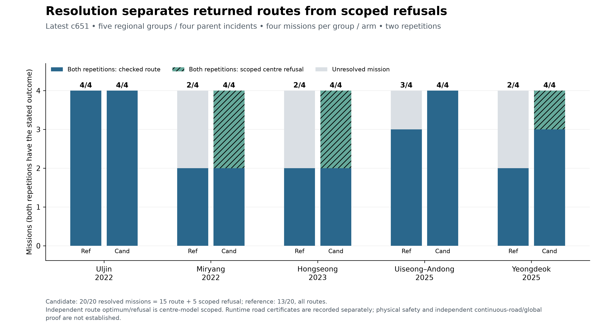

# WildfireGuardian

WildfireGuardian combines machine-learning wildfire forecasting, time-dependent vehicle routing, a field route logger and an offline 3D exhibition. This repository contains the **finalized research code for the October 2026 submission**, with exact evaluated versions preserved.

The scientific pipeline is **forecast → scenario hazards → route search → complete-journey checking → checked route or scoped refusal**. The logger and showcase have separate launchers and evidence; the 3D showcase uses an explicitly illustrative scene.

## Frozen October 15 research results

The frozen native-Mac benchmark contains **20 missions across five Korean regional panels from four parent fires**, two implementations and two repetitions: **80 executions**.

| Measure | Reference | Candidate |
|---|---:|---:|
| Missions resolved in both repetitions | 13/20 (65%) | **20/20 (100%)** |
| Missions providing checked routes | 13/20 (65%) | **15/20 (75%)** |
| Qualifying scoped-refusal missions | 0 | 5 |
| Unresolved executions | 14/40 | 0/40 |
| Median request time in 26 jointly resolved route pairs | 7.344 s | 8.006 s |
| Maximum recorded largest-process RSS | 2,055 MiB | 1,492 MiB |

**The headline is 100% verified on-time resolution on this benchmark, not 100% routing accuracy.** Resolution includes five scoped refusals. Candidate and reference arrival times match in all 26 jointly resolved route pairs. The candidate provides more qualifying decisions but shows no matched successful-route speed advantage or consistent paired memory saving. Independent centre/contact checks found no recorded contradiction among the 56 returned-route executions, including repetitions.

All 80 outcome records were published within the 30 s request allowance. Reference unresolved outcomes include eight search-label-limit stops and six centre-only refusal publications without qualifying frozen authority. Neither category is an outer deadline termination. Continuous-road radiation-enclosure and global-bound proof obligations remain open. See the [independent report](research/routing/INDEPENDENT_REPORT.v1.md) and [reviewed figures](research/routing/figures/).



## Verified routing update — October 29

The [request-window/check-first repair](experimental/window-routing/README.md) is available as an opt-in kit for the existing API. A fresh replay preserved all original input hashes, cold preparation, 30 s deadlines and the 3,072 MiB memory guard: **80/80 executions completed; candidate 20/20 missions resolved (15 checked routes + 5 scoped no-route decisions), unchanged reference 13/20**. The candidate already had 20/20 coverage; this confirms no regression.

Independent programs checked all **18 distinct returned journeys and 72/72 scenario-specific thermal thresholds**, covering 56 route executions, and corroborated the five candidate no-route missions. All 56 returned witnesses match the historical routes. Across 26 jointly checked route pairs, request medians were **6.846 s candidate versus 6.765 s reference**; this replay establishes no speed gain. In the separate Caldor/Rim engineering panel, the verified repair increased resolution from **3/6 to 6/6** under unchanged limits. The original release kit remains intact.

[Results, per-execution records, independent verification and reproduction instructions](research/routing/request-window-20261029/README.md). These are model-relative computational results, not field safety validation.

## Final-input routing constraint ablation

A separate **200-execution native study** tests five hazard policies on the same final 20 missions. Eight travel-only journeys encounter predicted flames. Flame avoidance finds three checked detours and correctly identifies five model-infeasible missions; adding peak/dose limits changes no additional outcomes on this panel. The frozen application and the 80-execution comparison above are unchanged.

See the [ablation results, figures, data and reproduction instructions](research/routing/final-input-ablation/README.md). This is a constraint ablation, not a new forecast evaluation or a general speedup claim.

## Experimental graph-preparation cache

An [opt-in research package](experimental/routing-preparation/README.md) explores native graph preparation and authenticated reuse across routing requests. It is separate from the frozen integration kit. [Matched research results](research/routing/prepared-graph-cache/README.md) include cache creation costs and distinguish graph preparation from complete-request time. Those measurements were collected on the earlier sealed candidate, not this namespace-refactored package.

## Choose what to run

| Component | Directory | Start here |
|---|---|---|
| Forecast and selected checkpoint | [`forecast/`](forecast/GITHUB_SNAPSHOT.md) | Prediction and thermal API documentation |
| Final forecast-to-routing integration | [`integration/`](integration/README.md) | Installable `wfg_latest` 1.0.0 and reviewed kit v3 |
| Logger and live map | [`hardware/`](hardware/README.md) | Firmware 0.3.0, USB export and local map |
| Offline 3D exhibition | [`demos/showcase/`](demos/showcase/README.md) | One local launcher; no map token |
| Results and ablations | [`research/`](research/README.md) | Independent rows, figures and separate forecast study |
| Monte Carlo extension | [`monte-carlo-extension/`](monte-carlo-extension/EXTENSION_GUIDE.md) | Separately versioned optional study |

## 1 Install the final routing API

Use **Python 3.12**. Native macOS is the evaluated runtime; Windows is not supported by the preserved POSIX worker/controller. Linux measurements require their own host-specific interpretation.

```sh
git clone --branch Main https://github.com/Sparkxt-0318/wildfireguardian.git
cd wildfireguardian
python3.12 -m venv .venv
source .venv/bin/activate
python -m pip install -c constraints-routing.txt './integration[packets]'
python tools/verify_release.py
```

The routing API uses NumPy and the standard library; packet construction uses pyproj. Fresh forecast inference additionally needs the pinned forecasting dependencies. No GPU is required for the timed route search.

## 2 Replay a recorded Korean routing case

Download and verify the exact evaluated roads, hazard packets and requests, then run one unscored replay:

```sh
python tools/fetch_routing_inputs.py
python integration/examples/run_frozen_case.py --out artifacts/uljin-replay
```

This uses already constructed hazards from the latest forecast. It does not rerun forecasting and needs no external environmental rasters. The accepted recorded Uljin journey arrives at **3,119 s**, uses **512 road legs**, and remains at its destination for **120 s**. New execution costs depend on the host and load; preserve unresolved or rejected outcomes rather than treating a raw path as success.

The **30 s allowance covers the complete routing request**, including cold preparation, search, runtime checking and publication. The script's offline independent checker has a separate cap, so total script time can exceed 30 s. Outputs include raw status, authoritative publication, cleanup and independent-check scope.

To use an already downloaded input archive:

```sh
python tools/fetch_routing_inputs.py --archive /path/to/WFG-evaluated-routing-inputs-20261015.zip
```

## 3 Run a fresh forecast-to-route chain

```sh
python -m pip install -r requirements.txt
python integration/examples/run_full_pipeline.py \
  --data-root /absolute/path/to/environment \
  --out artifacts/uljin-full-chain
```

`--data-root` must contain `events.json` and the aligned event inputs. The repository includes the selected checkpoint but not the full external environmental/training/survey datasets. Follow [forecast setup](forecast/GITHUB_SNAPSHOT.md) and [data provenance](docs/DATA_AND_RIGHTS.md); a metadata catalog cannot replace the rasters. The complete environment was reused in accepted reproductions, so publication does not establish a clean-machine data installation.

## 4 Import it in Python

```python
from wfg_latest import api

result = api.route_and_check(
    kit_root="integration/kit",
    packet_dir="data/routing/latest_inputs_try02/packets/uljin_2022/20220304T030000Z",
    graph="data/routing/graphs/uljin_2022/graph.json",
    request="data/routing/latest_inputs_try02/requests/uljin_2022/20220304T030000Z_FX1.json",
    out_dir="artifacts/python-route",  # fresh path
    arm="RDA_CAND",
)
print(result["authoritative_status"], result["arrival_s"])
print(result["independent"])
```

The other entry points are `export_forecast`, `build_packet` and `rekey_request`. See the [full-chain example](integration/examples/run_full_pipeline.py). A checked journey includes legal roads/turns/waits, scenario exposure history, destination opening and required stay. A timeout is unresolved, and a scoped refusal is not proof that every real-world escape is impossible.

## 5 Open the 3D showcase or live-map interface

Offline 3D exhibition, from the repository root:

```sh
cd demos/showcase
./Launch.command
```

It uses Node.js 20+ or Python 3, bundles assets locally, and is explicitly illustrative. It is not a live forecast or a routing-performance visualization.

For device recording and the local LIVE/replay map, follow [`hardware/README.md`](hardware/README.md). Real movement files, browser profiles and device secrets stay out of Git. Indoors, GNSS may have no fix.

## 6 Verify source and run component checks

```sh
python tools/verify_release.py
python -m pip install './forecast[test]'
python -m pytest forecast/tests
node --test demos/showcase/tests/*.test.mjs
```

Forecast tests that require external datasets or native FARSITE retain those prerequisites. Firmware builds and device-interface tests have their own instructions. Publication checks and an unscored replay do not rerun the 80-attempt benchmark.

## Exact versions and downloads

- Forecast checkpoint: **c651f6724fe6b036b0162edf264cb0063c061b80c2c936d48965ee66afbd1843**.
- Integrated API: **wfg_latest 1.0.0**; executed routing kit: **v3**.
- [Release identities](docs/RELEASE_IDENTITY.json), [source manifest](docs/PUBLICATION_SOURCE_MANIFEST.json), [project structure](docs/PROJECT_STRUCTURE.md).
- [Final research release and complete evidence archives](https://github.com/Sparkxt-0318/wildfireguardian/releases/tag/research-final-20261015), with SHA-256 checksums. Large evidence bundles are release assets rather than duplicated Git blobs.

The previous `routing-api/`, `routing-package/` and `routing-review/` paths remain for historical compatibility. **Use `integration/` for the finalized forecast-to-routing work.** Earlier results remain attached to their original inputs. No forecast-ablation checkpoint replaces the selected final checkpoint.

The completed forecast ablation did not demonstrate general four-scale superiority; its positive and negative findings remain [documented separately](research/forecast/FORECAST_EVIDENCE_HANDOFF.md). Further proof, source-coverage, generalization and operational work are in [future extensions](docs/FUTURE_EXTENSIONS.md). No universal speedup, forecast accuracy or physical-safety claim is made by this release.
