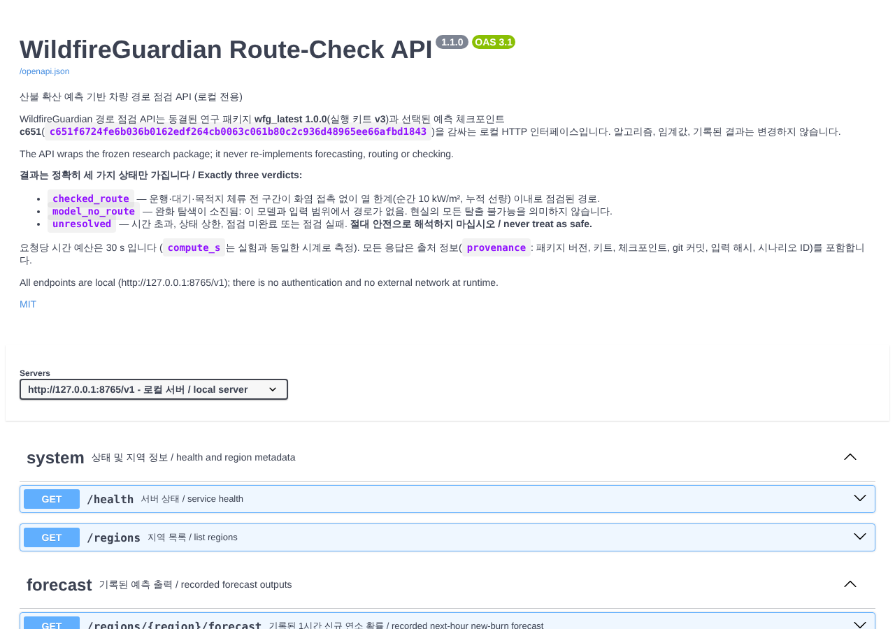
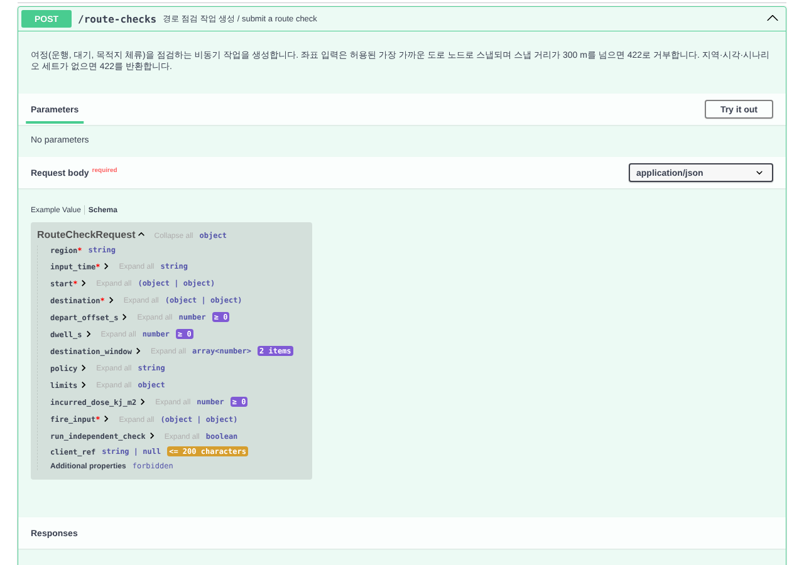

# WildfireGuardian Route-Check API

**한국어** · [English](#english)

## 한국어

### 개요

WildfireGuardian 경로 점검 API는 다음 세 가지를 감싸는 로컬 HTTP 인터페이스입니다. 동결된 연구 패키지 **wfg_latest 1.0.0**, 실행 키트 **v3**(`WFG-latest-completion-kit-20261015-v3`), 예측 체크포인트 **c651**(`c651f6724fe6b036b0162edf264cb0063c061b80c2c936d48965ee66afbd1843`)입니다.

- **API는 아무것도 다시 구현하지 않습니다.** 경로 점검 한 건은 동결된 키트를 제어해서 한 번 실행한 것입니다. `full` 정책은 `wfg_latest.api.route_and_check`를 호출하고, 다른 정책은 최종 입력 제약 절제 실험의 동결된 작업자를 같은 키트 컨트롤러로 실행합니다. 판정은 키트의 권위 판정(`journey_decision_v2_1`)을 세 상태로 옮긴 결과입니다. 예측도 다시 계산하지 않고 기록된 c651 출력만 내보냅니다. 엔드포인트마다 어떤 코드를 부르는지는 [`NOTES.md`](NOTES.md)에 정리되어 있습니다.
- **판정은 정확히 세 가지입니다:** `checked_route`, `model_no_route`, `unresolved`.
- **`unresolved`는 결코 안전을 뜻하지 않습니다.** 점검된 경로도, 범위가 정해진 거부(scoped refusal)도 확인되지 않았다는 뜻일 뿐입니다.
- **시간 예산은 요청당 30 s로 고정되어 있고 늘리지 않습니다.** `compute_s`는 실험과 같은 시계로 잽니다. 값은 키트 컨트롤러 영수증의 `external_launch_to_completion_wall_s`입니다. 메모리 가드는 3072 MiB입니다.
- **모든 응답에 출처 정보가 붙습니다.** 지역, 예측, 경로 점검, 배차 계획, GeoJSON 내보내기 응답에는 `provenance`가 들어 있습니다. 여기에는 API·패키지 버전, 키트, 체크포인트, git 커밋, 입력 파일 SHA-256, 시나리오 ID, 호스트가 담깁니다. `/health`와 모든 오류 응답에도 `provenance`가 있습니다(계약 v1.3). CSV와 KML 내보내기는 `X-WFG-Provenance` 응답 헤더에 압축 JSON으로 담고, KML은 설명(description)에도 넣습니다. CSV 본문은 주석 줄이 없는 표입니다.
- 로컬에서만 동작합니다(`127.0.0.1:8765`). 인증이 없고, 실행 중에는 외부 네트워크를 쓰지 않습니다. Swagger UI 5.17.14는 저장소의 `api/static/swagger-ui`에 들어 있어서 `/docs`가 외부 자산을 불러오지 않습니다.

### 요구 사항

- Python 3.12. 의존성 버전은 `api/requirements.txt`와 `constraints-routing.txt`에 고정되어 있습니다(예: numpy 1.26.4, pyproj 3.7.0, fastapi 0.143.3).
- GNU `/usr/bin/time`(Linux에서는 `time -v`)과 `/bin/ps`. 키트 컨트롤러는 모든 요청을 이 두 도구로 실행하고 측정합니다. 둘 중 하나라도 없으면 `/v1/health`가 `degraded` 상태와 함께 `issues`에 알려 줍니다. Debian/Ubuntu에서는 `sudo apt-get install time procps`로 설치합니다. macOS에는 기본으로 들어 있습니다.
- 기록된 입력은 `python tools/fetch_routing_inputs.py`로 받습니다. 이 도구는 연구 릴리스 아카이브를 내려받고 아카이브 SHA-256(`d7e0a5fc…`)과 파일별 해시를 확인한 다음 `data/routing/`에 풉니다. 이 디렉터리는 git에서 제외됩니다. 대상이 이미 있으면 덮어쓰지 않습니다. 네트워크는 이 단계에서 한 번만 필요합니다.
- **평가된 호스트는 네이티브 macOS(M5 Pro)입니다.** 30 s 예산이 고정이라서 더 느린 호스트에서는 무거운 임무가 `unresolved`/`TIMEOUT`으로 끝날 수 있습니다. 예를 들어 2.1 GHz Xeon에서 Uljin FX1은 38.6 s가 걸렸습니다([`NOTES.md`](NOTES.md)). 이 README를 쓴 4코어 x86_64 Linux 호스트에서 Hongseong FD1의 `compute_s`는 실행마다 14.7–15.9 s였습니다. 평가 호스트의 기록값은 7.410 s와 7.429 s입니다(`research/routing/INDEPENDENT_ROWS.csv`, `RDA_CAND`). 도착 시각은 두 호스트 모두 531 s입니다.

### 실행

저장소 루트에서 명령 하나로 실행합니다.

```sh
make api
```

`.venv`가 없으면 `make api-setup`이 먼저 실행됩니다. `api-setup`은 Python 3.12로 `.venv`를 만들고 고정된 의존성을 설치합니다. `data/routing`이 없을 때만 입력을 내려받고, `/usr/bin/time`이 없으면 경고를 출력합니다. 서버 주소는 다음과 같습니다.

- API: <http://127.0.0.1:8765/v1>
- 문서(Swagger UI): <http://127.0.0.1:8765/docs>
- OpenAPI: <http://127.0.0.1:8765/openapi.json> (`contracts/wfg_api_v1.yaml`을 그대로 제공)

같은 과정을 수동으로 실행하려면 다음과 같이 합니다.

```sh
python3.12 -m venv .venv
.venv/bin/python -m pip install -c constraints-routing.txt './integration[packets]' -r api/requirements.txt
.venv/bin/python tools/fetch_routing_inputs.py      # 처음 한 번 (data/routing이 없을 때)
.venv/bin/python -m api                             # 반드시 저장소 루트에서 실행
```

### 엔드포인트

| 메서드 | 경로 | 내용 |
|---|---|---|
| GET | `/v1/health` | 상태, 패키지·키트·체크포인트·git 커밋, 로드된 지역, 작업자 수, `issues` |
| GET | `/v1/regions` | 지역별 WGS84 경계, 도로 그래프 ID, 노드·간선 수, 기록된 입력 시각, 시나리오 세트 ID, 기록된 임무 |
| GET | `/v1/regions/{region}/forecast?input_time=…` | 기록된 다음 1시간 신규 연소 확률(375 m 격자, GeoJSON). `only_nonzero=true`면 확률이 0보다 크거나 현재 연소 중인 셀만 반환 |
| POST | `/v1/route-checks` | 경로 점검 작업 생성(202, 비동기) |
| GET | `/v1/route-checks/{job_id}` | 작업 상태와 결과 |
| GET | `/v1/route-checks/{job_id}/export?format=geojson\|kml\|csv` | `checked_route` 경로만 내보냄. 그 외에는 409 |
| POST | `/v1/dispatch-plans` | 다중 출발지 배차 계획 작업 생성(202) |
| GET | `/v1/dispatch-plans/{job_id}` | 배차 계획 상태와 결과 |
| GET | `/docs`, `/openapi.json` (`/v1/docs`, `/v1/openapi.json`도 같음) | 한국어 설명이 있는 Swagger UI와 계약 |

기록된 입력이 설치되지 않았으면 `/v1/regions`, 예측, `POST` 엔드포인트가 503 `DATA_UNAVAILABLE`을 반환합니다(계약 v1.2 이상). 계약 변경 이력은 `contracts/CHANGELOG.md`에 있습니다.

작업 상태는 `queued` → `running` → `done` 또는 `failed` 순으로 바뀝니다. `failed`는 API 내부 오류이며, 이때 결과는 항상 `unresolved`(`INTERNAL_ERROR`)입니다. 오류 응답은 모두 `{"error": {"code", "message", "details"}, "provenance": {…}}` 형식입니다.

### 사용 예 (curl)

아래 ID와 응답은 실행 중인 API에서 실제로 얻은 값입니다(긴 응답은 일부만 남겼습니다).

```sh
BASE=http://127.0.0.1:8765/v1
curl -s $BASE/health
curl -s $BASE/regions
```

`/health` 응답(관측값, `data_root`만 줄임):

```json
{"status": "ok",
 "api_version": "1.4.0",
 "package": "wfg_latest",
 "package_version": "1.0.0",
 "kit": "v3",
 "checkpoint": "c651f6724fe6b036b0162edf264cb0063c061b80c2c936d48965ee66afbd1843",
 "git_commit": "e91df688d8f830db7eecbec823fc38c5aea45345",
 "regions": ["hongseong_2023", "miryang_2022", "uiseong_andong_2025", "uljin_2022", "yeongdeok_2025"],
 "workers": 2,
 "data_root": ".../data/routing",
 "issues": [],
 "jobs": {},
 "queued_tasks": 0,
 "budget_s": 30.0,
 "pool_restarts": 0,
 "kit_candidate_id": "WFG-latest-completion-kit-20261015-v3",
 "git_dirty": true}
```

`/v1/regions`에 나오는 기록된 입력 시각과 시나리오 세트는 다음과 같습니다. 각 세트에는 시나리오 4개(`…:0`부터 `…:3`)가 있고 `horizon_s`는 3600입니다.

| 지역 | 이름 | 입력 시각 (UTC) | `scenario_set_id` | 기록된 임무 |
|---|---|---|---|---|
| `hongseong_2023` | 홍성 | 2023-04-02T07:00:00Z | `ffb1:20230402T070000Z:09414bcd4c0943dd` | FN1, FX1 |
| | | 2023-04-02T14:00:00Z | `ffb1:20230402T140000Z:c039b5e7d013322e` | FW2 |
| | | 2023-04-02T23:00:00Z | `ffb1:20230402T230000Z:247138a35dcddc50` | FD1 |
| `miryang_2022` | 밀양 | 2022-05-31T10:00:00Z | `ffb1:20220531T100000Z:40b532dc599ca183` | FN1 |
| | | 2022-06-01T02:00:00Z | `ffb1:20220601T020000Z:8d74e513a7acb765` | FW1 |
| | | 2022-06-01T08:00:00Z | `ffb1:20220601T080000Z:aa27c21fa688aa74` | FD1, FX1 |
| `uiseong_andong_2025` | 의성·안동 | 2025-03-23T01:00:00Z | `ffb1:20250323T010000Z:da4a13e53bc0b6a2` | FD1, FX2 |
| | | 2025-03-24T09:00:00Z | `ffb1:20250324T090000Z:08721049cc48e045` | FL2 |
| | | 2025-03-25T17:00:00Z | `ffb1:20250325T170000Z:53e6da7897bf9b5b` | FW1 |
| `uljin_2022` | 울진 | 2022-03-04T03:00:00Z | `ffb1:20220304T030000Z:163ba1c65bd35c6e` | FD1, FX1 |
| | | 2022-03-04T06:00:00Z | `ffb1:20220304T060000Z:75ebc90f278df40c` | FL1 |
| | | 2022-03-04T12:00:00Z | `ffb1:20220304T120000Z:5b266501e78de3aa` | FW2 |
| `yeongdeok_2025` | 영덕 | 2025-03-25T19:00:00Z | `ffb1:20250325T190000Z:20cb6955b51ab0c6` | FD1, FX2 |
| | | 2025-03-25T23:00:00Z | `ffb1:20250325T230000Z:c1b46f3c00c2036c` | FL2 |
| | | 2025-03-26T08:00:00Z | `ffb1:20250326T080000Z:d8d21b8e3ced8a48` | FW1 |

#### 기록된 예측

```sh
curl -s "$BASE/regions/uljin_2022/forecast?input_time=2022-03-04T03:00:00Z" -o uljin_20220304T030000Z.geojson
curl -s "$BASE/regions/uljin_2022/forecast?input_time=2022-03-04T03:00:00Z&only_nonzero=true"
```

Uljin의 이 입력 시각에서 전체 격자는 58 × 62 = 3596개 셀이고, `only_nonzero=true`로 받으면 81개 셀이 나옵니다. 셀 하나는 다음과 같습니다.

```json
{"type": "Feature", "id": "r39c26",
 "geometry": {"type": "Polygon", "coordinates": [[[129.2855742555789, 37.06266375334177], [129.28979027572194, 37.062600197560926],
   [129.28971088317348, 37.05922147476461], [129.28549504980458, 37.05928502280122], [129.2855742555789, 37.06266375334177]]]},
 "properties": {"row": 39, "col": 26, "p_new_burn_1h": 2.6809328119270504e-05, "valid": true, "burning_now": false, "known_burned": false}}
```

기록되지 않은 시각을 요청하면 404 `INPUT_TIME_UNAVAILABLE`과 함께 사용할 수 있는 시각 목록이 돌아옵니다.

#### 경로 점검(기록 입력): Hongseong FD1

```sh
curl -s -X POST $BASE/route-checks -H 'Content-Type: application/json' -d '{
  "region": "hongseong_2023",
  "input_time": "2023-04-02T23:00:00Z",
  "start": {"node_id": "osm:437291784"},
  "destination": {"node_id": "osm:436670987"},
  "destination_window": [0, 847],
  "dwell_s": 120,
  "fire_input": {"type": "recorded", "scenario_set_id": "ffb1:20230402T230000Z:247138a35dcddc50"}
}'
# 202 {"job_id": "rc_1165e5573d6f450d8e1a", "status": "queued", "kind": "route_check", "snap": {...},
#      "links": {"self": "/v1/route-checks/rc_1165e5573d6f450d8e1a",
#                "export_geojson": "/v1/route-checks/rc_1165e5573d6f450d8e1a/export?format=geojson"}}
```

`start`와 `destination`에는 `{"node_id": …}`나 `{"lon": …, "lat": …}`를 넣을 수 있습니다. 좌표는 허용된 가장 가까운 도로 노드로 스냅됩니다. 허용된 노드란 들어오는 도로와 나가는 도로가 하나 이상씩 있는 노드이고, 거리는 EPSG:5179 평면에서 잽니다. 스냅 거리가 300 m를 넘으면 422 `SNAP_TOO_FAR`로 거부합니다. 생략한 필드에는 기본값이 들어갑니다: `depart_offset_s` 0, `dwell_s` 120, `policy` `full`, `limits` {10 kW/m², 100 kJ/m²}, `incurred_dose_kj_m2` 0, `destination_window` [0, horizon].

#### 결과 조회(폴링)

```sh
JOB=rc_1165e5573d6f450d8e1a
while :; do
  s=$(curl -s $BASE/route-checks/$JOB | python3 -c 'import json,sys; print(json.load(sys.stdin)["status"])')
  [ "$s" = done ] || [ "$s" = failed ] && break
  sleep 2
done
curl -s $BASE/route-checks/$JOB
```

이 호스트에서 실제로 받은 응답입니다. 긴 배열과 해시는 줄였습니다.

```jsonc
{
  "job_id": "rc_1165e5573d6f450d8e1a", "kind": "route_check", "status": "done",
  "created_at": "2026-10-17T06:57:27.498052+00:00", "started_at": "2026-10-17T06:57:27.499567+00:00",
  "finished_at": "2026-10-17T06:57:43.524880+00:00",
  "request": { /* 접수된 본문 + 기본값: depart_offset_s 0, policy "full", limits {10, 100}, incurred_dose_kj_m2 0 */ },
  "snap": {
    "start":       {"node_id": "osm:437291784", "distance_m": 0.0, "lon": 126.51378, "lat": 36.545731499999995, "input": "node_id"},
    "destination": {"node_id": "osm:436670987", "distance_m": 0.0, "lon": 126.4697937, "lat": 36.5544389, "input": "node_id"}
  },
  "result": {
    "verdict": "checked_route", "reason_code": null,
    "raw_status": "CHECKED_JOURNEY_FULL_OPTIMUM_PROVEN", "raw_reason": null,
    "departure_s": 0, "arrival_s": 531, "lower_bound_L_s": 531,
    "lower_bounds": [{"kind": "contact_only_lattice_relaxation", "arrival_s": 531}],
    "dwell_end_s": 651,
    "route": {
      "type": "Feature",
      "geometry": {"type": "LineString", "coordinates": [[126.51378, 36.545731499999995], [126.51336900000001, 36.546273400000004],
                   /* … 꼭짓점 120개 중 일부 생략 … */ [126.4702354, 36.5547549], [126.4697937, 36.5544389]]},
      "properties": {"times_s": [0, 7, 15, /* … */ 522, 526, 531],
                     "node_ids": ["osm:437291784", "osm:437291785", /* … */ "osm:436670987"],
                     "segment_count": 119, "edge_ids": ["w686052072:s65:f", "w686052072:s66:f" /* … */], "waits": [],
                     "legs_total": 119, "route_sha256": "5709456ff03eeb9b35dec4e3e9dea47121efdeb5bc83fc5462e0b1e82250a2c1",
                     "published_stage": "Z"}
    },
    "exposure": [
      {"scenario_id": "ffb1:20230402T230000Z:247138a35dcddc50:0", "peak_kw_m2": 8.628507291869333e-05,
       "dose_kj_m2": 0.020607449087063506, "contact": false, "basis": "centre_model",
       "peak_upper_kw_m2": 9.906653522583497e-05, "dose_upper_kj_m2": 0.02117593963551037}
      /* 이번 실행에서는 시나리오 :1, :2, :3도 같은 값 */
    ],
    "compute_s": 15.903354872000364, "within_budget": true, "policy": "full",
    "limits": {"peak_kw_m2": 10, "dose_kj_m2": 100, "incurred_dose_kj_m2": 0},
    "independent_check": null, "assumptions": null, "notes": [],
    "provenance": {
      "api_version": "1.4.0", "package": "wfg_latest", "package_version": "1.0.0", "kit": "v3",
      "kit_candidate_id": "WFG-latest-completion-kit-20261015-v3",
      "checkpoint": "c651f6724fe6b036b0162edf264cb0063c061b80c2c936d48965ee66afbd1843",
      "git_commit": "e91df688d8f830db7eecbec823fc38c5aea45345", "git_dirty": true,
      "region": "hongseong_2023", "input_time": "2023-04-02T23:00:00Z",
      "graph_id": "hongseong-osm-20230401-provisional-grid375-dt1-53599a1a7b18-254dfdb05fb5",
      "input_hashes": {"graph": "861ca1514c8f…", "hazard": "7f8c03d1116c…", "request": "58f47c2d9722…",
                       "packet/REPORT.json": "1d78731166d0…", "packet/NATIVE_METADATA.json": "6513b60205a4…",
                       "packet/constructed_arrays.npz": "911ba7ad026d…"},
      "scenario_set_id": "ffb1:20230402T230000Z:247138a35dcddc50",
      "scenario_ids": ["ffb1:20230402T230000Z:247138a35dcddc50:0", /* :1, :2 */ "ffb1:20230402T230000Z:247138a35dcddc50:3"],
      "fire_input_type": "recorded", "policy": "full", "evaluated_configuration": true,
      "recorded_mission_match": "20230402T230000Z_FD1", "approximation": null,
      "clock": "external_launch_to_completion_wall_s of the kit controller (wfg_controller.run_attempt): …",
      "host": {"platform": "Linux-6.18.44-fc-v139-x86_64-with-glibc2.39", "machine": "x86_64", "python": "3.12.3", "cpu_count": 4},
      "generated_at": "2026-10-17T06:57:43.524847+00:00", "budget_s": 30.0, "workers": 2,
      "timings_s": {"worker_total_s": 16.010750717000064},
      "receipt": {"on_time_complete_publication": true, "exit_code": 0, "cleanup_state": "CLEAN",
                  "deadline_termination_requested": false, "memory_guard_triggered": false,
                  "external_launch_to_completion_wall_s": 15.903354872000364, "raw_primary_status": "CHECKED_ROUTE"}
    }
  },
  "error": null
}
```

`recorded_mission_match`는 API가 만든 요청 객체가 기록된 최종 패널 임무 `20230402T230000Z_FD1`의 요청과 정확히 같다는 뜻입니다. 도착 531 s는 기록된 결과와 같습니다. 이 호스트의 `compute_s`는 평가 호스트보다 큽니다([요구 사항](#요구-사항) 참고).

#### 내보내기 (`checked_route`만)

```sh
curl -s -OJ "$BASE/route-checks/$JOB/export?format=geojson"   # wfg_route_<job>.geojson: 경로 LineString + 출발/목적지 Point + provenance
curl -s -OJ "$BASE/route-checks/$JOB/export?format=kml"       # 경로 + 시각이 붙은 gx:Track
curl -s -OJ "$BASE/route-checks/$JOB/export?format=csv"
```

위 작업의 CSV 출력입니다(가운데는 생략). 출처 정보는 본문이 아니라 `X-WFG-Provenance` 응답 헤더에 있습니다.

```text
seq,node_id,lon,lat,time_s,event
0,osm:437291784,126.5137800,36.5457315,0,depart
1,osm:437291785,126.5133690,36.5462734,7,pass
...
119,osm:436670987,126.4697937,36.5544389,531,arrive
120,osm:436670987,126.4697937,36.5544389,651,dwell_end
```

`checked_route`가 아닌 결과는 내보내지 않습니다. 미해결 결과가 경로처럼 그려지는 일을 막기 위해서입니다. 예를 들어 아래 spread_zones 작업을 내보내려 하면 다음 응답이 돌아옵니다: `409 {"error": {"code": "NO_CHECKED_ROUTE", "message": "only checked routes are exported; this result is model_no_route", …}}`. 끝나지 않은 작업은 409 `JOB_NOT_DONE`입니다.

#### spread_zones 화재 입력(근사, 전문가 검토 필요)

```sh
curl -s -X POST $BASE/route-checks -H 'Content-Type: application/json' -d '{
  "region": "hongseong_2023",
  "input_time": "2023-04-02T23:00:00Z",
  "start": {"node_id": "osm:437291784"},
  "destination": {"node_id": "osm:436670987"},
  "destination_window": [0, 847],
  "dwell_s": 120,
  "fire_input": {
    "type": "spread_zones",
    "issued_at": "2023-04-02T22:00:00Z",
    "zones": {"type": "FeatureCollection", "features": [
      {"type": "Feature", "properties": {"arrival_h_max": 5},
       "geometry": {"type": "Polygon", "coordinates": [[[126.49, 36.55], [126.51, 36.55], [126.51, 36.57], [126.49, 36.57], [126.49, 36.55]]]}},
      {"type": "Feature", "properties": {"arrival_h_max": 8},
       "geometry": {"type": "Polygon", "coordinates": [[[126.48, 36.54], [126.52, 36.54], [126.52, 36.58], [126.48, 36.58], [126.48, 36.54]]]}}
    ]}
  }
}'
```

이 요청을 실제로 실행한 결과는 `verdict` `model_no_route`(`raw_status` `FULL_MODEL_REFUSAL_PROVEN`), `compute_s` 0.927 s, `provenance.approximation` `"approximation, requires expert review"`였습니다. `result.assumptions`에는 적용된 규칙이 모두 다시 기록됩니다. 이번 실행의 값은 다음과 같습니다.

- `issued_minus_input_s` = −3600
- 5 h 대역(셀 41개): 시나리오 0–3의 점화 시각이 발표 기준 0, 1.667, 3.333, 5 h입니다. 패킷 시각으로는 0(시간 원점으로 당김), 2400 s, null, null입니다. 뒤의 두 시각은 지평 3600 s를 넘기 때문에 점화하지 않습니다.
- 8 h 대역(셀 87개): 4, 6, 7, 8 h가 모두 지평 밖이라 점화하지 않습니다.
- 현재 연소 셀 4개는 기록대로 유지됩니다.

시나리오 세트 ID는 새로 만든 패킷의 ID(`ffb1:20230402T230000Z:13d0038938b4c84a`)이고, `evaluated_configuration`은 `false`입니다.

#### 정책과 독립 점검

위 FD1 본문에 필드를 하나 더 넣으면 됩니다(둘 중 하나씩).

```jsonc
"policy": "flame_only"          // full 이외 정책. 아래 "정책과 절제 실험 arm" 절 참고
"run_independent_check": true   // 시간 측정 후 오프라인 독립 점검기 실행. full 정책만, 최대 120 s, compute_s에 포함되지 않음
```

#### 배차 계획

```sh
curl -s -X POST $BASE/dispatch-plans -H 'Content-Type: application/json' -d '{
  "region": "hongseong_2023",
  "input_time": "2023-04-02T23:00:00Z",
  "fire_input": {"type": "recorded", "scenario_set_id": "ffb1:20230402T230000Z:247138a35dcddc50"},
  "origins": [
    {"id": "A", "location": {"node_id": "osm:437291784"}},
    {"id": "B", "location": {"lon": 126.53, "lat": 36.58}}
  ],
  "destinations": [
    {"id": "shelter", "location": {"node_id": "osm:436670987"}, "window": [0, 847]}
  ],
  "depart_offsets_s": [0, 300]
}'
curl -s $BASE/dispatch-plans/<job_id>
```

이 요청은 계약 스키마로만 검증했고, 이 README를 쓰면서 실행하지는 않았습니다. 그래서 출력은 싣지 않습니다. 출발지 B는 API의 스냅 함수로 `osm:436671098`(222.6 m)에 스냅됩니다. 계획은 (출발지, 목적지, 출발 오프셋) 조합마다 일반 경로 점검을 한 번씩 실행합니다. 이 예에서는 4번입니다. 출발지마다 다음 값을 반환합니다.

- `best_verdict`: 시도 중 하나라도 `checked_route`면 `checked_route`, 모든 시도가 `model_no_route`면 `model_no_route`, 그 밖에는 `unresolved`
- `latest_checked_depart_offset_s`: 점검된 경로를 주는 가장 늦은 출발 오프셋(문자 그대로의 값)
- `latest_contiguous_checked_depart_offset_s`: 가장 이른 요청 오프셋부터 끊김 없이 모두 점검된 경로가 있는 마지막 오프셋(보수적 값, 계약 v1.4). 중간에 거부나 미해결 오프셋이 있으면 그 앞에서 멈춥니다. 출발 전 출발지에 머무는 동안의 노출은 점검하지 않습니다.
- `best`
- `attempts`

배차 계획은 `full` 정책만 받습니다(그 밖은 422 `POLICY_NOT_ALLOWED`). 축소 정책의 경로는 전체 위험 모델을 통과하지 못할 수 있기 때문입니다. 같은 출발 오프셋을 두 번 주면 422 `DUPLICATE_OFFSET`입니다.

계획은 긴급도 순으로 정렬됩니다. 보수적 최종 안전 출발(`latest_contiguous_checked_depart_offset_s`, 없으면 가장 먼저)이 가장 이른 출발지가 먼저 오고, 그다음 `model_no_route`, 마지막으로 `unresolved`가 옵니다. 한계는 출발지 200개, 목적지 20개, 오프셋 24개입니다. 스냅에 실패한 출발지는 `rejected_origins`에 들어갑니다.

#### 오류 예 (관측값)

```text
POST /route-checks  start {"lon":126.60,"lat":36.56}  →  422 {"error":{"code":"SNAP_TOO_FAR","message":"start is 5602.7 m from the nearest allowed road node (limit 300 m)", …}}
POST /route-checks  input_time 23:00 + 14:00 scenario set  →  422 {"error":{"code":"SCENARIO_SET_TIME_MISMATCH", …}}
POST /route-checks  spread_zones, input_time 2023-04-03T00:00:00Z  →  422 {"error":{"code":"INPUT_TIME_UNAVAILABLE", …}}
GET  /regions/uljin_2022/forecast?input_time=2022-03-04T04:00:00Z  →  404 {"error":{"code":"INPUT_TIME_UNAVAILABLE", …}}
```

### 판정과 사유 코드

| 판정 | 의미 | 키트 판정과의 대응 (`api/verdict.py`, 동결된 채점기 `native_tally.py`의 규칙을 따름) |
|---|---|---|
| `checked_route` | 운행, 대기, 목적지 체류의 전 구간을 점검했고, 화염 접촉 없이 열 한계(순간 10 kW/m², 누적 선량) 안에 드는 경로 | `CHECKED_JOURNEY_*` 상태 3종 중 하나이고 `whole_road_check.status == CERTIFIED_ADMISSIBLE`인 경우. 도로 전용 경로(`ROAD_CERTIFIED_CENTRE_INFEASIBLE_ROUTE`)는 제외합니다. 화염을 강제하는 정책에서는 전 도로 접촉이 `CLEAR`여야 합니다 |
| `model_no_route` | 완화 탐색을 끝까지 수행한 결과, 이 모델과 입력 범위에서는 경로가 없음. 현실의 모든 탈출이 불가능하다는 증명은 아님 | `FULL_MODEL_REFUSAL_PROVEN` |
| `unresolved` | 시간 초과, 상한 도달, 점검 미완료 또는 점검 실패. **안전으로 해석하면 안 됨** | 위 두 경우를 뺀 전부 |

`unresolved`의 `reason_code`는 다음과 같습니다. 다른 판정에서는 `null`입니다.

| `reason_code` | 의미 |
|---|---|
| `TIMEOUT` | 30 s 예산 초과 |
| `STATE_CAP` | 탐색 상태 또는 확장 상한 도달 |
| `MEMORY_CAP` | 메모리 가드(3072 MiB) 작동 |
| `CHECK_NOT_FINISHED` | 점검 미완료 |
| `CHECK_FAILED` | 점검 실패 또는 거부. 독립 점검과의 모순도 포함 |
| `WORKER_ERROR` | 작업자 비정상 종료 또는 게시 없음 |
| `CLEANUP_UNCONFIRMED` | 프로세스 정리가 확인되지 않음 |
| `INTERNAL_ERROR` | API 내부 오류 |
| `OTHER` | 기타. `raw_reason`을 참고 |
| `INPUT_REJECTED` (v1.1) | 엔진이 입력을 거부 |
| `AT_ISSUE_FAILURE` (v1.1) | 출발 시점에 이미 한계를 넘음(기존 누적 선량 등) |
| `DISCONNECTED` (v1.1) | 도로망에서 도달할 수 없음(화재와 무관) |

수신 단계의 실패가 다른 판정보다 우선합니다. 우선순위는 메모리 가드, 마감 없는 비정상 종료, 정리 미확인, 게시 없음 순입니다. 독립 점검을 실행했다면 그 모순은 채점기와 같은 방식으로 판정을 `unresolved`로 낮춥니다.

### spread_zones 규칙: 근사이며 전문가 검토가 필요합니다

> **approximation, requires expert review.** 이 어댑터는 예측을 하지 않고 경로·점검 모델도 바꾸지 않습니다. 셀별 점화 시각만 정하고, 위험 패킷은 바뀌지 않은 패킷 작성기(`wfg_latest.packets.write_regional_packet`)로 만듭니다. 점화 시각은 작성기가 원래 시각을 뽑는 지점(`bridge.draw_ignitions`)에 주입합니다. 이 지점은 `packets.construct_regional`이 지역 창(window)에 쓰는 주입 지점과 같습니다. (`api/adapters/spread_zones.py`)

규칙은 모두 결과의 `assumptions`에 다시 기록됩니다.

- **래스터화(보수적):** 375 m 셀의 내부가 구역 다각형과 겹치면 셀은 그 구역에 속합니다. 셀 중심이나 모서리가 다각형 안에 있거나, 다각형 변이 셀을 지나는 경우입니다. 경계선만 공유하는 경우는 포함하지 않습니다. 여러 구역이 한 셀에 닿으면 그중 가장 작은 `arrival_h_max` 대역을 씁니다(중첩 구역).
- **대역:** 셀은 닿는 구역 중 가장 작은 `arrival_h_max` H를 씁니다. H_prev는 그 구역 안에 포함된(nested) 구역 중 가장 큰 `arrival_h_max`이고, 없으면 0(화재마다 가장 안쪽 대역)입니다. 다른 화재의 구역은 대역을 바꾸지 않습니다(계약 v1.5). 다각형 변은 투영 전에 경위도에서 약 200 m 간격으로 잘게 나눕니다.
- **점화:** 대역 (H_prev, H]의 셀은 max(0, H_prev − margin)부터 점화될 수 있습니다(0 하한은 input_time 시계에서 적용: issued_at ≤ input_time이면 같은 값이고, 더 늦게 발표된 경우에도 보수적입니다). margin 기본값은 60분이고 `margin_min`으로 바꿉니다. 시나리오는 4개입니다. 시나리오 0은 그 가장 이른 시각에 점화합니다. 시나리오 1–3은 H_prev + (H − H_prev) × k/3(k = 1, 2, 3)에 점화하므로 마지막 시나리오는 H에서 점화합니다. 점화된 셀은 [점화, 점화 + T) 동안 연소합니다. T는 실험의 활성 지속 시간(점검기의 스칼라 법칙)이고, 기록된 패킷에서는 3970.46 s입니다. 따라서 가장 늦은 시나리오는 H + T까지 활성입니다.
- **시계:** 구역 시간은 `issued_at`부터 세고, 패킷 시간은 `input_time`부터 셉니다. `input_time`보다 이른 시각은 0으로 당깁니다(보수적). 실험의 1시간 위험 지평 이후의 시각은 여정에 영향을 줄 수 없으므로 점화하지 않습니다. 패킷 작성기도 이 처리를 요구합니다.
- **현재 화재:** `input_time`의 기록된 c651 출력에서 격자, 시계 기준, 현재 연소 셀을 가져옵니다. 현재 연소 셀은 기록 그대로 유지하고, 구역 점화를 그 위에 두지 않습니다. 그래서 `input_time`은 해당 지역의 기록된 입력 시각이어야 합니다(v1.1 범위). `burning_scenario_set_id`를 지정하려면 그 시각의 기록된 세트여야 합니다. 다르면 422 `SCENARIO_SET_TIME_MISMATCH`가 돌아옵니다.
- **알려진 한계(`assumptions.limitations`):** 구역 예보는 점화 시각이 아니라 도달 범위를 줍니다. 그래서 시나리오 4개는 결정론적 표본일 뿐 확률 모델이 아닙니다. 또 `input_time` 이후 첫 1시간만 표현되고, 복사열은 모든 구역 셀에 실험의 고정 열방출 매개변수를 씁니다.
- 오류 코드: `INVALID_ZONES`(형식·좌표·시각 오류), `ZONES_OUTSIDE_REGION`(지역 격자에 닿지 않는 구역).

### 정책과 절제 실험 arm

| `policy` | 절제 arm | 강제하는 제약 | 실행 경로 |
|---|---|---|---|
| `full` (기본) | A4 | 화염 접촉 + 순간 복사열 + 누적 선량 | `wfg_latest.api.route_and_check`(`RDA_CAND`, `rda_worker_v1_1`). 80회 비교 실험과 같은 평가 경로 |
| `travel_only` | A0 | 없음(이동 시간만) | 절제 작업자 `phaseB/ablation_worker.py` |
| `flame_only` | A1 | 화염 접촉 | 절제 작업자 |
| `flame_peak` | A2 | 화염 + 순간 복사열 | 절제 작업자 |
| `flame_dose` | A3 | 화염 + 누적 선량 | 절제 작업자 |

`full`이 아닌 정책을 쓰면 API가 런타임 디렉터리에 절제 연구 키트 사본을 만듭니다. 사본의 파일은 모두 `research/routing/final-input-ablation/FREEZE.json`의 해시와 일치해야 합니다. 그다음 연구의 `arm_transform.arm_inputs`, `verify_transform`, `sentinel_sufficiency`로 계획 입력을 만들고 같은 키트 컨트롤러로 실행합니다. 이렇게 만든 경로에는 다음 사항이 적용됩니다.

- **full 정책 경로가 아닙니다.** `notes`에 "It is not a full-policy checked route."가 붙습니다.
- `full_policy_assessment`가 함께 보고됩니다. 이 값은 바뀌지 않은 전체 위험을 기준으로 독립 점검기 함수(문법, 셀 중심 모델 노출, 정확한 전 도로 접촉)를 써서 오프라인에서 계산한 평가이고, `compute_s`에 포함되지 않습니다. 프로젝트의 전 도로 복사열 점검은 다시 하지 않습니다. 경로가 full 정책을 통과하지 못하면 `notes`에 "This route FAILS the full policy: …"가 붙습니다. 같은 평가에서 경로가 **선택한 정책 자신의** 제약(예: `flame_only`에서 화염 접촉)에 모순되면, 절제 실험 채점기(`grade_route.py`)처럼 결과는 `unresolved`(`CHECK_FAILED`)가 됩니다. 내보내기 파일에는 정책과 "NOT a full-policy route" 표시가 붙고, 배차 계획은 `full` 정책만 받습니다.
- `exposure[].basis`는 `full_model_centre_check`입니다. `travel_only`는 화염을 강제하지 않으므로 `contact`가 `true`일 수 있습니다.
- 독립 점검기(`run_independent_check`)는 full 정책에서만 정의되어 있어서 실행되지 않습니다.
- `evaluated_configuration`은 `false`입니다. `true`가 되려면 기록 입력, `full` 정책, 기본 한계를 모두 써야 합니다.

연구 결과(`research/routing/final-input-ablation/RESULTS.md`)를 보면 왜 이 구분이 필요한지 알 수 있습니다. 이동 시간만 쓴 정책은 20개 임무 모두에서 자기 정책 경로를 찾았지만, 바뀌지 않은 full 정책을 통과한 경로는 12개였습니다.

### 환경 변수

| 변수 | 기본값 | 내용 |
|---|---|---|
| `WFG_API_DATA_ROOT` | `<repo>/data/routing` | 기록된 입력 루트 (`graphs/`, `latest_inputs_try02/`) |
| `WFG_API_RUNTIME_DIR` | `<repo>/artifacts/api_runtime` (git 제외) | 작업 폴더 `jobs/<id>/`, 절제 키트 사본, 요청별 패킷 |
| `WFG_API_WORKERS` | 물리 코어 수 − 2 (최소 1) | 동시 경로 점검 수(spawn 프로세스 풀) |
| `WFG_API_HOST` | `127.0.0.1` | 바인드 주소 |
| `WFG_API_PORT` | `8765` | 포트 |
| `WFG_API_PYTHON` | 서버의 `sys.executable` | 키트 작업자와 자식 프로세스를 실행할 인터프리터 |
| `WFG_API_GIT_COMMIT` | `git rev-parse HEAD` | provenance의 git 커밋 대체값(선택) |

환경 변수는 경로와 런타임 설정만 바꿉니다. 실험 상수(30 s, 3072 MiB, 300 m, 10 kW/m², 100 kJ/m², 120 s)는 `api/config.py`에 고정되어 있습니다. 같은 목록이 `api/.env.example`에 있습니다. `api/.env`로 복사하고(git 제외) `set -a; . api/.env; set +a`로 셸에 불러온 뒤 `make api`를 실행하세요. API에는 API 키, 토큰, 그 밖의 비밀 값이 필요 없습니다.

### 테스트와 스모크 스크립트

```sh
make api-test     # 빠른 테스트 (golden·panel 제외). 입력이나 도구가 없으면 이유와 함께 SKIP
make api-golden   # 기록된 최종 패널 임무 3개를 POST /route-checks로 재생
make api-panel    # 최종 패널 임무 20개를 API로 한 번씩 실행
make api-smoke    # = bash scripts/api_smoke.sh (실행 중인 서버 필요)
```

`golden`과 `panel`은 느리고 시간에 민감하므로 다른 작업이 없는 컴퓨터에서 실행하십시오.

`scripts/api_smoke.sh`는 이미 실행 중인 서버에 다음 순서로 요청합니다: `/health`, `/regions`, 기록 입력 경로 점검(Hongseong FD1), spread_zones 경로 점검, 요약. 연결할 수 없으면 `make api`로 서버를 시작하라고 안내하고 1로 종료합니다. 두 작업이 `done`이면 판정과 관계없이 0으로 종료합니다. 판정은 출력만 하고 해석하지 않으며, `unresolved`를 안전으로 취급하지 않습니다. `WFG_API_BASE`(기본 `http://127.0.0.1:8765/v1`)와 `WFG_SMOKE_TIMEOUT`(기본 300 s)으로 설정을 바꿀 수 있습니다. 이 README를 쓴 4코어 Linux 호스트에서 실행한 출력은 [English 절](#smoke-script)에 실었습니다.

### 알려진 한계

- **spread_zones**는 기록된 입력 시각에서만 동작하고 1시간 위험 지평만 다룹니다. 근사이므로 전문가 검토가 필요합니다.
- **작업은 메모리에 있습니다.** 서버를 다시 시작하면 작업 목록이 사라집니다. 작업 폴더(`job.json`, 입력, 키트 시도 기록)는 런타임 디렉터리 `jobs/<id>/`에 남지만 API가 다시 불러오지는 않습니다. 실행 중에는 최근 2,000개를 넘는 완료 작업을 `job.json`에서 읽어 응답합니다. 대기열이 20,000개를 넘으면 503 `BUSY`입니다.
- **정리 미확인 시 일시 정지.** 키트 시도의 프로세스 정리가 CLEAN으로 확인되지 않으면, 동결된 컨트롤러 규칙대로 새 실행을 멈추고 `/health`에 표시합니다(503 `LAUNCHES_PAUSED`). 남은 프로세스를 확인한 뒤 API를 다시 시작하십시오.
- **강제 종료된 풀 작업자.** 풀 작업자 프로세스가 시도 도중 강제로 종료되면(예: OOM killer), 그 시도의 키트 작업자는 자기 세션에서 SIGTERM을 무시하며 실행되므로 스스로 끝날 때까지 남을 수 있습니다. 풀은 다시 만들어지고 `/health`의 `pool_restarts`가 늘어납니다. 해당 작업은 `failed`이고 판정은 `unresolved`(`INTERNAL_ERROR`)입니다.
- **창으로 잘린 지역의 spread_zones.** 의성·안동 2025와 영덕 2025는 패킷이 공유 이벤트 격자의 창(window)만 담습니다. 창 밖에 걸친 구역 셀은 패킷에 넣을 수 없으며 `zone_cells_outside_region_window`로 개수만 보고합니다. 지평 안에서 아무 셀도 점화하지 않는 구역 입력은 받아들이고 결과의 notes에 그렇게 적습니다.
- **호스트 속도와 고정된 30 s 예산:** 평가 호스트(macOS M5 Pro)보다 느린 컴퓨터에서는 무거운 임무가 `unresolved`/`TIMEOUT`이 될 수 있습니다. 예산은 늘리지 않습니다. 기본 작업자 수(물리 코어 − 2)를 넘겨 동시에 실행하면 측정 시간이 늘어날 수 있습니다.
- **독립 점검은 선택 사항이고 오프라인에서 실행됩니다**(`run_independent_check`, 최대 120 s, full 정책만). 기본으로는 실행되지 않으며 `compute_s`에도 포함되지 않습니다.
- **인증이 없고 로컬 전용입니다.** 외부에 노출하지 마십시오. `/openapi.json`은 정적 계약을 제공하므로 Swagger UI의 "Try it out" 서버 주소는 항상 `http://127.0.0.1:8765/v1`입니다.
- 예측은 다시 계산하지 않습니다. 기록된 c651 출력이 있는 입력 시각만 쓸 수 있습니다.

### 화면

Swagger UI 개요(`/docs`):



`POST /route-checks`를 펼친 화면(한국어 설명과 요청 스키마):



---

## English

### What it is

The WildfireGuardian Route-Check API is a local HTTP interface around three frozen components: the research package **wfg_latest 1.0.0**, execution kit **v3** (`WFG-latest-completion-kit-20261015-v3`) and forecast checkpoint **c651** (`c651f6724fe6b036b0162edf264cb0063c061b80c2c936d48965ee66afbd1843`).

- **The API never re-implements anything.** Each route check is one controlled attempt of the frozen kit. The `full` policy calls `wfg_latest.api.route_and_check`. The other policies run the frozen final-input ablation worker through the same kit controller. The verdict is the kit's authoritative journey decision (`journey_decision_v2_1`) mapped onto three states. The API does not re-run the forecast either; it serves recorded c651 outputs only. [`NOTES.md`](NOTES.md) lists the code that each endpoint calls.
- **There are exactly three verdicts:** `checked_route`, `model_no_route` and `unresolved`.
- **`unresolved` never means safe.** It means that neither a checked route nor a scoped refusal was established.
- **Each request has a fixed 30 s budget, which is never raised.** `compute_s` uses the same clock as the experiments: the kit controller receipt's `external_launch_to_completion_wall_s`. The memory guard is 3072 MiB.
- **Every response carries provenance.** Region, forecast, route-check, dispatch-plan and GeoJSON export responses include a `provenance` object. It records the API and package versions, kit, checkpoint, git commit, SHA-256 of every input file, scenario IDs and host. `/health` and every error response also include `provenance` (contract v1.3). CSV and KML exports carry compact provenance JSON in the `X-WFG-Provenance` response header, and KML also puts it in the description. The CSV body is a plain table with no comment rows.
- The API is local only (`127.0.0.1:8765`), has no authentication and makes no external network calls at runtime. Swagger UI 5.17.14 is vendored under `api/static/swagger-ui`, so `/docs` loads no external assets.

### Requirements

- Python 3.12. Dependency versions are pinned in `api/requirements.txt` and `constraints-routing.txt` (for example numpy 1.26.4, pyproj 3.7.0 and fastapi 0.143.3).
- GNU `/usr/bin/time` (`time -v` on Linux) and `/bin/ps`. The kit controller launches and measures every request with them. If either one is missing, `/v1/health` reports `degraded` and lists the problem in `issues`. On Debian/Ubuntu, install them with `sudo apt-get install time procps`. macOS ships both.
- Recorded inputs come from `python tools/fetch_routing_inputs.py`. The tool downloads the research-release archive, verifies its SHA-256 (`d7e0a5fc…`) and every file hash, then unpacks it into `data/routing/`, which git ignores. It refuses to overwrite an existing directory. This is the only step that needs network access.
- **The evaluated host is native macOS (M5 Pro).** Because the 30 s budget is fixed, slower hosts can turn heavy missions into `unresolved`/`TIMEOUT`. For example, Uljin FX1 took 38.6 s on a 2.1 GHz Xeon ([`NOTES.md`](NOTES.md)). On the 4-core x86_64 Linux host used to write this README, Hongseong FD1 had a `compute_s` of 14.7–15.9 s across runs. The evaluated host recorded 7.410 s and 7.429 s for it (`research/routing/INDEPENDENT_ROWS.csv`, `RDA_CAND`). Both hosts produced an arrival of 531 s.

### Run

Run one command from the repository root:

```sh
make api
```

If `.venv` is missing, `make api` runs `make api-setup` first. `api-setup` creates `.venv` with Python 3.12 and installs the pinned dependencies. It fetches the inputs only if `data/routing` is missing, and it warns if `/usr/bin/time` is missing. The server addresses are:

- API: <http://127.0.0.1:8765/v1>
- Docs (Swagger UI): <http://127.0.0.1:8765/docs>
- OpenAPI: <http://127.0.0.1:8765/openapi.json> (serves `contracts/wfg_api_v1.yaml` verbatim)

To run the same steps by hand:

```sh
python3.12 -m venv .venv
.venv/bin/python -m pip install -c constraints-routing.txt './integration[packets]' -r api/requirements.txt
.venv/bin/python tools/fetch_routing_inputs.py      # once, while data/routing does not exist
.venv/bin/python -m api                             # run from the repository root
```

### Endpoints

| Method | Path | Purpose |
|---|---|---|
| GET | `/v1/health` | Status, package, kit, checkpoint, git commit, loaded regions, worker count, `issues` |
| GET | `/v1/regions` | Per region: WGS84 bounds, road graph ID, node and edge counts, recorded input times, scenario-set IDs, recorded missions |
| GET | `/v1/regions/{region}/forecast?input_time=…` | Recorded next-hour new-burn probability on the 375 m grid, as GeoJSON. With `only_nonzero=true`, only cells with p > 0 or burning now are returned |
| POST | `/v1/route-checks` | Submit a route check (202, asynchronous) |
| GET | `/v1/route-checks/{job_id}` | Job status and result |
| GET | `/v1/route-checks/{job_id}/export?format=geojson\|kml\|csv` | Export a `checked_route` route; anything else returns 409 |
| POST | `/v1/dispatch-plans` | Submit a multi-origin dispatch plan (202) |
| GET | `/v1/dispatch-plans/{job_id}` | Dispatch plan status and result |
| GET | `/docs`, `/openapi.json` (also `/v1/docs`, `/v1/openapi.json`) | Swagger UI with Korean descriptions, and the contract |

If the recorded inputs are not installed, `/v1/regions`, the forecast and the `POST` endpoints return 503 `DATA_UNAVAILABLE` (contract v1.2 and later). Contract changes are listed in `contracts/CHANGELOG.md`.

A job's status moves from `queued` to `running` and ends as `done` or `failed`. `failed` is an API internal error, and its result is always `unresolved` (`INTERNAL_ERROR`). Every error response has the shape `{"error": {"code", "message", "details"}, "provenance": {…}}`.

### Examples (curl)

The IDs and responses below come from the running API. Long responses are trimmed.

```sh
BASE=http://127.0.0.1:8765/v1
curl -s $BASE/health
curl -s $BASE/regions
```

`/health` response (observed; only `data_root` is shortened):

```json
{"status": "ok",
 "api_version": "1.4.0",
 "package": "wfg_latest",
 "package_version": "1.0.0",
 "kit": "v3",
 "checkpoint": "c651f6724fe6b036b0162edf264cb0063c061b80c2c936d48965ee66afbd1843",
 "git_commit": "e91df688d8f830db7eecbec823fc38c5aea45345",
 "regions": ["hongseong_2023", "miryang_2022", "uiseong_andong_2025", "uljin_2022", "yeongdeok_2025"],
 "workers": 2,
 "data_root": ".../data/routing",
 "issues": [],
 "jobs": {},
 "queued_tasks": 0,
 "budget_s": 30.0,
 "pool_restarts": 0,
 "kit_candidate_id": "WFG-latest-completion-kit-20261015-v3",
 "git_dirty": true}
```

`/v1/regions` lists the following recorded input times and scenario sets. Each set has four scenarios (`…:0` to `…:3`) and a `horizon_s` of 3600.

| Region | Name | Input time (UTC) | `scenario_set_id` | Recorded missions |
|---|---|---|---|---|
| `hongseong_2023` | Hongseong | 2023-04-02T07:00:00Z | `ffb1:20230402T070000Z:09414bcd4c0943dd` | FN1, FX1 |
| | | 2023-04-02T14:00:00Z | `ffb1:20230402T140000Z:c039b5e7d013322e` | FW2 |
| | | 2023-04-02T23:00:00Z | `ffb1:20230402T230000Z:247138a35dcddc50` | FD1 |
| `miryang_2022` | Miryang | 2022-05-31T10:00:00Z | `ffb1:20220531T100000Z:40b532dc599ca183` | FN1 |
| | | 2022-06-01T02:00:00Z | `ffb1:20220601T020000Z:8d74e513a7acb765` | FW1 |
| | | 2022-06-01T08:00:00Z | `ffb1:20220601T080000Z:aa27c21fa688aa74` | FD1, FX1 |
| `uiseong_andong_2025` | Uiseong-Andong | 2025-03-23T01:00:00Z | `ffb1:20250323T010000Z:da4a13e53bc0b6a2` | FD1, FX2 |
| | | 2025-03-24T09:00:00Z | `ffb1:20250324T090000Z:08721049cc48e045` | FL2 |
| | | 2025-03-25T17:00:00Z | `ffb1:20250325T170000Z:53e6da7897bf9b5b` | FW1 |
| `uljin_2022` | Uljin | 2022-03-04T03:00:00Z | `ffb1:20220304T030000Z:163ba1c65bd35c6e` | FD1, FX1 |
| | | 2022-03-04T06:00:00Z | `ffb1:20220304T060000Z:75ebc90f278df40c` | FL1 |
| | | 2022-03-04T12:00:00Z | `ffb1:20220304T120000Z:5b266501e78de3aa` | FW2 |
| `yeongdeok_2025` | Yeongdeok | 2025-03-25T19:00:00Z | `ffb1:20250325T190000Z:20cb6955b51ab0c6` | FD1, FX2 |
| | | 2025-03-25T23:00:00Z | `ffb1:20250325T230000Z:c1b46f3c00c2036c` | FL2 |
| | | 2025-03-26T08:00:00Z | `ffb1:20250326T080000Z:d8d21b8e3ced8a48` | FW1 |

#### Recorded forecast

```sh
curl -s "$BASE/regions/uljin_2022/forecast?input_time=2022-03-04T03:00:00Z" -o uljin_20220304T030000Z.geojson
curl -s "$BASE/regions/uljin_2022/forecast?input_time=2022-03-04T03:00:00Z&only_nonzero=true"
```

At this Uljin input time, the full grid has 58 × 62 = 3596 cells, and `only_nonzero=true` returns 81 of them. One cell looks like this:

```json
{"type": "Feature", "id": "r39c26",
 "geometry": {"type": "Polygon", "coordinates": [[[129.2855742555789, 37.06266375334177], [129.28979027572194, 37.062600197560926],
   [129.28971088317348, 37.05922147476461], [129.28549504980458, 37.05928502280122], [129.2855742555789, 37.06266375334177]]]},
 "properties": {"row": 39, "col": 26, "p_new_burn_1h": 2.6809328119270504e-05, "valid": true, "burning_now": false, "known_burned": false}}
```

If you request a time that was not recorded, the API returns 404 `INPUT_TIME_UNAVAILABLE` with the list of available times.

#### Route check with recorded input: Hongseong FD1

```sh
curl -s -X POST $BASE/route-checks -H 'Content-Type: application/json' -d '{
  "region": "hongseong_2023",
  "input_time": "2023-04-02T23:00:00Z",
  "start": {"node_id": "osm:437291784"},
  "destination": {"node_id": "osm:436670987"},
  "destination_window": [0, 847],
  "dwell_s": 120,
  "fire_input": {"type": "recorded", "scenario_set_id": "ffb1:20230402T230000Z:247138a35dcddc50"}
}'
# 202 {"job_id": "rc_1165e5573d6f450d8e1a", "status": "queued", "kind": "route_check", "snap": {...},
#      "links": {"self": "/v1/route-checks/rc_1165e5573d6f450d8e1a",
#                "export_geojson": "/v1/route-checks/rc_1165e5573d6f450d8e1a/export?format=geojson"}}
```

`start` and `destination` take either `{"node_id": …}` or `{"lon": …, "lat": …}`. Coordinates snap to the nearest allowed road node, which is a node with at least one incoming and one outgoing road. Distance is planar in EPSG:5179. A snap of more than 300 m is rejected with 422 `SNAP_TOO_FAR`. Omitted fields get these defaults: `depart_offset_s` 0, `dwell_s` 120, `policy` `full`, `limits` {10 kW/m², 100 kJ/m²}, `incurred_dose_kj_m2` 0 and `destination_window` [0, horizon].

#### Polling

```sh
JOB=rc_1165e5573d6f450d8e1a
while :; do
  s=$(curl -s $BASE/route-checks/$JOB | python3 -c 'import json,sys; print(json.load(sys.stdin)["status"])')
  [ "$s" = done ] || [ "$s" = failed ] && break
  sleep 2
done
curl -s $BASE/route-checks/$JOB
```

This is the response observed on this host, with long arrays and hashes trimmed:

```jsonc
{
  "job_id": "rc_1165e5573d6f450d8e1a", "kind": "route_check", "status": "done",
  "created_at": "2026-10-17T06:57:27.498052+00:00", "started_at": "2026-10-17T06:57:27.499567+00:00",
  "finished_at": "2026-10-17T06:57:43.524880+00:00",
  "request": { /* accepted body plus defaults: depart_offset_s 0, policy "full", limits {10, 100}, incurred_dose_kj_m2 0 */ },
  "snap": {
    "start":       {"node_id": "osm:437291784", "distance_m": 0.0, "lon": 126.51378, "lat": 36.545731499999995, "input": "node_id"},
    "destination": {"node_id": "osm:436670987", "distance_m": 0.0, "lon": 126.4697937, "lat": 36.5544389, "input": "node_id"}
  },
  "result": {
    "verdict": "checked_route", "reason_code": null,
    "raw_status": "CHECKED_JOURNEY_FULL_OPTIMUM_PROVEN", "raw_reason": null,
    "departure_s": 0, "arrival_s": 531, "lower_bound_L_s": 531,
    "lower_bounds": [{"kind": "contact_only_lattice_relaxation", "arrival_s": 531}],
    "dwell_end_s": 651,
    "route": {
      "type": "Feature",
      "geometry": {"type": "LineString", "coordinates": [[126.51378, 36.545731499999995], [126.51336900000001, 36.546273400000004],
                   /* … 120 vertices in total … */ [126.4702354, 36.5547549], [126.4697937, 36.5544389]]},
      "properties": {"times_s": [0, 7, 15, /* … */ 522, 526, 531],
                     "node_ids": ["osm:437291784", "osm:437291785", /* … */ "osm:436670987"],
                     "segment_count": 119, "edge_ids": ["w686052072:s65:f", "w686052072:s66:f" /* … */], "waits": [],
                     "legs_total": 119, "route_sha256": "5709456ff03eeb9b35dec4e3e9dea47121efdeb5bc83fc5462e0b1e82250a2c1",
                     "published_stage": "Z"}
    },
    "exposure": [
      {"scenario_id": "ffb1:20230402T230000Z:247138a35dcddc50:0", "peak_kw_m2": 8.628507291869333e-05,
       "dose_kj_m2": 0.020607449087063506, "contact": false, "basis": "centre_model",
       "peak_upper_kw_m2": 9.906653522583497e-05, "dose_upper_kj_m2": 0.02117593963551037}
      /* scenarios :1, :2 and :3 reported the same values in this run */
    ],
    "compute_s": 15.903354872000364, "within_budget": true, "policy": "full",
    "limits": {"peak_kw_m2": 10, "dose_kj_m2": 100, "incurred_dose_kj_m2": 0},
    "independent_check": null, "assumptions": null, "notes": [],
    "provenance": {
      "api_version": "1.4.0", "package": "wfg_latest", "package_version": "1.0.0", "kit": "v3",
      "kit_candidate_id": "WFG-latest-completion-kit-20261015-v3",
      "checkpoint": "c651f6724fe6b036b0162edf264cb0063c061b80c2c936d48965ee66afbd1843",
      "git_commit": "e91df688d8f830db7eecbec823fc38c5aea45345", "git_dirty": true,
      "region": "hongseong_2023", "input_time": "2023-04-02T23:00:00Z",
      "graph_id": "hongseong-osm-20230401-provisional-grid375-dt1-53599a1a7b18-254dfdb05fb5",
      "input_hashes": {"graph": "861ca1514c8f…", "hazard": "7f8c03d1116c…", "request": "58f47c2d9722…",
                       "packet/REPORT.json": "1d78731166d0…", "packet/NATIVE_METADATA.json": "6513b60205a4…",
                       "packet/constructed_arrays.npz": "911ba7ad026d…"},
      "scenario_set_id": "ffb1:20230402T230000Z:247138a35dcddc50",
      "scenario_ids": ["ffb1:20230402T230000Z:247138a35dcddc50:0", /* :1, :2 */ "ffb1:20230402T230000Z:247138a35dcddc50:3"],
      "fire_input_type": "recorded", "policy": "full", "evaluated_configuration": true,
      "recorded_mission_match": "20230402T230000Z_FD1", "approximation": null,
      "clock": "external_launch_to_completion_wall_s of the kit controller (wfg_controller.run_attempt): …",
      "host": {"platform": "Linux-6.18.44-fc-v139-x86_64-with-glibc2.39", "machine": "x86_64", "python": "3.12.3", "cpu_count": 4},
      "generated_at": "2026-10-17T06:57:43.524847+00:00", "budget_s": 30.0, "workers": 2,
      "timings_s": {"worker_total_s": 16.010750717000064},
      "receipt": {"on_time_complete_publication": true, "exit_code": 0, "cleanup_state": "CLEAN",
                  "deadline_termination_requested": false, "memory_guard_triggered": false,
                  "external_launch_to_completion_wall_s": 15.903354872000364, "raw_primary_status": "CHECKED_ROUTE"}
    }
  },
  "error": null
}
```

`recorded_mission_match` means that the request object the API built is identical to the request of recorded final-panel mission `20230402T230000Z_FD1`. The arrival of 531 s equals the recorded result. On this host, `compute_s` is higher than on the evaluated host (see [Requirements](#requirements)).

#### Export (checked routes only)

```sh
curl -s -OJ "$BASE/route-checks/$JOB/export?format=geojson"   # wfg_route_<job>.geojson: route LineString + start/destination Points + provenance
curl -s -OJ "$BASE/route-checks/$JOB/export?format=kml"       # route + timed gx:Track
curl -s -OJ "$BASE/route-checks/$JOB/export?format=csv"
```

This is the CSV for the job above, with the middle rows trimmed. Provenance is in the `X-WFG-Provenance` response header, not in the body:

```text
seq,node_id,lon,lat,time_s,event
0,osm:437291784,126.5137800,36.5457315,0,depart
1,osm:437291785,126.5133690,36.5462734,7,pass
...
119,osm:436670987,126.4697937,36.5544389,531,arrive
120,osm:436670987,126.4697937,36.5544389,651,dwell_end
```

Only `checked_route` results can be exported, so an unresolved result is never drawn as if it were a route. For example, exporting the spread_zones job below returns `409 {"error": {"code": "NO_CHECKED_ROUTE", "message": "only checked routes are exported; this result is model_no_route", …}}`. A job that has not finished returns 409 `JOB_NOT_DONE`.

#### spread_zones fire input (approximation, requires expert review)

```sh
curl -s -X POST $BASE/route-checks -H 'Content-Type: application/json' -d '{
  "region": "hongseong_2023",
  "input_time": "2023-04-02T23:00:00Z",
  "start": {"node_id": "osm:437291784"},
  "destination": {"node_id": "osm:436670987"},
  "destination_window": [0, 847],
  "dwell_s": 120,
  "fire_input": {
    "type": "spread_zones",
    "issued_at": "2023-04-02T22:00:00Z",
    "zones": {"type": "FeatureCollection", "features": [
      {"type": "Feature", "properties": {"arrival_h_max": 5},
       "geometry": {"type": "Polygon", "coordinates": [[[126.49, 36.55], [126.51, 36.55], [126.51, 36.57], [126.49, 36.57], [126.49, 36.55]]]}},
      {"type": "Feature", "properties": {"arrival_h_max": 8},
       "geometry": {"type": "Polygon", "coordinates": [[[126.48, 36.54], [126.52, 36.54], [126.52, 36.58], [126.48, 36.58], [126.48, 36.54]]]}}
    ]}
  }
}'
```

When this request ran, the result was `verdict` `model_no_route` (`raw_status` `FULL_MODEL_REFUSAL_PROVEN`), with `compute_s` 0.927 s and `provenance.approximation` `"approximation, requires expert review"`. `result.assumptions` records every rule that was applied. The values from this run were:

- `issued_minus_input_s` = −3600
- 5 h band (41 cells): scenarios 0–3 ignite at 0, 1.667, 3.333 and 5 h after issue. On the packet clock these are 0 (clamped to the time origin), 2400 s, null and null. The last two fall beyond the 3600 s horizon, so those cells stay unignited.
- 8 h band (87 cells): 4, 6, 7 and 8 h all fall beyond the horizon, so nothing ignites.
- The 4 cells burning now are kept as recorded.

The scenario-set ID is the ID of the newly built packet (`ffb1:20230402T230000Z:13d0038938b4c84a`), and `evaluated_configuration` is `false`.

#### Policy and independent check

Add one of these fields to the FD1 body above:

```jsonc
"policy": "flame_only"          // a policy other than full; see "Policies and ablation arms" below
"run_independent_check": true   // run the offline independent checker after the timed request; full policy only, up to 120 s, not part of compute_s
```

#### Dispatch plan

```sh
curl -s -X POST $BASE/dispatch-plans -H 'Content-Type: application/json' -d '{
  "region": "hongseong_2023",
  "input_time": "2023-04-02T23:00:00Z",
  "fire_input": {"type": "recorded", "scenario_set_id": "ffb1:20230402T230000Z:247138a35dcddc50"},
  "origins": [
    {"id": "A", "location": {"node_id": "osm:437291784"}},
    {"id": "B", "location": {"lon": 126.53, "lat": 36.58}}
  ],
  "destinations": [
    {"id": "shelter", "location": {"node_id": "osm:436670987"}, "window": [0, 847]}
  ],
  "depart_offsets_s": [0, 300]
}'
curl -s $BASE/dispatch-plans/<job_id>
```

This request was validated against the contract schema but was not run while this README was written, so no output is shown. The API's snap function places origin B on `osm:436671098` (222.6 m away). A plan runs one ordinary route check for each (origin, destination, departure offset) combination, which is 4 checks here. For each origin, it returns:

- `best_verdict`: `checked_route` if any attempt is checked, `model_no_route` only if every attempt is a scoped refusal, and `unresolved` otherwise
- `latest_checked_depart_offset_s`: the latest departure offset that gives a checked route (the literal value)
- `latest_contiguous_checked_depart_offset_s`: the conservative value (contract v1.4). It is the last offset such that every requested offset from the earliest one up to it has a checked route, and it stops before any refused or unresolved offset. Exposure while waiting at the origin before departure is not checked.
- `best`
- `attempts`

Dispatch plans accept only the `full` policy; anything else returns 422 `POLICY_NOT_ALLOWED`, because reduced-policy routes can fail the full hazard model. A repeated departure offset returns 422 `DUPLICATE_OFFSET`.

Plans are sorted by urgency. The origin with the earliest conservative latest-safe departure comes first; an origin with no contiguous value counts as earliest. Then come `model_no_route` origins, then `unresolved` ones. The limits are 200 origins, 20 destinations and 24 offsets. Origins that fail to snap go to `rejected_origins`.

#### Error examples (observed)

```text
POST /route-checks  start {"lon":126.60,"lat":36.56}  →  422 {"error":{"code":"SNAP_TOO_FAR","message":"start is 5602.7 m from the nearest allowed road node (limit 300 m)", …}}
POST /route-checks  input_time 23:00 + 14:00 scenario set  →  422 {"error":{"code":"SCENARIO_SET_TIME_MISMATCH", …}}
POST /route-checks  spread_zones, input_time 2023-04-03T00:00:00Z  →  422 {"error":{"code":"INPUT_TIME_UNAVAILABLE", …}}
GET  /regions/uljin_2022/forecast?input_time=2022-03-04T04:00:00Z  →  404 {"error":{"code":"INPUT_TIME_UNAVAILABLE", …}}
```

### Verdicts and reason codes

| Verdict | Meaning | Mapping from the kit decision (`api/verdict.py`, following the frozen scorer `native_tally.py`) |
|---|---|---|
| `checked_route` | A route whose whole journey (driving, waiting and the destination stay) was checked: no flame contact, and within the heat limits (10 kW/m² instantaneous, cumulative dose) | One of the three `CHECKED_JOURNEY_*` statuses with `whole_road_check.status == CERTIFIED_ADMISSIBLE`. Road-only routes (`ROAD_CERTIFIED_CENTRE_INFEASIBLE_ROUTE`) are excluded. When flame contact is enforced, whole-road contact must be `CLEAR` |
| `model_no_route` | The relaxation search was exhausted, so no route exists in this model and input scope. This does not prove that every real-world escape is impossible | `FULL_MODEL_REFUSAL_PROVEN` |
| `unresolved` | Timeout, cap, check not finished or check failed. **Never treat it as safe** | Everything else |

`reason_code` explains an `unresolved` verdict. It is `null` for the other two verdicts.

| `reason_code` | Meaning |
|---|---|
| `TIMEOUT` | The 30 s budget was exceeded |
| `STATE_CAP` | The search hit its state or expansion cap |
| `MEMORY_CAP` | The memory guard (3072 MiB) triggered |
| `CHECK_NOT_FINISHED` | The check did not finish |
| `CHECK_FAILED` | The check failed or rejected the route, including contradictions from the independent check |
| `WORKER_ERROR` | The worker exited abnormally or published nothing |
| `CLEANUP_UNCONFIRMED` | Process cleanup was not confirmed |
| `INTERNAL_ERROR` | API internal error |
| `OTHER` | Anything else; see `raw_reason` |
| `INPUT_REJECTED` (v1.1) | The engine rejected the input |
| `AT_ISSUE_FAILURE` (v1.1) | The limits were already exceeded at departure, for example because of incurred dose |
| `DISCONNECTED` (v1.1) | The destination is unreachable in the road graph, regardless of the fire |

Receipt-level failures take priority over everything else, in this order: memory guard, non-zero exit without a deadline, unconfirmed cleanup, no publication. If the independent check was requested, the scorer's rules apply. A contradiction downgrades the verdict to `unresolved`. So does a check that did not complete (`CHECK_NOT_FINISHED`, raw reason `INDEPENDENT_CHECK_MISSING`), because the scorer never counts such a run as resolved.

### spread_zones rules: an approximation that requires expert review

> **approximation, requires expert review.** The adapter does not forecast, and it does not change the routing or checking models. It only decides per-cell ignition times. It then builds the hazard packet with the unchanged packet writer (`wfg_latest.packets.write_regional_packet`), injecting those times where the writer normally draws them (`bridge.draw_ignitions`). This is the same injection point that `packets.construct_regional` uses for regional windows. (`api/adapters/spread_zones.py`)

Every rule below is also echoed in the result's `assumptions`.

- **Rasterization (conservative):** a 375 m cell belongs to a zone when the zone polygon intersects the cell's interior, that is, when the cell's centre or a corner is inside the polygon or a polygon edge crosses the cell. Sharing only a boundary line does not count. When several zones touch a cell, the cell takes the band of the smallest `arrival_h_max` (nested zones).
- **Bands:** a cell takes the smallest `arrival_h_max` H among the zones touching it. H_prev is the largest `arrival_h_max` of a zone nested inside that zone, or 0 when there is none (each fire's innermost band). Zones of other fires never shift a band (contract v1.5). Polygon edges are densified in lon/lat, at about 200 m, before projection.
- **Ignition:** a cell in band (H_prev, H] may ignite from max(0, H_prev − margin). The 0 floor is applied on the input_time clock: that is the same value when issued_at ≤ input_time, and it stays conservative for products issued later. The margin defaults to 60 min and is set with `margin_min`. There are four scenarios. Scenario 0 ignites at that earliest time. Scenarios 1–3 ignite at H_prev + (H − H_prev) × k/3 for k = 1, 2, 3, so the last one ignites at H. Each ignited cell then burns on [ignition, ignition + T), where T is the experiment's active duration (the checker's scalar law). T is 3970.46 s in the recorded packets. The latest scenario therefore stays active until H + T.
- **Clock:** zone hours count from `issued_at`, and packet times count from `input_time`. Times before `input_time` are clamped to 0, which is conservative. Times at or after the experiment's 1 h hazard horizon cannot affect the journey, so they stay unignited, as the packet writer requires.
- **Present fire:** the recorded c651 export at `input_time` supplies the grid, the clock binding and the cells burning now. Those cells stay exactly as recorded, and zone ignitions are never placed on them. `input_time` must therefore be a recorded input time of the region (v1.1 scope). If you set `burning_scenario_set_id`, it must be the recorded set at that time; otherwise the API returns 422 `SCENARIO_SET_TIME_MISMATCH`.
- **Stated limitations (`assumptions.limitations`):** zone products give arrival ranges, not ignition times, so the four scenarios are a deterministic sample, not a probability model. Only the first hour after `input_time` is represented. Radiation uses the experiment's fixed heat-release parameters for every zone cell.
- Error codes: `INVALID_ZONES` (bad geometry, coordinates or times) and `ZONES_OUTSIDE_REGION` (a zone does not touch the region grid).

### Policies and ablation arms

| `policy` | Ablation arm | Constraints enforced | Execution path |
|---|---|---|---|
| `full` (default) | A4 | Flame contact + instantaneous flux + cumulative dose | `wfg_latest.api.route_and_check` (`RDA_CAND`, `rda_worker_v1_1`). This is the evaluated path of the 80-execution comparison |
| `travel_only` | A0 | None (travel time only) | Ablation worker `phaseB/ablation_worker.py` |
| `flame_only` | A1 | Flame contact | Ablation worker |
| `flame_peak` | A2 | Flame + instantaneous flux | Ablation worker |
| `flame_dose` | A3 | Flame + cumulative dose | Ablation worker |

For any policy other than `full`, the API builds a copy of the ablation study kit in the runtime directory. Every file in the copy must match its hash in `research/routing/final-input-ablation/FREEZE.json`. The API then builds the planning inputs with the study's own `arm_transform.arm_inputs`, `verify_transform` and `sentinel_sufficiency`, and runs them through the same kit controller. The resulting routes are treated as follows:

- **They are not full-policy routes.** `notes` includes "It is not a full-policy checked route."
- `full_policy_assessment` is reported alongside the result. It is an offline assessment against the unchanged full hazard that uses the independent checker's functions (grammar, centre-model exposure and exact whole-road contact). It is not part of `compute_s`, and it does not repeat the project's whole-road radiation check. If the route fails the full policy, `notes` includes "This route FAILS the full policy: …". If the same assessment shows that the route contradicts **its own selected policy's** constraints (for example flame contact under `flame_only`), the result is `unresolved` (`CHECK_FAILED`), as the ablation grader `grade_route.py` would score it. Exported files state the policy and are labelled "NOT a full-policy route". Dispatch plans accept only `full`.
- `exposure[].basis` is `full_model_centre_check`. Because `travel_only` does not enforce flame contact, its `contact` value can be `true`.
- The independent checker (`run_independent_check`) is defined for the full policy only, so it is not run.
- `evaluated_configuration` is `false`. It is `true` only for recorded input with the `full` policy and default limits.

The research results (`research/routing/final-input-ablation/RESULTS.md`) show why the distinction matters. The travel-only policy found an own-policy route for all 20 missions, but only 12 of those routes passed the unchanged full policy.

### Environment variables

| Variable | Default | Purpose |
|---|---|---|
| `WFG_API_DATA_ROOT` | `<repo>/data/routing` | Root of the recorded inputs (`graphs/`, `latest_inputs_try02/`) |
| `WFG_API_RUNTIME_DIR` | `<repo>/artifacts/api_runtime` (git-ignored) | Job folders `jobs/<id>/`, the ablation kit copy, packets built per request |
| `WFG_API_WORKERS` | physical cores − 2 (minimum 1) | Number of concurrent route checks (spawn process pool) |
| `WFG_API_HOST` | `127.0.0.1` | Bind address |
| `WFG_API_PORT` | `8765` | Port |
| `WFG_API_PYTHON` | the server's `sys.executable` | Interpreter used to launch kit workers and child processes |
| `WFG_API_GIT_COMMIT` | `git rev-parse HEAD` | Optional override for the git commit in provenance |

Environment variables change only paths and runtime settings. The experiment constants (30 s, 3072 MiB, 300 m, 10 kW/m², 100 kJ/m², 120 s) are fixed in `api/config.py`. The same list is in `api/.env.example`. Copy it to `api/.env` (git-ignored), load it with `set -a; . api/.env; set +a`, then run `make api`. The API needs no API keys, tokens or other secrets.

### Testing

```sh
make api-test     # fast tests (no golden, no panel); skipped with a stated reason when inputs or tools are missing
make api-golden   # replays three recorded final-panel missions through POST /route-checks
make api-panel    # runs all 20 final-panel missions once through the API
make api-smoke    # = bash scripts/api_smoke.sh (needs a running server)
```

`golden` and `panel` are slow and timing-sensitive, so run them on an otherwise idle machine.

### Smoke script

`scripts/api_smoke.sh` sends these requests to an already-running server, in order: `/health`, `/regions`, a recorded route check (Hongseong FD1), a spread_zones route check and a summary. If it cannot connect, it tells you to start the server with `make api` and exits 1. It exits 0 when both jobs finish with status `done`, whatever their verdicts. It prints verdicts without interpreting them and never treats `unresolved` as safe. You can change the target with `WFG_API_BASE` (default `http://127.0.0.1:8765/v1`) and the wait with `WFG_SMOKE_TIMEOUT` (default 300 s).

This output was observed on the 4-core x86_64 Linux host used to write this README, at commit `133d3a4`:

```text
[1/5] GET http://127.0.0.1:8765/v1/health
  status=ok package=wfg_latest 1.0.0 kit=v3 checkpoint=c651f6724fe6 git_commit=133d3a4d4bf61f47ba46407fa44c5bc21ba93cec workers=2
  regions=hongseong_2023,miryang_2022,uiseong_andong_2025,uljin_2022,yeongdeok_2025
[2/5] GET http://127.0.0.1:8765/v1/regions
  hongseong_2023       홍성     input_times=3 scenario_sets=3
  miryang_2022         밀양     input_times=3 scenario_sets=3
  uiseong_andong_2025  의성·안동  input_times=3 scenario_sets=3
  uljin_2022           울진     input_times=3 scenario_sets=3
  yeongdeok_2025       영덕     input_times=3 scenario_sets=3
  using hongseong_2023 2023-04-02T23:00:00Z scenario_set_id=ffb1:20230402T230000Z:247138a35dcddc50
[3/5] POST http://127.0.0.1:8765/v1/route-checks (recorded fire input; mission Hongseong FD1)
  accepted job_id=rc_1165e5573d6f450d8e1a
  job rc_1165e5573d6f450d8e1a: done after 16 s
  verdict=checked_route
  reason_code=null arrival_s=531 lower_bound_L_s=531 compute_s=14.738 within_budget=True
  recorded_mission_match=20230402T230000Z_FD1 evaluated_configuration=True
  recorded final-panel arrival for FD1: 531 s
[4/5] POST http://127.0.0.1:8765/v1/route-checks (spread_zones fire input: nested 5 h / 8 h zones, issued 2023-04-02T22:00:00Z)
  accepted job_id=rc_b730a090ed364bf7a67b
  job rc_b730a090ed364bf7a67b: done after 2 s
  verdict=model_no_route (scoped refusal: no route in this model, not proof that no escape exists)
  reason_code=null arrival_s=null lower_bound_L_s=null compute_s=0.927 within_budget=True
  provenance.approximation="approximation, requires expert review"
[5/5] summary
  recorded     rc_1165e5573d6f450d8e1a  status=done verdict=checked_route
  spread_zones rc_b730a090ed364bf7a67b  status=done verdict=model_no_route
SMOKE OK: both jobs finished
```

### Known limitations

- **spread_zones** works only at a recorded input time and covers only the 1 h hazard horizon. It is an approximation that requires expert review.
- **Jobs live in memory.** A restart loses the job list. Job folders (`job.json`, inputs and the kit attempt records) stay under `jobs/<id>/` in the runtime directory, but the API does not reload them. While the server runs, finished jobs beyond the most recent 2,000 are served from their `job.json`. More than 20,000 queued checks returns 503 `BUSY`.
- **Paused launches after an unconfirmed cleanup.** If a kit attempt's process cleanup is not confirmed CLEAN, new launches pause as the frozen controller requires. `/health` reports this and new requests get 503 `LAUNCHES_PAUSED`. Check for leftover processes, then restart the API.
- **Hard-killed pool workers.** If a pool worker process is killed mid-attempt (for example by the OOM killer), that attempt's kit worker runs in its own session and ignores SIGTERM, so it can linger until it exits on its own. The pool is rebuilt, `/health` increments `pool_restarts`, and the job is `failed` with verdict `unresolved` (`INTERNAL_ERROR`).
- **spread_zones in windowed regions.** For Uiseong-Andong 2025 and Yeongdeok 2025 the packet holds only a window of the shared event grid. Zone cells outside that window cannot be placed in the packet and are only counted in `zone_cells_outside_region_window`. A zones input that ignites no cell within the horizon is accepted, and the result says so in its notes.
- **Host speed and the fixed 30 s budget:** on hosts slower than the evaluated macOS M5 Pro, heavy missions can become `unresolved`/`TIMEOUT`. The budget is never raised. Running more concurrent checks than the default worker count (physical cores − 2) can also inflate the measured times.
- **The independent check is optional and runs offline** (`run_independent_check`, up to 120 s, full policy only). It does not run by default and is not part of `compute_s`.
- **There is no authentication, and the API is local only.** Do not expose it. Because `/openapi.json` serves the static contract, Swagger UI's "Try it out" always targets `http://127.0.0.1:8765/v1`.
- The forecast is never re-run. Only input times with a recorded c651 export are available.

### Screenshots

Swagger UI overview (`/docs`):


`POST /route-checks` expanded, showing the Korean description and the request schema:


