# Cell links: results of the first feasibility pass

Question: would a real wildfire crossing a real point-to-point microwave link cause a signal change that can be detected above normal link noise? And how often would links in Korean terrain actually be crossed by flames or the hot plume?

Short answer: rarely, and not reliably enough to act as a tripwire. A commercial link is planned so that its first Fresnel zone clears terrain and trees, with a median clearance of 187 m on our hypothetical Uiseong network. Surface-fire flames almost never reach it. Crown-fire flames reach it on about 0.1 to 2 percent of link length, and the hot plume above the flames does not absorb.

In the extreme spread scenario (similar to the 25 March run of the Uiseong fire), 11 percent of crossed links show a peak mean loss of at least 1 dB, and 19 percent show plume scintillation of at least 0.3 dB. The dips last only minutes.

We injected these signatures into real dry-weather noise from 98 screened Gothenburg links. At one false alarm per link per 100 days, the best detector found 3.5 percent of crossed links. Even at one false alarm per link per 10 days it found 10 percent.

Light rain, such as the 1 to 3 mm that fell during the Uiseong fire, produces dips of the same size and raises false alarms about 70-fold.

Recommendation: no-go for existing commercial backhaul as a primary fire tripwire. One cheap check is worth doing before closing the idea; see "Next step".

Every number below is listed with its producing script, config and commit in [results/NUMBERS.json](results/NUMBERS.json). Labels used throughout:
- Measured: from a cited observation (see [docs/PARAMETERS.md](docs/PARAMETERS.md)).
- Observed noise: the OpenMRG link data.
- Modeled: from our simulations.
- Assumed: our parameter choices.

No simulated result here has been observed in a real fire.

## 1. What the literature supports (measured)

- Laboratory pine-litter flames attenuate X-band microwaves by 1.6 to 5.7 dB (Mphale and Heron 2007; the prompt's "5.8" is the abstract's rounding). The inverted electron densities are 0.51 to 1.35e16 m^-3 and the collision frequencies 3.43 to 5.97e10 s^-1.
  - The burner was 0.5 m wide, but the authors' inversion treats the values as dB/m, so the per-metre loss is uncertain by a factor of 2.
- Field crossings were much weaker than the lab suggests:
  - 0.03 to 0.05 dB total at VHF through a grassfire;
  - 0.43 dB over 590 m through a cane fire;
  - under 5 dB at UHF and X band over about 40 m of a mass fire (Operation Euroka, cited second hand).
- "Largest losses through the hottest zone" is a lab-timing and modeling statement from Mphale's thesis, not a measured height profile.
- "Flames matter far more than smoke" is contested. Hong et al. (2021) support it; Li et al. (2017) and Bystrov et al. (2021) find smoke equal to or larger than flame, with both small.
- Korea: microwave carries about 6 percent of mobile backhaul in North East Asia (Ericsson 2025). The documented KT microwave relays are long links at 10 GHz or below.
  - Other radio links in Korean mountains include broadcast relays, Safe-Net PS-LTE (700 MHz) and the 1,971 Korea Forest Service fire cameras. Their counts, frequencies and backhaul could not be confirmed.
- Uiseong 2025: about 99,000 ha burned, with a peak reported spread of 8.2 km/h, gusts to 27 m/s and 16 percent humidity, plus 1 to 3 mm of rain on 27 to 28 March. Telecom outages came mainly from power cuts and burned lines, not from radio-path effects.

## 2. Physics (modeled)

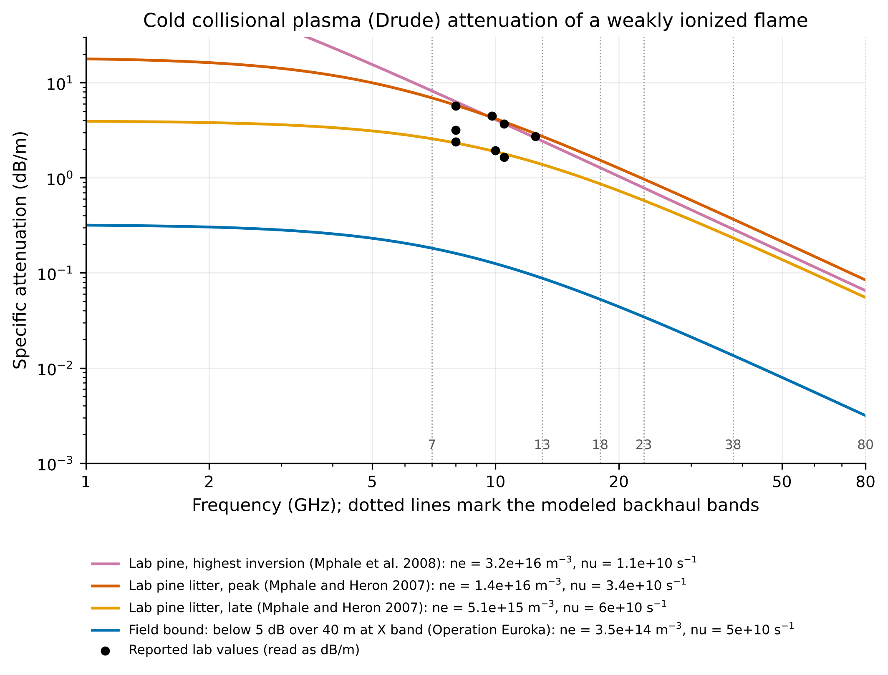

- The cold collisional plasma (Drude) model reproduces the reported lab values to within 19 percent when they are read as dB/m. This is a consistency check, not an independent validation, because the electron density and collision frequency were inverted from the same data.
- Specific attenuation at the lab-peak electron density (1.35e16 m^-3, 3.43e10 s^-1):

| Band | Attenuation (dB/m) |
|---|---|
| 7 GHz | 6.9 |
| 13 GHz | 2.7 |
| 18 GHz | 1.5 |
| 23 GHz | 0.97 |
| 38 GHz | 0.37 |
| 80 GHz | 0.08 |

  - Above about 10 GHz the loss falls roughly as 1/f^2, so the lower-frequency, longer links are the most sensitive per metre of flame.
  - The field-bound electron density (3.5e14 m^-3, derived from Euroka's under-5-dB bound) gives values 29 to 38 times lower, for example 0.18 dB/m at 7 GHz and 0.05 dB/m at 18 GHz.
- Free electrons do not survive above the flame. Saha equilibrium needs an effective ionization temperature of about 1650 K to reach the measured density, and that collapses as the plume cools. Even a "frozen ions" upper bound gives under 3e10 m^-3 at 50 m above the ground over a 30 MW/m crown fire (20 m above its flame top), which absorbs nothing.

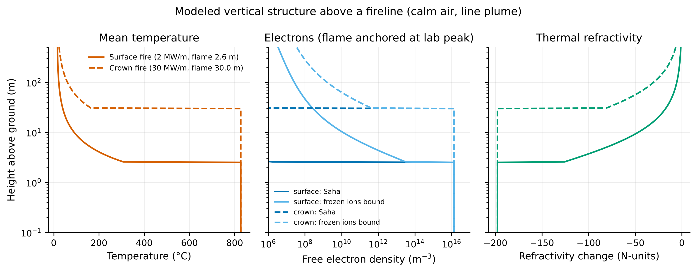

- The plume acts through refraction instead. Air at 1000 K has about 200 N-units lower refractivity than ambient, and the turbulent plume causes scintillation.
- In calm air (an upper bound, since wind bends and dilutes the plume), at 18 GHz on a 5 km link, the scintillation standard deviation is:
  - crown fire: 0.55 dB at 50 m ray height, 0.17 dB at 150 m;
  - surface fire: 0.07 dB at 50 m.
- Mean loss is only large when the flame itself enters the first Fresnel zone. With the ray at the flame top, the mean excess loss at 18 GHz is 1.6 dB (surface) and 2.9 dB (crown, lab-peak electron density). At 50 m and above it is within the model's ±0.3 dB ripple.

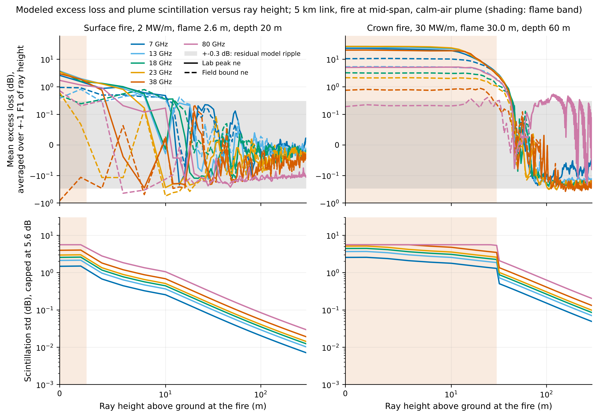

## 3. How often fire reaches a link on real terrain (modeled, hypothetical links)

We placed 1,520 hypothetical links between 215 ridge-top sites on the Copernicus 30 m DSM of the Uiseong to Yeongdeok area. All bands from 7 to 80 GHz were included, each with typical hop lengths, 30 m antennas, and the standard 0.6 F1 clearance at k = 4/3.

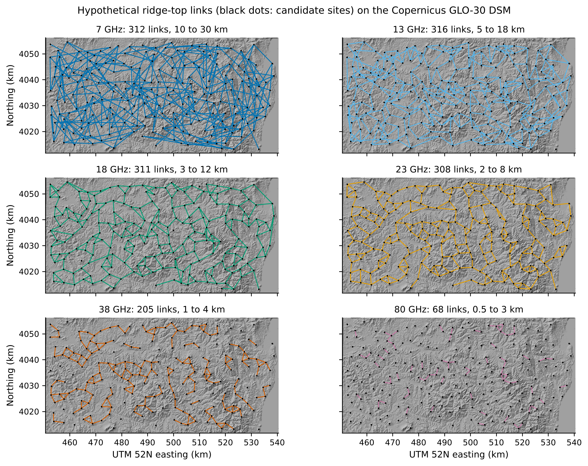

| Fire feature reaching the link | Share of total link length |
|---|---|
| Surface flame (2 m) inside the first Fresnel zone | 0.009 percent |
| Crown flame (20 m above the DSM) inside F1 | 0.13 percent |
| Crown flame (35 m) inside F1 | 1.8 percent, of which 0.4 percent lies outside the 300 m tower zones |
| Calm-air crown plume at least 100 K above ambient at the ray | 3.2 percent (0.5 percent outside tower zones) |
| Calm-air crown plume at least 30 K above ambient at the ray | 34 percent |

- The median ray clearance is 187 m.
- Flames can reach the beam mainly near the towers (where a 35 m crown flame would also threaten the site itself) and at the occasional low point over an intermediate ridge.
- Higher bands use shorter hops with slightly lower clearance, but the share remains small in every band.

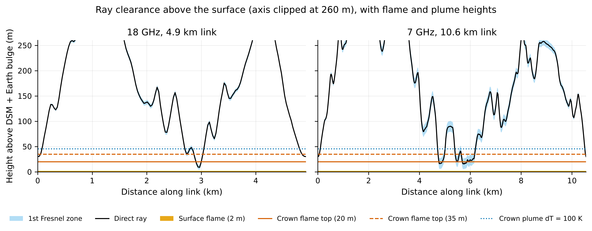 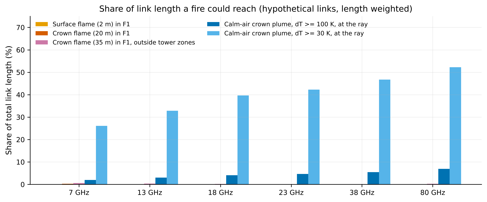

## 4. Simulated crossings (modeled)

A minimum-travel-time spread model with wind and slope runs from the approximate Uiseong ignition point eastward for 24 h.

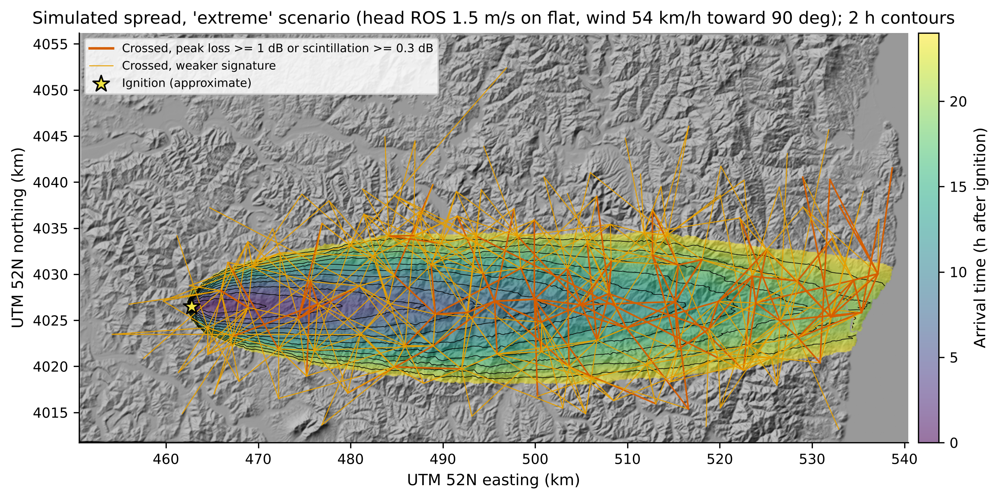

| Scenario | Area in 24 h | Links crossed | Peak mean loss of at least 1 dB, lab-peak ne | Same, field-bound ne | Peak scintillation of at least 0.3 dB |
|---|---|---|---|---|---|
| Moderate (0.4 m/s head ROS, 36 km/h wind) | 12,890 ha | 99 | 0 percent | 0 percent | 7 percent |
| Extreme (1.5 m/s, 54 km/h; area comparable to the real fire) | 100,438 ha | 621 | 11 percent | 5.5 percent | 19 percent |

- Mean-loss dips last one to a few minutes, while flames sit under a low point of the link.
- Scintillation lasts as long as flames burn anywhere under the link.
- In the extreme run, 74 to 83 percent of the burned link length is crown fire.

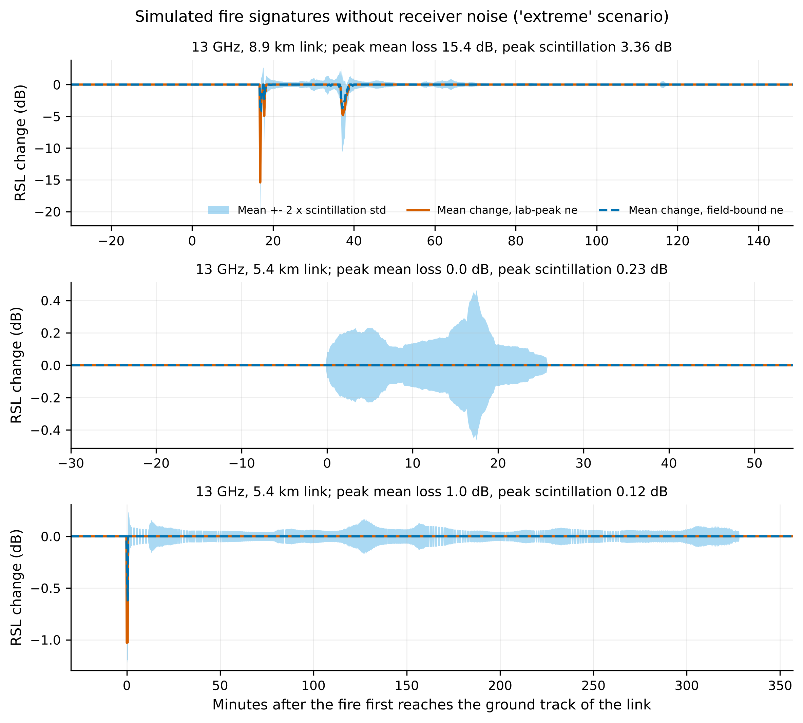

## 5. Detection in real link noise (observed noise plus modeled signal)

Noise source: OpenMRG (Gothenburg, 10 s RSL and TSL, ATPC disabled, CC BY-SA 4.0), 120 random sub-links with a median frequency of 29 GHz and median length of 2.0 km. Dry periods are those with no city-gauge rain within ±3 h: 4,360 link-days.
- Dry 10 s noise has a median standard deviation of 0.20 dB (90th percentile 0.45 dB).
- False alarms come from a heavy tail concentrated in a few erratic links: the worst 10 percent produced 83 percent of the 3 dB alarms.
- As in operational CML rain processing, we ranked links on June data and kept the best 80 percent (98 links), then evaluated on July and August only (2,112 link-days).

Screened dry false-alarm rates at 10 s:

| Detector | Threshold | False alarms per link-day |
|---|---|---|
| Drop | 3 dB | 0.033 |
| Drop | 6 dB | 0.008 |
| Drop | 9 dB | 0.001 |

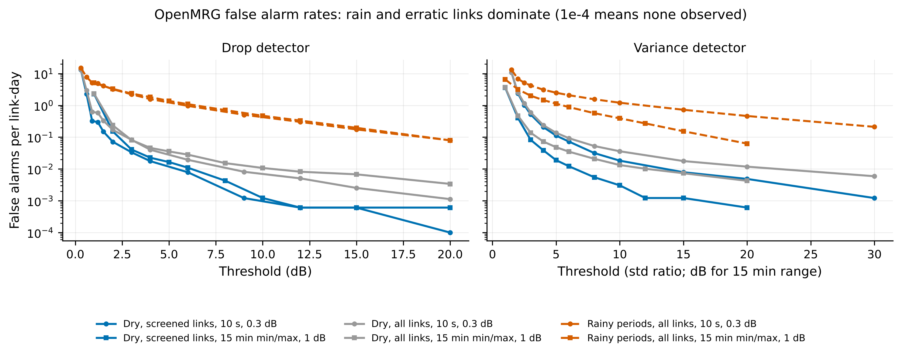

Detection probability is the share of all crossed links detected in the extreme scenario, with lab-peak electron density. The value in brackets is among links with a physical signature, meaning a peak mean loss of at least 1 dB or scintillation of at least 0.3 dB.

| Logging | Detector | At 0.01 false alarms per link-day | At 0.1 false alarms per link-day |
|---|---|---|---|
| 10 s, 0.3 dB | Variance jump | 3.5 percent (16 percent); median delay 12 min | 9.8 percent (43 percent); 8 min |
| 10 s, 0.3 dB | Drop | 1.6 percent (7 percent) | 7.9 percent (35 percent); 11 min |
| 1 min, 0.3 dB | Variance jump | 2.3 percent (10 percent) | 9.5 percent (42 percent); 9 min |
| 15 min min/max, 1 dB | Range growth | 1.4 percent (7 percent) | 9.5 percent (41 percent); 15 min |
| 10 s, RSL only, ATPC 2 dB window | Variance jump | 0 percent | 9.3 percent (41 percent) |

- With the field-bound electron density, the best detector finds 1 percent of crossed links at 0.01 per link-day and 6 percent at 0.1.
- In the moderate scenario it finds at most 2 percent, even at 0.1 per link-day.
- Delays are measured from the moment the fire first reaches the ground track of the link. Most detected links alarm within 30 min.

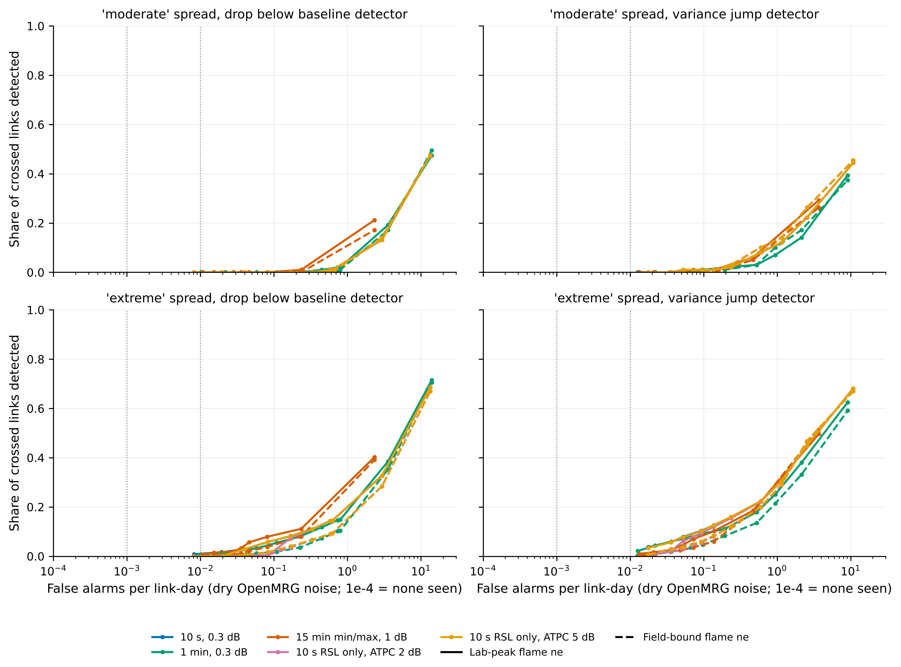 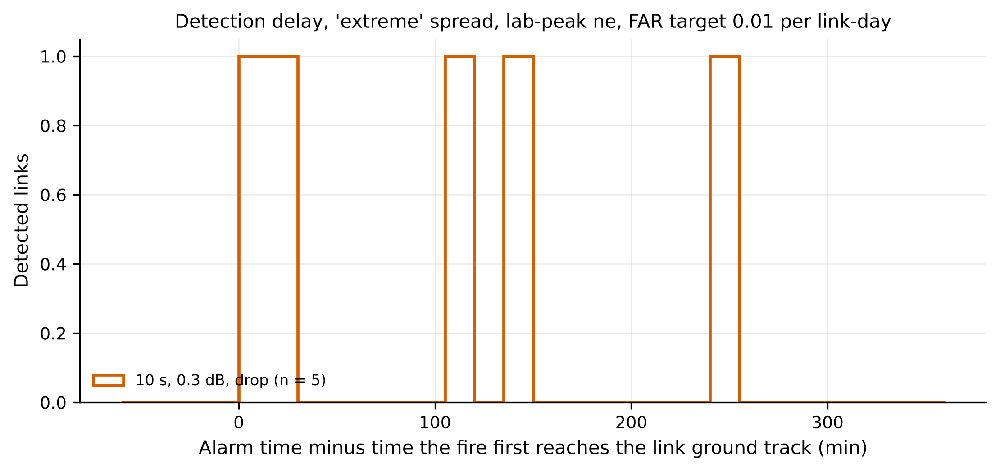

Locating the front: in the extreme run, 23 links alarmed at 0.01 per link-day (10 s data, either detector).
- Placing the fire at each alarmed link's midpoint gives a median position error of 2.8 km (90th percentile 4.7 km). The median length of these links is 6.6 km.
- A plane fit to the alarm times recovers the front's mean speed (2.8 km/h, the same as the fit to the true crossing times) but not its direction (69 deg against 121 deg from the true crossings).
- Sparse, slow alarms can tell you roughly when and where the fire passed, but not reliably where it is heading.

## 6. Confounders

- Rain. Fire weather is usually dry, but the Uiseong fire had 1 to 3 mm of rain on 27 to 28 March.
  - Uniform rain of 1 mm/h over the median hop gives 0.02 dB at 7 GHz, 0.3 dB at 18 GHz, 1.2 dB at 38 GHz and 3.1 dB at 80 GHz (ITU-R P.838-3, vertical polarization). This is the same size as the fire signatures.
  - In OpenMRG rainy periods, false alarms rise to 2.2 per link-day at a 3 dB drop threshold, against 0.03 in screened dry periods.
  - Rain must therefore be excluded with radar or gauges, or by spatial coherence across many links. Fire signatures are short and move with the front, while rain is broad and lasts hours.
- ATPC. If only RSL is logged and ATPC holds the received level within a window, any fade larger than the window is clipped. With a 2 dB window, every detector at the 0.01 per link-day operating point (thresholds of 6 dB or higher) misses everything. A 5 dB window changes little. Logging TSL (RSL - TSL) removes the problem, apart from TSL's 1 dB steps.
- Coarse logging. 15-min min/max values in 1 dB steps still catch the short dips, because the minimum records them. At the looser operating point they perform about as well as 10 s data, but alarms come about 7 min later on average, and they lose more at strict false-alarm rates.

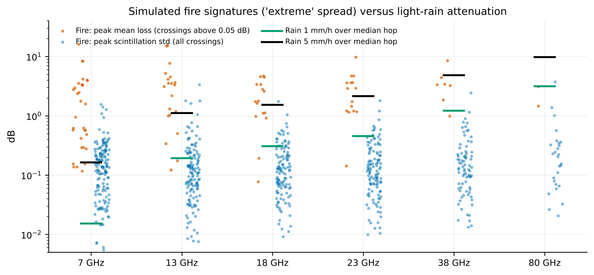 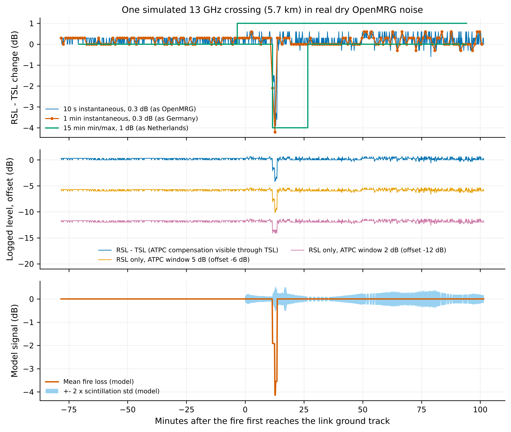

## 7. Where it could work

- Frequencies: the physics favours 6 to 13 GHz, where flame attenuation is 3 to 8 dB/m at the lab-peak density. But those bands use the longest, highest hops. Above 38 GHz flame absorption is small, and rain dominates.
- Clearance: a link must pass within a few metres of the flame top, or within a few tens of metres above a crown fire for scintillation. Planned commercial links rarely do, except within about 300 m of a tower and at isolated low points.
- Fire types: only high-intensity crown fires give signatures, and only on a minority of crossings. Surface fires under the canopy are essentially invisible to planned links.

## 8. Go or no-go

No-go for existing commercial microwave backhaul as a wildfire tripwire in Korea, for four reasons:
- few such links exist in Korean mountains;
- a correctly planned link keeps fire out of its Fresnel zone;
- detectable signatures appear on about 10 to 20 percent of crossings, even in an extreme crown-fire run;
- realistic noise, rain and ATPC push detection to a few percent at tolerable false-alarm rates.

The idea is not dead for purpose-built links. A low-cost, low-mounted link across a fire-prone slope, logged at 10 Hz with TSL, is a different design with different geometry. It would need its own test.

## 9. Next step (single most informative)

Request the received and transmitted signal logs for 20 to 30 March 2025 from KT (and, if possible, KBS and the Korea Forest Service relays) for every microwave or radio relay link whose path crossed the Uiseong, Andong, Cheongsong, Yeongyang and Yeongdeok burn area.

This is the only way to observe what a real high-intensity crown fire did to real links. It directly tests the two most uncertain model inputs, field-scale flame electron density and crown-plume scintillation, and it costs a letter. A real crossing with a clear signature would reopen the case. Silence on links that demonstrably crossed the fire front would close it.

The main risk is data retention: network-management systems often keep 15-min data for only months. If no logs survive, the fallback is a field test: two 10 GHz radios logging at 10 Hz across a prescribed burn, with the beam at the flame top and at 2 and 5 times flame height.

## 10. Booth demo

Two ESP32 boards and a laptop. The sketches and live chart are in [demo/](demo/README.md).
- One board broadcasts fixed-power ESP-NOW packets every 20 ms.
- The other prints the RSSI of each packet.
- `live_chart.py` plots RSSI with a rolling baseline and the same two detectors used here (drop and variance).

Show visitors that:
- a hand or water bottle in the Fresnel zone drops the level;
- fast movement at the zone edge raises variance while the mean barely moves;
- a heat gun does nearly nothing at 2.4 GHz over 2 m. That matches the model, which needs kilometre-scale links and tens of metres of hot plume.

An open, potassium-seeded flame needs venue permission and supervision. The demo has not been tested on hardware.

## 11. Main limitations

- The links are hypothetical. Real Korean link locations, frequencies and heights are unknown.
- The noise comes from short urban Swedish links in summer, not Korean mountain links in spring.
- Flame electron density at field scale is uncertain by more than an order of magnitude (lab peak versus field bound).
- The plume model is a calm-air line plume (an upper bound), and plume scintillation uses an assumed temperature-fluctuation intensity. No microwave scintillation measurement over a fire plume was found.
- The spread model has no fuel map, no spotting and a single wind direction.
- The DSM is treated as the surface, which is optimistic for surface fires under canopy.
