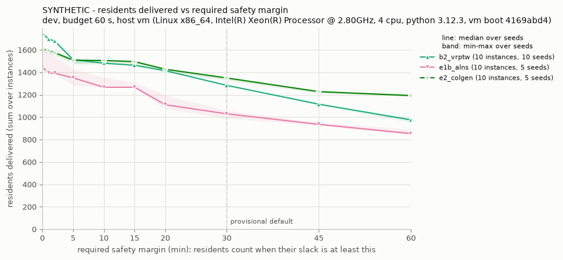
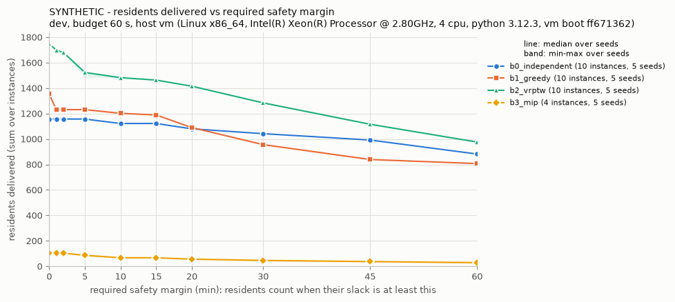

# evacplan leaderboard (Track C)

Regenerated by `evacplan run` and `evacplan leaderboard` from `evacplan/results/*.csv` (committed; the plans and oracle results under `results/runs/` are not), with one safety-margin figure per table in `figures/`. Do not edit by hand.

* **delivered**, **unresolved**, **model_no_route**, **not planned** and **unservable** come from `evacplan.oracle`: delivered = residents whose trip is `checked` in all K members; `unresolved` is never safe and never delivered; `model_no_route` is scoped to the hazard model, its members and horizon; not planned = residents no itinerary boards. **best bound** and **gap** come from the methods' own proofs (e.g. B3's relaxed MIP), not from the oracle. **runtime** is the harness's wall clock around the method's solve, oracle calls inside its search included; the final oracle check is not part of it. **mean time to certified plan** = the mean over the method's rows of runtime + the final certification of the returned plan by a fresh oracle (cold cache), a secondary metric; final certification stays outside every method's budget, and oracle calls inside a method's search count toward its runtime (`program/DECISIONS.md`, 2026-11-02). For a method that certifies inside its loop, that oracle time is part of `runtime_s`, so its time to certified plan counts certification twice: in the loop, and in the harness's cold check.
* **unservable** = residents that no plan can serve within the model, fleet and horizon: a scoped `model_no_route` per facility and mobility class, declared by the oracle (`results/<method>.facilities.csv`, which also holds each facility's latest first-arrival and last-departure times). They are counted again inside not planned (or model_no_route / unresolved if a plan tries them).
* **One table per set, budget and host.** Methods are compared only at **equal wall-clock budgets** and on **the same host**: everything in a table (totals, best bounds, best of baselines, the bar for beating B2, the verdicts and the margin figure) uses only that host's rows. Rows from different hosts are never pooled or compared, and times are never compared across hosts: when the work moves to another machine, the baselines are re-run there (`program/DECISIONS.md`, 2026-11-01). The host string names the machine, its OS, CPU model and CPU count, and the Python version; on a virtual machine it ends with the VM's boot session, so each cloud session is its own host (`docs/ASSUMPTIONS.md` #92). **over budget** counts rows whose runtime exceeded the budget; a method with any such row gets no B2 verdict.
* **Repeats**: every method runs 5 repeats (seeds 0-4, `--repeats 5`) at the same budget on a quiet machine; B2 can have more seeds, those of its interleaved holds. A per-instance cell is the median over seeds, followed by [min–max] when the seeds differ; in the method table, a total is the median of the per-seed totals, followed by their [min–max] when they differ. Time-limited methods differ between repeats even when they ignore the seed: B2's OR-Tools search is seedless, so its repeats differ only through machine load (how far the search gets within the budget), and its outcome is not monotone in that depth (`docs/ASSUMPTIONS.md` #84; each B2 row records the solutions found and the final objective).
* **Beating B2** (`program/DECISIONS.md`, 2026-11-01): the **best-of-baselines total** is the sum over the set's instances of the most residents any baseline (B0, B1, B2, B3; any seed) delivered on that instance; **B2 best observed** is the largest B2 per-seed total over the seeds that cover every instance of the set; the **bar** is the larger of the two. A recorded observation (`docs/recorded_observations.json`, printed with its source) of a B2 total or of a best-of-baselines total, for the same set and budget on this host or on an earlier session of the same cloud VM (its host class), raises the matching part when it is larger; it never defines a part this host's own rows leave undefined. A method other than the baselines and noop beats B2 only if its worst of 5 repeats exceeds the bar: it needs at least 5 repeats, each covering every instance of the set, no row over the budget, and its lowest per-seed total must be above the bar. Otherwise the verdict is no (worst ≤ bar) or n/a (fewer than 5 repeats, a repeat missing an instance, a row over the budget, no bar on this host, or, in a table with interleaved holds, a row with no B2 row in the same hold and pair).
* **slack ≥ m min** = residents delivered with a safety slack of at least m minutes: the smallest oracle leg slack over their vehicle's legs from the start of its itinerary through the unloading that delivers them, each leg's slack capped at the time left before the hazard horizon (`docs/ASSUMPTIONS.md` #91). slack ≥ 0 equals delivered. The problem definition is unchanged: delivered counts every checked trip whatever its margin. **slack ≥ 30 min is the provisional default robust count** (`program/DECISIONS.md`, 2026-11-02; to be derived later from Track A's measured forecast error). Each table's figure plots residents delivered against the required margin (0-60 min).
* **Interleaved holds**: a challenger and B2 alternate per instance and seed in one bench-lock hold (ABAB), so both see the same machine; B2's seeds continue after its rows on the hold's instances, so each hold adds repeats and replaces none, and a hold re-runs the challenger's seeds only with `--replace`. In a table with interleaved holds, a method other than B2 is judged only if each of its rows has a B2 row in the same hold and pair (`program/DECISIONS.md`, 2026-11-02); tables without them predate that rule. The **speed check** row times a fixed workload before every pair (`results/speed/speed_check.csv`); a range over 10 % of its median is flagged, and a line under the bar counts the flagged holds.
* **mean gap** = mean of (best bound - delivered) / best bound over the method's own proven bounds (exact or relaxation methods, e.g. B3 on S instances only); a method that runs on fewer instances is summed over fewer residents (see the size table).
* **Bound-only methods** (e.g. `e4_flow_bound`, `docs/ASSUMPTIONS.md` #94) plan nothing and only prove an upper bound on the residents any plan can deliver. Their bounds enter the best-bound column and their own bounds table (with runtime and the gap to the best plan of the table); they are left out of the method table, the verdicts and the margin figure. A proven bound does not depend on the budget that computed it, so their rows join every table of the same set and host.
* **SYNTHETIC** rows are SYNTHETIC instances (`evacplan/instances/SPLIT.json`), not real-world results.
* **commit** = the git commits of the method's rows (12 hex digits); `+dirty` marks a run from a checkout with uncommitted changes under `evacplan/`, `hazard_contract/` or `program/` (other than the generated outputs).

## dev, budget 60 s, host vm (Linux x86_64, Intel(R) Xeon(R) Processor @ 2.80GHz, 4 cpu, python 3.12.3, vm boot 4169abd4)

Rows from this host only; no row of another host enters this table, its bar or its figure.

| method | label | instances | seeds | delivered | unresolved | model_no_route | not planned | unservable | residents | slack ≥ 5 min | slack ≥ 15 min | slack ≥ 30 min (default) | min slack (s) | mean runtime (s) | mean time to certified plan (s) | over budget | mean gap | B2 verdict | commit |
|---|---|---|---|---|---|---|---|---|---|---|---|---|---|---|---|---|---|---|---|
| b2_vrptw | SYNTHETIC | 10 | 10 | 1749 (88.6%) | 0 | 0 | 226 | 1 | 1975 | 1514 [1473–1523] | 1463 [1463–1464] | 1284 [1284–1285] | 16.7 | 57.516 | 66.0 | 0 | – | baseline | ceca7380f686, ceca7380f686+dirty, dae67e867e98 |
| e1b_alns | SYNTHETIC | 10 | 5 | 1446 (73.2%) [1444–1583] | 0 | 0 | 529 [392–531] | 1 | 1975 | 1351 [1283–1428] | 1267 [1265–1311] | 1030 [992–1061] | 1.9 | 56.748 | 66.3 | 0 | – | no (worst 1444 ≤ bar 1751) | dae67e867e98 |
| e2_colgen | SYNTHETIC | 10 | 5 | 1611 (81.6%) [1585–1627] | 0 | 0 | 364 [348–390] | 1 | 1975 | 1508 [1482–1524] | 1496 [1472–1498] | 1350 [1330–1356] | 35.7 | 36.483 | 44.8 | 0 | 0.090 | no (worst 1585 ≤ bar 1751) | ceca7380f686, ceca7380f686+dirty |

Bar for beating B2 on this host: max(B2 best observed 1750 [recorded (an earlier session of this host class): Phase 0 review, B2's full run on dev at 60 s, review of commit 957e6720 (program/reviews/phase0-review.md)], best-of-baselines total 1751 [this host's baseline rows 1749; recorded (an earlier session of this host class): best-of-baselines total of the baseline rows committed at b43990bb (results at 1373bb3f; B2 delivered 517 on SYNTHETIC-L-grid-t50-s109), stated by Siyeong in his checkpoint-2 answer 3 (program/DECISIONS.md, 2026-11-01)]) = 1751; a method beats B2 only if its worst of ≥5 repeats exceeds 1751 and none of its rows is over the budget.

Speed check flagged in 4 of 4 holds (probe spread over 10 % of the median): timings on this host are indicative; final timed results are re-run on the Mac (DECISIONS 2026-11-02).

Interleaved holds (ABAB in one lock hold; per-seed totals over the hold's instances):

| hold | instances | pairs | row | median [min–max] | worst |
|---|---|---|---|---|---|
| 20261102T132039Z-e1b_alns-x-b2_vrptw-o0 | 8 | 40 | b2_vrptw | 705 | 705 |
|  |  |  | e1b_alns | 714 [714–716] | 714 |
|  |  |  | speed check (s) | 0.155 [0.099–0.257] | spread 102 % ⚠ over 10 % |
| 20261102T144553Z-e1b_alns-x-b2_vrptw-o0 | 2 | 10 | b2_vrptw | 1044 | 1044 |
|  |  |  | e1b_alns | 730 [730–869] | 730 |
|  |  |  | speed check (s) | 0.152 [0.104–0.217] | spread 74 % ⚠ over 10 % |
| 20261102T153902Z-e2_colgen-x-b2_vrptw-o5 | 8 | 40 | b2_vrptw | 705 | 705 |
|  |  |  | e2_colgen | 682 [681–689] | 681 |
|  |  |  | speed check (s) | 0.142 [0.093–0.254] | spread 114 % ⚠ over 10 % |
| 20261102T164918Z-e2_colgen-x-b2_vrptw-o5 | 2 | 10 | b2_vrptw | 1044 | 1044 |
|  |  |  | e2_colgen | 929 [904–938] | 904 |
|  |  |  | speed check (s) | 0.122 [0.097–0.237] | spread 115 % ⚠ over 10 % |

Recorded B2 observation for this set and budget from an earlier session of this host class (not in the rows; `docs/recorded_observations.json`): 1750 delivered, 0 unresolved [Phase 0 review, B2's full run on dev at 60 s, review of commit 957e6720 (program/reviews/phase0-review.md)].

Recorded best-of-baselines total for this set and budget from an earlier session of this host class (not in the rows; `docs/recorded_observations.json`): 1751 delivered, 0 unresolved [best-of-baselines total of the baseline rows committed at b43990bb (results at 1373bb3f; B2 delivered 517 on SYNTHETIC-L-grid-t50-s109), stated by Siyeong in his checkpoint-2 answer 3 (program/DECISIONS.md, 2026-11-01)].

Residents delivered vs required safety margin (line: median over seeds; band: min–max; this host's rows only; noop not drawn):

Delivered (checked) per instance, median over seeds [min–max when they differ]; **best bound** = the smallest proven upper bound any method reports for the instance, bound-only methods included (no plan can deliver more); **best of baselines** = the most residents any baseline delivered on the instance (any seed), summed in the bar above:

| instance | label | residents | unservable | best bound | best of baselines | b2_vrptw | e1b_alns | e2_colgen |
|---|---|---|---|---|---|---|---|---|
| SYNTHETIC-S-grid-t25-s101 | SYNTHETIC | 23 | 0 | 23 | 23 | 23 | 23 | 23 |
| SYNTHETIC-S-geo-t25-s102 | SYNTHETIC | 39 | 0 | 39 | 36 | 36 | 37 | 37 |
| SYNTHETIC-S-grid-t75-s103 | SYNTHETIC | 27 | 1 | 25 | 23 | 23 | 23 | 23 |
| SYNTHETIC-S-geo-t75-s104 | SYNTHETIC | 26 | 0 | 26 | 26 | 26 | 26 | 26 |
| SYNTHETIC-M-grid-t25-s105 | SYNTHETIC | 163 | 0 | 163 | 163 | 163 | 163 | 163 |
| SYNTHETIC-M-geo-t25-s106 | SYNTHETIC | 155 | 0 | 155 | 155 | 155 | 155 | 155 |
| SYNTHETIC-M-grid-t75-s107 | SYNTHETIC | 168 | 0 | 156 | 140 | 140 | 148 [148–150] | 131 [131–138] |
| SYNTHETIC-M-geo-t75-s108 | SYNTHETIC | 149 | 0 | 143 | 139 | 139 | 139 | 124 [123–124] |
| SYNTHETIC-L-grid-t50-s109 | SYNTHETIC | 646 | 0 | 646 | 516 | 516 | 335 [335–427] | 446 [421–455] |
| SYNTHETIC-L-geo-t50-s110 | SYNTHETIC | 579 | 0 | 579 | 528 | 528 | 395 [395–486] | 483 |

Unresolved per instance (never safe, never delivered), median over seeds [min–max when they differ]:

| instance | label | b2_vrptw | e1b_alns | e2_colgen |
|---|---|---|---|---|
| SYNTHETIC-S-grid-t25-s101 | SYNTHETIC | 0 | 0 | 0 |
| SYNTHETIC-S-geo-t25-s102 | SYNTHETIC | 0 | 0 | 0 |
| SYNTHETIC-S-grid-t75-s103 | SYNTHETIC | 0 | 0 | 0 |
| SYNTHETIC-S-geo-t75-s104 | SYNTHETIC | 0 | 0 | 0 |
| SYNTHETIC-M-grid-t25-s105 | SYNTHETIC | 0 | 0 | 0 |
| SYNTHETIC-M-geo-t25-s106 | SYNTHETIC | 0 | 0 | 0 |
| SYNTHETIC-M-grid-t75-s107 | SYNTHETIC | 0 | 0 | 0 |
| SYNTHETIC-M-geo-t75-s108 | SYNTHETIC | 0 | 0 | 0 |
| SYNTHETIC-L-grid-t50-s109 | SYNTHETIC | 0 | 0 | 0 |
| SYNTHETIC-L-geo-t50-s110 | SYNTHETIC | 0 | 0 | 0 |

Delivered with slack ≥ 5 min per instance, median over seeds [min–max when they differ] (– : rows from before the margin columns):

| instance | label | b2_vrptw | e1b_alns | e2_colgen |
|---|---|---|---|---|
| SYNTHETIC-S-grid-t25-s101 | SYNTHETIC | 23 | 23 | 23 |
| SYNTHETIC-S-geo-t25-s102 | SYNTHETIC | 36 | 37 | 37 |
| SYNTHETIC-S-grid-t75-s103 | SYNTHETIC | 8 | 4 | 6 |
| SYNTHETIC-S-geo-t75-s104 | SYNTHETIC | 8 | 6 | 8 |
| SYNTHETIC-M-grid-t25-s105 | SYNTHETIC | 163 [154–163] | 163 | 163 |
| SYNTHETIC-M-geo-t25-s106 | SYNTHETIC | 155 | 155 | 155 |
| SYNTHETIC-M-grid-t75-s107 | SYNTHETIC | 41 | 80 [68–148] | 63 [63–70] |
| SYNTHETIC-M-geo-t75-s108 | SYNTHETIC | 139 | 139 | 124 [123–124] |
| SYNTHETIC-L-grid-t50-s109 | SYNTHETIC | 516 | 281 [281–427] | 446 [421–455] |
| SYNTHETIC-L-geo-t50-s110 | SYNTHETIC | 434 [393–434] | 395 [388–395] | 483 |

Delivered with slack ≥ 15 min per instance, median over seeds [min–max when they differ] (– : rows from before the margin columns):

| instance | label | b2_vrptw | e1b_alns | e2_colgen |
|---|---|---|---|---|
| SYNTHETIC-S-grid-t25-s101 | SYNTHETIC | 23 | 23 | 23 |
| SYNTHETIC-S-geo-t25-s102 | SYNTHETIC | 36 | 37 | 27 |
| SYNTHETIC-S-grid-t75-s103 | SYNTHETIC | 8 | 4 | 6 |
| SYNTHETIC-S-geo-t75-s104 | SYNTHETIC | 8 | 6 | 8 |
| SYNTHETIC-M-grid-t25-s105 | SYNTHETIC | 153 [153–154] | 163 | 163 |
| SYNTHETIC-M-geo-t25-s106 | SYNTHETIC | 155 | 155 | 155 |
| SYNTHETIC-M-grid-t75-s107 | SYNTHETIC | 41 | 79 [68–80] | 63 [52–66] |
| SYNTHETIC-M-geo-t75-s108 | SYNTHETIC | 139 | 139 | 124 [123–124] |
| SYNTHETIC-L-grid-t50-s109 | SYNTHETIC | 516 | 281 [281–326] | 446 [421–455] |
| SYNTHETIC-L-geo-t50-s110 | SYNTHETIC | 384 | 379 [379–383] | 483 |

Delivered with slack ≥ 30 min per instance, median over seeds [min–max when they differ] (– : rows from before the margin columns):

| instance | label | b2_vrptw | e1b_alns | e2_colgen |
|---|---|---|---|---|
| SYNTHETIC-S-grid-t25-s101 | SYNTHETIC | 23 | 23 | 23 |
| SYNTHETIC-S-geo-t25-s102 | SYNTHETIC | 14 | 15 | 27 |
| SYNTHETIC-S-grid-t75-s103 | SYNTHETIC | 0 | 0 | 0 |
| SYNTHETIC-S-geo-t75-s104 | SYNTHETIC | 0 | 6 | 0 |
| SYNTHETIC-M-grid-t25-s105 | SYNTHETIC | 153 [153–154] | 163 | 163 |
| SYNTHETIC-M-geo-t25-s106 | SYNTHETIC | 155 | 155 | 155 |
| SYNTHETIC-M-grid-t75-s107 | SYNTHETIC | 41 | 30 [5–43] | 36 [27–66] |
| SYNTHETIC-M-geo-t75-s108 | SYNTHETIC | 111 | 139 | 119 [118–123] |
| SYNTHETIC-L-grid-t50-s109 | SYNTHETIC | 491 | 225 [178–262] | 442 [417–450] |
| SYNTHETIC-L-geo-t50-s110 | SYNTHETIC | 296 | 261 [261–352] | 386 |

Delivered (checked) by instance size: sum of the per-instance medians / residents of the instances the method ran (count); compare methods only on equal counts:

| method | S | M | L |
|---|---|---|---|
| b2_vrptw | 108 / 115 (4) | 597 / 635 (4) | 1044 / 1225 (2) |
| e1b_alns | 109 / 115 (4) | 605 / 635 (4) | 730 / 1225 (2) |
| e2_colgen | 109 / 115 (4) | 573 / 635 (4) | 929 / 1225 (2) |

## dev, budget 60 s, host vm (Linux x86_64, Intel(R) Xeon(R) Processor @ 2.80GHz, 4 cpu, python 3.12.3, vm boot ff671362)

Rows from this host only; no row of another host enters this table, its bar or its figure.

| method | label | instances | seeds | delivered | unresolved | model_no_route | not planned | unservable | residents | slack ≥ 5 min | slack ≥ 15 min | slack ≥ 30 min (default) | min slack (s) | mean runtime (s) | mean time to certified plan (s) | over budget | mean gap | B2 verdict | commit |
|---|---|---|---|---|---|---|---|---|---|---|---|---|---|---|---|---|---|---|---|
| b0_independent | SYNTHETIC | 10 | 5 | 1157 (58.6%) | 0 | 0 | 818 | 1 | 1975 | 1157 | 1122 | 1042 | 403.2 | 1.117 | – | 0 | – | baseline | c888a87b02c5 |
| b1_greedy | SYNTHETIC | 10 | 5 | 1353 (68.5%) | 0 | 0 | 622 | 1 | 1975 | 1231 | 1189 | 956 | 1.9 | 3.987 | – | 0 | – | baseline | c888a87b02c5 |
| b2_vrptw | SYNTHETIC | 10 | 5 | 1737 (87.9%) [1721–1737] | 0 | 0 | 238 [238–254] | 1 | 1975 | 1499 [1470–1510] | 1442 [1442–1491] | 1263 [1263–1360] | 16.7 | 57.517 | – | 0 | – | baseline | 188416780bdb |
| b3_mip | SYNTHETIC | 4 | 5 | 103 (89.6%) [103–104] | 0 | 0 | 12 [11–12] | 1 | 115 | 86 [85–103] | 67 [66–68] | 46 [37–57] | 223.3 | 40.875 | – | 0 | 0.087 | baseline | c888a87b02c5 |
| e1_alns | SYNTHETIC | 10 | 5 | 1444 (73.1%) [1443–1446] | 0 | 0 | 531 [529–532] | 1 | 1975 | 1351 [1283–1352] | 1267 [1265–1267] | 992 [980–1030] | 1.9 | 55.764 | – | 0 | – | no (worst 1443 ≤ bar 1751) | 483eb527cba4 |
| noop | SYNTHETIC | 10 | 5 | 0 (0.0%) | 0 | 0 | 1975 | 1 | 1975 | 0 | 0 | 0 | – | 0.000 | – | 0 | – | – | c888a87b02c5 |

Bar for beating B2 on this host: max(B2 best observed 1750 [recorded (an earlier session of this host class): Phase 0 review, B2's full run on dev at 60 s, review of commit 957e6720 (program/reviews/phase0-review.md)], best-of-baselines total 1751 [this host's baseline rows 1738; recorded (an earlier session of this host class): best-of-baselines total of the baseline rows committed at b43990bb (results at 1373bb3f; B2 delivered 517 on SYNTHETIC-L-grid-t50-s109), stated by Siyeong in his checkpoint-2 answer 3 (program/DECISIONS.md, 2026-11-01)]) = 1751; a method beats B2 only if its worst of ≥5 repeats exceeds 1751 and none of its rows is over the budget.

Recorded B2 observation for this set and budget from an earlier session of this host class (not in the rows; `docs/recorded_observations.json`): 1750 delivered, 0 unresolved [Phase 0 review, B2's full run on dev at 60 s, review of commit 957e6720 (program/reviews/phase0-review.md)].

Recorded best-of-baselines total for this set and budget from an earlier session of this host class (not in the rows; `docs/recorded_observations.json`): 1751 delivered, 0 unresolved [best-of-baselines total of the baseline rows committed at b43990bb (results at 1373bb3f; B2 delivered 517 on SYNTHETIC-L-grid-t50-s109), stated by Siyeong in his checkpoint-2 answer 3 (program/DECISIONS.md, 2026-11-01)].

Residents delivered vs required safety margin (line: median over seeds; band: min–max; this host's rows only; noop not drawn):

Delivered (checked) per instance, median over seeds [min–max when they differ]; **best bound** = the smallest proven upper bound any method reports for the instance, bound-only methods included (no plan can deliver more); **best of baselines** = the most residents any baseline delivered on the instance (any seed), summed in the bar above:

| instance | label | residents | unservable | best bound | best of baselines | b0_independent | b1_greedy | b2_vrptw | b3_mip | e1_alns | noop |
|---|---|---|---|---|---|---|---|---|---|---|---|
| SYNTHETIC-S-grid-t25-s101 | SYNTHETIC | 23 | 0 | 23 | 23 | 23 | 23 | 23 | 23 | 23 | 0 |
| SYNTHETIC-S-geo-t25-s102 | SYNTHETIC | 39 | 0 | 39 | 37 | 28 | 37 | 36 | 34 [34–35] | 37 | 0 |
| SYNTHETIC-S-grid-t75-s103 | SYNTHETIC | 27 | 1 | 25 | 23 | 20 | 20 | 23 | 21 | 23 | 0 |
| SYNTHETIC-S-geo-t75-s104 | SYNTHETIC | 26 | 0 | 26 | 26 | 10 | 24 | 26 | 25 | 26 | 0 |
| SYNTHETIC-M-grid-t25-s105 | SYNTHETIC | 163 | 0 | 163 | 163 | 132 | 163 | 163 | – | 163 | 0 |
| SYNTHETIC-M-geo-t25-s106 | SYNTHETIC | 155 | 0 | 155 | 155 | 128 | 155 | 155 | – | 155 | 0 |
| SYNTHETIC-M-grid-t75-s107 | SYNTHETIC | 168 | 0 | 160 | 140 | 77 | 100 | 140 | – | 148 [147–150] | 0 |
| SYNTHETIC-M-geo-t75-s108 | SYNTHETIC | 149 | 0 | 144 | 139 | 95 | 101 | 139 | – | 139 | 0 |
| SYNTHETIC-L-grid-t50-s109 | SYNTHETIC | 646 | 0 | 646 | 516 | 314 | 335 | 516 [509–516] | – | 335 | 0 |
| SYNTHETIC-L-geo-t50-s110 | SYNTHETIC | 579 | 0 | 579 | 516 | 330 | 395 | 516 [500–516] | – | 395 | 0 |

Proven upper bounds of bound-only methods (they plan nothing: not in the method table, no verdict, not in the figure; their rows join every table of this set and host, whatever budget computed them); **gap** = (bound - best delivered) / bound, **best delivered** = the most residents any method delivered on the instance in this table (any seed):

| instance | label | residents | best delivered | e4_flow_bound | gap | runtime (s) |
|---|---|---|---|---|---|---|
| SYNTHETIC-S-grid-t25-s101 | SYNTHETIC | 23 | 23 | 23 | 0.0% | 3.9 |
| SYNTHETIC-S-geo-t25-s102 | SYNTHETIC | 39 | 37 | 39 | 5.1% | 6.4 |
| SYNTHETIC-S-grid-t75-s103 | SYNTHETIC | 27 | 23 | 25 | 8.0% | 1.3 |
| SYNTHETIC-S-geo-t75-s104 | SYNTHETIC | 26 | 26 | 26 | 0.0% | 1.2 |
| SYNTHETIC-M-grid-t25-s105 | SYNTHETIC | 163 | 163 | 163 | 0.0% | 221.5 |
| SYNTHETIC-M-geo-t25-s106 | SYNTHETIC | 155 | 155 | 155 | 0.0% | 595.9 |
| SYNTHETIC-M-grid-t75-s107 | SYNTHETIC | 168 | 150 | 160 | 6.2% | 164.8 |
| SYNTHETIC-M-geo-t75-s108 | SYNTHETIC | 149 | 139 | 144 | 3.5% | 200.1 |
| SYNTHETIC-L-grid-t50-s109 | SYNTHETIC | 646 | 516 | 646 | 20.1% | 881.1 |
| SYNTHETIC-L-geo-t50-s110 | SYNTHETIC | 579 | 516 | 579 | 10.9% | 880.5 |

Mean gap of e4_flow_bound by size (instances): S 3.3% (4), M 2.4% (4), L 15.5% (2), all 5.4% (10); computed at budget 900 s, commit a4c8887318af.

Unresolved per instance (never safe, never delivered), median over seeds [min–max when they differ]:

| instance | label | b0_independent | b1_greedy | b2_vrptw | b3_mip | e1_alns | noop |
|---|---|---|---|---|---|---|---|
| SYNTHETIC-S-grid-t25-s101 | SYNTHETIC | 0 | 0 | 0 | 0 | 0 | 0 |
| SYNTHETIC-S-geo-t25-s102 | SYNTHETIC | 0 | 0 | 0 | 0 | 0 | 0 |
| SYNTHETIC-S-grid-t75-s103 | SYNTHETIC | 0 | 0 | 0 | 0 | 0 | 0 |
| SYNTHETIC-S-geo-t75-s104 | SYNTHETIC | 0 | 0 | 0 | 0 | 0 | 0 |
| SYNTHETIC-M-grid-t25-s105 | SYNTHETIC | 0 | 0 | 0 | – | 0 | 0 |
| SYNTHETIC-M-geo-t25-s106 | SYNTHETIC | 0 | 0 | 0 | – | 0 | 0 |
| SYNTHETIC-M-grid-t75-s107 | SYNTHETIC | 0 | 0 | 0 | – | 0 | 0 |
| SYNTHETIC-M-geo-t75-s108 | SYNTHETIC | 0 | 0 | 0 | – | 0 | 0 |
| SYNTHETIC-L-grid-t50-s109 | SYNTHETIC | 0 | 0 | 0 | – | 0 | 0 |
| SYNTHETIC-L-geo-t50-s110 | SYNTHETIC | 0 | 0 | 0 | – | 0 | 0 |

Delivered with slack ≥ 5 min per instance, median over seeds [min–max when they differ] (– : rows from before the margin columns):

| instance | label | b0_independent | b1_greedy | b2_vrptw | b3_mip | e1_alns | noop |
|---|---|---|---|---|---|---|---|
| SYNTHETIC-S-grid-t25-s101 | SYNTHETIC | 23 | 23 | 23 | 23 | 23 | 0 |
| SYNTHETIC-S-geo-t25-s102 | SYNTHETIC | 28 | 37 | 36 | 34 [34–35] | 37 | 0 |
| SYNTHETIC-S-grid-t75-s103 | SYNTHETIC | 20 | 20 | 8 | 21 | 4 | 0 |
| SYNTHETIC-S-geo-t75-s104 | SYNTHETIC | 10 | 10 | 8 | 7 [7–25] | 6 | 0 |
| SYNTHETIC-M-grid-t25-s105 | SYNTHETIC | 132 | 163 | 154 | – | 163 | 0 |
| SYNTHETIC-M-geo-t25-s106 | SYNTHETIC | 128 | 155 | 155 | – | 155 | 0 |
| SYNTHETIC-M-grid-t75-s107 | SYNTHETIC | 77 | 46 | 41 | – | 148 [80–149] | 0 |
| SYNTHETIC-M-geo-t75-s108 | SYNTHETIC | 95 | 101 | 139 | – | 139 | 0 |
| SYNTHETIC-L-grid-t50-s109 | SYNTHETIC | 314 | 281 | 516 [509–516] | – | 281 | 0 |
| SYNTHETIC-L-geo-t50-s110 | SYNTHETIC | 330 | 395 | 420 [390–430] | – | 395 | 0 |

Delivered with slack ≥ 15 min per instance, median over seeds [min–max when they differ] (– : rows from before the margin columns):

| instance | label | b0_independent | b1_greedy | b2_vrptw | b3_mip | e1_alns | noop |
|---|---|---|---|---|---|---|---|
| SYNTHETIC-S-grid-t25-s101 | SYNTHETIC | 23 | 23 | 23 | 23 | 23 | 0 |
| SYNTHETIC-S-geo-t25-s102 | SYNTHETIC | 28 | 27 | 36 | 34 [34–35] | 37 | 0 |
| SYNTHETIC-S-grid-t75-s103 | SYNTHETIC | 20 | 20 | 8 | 3 | 4 | 0 |
| SYNTHETIC-S-geo-t75-s104 | SYNTHETIC | 10 | 10 | 8 | 7 [6–7] | 6 | 0 |
| SYNTHETIC-M-grid-t25-s105 | SYNTHETIC | 132 | 163 | 154 | – | 163 | 0 |
| SYNTHETIC-M-geo-t25-s106 | SYNTHETIC | 93 | 155 | 155 | – | 155 | 0 |
| SYNTHETIC-M-grid-t75-s107 | SYNTHETIC | 77 | 30 | 41 | – | 80 [78–80] | 0 |
| SYNTHETIC-M-geo-t75-s108 | SYNTHETIC | 95 | 101 | 139 | – | 139 | 0 |
| SYNTHETIC-L-grid-t50-s109 | SYNTHETIC | 314 | 281 | 516 [509–516] | – | 281 | 0 |
| SYNTHETIC-L-geo-t50-s110 | SYNTHETIC | 330 | 379 | 362 [362–411] | – | 379 | 0 |

Delivered with slack ≥ 30 min per instance, median over seeds [min–max when they differ] (– : rows from before the margin columns):

| instance | label | b0_independent | b1_greedy | b2_vrptw | b3_mip | e1_alns | noop |
|---|---|---|---|---|---|---|---|
| SYNTHETIC-S-grid-t25-s101 | SYNTHETIC | 18 | 23 | 23 | 23 [15–23] | 23 | 0 |
| SYNTHETIC-S-geo-t25-s102 | SYNTHETIC | 27 | 27 | 14 | 23 [22–34] | 15 | 0 |
| SYNTHETIC-S-grid-t75-s103 | SYNTHETIC | 0 | 0 | 0 | 0 | 0 | 0 |
| SYNTHETIC-S-geo-t75-s104 | SYNTHETIC | 10 | 0 | 0 | 0 | 6 | 0 |
| SYNTHETIC-M-grid-t25-s105 | SYNTHETIC | 132 | 163 | 154 | – | 163 | 0 |
| SYNTHETIC-M-geo-t25-s106 | SYNTHETIC | 81 | 155 | 155 | – | 155 | 0 |
| SYNTHETIC-M-grid-t75-s107 | SYNTHETIC | 57 | 1 | 41 | – | 42 [5–43] | 0 |
| SYNTHETIC-M-geo-t75-s108 | SYNTHETIC | 93 | 101 | 111 | – | 139 [90–139] | 0 |
| SYNTHETIC-L-grid-t50-s109 | SYNTHETIC | 294 | 225 | 491 [486–491] | – | 225 | 0 |
| SYNTHETIC-L-geo-t50-s110 | SYNTHETIC | 330 | 261 | 274 [274–371] | – | 261 | 0 |

Delivered (checked) by instance size: sum of the per-instance medians / residents of the instances the method ran (count); compare methods only on equal counts:

| method | S | M | L |
|---|---|---|---|
| b0_independent | 81 / 115 (4) | 432 / 635 (4) | 644 / 1225 (2) |
| b1_greedy | 104 / 115 (4) | 519 / 635 (4) | 730 / 1225 (2) |
| b2_vrptw | 108 / 115 (4) | 597 / 635 (4) | 1032 / 1225 (2) |
| b3_mip | 103 / 115 (4) | – | – |
| e1_alns | 109 / 115 (4) | 605 / 635 (4) | 730 / 1225 (2) |
| noop | 0 / 115 (4) | 0 / 635 (4) | 0 / 1225 (2) |
