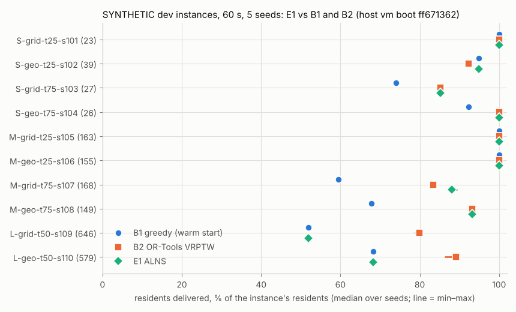
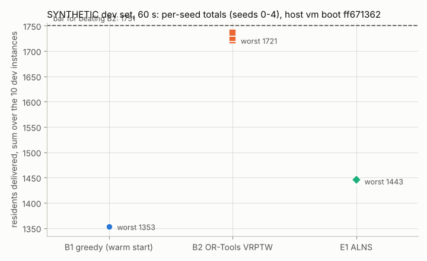

# E1: ALNS with the oracle in the loop (SYNTHETIC dev set)

**Type:** method experiment, Track C Phase 1 batch 1. **Method:** `e1_alns`
(`evacplan/src/evacplan/methods/e1_alns.py`). **Data:** the frozen SYNTHETIC `dev` split only (the test set is
never generated, loaded or run). **Label:** every number and figure here is SYNTHETIC. **Parameters:**
[`config.yaml`](config.yaml), fixed a priori and committed before any dev run; nothing is tuned to the SYNTHETIC
hazards (H0 found them "much hotter" than the Korean dev packets; Siyeong asked to be told before anything is
tuned to them).

## Pre-registration (written and committed before any dev run)

### Hypothesis

An adaptive large neighbourhood search (Ropke & Pisinger 2006) that searches a relaxed model (contact-free in all
K members by construction) and certifies only its incumbents with the oracle delivers more residents than B2 on
the dev set at 60 s: its worst of 5 repeats exceeds the bar for beating B2 (max of B2's best observed total and the
best-of-baselines total; 1750 / 1751 before the 5-seed reruns).

### Why it might work (the math)

* **The relaxed model is tight except for dose.** Plans are decoded on the POSITIVE masks of `evacplan.reach`:
  every drive, wait, boarding and unloading is contact-free in all K members, supported and ends by the horizon.
  Of the oracle's other rules, peak flux cannot bind (the flux law caps flux at q_rad / 2 = 0.70 kW/m² < 10 kW/m²,
  H0), so a decoded trip fails the oracle only on cumulative dose. The relaxed count is therefore an upper bound on
  the certified count of the same plan, equal to it unless a vehicle accumulates more than 100 kJ/m² (in H0 that
  happens only within about 375 m of burning cells). Searching the relaxed model loses little and costs microseconds
  per trip instead of the oracle's milliseconds per leg.
* **Lazy certification** (Dellin & Srinivasa 2016: evaluate expensive edges only on the current candidate optimum).
  The oracle runs only on the best relaxed candidate: at the end of each 100-iteration segment, when the time left
  would no longer suffice to certify it (the search then goes on with what remains) and at the end of the search;
  and only on itineraries it has not seen (cached by content). A vehicle's oracle state never improves along
  its itinerary, so a trip the oracle rejects is cut with the rest of that itinerary without changing any other
  verdict; the rejected prefix is remembered and cut from later plans, so the search sees the oracle's verdicts
  wherever it has them.
* **Large neighbourhoods fit this problem.** Boarding (40-450 s per resident) dominates trip times, so the plan's
  quality is decided by which vehicle serves which facility before its latest safe departure, and in what order. B1
  appends earliest-deadline-first and never revisits a choice; B2 optimises a static VRPTW whose free-flow times and
  static windows ignore the time-dependent hazard and then drops what the realization cannot do. E1 optimises the
  realized time-dependent plan directly: each iteration removes 10-40 % of the requests (random, worst-slack,
  related, whole trips or whole vehicle routes) and re-inserts the pool greedily or by regret-k. Regret insertion
  serves first the requests with the fewest good options, i.e. facilities near their deadline, which is exactly where
  greedy insertion loses residents. Insertions can top up a stop, add a stop to a trip (up to 3 facilities per
  trip) or open a trip anywhere in a vehicle's sequence; the latest safe departures prune options that cannot leave
  in time (an exact test: a departure after the latest safe departure has no contact-free route to an open shelter).
* **Never below the warm start.** The warm start is B1. A certified candidate replaces it only if its certified
  objective beats the warm start's optimistic bound (its relaxed resident count), so E1 delivers at least B1's
  residents on every instance and seed. The scalarisation `A*delivered + B*min(slack, Hi) - vehicle_time`
  (`B > vehicles x Hi`, `A > B x Hi`) keeps the lexicographic order exact.

### Setup

* Instances: the 10 frozen SYNTHETIC dev instances (4 S, 4 M, 2 L). Smoke and debugging runs: at most 2 dev S
  instances with short budgets; unit tests and profiling use hand-built instances and generator seeds 9701+ outside
  the split.
* Budget: 60 s wall clock per instance and seed, B1 warm start, oracle checks and a reserve (0.5 s + 3 % of the budget,
  as B2) included; single-threaded.
* Repeats: seeds 0-4 (`--repeats 5`), one bench-lock acquisition, quiet machine, one host (the container session
  whose boot id starts `ff671362`; the final run is refused if the session changed, because the baselines must then
  be re-run first).
* Parameters: [`config.yaml`](config.yaml) (Ropke & Pisinger 2006: segment 100, reaction 0.1, scores 33/9/13,
  removal 10-40 %, p = 6 for Shaw and 3 for worst removal, Shaw weights 9/3/2/5, noise 0.025, start temperature
  accepting a 5 % worse solution with probability 0.5, cooling 0.99975 over 25,000 iterations as an overall decay).

### Baseline and metric

* Baselines: B2 (OR-Tools VRPTW, the bar) and B1 (the warm start), 5-seed rows of the same host.
* Primary metric: total residents delivered (checked by the oracle in all K members) over the dev set per seed;
  median [min-max] and the worst of 5, against the leaderboard's bar and verdict (`compare_to_b2`).
* Also reported: unresolved (must be 0), model_no_route, not planned, delivered with slack >= 5 / 15 / 30 min,
  minimum slack, over-budget runs, per-instance medians vs B1 and B2, residents lost to dose (the oracle's dose
  causes in the final plans, and the residents the search cut after the oracle rejected their trips), iterations,
  oracle calls and the time split.

### Decision rule (fixed before the run)

* **KEEP** if the leaderboard verdict is "beats B2".
* **ITERATE** if the worst of 5 exceeds B2's median total on this host but not the bar, and a concrete untuned fix can
  be named.
* **KILL** otherwise.

### Budget

About 4 hours of work; at most 2 hours of bench time including the final evaluation (about 55 min: 10 instances x 5
seeds x 60 s plus the harness's oracle checks).

## Results

*Batch-1 review, 2026-11-01.* Text marked *batch-1 review* was added or corrected after the independent review of
batch 1, from the rows committed at `18841678`. The pre-registration above is unchanged; the decision label changed
(see Decision). B2's numbers here are its quiet re-run: 5 seeds in one bench-lock hold (14:56-15:49 UTC) at
`18841678`, while a `/proc` sampler recorded every other process (4.7 % of one core in all, almost entirely the agent
harness): 1726/1737/1737/1737/1721 per seed. B2's first 5-seed hold (05:03-05:55, rows at `c888a87b`) overlapped about
3 min of single-threaded work that the E4, E3 and E1 agents ran outside the lock (rule 6) and gave 1749 × 5. In the
re-run B2's search found 20-27 % fewer solutions on every instance with nothing else running, so this VM was slower in
the afternoon than in the morning; E1's run (08:15-09:07) was at an unmeasured speed. Comparisons across these holds
carry that uncertainty (program/reviews/checkpoint-3.md). [`results.csv`](results.csv) and the figures are
regenerated with B1's rows and the quiet B2 rows.

### Before the final run (tests, profiling outside the split, dev smoke)

* Tests (07:10-07:12 UTC, under the lock): 45 passed (`test_e1_alns.py` 9, `test_relaxed_and_rule3.py` incl. the AST rule-3 guard).
* Profiling on generated instances OUTSIDE the frozen split (seeds 9711, 9712; 60 s; same host):
  | instance | residents | B1 | E1 | E1 iterations | E1 time split |
  |---|---|---|---|---|---|
  | SYNTHETIC-L-grid-t50-s9711 | 566 | 452 (8.4 s) | 452 (46.5 s) | 0 | warm start 8.2 s, oracle calibration 2.3 s, certification of the warm start 36.0 s; oracle 22.5 ms per leg (1,701 legs) |
  | SYNTHETIC-M-geo-t75-s9712 | 143 | 98 (3.4 s) | 143 (57.7 s) | 3,222 | warm start 3.4 s, search 52.4 s, 5 certifications (21.7 s of oracle time, 18.3 ms per leg) |
  On L the full plan costs ~38 s to certify, and E1 reserves 1.5x the estimate (oracle_safety, fixed a priori) before
  it starts an iteration, so it never starts one: it returns the certified warm start. Kept as pre-registered (no
  parameter change); see the findings.
* Dev smoke (2 S instances, 10 s, seed 0, rows in the scratchpad): S-grid-t25-s101 23/23 (9,171 iterations, 9.2 s);
  S-geo-t25-s102 37/39 (25 iterations, 6.8 s). No code was changed after the smoke.

### Final evaluation (dev, 60 s, seeds 0-4)

Run once, as pre-registered: `evacplan run --method e1_alns --set dev --budget-s 60 --repeats 5`, one bench-lock hold
(08:15-09:07 UTC), commit `483eb527` (clean), host `vm (Linux x86_64, Intel(R) Xeon(R) Processor @ 2.80GHz, 4 cpu,
python 3.12.3, vm boot ff671362)`, the same container session as the B2 reruns. Rows: `evacplan/results/e1_alns.csv`;
per run: [`results.csv`](results.csv) (from [`e1_analysis.py`](e1_analysis.py)).

*Batch-1 review:* the hold was not fully quiet (rule 6). About 20 s of the E4 agent's work ran outside the lock
(08:16:00.8-08:16:58.5 UTC) and overlapped S-grid-t25-s101 seeds 0-1. Both delivered 23/23, every resident and the
proven bound, with the same slack counts as seeds 2-4; only diagnostics such as their iteration counts could have
been affected: 74,382 and 67,312, against 69,969-78,499 for seeds 2-4.

**Verdict (leaderboard): no (worst 1443 ≤ bar 1751).** Bar on this host = max(B2 best observed 1750 [recorded:
Phase 0 review, an earlier session of this cloud VM], best-of-baselines total [this session's rows 1750; recorded 1751
from an earlier session of this VM, rows at `1373bb3f`, where B2 delivered 517 on SYNTHETIC-L-grid-t50-s109]) = 1751.
*Batch-1 review:* first written as best-of-baselines 1749 and bar 1750, before B1's rows of this session arrived
(run at `c888a87b`, committed in `397e3f0b`; B1's 37 on S-geo-t25-s102 beats B2's 36) and before the harness
applied Siyeong's rule literally (a recorded observation now only raises a bar that this session's own rows define).
The verdict does not change.

| SYNTHETIC dev, 60 s, this host | per-seed totals (seeds 0-4) | median [min–max] | worst |
|---|---|---|---|
| **E1 ALNS** | 1445, 1444, 1446, 1443, 1444 | **1444 [1443–1446]** | **1443** |
| B2 OR-Tools VRPTW (quiet re-run) | 1726, 1737, 1737, 1737, 1721 | 1737 [1721–1737] | 1721 |
| B2, first hold (`c888a87b`, replaced) | 1749 × 5 | 1749 | 1749 |
| B1 greedy (E1's warm start)¹ | 1353 × 5 | 1353 | 1353 |

¹ *Batch-1 review:* B1's 5-seed rows of this session (run at `c888a87b`, committed in `397e3f0b`) arrived after this
section was first written (its rerun was then still queued, and the B1 numbers were the sizes of the B1 plans built
inside E1's runs). They give 1353 in every seed, and E1's warm start planned as many residents as B1's row delivered in
all 50 runs.

| E1, sum over the 10 instances per seed | median [min–max] |
|---|---|
| delivered (checked in all K members) | 1444 [1443–1446] |
| unresolved | 0 |
| model_no_route | 0 |
| not planned | 531 [529–532] |
| delivered with slack ≥ 5 / 15 / 30 min | 1351 [1283–1352] / 1267 [1265–1267] / 992 [980–1030] (B2: 1499 [1470–1510] / 1442 [1442–1491] / 1263 [1263–1360]; first hold 1523 [1482–1523] / 1463 / 1284) |
| minimum slack | 1.9 s (L-grid-t50-s109, B1's plan; B2 16.7 s) |
| runs over budget | 0 of 50 (mean runtime 55.8 s; S runs and 11 of the 20 M runs stop at 57.7 s = budget − reserve, the other 9 M runs at 54.8-56.5 s, when their last candidate's certification did not fit; *batch-1 review*) |
| residents lost to dose in the final plans: DOSE_ABOVE_BUDGET (model_no_route) / DOSE_UNRESOLVED (unresolved) | 0 / 0 |
| residents in trips the oracle rejected during the search (summed over certifications) | 0 |
| relaxed best − certified incumbent | 0 in 49 runs; 1 in M-grid-t75-s107 seed 3 (a 148-resident candidate whose certification did not fit in the time left) |

*Batch-1 review:* the reproduction from a clean checkout (same VM session, seed 0) delivered 1445 again, identical on
every instance, but its plans differed on 3 M instances, so its slack ≥ 5 / 15 / 30 min totals were 1342 / 1256 / 1009,
outside the ranges above (M-grid-t75-s107 at ≥ 15 min: 69 against 78-80). Five repeats understate the spread of a
time-limited search; delivered is unaffected.

| instance | residents | B1 | B2 median [min–max] | E1 median [min–max] | E1 − B2 | E1 iterations (median) | E1 oracle itinerary checks (median) |
|---|---|---|---|---|---|---|---|
| SYNTHETIC-S-grid-t25-s101 | 23 | 23 | 23 | 23 | +0 | 70,646 | 3 |
| SYNTHETIC-S-geo-t25-s102 | 39 | 37 | 36 | 37 | +1 | 26,200 | 3 |
| SYNTHETIC-S-grid-t75-s103 | 27 | 20 | 23 | 23 | +0 | 47,066 | 2 |
| SYNTHETIC-S-geo-t75-s104 | 26 | 24 | 26 | 26 | +0 | 59,925 | 2 |
| SYNTHETIC-M-grid-t25-s105 | 163 | 163 | 163 | 163 | +0 | 2,280 | 15 |
| SYNTHETIC-M-geo-t25-s106 | 155 | 155 | 155 | 155 | +0 | 2,925 | 16 |
| SYNTHETIC-M-grid-t75-s107 | 168 | 100 | 140 | 148 [147–150] | +8 | 1,079 | 11 |
| SYNTHETIC-M-geo-t75-s108 | 149 | 101 | 139 | 139 | +0 | 733 | 20 |
| SYNTHETIC-L-grid-t50-s109 | 646 | 335 | 516 [509–516] | 335 | −181 | 0 | 10 |
| SYNTHETIC-L-geo-t50-s110 | 579 | 395 | 516 [500–516] | 395 | −121 | 0 | 10 |

By size: S 109 vs B2 108 (the best-of-baselines S total is 109); M 605 vs B2 597 (best-of-baselines 597); L 730 vs B2
1032 (B2's quiet re-run; 1044 in its first hold, 516 + 528). B2's S and M values are the same in both holds.

*Batch-1 review:* both figures and [`results.csv`](results.csv) were regenerated with B1's rows of this session and
B2's quiet re-run (`e1_analysis.py`, unchanged); the seed-totals figure draws the bar at 1751. Before, the per-instance
figure named B1 without drawing it, the bar was drawn at 1750 and `b1_median` was empty.

**What happened.**

* **S and M: E1 matches or beats every baseline on every instance, every trip certified.** On S it reaches B2/B3's
  values or better (S-geo-t25-s102: 37 in every seed vs B2 36); on M it delivers every resident of the two instances
  where a baseline did (163, 155), equals B2 on M-geo-t75-s108 (139) and beats it by 8 on M-grid-t75-s107 (147-150;
  B2 140, B1 100). Thousands of iterations on S and M; the oracle never
  rejected a trip in any certification (no dose cut anywhere), so the relaxed model was exact on these instances.
* **L: no search at all.** On both L instances the setup and B1 warm start took 8.0-10.7 s (almost all of it setup:
  Reach and the latest-departure sweep), the oracle calibration 2.5-3.8 s, and the oracle cost 21.6-25.5 ms per leg on
  plans of 1,658-1,772 legs, i.e. one full-plan certification ≈ 36-45 s. E1 reserves 1.5× the estimate
  (`oracle_safety`, fixed a priori) before it starts an iteration, so it never started one: it certified the warm start
  (33-41 s) and returned it, delivering exactly B1's 335 and 395. This was visible before the final run on an L
  instance outside the split (0 iterations there too); the parameter was kept as pre-registered (see Next step).
  Lowering it to 1.0 would have left 0-12 s of search on L by the code's own estimate (about 10-12 s on L-geo, 0-8 s
  on L-grid); what that search would have delivered was not measured. (*Batch-1 review:* setup attribution,
  calibration range and the room at 1.0 corrected; the earlier claim that this would come "nowhere near the
  314-resident gap to B2" was never measured.)
* **The oracle is the bottleneck, also on M.** The certifications took 15-37 s of oracle time per M run (of 57.7 s).
  In 9 of the 20 M runs the last candidate's certification would not have fitted in the time left, so the incumbent
  stayed and the run stopped 1.2-2.9 s before 57.7 s (*batch-1 review:* first reported as "18 certifications on M were
  skipped"; `certifications_skipped` counts each of these 9 candidates twice, at its "time" and its "final" attempt).
  "Search cheaply, check expensively" works only when the expensive check fits the budget; at 60 s it does not on L.
* **Dose.** In no run did the oracle reject a trip E1 proposed (DOSE_* = 0 in the final plans and in the search).
  (*Batch-1 review:* the pre-registration's "only within about 375 m of burning cells" holds for H0's dose_lower;
  on dose_upper, which the oracle certifies on, 0.8-3.9 % of Korean stays beyond 375 m reach the budget because
  unknown cells may burn. No E1 result depends on it: no dose cut occurred.)
  The H0 caveat (SYNTHETIC dose_lower much hotter than the Korean packets) therefore did not touch these results;
  nothing in E1 depends on a dose value.

## Decision: ITERATE: 1 of the 2 approved iterations run

*Batch-1 review, 2026-11-01: first written as "KILL"; relabelled after the independent review of batch 1.*

* **The approved budget.** Siyeong approved E1 at checkpoint 2 as proposed there (`program/reviews/checkpoint-2.md`,
  E1: "Budget. 2 iterations. KILL if the minimum of 3 is still ≤ 1750 after the second"; `program/DECISIONS.md`
  2026-11-01, item 2). His item 3 replaced only the comparison (worst of 5 above 1750 and 1751); none of his answers
  changed the number of iterations.
* **The rule E1 ran under.** The orchestrator's batch-1 brief replaced that budget with a single run and a new KILL
  condition (KILL unless the worst of 5 exceeds B2's median total on this host), without a recorded decision (now
  recorded as an orchestrator error: `program/DECISIONS.md`, 2026-11-01, batch-1 review). E1's pre-registration
  copied the brief (the decision rule above; `config.yaml`: "from the brief").
* **By the pre-registered rule: KILL.** The verdict is not "beats B2" (worst 1443 ≤ bar 1751), and the worst of 5
  (1443) does not exceed B2's median total on this host (1749 when E1 was decided; 1737 in B2's quiet re-run), so
  ITERATE does not apply. (With B2's median at 1749 and the bar at 1751, that rule left ITERATE only for a worst of 1750
  or 1751.)
* **Under the approved budget: ITERATE.** That budget allows KILL only after the second iteration. The first ended
  below the bar, and an untuned fix can be named (fix 1 under Next step; the proposed E1b).
* **Siyeong decides** between confirming KILL and running the approved second iteration (E1b, below).

What the run shows does not depend on the label: the ALNS itself is at least as good as the best baseline on S and M at
equal time, but certifying incumbents inside a 60 s budget is unaffordable on L with the current oracle (~22 ms per
leg, ~40 s per L plan), so E1 falls back to B1 there. The harness's own untimed oracle check of B2's L plans takes
about 33-36 s (Next step 2).

## Next step

*Batch-1 review, 2026-11-01: rewritten. The first version said every candidate fix needs Siyeong's approval because
each touches "the comparison rule, the oracle interface or a pre-registered parameter". Fix 1 does not: a prefix-state
entry point added to `evacplan.oracle` is an API addition, which is not on the ask-first list (`program/CLAUDE.md`),
and it fits the approved second iteration. Items 2 and 3 remain Siyeong's to decide.*

No further E1 runs until Siyeong decides (checkpoint 3).

1. **Cheaper certification on L** (fix 1; untuned, structural): an oracle entry point that checks an itinerary's suffix
   from a cached prefix state (cumulative dose per member and the state so far) would make lazy certification cost only
   the changed legs. That is an `evacplan.oracle` API addition: the oracle stays the only code that declares states,
   and `hazard_contract` is unchanged.
2. **Budget accounting for certification.** The harness checks every method's final plan with the oracle after the
   timed solve (not timed; ASSUMPTIONS #53). On B2's plans that check takes, with a cold cache, about 33-36 s per L
   plan, 4-7 s per M plan and 0.2-3 s per S plan. E1, by its pre-registered design, also certifies inside its 60 s
   (33-41 s per L plan; the harness then checks the plan again outside the budget), which with the 1.5× reserve is why
   it ran no search on L. On dev the oracle in E1's loop never cut a trip (0 oracle and dose cuts in 50 runs), so its
   in-budget cost bought nothing on this set. Either both count it or neither; Siyeong decides. How much it matters
   (*batch-1 review, 2026-11-01; post hoc, not pre-registered, not a leaderboard row*):
   * **Neither.** A review verifier reran E1 with no oracle use inside the budget (no calibration, no certification
     reserve; the best relaxed plan is returned and the harness's untimed oracle check certifies it, as for every
     baseline) through `evacplan.harness.run` at `18841678`, in the same VM session, under the bench lock (12:16-13:14
     UTC). Per-seed totals 1777/1775/1774/1799/1780, worst 1774 > bar 1751. L-grid 530/532/533/553/535 vs B2 516;
     L-geo 530/528/525/530/529 vs B2 528 in its first hold (it beats that in 3 of 5 seeds only; B2's quiet re-run
     delivers 500-516 there, at a slower machine speed); M 608/606/607/607/607 vs B2 597;
     S 109 vs 108. 0 unresolved, 0 model_no_route, and the relaxed count equals the checked count in all 50 runs. It
     is one run per seed of a different method, built after seeing the results. L is sensitive to machine speed (a
     spot rerun gave 530 on L-grid seed 0 and 522 on L-geo seed 2, against 530 and 525 here, and the reviewer's first
     run of the same variant differed from this one by up to 3 residents per L instance and seed), and other review
     agents were active on the machine during that hold, so it is indicative only and changes nothing in E1's
     result. Script, rows and log: [`posthoc/`](posthoc/).
   * **Both.** B2 certifying inside its own 60 s (a reviewer's rerun of B2, one run per L instance under the bench
     lock, with its budget cut by its own cold oracle check time) delivers 469 + 482 = 951 on L, so the bar would be
     at least 1574 (B1's S+M 623 + 951), and E1 (worst 1443) would still lose.
3. **`oracle_safety` 1.5 → 1.0** with the existing per-check guard (computational, not hazard-related): 0-12 s of
   search on L by the code's own estimate (about 10-12 s on L-geo, 0-8 s on L-grid; *batch-1 review*). It changes a
   pre-registered parameter after seeing dev results, so it needs Siyeong's decision.

**Proposed second iteration (E1b), for Siyeong.** E1 untuned with fix 1 (in-loop oracle checks only of changed
itineraries, through a prefix-state cache, so E1 still handles dose through the oracle) and without the full in-budget
certification of the warm start (the harness's untimed oracle check certifies the final plan, as for every method;
this is the current harness rule, ASSUMPTIONS #53). Same dev set, 60 s, 5 seeds, through the bench lock, pre-registered
like E1; KEEP if it beats B2 (worst of 5 > bar), KILL otherwise. E1b still spends part of its budget on oracle checks,
so the counterfactual under item 2 is not a prediction of its result.

## What tuning would be tried if Siyeong allows it

None of this was done in this batch (no parameter was changed after seeing a dev result):

1. **Search effort per instance size.** At 60 s M gets 600-3,300 iterations and L none, so Ropke & Pisinger's
   100-iteration segments update the operator weights only a few times on M. Tuning would set the segment length,
   the destroy range (10-40 % of the requests) and the cooling end point per size class on dev.
2. **Operator portfolio.** Drop or reweight operators from the learned weights on dev (initial weights, scores).
3. **Dose-aware insertion.** The oracle's dose verdicts could seed a cost on long stays within ~375 m of burning
   cells (H0's band where dose_lower reaches the budget; on dose_upper, which the oracle certifies on, stays
   farther out can reach it too: H0, batch-1 review). That is tuning to the SYNTHETIC hazards ("much hotter" than
   the Korean packets by H0's rule) and needs Siyeong's decision first.
4. **Certification cadence and safety factor** (computational): certify more or less often, and a smaller safety
   factor on the oracle's time estimate on large instances.

## Changes after seeing dev results

* Method (`e1_alns.py`) and parameters (`config.yaml`): none. The last method commit before the dev smoke is
  `e642c1bb`; the smoke ran at `c318d524` and the final run at `483eb527` (the commits in between touch only the
  analysis script and this README, plus the merge of the orchestrator's same-host B2 rows).
* `e1_analysis.py`, after the final run: the figures draw only methods that have rows on this host (B1's rerun was still
  queued, which left an empty B1 column) and the bar's label moved left. No number changed. (*Batch-1 review:* B1's
  rows have since arrived; `results.csv` and the figures were regenerated with them and B2's quiet re-run, see
  Results.)
* *Batch-1 review, 2026-11-01:* this README and the new [`posthoc/`](posthoc/) folder only. The decision label changed
  (KILL → ITERATE: 1 of the 2 approved iterations run), the marked corrections were made, Next step was rewritten, and
  a review verifier's post hoc counterfactual was added in `posthoc/` (not an E1 run). Method, parameters and E1's rows
  are unchanged.

## Budget used

* Bench time: about 57 min (tests, profiling and the dev smoke 07:10-07:16 UTC; final evaluation 08:15-09:07 UTC,
  one hold). Waiting for the shared lock: about 1 h 40 min before the first hold and 1 h before the final one.
* Work: about 4 h 15 min (05:00-09:15 UTC).

## After the merge (orchestrator note, 2026-11-01; corrected in the batch-1 review)

The full suite on `evacplan/phase0` after merging E1, E3 and E4 failed one test, `test_respects_the_budget`: 1.68 s at a
1.5 s budget. The part of a run E1 cannot interrupt is its setup, Reach and the latest-departure sweep, which it books
under `warm_start`; it takes about 1.2-1.7 s on that S test instance (3.0-4.2 s of the M instance's 4 s). The B1 loop
after it checks the deadline before every insertion and stops there (`warm_complete` False), so at 1.5 s E1 returns an
empty plan: valid, with nothing delivered. At a budget smaller than the setup E1 overruns by the rest of the setup. The
test bounds the overrun by the booked warm start (setup included), plus a strict check at a 6 s budget; E1's code is
unchanged. At 60 s on dev the booked warm start takes at most 10.7 s (L), the B1 loop ran to completion in 50 of 50
rows (`warm_complete` True), and none of the 50 runs was over budget, so no result changes. (*Batch-1 review:* first
written as "E1 cannot interrupt the B1 warm start"; the B1 loop itself is short, milliseconds on the test instances
and 0.13-0.17 s on dev L.)
