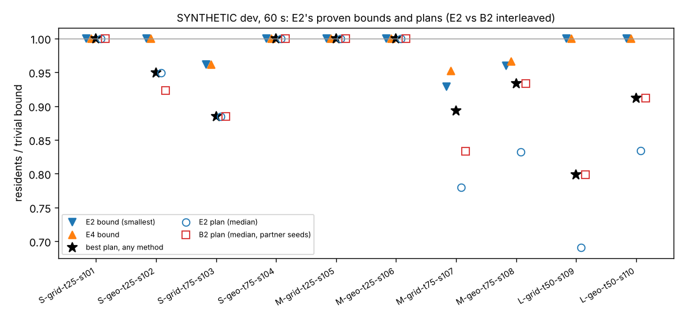

# E2: column generation over vehicle itineraries, with a proven bound (SYNTHETIC dev)

**Type:** planner with a proven upper bound. **Track:** C, Phase 1 batch 2. **Data:** the frozen SYNTHETIC dev
split only (rule 5: no test instance is generated, read or run; the KR-2025 data are never opened). **Label:** every
number and figure here is SYNTHETIC. **Code:** `evacplan/src/evacplan/methods/e2_colgen.py` (method `e2_colgen`),
`methods/e2_pricing.py` (the pricing dynamic programme on E4's network), `methods/e2_worker.py` (a persistent HiGHS
worker in a child process); tests in `evacplan/tests/test_e2_colgen.py`. Approved by Siyeong at checkpoint 3
(2026-11-02) as proposed: "Column generation (set partitioning over itineraries; pricing by a resource-constrained
shortest path on E4's network; its LP bound certifies its own plans). Hypothesis: within 60 s it matches B2 on S/M
and gives plan and bound on M. Kill if worst of 5 < B2 on M with no usable bound. About 5 h work, 1.5 h bench."

## Pre-registration (written before any dev run)

What had been run before this section was written: construction times of `Reach` and of E4's `FlowNetwork` (no LP)
on four generated SYNTHETIC instances outside the split (`S-grid-t75-s9801`, `M-grid-t75-s9802`, `M-geo-t25-s9803`,
`L-geo-t50-s9804`; 0.6 s, 1.6 s, 2.5 s and 6 s), under the bench lock; HiGHS's dual sign convention on a two-row toy
LP. No dev instance has been generated, read or run by E2, and no E2 code existed.

**Amendment 1 (before any dev run; 2026-11-02, about 13:40 UTC).** Debugging on a generated SYNTHETIC instance
outside the split (`S-grid-t75-s9801`, one van) showed the bound right and the plan weak: E2 proved 22 (the optimum:
B1, B2 and B3 deliver 22, E4 proves 22) but planned 18. A DP path may board one facility on several visits beyond its
residents (the DP has no per-itinerary resident count; that is a relaxation, fine for the bound), and the realizer
then drops such boardings whole. Changes to the plan side only (the bound still uses only the RELAXED DP and
nonnegative prices, so its argument below is unchanged); nothing was fitted to any result:

1. *Capping.* Before a RESTRICTED column is realized, its boardings are capped by each facility's residents, first
   boardings first (`cap_sequence`).
2. *Residual re-optimization* (block-coordinate ascent): each vehicle in turn gets its best RESTRICTED itinerary
   given the other vehicles' columns: profit 1 per resident unloaded where shelter room is left, boarding only where
   residents are left, the paths capped by the residual residents and realized against the residual resources; a
   second DP pass forbids the facility classes the best paths over-boarded. One pass before the column generation (a
   constructive start: vehicles by decreasing space, then start time), then passes after the MIP until a pass changes
   nothing. Each vehicle has its own single-vehicle table for this (its type's clock unit).
3. *RESTRICTED moves* depart from any unit of their cell with that cell's travel time (arrival shifted by the delay),
   instead of waiting for the next cell start; still never earlier than the RELAXED arrival.
4. *Budget split:* the column generation stops at `deadline - (2 s + 40 % of the budget)` (was 25 %); the MIP gets up
   to 10 %, the re-optimization runs until `deadline - (1 s + 15 %)`, then a short MIP (5 %) if it found new columns;
   then the in-budget oracle check, per vehicle, only while the time left covers 1.5 x its estimated cost (legs x the
   slowest observed seconds per leg, a priori 30 ms: E1 measured 18-25.5 ms; an L plan costs about 40 s, so on L it
   mostly skips).

**Amendment 2 (before any dev run; 2026-11-02, about 14:50 UTC).** A second debugging run on generated SYNTHETIC
instances outside the split (`S-grid-t75-s9801`, `M-grid-t75-s9802`, `M-geo-t25-s9803`, `L-geo-t50-s9804`, and the
tests' tiny instance) gave plans of 20 / 123 / 121 / 354 against bounds of 22 / 139 / 132 / 583, and 3 against a
proven 5 on the tiny instance; on `M-grid-t75-s9802` E2 stopped after 16.5 s with the re-optimization at a local
optimum and 43 s unused, and on L the column generation managed two rounds in 19 s. Changes, again to the plan side
only and fixed from first principles, not fitted to any result:

5. *Lagrangian pricing of over-boarding in the re-optimization* (the standard Lagrangian heuristic for resource
   constraints a shortest-path DP does not track; Beasley and Christofides 1989): instead of forbidding a facility
   class a path over-boarded, each pass prices it halfway towards 1 (at 1 its residents would be worthless), up to 3
   passes, keeping the best capped and realized itinerary. (On the tiny instance the first pass shuttles to the
   nearer facility, whose 3 residents the cap keeps; at price 0.5 the far facility is served first: 5.)
6. *Large-neighbourhood search* after the re-optimization passes, until the re-optimization reserve: remove the
   itineraries of 1 to 3 random vehicles and re-insert them in random order with the single-vehicle DP (the exact
   repair of each), accepting any result that is not worse (residents, then vehicle time); numpy's generator seeded with
   the run's seed.
7. *Re-optimization clock:* 3 s (or the type's unit if coarser): every single-resident action rounded up by at most
   2 s, a 3x smaller table (computational).
8. *Column-generation round guard:* the column generation stops after any round (round 0 included) whose pricing and
   realization took more than 10 % of the budget, keeping the bound found so far: fewer than about 5 rounds cannot
   converge and only take the time from the plan (on the profiled L instance a round takes about 9 s).

**Amendment 3 (before any dev run; 2026-11-02, about 15:25 UTC).** With amendment 2 the generated instances gave 22 /
138 / 123 / 382 (S proven optimal, 22 = bound; M-t75 138 of a bound of 139), and the tests passed (one test's own
expected value was wrong and is fixed). The loose M instance stayed at 123 of 132: on loose instances the bus's
single-vehicle optimum takes ambulatory residents first and leaves wheelchair users without slots in time, and only 19
LNS iterations fit. E1's precedent (`e1_alns`, warm start) is followed:

9. *B1 warm start:* B1's earliest-deadline-first insertion (B1's own trip rule, `B1Greedy._trip` and `_key`) on E2's
   Reach, within at most 25 % of the budget; each vehicle's trips become a stop sequence, realized alone as a column;
   together they are B1's plan (it satisfies every master row). The constructive re-optimization pass of amendment 1
   (from an empty plan) also runs; the better of the two plans is the first incumbent. So E2 never plans fewer residents
   than B1's plan as realized here. (A first version started the pass from B1's plan instead: on the generated L
   instance that gave 365, below the 382 of the construction from an empty plan, so both are built.)

### Hypothesis

Within 60 s per instance, a Dantzig-Wolfe decomposition of the dispatch problem by vehicle (a set-packing master
over single-vehicle itineraries, priced by an exact dynamic programme on E4's contact-free time-expanded network)
(i) delivers as many residents as B2 on S and M, and (ii) proves, on every M instance, an upper bound on the residents
any plan can deliver that is at least as tight as E4's (160 and 144 on the two tight M instances, where the trivial
bound is 168 and 149).

### Why it might work (the math)

* **Decomposition.** Every constraint of the problem except three families is internal to one vehicle (its route,
  its clock, its space per class, its shift). The three coupling families are linear in what each vehicle does:
  residents per facility and class, shelter capacity per class, at most one itinerary per vehicle. Dantzig-Wolfe
  (Dantzig and Wolfe 1960) keeps the coupling rows in a master problem over whole itineraries and moves everything
  else into a pricing problem per vehicle, a resource-constrained longest path (Irnich and Desaulniers 2005; the
  VRPTW scheme of Desrochers, Desrosiers and Solomon 1992). By Geoffrion (1974), the master's LP optimum equals the
  Lagrangian dual over the convex hull of each vehicle's *integral* itineraries, so it is at least as tight as any
  LP that lets fractions of one vehicle work in parallel, which is what E4's bound has to fight with trip cuts and
  free-space rows (E4 README, amendment and next steps).
* **A bound at every iteration, whatever the solver does.** For any nonnegative prices `y` on the coupling rows,
  weak Lagrangian duality gives: residents delivered by any plan <= `y . b + sum over vehicles of max(0, best
  itinerary value at y)` (Lübbecke and Desrosiers 2005, Sect. 2.1). The right-hand side needs only an exact (or
  relaxed) pricing solve; it does not need the master LP to be optimal or converged. E2 evaluates it in every round
  and keeps the smallest value.
* **Why plans might be good.** The integer plan is a set-packing MIP over generated itineraries (price-and-branch).
  It chooses whole itineraries jointly for all vehicles against shared residents and shelter room, which neither B2
  (static times, hazard only in the windows) nor a greedy can do; the duals price what each facility's residents and
  each shelter's room are worth near the fire's deadlines.
* **Stabilisation.** Wentges's dual smoothing (Wentges 1997) with the standard mispricing rule (Pessoa, Sadykov,
  Uchoa and Vanderbeck 2018) against the tailing-off of plain column generation.

### The method (`e2_colgen`)

**Network.** E4's `FlowNetwork` (reused by import, `grouping="vehicle"`, E4's step rule: `delta` = 60 s on instances
with at most 10 facilities, 120 s otherwise, reduced automatically to the shortest free-flow time between two
locations): locations = facility and shelter nodes; the kept moves `(i, k) -> (j, EA)` (NEGATIVE earliest arrival
`EA` leaving `i` at `k delta`, departure cut-off, dominated moves pruned); each vehicle's entries; each site's action
sets per class (`Site.usable`); the trip limits (`FlowNetwork.trip_limits`).

**Master (restricted, LP and MIP).** Columns are single-vehicle itineraries `p` with residents boarded
`a[p, f, c]`, unloaded `u[p, s, c]` and delivered `d[p] = sum u`. Rows: at most one itinerary per vehicle; residents
per facility and class; shelter capacity per class (only where it can bind); E4's trip cuts per vehicle and
facility, residents per class and boarding seconds (valid for every checked itinerary, E4 README step 8; only where
tighter than the residents). Objective: residents delivered (the first criterion). Tie-break in the integer master
only: minus `eps` x vehicle time of the realized itinerary, `eps` = 1 / (1 + sum over vehicles of their shift
lengths), so one resident always outweighs any time saving (third criterion). The second criterion (minimum safety
slack) is not modelled.

**Pricing: the clock DP.** For one vehicle and dual prices `y`, maximize (residents unloaded, each worth 1 minus the
shelter's capacity price) minus (residents boarded, each costing the facility's resident price plus the vehicle's
trip-cut prices). States: (time unit `u`, location, load per class), the clock in units of `g` seconds (`g` divides
`delta`). Transitions: wait one unit; board or unload ONE resident of one class at one site of the location, taking
that resident's seconds; take one of E4's moves; enter at the vehicle's entries; end with an empty vehicle. A dense
table over (unit, vehicle of a batch, location, load) computed in blocks shorter than the shortest action (numpy,
vectorized over loads and over the vehicles of one type). Two modes on the same table:

* RELAXED (the bound, and columns for the LP): times rounded down to units (`floor`), each action allowed at unit
  `u` iff `u >= floor(lo / g)` and `u + floor(secs / g) <= floor(hi / g)` for an interval `[lo, hi]` of the site's
  action set for the class, and by the vehicle's shift end; a vehicle anywhere in cell `k` may take a move from
  `(i, k)` (E4's semantics: the departure is rounded down to the cell start), arriving at unit `floor(EA / g)`.
* RESTRICTED (columns for the integer plan): times rounded up (`ceil`), a move from `(i, k)` only at the cell start
  `k delta`, arriving at `ceil(EA / g)`. Its columns are then realized.

Columns are read off the table by backtracking from the best empty end state at each location (at most 3 per
vehicle and mode per round). **Clock unit rule (fixed a priori):** per vehicle type, `g` = the smallest divisor of
`delta` that is at most the shortest positive per-resident boarding or unloading time of a class the type carries
(so every action advances the relaxed clock), with all vehicles of the type in one batch, such that the table has at
most 24 million cells (192 MB); if none fits, the batch is split. (On the profiled instances: S and M `g` = 1 s; L
`g` = 1-4 s by type.)

**Rounds.** Round 0 prices at `y = 0`. Then each round: solve the master LP (HiGHS, warm-started simplex in a
persistent child process); smoothed prices `y_sep = 0.5 y_center + 0.5 y_LP` (`y_center`: the prices with the best
bound so far); RELAXED DP at `y_sep` for every vehicle: the Lagrangian bound `L(y_sep)` (kept if smaller), columns
with positive reduced cost at the LP's prices go to the master; if none does (mispricing), the RELAXED DP runs again
at `y_LP` in the same round, and if that finds none either, the LP is optimal over all relaxed itineraries
(converged). RESTRICTED DP at `y_LP`: its columns are realized one by one (`methods.realize`, ASAP on the POSITIVE
masks, as B2 and B3 do; each column alone, with every resident and all shelter room available) and the realized
versions (residents actually kept) enter both masters. Stop when the LP has converged, when the floored bound equals
the best integer plan (proven optimal), or at the reserve.

**Integer plan.** A greedy packing of the realized columns each round (an incumbent); at the end the set-packing
MIP over the realized columns (HiGHS, one thread, the greedy as start, up to 10 % of the budget). Any selection
the MIP's rows allow realizes exactly as its columns did alone: vehicles do not interact on roads (ASSUMPTIONS #6,
#16), and the rows keep the residents and shelter room the realizer shares. **In-budget oracle check:** if at least
12 % of the budget is left, the plan is checked by the oracle (`Oracle.check_plan`); a vehicle with a trip that is
not `checked` (peak or dose, which the masks do not model) has its column cut before that trip and realized again,
the old column is forbidden and the MIP re-solved (at most 2 such repairs). The harness then certifies the returned
plan with a fresh oracle, outside the budget. **Budget:** setup (Reach, FlowNetwork, DP tables) and everything else
inside the 60 s; the column generation stops at `deadline - (2 s + 0.25 budget)`; the final MIP gets up to 10 % of
the budget, the oracle check the rest of the reserve. Single-threaded throughout (the parent waits while HiGHS
runs). `seed` = HiGHS's random seed; otherwise deterministic (repeats differ only when the time limit binds).

### Why the bound is valid (the argument)

Notation: a *checked plan* is any plan and its oracle result; residents count as delivered iff their trip is
`checked`. Fix any nonnegative prices `y` (the LP's, smoothed, or zero; HiGHS's status and tolerances do not
matter) and any checked plan `P`.

1. *Keep only what counts* (E4 step 1). Per vehicle keep the itinerary up to its last delivering unloading and of
   each boarding only the residents that are delivered. Everything kept is checked; loads and seconds of work only
   drop. Call `q_v` vehicle `v`'s kept itinerary (empty if it delivers nobody) and `A(q_v)` its row usage.
2. *The kept plan satisfies every master row.* Residents per facility and class: they were boarded at boardings
   the validator accepted (no overboarding). Shelter capacity: first come first served flags any excess. Trip cuts:
   E4 step 8, for each vehicle alone. So `sum_v A(q_v) <= b`.
3. *Each `q_v` is a path of the RELAXED clock DP with the same counts* (shown below). Then its value at `y` is at
   most the DP's optimum `DP_v(y)`, and at most `max(0, DP_v(y))` also for an empty `q_v`.
4. Hence `delivered(P) = sum_v d(q_v) = sum_v [d(q_v) - y A(q_v)] + y sum_v A(q_v) <= sum_v max(0, DP_v(y)) + y b`
   (step 2 and `y >= 0`). E2 reports `floor(that + 1e-6)`, the smallest over the rounds, and at most the resource
   bound (`timexp.trivial_bound`). The sum `y b` is taken with `math.fsum`; the margin covers the float error of the DP
   (at most ~1e-11 here: sums of at most ~10^4 terms of size ~1).

Step 3, the mapping. With a complete 1 s lattice (persistent burning and whole-second data, ASSUMPTIONS #72;
otherwise `FlowNetwork` refuses and E2 claims only the resource bound), every time of the kept itinerary may be
floored to a whole second and stays feasible (E4 step 3). Let `tau` be the DP vehicle's clock (in seconds, `u g`)
and `t` the real one. By induction the DP vehicle is at the same location with the same load and `tau <= t`:

* *Entry.* E4's entries: at the depot's location at the start time, or (depot not a location) at the first
  facility at the NEGATIVE earliest arrival from the depot at the start, which is no later than the real arrival
  (E4 step 3; the first kept stop boards someone, so it is a facility).
* *Waits.* The DP may wait any number of units at any location (the NEGATIVE relaxation waits anywhere).
* *Actions.* Each real boarding or unloading of `n` residents is `n` back-to-back single-resident actions of
  whole seconds; each lies inside one interval `[lo, hi]` of the site's action set for its class (E4 step 4:
  boarding starts at or after the release, ends before the node ignites and before `LD_neg + 1`; unloading inside
  a window, by the horizon, before the shelter node ignites) and ends within the shift. The DP vehicle, being no
  later, starts the same resident at unit `floor(t0 / g) >= floor(lo / g)` (waiting if needed) and ends at
  `floor(t0 / g) + floor(secs / g) <= floor((t0 + secs) / g) <= floor(hi / g)` (floors are superadditive), i.e.
  no later than the real end. Loads per class stay within `[0, space]` because the real ones do. Several sites at
  one location (co-located facility and shelter) are covered: any interleaving of single-resident actions is a DP
  path.
* *Moves.* The real drive leaves location `i` at `beta` (cell `k = floor(beta / delta)`) and reaches the next kept
  stop `j` at `alpha'`. E4 step 3 shows that the move `(i, k) -> j` exists in E4's network (departure cut-off,
  arrival by the end of `j`'s action sets, alive nodes) with `EA <= alpha'`, or, if it was pruned as dominated, a
  path of two kept moves through another location that arrives no later than `EA` (E4's pruning rule: an earlier
  cell, or the same cell no later, i.e. arrival time `<= EA`). The DP vehicle at `tau <= beta` waits until cell `k`
  (if it is earlier) and takes that move or path: RELAXED mode lets any unit of cell `k` take the move, and `g`
  divides `delta`, so cell membership of a unit is exact. It arrives at unit `floor(EA / g) <= floor(alpha' / g)`.
* *End.* The kept itinerary ends with an unloading after which nobody is on board: an empty DP state, which may end.

So the DP optimum covers every kept itinerary; with `g > 1` the floors only enlarge the DP's feasible set. If a
block of the DP ever had an action of zero units (a zero-second boarding or unloading), positive-value cycles of
such actions at one location would make the DP unbounded; E2 then detects them and claims only the resource bound
for that instance (this cannot happen on the SYNTHETIC generators, whose shortest action is about 24 s).

**What is relaxed** (each only enlarges the DP's set of itineraries): the departure from a location rounded down to
its cell start (E4); NEGATIVE travel (only certain contact blocks, waits anywhere, no turn rules, unknown cells
passable; E4); actions checked only against the sites' action sets (no stay contact check beyond node ignition, no
dose, no peak flux); no per-itinerary limit on residents boarded per facility (the master's rows limit the total);
`g`-rounding. **Nothing in the bound depends on** the master LP being solved to optimality, on the columns
generated, on the RESTRICTED mode, on realization or on HiGHS's tolerances: only on `y >= 0` and an exact RELAXED DP.

E2 declares no state about any plan (rule 3): its plans are checked by the oracle in the harness; its in-budget
oracle call only decides which columns to keep.

### Setup

* Instances: the 10 frozen dev instances (4 S, 4 M, 2 L), SYNTHETIC, regenerated and fingerprint-checked by the
  harness. Budget 60 s per instance and seed, seeds 0-4 (comparison rule, DECISIONS 2026-11-01).
* Final run (DECISIONS 2026-11-02 item 5): B2 interleaved with E2 (ABAB, a speed probe before every pair) in one
  lock hold per group, through the harness: hold 1 = the 8 S and M instances, hold 2 = the 2 L instances:
  `benchlock.py --wait-max 1800 --label E2-final-SM -- evacplan run --method e2_colgen --interleave-with b2_vrptw
  --set dev --budget-s 60 --repeats 5 --partner-seed-offset 5 --instances <ids>`. Nothing else heavy runs beside a
  hold. `--partner-seed-offset 5` (orchestrator, 2026-11-02): E1b's holds wrote B2 seeds 0-4 on all 10 dev instances on
  this host, so B2's partner seeds here are 5-9 in both holds (nothing collides, and every B2 seed covers all 10).
* Before the final run, one smoke run (one S and one M instance, seed 0) into a scratch results directory, so no dev
  row is written before the final run. Any change after that smoke is a deviation and is recorded here.
* Parameters: `config.yaml` (and the method's defaults, recorded in every row's config).

### Baseline, metric, validity checks

* Baseline: B2 (`b2_vrptw`) in the same interleaved holds (same machine state, alternating). The bar for beating B2 on
  this host is 1751 (the leaderboard's rule, with the recorded 1750/1751).
* Metrics: residents delivered per instance and seed (oracle `checked`), per-seed totals over the 10 instances and
  over the 4 M instances, worst of 5; E2's proven bound per instance and its gap to the best plan; time to certified
  plan (runtime + the harness's `certify_s`).
* Validity checks (a bound-only failure is a bug, not a result): (1) every E2 bound is at least every delivered value
  of every method in every row on dev (any seed, budget or host), the same check as E4's `check_validity.py`;
  (2) tests: bound >= the brute-force optimum on tiny generated instances (B3's and E4's tiny instance and its random
  off-grid variants); bound >= every oracle-checked plan (random plans, B0, B1, B3, E2's own) on random small
  instances; E2's plans are oracle-valid; the budget is respected; same seed, same plan (when the time limit does not
  bind).

### Budget and decision rule

Time-box: about 5 h of work; bench: tests and the smoke (about 20 min) plus the two interleaved holds (about 90 and
35 min including B2's partner runs and cold certification; the approved 1.5 h predates the interleaving).

* **KEEP** if the leaderboard verdict is "beats B2" (worst of 5 above the bar 1751).
* **ITERATE** if not, but either (a) E2's worst-of-5 total over the 4 M instances is at least B2's worst-of-5 total
  over the same 4 M instances in the same interleaved hold, or (b) E2 proves a valid bound on every M instance (in
  every E2 row there) that is strictly below the trivial bound on at least one of the two tight M instances
  (`SYNTHETIC-M-grid-t75-s107`: 168, `SYNTHETIC-M-geo-t75-s108`: 149), the smallest E2 bound per instance counting.
* **KILL** otherwise.

## Results

**Smoke** (dev, seed 0, one S and one M instance, into a scratch results directory: no dev row was written before the
final run): `SYNTHETIC-S-geo-t25-s102` 37/39 in 53.6 s, `SYNTHETIC-M-grid-t75-s107` 131/168 with a proven bound of 156 in
56.6 s, both within the budget and every trip checked. **No change was made after it** (no deviation): the final run
used the same commit, `ceca7380`.

**Final run** (DECISIONS 2026-11-02 item 5): B2 interleaved with E2 (ABAB, a speed probe before every pair) through
`evacplan run --method e2_colgen --interleave-with b2_vrptw --set dev --budget-s 60 --repeats 5 --partner-seed-offset 5`,
commit `ceca7380`, host `vm (Linux x86_64, Intel(R) Xeon(R) Processor @ 2.80GHz, 4 cpu, python 3.12.3, vm boot 4169abd4)`:
hold `20261102T153902Z-e2_colgen-x-b2_vrptw-o5` (the 8 S and M instances, 40 pairs, 15:39-16:44 UTC) and hold
`20261102T164918Z-e2_colgen-x-b2_vrptw-o5` (the 2 L instances, 10 pairs, 16:49-17:18 UTC). Rows:
`evacplan/results/e2_colgen.csv` (+ `.facilities.csv`), B2's partner rows (seeds 5-9) in `b2_vrptw.csv`, the speed checks in
`results/speed/speed_check.csv`; the table below and `results.csv` come from `analyze.py` (rows only). Every row is within
the budget (leaderboard: 0 over budget), and every E2 and B2 trip in both holds is `checked` (0 unresolved, 0
model_no_route).

Per instance and seed, E2 / its B2 partner of the same pair (B2 seed = E2 seed + 5); bounds: trivial (residents of
servable classes), E4 (bound only, previous host's rows), **E2** (smallest; the same in every seed); time to certified
plan = runtime + the harness's certification, median over the seeds (s); SYNTHETIC:

| instance (SYNTHETIC) | residents | trivial | E4 bound | **E2 bound** | seed 0 | seed 1 | seed 2 | seed 3 | seed 4 | best plan, any method | E2 t-cert | B2 t-cert |
|---|---|---|---|---|---|---|---|---|---|---|---|---|
| S-grid-t25-s101 | 23 | 23 | 23 | **23** | 23 / 23 | 23 / 23 | 23 / 23 | 23 / 23 | 23 / 23 | 23 | 5.1 | 59.0 |
| S-geo-t25-s102 | 39 | 39 | 39 | **39** | 37 / 36 | 37 / 36 | 37 / 36 | 37 / 36 | 37 / 36 | 37 | 56.9 | 61.3 |
| S-grid-t75-s103 | 27 | 26 | 25 | **25** | 23 / 23 | 23 / 23 | 23 / 23 | 23 / 23 | 23 / 23 | 23 | 52.1 | 58.9 |
| S-geo-t75-s104 | 26 | 26 | 26 | **26** | 26 / 26 | 26 / 26 | 26 / 26 | 26 / 26 | 26 / 26 | 26 | 4.0 | 58.6 |
| M-grid-t25-s105 | 163 | 163 | 163 | **163** | 163 / 163 | 163 / 163 | 163 / 163 | 163 / 163 | 163 / 163 | 163 | 23.0 | 61.9 |
| M-geo-t25-s106 | 155 | 155 | 155 | **155** | 155 / 155 | 155 / 155 | 155 / 155 | 155 / 155 | 155 / 155 | 155 | 18.2 | 61.8 |
| M-grid-t75-s107 | 168 | 168 | 160 | **156** | 131 / 140 | 131 / 140 | 131 / 140 | 134 / 140 | 138 / 140 | 150 | 60.4 | 62.7 |
| M-geo-t75-s108 | 149 | 149 | 144 | **143** | 124 / 139 | 124 / 139 | 123 / 139 | 124 / 139 | 124 / 139 | 139 | 62.1 | 63.3 |
| L-grid-t50-s109 | 646 | 646 | 646 | **646** | 446 / 516 | 446 / 516 | 421 / 516 | 421 / 516 | 455 / 516 | 516 | 81.6 | 88.6 |
| L-geo-t50-s110 | 579 | 579 | 579 | **579** | 483 / 528 | 483 / 528 | 483 / 528 | 483 / 528 | 483 / 528 | 528 | 81.0 | 83.0 |

**Totals** per seed 0-4 (E2 / its B2 partners): all 10 instances E2 1611, 1611, 1585, 1589, 1627 / B2 1749 in every seed;
the 4 M instances E2 573, 573, 572, 576, 580 / B2 597; the 4 S instances E2 109 / B2 108 in every seed. Leaderboard
(this host): E2 1611 [1585–1627], verdict **no (worst 1585 ≤ bar 1751)**; mean time to certified plan E2 44.8 s, B2 65.8 s.

**Bounds (what works).** E2 proves, inside the 60 s budget, the tightest bounds known on both tight M instances: **156**
on `M-grid-t75-s107` (E4 160, trivial 168; the column generation converged in 10-14 rounds, 12-18 s, Lagrangian value
156.89-156.95) and **143** on `M-geo-t75-s108` (E4 144, trivial 149; 16-19 rounds, not yet converged when its 34 s share
ran out, Lagrangian value 143.52-143.67), in every seed, against E4's 165-200 s per M instance. Against the best plan of any
method, the certified gap is 3.8 % on s107 (150, E1's) and 2.8 % on s108 (139), against E4's 6.25 % and 3.5 %: E2 closes
67 % and 60 % of the trivial gap (E4: 44 % and 50 %). On `S-grid-t75-s103` it proves 25, as E4. On L it claims only the
resource bound: the column generation gets 0-5 rounds there (a round takes 5-9 s; the round guard of amendment 2 stopped it
after round 0 in three of the five L-grid seeds), and its Lagrangian values (715-876) stay above the resource bounds (646,
579). Where a plan reaches the bound (S-s101, S-s104, M-s105, M-s106) E2
proves it optimal and stops: certified plans in 4-23 s, against B2's ~60 s.

**Validity check** (the core): **0 violations** over the 50 E2 rows against 370 plan rows of 7 methods on dev (any seed,
budget or host, `analyze.py`): every E2 bound is at least every delivered value. Tests (`tests/test_e2_colgen.py`, 35
passed under the bench lock at `ceca7380`): bound >= the brute-force optimum on B3's tiny instance and 10 off-grid variants;
bound >= every oracle-checked plan (random plans, B0, B1, B3 every third seed, E2's own) on 12 random small instances; the
Lagrangian value covers the optimum for random nonnegative prices; the RESTRICTED optimum never exceeds the RELAXED one and
every path read off the table carries its table value; E2's plans pass the validator and the oracle; the budget (an M
instance at 20 s); the same seed gives the same plan when no phase runs into the time limit; only the resource bound on an
incomplete lattice; the worker's dual signs, errors and kill path; no `highspy` in the parent process.

**Plans (what does not).** E2 matches or beats B2 on S (S-geo-t25-s102: 37 against 36 in every seed, the best plan
known) and matches it on the loose M instances (163, 155, proven optimal), but falls short on the tight M instances (131-138
against 140; 123-124 against 139) and on L (421-455 against 516; 483 against 528). The integer side (realized columns, the
set-packing MIP, residual single-vehicle re-optimization, LNS) cannot match B2's routing search where vehicles must
interleave many facilities near their deadlines: on M-s107 the best of its starts is the DP construction (131; B1 100), LNS
adds 0-7; on M-s108 the starts give 101 (B1) and 86, LNS reaches 123-124. On L each single-vehicle DP takes 0.26-0.41 s,
so 0-2 LNS iterations fit (starts: B1 335 and 395, the DP construction 380 and 334); on L-grid the two seeds whose column
generation ran 2 rounds instead of stopping at round 0 planned 421 against 446-455. Secondary: at the provisional 30-min default margin E2 delivers more than B2 (1350
[1330–1356] against 1284 [1284–1285]; more on S-s102, M-s105, M-s108 and L-s110, fewer on M-s107 and L-s109): its
re-optimization prefers earlier, shorter itineraries.

**Speed check.** The speed probes spread 114-115 % within each hold (0.09-0.25 s; flagged by the leaderboard), so the
machine's speed varied during the holds; ABAB alternation exposes both methods to the same conditions, and B2's 5 partner
seeds gave identical totals.

**Bench time** (all under the lock): profiling and three debugging/test runs on generated instances (about 25 min), the smoke
(2.5 min), the holds (65 + 28.5 min), the leaderboard: about 2 h, of which 1.5 h in the final holds (the approved 1.5 h
predates B2's interleaving). Work time: about 5 h.

### Decision: **ITERATE**

By the pre-registered rule: not KEEP (worst of 5 = 1585, not above the bar 1751; leaderboard verdict "no"). (a) fails: E2's
worst-of-5 M total 572 < B2's 597 in the same hold. (b) holds: every one of the 20 E2 rows on M carries a valid bound, and
it is strictly below the trivial bound on both tight M instances (156 < 168, 143 < 149), in every seed. Hence **ITERATE**.

### Next step

1. **Use E2 as the certificate, not the planner.** Its bound is the best proven on M within 60 s and needs no plan; paired
   with the best planner it turns plans into certified gaps (s107: E1's 150 against 156; s108: B2's 139 against 143). Any
   planner's itineraries can enter E2's master as columns (the bound is unaffected), so the MIP and LNS would start from the
   best plan instead of B1's.
2. **Tighten the bound further:** M-s108's column generation had not converged at 34 s (its LP value can only be lower than
   143.5); give the bound-only use a larger budget, and add the remaining E4-style strengthenings as master rows.
3. **Plan side, if pursued:** per-facility resident counters in the RESTRICTED DP (limited-memory labels, as ng-routes) so
   that columns stop over-boarding at the source; branch-and-price diving on the realized columns; a faster DP on L (the
   numpy block loop is the bottleneck, 0.26-0.41 s per single-vehicle table there).

### Questions for Siyeong

1. Should E2 continue as the bound/certificate provider for the best planner (next step 1) rather than as a standalone
   planner?
2. At the provisional 30-min margin E2 delivers more than B2 (1350 against 1284) while delivering fewer in total: should
   the margin-weighted count enter the verdict once the margin is final?

## References

Beasley, J. E., Christofides, N. (1989). An algorithm for the resource constrained shortest path problem. *Networks*
19(4), 379-394. Dantzig, G. B., Wolfe, P. (1960). Decomposition principle for linear programs. *Operations Research* 8(1), 101-111.
Desrochers, M., Desrosiers, J., Solomon, M. (1992). A new optimization algorithm for the vehicle routing problem
with time windows. *Operations Research* 40(2), 342-354. Geoffrion, A. M. (1974). Lagrangean relaxation for integer
programming. *Mathematical Programming Study* 2, 82-114. Irnich, S., Desaulniers, G. (2005). Shortest path problems
with resource constraints. In *Column Generation*, Springer, 33-65. Lübbecke, M. E., Desrosiers, J. (2005). Selected
topics in column generation. *Operations Research* 53(6), 1007-1023. Pessoa, A., Sadykov, R., Uchoa, E., Vanderbeck,
F. (2018). Automation and combination of linear-programming based stabilization techniques in column generation.
*INFORMS Journal on Computing* 30(2), 339-360. Wentges, P. (1997). Weighted Dantzig-Wolfe decomposition for linear
mixed-integer programming. *International Transactions in Operational Research* 4(2), 151-162.
