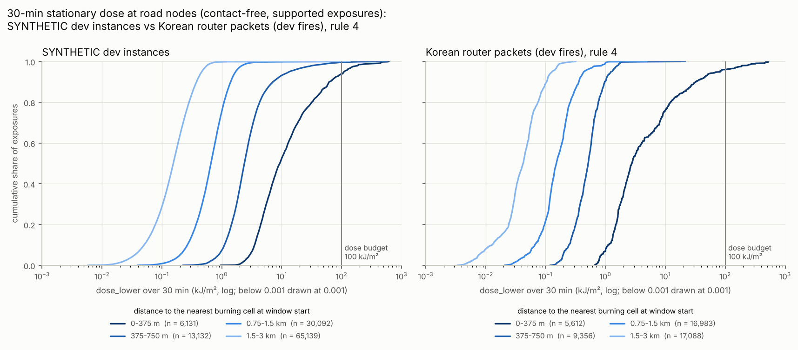
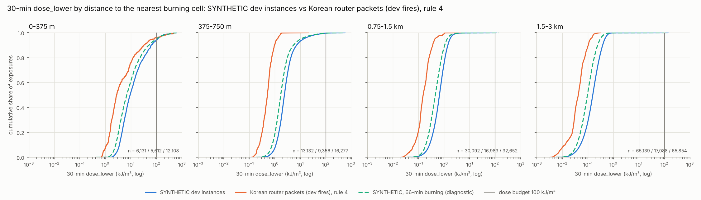
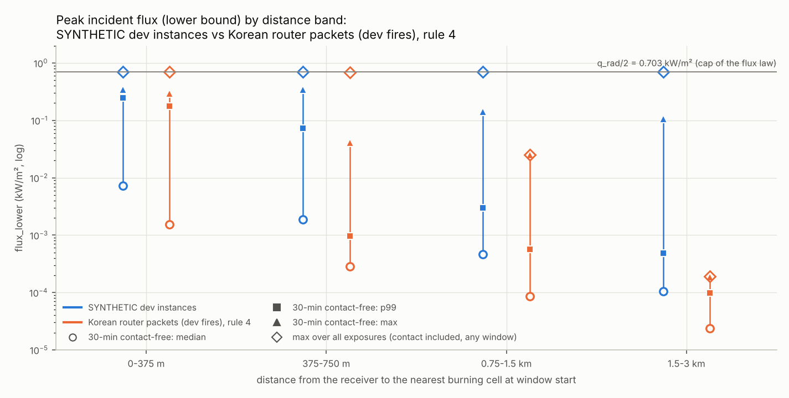

# H0: hazard intensity, SYNTHETIC dev instances vs Korean router packets (dev fires)

**Type:** measurement (analysis), not a method experiment. No tuning; generators, methods and
`hazard_contract` are unchanged. **Decision:** n/a (analysis). **Data:** dev only (frozen SYNTHETIC
dev split; Korean dev fires). **Label:** every SYNTHETIC number and figure says SYNTHETIC.

## Pre-registration (written and committed 2026-11-01, before any flux, dose, contact, support or distance value was computed)

### Why

Siyeong, `program/DECISIONS.md` 2026-11-01 item 4: "Report the peak flux and cumulative dose
distributions on the synthetic instances alongside the real Korean panel (peak about 0.7 kW/m²). If
synthetic hazards are much hotter, tell me before tuning to them." E1 (ALNS with the oracle in the loop)
is not tuned until this verdict is in.

Background. The SYNTHETIC fires burn persistently: every ignited cell keeps burning at the flaming rate
for 48 h, i.e. through the horizon, with the packets' heat parameters (`evacplan/docs/ASSUMPTIONS.md`
#43, #44). In the Korean router packets a cell burns about 66 min (T = 3970 s; present fire until the
packet's `R_max`). Both use the `sheet_solid_angle_v1` flux law (`hazard_contract/README.md`) with the
same q_rad = 1.406 kW/m², so total flux never exceeds q_rad/2 = 0.703 kW/m² in either panel: peak flux
is capped the same way, while dose near burned areas can differ a lot.

### What was looked at before this pre-registration

Structural metadata only: grid shapes, K, horizons, node counts and the time per query (about 2 ms
per single-point query returning all members). No flux, dose, contact, support or distance value.

| panel | sources | K | horizon | grid (cells of 375 m) | receivers |
|---|---|---|---|---|---|
| SYNTHETIC | 10 dev instances (4 S, 4 M, 2 L) | 8 | 3 h (S), 4 h (M), 6 h (L) | roads + 2 cells, 4 km of wildland to the west | 80-475 road nodes per instance, 2,091 in total |
| Korean | 3 dev fires × 3 packets | 4 | 1 h (3600 s) | Uljin 62×58, Hongseong 18×18, Miryang 17×11 (= the graphs' grids) | graph nodes: Uljin 9,372, Hongseong 915, Miryang 1,494 (all inside their grids) |

### Panels

- **SYNTHETIC:** the 10 frozen dev instances, regenerated through `evacplan.instances` (dev only, the
  frozen fingerprints are verified), each with its K = 8 scenario set. Receivers: every road node.
- **Korean:** the router packets of the dev fires only, `uljin_2022`, `hongseong_2023` and
  `miryang_2022`, 3 packets each, under `$WFG_ROUTING_INPUTS/latest_inputs_try02/packets/`.
  Converted only through `hazard_contract.from_wfg_packet` (default `present_fire="enclosure"`, rule 4
  applied with no opt-out); H0's code never reads a packet file (see the note below). Receivers: the
  nodes of the matching router graph `$WFG_ROUTING_INPUTS/graphs/<fire>/graph.json`, read through
  `evacplan.adapters.wfg_graph`, restricted to nodes strictly inside the scenario grid (all of them).
  The script refuses any other fire name. `uiseong_andong_2025` and `yeongdeok_2025` (KR-2025 test
  season, rule 5) are never opened.

**Note (batch-1 review, 2026-11-01; added after the pre-registration, changes nothing in H0).** The
Korean bullet said "evacplan code never reads a packet file", which was too broad: from 997d6d7a
(2026-10-31) until this review, evacplan's real-data adapter tests
(`evacplan/tests/test_adapter_wfg_graph.py`) read the KR-2025 road graphs and packet grid metadata in
every suite run with `WFG_ROUTING_INPUTS` set (each packet's whole `NATIVE_METADATA.json`, which in the
dev packets also holds the present-fire cells at issue time; no other packet file). Found by the
batch-1 review, fixed by restricting those tests to the three dev fires (orchestrator), and reported to
Siyeong at checkpoint 3.

### Exposures

- A stationary receiver at a node over windows of 5, 15, 30 and 60 min, queried with
  `ScenarioSet.query` on a single-point geometry (a stationary occupancy), all members at once.
- Windows start every 10 min from the issue time (t0 = 0, 10, 20, ... min) and must end by the horizon
  (t0 + length ≤ `horizon_s`). Windows per node: Korean 6 / 5 / 4 / 1 (for 5 / 15 / 30 / 60 min);
  SYNTHETIC S 18 / 17 / 16 / 13, M 24 / 23 / 22 / 19, L 36 / 35 / 34 / 31.
- Per (node, window, member) record: contact (certain = `True`, none = `False`, unknown = `None`),
  supported, flux_lower, flux_upper (kW/m²), dose_lower, dose_upper (kJ/m²).
- **No subsampling.** Every node, window and member is queried: 565,488 Korean queries (2,261,952
  exposures, of which 565,488 are 30-min windows) and 218,952 SYNTHETIC queries (1,751,616 exposures, of
  which 437,904 are 30-min windows), plus 54,738 queries for the persistence diagnostic below. That is
  about 29 CPU-minutes, run as 4 worker processes inside one bench-lock hold (budget: 30 min of lock
  time). No randomness is used anywhere.

### Distance bands

- d = Euclidean distance from the receiver to the nearest closed cell square that is supported and
  burning at the window start t0 in that member (`ignite_s ≤ t0 < extinguish_s`, the members' burning
  intervals read from the `hazard_contract` objects); in-grid cells only; d = 0 when the receiver lies
  on or in such a cell. Unknown (unsupported) cells are not known to burn, so they never set d.
- Bands: **0-375 m** [0, 375), **375-750 m** [375, 750), **0.75-1.5 km** [750, 1500),
  **1.5-3 km** [1500, 3000]. Exposures with d > 3 km or no burning cell are counted as "beyond" and
  are not part of the rule.

### Statistics

- Distribution statistics use **contact-free, supported** exposures (`contact is False`, which implies
  `supported`). The share with certain contact (would be `model_no_route`) and the share unsupported
  (would be `unresolved`) are reported separately, per panel × band × window length and overall.
- Per panel × band × window length:
  - n, median, p90, p99 and max of flux_lower and dose_lower;
  - the same for flux_upper and dose_upper over finite values, with the share infinite;
  - the share with dose_lower ≥ 100 kJ/m² (the dose budget), and the same for dose_upper.
- Quantiles: `numpy.quantile` with its default linear method.
- Overall peak flux over **all** exposures, contact and unsupported included: max flux_lower and max
  finite flux_upper per panel (and per band), to confirm the ~0.7 kW/m² cap in both panels.

### Pre-registered rule

SYNTHETIC is **"much hotter"** if, in any distance band with at least 200 contact-free supported
exposures in both panels, for the 30-min windows, either:

1. the SYNTHETIC median or p90 of dose_lower is at least 2× the Korean value; or
2. the SYNTHETIC share of exposures with dose_lower ≥ 100 kJ/m² is at least 2× the Korean share and at
   least 1 percentage point higher.

Applied exactly as written, with these readings fixed in advance: "at least 2×" is SYNTHETIC ≥ 2 ×
Korean; if both values are 0 the criterion is not met, and a Korean 0 against a positive SYNTHETIC value
meets it; shares are fractions of the band's contact-free supported 30-min exposures and use ≥ 100. A
band where either panel has fewer than 200 contact-free supported 30-min exposures (for example because
rule 4 leaves Korean cells unsupported) cannot be judged by the rule; the report says so. If no band can
be judged, `much_hotter` is false and the report says the rule could not be applied anywhere.

**Descriptive label** per judged band, from r = √(r_median × r_p90), the geometric mean of the
SYNTHETIC/Korean ratios of the 30-min dose_lower median and p90: **much hotter** if the rule triggers;
otherwise **hotter but not much** if r ≥ 1.25, **cooler** if r ≤ 0.8, **comparable** if 0.8 < r < 1.25.
Overall label: much hotter if any band triggers; otherwise hotter but not much if some band is hotter
and none is cooler, cooler if some band is cooler and none is hotter, comparable if all judged bands
are comparable, and "comparable (mixed)" if both hotter and cooler bands occur.

### Secondary analyses (descriptive only, never part of the rule)

1. Per-source breakdown (each SYNTHETIC instance; each Korean fire and packet) of the 30-min table.
2. SYNTHETIC restricted to windows that end by 3600 s, the Korean horizon ("SYNTHETIC first hour").
3. Persistence diagnostic: the same SYNTHETIC scenario sets with every burning interval cut to the
   packets' scalar burn duration (extinguish = ignite + 3970.46 s; same ignitions, same heat law),
   30-min windows only. Built in memory with `hazard_contract.ScenarioSet`'s public constructor; the
   generator is untouched; labelled "SYNTHETIC, 66-min burning (diagnostic)". The rule's arithmetic is
   applied to it descriptively, to see whether persistent burning explains any difference.
4. Within-band distance distribution (p10, median, p90 of d) of the contact-free supported exposures,
   to show whether a band difference comes from where the receivers sit inside the band.
5. dose_upper compared with the same thresholds, because the Korean dose_lower counts unknown cells as
   not burning while the upper bounds count them as burning.

### Known biases (stated before the results)

- **Rule 4.** It leaves 32-100 % of Korean road cells unsupported, so the supported Korean exposures may
  be a biased subset (receivers whose own cells are known). The Korean dose_lower also ignores unknown
  cells, which biases it low near unknown areas.
- **Burn duration.** 48 h (SYNTHETIC, through every horizon) vs about 66 min (Korean; present fire until
  `R_max`, about 53-65 min). SYNTHETIC fires start 1 h before issue and keep everything burned so far
  burning for 3-6 h horizons; within the Korean 1 h horizon the difference is smaller.
- **Grid and fire size.** SYNTHETIC grids cover the road region plus 4 km of wildland; the Korean
  grids are fixed windows (62×58, 18×18, 17×11 cells), and sources outside a grid are not modelled.
- **Design.** The SYNTHETIC instances are built so that the fire threatens the facilities (ignition
  placed upwind, lead 30-150 min), so their roads lie in the fire's path by construction.
- **Horizon and timing.** 1 h vs 3-6 h: 30-min windows start at 0-30 min (Korean) vs 0 to horizon −
  30 min (SYNTHETIC). Secondary analysis 2 looks at the first hour only.
- **Members and receivers.** K = 4 vs 8. The Korean panel is about 80 % Uljin nodes and the SYNTHETIC
  panel about 56 % L-instance exposures. Exposures are strongly correlated (neighbouring nodes,
  overlapping windows, members), so n counts exposures, not independent observations.

### Outputs

- `h0_hazard_intensity.py`: computes everything from scratch (`compute`, then `analyze`); raw
  per-exposure records go to `evacplan/runs/H0-hazard-intensity/` (git-ignored, regenerable).
- `results.csv` (panel × band × window length, including the secondary panels), `results_by_source.csv`,
  `inventory.csv`, `peak_flux.csv`, `verdict.csv`; every row records commit, seed, config and host.
- `figures/`: CDFs of 30-min dose_lower by band, one plot per panel titled "SYNTHETIC dev instances" and
  "Korean router packets (dev fires), rule 4", the same per band with both panels overlaid, and peak
  flux by band.

## Results (computed 2026-11-01; nothing below this heading existed at pre-registration)

**Verdict: SYNTHETIC is "much hotter" under the pre-registered rule** (`much_hotter = true`). The rule
triggers in all four distance bands, each judged with at least 5,612 contact-free supported 30-min
exposures per panel (the threshold is 200):

- the median criterion triggers in every band;
- the p90 criterion triggers in the three outer bands;
- the over-budget-share criterion triggers in none.

Descriptive label: much hotter in every band and overall. Siyeong's item 4 applies: he decides before
E1 is tuned to these hazards.

**Run.**
- Commits: exposures at `144ae2b4` (clean), analysis at `6221c9b0`.
- Host: `vm (Linux x86_64, 4 cpu, python 3.12.3)`; hazard_contract 1.0.1 (format 1.0), numpy 1.26.4.
- Size: 784,440 + 54,738 queries, giving 4,013,568 + 437,904 exposure records.
- Time: 522 s in one bench-lock hold with 4 worker processes. The analysis and the post-hoc step took
  about 2 more minutes, also under the lock.
- No subsampling and no randomness (seed: none).
- The analysis refuses records that break the design, and every check held: one record per receiver,
  window and member; distance 0 implies certain contact; contact-free implies supported; windows end by
  the horizon; lower bounds ≤ upper bounds; flux_lower ≤ q_rad/2.

Reproduce from the worktree root (the routing inputs are never copied into the repo):

```sh
export WFG_ROUTING_INPUTS=/path/to/routing_inputs        # holds graphs/ and latest_inputs_try02/
for step in compute analyze posthoc; do
  .venv/bin/python program/benchlock.py --label H0-$step -- \
      .venv/bin/python evacplan/experiments/H0-hazard-intensity/h0_hazard_intensity.py $step
done
```

### The rule's inputs: 30-min dose_lower of contact-free supported exposures (kJ/m²)

| band | n, SYNTHETIC / Korean | median, SYNTHETIC / Korean | p90, SYNTHETIC / Korean | share ≥ 100 kJ/m², SYNTHETIC / Korean | criteria met | label |
|---|---|---|---|---|---|---|
| 0-375 m | 6,131 / 5,612 | 9.26 / 2.75 (3.36×) | 62.1 / 31.9 (1.95×) | 6.12 % / 3.99 % (1.53×) | median | much hotter |
| 375-750 m | 13,132 / 9,356 | 2.38 / 0.515 (4.62×) | 7.17 / 0.973 (7.37×) | 0.39 % / 0 % | median, p90 | much hotter |
| 0.75-1.5 km | 30,092 / 16,983 | 0.659 / 0.152 (4.34×) | 1.41 / 0.359 (3.91×) | 0.0033 % / 0 % | median, p90 | much hotter |
| 1.5-3 km | 65,139 / 17,088 | 0.155 / 0.042 (3.68×) | 0.378 / 0.104 (3.63×) | 0.0015 % / 0 % | median, p90 | much hotter |

The gap holds at every window length. The SYNTHETIC/Korean median ratio is 2.7-3.5× for 5-min windows
and 4.1-6.2× for 60-min windows (`results.csv`).

Doses near the budget occur almost only within 375 m of a burning cell, and there the tails differ less
than the medians: p90 1.95×, over-budget share 1.53×. For 15-min windows the Korean over-budget share is
even the higher one (1.99 % vs 1.45 %). Beyond 375 m, the 30-min dose_lower p99 stays far below the
budget in both panels: SYNTHETIC 57 kJ/m² at 375-750 m and at most 2.6 kJ/m² beyond 750 m, Korean at
most 1.7 kJ/m² (for the tail above the p99 and for dose_upper, see "What this means for E1").

### Contact and support (30-min windows, share of all exposures in the band)

| band | SYNTHETIC contact | SYNTHETIC unsupported | Korean contact | Korean unsupported |
|---|---|---|---|---|
| 0-375 m | 83.8 % | 0 % | 18.9 % | 43.6 % |
| 375-750 m | 4.2 % | 0 % | 0.02 % | 56.0 % |
| 0.75-1.5 km | 0.34 % | 0 % | 0 % | 68.1 % |
| 1.5-3 km | 0.05 % | 0 % | 0 % | 78.4 % |
| beyond 3 km | 0.004 % | 0 % | 0 % | 91.7 % |
| all | 7.4 % | 0 % | 0.50 % | 85.0 % |

- "Contact" is certain contact, which would be `model_no_route`.
- "Unsupported" means the query touched an unknown cell, which would be `unresolved`. None of these
  exposures had certain contact, so their contact is unknown.
- Support does not depend on the window, so the Korean unsupported share is 85.0 % at every window
  length. By fire: Uljin 83.7 %, Hongseong 81.2 %, Miryang 96.0 % (its 2022-05-31 10:00Z packet 100 %).
- 66-94 % of the cells of each Korean grid are unknown. SYNTHETIC has no unknown cells.

### Peak flux (the ~0.7 kW/m² cap)

| | SYNTHETIC | Korean |
|---|---|---|
| max flux_lower, all exposures (contact included, every window) | 0.702 kW/m² | 0.693 kW/m² |
| max finite flux_upper, all exposures | 0.703 kW/m² | 0.703 kW/m² |
| share of infinite flux_upper | 0 | 0 |
| max flux_lower, contact-free supported exposures | 0.342 kW/m² | 0.292 kW/m² |
| p99 flux_lower, contact-free 30-min, 0-375 m | 0.248 kW/m² | 0.177 kW/m² |

Both panels use q_rad = 1.406 kW/m², and the law caps flux at q_rad/2 = 0.703 kW/m². No exposure exceeds
it, so the 10 kW/m² peak budget can never bind: contact and dose decide.

### Secondary analyses (pre-registered; descriptive, not part of the rule)

Each cell is r = √(median ratio × p90 ratio) of 30-min dose_lower (dose_upper in the last row), then the
two ratios, then the descriptive label (`verdict.csv`).

| comparison | 0-375 m | 375-750 m | 0.75-1.5 km | 1.5-3 km | overall |
|---|---|---|---|---|---|
| main: SYNTHETIC vs Korean | 2.56 (3.36, 1.95) much hotter | 5.84 (4.62, 7.37) much hotter | 4.12 (4.34, 3.91) much hotter | 3.65 (3.68, 3.63) much hotter | much hotter |
| SYNTHETIC first hour vs Korean | 1.80 (1.98, 1.64) hotter but not much | 5.13 (3.34, 7.87) much hotter | 2.34 (2.19, 2.50) much hotter | 1.64 (1.56, 1.74) hotter but not much | much hotter |
| SYNTHETIC 66-min burning vs Korean | 1.98 (2.48, 1.58) much hotter | 4.31 (3.32, 5.58) much hotter | 2.97 (2.99, 2.94) much hotter | 2.29 (2.27, 2.31) much hotter | much hotter |
| dose_upper, SYNTHETIC vs Korean | 0.79 (0.78, 0.80) cooler | 0.62 (0.97, 0.40) cooler | 0.21 (0.30, 0.14) cooler | 0.065 (0.068, 0.063) cooler | cooler |

1. **Per source** (`results_by_source.csv`).
   - Nearest band: the median is 5.3-15.7 kJ/m² across the SYNTHETIC instances and 1.3-9.0 kJ/m² across
     the Korean packets. The tight (t75) SYNTHETIC instances are the hottest (10.6-15.7). Two Korean
     packets fall inside the SYNTHETIC range: Uljin 2022-03-04 06:00Z (9.0) and Miryang 2022-06-01
     08:00Z (6.1).
   - Three outer bands: every Korean packet's median lies below every SYNTHETIC instance's median (for
     example at 375-750 m, Korean at most 0.74 against SYNTHETIC at least 1.52).
   - Miryang contributes little: its 2022-05-31 10:00Z packet has no supported receiver, and its
     2022-06-01 02:00Z packet only 144 contact-free supported 30-min exposures within 3 km of fire.
2. **First hour.** Restricting SYNTHETIC to windows that end within an hour of issue (the Korean
   horizon) narrows the gap in the nearest and farthest bands. The panel stays much hotter overall.
3. **Persistence.** Cutting the SYNTHETIC burning to the packets' 66 min lowers the SYNTHETIC medians by
   26-38 %, but leaves them 2.3-3.3× the Korean medians: still much hotter in every band.
4. **Within-band distance.** Receivers sit at the same distances inside each band in both panels.
   Medians: 221 / 219 m, 565 / 575 m, 1,131 / 1,084 m, 2,256 / 2,160 m (SYNTHETIC / Korean). So the gap is
   not a composition effect.
5. **dose_upper.** Counting unknown cells as burning reverses the comparison. On upper bounds SYNTHETIC
   is cooler in every band, and the Korean dose_upper reaches the budget more often: 20.0 / 3.9 / 2.2 /
   0.84 % against 14.0 / 1.2 / 0.010 / 0.003 % (bands from near to far).

### Post hoc (added after the results were seen; descriptive only, cannot change the verdict)

Known-burning and unknown 375 m cells around the receivers at window start: medians over the
contact-free supported 30-min exposures (`posthoc_burning_area.csv`; one cell = 0.14 km²).

| band | known-burning cells within 1.5 km, SYNTHETIC / Korean | within 3 km, SYNTHETIC / Korean | Korean unknown cells within 3 km (median / p90) | Korean exposures with an unknown cell within 1.5 km |
|---|---|---|---|---|
| 0-375 m | 19 / 3 | 51 / 6 | 73 / 147 | 58 % |
| 375-750 m | 12 / 2 | 43 / 4 | 10 / 126 | 41 % |
| 0.75-1.5 km | 4 / 2 | 29 / 5 | 5 / 118 | 30 % |
| 1.5-3 km | 0 / 0 | 8 / 3 | 27 / 111 | 34 % |

### Likely cause

At the same distance to the nearest burning cell, a SYNTHETIC receiver has about 3-11× more
known-burning cells within 3 km (51 vs 6 in the nearest band). The sheet law adds up the flux of every
burning cell, so more burning area means more dose. Three things build that area:

1. **Persistent burning (48 h).** Every cell burned since ignition, 1 h before issue, keeps emitting at
   the flaming rate. The diagnostic attributes 26-38 % of the SYNTHETIC median dose to it, not the whole
   gap.
2. **Fire size and timing.** The SYNTHETIC fires are contiguous ellipses built to reach the facilities
   within 30-150 min and watched over 3-6 h. The packets cover the first hour after a forecast cutoff.
   The first-hour restriction narrows the gap but does not close it.
3. **Rule 4 on the Korean side.** The Korean lower bounds count only cells known to burn, and a median of
   73 unknown cells lie within 3 km of a near-band Korean receiver. Where those cells hold fire, the
   Korean doses are understated; counted as burning (upper bounds), they make the Korean panel the
   hotter one.

H0 cannot place the true Korean intensity between those two bounds.

### What this means for E1

- **Hold dose tuning.** By the rule, the SYNTHETIC dev hazards are much hotter than the Korean packets,
  so E1's dose handling should not be tuned to them until Siyeong decides.
- **Which bound differs.** The gap is in the certain dose. dose_lower drives the oracle's
  `DOSE_ABOVE_BUDGET`. On the bound that decides certification (Σ dose_upper ≤ 100 kJ/m²,
  ASSUMPTIONS #21), the SYNTHETIC hazards are the milder ones.
- **Where the budget binds.** Distance is to the nearest known-burning cell; unknown cells never set it. The
  numbers are for contact-free supported 30-min exposures (`results.csv`).
  - On dose_lower the budget binds almost only within about 375 m, where the SYNTHETIC tail is 1.5-2× the
    Korean one. Beyond 375 m no Korean 30-min exposure reaches it (max 21 kJ/m²). SYNTHETIC exposures
    still do: 0.39 % at 375-750 m (max 566 kJ/m²), and 0.0033 % and 0.0015 % (one exposure each) in the
    next two bands.
  - On dose_upper, the bound the oracle certifies on, Korean 30-min exposures beyond 375 m reach the
    budget in 0.8-3.9 % of cases: 3.9 / 2.2 / 0.84 / 2.5 % from 375-750 m out to beyond 3 km (p99 up to
    415 kJ/m²), because unknown cells may burn. SYNTHETIC: 1.2 % at 375-750 m. A stay like that cannot
    be certified: its itinerary is at best `DOSE_UNRESOLVED`, which never counts as safe (rule 4).
  - So being more than 375 m from known fire does not make a 30-min stay dose-safe in either panel.
  - *Corrected 2026-11-01 (batch-1 review).* This bullet said that stays beyond 375 m were "dose-safe for
    30 min in both panels". That holds only on dose_lower, and even there not for every SYNTHETIC exposure.
- **Proposal.**
  - Run E1 as approved on the SYNTHETIC dev set, with dose left to the oracle: no dose weights or
    thresholds fitted to SYNTHETIC results.
  - Report `DOSE_ABOVE_BUDGET` and `DOSE_UNRESOLVED` residents separately in every E1 row, so any gain
    that comes from dose is visible.
  - A calibrated SYNTHETIC variant would be a generator change and a new split, which needs Siyeong's
    approval. 66-min burning alone is not enough.

### Caveats

- **Rule 4.** 85 % of Korean exposures are unsupported, so the Korean statistics come from the 15 % of
  receivers whose own cells are known, mostly in Uljin; Miryang contributes little.
- **Bound.** The rule judges dose_lower; on dose_upper the direction reverses (see above).
- **Horizon and grid edges.** The Korean packets cover 1 h, the SYNTHETIC sets 3-6 h. Every Korean packet
  has burning or unknown cells on its grid edge in all 4 members. Fire outside the Korean windows is not
  modelled and could add dose near their edges.
- **Design and panel differences.** The SYNTHETIC fires are built to threaten the facilities. The panels
  also differ in K (8 vs 4), grid and fire size, and node density (lattice vs dense road nodes).
- **Correlation.** Exposures are strongly correlated (neighbouring nodes, overlapping windows, members),
  so n counts exposures, not independent observations. As pre-registered, there are no confidence
  intervals.
- **Stationary only.** Receivers are stationary at road nodes; moving legs are not measured here, while
  the oracle sums both.
- **Same physics.** Both panels use the same flux law and heat parameters, so every difference comes from
  where and for how long cells burn.

### Figures







**Budget:** 30 min of bench-lock compute (used: 9 min for the exposures, plus a few minutes of
analysis). **Decision:** n/a (analysis). **Next step:** report the verdict to Siyeong before E1's dose
handling is tuned (item 4).
