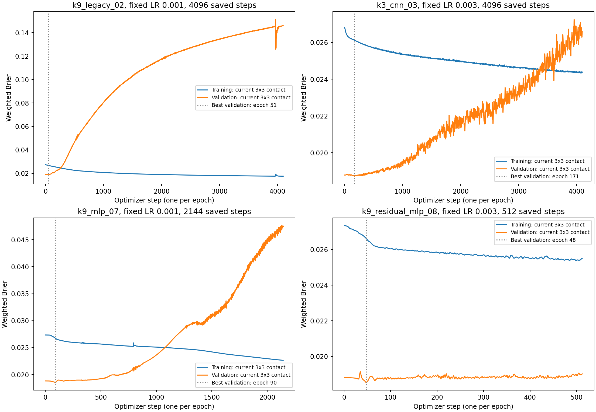

# Learning-rate and convergence diagnostic

Snapshot of the saved training/validation histories on 2026-10-09. No test outcomes were used, and the original run was not modified. The unfinished histories are snapshots, not completed training results.

**Training is still improving, while validation worsens in the long trajectories currently saved. This does not establish that the learning rate is too small.**

An epoch is one full-batch optimizer step. The chunk size controls gradient-accumulation memory, not the number of optimizer steps. Larger rates can be tested for faster optimization; validation determines which rate/schedule generalizes better.

| Model | LR | Saved steps | Best validation step | Training Brier at that step | Latest training Brier | Best validation Brier | Latest validation Brier |
|---|---:|---:|---:|---:|---:|---:|---:|
| k9_legacy_02 | 0.001 | 4096 | 51 | 0.026675 | 0.017557 | 0.018709 | 0.145956 |
| k3_cnn_03 | 0.003 | 4096 | 171 | 0.026129 | 0.024360 | 0.018727 | 0.026588 |
| k9_mlp_07 | 0.001 | 2144 | 90 | 0.026740 | 0.022645 | 0.018561 | 0.047485 |
| k9_residual_mlp_08 | 0.003 | 512 | 48 | 0.026610 | 0.025481 | 0.018548 | 0.019026 |

Training and validation values in the table and plot use the same current 3x3-contact condition on distinct whole-fire partitions, with original inverse inclusion weights.

Completed 4096-step runs improved native training Brier by only about 0.61% (CNN) and 0.95% (legacy CNN) over steps 3,584–4,096. The saved MLP improved by about 4.88% over its last 512 steps, but its validation also worsened. These endpoint comparisons describe the snapshot; they are not fitted convergence-rate estimates.

The late preclipping gradient norms are below 10, so gradient clipping is not imposing the late step-size limit in these saved windows.

The fresh controlled search compares peak rates 0.001, 0.003, 0.01, 0.03 while keeping each architecture, nominal weight decay, dropout, initialization and data contract fixed. Constant rates are controls for scheduling. Linear warmup followed by cosine decay and optional cosine restarts are compared using validation. AdamW shrinkage depends on both actual learning rate and nominal weight decay, so a change in learning rate also changes per-step shrinkage.
