## Complete evaluation metrics and graphs

All scalar fields in saved `metrics.json` are reported below, including nested classification metrics, weighted ECE, thresholds, and support diagnostics. Every metric has a graph and numerical values for training, validation, and test. Newly added scalar evaluation fields are discovered automatically.

**Comparison populations.** Matched results compare all models on identical current 3×3-contact rows with their original inverse inclusion weights. Native results use each model's own K-contact population; compare families within the same K. Full prediction coverage describes all base rows and is separate from both scoring populations. Training, validation, and test contain distinct fires. Each graph keeps these populations separate, with independent horizontal axis scales.

**Probability reference.** For row i, yᵢ ∈ {0,1} is the reconstructed next-hour outcome, pᵢ ∈ [0,1] is the saved prediction, and wᵢ > 0 is its original sampling weight. The Bernoulli reference is Pᵢ=(1−yᵢ,yᵢ), the prediction is Qᵢ=(1−pᵢ,pᵢ), and every distance mean is Σᵢwᵢd(Pᵢ,Qᵢ)/Σᵢwᵢ. These compare predictions with binary empirical outcomes, not a known true conditional-probability field or two models. They do not measure spatial fire-front displacement. The endpoint is first-new-burning in the next hour, not currently active flame.

| Quantity per row | Definition |
|---|---|
| Exact KL | ΣₓPᵢ(x) ln(Pᵢ(x)/Qᵢ(x)); equals exact NLL for binary yᵢ |
| Floored KL | Same directed KL after clipping pᵢ to [ε,1−ε]; equals floored log loss for binary yᵢ; ε is reported below |
| Total variation | ½Σₓ&#124;Pᵢ(x)−Qᵢ(x)&#124; = &#124;yᵢ−pᵢ&#124; |
| Hellinger | √(½Σₓ(√Pᵢ(x)−√Qᵢ(x))²) |
| Jensen-Shannon divergence | ½KL(Pᵢ ∥ Mᵢ)+½KL(Qᵢ ∥ Mᵢ), Mᵢ=(Pᵢ+Qᵢ)/2 |
| Jensen-Shannon distance | Square root of each row's JS divergence, then weighted averaging |
| Bhattacharyya | −ln(Σₓ√(Pᵢ(x)Qᵢ(x))) |
| Wasserstein-1 / Wasserstein-2 | &#124;yᵢ−pᵢ&#124; / √&#124;yᵢ−pᵢ&#124; for support {0,1} with unit ground distance |

Natural logarithms give divergences and log loss in nats. Exact zero-probability failures remain +∞ in tables and graph status columns. N/A means the evaluator returned an undefined result; missing means that field was not saved for that model/split. Neither is changed to zero. Bounded distances may reward low probabilities in an imbalanced population; retain Brier, log loss, positive-class scores, ranking, and classification results when interpreting them. No test data are used to reselect models or thresholds.

**Classification.** Decisions use pᵢ ≥ threshold. Threshold 0.5 and the separately validation-selected F1 and MCC thresholds are reported explicitly and applied unchanged to all splits. TP, FP, TN, and FN are weighted population counts; precision=TP/(TP+FP), recall=TP/(TP+FN), F1=2TP/(2TP+FP+FN), and MCC=(TP·TN−FP·FN)/√((TP+FP)(TP+FN)(TN+FP)(TN+FN)). The evaluator assigns zero when a classification denominator is zero. Average precision is non-interpolated; PR AUC uses trapezoidal integration. They are different metrics.

[All metric cells as CSV](metrics.csv) · [All reliability-bin values as CSV](calibration_bins.csv) · [Cohort summaries as CSV](cohorts.csv) · [Coverage and file hashes](manifest.json)

### Probability scores

#### Weighted Brier score

Saved field: `brier`. Lower is better.

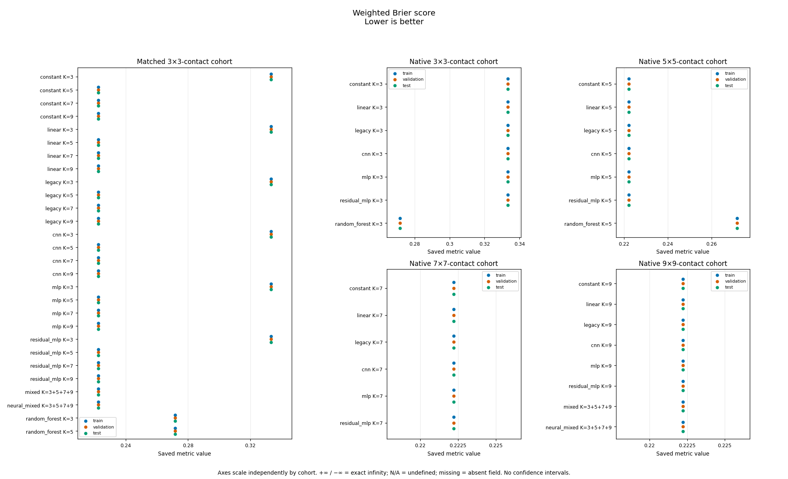

| Model | Native K | Matched train | Matched validation | Matched test | Native train | Native validation | Native test |
|---|---:|---:|---:|---:|---:|---:|---:|
| constant K=3 (`k3_constant_00_lr0.003_constant`) | 3 | 0.33333333 | 0.33333333 | 0.33333333 | 0.33333333 | 0.33333333 | 0.33333333 |
| constant K=5 (`k5_constant_00_lr0.003_constant`) | 5 | 0.22222223 | 0.22222223 | 0.22222223 | 0.22222223 | 0.22222223 | 0.22222223 |
| constant K=7 (`k7_constant_00_lr0.003_constant`) | 7 | 0.22222222 | 0.22222222 | 0.22222222 | 0.22222222 | 0.22222222 | 0.22222222 |
| constant K=9 (`k9_constant_00_lr0.003_constant`) | 9 | 0.22222222 | 0.22222222 | 0.22222222 | 0.22222222 | 0.22222222 | 0.22222222 |
| linear K=3 (`k3_linear_01_lr0.003_constant`) | 3 | 0.33333333 | 0.33333333 | 0.33333333 | 0.33333333 | 0.33333333 | 0.33333333 |
| linear K=5 (`k5_linear_01_lr0.003_constant`) | 5 | 0.22222222 | 0.22222222 | 0.22222222 | 0.22222222 | 0.22222222 | 0.22222222 |
| linear K=7 (`k7_linear_01_lr0.003_constant`) | 7 | 0.22222222 | 0.22222222 | 0.22222222 | 0.22222222 | 0.22222222 | 0.22222222 |
| linear K=9 (`k9_linear_01_lr0.003_constant`) | 9 | 0.22222222 | 0.22222222 | 0.22222222 | 0.22222222 | 0.22222222 | 0.22222222 |
| legacy K=3 (`k3_legacy_02_lr0.003_constant`) | 3 | 0.33333333 | 0.33333333 | 0.33333333 | 0.33333333 | 0.33333333 | 0.33333333 |
| legacy K=5 (`k5_legacy_02_lr0.003_constant`) | 5 | 0.22222223 | 0.22222223 | 0.22222223 | 0.22222223 | 0.22222223 | 0.22222223 |
| legacy K=7 (`k7_legacy_02_lr0.003_constant`) | 7 | 0.22222222 | 0.22222222 | 0.22222222 | 0.22222222 | 0.22222222 | 0.22222222 |
| legacy K=9 (`k9_legacy_02_lr0.003_constant`) | 9 | 0.22222222 | 0.22222222 | 0.22222222 | 0.22222222 | 0.22222222 | 0.22222222 |
| cnn K=3 (`k3_cnn_03_lr0.003_constant`) | 3 | 0.33333333 | 0.33333333 | 0.33333333 | 0.33333333 | 0.33333333 | 0.33333333 |
| cnn K=5 (`k5_cnn_03_lr0.003_constant`) | 5 | 0.22222236 | 0.22222236 | 0.22222236 | 0.22222236 | 0.22222236 | 0.22222236 |
| cnn K=7 (`k7_cnn_03_lr0.003_constant`) | 7 | 0.22222222 | 0.22222222 | 0.22222222 | 0.22222222 | 0.22222222 | 0.22222222 |
| cnn K=9 (`k9_cnn_03_lr0.003_constant`) | 9 | 0.22222223 | 0.22222223 | 0.22222223 | 0.22222223 | 0.22222223 | 0.22222223 |
| mlp K=3 (`k3_mlp_04_lr0.003_constant`) | 3 | 0.33333333 | 0.33333333 | 0.33333333 | 0.33333333 | 0.33333333 | 0.33333333 |
| mlp K=5 (`k5_mlp_05_lr0.003_constant`) | 5 | 0.22222223 | 0.22222223 | 0.22222223 | 0.22222223 | 0.22222223 | 0.22222223 |
| mlp K=7 (`k7_mlp_04_lr0.003_constant`) | 7 | 0.22222222 | 0.22222222 | 0.22222222 | 0.22222222 | 0.22222222 | 0.22222222 |
| mlp K=9 (`k9_mlp_04_lr0.003_constant`) | 9 | 0.22222222 | 0.22222222 | 0.22222222 | 0.22222222 | 0.22222222 | 0.22222222 |
| residual_mlp K=3 (`k3_residual_mlp_08_lr0.003_constant`) | 3 | 0.33333333 | 0.33333333 | 0.33333333 | 0.33333333 | 0.33333333 | 0.33333333 |
| residual_mlp K=5 (`k5_residual_mlp_09_lr0.003_constant`) | 5 | 0.22222224 | 0.22222224 | 0.22222224 | 0.22222224 | 0.22222224 | 0.22222224 |
| residual_mlp K=7 (`k7_residual_mlp_08_lr0.003_constant`) | 7 | 0.22222223 | 0.22222223 | 0.22222223 | 0.22222223 | 0.22222223 | 0.22222223 |
| residual_mlp K=9 (`k9_residual_mlp_08_lr0.003_constant`) | 9 | 0.22222223 | 0.22222223 | 0.22222223 | 0.22222223 | 0.22222223 | 0.22222223 |
| mixed K=3+5+7+9 (`mixed_3_5_7_9_00_lr0.003_constant`) | 9 | 0.22222226 | 0.22222226 | 0.22222226 | 0.22222226 | 0.22222226 | 0.22222226 |
| neural_mixed K=3+5+7+9 (`neural_mixed_3_5_7_9_00_lr0.003_constant`) | 9 | 0.22222242 | 0.22222242 | 0.22222242 | 0.22222242 | 0.22222242 | 0.22222242 |
| random_forest K=3 (`rf3_depth8`) | 3 | 0.27160494 | 0.27160494 | 0.27160494 | 0.27160494 | 0.27160494 | 0.27160494 |
| random_forest K=5 (`rf5_depth8`) | 5 | 0.27160494 | 0.27160494 | 0.27160494 | 0.27160494 | 0.27160494 | 0.27160494 |

#### Floored log loss (nats)

Saved field: `clipped_log_loss`. Lower is better.

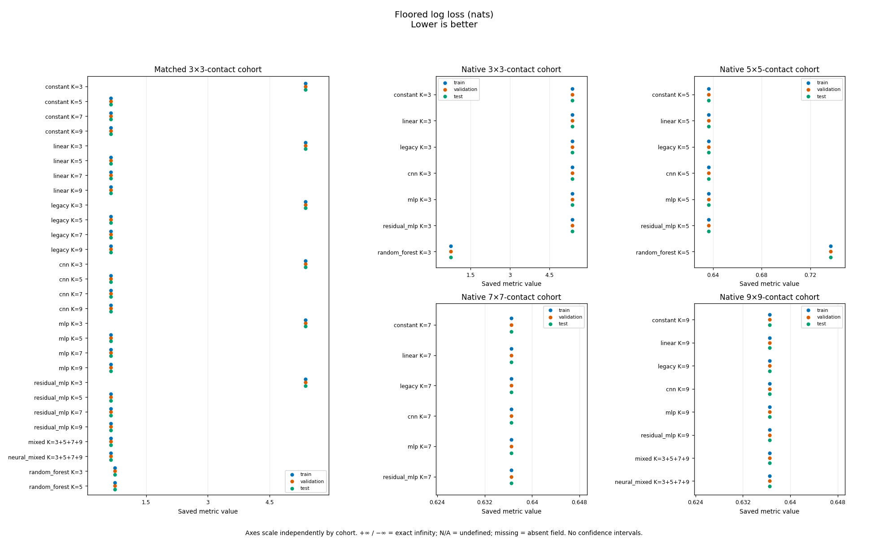

| Model | Native K | Matched train | Matched validation | Matched test | Native train | Native validation | Native test |
|---|---:|---:|---:|---:|---:|---:|---:|
| constant K=3 (`k3_constant_00_lr0.003_constant`) | 3 | 5.3726986 | 5.3726986 | 5.3726986 | 5.3726986 | 5.3726986 | 5.3726986 |
| constant K=5 (`k5_constant_00_lr0.003_constant`) | 5 | 0.63651419 | 0.63651419 | 0.63651419 | 0.63651419 | 0.63651419 | 0.63651419 |
| constant K=7 (`k7_constant_00_lr0.003_constant`) | 7 | 0.63651417 | 0.63651417 | 0.63651417 | 0.63651417 | 0.63651417 | 0.63651417 |
| constant K=9 (`k9_constant_00_lr0.003_constant`) | 9 | 0.63651417 | 0.63651417 | 0.63651417 | 0.63651417 | 0.63651417 | 0.63651417 |
| linear K=3 (`k3_linear_01_lr0.003_constant`) | 3 | 5.3726986 | 5.3726986 | 5.3726986 | 5.3726986 | 5.3726986 | 5.3726986 |
| linear K=5 (`k5_linear_01_lr0.003_constant`) | 5 | 0.63651416 | 0.63651416 | 0.63651416 | 0.63651416 | 0.63651416 | 0.63651416 |
| linear K=7 (`k7_linear_01_lr0.003_constant`) | 7 | 0.63651417 | 0.63651417 | 0.63651417 | 0.63651417 | 0.63651417 | 0.63651417 |
| linear K=9 (`k9_linear_01_lr0.003_constant`) | 9 | 0.63651417 | 0.63651417 | 0.63651417 | 0.63651417 | 0.63651417 | 0.63651417 |
| legacy K=3 (`k3_legacy_02_lr0.003_constant`) | 3 | 5.3726986 | 5.3726986 | 5.3726986 | 5.3726986 | 5.3726986 | 5.3726986 |
| legacy K=5 (`k5_legacy_02_lr0.003_constant`) | 5 | 0.63651419 | 0.63651419 | 0.63651419 | 0.63651419 | 0.63651419 | 0.63651419 |
| legacy K=7 (`k7_legacy_02_lr0.003_constant`) | 7 | 0.63651417 | 0.63651417 | 0.63651417 | 0.63651417 | 0.63651417 | 0.63651417 |
| legacy K=9 (`k9_legacy_02_lr0.003_constant`) | 9 | 0.63651417 | 0.63651417 | 0.63651417 | 0.63651417 | 0.63651417 | 0.63651417 |
| cnn K=3 (`k3_cnn_03_lr0.003_constant`) | 3 | 5.3726986 | 5.3726986 | 5.3726986 | 5.3726986 | 5.3726986 | 5.3726986 |
| cnn K=5 (`k5_cnn_03_lr0.003_constant`) | 5 | 0.63651448 | 0.63651448 | 0.63651448 | 0.63651448 | 0.63651448 | 0.63651448 |
| cnn K=7 (`k7_cnn_03_lr0.003_constant`) | 7 | 0.63651417 | 0.63651417 | 0.63651417 | 0.63651417 | 0.63651417 | 0.63651417 |
| cnn K=9 (`k9_cnn_03_lr0.003_constant`) | 9 | 0.63651417 | 0.63651417 | 0.63651417 | 0.63651417 | 0.63651417 | 0.63651417 |
| mlp K=3 (`k3_mlp_04_lr0.003_constant`) | 3 | 5.3726986 | 5.3726986 | 5.3726986 | 5.3726986 | 5.3726986 | 5.3726986 |
| mlp K=5 (`k5_mlp_05_lr0.003_constant`) | 5 | 0.63651419 | 0.63651419 | 0.63651419 | 0.63651419 | 0.63651419 | 0.63651419 |
| mlp K=7 (`k7_mlp_04_lr0.003_constant`) | 7 | 0.63651417 | 0.63651417 | 0.63651417 | 0.63651417 | 0.63651417 | 0.63651417 |
| mlp K=9 (`k9_mlp_04_lr0.003_constant`) | 9 | 0.63651417 | 0.63651417 | 0.63651417 | 0.63651417 | 0.63651417 | 0.63651417 |
| residual_mlp K=3 (`k3_residual_mlp_08_lr0.003_constant`) | 3 | 5.3726986 | 5.3726986 | 5.3726986 | 5.3726986 | 5.3726986 | 5.3726986 |
| residual_mlp K=5 (`k5_residual_mlp_09_lr0.003_constant`) | 5 | 0.63651421 | 0.63651421 | 0.63651421 | 0.63651421 | 0.63651421 | 0.63651421 |
| residual_mlp K=7 (`k7_residual_mlp_08_lr0.003_constant`) | 7 | 0.63651418 | 0.63651418 | 0.63651418 | 0.63651418 | 0.63651418 | 0.63651418 |
| residual_mlp K=9 (`k9_residual_mlp_08_lr0.003_constant`) | 9 | 0.63651419 | 0.63651419 | 0.63651419 | 0.63651419 | 0.63651419 | 0.63651419 |
| mixed K=3+5+7+9 (`mixed_3_5_7_9_00_lr0.003_constant`) | 9 | 0.63651425 | 0.63651425 | 0.63651425 | 0.63651425 | 0.63651425 | 0.63651425 |
| neural_mixed K=3+5+7+9 (`neural_mixed_3_5_7_9_00_lr0.003_constant`) | 9 | 0.63651461 | 0.63651461 | 0.63651461 | 0.63651461 | 0.63651461 | 0.63651461 |
| random_forest K=3 (`rf3_depth8`) | 3 | 0.73654903 | 0.73654903 | 0.73654903 | 0.73654903 | 0.73654903 | 0.73654903 |
| random_forest K=5 (`rf5_depth8`) | 5 | 0.73654903 | 0.73654903 | 0.73654903 | 0.73654903 | 0.73654903 | 0.73654903 |

#### Exact negative log likelihood (nats)

Saved field: `exact_negative_log_likelihood_mean`. Lower is better.

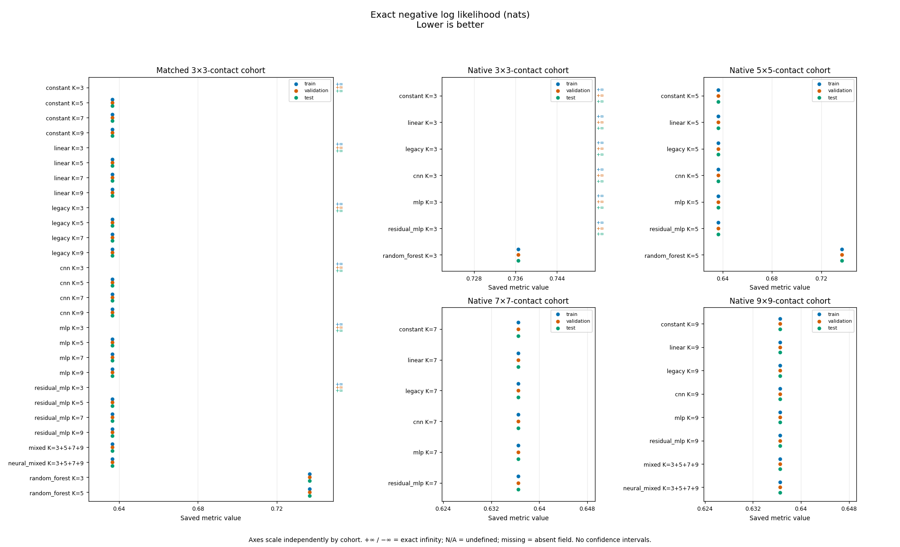

| Model | Native K | Matched train | Matched validation | Matched test | Native train | Native validation | Native test |
|---|---:|---:|---:|---:|---:|---:|---:|
| constant K=3 (`k3_constant_00_lr0.003_constant`) | 3 | +∞ | +∞ | +∞ | +∞ | +∞ | +∞ |
| constant K=5 (`k5_constant_00_lr0.003_constant`) | 5 | 0.63651419 | 0.63651419 | 0.63651419 | 0.63651419 | 0.63651419 | 0.63651419 |
| constant K=7 (`k7_constant_00_lr0.003_constant`) | 7 | 0.63651417 | 0.63651417 | 0.63651417 | 0.63651417 | 0.63651417 | 0.63651417 |
| constant K=9 (`k9_constant_00_lr0.003_constant`) | 9 | 0.63651417 | 0.63651417 | 0.63651417 | 0.63651417 | 0.63651417 | 0.63651417 |
| linear K=3 (`k3_linear_01_lr0.003_constant`) | 3 | +∞ | +∞ | +∞ | +∞ | +∞ | +∞ |
| linear K=5 (`k5_linear_01_lr0.003_constant`) | 5 | 0.63651416 | 0.63651416 | 0.63651416 | 0.63651416 | 0.63651416 | 0.63651416 |
| linear K=7 (`k7_linear_01_lr0.003_constant`) | 7 | 0.63651417 | 0.63651417 | 0.63651417 | 0.63651417 | 0.63651417 | 0.63651417 |
| linear K=9 (`k9_linear_01_lr0.003_constant`) | 9 | 0.63651417 | 0.63651417 | 0.63651417 | 0.63651417 | 0.63651417 | 0.63651417 |
| legacy K=3 (`k3_legacy_02_lr0.003_constant`) | 3 | +∞ | +∞ | +∞ | +∞ | +∞ | +∞ |
| legacy K=5 (`k5_legacy_02_lr0.003_constant`) | 5 | 0.63651419 | 0.63651419 | 0.63651419 | 0.63651419 | 0.63651419 | 0.63651419 |
| legacy K=7 (`k7_legacy_02_lr0.003_constant`) | 7 | 0.63651417 | 0.63651417 | 0.63651417 | 0.63651417 | 0.63651417 | 0.63651417 |
| legacy K=9 (`k9_legacy_02_lr0.003_constant`) | 9 | 0.63651417 | 0.63651417 | 0.63651417 | 0.63651417 | 0.63651417 | 0.63651417 |
| cnn K=3 (`k3_cnn_03_lr0.003_constant`) | 3 | +∞ | +∞ | +∞ | +∞ | +∞ | +∞ |
| cnn K=5 (`k5_cnn_03_lr0.003_constant`) | 5 | 0.63651448 | 0.63651448 | 0.63651448 | 0.63651448 | 0.63651448 | 0.63651448 |
| cnn K=7 (`k7_cnn_03_lr0.003_constant`) | 7 | 0.63651417 | 0.63651417 | 0.63651417 | 0.63651417 | 0.63651417 | 0.63651417 |
| cnn K=9 (`k9_cnn_03_lr0.003_constant`) | 9 | 0.63651417 | 0.63651417 | 0.63651417 | 0.63651417 | 0.63651417 | 0.63651417 |
| mlp K=3 (`k3_mlp_04_lr0.003_constant`) | 3 | +∞ | +∞ | +∞ | +∞ | +∞ | +∞ |
| mlp K=5 (`k5_mlp_05_lr0.003_constant`) | 5 | 0.63651419 | 0.63651419 | 0.63651419 | 0.63651419 | 0.63651419 | 0.63651419 |
| mlp K=7 (`k7_mlp_04_lr0.003_constant`) | 7 | 0.63651417 | 0.63651417 | 0.63651417 | 0.63651417 | 0.63651417 | 0.63651417 |
| mlp K=9 (`k9_mlp_04_lr0.003_constant`) | 9 | 0.63651417 | 0.63651417 | 0.63651417 | 0.63651417 | 0.63651417 | 0.63651417 |
| residual_mlp K=3 (`k3_residual_mlp_08_lr0.003_constant`) | 3 | +∞ | +∞ | +∞ | +∞ | +∞ | +∞ |
| residual_mlp K=5 (`k5_residual_mlp_09_lr0.003_constant`) | 5 | 0.63651421 | 0.63651421 | 0.63651421 | 0.63651421 | 0.63651421 | 0.63651421 |
| residual_mlp K=7 (`k7_residual_mlp_08_lr0.003_constant`) | 7 | 0.63651418 | 0.63651418 | 0.63651418 | 0.63651418 | 0.63651418 | 0.63651418 |
| residual_mlp K=9 (`k9_residual_mlp_08_lr0.003_constant`) | 9 | 0.63651419 | 0.63651419 | 0.63651419 | 0.63651419 | 0.63651419 | 0.63651419 |
| mixed K=3+5+7+9 (`mixed_3_5_7_9_00_lr0.003_constant`) | 9 | 0.63651425 | 0.63651425 | 0.63651425 | 0.63651425 | 0.63651425 | 0.63651425 |
| neural_mixed K=3+5+7+9 (`neural_mixed_3_5_7_9_00_lr0.003_constant`) | 9 | 0.63651461 | 0.63651461 | 0.63651461 | 0.63651461 | 0.63651461 | 0.63651461 |
| random_forest K=3 (`rf3_depth8`) | 3 | 0.73654903 | 0.73654903 | 0.73654903 | 0.73654903 | 0.73654903 | 0.73654903 |
| random_forest K=5 (`rf5_depth8`) | 5 | 0.73654903 | 0.73654903 | 0.73654903 | 0.73654903 | 0.73654903 | 0.73654903 |

#### Negative-class Brier score

Saved field: `negative_class_brier`. Lower is better.

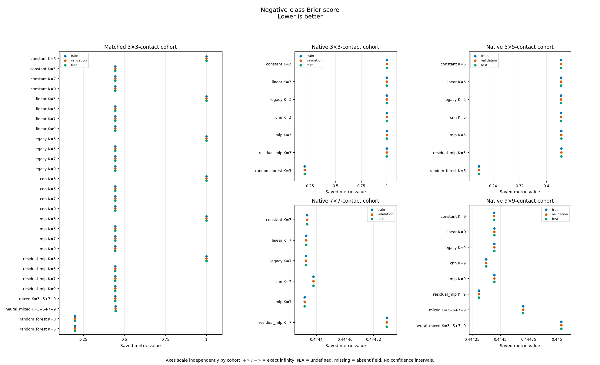

| Model | Native K | Matched train | Matched validation | Matched test | Native train | Native validation | Native test |
|---|---:|---:|---:|---:|---:|---:|---:|
| constant K=3 (`k3_constant_00_lr0.003_constant`) | 3 | 1 | 1 | 1 | 1 | 1 | 1 |
| constant K=5 (`k5_constant_00_lr0.003_constant`) | 5 | 0.44432257 | 0.44432257 | 0.44432257 | 0.44432257 | 0.44432257 | 0.44432257 |
| constant K=7 (`k7_constant_00_lr0.003_constant`) | 7 | 0.44438002 | 0.44438002 | 0.44438002 | 0.44438002 | 0.44438002 | 0.44438002 |
| constant K=9 (`k9_constant_00_lr0.003_constant`) | 9 | 0.44444447 | 0.44444447 | 0.44444447 | 0.44444447 | 0.44444447 | 0.44444447 |
| linear K=3 (`k3_linear_01_lr0.003_constant`) | 3 | 1 | 1 | 1 | 1 | 1 | 1 |
| linear K=5 (`k5_linear_01_lr0.003_constant`) | 5 | 0.44432297 | 0.44432297 | 0.44432297 | 0.44432297 | 0.44432297 | 0.44432297 |
| linear K=7 (`k7_linear_01_lr0.003_constant`) | 7 | 0.44437867 | 0.44437867 | 0.44437867 | 0.44437867 | 0.44437867 | 0.44437867 |
| linear K=9 (`k9_linear_01_lr0.003_constant`) | 9 | 0.44444511 | 0.44444511 | 0.44444511 | 0.44444511 | 0.44444511 | 0.44444511 |
| legacy K=3 (`k3_legacy_02_lr0.003_constant`) | 3 | 1 | 1 | 1 | 1 | 1 | 1 |
| legacy K=5 (`k5_legacy_02_lr0.003_constant`) | 5 | 0.44431931 | 0.44431931 | 0.44431931 | 0.44431931 | 0.44431931 | 0.44431931 |
| legacy K=7 (`k7_legacy_02_lr0.003_constant`) | 7 | 0.44437764 | 0.44437764 | 0.44437764 | 0.44437764 | 0.44437764 | 0.44437764 |
| legacy K=9 (`k9_legacy_02_lr0.003_constant`) | 9 | 0.44444511 | 0.44444511 | 0.44444511 | 0.44444511 | 0.44444511 | 0.44444511 |
| cnn K=3 (`k3_cnn_03_lr0.003_constant`) | 3 | 1 | 1 | 1 | 1 | 1 | 1 |
| cnn K=5 (`k5_cnn_03_lr0.003_constant`) | 5 | 0.44395219 | 0.44395219 | 0.44395219 | 0.44395219 | 0.44395219 | 0.44395219 |
| cnn K=7 (`k7_cnn_03_lr0.003_constant`) | 7 | 0.44439353 | 0.44439353 | 0.44439353 | 0.44439353 | 0.44439353 | 0.44439353 |
| cnn K=9 (`k9_cnn_03_lr0.003_constant`) | 9 | 0.44437343 | 0.44437343 | 0.44437343 | 0.44437343 | 0.44437343 | 0.44437343 |
| mlp K=3 (`k3_mlp_04_lr0.003_constant`) | 3 | 1 | 1 | 1 | 1 | 1 | 1 |
| mlp K=5 (`k5_mlp_05_lr0.003_constant`) | 5 | 0.44456091 | 0.44456091 | 0.44456091 | 0.44456091 | 0.44456091 | 0.44456091 |
| mlp K=7 (`k7_mlp_04_lr0.003_constant`) | 7 | 0.44437501 | 0.44437501 | 0.44437501 | 0.44437501 | 0.44437501 | 0.44437501 |
| mlp K=9 (`k9_mlp_04_lr0.003_constant`) | 9 | 0.44444558 | 0.44444558 | 0.44444558 | 0.44444558 | 0.44444558 | 0.44444558 |
| residual_mlp K=3 (`k3_residual_mlp_08_lr0.003_constant`) | 3 | 1 | 1 | 1 | 1 | 1 | 1 |
| residual_mlp K=5 (`k5_residual_mlp_09_lr0.003_constant`) | 5 | 0.44463244 | 0.44463244 | 0.44463244 | 0.44463244 | 0.44463244 | 0.44463244 |
| residual_mlp K=7 (`k7_residual_mlp_08_lr0.003_constant`) | 7 | 0.44454795 | 0.44454795 | 0.44454795 | 0.44454795 | 0.44454795 | 0.44454795 |
| residual_mlp K=9 (`k9_residual_mlp_08_lr0.003_constant`) | 9 | 0.44431081 | 0.44431081 | 0.44431081 | 0.44431081 | 0.44431081 | 0.44431081 |
| mixed K=3+5+7+9 (`mixed_3_5_7_9_00_lr0.003_constant`) | 9 | 0.44470065 | 0.44470065 | 0.44470065 | 0.44470065 | 0.44470065 | 0.44470065 |
| neural_mixed K=3+5+7+9 (`neural_mixed_3_5_7_9_00_lr0.003_constant`) | 9 | 0.44503682 | 0.44503682 | 0.44503682 | 0.44503682 | 0.44503682 | 0.44503682 |
| random_forest K=3 (`rf3_depth8`) | 3 | 0.19753086 | 0.19753086 | 0.19753086 | 0.19753086 | 0.19753086 | 0.19753086 |
| random_forest K=5 (`rf5_depth8`) | 5 | 0.19753086 | 0.19753086 | 0.19753086 | 0.19753086 | 0.19753086 | 0.19753086 |

#### Positive-class Brier score

Saved field: `positive_class_brier`. Lower is better.

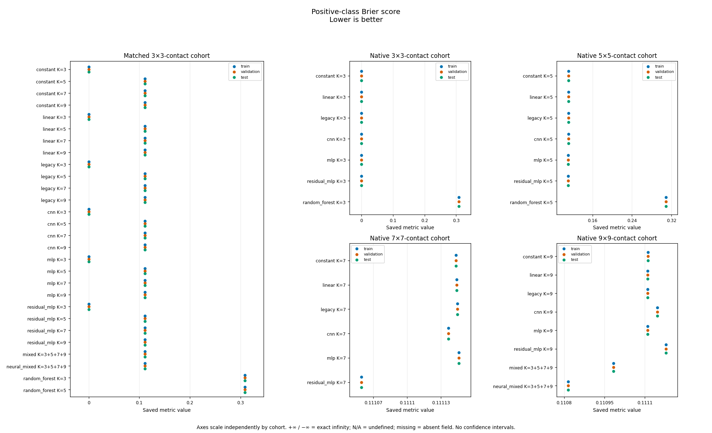

| Model | Native K | Matched train | Matched validation | Matched test | Native train | Native validation | Native test |
|---|---:|---:|---:|---:|---:|---:|---:|
| constant K=3 (`k3_constant_00_lr0.003_constant`) | 3 | 0 | 0 | 0 | 0 | 0 | 0 |
| constant K=5 (`k5_constant_00_lr0.003_constant`) | 5 | 0.11117206 | 0.11117206 | 0.11117206 | 0.11117206 | 0.11117206 | 0.11117206 |
| constant K=7 (`k7_constant_00_lr0.003_constant`) | 7 | 0.11114333 | 0.11114333 | 0.11114333 | 0.11114333 | 0.11114333 | 0.11114333 |
| constant K=9 (`k9_constant_00_lr0.003_constant`) | 9 | 0.1111111 | 0.1111111 | 0.1111111 | 0.1111111 | 0.1111111 | 0.1111111 |
| linear K=3 (`k3_linear_01_lr0.003_constant`) | 3 | 0 | 0 | 0 | 0 | 0 | 0 |
| linear K=5 (`k5_linear_01_lr0.003_constant`) | 5 | 0.11117184 | 0.11117184 | 0.11117184 | 0.11117184 | 0.11117184 | 0.11117184 |
| linear K=7 (`k7_linear_01_lr0.003_constant`) | 7 | 0.111144 | 0.111144 | 0.111144 | 0.111144 | 0.111144 | 0.111144 |
| linear K=9 (`k9_linear_01_lr0.003_constant`) | 9 | 0.11111078 | 0.11111078 | 0.11111078 | 0.11111078 | 0.11111078 | 0.11111078 |
| legacy K=3 (`k3_legacy_02_lr0.003_constant`) | 3 | 0 | 0 | 0 | 0 | 0 | 0 |
| legacy K=5 (`k5_legacy_02_lr0.003_constant`) | 5 | 0.11117369 | 0.11117369 | 0.11117369 | 0.11117369 | 0.11117369 | 0.11117369 |
| legacy K=7 (`k7_legacy_02_lr0.003_constant`) | 7 | 0.11114452 | 0.11114452 | 0.11114452 | 0.11114452 | 0.11114452 | 0.11114452 |
| legacy K=9 (`k9_legacy_02_lr0.003_constant`) | 9 | 0.11111078 | 0.11111078 | 0.11111078 | 0.11111078 | 0.11111078 | 0.11111078 |
| cnn K=3 (`k3_cnn_03_lr0.003_constant`) | 3 | 0 | 0 | 0 | 0 | 0 | 0 |
| cnn K=5 (`k5_cnn_03_lr0.003_constant`) | 5 | 0.11135744 | 0.11135744 | 0.11135744 | 0.11135744 | 0.11135744 | 0.11135744 |
| cnn K=7 (`k7_cnn_03_lr0.003_constant`) | 7 | 0.11113657 | 0.11113657 | 0.11113657 | 0.11113657 | 0.11113657 | 0.11113657 |
| cnn K=9 (`k9_cnn_03_lr0.003_constant`) | 9 | 0.11114663 | 0.11114663 | 0.11114663 | 0.11114663 | 0.11114663 | 0.11114663 |
| mlp K=3 (`k3_mlp_04_lr0.003_constant`) | 3 | 0 | 0 | 0 | 0 | 0 | 0 |
| mlp K=5 (`k5_mlp_05_lr0.003_constant`) | 5 | 0.11105289 | 0.11105289 | 0.11105289 | 0.11105289 | 0.11105289 | 0.11105289 |
| mlp K=7 (`k7_mlp_04_lr0.003_constant`) | 7 | 0.11114583 | 0.11114583 | 0.11114583 | 0.11114583 | 0.11114583 | 0.11114583 |
| mlp K=9 (`k9_mlp_04_lr0.003_constant`) | 9 | 0.11111054 | 0.11111054 | 0.11111054 | 0.11111054 | 0.11111054 | 0.11111054 |
| residual_mlp K=3 (`k3_residual_mlp_08_lr0.003_constant`) | 3 | 0 | 0 | 0 | 0 | 0 | 0 |
| residual_mlp K=5 (`k5_residual_mlp_09_lr0.003_constant`) | 5 | 0.11101714 | 0.11101714 | 0.11101714 | 0.11101714 | 0.11101714 | 0.11101714 |
| residual_mlp K=7 (`k7_residual_mlp_08_lr0.003_constant`) | 7 | 0.11105937 | 0.11105937 | 0.11105937 | 0.11105937 | 0.11105937 | 0.11105937 |
| residual_mlp K=9 (`k9_residual_mlp_08_lr0.003_constant`) | 9 | 0.11117794 | 0.11117794 | 0.11117794 | 0.11117794 | 0.11117794 | 0.11117794 |
| mixed K=3+5+7+9 (`mixed_3_5_7_9_00_lr0.003_constant`) | 9 | 0.11098306 | 0.11098306 | 0.11098306 | 0.11098306 | 0.11098306 | 0.11098306 |
| neural_mixed K=3+5+7+9 (`neural_mixed_3_5_7_9_00_lr0.003_constant`) | 9 | 0.11081522 | 0.11081522 | 0.11081522 | 0.11081522 | 0.11081522 | 0.11081522 |
| random_forest K=3 (`rf3_depth8`) | 3 | 0.30864198 | 0.30864198 | 0.30864198 | 0.30864198 | 0.30864198 | 0.30864198 |
| random_forest K=5 (`rf5_depth8`) | 5 | 0.30864198 | 0.30864198 | 0.30864198 | 0.30864198 | 0.30864198 | 0.30864198 |

### Probability distances

#### Bernoulli Bhattacharyya distance

Saved field: `bernoulli_bhattacharyya_distance_mean`. Lower is better.

| Model | Native K | Matched train | Matched validation | Matched test | Native train | Native validation | Native test |
|---|---:|---:|---:|---:|---:|---:|---:|
| constant K=3 (`k3_constant_00_lr0.003_constant`) | 3 | +∞ | +∞ | +∞ | +∞ | +∞ | +∞ |
| constant K=5 (`k5_constant_00_lr0.003_constant`) | 5 | 0.31825709 | 0.31825709 | 0.31825709 | 0.31825709 | 0.31825709 | 0.31825709 |
| constant K=7 (`k7_constant_00_lr0.003_constant`) | 7 | 0.31825709 | 0.31825709 | 0.31825709 | 0.31825709 | 0.31825709 | 0.31825709 |
| constant K=9 (`k9_constant_00_lr0.003_constant`) | 9 | 0.31825708 | 0.31825708 | 0.31825708 | 0.31825708 | 0.31825708 | 0.31825708 |
| linear K=3 (`k3_linear_01_lr0.003_constant`) | 3 | +∞ | +∞ | +∞ | +∞ | +∞ | +∞ |
| linear K=5 (`k5_linear_01_lr0.003_constant`) | 5 | 0.31825708 | 0.31825708 | 0.31825708 | 0.31825708 | 0.31825708 | 0.31825708 |
| linear K=7 (`k7_linear_01_lr0.003_constant`) | 7 | 0.31825709 | 0.31825709 | 0.31825709 | 0.31825709 | 0.31825709 | 0.31825709 |
| linear K=9 (`k9_linear_01_lr0.003_constant`) | 9 | 0.31825708 | 0.31825708 | 0.31825708 | 0.31825708 | 0.31825708 | 0.31825708 |
| legacy K=3 (`k3_legacy_02_lr0.003_constant`) | 3 | +∞ | +∞ | +∞ | +∞ | +∞ | +∞ |
| legacy K=5 (`k5_legacy_02_lr0.003_constant`) | 5 | 0.31825709 | 0.31825709 | 0.31825709 | 0.31825709 | 0.31825709 | 0.31825709 |
| legacy K=7 (`k7_legacy_02_lr0.003_constant`) | 7 | 0.31825709 | 0.31825709 | 0.31825709 | 0.31825709 | 0.31825709 | 0.31825709 |
| legacy K=9 (`k9_legacy_02_lr0.003_constant`) | 9 | 0.31825708 | 0.31825708 | 0.31825708 | 0.31825708 | 0.31825708 | 0.31825708 |
| cnn K=3 (`k3_cnn_03_lr0.003_constant`) | 3 | +∞ | +∞ | +∞ | +∞ | +∞ | +∞ |
| cnn K=5 (`k5_cnn_03_lr0.003_constant`) | 5 | 0.31825724 | 0.31825724 | 0.31825724 | 0.31825724 | 0.31825724 | 0.31825724 |
| cnn K=7 (`k7_cnn_03_lr0.003_constant`) | 7 | 0.31825709 | 0.31825709 | 0.31825709 | 0.31825709 | 0.31825709 | 0.31825709 |
| cnn K=9 (`k9_cnn_03_lr0.003_constant`) | 9 | 0.31825709 | 0.31825709 | 0.31825709 | 0.31825709 | 0.31825709 | 0.31825709 |
| mlp K=3 (`k3_mlp_04_lr0.003_constant`) | 3 | +∞ | +∞ | +∞ | +∞ | +∞ | +∞ |
| mlp K=5 (`k5_mlp_05_lr0.003_constant`) | 5 | 0.31825709 | 0.31825709 | 0.31825709 | 0.31825709 | 0.31825709 | 0.31825709 |
| mlp K=7 (`k7_mlp_04_lr0.003_constant`) | 7 | 0.31825709 | 0.31825709 | 0.31825709 | 0.31825709 | 0.31825709 | 0.31825709 |
| mlp K=9 (`k9_mlp_04_lr0.003_constant`) | 9 | 0.31825708 | 0.31825708 | 0.31825708 | 0.31825708 | 0.31825708 | 0.31825708 |
| residual_mlp K=3 (`k3_residual_mlp_08_lr0.003_constant`) | 3 | +∞ | +∞ | +∞ | +∞ | +∞ | +∞ |
| residual_mlp K=5 (`k5_residual_mlp_09_lr0.003_constant`) | 5 | 0.31825711 | 0.31825711 | 0.31825711 | 0.31825711 | 0.31825711 | 0.31825711 |
| residual_mlp K=7 (`k7_residual_mlp_08_lr0.003_constant`) | 7 | 0.31825709 | 0.31825709 | 0.31825709 | 0.31825709 | 0.31825709 | 0.31825709 |
| residual_mlp K=9 (`k9_residual_mlp_08_lr0.003_constant`) | 9 | 0.3182571 | 0.3182571 | 0.3182571 | 0.3182571 | 0.3182571 | 0.3182571 |
| mixed K=3+5+7+9 (`mixed_3_5_7_9_00_lr0.003_constant`) | 9 | 0.31825713 | 0.31825713 | 0.31825713 | 0.31825713 | 0.31825713 | 0.31825713 |
| neural_mixed K=3+5+7+9 (`neural_mixed_3_5_7_9_00_lr0.003_constant`) | 9 | 0.31825731 | 0.31825731 | 0.31825731 | 0.31825731 | 0.31825731 | 0.31825731 |
| random_forest K=3 (`rf3_depth8`) | 3 | 0.36827452 | 0.36827452 | 0.36827452 | 0.36827452 | 0.36827452 | 0.36827452 |
| random_forest K=5 (`rf5_depth8`) | 5 | 0.36827452 | 0.36827452 | 0.36827452 | 0.36827452 | 0.36827452 | 0.36827452 |

#### Bernoulli Hellinger distance

Saved field: `bernoulli_hellinger_distance_mean`. Lower is better.

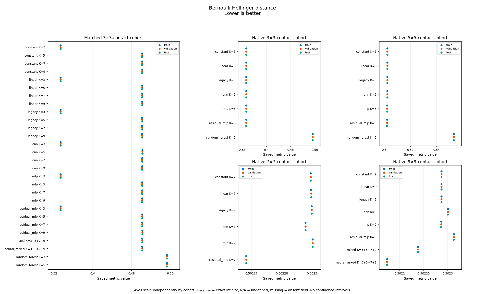

| Model | Native K | Matched train | Matched validation | Matched test | Native train | Native validation | Native test |
|---|---:|---:|---:|---:|---:|---:|---:|
| constant K=3 (`k3_constant_00_lr0.003_constant`) | 3 | 0.33333333 | 0.33333333 | 0.33333333 | 0.33333333 | 0.33333333 | 0.33333333 |
| constant K=5 (`k5_constant_00_lr0.003_constant`) | 5 | 0.50231031 | 0.50231031 | 0.50231031 | 0.50231031 | 0.50231031 | 0.50231031 |
| constant K=7 (`k7_constant_00_lr0.003_constant`) | 7 | 0.50229935 | 0.50229935 | 0.50229935 | 0.50229935 | 0.50229935 | 0.50229935 |
| constant K=9 (`k9_constant_00_lr0.003_constant`) | 9 | 0.50228704 | 0.50228704 | 0.50228704 | 0.50228704 | 0.50228704 | 0.50228704 |
| linear K=3 (`k3_linear_01_lr0.003_constant`) | 3 | 0.33333333 | 0.33333333 | 0.33333333 | 0.33333333 | 0.33333333 | 0.33333333 |
| linear K=5 (`k5_linear_01_lr0.003_constant`) | 5 | 0.50231022 | 0.50231022 | 0.50231022 | 0.50231022 | 0.50231022 | 0.50231022 |
| linear K=7 (`k7_linear_01_lr0.003_constant`) | 7 | 0.5022996 | 0.5022996 | 0.5022996 | 0.5022996 | 0.5022996 | 0.5022996 |
| linear K=9 (`k9_linear_01_lr0.003_constant`) | 9 | 0.50228692 | 0.50228692 | 0.50228692 | 0.50228692 | 0.50228692 | 0.50228692 |
| legacy K=3 (`k3_legacy_02_lr0.003_constant`) | 3 | 0.33333333 | 0.33333333 | 0.33333333 | 0.33333333 | 0.33333333 | 0.33333333 |
| legacy K=5 (`k5_legacy_02_lr0.003_constant`) | 5 | 0.50231093 | 0.50231093 | 0.50231093 | 0.50231093 | 0.50231093 | 0.50231093 |
| legacy K=7 (`k7_legacy_02_lr0.003_constant`) | 7 | 0.5022998 | 0.5022998 | 0.5022998 | 0.5022998 | 0.5022998 | 0.5022998 |
| legacy K=9 (`k9_legacy_02_lr0.003_constant`) | 9 | 0.50228692 | 0.50228692 | 0.50228692 | 0.50228692 | 0.50228692 | 0.50228692 |
| cnn K=3 (`k3_cnn_03_lr0.003_constant`) | 3 | 0.33333333 | 0.33333333 | 0.33333333 | 0.33333333 | 0.33333333 | 0.33333333 |
| cnn K=5 (`k5_cnn_03_lr0.003_constant`) | 5 | 0.50238101 | 0.50238101 | 0.50238101 | 0.50238101 | 0.50238101 | 0.50238101 |
| cnn K=7 (`k7_cnn_03_lr0.003_constant`) | 7 | 0.50229677 | 0.50229677 | 0.50229677 | 0.50229677 | 0.50229677 | 0.50229677 |
| cnn K=9 (`k9_cnn_03_lr0.003_constant`) | 9 | 0.5023006 | 0.5023006 | 0.5023006 | 0.5023006 | 0.5023006 | 0.5023006 |
| mlp K=3 (`k3_mlp_04_lr0.003_constant`) | 3 | 0.33333333 | 0.33333333 | 0.33333333 | 0.33333333 | 0.33333333 | 0.33333333 |
| mlp K=5 (`k5_mlp_05_lr0.003_constant`) | 5 | 0.50226482 | 0.50226482 | 0.50226482 | 0.50226482 | 0.50226482 | 0.50226482 |
| mlp K=7 (`k7_mlp_04_lr0.003_constant`) | 7 | 0.5023003 | 0.5023003 | 0.5023003 | 0.5023003 | 0.5023003 | 0.5023003 |
| mlp K=9 (`k9_mlp_04_lr0.003_constant`) | 9 | 0.50228683 | 0.50228683 | 0.50228683 | 0.50228683 | 0.50228683 | 0.50228683 |
| residual_mlp K=3 (`k3_residual_mlp_08_lr0.003_constant`) | 3 | 0.33333333 | 0.33333333 | 0.33333333 | 0.33333333 | 0.33333333 | 0.33333333 |
| residual_mlp K=5 (`k5_residual_mlp_09_lr0.003_constant`) | 5 | 0.50225117 | 0.50225117 | 0.50225117 | 0.50225117 | 0.50225117 | 0.50225117 |
| residual_mlp K=7 (`k7_residual_mlp_08_lr0.003_constant`) | 7 | 0.50226729 | 0.50226729 | 0.50226729 | 0.50226729 | 0.50226729 | 0.50226729 |
| residual_mlp K=9 (`k9_residual_mlp_08_lr0.003_constant`) | 9 | 0.50231256 | 0.50231256 | 0.50231256 | 0.50231256 | 0.50231256 | 0.50231256 |
| mixed K=3+5+7+9 (`mixed_3_5_7_9_00_lr0.003_constant`) | 9 | 0.50223815 | 0.50223815 | 0.50223815 | 0.50223815 | 0.50223815 | 0.50223815 |
| neural_mixed K=3+5+7+9 (`neural_mixed_3_5_7_9_00_lr0.003_constant`) | 9 | 0.50217399 | 0.50217399 | 0.50217399 | 0.50217399 | 0.50217399 | 0.50217399 |
| random_forest K=3 (`rf3_depth8`) | 3 | 0.55310773 | 0.55310773 | 0.55310773 | 0.55310773 | 0.55310773 | 0.55310773 |
| random_forest K=5 (`rf5_depth8`) | 5 | 0.55310773 | 0.55310773 | 0.55310773 | 0.55310773 | 0.55310773 | 0.55310773 |

#### Bernoulli Jensen-Shannon distance

Saved field: `bernoulli_jensen_shannon_distance_mean`. Lower is better.

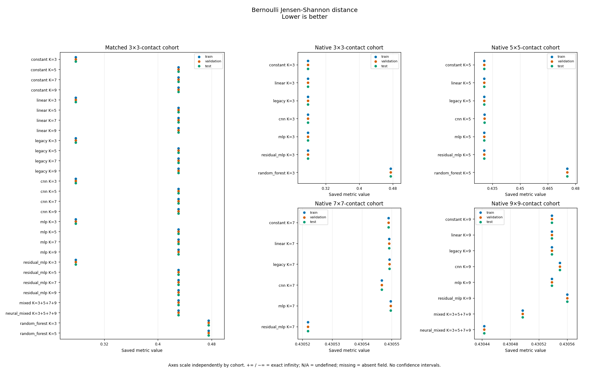

| Model | Native K | Matched train | Matched validation | Matched test | Native train | Native validation | Native test |
|---|---:|---:|---:|---:|---:|---:|---:|
| constant K=3 (`k3_constant_00_lr0.003_constant`) | 3 | 0.2775182 | 0.2775182 | 0.2775182 | 0.2775182 | 0.2775182 | 0.2775182 |
| constant K=5 (`k5_constant_00_lr0.003_constant`) | 5 | 0.43055815 | 0.43055815 | 0.43055815 | 0.43055815 | 0.43055815 | 0.43055815 |
| constant K=7 (`k7_constant_00_lr0.003_constant`) | 7 | 0.43054888 | 0.43054888 | 0.43054888 | 0.43054888 | 0.43054888 | 0.43054888 |
| constant K=9 (`k9_constant_00_lr0.003_constant`) | 9 | 0.43053848 | 0.43053848 | 0.43053848 | 0.43053848 | 0.43053848 | 0.43053848 |
| linear K=3 (`k3_linear_01_lr0.003_constant`) | 3 | 0.2775182 | 0.2775182 | 0.2775182 | 0.2775182 | 0.2775182 | 0.2775182 |
| linear K=5 (`k5_linear_01_lr0.003_constant`) | 5 | 0.43055807 | 0.43055807 | 0.43055807 | 0.43055807 | 0.43055807 | 0.43055807 |
| linear K=7 (`k7_linear_01_lr0.003_constant`) | 7 | 0.4305491 | 0.4305491 | 0.4305491 | 0.4305491 | 0.4305491 | 0.4305491 |
| linear K=9 (`k9_linear_01_lr0.003_constant`) | 9 | 0.43053838 | 0.43053838 | 0.43053838 | 0.43053838 | 0.43053838 | 0.43053838 |
| legacy K=3 (`k3_legacy_02_lr0.003_constant`) | 3 | 0.2775182 | 0.2775182 | 0.2775182 | 0.2775182 | 0.2775182 | 0.2775182 |
| legacy K=5 (`k5_legacy_02_lr0.003_constant`) | 5 | 0.43055867 | 0.43055867 | 0.43055867 | 0.43055867 | 0.43055867 | 0.43055867 |
| legacy K=7 (`k7_legacy_02_lr0.003_constant`) | 7 | 0.43054927 | 0.43054927 | 0.43054927 | 0.43054927 | 0.43054927 | 0.43054927 |
| legacy K=9 (`k9_legacy_02_lr0.003_constant`) | 9 | 0.43053838 | 0.43053838 | 0.43053838 | 0.43053838 | 0.43053838 | 0.43053838 |
| cnn K=3 (`k3_cnn_03_lr0.003_constant`) | 3 | 0.2775182 | 0.2775182 | 0.2775182 | 0.2775182 | 0.2775182 | 0.2775182 |
| cnn K=5 (`k5_cnn_03_lr0.003_constant`) | 5 | 0.4306179 | 0.4306179 | 0.4306179 | 0.4306179 | 0.4306179 | 0.4306179 |
| cnn K=7 (`k7_cnn_03_lr0.003_constant`) | 7 | 0.4305467 | 0.4305467 | 0.4305467 | 0.4305467 | 0.4305467 | 0.4305467 |
| cnn K=9 (`k9_cnn_03_lr0.003_constant`) | 9 | 0.43054994 | 0.43054994 | 0.43054994 | 0.43054994 | 0.43054994 | 0.43054994 |
| mlp K=3 (`k3_mlp_04_lr0.003_constant`) | 3 | 0.2775182 | 0.2775182 | 0.2775182 | 0.2775182 | 0.2775182 | 0.2775182 |
| mlp K=5 (`k5_mlp_05_lr0.003_constant`) | 5 | 0.4305197 | 0.4305197 | 0.4305197 | 0.4305197 | 0.4305197 | 0.4305197 |
| mlp K=7 (`k7_mlp_04_lr0.003_constant`) | 7 | 0.43054969 | 0.43054969 | 0.43054969 | 0.43054969 | 0.43054969 | 0.43054969 |
| mlp K=9 (`k9_mlp_04_lr0.003_constant`) | 9 | 0.4305383 | 0.4305383 | 0.4305383 | 0.4305383 | 0.4305383 | 0.4305383 |
| residual_mlp K=3 (`k3_residual_mlp_08_lr0.003_constant`) | 3 | 0.2775182 | 0.2775182 | 0.2775182 | 0.2775182 | 0.2775182 | 0.2775182 |
| residual_mlp K=5 (`k5_residual_mlp_09_lr0.003_constant`) | 5 | 0.43050816 | 0.43050816 | 0.43050816 | 0.43050816 | 0.43050816 | 0.43050816 |
| residual_mlp K=7 (`k7_residual_mlp_08_lr0.003_constant`) | 7 | 0.43052179 | 0.43052179 | 0.43052179 | 0.43052179 | 0.43052179 | 0.43052179 |
| residual_mlp K=9 (`k9_residual_mlp_08_lr0.003_constant`) | 9 | 0.43056005 | 0.43056005 | 0.43056005 | 0.43056005 | 0.43056005 | 0.43056005 |
| mixed K=3+5+7+9 (`mixed_3_5_7_9_00_lr0.003_constant`) | 9 | 0.43049716 | 0.43049716 | 0.43049716 | 0.43049716 | 0.43049716 | 0.43049716 |
| neural_mixed K=3+5+7+9 (`neural_mixed_3_5_7_9_00_lr0.003_constant`) | 9 | 0.43044295 | 0.43044295 | 0.43044295 | 0.43044295 | 0.43044295 | 0.43044295 |
| random_forest K=3 (`rf3_depth8`) | 3 | 0.47541578 | 0.47541578 | 0.47541578 | 0.47541578 | 0.47541578 | 0.47541578 |
| random_forest K=5 (`rf5_depth8`) | 5 | 0.47541578 | 0.47541578 | 0.47541578 | 0.47541578 | 0.47541578 | 0.47541578 |

#### Bernoulli Jensen-Shannon divergence (nats)

Saved field: `bernoulli_jensen_shannon_divergence_mean`. Lower is better.

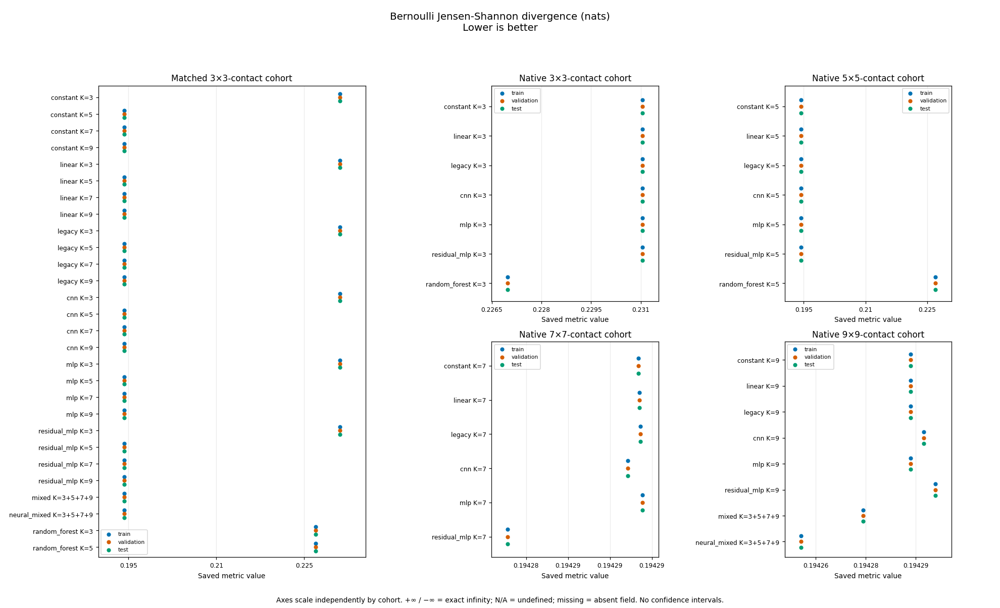

| Model | Native K | Matched train | Matched validation | Matched test | Native train | Native validation | Native test |
|---|---:|---:|---:|---:|---:|---:|---:|
| constant K=3 (`k3_constant_00_lr0.003_constant`) | 3 | 0.23104906 | 0.23104906 | 0.23104906 | 0.23104906 | 0.23104906 | 0.23104906 |
| constant K=5 (`k5_constant_00_lr0.003_constant`) | 5 | 0.19429525 | 0.19429525 | 0.19429525 | 0.19429525 | 0.19429525 | 0.19429525 |
| constant K=7 (`k7_constant_00_lr0.003_constant`) | 7 | 0.19429204 | 0.19429204 | 0.19429204 | 0.19429204 | 0.19429204 | 0.19429204 |
| constant K=9 (`k9_constant_00_lr0.003_constant`) | 9 | 0.19428844 | 0.19428844 | 0.19428844 | 0.19428844 | 0.19428844 | 0.19428844 |
| linear K=3 (`k3_linear_01_lr0.003_constant`) | 3 | 0.23104906 | 0.23104906 | 0.23104906 | 0.23104906 | 0.23104906 | 0.23104906 |
| linear K=5 (`k5_linear_01_lr0.003_constant`) | 5 | 0.19429522 | 0.19429522 | 0.19429522 | 0.19429522 | 0.19429522 | 0.19429522 |
| linear K=7 (`k7_linear_01_lr0.003_constant`) | 7 | 0.19429211 | 0.19429211 | 0.19429211 | 0.19429211 | 0.19429211 | 0.19429211 |
| linear K=9 (`k9_linear_01_lr0.003_constant`) | 9 | 0.19428841 | 0.19428841 | 0.19428841 | 0.19428841 | 0.19428841 | 0.19428841 |
| legacy K=3 (`k3_legacy_02_lr0.003_constant`) | 3 | 0.23104906 | 0.23104906 | 0.23104906 | 0.23104906 | 0.23104906 | 0.23104906 |
| legacy K=5 (`k5_legacy_02_lr0.003_constant`) | 5 | 0.19429543 | 0.19429543 | 0.19429543 | 0.19429543 | 0.19429543 | 0.19429543 |
| legacy K=7 (`k7_legacy_02_lr0.003_constant`) | 7 | 0.19429217 | 0.19429217 | 0.19429217 | 0.19429217 | 0.19429217 | 0.19429217 |
| legacy K=9 (`k9_legacy_02_lr0.003_constant`) | 9 | 0.19428841 | 0.19428841 | 0.19428841 | 0.19428841 | 0.19428841 | 0.19428841 |
| cnn K=3 (`k3_cnn_03_lr0.003_constant`) | 3 | 0.23104906 | 0.23104906 | 0.23104906 | 0.23104906 | 0.23104906 | 0.23104906 |
| cnn K=5 (`k5_cnn_03_lr0.003_constant`) | 5 | 0.19431596 | 0.19431596 | 0.19431596 | 0.19431596 | 0.19431596 | 0.19431596 |
| cnn K=7 (`k7_cnn_03_lr0.003_constant`) | 7 | 0.19429129 | 0.19429129 | 0.19429129 | 0.19429129 | 0.19429129 | 0.19429129 |
| cnn K=9 (`k9_cnn_03_lr0.003_constant`) | 9 | 0.19429241 | 0.19429241 | 0.19429241 | 0.19429241 | 0.19429241 | 0.19429241 |
| mlp K=3 (`k3_mlp_04_lr0.003_constant`) | 3 | 0.23104906 | 0.23104906 | 0.23104906 | 0.23104906 | 0.23104906 | 0.23104906 |
| mlp K=5 (`k5_mlp_05_lr0.003_constant`) | 5 | 0.19428195 | 0.19428195 | 0.19428195 | 0.19428195 | 0.19428195 | 0.19428195 |
| mlp K=7 (`k7_mlp_04_lr0.003_constant`) | 7 | 0.19429232 | 0.19429232 | 0.19429232 | 0.19429232 | 0.19429232 | 0.19429232 |
| mlp K=9 (`k9_mlp_04_lr0.003_constant`) | 9 | 0.19428838 | 0.19428838 | 0.19428838 | 0.19428838 | 0.19428838 | 0.19428838 |
| residual_mlp K=3 (`k3_residual_mlp_08_lr0.003_constant`) | 3 | 0.23104906 | 0.23104906 | 0.23104906 | 0.23104906 | 0.23104906 | 0.23104906 |
| residual_mlp K=5 (`k5_residual_mlp_09_lr0.003_constant`) | 5 | 0.19427796 | 0.19427796 | 0.19427796 | 0.19427796 | 0.19427796 | 0.19427796 |
| residual_mlp K=7 (`k7_residual_mlp_08_lr0.003_constant`) | 7 | 0.19428267 | 0.19428267 | 0.19428267 | 0.19428267 | 0.19428267 | 0.19428267 |
| residual_mlp K=9 (`k9_residual_mlp_08_lr0.003_constant`) | 9 | 0.1942959 | 0.1942959 | 0.1942959 | 0.1942959 | 0.1942959 | 0.1942959 |
| mixed K=3+5+7+9 (`mixed_3_5_7_9_00_lr0.003_constant`) | 9 | 0.19427417 | 0.19427417 | 0.19427417 | 0.19427417 | 0.19427417 | 0.19427417 |
| neural_mixed K=3+5+7+9 (`neural_mixed_3_5_7_9_00_lr0.003_constant`) | 9 | 0.19425548 | 0.19425548 | 0.19425548 | 0.19425548 | 0.19425548 | 0.19425548 |
| random_forest K=3 (`rf3_depth8`) | 3 | 0.22698278 | 0.22698278 | 0.22698278 | 0.22698278 | 0.22698278 | 0.22698278 |
| random_forest K=5 (`rf5_depth8`) | 5 | 0.22698278 | 0.22698278 | 0.22698278 | 0.22698278 | 0.22698278 | 0.22698278 |

#### Exact Bernoulli KL divergence (nats)

Saved field: `bernoulli_kl_divergence_mean`. Lower is better.

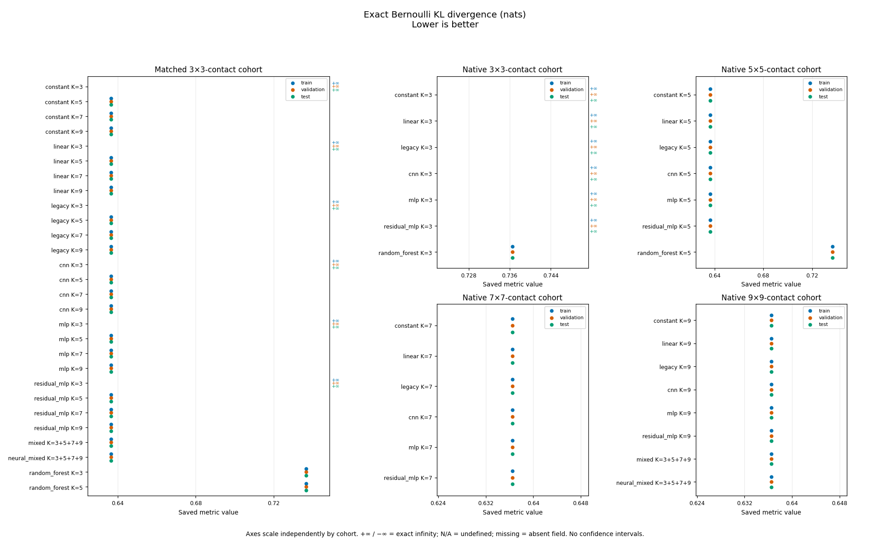

| Model | Native K | Matched train | Matched validation | Matched test | Native train | Native validation | Native test |
|---|---:|---:|---:|---:|---:|---:|---:|
| constant K=3 (`k3_constant_00_lr0.003_constant`) | 3 | +∞ | +∞ | +∞ | +∞ | +∞ | +∞ |
| constant K=5 (`k5_constant_00_lr0.003_constant`) | 5 | 0.63651419 | 0.63651419 | 0.63651419 | 0.63651419 | 0.63651419 | 0.63651419 |
| constant K=7 (`k7_constant_00_lr0.003_constant`) | 7 | 0.63651417 | 0.63651417 | 0.63651417 | 0.63651417 | 0.63651417 | 0.63651417 |
| constant K=9 (`k9_constant_00_lr0.003_constant`) | 9 | 0.63651417 | 0.63651417 | 0.63651417 | 0.63651417 | 0.63651417 | 0.63651417 |
| linear K=3 (`k3_linear_01_lr0.003_constant`) | 3 | +∞ | +∞ | +∞ | +∞ | +∞ | +∞ |
| linear K=5 (`k5_linear_01_lr0.003_constant`) | 5 | 0.63651416 | 0.63651416 | 0.63651416 | 0.63651416 | 0.63651416 | 0.63651416 |
| linear K=7 (`k7_linear_01_lr0.003_constant`) | 7 | 0.63651417 | 0.63651417 | 0.63651417 | 0.63651417 | 0.63651417 | 0.63651417 |
| linear K=9 (`k9_linear_01_lr0.003_constant`) | 9 | 0.63651417 | 0.63651417 | 0.63651417 | 0.63651417 | 0.63651417 | 0.63651417 |
| legacy K=3 (`k3_legacy_02_lr0.003_constant`) | 3 | +∞ | +∞ | +∞ | +∞ | +∞ | +∞ |
| legacy K=5 (`k5_legacy_02_lr0.003_constant`) | 5 | 0.63651419 | 0.63651419 | 0.63651419 | 0.63651419 | 0.63651419 | 0.63651419 |
| legacy K=7 (`k7_legacy_02_lr0.003_constant`) | 7 | 0.63651417 | 0.63651417 | 0.63651417 | 0.63651417 | 0.63651417 | 0.63651417 |
| legacy K=9 (`k9_legacy_02_lr0.003_constant`) | 9 | 0.63651417 | 0.63651417 | 0.63651417 | 0.63651417 | 0.63651417 | 0.63651417 |
| cnn K=3 (`k3_cnn_03_lr0.003_constant`) | 3 | +∞ | +∞ | +∞ | +∞ | +∞ | +∞ |
| cnn K=5 (`k5_cnn_03_lr0.003_constant`) | 5 | 0.63651448 | 0.63651448 | 0.63651448 | 0.63651448 | 0.63651448 | 0.63651448 |
| cnn K=7 (`k7_cnn_03_lr0.003_constant`) | 7 | 0.63651417 | 0.63651417 | 0.63651417 | 0.63651417 | 0.63651417 | 0.63651417 |
| cnn K=9 (`k9_cnn_03_lr0.003_constant`) | 9 | 0.63651417 | 0.63651417 | 0.63651417 | 0.63651417 | 0.63651417 | 0.63651417 |
| mlp K=3 (`k3_mlp_04_lr0.003_constant`) | 3 | +∞ | +∞ | +∞ | +∞ | +∞ | +∞ |
| mlp K=5 (`k5_mlp_05_lr0.003_constant`) | 5 | 0.63651419 | 0.63651419 | 0.63651419 | 0.63651419 | 0.63651419 | 0.63651419 |
| mlp K=7 (`k7_mlp_04_lr0.003_constant`) | 7 | 0.63651417 | 0.63651417 | 0.63651417 | 0.63651417 | 0.63651417 | 0.63651417 |
| mlp K=9 (`k9_mlp_04_lr0.003_constant`) | 9 | 0.63651417 | 0.63651417 | 0.63651417 | 0.63651417 | 0.63651417 | 0.63651417 |
| residual_mlp K=3 (`k3_residual_mlp_08_lr0.003_constant`) | 3 | +∞ | +∞ | +∞ | +∞ | +∞ | +∞ |
| residual_mlp K=5 (`k5_residual_mlp_09_lr0.003_constant`) | 5 | 0.63651421 | 0.63651421 | 0.63651421 | 0.63651421 | 0.63651421 | 0.63651421 |
| residual_mlp K=7 (`k7_residual_mlp_08_lr0.003_constant`) | 7 | 0.63651418 | 0.63651418 | 0.63651418 | 0.63651418 | 0.63651418 | 0.63651418 |
| residual_mlp K=9 (`k9_residual_mlp_08_lr0.003_constant`) | 9 | 0.63651419 | 0.63651419 | 0.63651419 | 0.63651419 | 0.63651419 | 0.63651419 |
| mixed K=3+5+7+9 (`mixed_3_5_7_9_00_lr0.003_constant`) | 9 | 0.63651425 | 0.63651425 | 0.63651425 | 0.63651425 | 0.63651425 | 0.63651425 |
| neural_mixed K=3+5+7+9 (`neural_mixed_3_5_7_9_00_lr0.003_constant`) | 9 | 0.63651461 | 0.63651461 | 0.63651461 | 0.63651461 | 0.63651461 | 0.63651461 |
| random_forest K=3 (`rf3_depth8`) | 3 | 0.73654903 | 0.73654903 | 0.73654903 | 0.73654903 | 0.73654903 | 0.73654903 |
| random_forest K=5 (`rf5_depth8`) | 5 | 0.73654903 | 0.73654903 | 0.73654903 | 0.73654903 | 0.73654903 | 0.73654903 |

#### Bernoulli total variation distance

Saved field: `bernoulli_total_variation_distance_mean`. Lower is better.

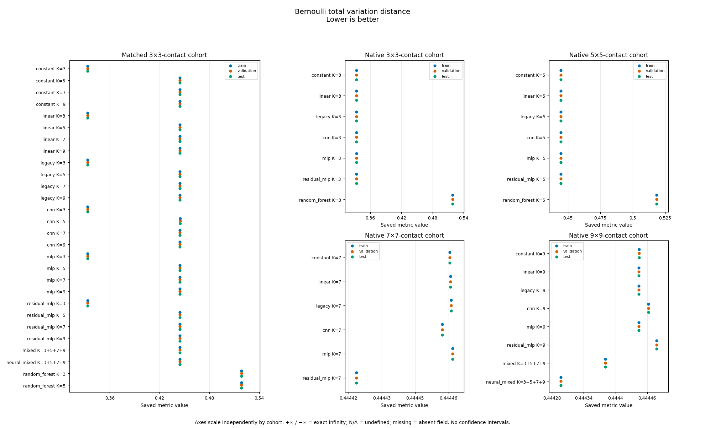

| Model | Native K | Matched train | Matched validation | Matched test | Native train | Native validation | Native test |
|---|---:|---:|---:|---:|---:|---:|---:|
| constant K=3 (`k3_constant_00_lr0.003_constant`) | 3 | 0.33333333 | 0.33333333 | 0.33333333 | 0.33333333 | 0.33333333 | 0.33333333 |
| constant K=5 (`k5_constant_00_lr0.003_constant`) | 5 | 0.44447492 | 0.44447492 | 0.44447492 | 0.44447492 | 0.44447492 | 0.44447492 |
| constant K=7 (`k7_constant_00_lr0.003_constant`) | 7 | 0.44446055 | 0.44446055 | 0.44446055 | 0.44446055 | 0.44446055 | 0.44446055 |
| constant K=9 (`k9_constant_00_lr0.003_constant`) | 9 | 0.44444444 | 0.44444444 | 0.44444444 | 0.44444444 | 0.44444444 | 0.44444444 |
| linear K=3 (`k3_linear_01_lr0.003_constant`) | 3 | 0.33333333 | 0.33333333 | 0.33333333 | 0.33333333 | 0.33333333 | 0.33333333 |
| linear K=5 (`k5_linear_01_lr0.003_constant`) | 5 | 0.4444748 | 0.4444748 | 0.4444748 | 0.4444748 | 0.4444748 | 0.4444748 |
| linear K=7 (`k7_linear_01_lr0.003_constant`) | 7 | 0.44446089 | 0.44446089 | 0.44446089 | 0.44446089 | 0.44446089 | 0.44446089 |
| linear K=9 (`k9_linear_01_lr0.003_constant`) | 9 | 0.44444428 | 0.44444428 | 0.44444428 | 0.44444428 | 0.44444428 | 0.44444428 |
| legacy K=3 (`k3_legacy_02_lr0.003_constant`) | 3 | 0.33333333 | 0.33333333 | 0.33333333 | 0.33333333 | 0.33333333 | 0.33333333 |
| legacy K=5 (`k5_legacy_02_lr0.003_constant`) | 5 | 0.44447573 | 0.44447573 | 0.44447573 | 0.44447573 | 0.44447573 | 0.44447573 |
| legacy K=7 (`k7_legacy_02_lr0.003_constant`) | 7 | 0.44446115 | 0.44446115 | 0.44446115 | 0.44446115 | 0.44446115 | 0.44446115 |
| legacy K=9 (`k9_legacy_02_lr0.003_constant`) | 9 | 0.44444428 | 0.44444428 | 0.44444428 | 0.44444428 | 0.44444428 | 0.44444428 |
| cnn K=3 (`k3_cnn_03_lr0.003_constant`) | 3 | 0.33333333 | 0.33333333 | 0.33333333 | 0.33333333 | 0.33333333 | 0.33333333 |
| cnn K=5 (`k5_cnn_03_lr0.003_constant`) | 5 | 0.44456754 | 0.44456754 | 0.44456754 | 0.44456754 | 0.44456754 | 0.44456754 |
| cnn K=7 (`k7_cnn_03_lr0.003_constant`) | 7 | 0.44445717 | 0.44445717 | 0.44445717 | 0.44445717 | 0.44445717 | 0.44445717 |
| cnn K=9 (`k9_cnn_03_lr0.003_constant`) | 9 | 0.4444622 | 0.4444622 | 0.4444622 | 0.4444622 | 0.4444622 | 0.4444622 |
| mlp K=3 (`k3_mlp_04_lr0.003_constant`) | 3 | 0.33333333 | 0.33333333 | 0.33333333 | 0.33333333 | 0.33333333 | 0.33333333 |
| mlp K=5 (`k5_mlp_05_lr0.003_constant`) | 5 | 0.44441533 | 0.44441533 | 0.44441533 | 0.44441533 | 0.44441533 | 0.44441533 |
| mlp K=7 (`k7_mlp_04_lr0.003_constant`) | 7 | 0.4444618 | 0.4444618 | 0.4444618 | 0.4444618 | 0.4444618 | 0.4444618 |
| mlp K=9 (`k9_mlp_04_lr0.003_constant`) | 9 | 0.44444416 | 0.44444416 | 0.44444416 | 0.44444416 | 0.44444416 | 0.44444416 |
| residual_mlp K=3 (`k3_residual_mlp_08_lr0.003_constant`) | 3 | 0.33333333 | 0.33333333 | 0.33333333 | 0.33333333 | 0.33333333 | 0.33333333 |
| residual_mlp K=5 (`k5_residual_mlp_09_lr0.003_constant`) | 5 | 0.44439745 | 0.44439745 | 0.44439745 | 0.44439745 | 0.44439745 | 0.44439745 |
| residual_mlp K=7 (`k7_residual_mlp_08_lr0.003_constant`) | 7 | 0.44441857 | 0.44441857 | 0.44441857 | 0.44441857 | 0.44441857 | 0.44441857 |
| residual_mlp K=9 (`k9_residual_mlp_08_lr0.003_constant`) | 9 | 0.44447786 | 0.44447786 | 0.44447786 | 0.44447786 | 0.44447786 | 0.44447786 |
| mixed K=3+5+7+9 (`mixed_3_5_7_9_00_lr0.003_constant`) | 9 | 0.4443804 | 0.4443804 | 0.4443804 | 0.4443804 | 0.4443804 | 0.4443804 |
| neural_mixed K=3+5+7+9 (`neural_mixed_3_5_7_9_00_lr0.003_constant`) | 9 | 0.4442964 | 0.4442964 | 0.4442964 | 0.4442964 | 0.4442964 | 0.4442964 |
| random_forest K=3 (`rf3_depth8`) | 3 | 0.51851852 | 0.51851852 | 0.51851852 | 0.51851852 | 0.51851852 | 0.51851852 |
| random_forest K=5 (`rf5_depth8`) | 5 | 0.51851852 | 0.51851852 | 0.51851852 | 0.51851852 | 0.51851852 | 0.51851852 |

#### Bernoulli Wasserstein-1 distance

Saved field: `bernoulli_wasserstein_1_distance_mean`. Lower is better.

| Model | Native K | Matched train | Matched validation | Matched test | Native train | Native validation | Native test |
|---|---:|---:|---:|---:|---:|---:|---:|
| constant K=3 (`k3_constant_00_lr0.003_constant`) | 3 | 0.33333333 | 0.33333333 | 0.33333333 | 0.33333333 | 0.33333333 | 0.33333333 |
| constant K=5 (`k5_constant_00_lr0.003_constant`) | 5 | 0.44447492 | 0.44447492 | 0.44447492 | 0.44447492 | 0.44447492 | 0.44447492 |
| constant K=7 (`k7_constant_00_lr0.003_constant`) | 7 | 0.44446055 | 0.44446055 | 0.44446055 | 0.44446055 | 0.44446055 | 0.44446055 |
| constant K=9 (`k9_constant_00_lr0.003_constant`) | 9 | 0.44444444 | 0.44444444 | 0.44444444 | 0.44444444 | 0.44444444 | 0.44444444 |
| linear K=3 (`k3_linear_01_lr0.003_constant`) | 3 | 0.33333333 | 0.33333333 | 0.33333333 | 0.33333333 | 0.33333333 | 0.33333333 |
| linear K=5 (`k5_linear_01_lr0.003_constant`) | 5 | 0.4444748 | 0.4444748 | 0.4444748 | 0.4444748 | 0.4444748 | 0.4444748 |
| linear K=7 (`k7_linear_01_lr0.003_constant`) | 7 | 0.44446089 | 0.44446089 | 0.44446089 | 0.44446089 | 0.44446089 | 0.44446089 |
| linear K=9 (`k9_linear_01_lr0.003_constant`) | 9 | 0.44444428 | 0.44444428 | 0.44444428 | 0.44444428 | 0.44444428 | 0.44444428 |
| legacy K=3 (`k3_legacy_02_lr0.003_constant`) | 3 | 0.33333333 | 0.33333333 | 0.33333333 | 0.33333333 | 0.33333333 | 0.33333333 |
| legacy K=5 (`k5_legacy_02_lr0.003_constant`) | 5 | 0.44447573 | 0.44447573 | 0.44447573 | 0.44447573 | 0.44447573 | 0.44447573 |
| legacy K=7 (`k7_legacy_02_lr0.003_constant`) | 7 | 0.44446115 | 0.44446115 | 0.44446115 | 0.44446115 | 0.44446115 | 0.44446115 |
| legacy K=9 (`k9_legacy_02_lr0.003_constant`) | 9 | 0.44444428 | 0.44444428 | 0.44444428 | 0.44444428 | 0.44444428 | 0.44444428 |
| cnn K=3 (`k3_cnn_03_lr0.003_constant`) | 3 | 0.33333333 | 0.33333333 | 0.33333333 | 0.33333333 | 0.33333333 | 0.33333333 |
| cnn K=5 (`k5_cnn_03_lr0.003_constant`) | 5 | 0.44456754 | 0.44456754 | 0.44456754 | 0.44456754 | 0.44456754 | 0.44456754 |
| cnn K=7 (`k7_cnn_03_lr0.003_constant`) | 7 | 0.44445717 | 0.44445717 | 0.44445717 | 0.44445717 | 0.44445717 | 0.44445717 |
| cnn K=9 (`k9_cnn_03_lr0.003_constant`) | 9 | 0.4444622 | 0.4444622 | 0.4444622 | 0.4444622 | 0.4444622 | 0.4444622 |
| mlp K=3 (`k3_mlp_04_lr0.003_constant`) | 3 | 0.33333333 | 0.33333333 | 0.33333333 | 0.33333333 | 0.33333333 | 0.33333333 |
| mlp K=5 (`k5_mlp_05_lr0.003_constant`) | 5 | 0.44441533 | 0.44441533 | 0.44441533 | 0.44441533 | 0.44441533 | 0.44441533 |
| mlp K=7 (`k7_mlp_04_lr0.003_constant`) | 7 | 0.4444618 | 0.4444618 | 0.4444618 | 0.4444618 | 0.4444618 | 0.4444618 |
| mlp K=9 (`k9_mlp_04_lr0.003_constant`) | 9 | 0.44444416 | 0.44444416 | 0.44444416 | 0.44444416 | 0.44444416 | 0.44444416 |
| residual_mlp K=3 (`k3_residual_mlp_08_lr0.003_constant`) | 3 | 0.33333333 | 0.33333333 | 0.33333333 | 0.33333333 | 0.33333333 | 0.33333333 |
| residual_mlp K=5 (`k5_residual_mlp_09_lr0.003_constant`) | 5 | 0.44439745 | 0.44439745 | 0.44439745 | 0.44439745 | 0.44439745 | 0.44439745 |
| residual_mlp K=7 (`k7_residual_mlp_08_lr0.003_constant`) | 7 | 0.44441857 | 0.44441857 | 0.44441857 | 0.44441857 | 0.44441857 | 0.44441857 |
| residual_mlp K=9 (`k9_residual_mlp_08_lr0.003_constant`) | 9 | 0.44447786 | 0.44447786 | 0.44447786 | 0.44447786 | 0.44447786 | 0.44447786 |
| mixed K=3+5+7+9 (`mixed_3_5_7_9_00_lr0.003_constant`) | 9 | 0.4443804 | 0.4443804 | 0.4443804 | 0.4443804 | 0.4443804 | 0.4443804 |
| neural_mixed K=3+5+7+9 (`neural_mixed_3_5_7_9_00_lr0.003_constant`) | 9 | 0.4442964 | 0.4442964 | 0.4442964 | 0.4442964 | 0.4442964 | 0.4442964 |
| random_forest K=3 (`rf3_depth8`) | 3 | 0.51851852 | 0.51851852 | 0.51851852 | 0.51851852 | 0.51851852 | 0.51851852 |
| random_forest K=5 (`rf5_depth8`) | 5 | 0.51851852 | 0.51851852 | 0.51851852 | 0.51851852 | 0.51851852 | 0.51851852 |

#### Bernoulli Wasserstein-2 distance

Saved field: `bernoulli_wasserstein_2_distance_mean`. Lower is better.

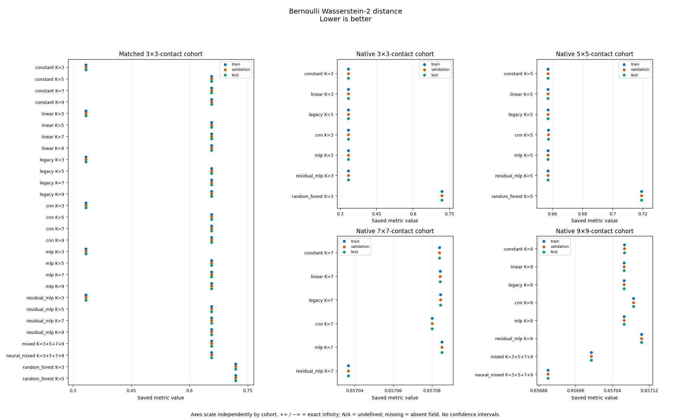

| Model | Native K | Matched train | Matched validation | Matched test | Native train | Native validation | Native test |
|---|---:|---:|---:|---:|---:|---:|---:|
| constant K=3 (`k3_constant_00_lr0.003_constant`) | 3 | 0.33333333 | 0.33333333 | 0.33333333 | 0.33333333 | 0.33333333 | 0.33333333 |
| constant K=5 (`k5_constant_00_lr0.003_constant`) | 5 | 0.65709982 | 0.65709982 | 0.65709982 | 0.65709982 | 0.65709982 | 0.65709982 |
| constant K=7 (`k7_constant_00_lr0.003_constant`) | 7 | 0.65708374 | 0.65708374 | 0.65708374 | 0.65708374 | 0.65708374 | 0.65708374 |
| constant K=9 (`k9_constant_00_lr0.003_constant`) | 9 | 0.6570657 | 0.6570657 | 0.6570657 | 0.6570657 | 0.6570657 | 0.6570657 |
| linear K=3 (`k3_linear_01_lr0.003_constant`) | 3 | 0.33333333 | 0.33333333 | 0.33333333 | 0.33333333 | 0.33333333 | 0.33333333 |
| linear K=5 (`k5_linear_01_lr0.003_constant`) | 5 | 0.65709969 | 0.65709969 | 0.65709969 | 0.65709969 | 0.65709969 | 0.65709969 |
| linear K=7 (`k7_linear_01_lr0.003_constant`) | 7 | 0.65708412 | 0.65708412 | 0.65708412 | 0.65708412 | 0.65708412 | 0.65708412 |
| linear K=9 (`k9_linear_01_lr0.003_constant`) | 9 | 0.65706552 | 0.65706552 | 0.65706552 | 0.65706552 | 0.65706552 | 0.65706552 |
| legacy K=3 (`k3_legacy_02_lr0.003_constant`) | 3 | 0.33333333 | 0.33333333 | 0.33333333 | 0.33333333 | 0.33333333 | 0.33333333 |
| legacy K=5 (`k5_legacy_02_lr0.003_constant`) | 5 | 0.65710073 | 0.65710073 | 0.65710073 | 0.65710073 | 0.65710073 | 0.65710073 |
| legacy K=7 (`k7_legacy_02_lr0.003_constant`) | 7 | 0.65708441 | 0.65708441 | 0.65708441 | 0.65708441 | 0.65708441 | 0.65708441 |
| legacy K=9 (`k9_legacy_02_lr0.003_constant`) | 9 | 0.65706552 | 0.65706552 | 0.65706552 | 0.65706552 | 0.65706552 | 0.65706552 |
| cnn K=3 (`k3_cnn_03_lr0.003_constant`) | 3 | 0.33333333 | 0.33333333 | 0.33333333 | 0.33333333 | 0.33333333 | 0.33333333 |
| cnn K=5 (`k5_cnn_03_lr0.003_constant`) | 5 | 0.65720347 | 0.65720347 | 0.65720347 | 0.65720347 | 0.65720347 | 0.65720347 |
| cnn K=7 (`k7_cnn_03_lr0.003_constant`) | 7 | 0.65707996 | 0.65707996 | 0.65707996 | 0.65707996 | 0.65707996 | 0.65707996 |
| cnn K=9 (`k9_cnn_03_lr0.003_constant`) | 9 | 0.65708559 | 0.65708559 | 0.65708559 | 0.65708559 | 0.65708559 | 0.65708559 |
| mlp K=3 (`k3_mlp_04_lr0.003_constant`) | 3 | 0.33333333 | 0.33333333 | 0.33333333 | 0.33333333 | 0.33333333 | 0.33333333 |
| mlp K=5 (`k5_mlp_05_lr0.003_constant`) | 5 | 0.6570331 | 0.6570331 | 0.6570331 | 0.6570331 | 0.6570331 | 0.6570331 |
| mlp K=7 (`k7_mlp_04_lr0.003_constant`) | 7 | 0.65708514 | 0.65708514 | 0.65708514 | 0.65708514 | 0.65708514 | 0.65708514 |
| mlp K=9 (`k9_mlp_04_lr0.003_constant`) | 9 | 0.65706539 | 0.65706539 | 0.65706539 | 0.65706539 | 0.65706539 | 0.65706539 |
| residual_mlp K=3 (`k3_residual_mlp_08_lr0.003_constant`) | 3 | 0.33333333 | 0.33333333 | 0.33333333 | 0.33333333 | 0.33333333 | 0.33333333 |
| residual_mlp K=5 (`k5_residual_mlp_09_lr0.003_constant`) | 5 | 0.65701308 | 0.65701308 | 0.65701308 | 0.65701308 | 0.65701308 | 0.65701308 |
| residual_mlp K=7 (`k7_residual_mlp_08_lr0.003_constant`) | 7 | 0.65703673 | 0.65703673 | 0.65703673 | 0.65703673 | 0.65703673 | 0.65703673 |
| residual_mlp K=9 (`k9_residual_mlp_08_lr0.003_constant`) | 9 | 0.65710311 | 0.65710311 | 0.65710311 | 0.65710311 | 0.65710311 | 0.65710311 |
| mixed K=3+5+7+9 (`mixed_3_5_7_9_00_lr0.003_constant`) | 9 | 0.65699398 | 0.65699398 | 0.65699398 | 0.65699398 | 0.65699398 | 0.65699398 |
| neural_mixed K=3+5+7+9 (`neural_mixed_3_5_7_9_00_lr0.003_constant`) | 9 | 0.65689984 | 0.65689984 | 0.65689984 | 0.65689984 | 0.65689984 | 0.65689984 |
| random_forest K=3 (`rf3_depth8`) | 3 | 0.71912622 | 0.71912622 | 0.71912622 | 0.71912622 | 0.71912622 | 0.71912622 |
| random_forest K=5 (`rf5_depth8`) | 5 | 0.71912622 | 0.71912622 | 0.71912622 | 0.71912622 | 0.71912622 | 0.71912622 |

#### Floored Bernoulli KL divergence (nats)

Saved field: `floored_bernoulli_kl_divergence_mean`. Lower is better.

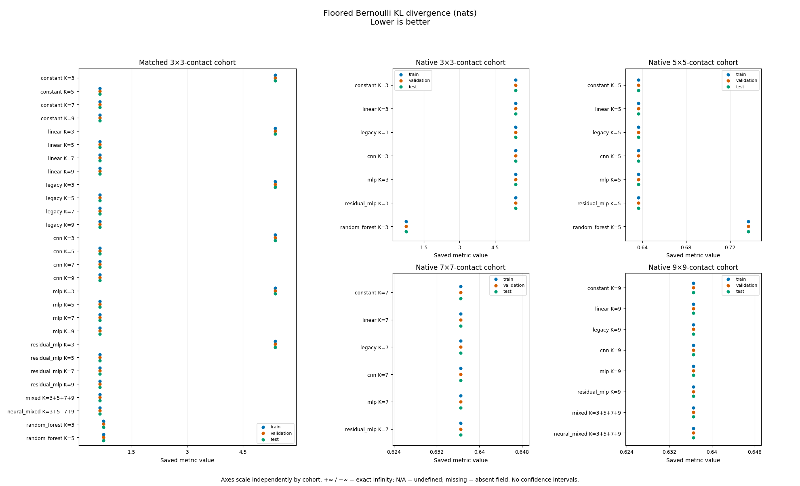

| Model | Native K | Matched train | Matched validation | Matched test | Native train | Native validation | Native test |
|---|---:|---:|---:|---:|---:|---:|---:|
| constant K=3 (`k3_constant_00_lr0.003_constant`) | 3 | 5.3726986 | 5.3726986 | 5.3726986 | 5.3726986 | 5.3726986 | 5.3726986 |
| constant K=5 (`k5_constant_00_lr0.003_constant`) | 5 | 0.63651419 | 0.63651419 | 0.63651419 | 0.63651419 | 0.63651419 | 0.63651419 |
| constant K=7 (`k7_constant_00_lr0.003_constant`) | 7 | 0.63651417 | 0.63651417 | 0.63651417 | 0.63651417 | 0.63651417 | 0.63651417 |
| constant K=9 (`k9_constant_00_lr0.003_constant`) | 9 | 0.63651417 | 0.63651417 | 0.63651417 | 0.63651417 | 0.63651417 | 0.63651417 |
| linear K=3 (`k3_linear_01_lr0.003_constant`) | 3 | 5.3726986 | 5.3726986 | 5.3726986 | 5.3726986 | 5.3726986 | 5.3726986 |
| linear K=5 (`k5_linear_01_lr0.003_constant`) | 5 | 0.63651416 | 0.63651416 | 0.63651416 | 0.63651416 | 0.63651416 | 0.63651416 |
| linear K=7 (`k7_linear_01_lr0.003_constant`) | 7 | 0.63651417 | 0.63651417 | 0.63651417 | 0.63651417 | 0.63651417 | 0.63651417 |
| linear K=9 (`k9_linear_01_lr0.003_constant`) | 9 | 0.63651417 | 0.63651417 | 0.63651417 | 0.63651417 | 0.63651417 | 0.63651417 |
| legacy K=3 (`k3_legacy_02_lr0.003_constant`) | 3 | 5.3726986 | 5.3726986 | 5.3726986 | 5.3726986 | 5.3726986 | 5.3726986 |
| legacy K=5 (`k5_legacy_02_lr0.003_constant`) | 5 | 0.63651419 | 0.63651419 | 0.63651419 | 0.63651419 | 0.63651419 | 0.63651419 |
| legacy K=7 (`k7_legacy_02_lr0.003_constant`) | 7 | 0.63651417 | 0.63651417 | 0.63651417 | 0.63651417 | 0.63651417 | 0.63651417 |
| legacy K=9 (`k9_legacy_02_lr0.003_constant`) | 9 | 0.63651417 | 0.63651417 | 0.63651417 | 0.63651417 | 0.63651417 | 0.63651417 |
| cnn K=3 (`k3_cnn_03_lr0.003_constant`) | 3 | 5.3726986 | 5.3726986 | 5.3726986 | 5.3726986 | 5.3726986 | 5.3726986 |
| cnn K=5 (`k5_cnn_03_lr0.003_constant`) | 5 | 0.63651448 | 0.63651448 | 0.63651448 | 0.63651448 | 0.63651448 | 0.63651448 |
| cnn K=7 (`k7_cnn_03_lr0.003_constant`) | 7 | 0.63651417 | 0.63651417 | 0.63651417 | 0.63651417 | 0.63651417 | 0.63651417 |
| cnn K=9 (`k9_cnn_03_lr0.003_constant`) | 9 | 0.63651417 | 0.63651417 | 0.63651417 | 0.63651417 | 0.63651417 | 0.63651417 |
| mlp K=3 (`k3_mlp_04_lr0.003_constant`) | 3 | 5.3726986 | 5.3726986 | 5.3726986 | 5.3726986 | 5.3726986 | 5.3726986 |
| mlp K=5 (`k5_mlp_05_lr0.003_constant`) | 5 | 0.63651419 | 0.63651419 | 0.63651419 | 0.63651419 | 0.63651419 | 0.63651419 |
| mlp K=7 (`k7_mlp_04_lr0.003_constant`) | 7 | 0.63651417 | 0.63651417 | 0.63651417 | 0.63651417 | 0.63651417 | 0.63651417 |
| mlp K=9 (`k9_mlp_04_lr0.003_constant`) | 9 | 0.63651417 | 0.63651417 | 0.63651417 | 0.63651417 | 0.63651417 | 0.63651417 |
| residual_mlp K=3 (`k3_residual_mlp_08_lr0.003_constant`) | 3 | 5.3726986 | 5.3726986 | 5.3726986 | 5.3726986 | 5.3726986 | 5.3726986 |
| residual_mlp K=5 (`k5_residual_mlp_09_lr0.003_constant`) | 5 | 0.63651421 | 0.63651421 | 0.63651421 | 0.63651421 | 0.63651421 | 0.63651421 |
| residual_mlp K=7 (`k7_residual_mlp_08_lr0.003_constant`) | 7 | 0.63651418 | 0.63651418 | 0.63651418 | 0.63651418 | 0.63651418 | 0.63651418 |
| residual_mlp K=9 (`k9_residual_mlp_08_lr0.003_constant`) | 9 | 0.63651419 | 0.63651419 | 0.63651419 | 0.63651419 | 0.63651419 | 0.63651419 |
| mixed K=3+5+7+9 (`mixed_3_5_7_9_00_lr0.003_constant`) | 9 | 0.63651425 | 0.63651425 | 0.63651425 | 0.63651425 | 0.63651425 | 0.63651425 |
| neural_mixed K=3+5+7+9 (`neural_mixed_3_5_7_9_00_lr0.003_constant`) | 9 | 0.63651461 | 0.63651461 | 0.63651461 | 0.63651461 | 0.63651461 | 0.63651461 |
| random_forest K=3 (`rf3_depth8`) | 3 | 0.73654903 | 0.73654903 | 0.73654903 | 0.73654903 | 0.73654903 | 0.73654903 |
| random_forest K=5 (`rf5_depth8`) | 5 | 0.73654903 | 0.73654903 | 0.73654903 | 0.73654903 | 0.73654903 | 0.73654903 |

### Ranking scores

#### Average precision (non-interpolated)

Saved field: `average_precision`. Higher is better.

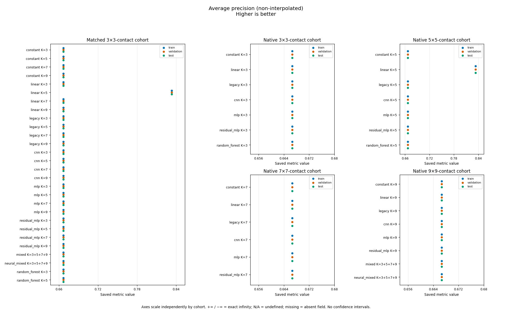

| Model | Native K | Matched train | Matched validation | Matched test | Native train | Native validation | Native test |
|---|---:|---:|---:|---:|---:|---:|---:|
| constant K=3 (`k3_constant_00_lr0.003_constant`) | 3 | 0.66666667 | 0.66666667 | 0.66666667 | 0.66666667 | 0.66666667 | 0.66666667 |
| constant K=5 (`k5_constant_00_lr0.003_constant`) | 5 | 0.66666667 | 0.66666667 | 0.66666667 | 0.66666667 | 0.66666667 | 0.66666667 |
| constant K=7 (`k7_constant_00_lr0.003_constant`) | 7 | 0.66666667 | 0.66666667 | 0.66666667 | 0.66666667 | 0.66666667 | 0.66666667 |
| constant K=9 (`k9_constant_00_lr0.003_constant`) | 9 | 0.66666667 | 0.66666667 | 0.66666667 | 0.66666667 | 0.66666667 | 0.66666667 |
| linear K=3 (`k3_linear_01_lr0.003_constant`) | 3 | 0.66666667 | 0.66666667 | 0.66666667 | 0.66666667 | 0.66666667 | 0.66666667 |
| linear K=5 (`k5_linear_01_lr0.003_constant`) | 5 | 0.83333333 | 0.83333333 | 0.83333333 | 0.83333333 | 0.83333333 | 0.83333333 |
| linear K=7 (`k7_linear_01_lr0.003_constant`) | 7 | 0.66666667 | 0.66666667 | 0.66666667 | 0.66666667 | 0.66666667 | 0.66666667 |
| linear K=9 (`k9_linear_01_lr0.003_constant`) | 9 | 0.66666667 | 0.66666667 | 0.66666667 | 0.66666667 | 0.66666667 | 0.66666667 |
| legacy K=3 (`k3_legacy_02_lr0.003_constant`) | 3 | 0.66666667 | 0.66666667 | 0.66666667 | 0.66666667 | 0.66666667 | 0.66666667 |
| legacy K=5 (`k5_legacy_02_lr0.003_constant`) | 5 | 0.66666667 | 0.66666667 | 0.66666667 | 0.66666667 | 0.66666667 | 0.66666667 |
| legacy K=7 (`k7_legacy_02_lr0.003_constant`) | 7 | 0.66666667 | 0.66666667 | 0.66666667 | 0.66666667 | 0.66666667 | 0.66666667 |
| legacy K=9 (`k9_legacy_02_lr0.003_constant`) | 9 | 0.66666667 | 0.66666667 | 0.66666667 | 0.66666667 | 0.66666667 | 0.66666667 |
| cnn K=3 (`k3_cnn_03_lr0.003_constant`) | 3 | 0.66666667 | 0.66666667 | 0.66666667 | 0.66666667 | 0.66666667 | 0.66666667 |
| cnn K=5 (`k5_cnn_03_lr0.003_constant`) | 5 | 0.66666667 | 0.66666667 | 0.66666667 | 0.66666667 | 0.66666667 | 0.66666667 |
| cnn K=7 (`k7_cnn_03_lr0.003_constant`) | 7 | 0.66666667 | 0.66666667 | 0.66666667 | 0.66666667 | 0.66666667 | 0.66666667 |
| cnn K=9 (`k9_cnn_03_lr0.003_constant`) | 9 | 0.66666667 | 0.66666667 | 0.66666667 | 0.66666667 | 0.66666667 | 0.66666667 |
| mlp K=3 (`k3_mlp_04_lr0.003_constant`) | 3 | 0.66666667 | 0.66666667 | 0.66666667 | 0.66666667 | 0.66666667 | 0.66666667 |
| mlp K=5 (`k5_mlp_05_lr0.003_constant`) | 5 | 0.66666667 | 0.66666667 | 0.66666667 | 0.66666667 | 0.66666667 | 0.66666667 |
| mlp K=7 (`k7_mlp_04_lr0.003_constant`) | 7 | 0.66666667 | 0.66666667 | 0.66666667 | 0.66666667 | 0.66666667 | 0.66666667 |
| mlp K=9 (`k9_mlp_04_lr0.003_constant`) | 9 | 0.66666667 | 0.66666667 | 0.66666667 | 0.66666667 | 0.66666667 | 0.66666667 |
| residual_mlp K=3 (`k3_residual_mlp_08_lr0.003_constant`) | 3 | 0.66666667 | 0.66666667 | 0.66666667 | 0.66666667 | 0.66666667 | 0.66666667 |
| residual_mlp K=5 (`k5_residual_mlp_09_lr0.003_constant`) | 5 | 0.66666667 | 0.66666667 | 0.66666667 | 0.66666667 | 0.66666667 | 0.66666667 |
| residual_mlp K=7 (`k7_residual_mlp_08_lr0.003_constant`) | 7 | 0.66666667 | 0.66666667 | 0.66666667 | 0.66666667 | 0.66666667 | 0.66666667 |
| residual_mlp K=9 (`k9_residual_mlp_08_lr0.003_constant`) | 9 | 0.66666667 | 0.66666667 | 0.66666667 | 0.66666667 | 0.66666667 | 0.66666667 |
| mixed K=3+5+7+9 (`mixed_3_5_7_9_00_lr0.003_constant`) | 9 | 0.66666667 | 0.66666667 | 0.66666667 | 0.66666667 | 0.66666667 | 0.66666667 |
| neural_mixed K=3+5+7+9 (`neural_mixed_3_5_7_9_00_lr0.003_constant`) | 9 | 0.66666667 | 0.66666667 | 0.66666667 | 0.66666667 | 0.66666667 | 0.66666667 |
| random_forest K=3 (`rf3_depth8`) | 3 | 0.66666667 | 0.66666667 | 0.66666667 | 0.66666667 | 0.66666667 | 0.66666667 |
| random_forest K=5 (`rf5_depth8`) | 5 | 0.66666667 | 0.66666667 | 0.66666667 | 0.66666667 | 0.66666667 | 0.66666667 |

#### Precision-recall AUC (trapezoidal)

Saved field: `precision_recall_auc`. Higher is better.

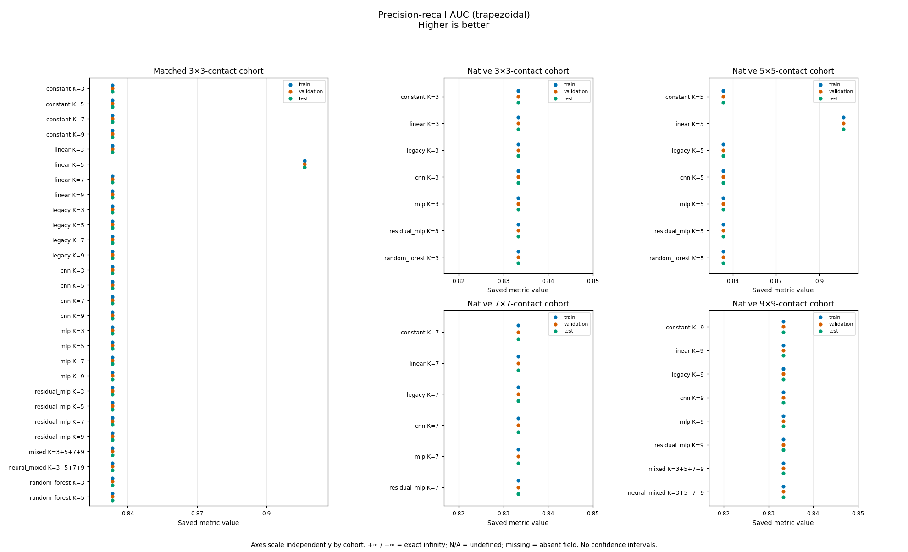

| Model | Native K | Matched train | Matched validation | Matched test | Native train | Native validation | Native test |
|---|---:|---:|---:|---:|---:|---:|---:|
| constant K=3 (`k3_constant_00_lr0.003_constant`) | 3 | 0.83333333 | 0.83333333 | 0.83333333 | 0.83333333 | 0.83333333 | 0.83333333 |
| constant K=5 (`k5_constant_00_lr0.003_constant`) | 5 | 0.83333333 | 0.83333333 | 0.83333333 | 0.83333333 | 0.83333333 | 0.83333333 |
| constant K=7 (`k7_constant_00_lr0.003_constant`) | 7 | 0.83333333 | 0.83333333 | 0.83333333 | 0.83333333 | 0.83333333 | 0.83333333 |
| constant K=9 (`k9_constant_00_lr0.003_constant`) | 9 | 0.83333333 | 0.83333333 | 0.83333333 | 0.83333333 | 0.83333333 | 0.83333333 |
| linear K=3 (`k3_linear_01_lr0.003_constant`) | 3 | 0.83333333 | 0.83333333 | 0.83333333 | 0.83333333 | 0.83333333 | 0.83333333 |
| linear K=5 (`k5_linear_01_lr0.003_constant`) | 5 | 0.91666667 | 0.91666667 | 0.91666667 | 0.91666667 | 0.91666667 | 0.91666667 |
| linear K=7 (`k7_linear_01_lr0.003_constant`) | 7 | 0.83333333 | 0.83333333 | 0.83333333 | 0.83333333 | 0.83333333 | 0.83333333 |
| linear K=9 (`k9_linear_01_lr0.003_constant`) | 9 | 0.83333333 | 0.83333333 | 0.83333333 | 0.83333333 | 0.83333333 | 0.83333333 |
| legacy K=3 (`k3_legacy_02_lr0.003_constant`) | 3 | 0.83333333 | 0.83333333 | 0.83333333 | 0.83333333 | 0.83333333 | 0.83333333 |
| legacy K=5 (`k5_legacy_02_lr0.003_constant`) | 5 | 0.83333333 | 0.83333333 | 0.83333333 | 0.83333333 | 0.83333333 | 0.83333333 |
| legacy K=7 (`k7_legacy_02_lr0.003_constant`) | 7 | 0.83333333 | 0.83333333 | 0.83333333 | 0.83333333 | 0.83333333 | 0.83333333 |
| legacy K=9 (`k9_legacy_02_lr0.003_constant`) | 9 | 0.83333333 | 0.83333333 | 0.83333333 | 0.83333333 | 0.83333333 | 0.83333333 |
| cnn K=3 (`k3_cnn_03_lr0.003_constant`) | 3 | 0.83333333 | 0.83333333 | 0.83333333 | 0.83333333 | 0.83333333 | 0.83333333 |
| cnn K=5 (`k5_cnn_03_lr0.003_constant`) | 5 | 0.83333333 | 0.83333333 | 0.83333333 | 0.83333333 | 0.83333333 | 0.83333333 |
| cnn K=7 (`k7_cnn_03_lr0.003_constant`) | 7 | 0.83333333 | 0.83333333 | 0.83333333 | 0.83333333 | 0.83333333 | 0.83333333 |
| cnn K=9 (`k9_cnn_03_lr0.003_constant`) | 9 | 0.83333333 | 0.83333333 | 0.83333333 | 0.83333333 | 0.83333333 | 0.83333333 |
| mlp K=3 (`k3_mlp_04_lr0.003_constant`) | 3 | 0.83333333 | 0.83333333 | 0.83333333 | 0.83333333 | 0.83333333 | 0.83333333 |
| mlp K=5 (`k5_mlp_05_lr0.003_constant`) | 5 | 0.83333333 | 0.83333333 | 0.83333333 | 0.83333333 | 0.83333333 | 0.83333333 |
| mlp K=7 (`k7_mlp_04_lr0.003_constant`) | 7 | 0.83333333 | 0.83333333 | 0.83333333 | 0.83333333 | 0.83333333 | 0.83333333 |
| mlp K=9 (`k9_mlp_04_lr0.003_constant`) | 9 | 0.83333333 | 0.83333333 | 0.83333333 | 0.83333333 | 0.83333333 | 0.83333333 |
| residual_mlp K=3 (`k3_residual_mlp_08_lr0.003_constant`) | 3 | 0.83333333 | 0.83333333 | 0.83333333 | 0.83333333 | 0.83333333 | 0.83333333 |
| residual_mlp K=5 (`k5_residual_mlp_09_lr0.003_constant`) | 5 | 0.83333333 | 0.83333333 | 0.83333333 | 0.83333333 | 0.83333333 | 0.83333333 |
| residual_mlp K=7 (`k7_residual_mlp_08_lr0.003_constant`) | 7 | 0.83333333 | 0.83333333 | 0.83333333 | 0.83333333 | 0.83333333 | 0.83333333 |
| residual_mlp K=9 (`k9_residual_mlp_08_lr0.003_constant`) | 9 | 0.83333333 | 0.83333333 | 0.83333333 | 0.83333333 | 0.83333333 | 0.83333333 |
| mixed K=3+5+7+9 (`mixed_3_5_7_9_00_lr0.003_constant`) | 9 | 0.83333333 | 0.83333333 | 0.83333333 | 0.83333333 | 0.83333333 | 0.83333333 |
| neural_mixed K=3+5+7+9 (`neural_mixed_3_5_7_9_00_lr0.003_constant`) | 9 | 0.83333333 | 0.83333333 | 0.83333333 | 0.83333333 | 0.83333333 | 0.83333333 |
| random_forest K=3 (`rf3_depth8`) | 3 | 0.83333333 | 0.83333333 | 0.83333333 | 0.83333333 | 0.83333333 | 0.83333333 |
| random_forest K=5 (`rf5_depth8`) | 5 | 0.83333333 | 0.83333333 | 0.83333333 | 0.83333333 | 0.83333333 | 0.83333333 |

#### ROC AUC

Saved field: `roc_auc`. Higher is better.

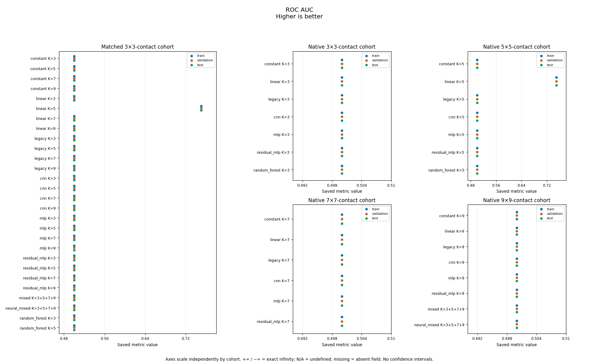

| Model | Native K | Matched train | Matched validation | Matched test | Native train | Native validation | Native test |
|---|---:|---:|---:|---:|---:|---:|---:|
| constant K=3 (`k3_constant_00_lr0.003_constant`) | 3 | 0.5 | 0.5 | 0.5 | 0.5 | 0.5 | 0.5 |
| constant K=5 (`k5_constant_00_lr0.003_constant`) | 5 | 0.5 | 0.5 | 0.5 | 0.5 | 0.5 | 0.5 |
| constant K=7 (`k7_constant_00_lr0.003_constant`) | 7 | 0.5 | 0.5 | 0.5 | 0.5 | 0.5 | 0.5 |
| constant K=9 (`k9_constant_00_lr0.003_constant`) | 9 | 0.5 | 0.5 | 0.5 | 0.5 | 0.5 | 0.5 |
| linear K=3 (`k3_linear_01_lr0.003_constant`) | 3 | 0.5 | 0.5 | 0.5 | 0.5 | 0.5 | 0.5 |
| linear K=5 (`k5_linear_01_lr0.003_constant`) | 5 | 0.75 | 0.75 | 0.75 | 0.75 | 0.75 | 0.75 |
| linear K=7 (`k7_linear_01_lr0.003_constant`) | 7 | 0.5 | 0.5 | 0.5 | 0.5 | 0.5 | 0.5 |
| linear K=9 (`k9_linear_01_lr0.003_constant`) | 9 | 0.5 | 0.5 | 0.5 | 0.5 | 0.5 | 0.5 |
| legacy K=3 (`k3_legacy_02_lr0.003_constant`) | 3 | 0.5 | 0.5 | 0.5 | 0.5 | 0.5 | 0.5 |
| legacy K=5 (`k5_legacy_02_lr0.003_constant`) | 5 | 0.5 | 0.5 | 0.5 | 0.5 | 0.5 | 0.5 |
| legacy K=7 (`k7_legacy_02_lr0.003_constant`) | 7 | 0.5 | 0.5 | 0.5 | 0.5 | 0.5 | 0.5 |
| legacy K=9 (`k9_legacy_02_lr0.003_constant`) | 9 | 0.5 | 0.5 | 0.5 | 0.5 | 0.5 | 0.5 |
| cnn K=3 (`k3_cnn_03_lr0.003_constant`) | 3 | 0.5 | 0.5 | 0.5 | 0.5 | 0.5 | 0.5 |
| cnn K=5 (`k5_cnn_03_lr0.003_constant`) | 5 | 0.5 | 0.5 | 0.5 | 0.5 | 0.5 | 0.5 |
| cnn K=7 (`k7_cnn_03_lr0.003_constant`) | 7 | 0.5 | 0.5 | 0.5 | 0.5 | 0.5 | 0.5 |
| cnn K=9 (`k9_cnn_03_lr0.003_constant`) | 9 | 0.5 | 0.5 | 0.5 | 0.5 | 0.5 | 0.5 |
| mlp K=3 (`k3_mlp_04_lr0.003_constant`) | 3 | 0.5 | 0.5 | 0.5 | 0.5 | 0.5 | 0.5 |
| mlp K=5 (`k5_mlp_05_lr0.003_constant`) | 5 | 0.5 | 0.5 | 0.5 | 0.5 | 0.5 | 0.5 |
| mlp K=7 (`k7_mlp_04_lr0.003_constant`) | 7 | 0.5 | 0.5 | 0.5 | 0.5 | 0.5 | 0.5 |
| mlp K=9 (`k9_mlp_04_lr0.003_constant`) | 9 | 0.5 | 0.5 | 0.5 | 0.5 | 0.5 | 0.5 |
| residual_mlp K=3 (`k3_residual_mlp_08_lr0.003_constant`) | 3 | 0.5 | 0.5 | 0.5 | 0.5 | 0.5 | 0.5 |
| residual_mlp K=5 (`k5_residual_mlp_09_lr0.003_constant`) | 5 | 0.5 | 0.5 | 0.5 | 0.5 | 0.5 | 0.5 |
| residual_mlp K=7 (`k7_residual_mlp_08_lr0.003_constant`) | 7 | 0.5 | 0.5 | 0.5 | 0.5 | 0.5 | 0.5 |
| residual_mlp K=9 (`k9_residual_mlp_08_lr0.003_constant`) | 9 | 0.5 | 0.5 | 0.5 | 0.5 | 0.5 | 0.5 |
| mixed K=3+5+7+9 (`mixed_3_5_7_9_00_lr0.003_constant`) | 9 | 0.5 | 0.5 | 0.5 | 0.5 | 0.5 | 0.5 |
| neural_mixed K=3+5+7+9 (`neural_mixed_3_5_7_9_00_lr0.003_constant`) | 9 | 0.5 | 0.5 | 0.5 | 0.5 | 0.5 | 0.5 |
| random_forest K=3 (`rf3_depth8`) | 3 | 0.5 | 0.5 | 0.5 | 0.5 | 0.5 | 0.5 |
| random_forest K=5 (`rf5_depth8`) | 5 | 0.5 | 0.5 | 0.5 | 0.5 | 0.5 | 0.5 |

### Classification scores and confusion counts

#### classification at 0 5 / f1

Saved field: `classification_at_0_5.f1`. Higher is better.

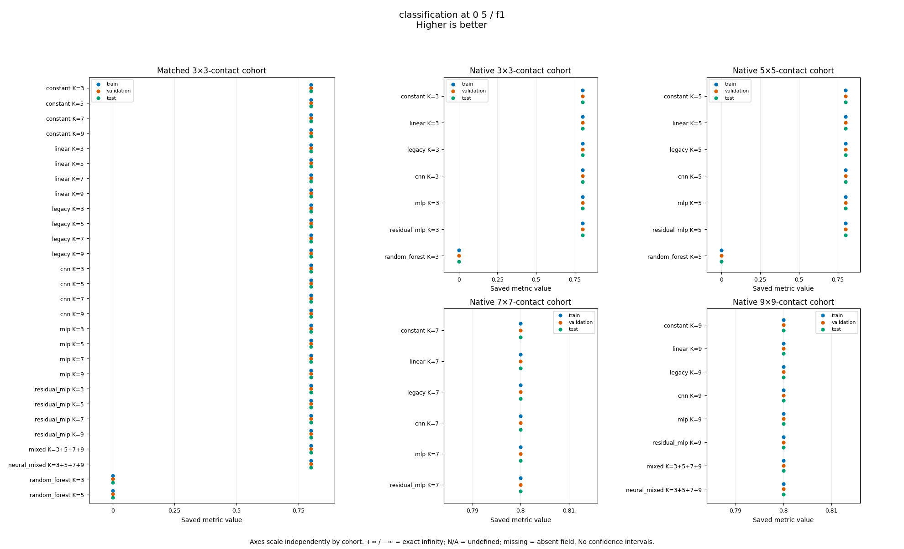

| Model | Native K | Matched train | Matched validation | Matched test | Native train | Native validation | Native test |
|---|---:|---:|---:|---:|---:|---:|---:|
| constant K=3 (`k3_constant_00_lr0.003_constant`) | 3 | 0.8 | 0.8 | 0.8 | 0.8 | 0.8 | 0.8 |
| constant K=5 (`k5_constant_00_lr0.003_constant`) | 5 | 0.8 | 0.8 | 0.8 | 0.8 | 0.8 | 0.8 |
| constant K=7 (`k7_constant_00_lr0.003_constant`) | 7 | 0.8 | 0.8 | 0.8 | 0.8 | 0.8 | 0.8 |
| constant K=9 (`k9_constant_00_lr0.003_constant`) | 9 | 0.8 | 0.8 | 0.8 | 0.8 | 0.8 | 0.8 |
| linear K=3 (`k3_linear_01_lr0.003_constant`) | 3 | 0.8 | 0.8 | 0.8 | 0.8 | 0.8 | 0.8 |
| linear K=5 (`k5_linear_01_lr0.003_constant`) | 5 | 0.8 | 0.8 | 0.8 | 0.8 | 0.8 | 0.8 |
| linear K=7 (`k7_linear_01_lr0.003_constant`) | 7 | 0.8 | 0.8 | 0.8 | 0.8 | 0.8 | 0.8 |
| linear K=9 (`k9_linear_01_lr0.003_constant`) | 9 | 0.8 | 0.8 | 0.8 | 0.8 | 0.8 | 0.8 |
| legacy K=3 (`k3_legacy_02_lr0.003_constant`) | 3 | 0.8 | 0.8 | 0.8 | 0.8 | 0.8 | 0.8 |
| legacy K=5 (`k5_legacy_02_lr0.003_constant`) | 5 | 0.8 | 0.8 | 0.8 | 0.8 | 0.8 | 0.8 |
| legacy K=7 (`k7_legacy_02_lr0.003_constant`) | 7 | 0.8 | 0.8 | 0.8 | 0.8 | 0.8 | 0.8 |
| legacy K=9 (`k9_legacy_02_lr0.003_constant`) | 9 | 0.8 | 0.8 | 0.8 | 0.8 | 0.8 | 0.8 |
| cnn K=3 (`k3_cnn_03_lr0.003_constant`) | 3 | 0.8 | 0.8 | 0.8 | 0.8 | 0.8 | 0.8 |
| cnn K=5 (`k5_cnn_03_lr0.003_constant`) | 5 | 0.8 | 0.8 | 0.8 | 0.8 | 0.8 | 0.8 |
| cnn K=7 (`k7_cnn_03_lr0.003_constant`) | 7 | 0.8 | 0.8 | 0.8 | 0.8 | 0.8 | 0.8 |
| cnn K=9 (`k9_cnn_03_lr0.003_constant`) | 9 | 0.8 | 0.8 | 0.8 | 0.8 | 0.8 | 0.8 |
| mlp K=3 (`k3_mlp_04_lr0.003_constant`) | 3 | 0.8 | 0.8 | 0.8 | 0.8 | 0.8 | 0.8 |
| mlp K=5 (`k5_mlp_05_lr0.003_constant`) | 5 | 0.8 | 0.8 | 0.8 | 0.8 | 0.8 | 0.8 |
| mlp K=7 (`k7_mlp_04_lr0.003_constant`) | 7 | 0.8 | 0.8 | 0.8 | 0.8 | 0.8 | 0.8 |
| mlp K=9 (`k9_mlp_04_lr0.003_constant`) | 9 | 0.8 | 0.8 | 0.8 | 0.8 | 0.8 | 0.8 |
| residual_mlp K=3 (`k3_residual_mlp_08_lr0.003_constant`) | 3 | 0.8 | 0.8 | 0.8 | 0.8 | 0.8 | 0.8 |
| residual_mlp K=5 (`k5_residual_mlp_09_lr0.003_constant`) | 5 | 0.8 | 0.8 | 0.8 | 0.8 | 0.8 | 0.8 |
| residual_mlp K=7 (`k7_residual_mlp_08_lr0.003_constant`) | 7 | 0.8 | 0.8 | 0.8 | 0.8 | 0.8 | 0.8 |
| residual_mlp K=9 (`k9_residual_mlp_08_lr0.003_constant`) | 9 | 0.8 | 0.8 | 0.8 | 0.8 | 0.8 | 0.8 |
| mixed K=3+5+7+9 (`mixed_3_5_7_9_00_lr0.003_constant`) | 9 | 0.8 | 0.8 | 0.8 | 0.8 | 0.8 | 0.8 |
| neural_mixed K=3+5+7+9 (`neural_mixed_3_5_7_9_00_lr0.003_constant`) | 9 | 0.8 | 0.8 | 0.8 | 0.8 | 0.8 | 0.8 |
| random_forest K=3 (`rf3_depth8`) | 3 | 0 | 0 | 0 | 0 | 0 | 0 |
| random_forest K=5 (`rf5_depth8`) | 5 | 0 | 0 | 0 | 0 | 0 | 0 |

#### classification at 0 5 / fn

Saved field: `classification_at_0_5.fn`. Descriptive; no universal better direction.

| Model | Native K | Matched train | Matched validation | Matched test | Native train | Native validation | Native test |
|---|---:|---:|---:|---:|---:|---:|---:|
| constant K=3 (`k3_constant_00_lr0.003_constant`) | 3 | 0 | 0 | 0 | 0 | 0 | 0 |
| constant K=5 (`k5_constant_00_lr0.003_constant`) | 5 | 0 | 0 | 0 | 0 | 0 | 0 |
| constant K=7 (`k7_constant_00_lr0.003_constant`) | 7 | 0 | 0 | 0 | 0 | 0 | 0 |
| constant K=9 (`k9_constant_00_lr0.003_constant`) | 9 | 0 | 0 | 0 | 0 | 0 | 0 |
| linear K=3 (`k3_linear_01_lr0.003_constant`) | 3 | 0 | 0 | 0 | 0 | 0 | 0 |
| linear K=5 (`k5_linear_01_lr0.003_constant`) | 5 | 0 | 0 | 0 | 0 | 0 | 0 |
| linear K=7 (`k7_linear_01_lr0.003_constant`) | 7 | 0 | 0 | 0 | 0 | 0 | 0 |
| linear K=9 (`k9_linear_01_lr0.003_constant`) | 9 | 0 | 0 | 0 | 0 | 0 | 0 |
| legacy K=3 (`k3_legacy_02_lr0.003_constant`) | 3 | 0 | 0 | 0 | 0 | 0 | 0 |
| legacy K=5 (`k5_legacy_02_lr0.003_constant`) | 5 | 0 | 0 | 0 | 0 | 0 | 0 |
| legacy K=7 (`k7_legacy_02_lr0.003_constant`) | 7 | 0 | 0 | 0 | 0 | 0 | 0 |
| legacy K=9 (`k9_legacy_02_lr0.003_constant`) | 9 | 0 | 0 | 0 | 0 | 0 | 0 |
| cnn K=3 (`k3_cnn_03_lr0.003_constant`) | 3 | 0 | 0 | 0 | 0 | 0 | 0 |
| cnn K=5 (`k5_cnn_03_lr0.003_constant`) | 5 | 0 | 0 | 0 | 0 | 0 | 0 |
| cnn K=7 (`k7_cnn_03_lr0.003_constant`) | 7 | 0 | 0 | 0 | 0 | 0 | 0 |
| cnn K=9 (`k9_cnn_03_lr0.003_constant`) | 9 | 0 | 0 | 0 | 0 | 0 | 0 |
| mlp K=3 (`k3_mlp_04_lr0.003_constant`) | 3 | 0 | 0 | 0 | 0 | 0 | 0 |
| mlp K=5 (`k5_mlp_05_lr0.003_constant`) | 5 | 0 | 0 | 0 | 0 | 0 | 0 |
| mlp K=7 (`k7_mlp_04_lr0.003_constant`) | 7 | 0 | 0 | 0 | 0 | 0 | 0 |
| mlp K=9 (`k9_mlp_04_lr0.003_constant`) | 9 | 0 | 0 | 0 | 0 | 0 | 0 |
| residual_mlp K=3 (`k3_residual_mlp_08_lr0.003_constant`) | 3 | 0 | 0 | 0 | 0 | 0 | 0 |
| residual_mlp K=5 (`k5_residual_mlp_09_lr0.003_constant`) | 5 | 0 | 0 | 0 | 0 | 0 | 0 |
| residual_mlp K=7 (`k7_residual_mlp_08_lr0.003_constant`) | 7 | 0 | 0 | 0 | 0 | 0 | 0 |
| residual_mlp K=9 (`k9_residual_mlp_08_lr0.003_constant`) | 9 | 0 | 0 | 0 | 0 | 0 | 0 |
| mixed K=3+5+7+9 (`mixed_3_5_7_9_00_lr0.003_constant`) | 9 | 0 | 0 | 0 | 0 | 0 | 0 |
| neural_mixed K=3+5+7+9 (`neural_mixed_3_5_7_9_00_lr0.003_constant`) | 9 | 0 | 0 | 0 | 0 | 0 | 0 |
| random_forest K=3 (`rf3_depth8`) | 3 | 2 | 2 | 2 | 2 | 2 | 2 |
| random_forest K=5 (`rf5_depth8`) | 5 | 2 | 2 | 2 | 2 | 2 | 2 |

#### classification at 0 5 / fp

Saved field: `classification_at_0_5.fp`. Descriptive; no universal better direction.

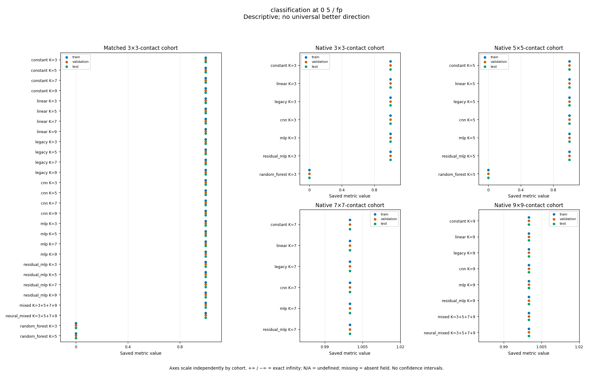

| Model | Native K | Matched train | Matched validation | Matched test | Native train | Native validation | Native test |
|---|---:|---:|---:|---:|---:|---:|---:|
| constant K=3 (`k3_constant_00_lr0.003_constant`) | 3 | 1 | 1 | 1 | 1 | 1 | 1 |
| constant K=5 (`k5_constant_00_lr0.003_constant`) | 5 | 1 | 1 | 1 | 1 | 1 | 1 |
| constant K=7 (`k7_constant_00_lr0.003_constant`) | 7 | 1 | 1 | 1 | 1 | 1 | 1 |
| constant K=9 (`k9_constant_00_lr0.003_constant`) | 9 | 1 | 1 | 1 | 1 | 1 | 1 |
| linear K=3 (`k3_linear_01_lr0.003_constant`) | 3 | 1 | 1 | 1 | 1 | 1 | 1 |
| linear K=5 (`k5_linear_01_lr0.003_constant`) | 5 | 1 | 1 | 1 | 1 | 1 | 1 |
| linear K=7 (`k7_linear_01_lr0.003_constant`) | 7 | 1 | 1 | 1 | 1 | 1 | 1 |
| linear K=9 (`k9_linear_01_lr0.003_constant`) | 9 | 1 | 1 | 1 | 1 | 1 | 1 |
| legacy K=3 (`k3_legacy_02_lr0.003_constant`) | 3 | 1 | 1 | 1 | 1 | 1 | 1 |
| legacy K=5 (`k5_legacy_02_lr0.003_constant`) | 5 | 1 | 1 | 1 | 1 | 1 | 1 |
| legacy K=7 (`k7_legacy_02_lr0.003_constant`) | 7 | 1 | 1 | 1 | 1 | 1 | 1 |
| legacy K=9 (`k9_legacy_02_lr0.003_constant`) | 9 | 1 | 1 | 1 | 1 | 1 | 1 |
| cnn K=3 (`k3_cnn_03_lr0.003_constant`) | 3 | 1 | 1 | 1 | 1 | 1 | 1 |
| cnn K=5 (`k5_cnn_03_lr0.003_constant`) | 5 | 1 | 1 | 1 | 1 | 1 | 1 |
| cnn K=7 (`k7_cnn_03_lr0.003_constant`) | 7 | 1 | 1 | 1 | 1 | 1 | 1 |
| cnn K=9 (`k9_cnn_03_lr0.003_constant`) | 9 | 1 | 1 | 1 | 1 | 1 | 1 |
| mlp K=3 (`k3_mlp_04_lr0.003_constant`) | 3 | 1 | 1 | 1 | 1 | 1 | 1 |
| mlp K=5 (`k5_mlp_05_lr0.003_constant`) | 5 | 1 | 1 | 1 | 1 | 1 | 1 |
| mlp K=7 (`k7_mlp_04_lr0.003_constant`) | 7 | 1 | 1 | 1 | 1 | 1 | 1 |
| mlp K=9 (`k9_mlp_04_lr0.003_constant`) | 9 | 1 | 1 | 1 | 1 | 1 | 1 |
| residual_mlp K=3 (`k3_residual_mlp_08_lr0.003_constant`) | 3 | 1 | 1 | 1 | 1 | 1 | 1 |
| residual_mlp K=5 (`k5_residual_mlp_09_lr0.003_constant`) | 5 | 1 | 1 | 1 | 1 | 1 | 1 |
| residual_mlp K=7 (`k7_residual_mlp_08_lr0.003_constant`) | 7 | 1 | 1 | 1 | 1 | 1 | 1 |
| residual_mlp K=9 (`k9_residual_mlp_08_lr0.003_constant`) | 9 | 1 | 1 | 1 | 1 | 1 | 1 |
| mixed K=3+5+7+9 (`mixed_3_5_7_9_00_lr0.003_constant`) | 9 | 1 | 1 | 1 | 1 | 1 | 1 |
| neural_mixed K=3+5+7+9 (`neural_mixed_3_5_7_9_00_lr0.003_constant`) | 9 | 1 | 1 | 1 | 1 | 1 | 1 |
| random_forest K=3 (`rf3_depth8`) | 3 | 0 | 0 | 0 | 0 | 0 | 0 |
| random_forest K=5 (`rf5_depth8`) | 5 | 0 | 0 | 0 | 0 | 0 | 0 |

#### classification at 0 5 / mcc

Saved field: `classification_at_0_5.mcc`. Higher is better.

| Model | Native K | Matched train | Matched validation | Matched test | Native train | Native validation | Native test |
|---|---:|---:|---:|---:|---:|---:|---:|
| constant K=3 (`k3_constant_00_lr0.003_constant`) | 3 | 0 | 0 | 0 | 0 | 0 | 0 |
| constant K=5 (`k5_constant_00_lr0.003_constant`) | 5 | 0 | 0 | 0 | 0 | 0 | 0 |
| constant K=7 (`k7_constant_00_lr0.003_constant`) | 7 | 0 | 0 | 0 | 0 | 0 | 0 |
| constant K=9 (`k9_constant_00_lr0.003_constant`) | 9 | 0 | 0 | 0 | 0 | 0 | 0 |
| linear K=3 (`k3_linear_01_lr0.003_constant`) | 3 | 0 | 0 | 0 | 0 | 0 | 0 |
| linear K=5 (`k5_linear_01_lr0.003_constant`) | 5 | 0 | 0 | 0 | 0 | 0 | 0 |
| linear K=7 (`k7_linear_01_lr0.003_constant`) | 7 | 0 | 0 | 0 | 0 | 0 | 0 |
| linear K=9 (`k9_linear_01_lr0.003_constant`) | 9 | 0 | 0 | 0 | 0 | 0 | 0 |
| legacy K=3 (`k3_legacy_02_lr0.003_constant`) | 3 | 0 | 0 | 0 | 0 | 0 | 0 |
| legacy K=5 (`k5_legacy_02_lr0.003_constant`) | 5 | 0 | 0 | 0 | 0 | 0 | 0 |
| legacy K=7 (`k7_legacy_02_lr0.003_constant`) | 7 | 0 | 0 | 0 | 0 | 0 | 0 |
| legacy K=9 (`k9_legacy_02_lr0.003_constant`) | 9 | 0 | 0 | 0 | 0 | 0 | 0 |
| cnn K=3 (`k3_cnn_03_lr0.003_constant`) | 3 | 0 | 0 | 0 | 0 | 0 | 0 |
| cnn K=5 (`k5_cnn_03_lr0.003_constant`) | 5 | 0 | 0 | 0 | 0 | 0 | 0 |
| cnn K=7 (`k7_cnn_03_lr0.003_constant`) | 7 | 0 | 0 | 0 | 0 | 0 | 0 |
| cnn K=9 (`k9_cnn_03_lr0.003_constant`) | 9 | 0 | 0 | 0 | 0 | 0 | 0 |
| mlp K=3 (`k3_mlp_04_lr0.003_constant`) | 3 | 0 | 0 | 0 | 0 | 0 | 0 |
| mlp K=5 (`k5_mlp_05_lr0.003_constant`) | 5 | 0 | 0 | 0 | 0 | 0 | 0 |
| mlp K=7 (`k7_mlp_04_lr0.003_constant`) | 7 | 0 | 0 | 0 | 0 | 0 | 0 |
| mlp K=9 (`k9_mlp_04_lr0.003_constant`) | 9 | 0 | 0 | 0 | 0 | 0 | 0 |
| residual_mlp K=3 (`k3_residual_mlp_08_lr0.003_constant`) | 3 | 0 | 0 | 0 | 0 | 0 | 0 |
| residual_mlp K=5 (`k5_residual_mlp_09_lr0.003_constant`) | 5 | 0 | 0 | 0 | 0 | 0 | 0 |
| residual_mlp K=7 (`k7_residual_mlp_08_lr0.003_constant`) | 7 | 0 | 0 | 0 | 0 | 0 | 0 |
| residual_mlp K=9 (`k9_residual_mlp_08_lr0.003_constant`) | 9 | 0 | 0 | 0 | 0 | 0 | 0 |
| mixed K=3+5+7+9 (`mixed_3_5_7_9_00_lr0.003_constant`) | 9 | 0 | 0 | 0 | 0 | 0 | 0 |
| neural_mixed K=3+5+7+9 (`neural_mixed_3_5_7_9_00_lr0.003_constant`) | 9 | 0 | 0 | 0 | 0 | 0 | 0 |
| random_forest K=3 (`rf3_depth8`) | 3 | 0 | 0 | 0 | 0 | 0 | 0 |
| random_forest K=5 (`rf5_depth8`) | 5 | 0 | 0 | 0 | 0 | 0 | 0 |

#### classification at 0 5 / precision

Saved field: `classification_at_0_5.precision`. Higher is better.

| Model | Native K | Matched train | Matched validation | Matched test | Native train | Native validation | Native test |
|---|---:|---:|---:|---:|---:|---:|---:|
| constant K=3 (`k3_constant_00_lr0.003_constant`) | 3 | 0.66666667 | 0.66666667 | 0.66666667 | 0.66666667 | 0.66666667 | 0.66666667 |
| constant K=5 (`k5_constant_00_lr0.003_constant`) | 5 | 0.66666667 | 0.66666667 | 0.66666667 | 0.66666667 | 0.66666667 | 0.66666667 |
| constant K=7 (`k7_constant_00_lr0.003_constant`) | 7 | 0.66666667 | 0.66666667 | 0.66666667 | 0.66666667 | 0.66666667 | 0.66666667 |
| constant K=9 (`k9_constant_00_lr0.003_constant`) | 9 | 0.66666667 | 0.66666667 | 0.66666667 | 0.66666667 | 0.66666667 | 0.66666667 |
| linear K=3 (`k3_linear_01_lr0.003_constant`) | 3 | 0.66666667 | 0.66666667 | 0.66666667 | 0.66666667 | 0.66666667 | 0.66666667 |
| linear K=5 (`k5_linear_01_lr0.003_constant`) | 5 | 0.66666667 | 0.66666667 | 0.66666667 | 0.66666667 | 0.66666667 | 0.66666667 |
| linear K=7 (`k7_linear_01_lr0.003_constant`) | 7 | 0.66666667 | 0.66666667 | 0.66666667 | 0.66666667 | 0.66666667 | 0.66666667 |
| linear K=9 (`k9_linear_01_lr0.003_constant`) | 9 | 0.66666667 | 0.66666667 | 0.66666667 | 0.66666667 | 0.66666667 | 0.66666667 |
| legacy K=3 (`k3_legacy_02_lr0.003_constant`) | 3 | 0.66666667 | 0.66666667 | 0.66666667 | 0.66666667 | 0.66666667 | 0.66666667 |
| legacy K=5 (`k5_legacy_02_lr0.003_constant`) | 5 | 0.66666667 | 0.66666667 | 0.66666667 | 0.66666667 | 0.66666667 | 0.66666667 |
| legacy K=7 (`k7_legacy_02_lr0.003_constant`) | 7 | 0.66666667 | 0.66666667 | 0.66666667 | 0.66666667 | 0.66666667 | 0.66666667 |
| legacy K=9 (`k9_legacy_02_lr0.003_constant`) | 9 | 0.66666667 | 0.66666667 | 0.66666667 | 0.66666667 | 0.66666667 | 0.66666667 |
| cnn K=3 (`k3_cnn_03_lr0.003_constant`) | 3 | 0.66666667 | 0.66666667 | 0.66666667 | 0.66666667 | 0.66666667 | 0.66666667 |
| cnn K=5 (`k5_cnn_03_lr0.003_constant`) | 5 | 0.66666667 | 0.66666667 | 0.66666667 | 0.66666667 | 0.66666667 | 0.66666667 |
| cnn K=7 (`k7_cnn_03_lr0.003_constant`) | 7 | 0.66666667 | 0.66666667 | 0.66666667 | 0.66666667 | 0.66666667 | 0.66666667 |
| cnn K=9 (`k9_cnn_03_lr0.003_constant`) | 9 | 0.66666667 | 0.66666667 | 0.66666667 | 0.66666667 | 0.66666667 | 0.66666667 |
| mlp K=3 (`k3_mlp_04_lr0.003_constant`) | 3 | 0.66666667 | 0.66666667 | 0.66666667 | 0.66666667 | 0.66666667 | 0.66666667 |
| mlp K=5 (`k5_mlp_05_lr0.003_constant`) | 5 | 0.66666667 | 0.66666667 | 0.66666667 | 0.66666667 | 0.66666667 | 0.66666667 |
| mlp K=7 (`k7_mlp_04_lr0.003_constant`) | 7 | 0.66666667 | 0.66666667 | 0.66666667 | 0.66666667 | 0.66666667 | 0.66666667 |
| mlp K=9 (`k9_mlp_04_lr0.003_constant`) | 9 | 0.66666667 | 0.66666667 | 0.66666667 | 0.66666667 | 0.66666667 | 0.66666667 |
| residual_mlp K=3 (`k3_residual_mlp_08_lr0.003_constant`) | 3 | 0.66666667 | 0.66666667 | 0.66666667 | 0.66666667 | 0.66666667 | 0.66666667 |
| residual_mlp K=5 (`k5_residual_mlp_09_lr0.003_constant`) | 5 | 0.66666667 | 0.66666667 | 0.66666667 | 0.66666667 | 0.66666667 | 0.66666667 |
| residual_mlp K=7 (`k7_residual_mlp_08_lr0.003_constant`) | 7 | 0.66666667 | 0.66666667 | 0.66666667 | 0.66666667 | 0.66666667 | 0.66666667 |
| residual_mlp K=9 (`k9_residual_mlp_08_lr0.003_constant`) | 9 | 0.66666667 | 0.66666667 | 0.66666667 | 0.66666667 | 0.66666667 | 0.66666667 |
| mixed K=3+5+7+9 (`mixed_3_5_7_9_00_lr0.003_constant`) | 9 | 0.66666667 | 0.66666667 | 0.66666667 | 0.66666667 | 0.66666667 | 0.66666667 |
| neural_mixed K=3+5+7+9 (`neural_mixed_3_5_7_9_00_lr0.003_constant`) | 9 | 0.66666667 | 0.66666667 | 0.66666667 | 0.66666667 | 0.66666667 | 0.66666667 |
| random_forest K=3 (`rf3_depth8`) | 3 | 0 | 0 | 0 | 0 | 0 | 0 |
| random_forest K=5 (`rf5_depth8`) | 5 | 0 | 0 | 0 | 0 | 0 | 0 |

#### classification at 0 5 / recall

Saved field: `classification_at_0_5.recall`. Higher is better.

| Model | Native K | Matched train | Matched validation | Matched test | Native train | Native validation | Native test |
|---|---:|---:|---:|---:|---:|---:|---:|
| constant K=3 (`k3_constant_00_lr0.003_constant`) | 3 | 1 | 1 | 1 | 1 | 1 | 1 |
| constant K=5 (`k5_constant_00_lr0.003_constant`) | 5 | 1 | 1 | 1 | 1 | 1 | 1 |
| constant K=7 (`k7_constant_00_lr0.003_constant`) | 7 | 1 | 1 | 1 | 1 | 1 | 1 |
| constant K=9 (`k9_constant_00_lr0.003_constant`) | 9 | 1 | 1 | 1 | 1 | 1 | 1 |
| linear K=3 (`k3_linear_01_lr0.003_constant`) | 3 | 1 | 1 | 1 | 1 | 1 | 1 |
| linear K=5 (`k5_linear_01_lr0.003_constant`) | 5 | 1 | 1 | 1 | 1 | 1 | 1 |
| linear K=7 (`k7_linear_01_lr0.003_constant`) | 7 | 1 | 1 | 1 | 1 | 1 | 1 |
| linear K=9 (`k9_linear_01_lr0.003_constant`) | 9 | 1 | 1 | 1 | 1 | 1 | 1 |
| legacy K=3 (`k3_legacy_02_lr0.003_constant`) | 3 | 1 | 1 | 1 | 1 | 1 | 1 |
| legacy K=5 (`k5_legacy_02_lr0.003_constant`) | 5 | 1 | 1 | 1 | 1 | 1 | 1 |
| legacy K=7 (`k7_legacy_02_lr0.003_constant`) | 7 | 1 | 1 | 1 | 1 | 1 | 1 |
| legacy K=9 (`k9_legacy_02_lr0.003_constant`) | 9 | 1 | 1 | 1 | 1 | 1 | 1 |
| cnn K=3 (`k3_cnn_03_lr0.003_constant`) | 3 | 1 | 1 | 1 | 1 | 1 | 1 |
| cnn K=5 (`k5_cnn_03_lr0.003_constant`) | 5 | 1 | 1 | 1 | 1 | 1 | 1 |
| cnn K=7 (`k7_cnn_03_lr0.003_constant`) | 7 | 1 | 1 | 1 | 1 | 1 | 1 |
| cnn K=9 (`k9_cnn_03_lr0.003_constant`) | 9 | 1 | 1 | 1 | 1 | 1 | 1 |
| mlp K=3 (`k3_mlp_04_lr0.003_constant`) | 3 | 1 | 1 | 1 | 1 | 1 | 1 |
| mlp K=5 (`k5_mlp_05_lr0.003_constant`) | 5 | 1 | 1 | 1 | 1 | 1 | 1 |
| mlp K=7 (`k7_mlp_04_lr0.003_constant`) | 7 | 1 | 1 | 1 | 1 | 1 | 1 |
| mlp K=9 (`k9_mlp_04_lr0.003_constant`) | 9 | 1 | 1 | 1 | 1 | 1 | 1 |
| residual_mlp K=3 (`k3_residual_mlp_08_lr0.003_constant`) | 3 | 1 | 1 | 1 | 1 | 1 | 1 |
| residual_mlp K=5 (`k5_residual_mlp_09_lr0.003_constant`) | 5 | 1 | 1 | 1 | 1 | 1 | 1 |
| residual_mlp K=7 (`k7_residual_mlp_08_lr0.003_constant`) | 7 | 1 | 1 | 1 | 1 | 1 | 1 |
| residual_mlp K=9 (`k9_residual_mlp_08_lr0.003_constant`) | 9 | 1 | 1 | 1 | 1 | 1 | 1 |
| mixed K=3+5+7+9 (`mixed_3_5_7_9_00_lr0.003_constant`) | 9 | 1 | 1 | 1 | 1 | 1 | 1 |
| neural_mixed K=3+5+7+9 (`neural_mixed_3_5_7_9_00_lr0.003_constant`) | 9 | 1 | 1 | 1 | 1 | 1 | 1 |
| random_forest K=3 (`rf3_depth8`) | 3 | 0 | 0 | 0 | 0 | 0 | 0 |
| random_forest K=5 (`rf5_depth8`) | 5 | 0 | 0 | 0 | 0 | 0 | 0 |

#### classification at 0 5 / tn

Saved field: `classification_at_0_5.tn`. Descriptive; no universal better direction.

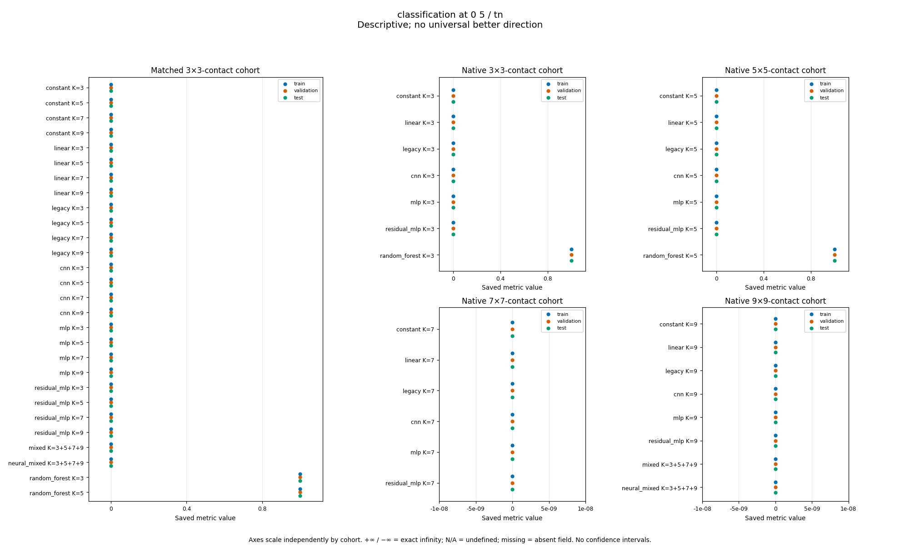

| Model | Native K | Matched train | Matched validation | Matched test | Native train | Native validation | Native test |
|---|---:|---:|---:|---:|---:|---:|---:|
| constant K=3 (`k3_constant_00_lr0.003_constant`) | 3 | 0 | 0 | 0 | 0 | 0 | 0 |
| constant K=5 (`k5_constant_00_lr0.003_constant`) | 5 | 0 | 0 | 0 | 0 | 0 | 0 |
| constant K=7 (`k7_constant_00_lr0.003_constant`) | 7 | 0 | 0 | 0 | 0 | 0 | 0 |
| constant K=9 (`k9_constant_00_lr0.003_constant`) | 9 | 0 | 0 | 0 | 0 | 0 | 0 |
| linear K=3 (`k3_linear_01_lr0.003_constant`) | 3 | 0 | 0 | 0 | 0 | 0 | 0 |
| linear K=5 (`k5_linear_01_lr0.003_constant`) | 5 | 0 | 0 | 0 | 0 | 0 | 0 |
| linear K=7 (`k7_linear_01_lr0.003_constant`) | 7 | 0 | 0 | 0 | 0 | 0 | 0 |
| linear K=9 (`k9_linear_01_lr0.003_constant`) | 9 | 0 | 0 | 0 | 0 | 0 | 0 |
| legacy K=3 (`k3_legacy_02_lr0.003_constant`) | 3 | 0 | 0 | 0 | 0 | 0 | 0 |
| legacy K=5 (`k5_legacy_02_lr0.003_constant`) | 5 | 0 | 0 | 0 | 0 | 0 | 0 |
| legacy K=7 (`k7_legacy_02_lr0.003_constant`) | 7 | 0 | 0 | 0 | 0 | 0 | 0 |
| legacy K=9 (`k9_legacy_02_lr0.003_constant`) | 9 | 0 | 0 | 0 | 0 | 0 | 0 |
| cnn K=3 (`k3_cnn_03_lr0.003_constant`) | 3 | 0 | 0 | 0 | 0 | 0 | 0 |
| cnn K=5 (`k5_cnn_03_lr0.003_constant`) | 5 | 0 | 0 | 0 | 0 | 0 | 0 |
| cnn K=7 (`k7_cnn_03_lr0.003_constant`) | 7 | 0 | 0 | 0 | 0 | 0 | 0 |
| cnn K=9 (`k9_cnn_03_lr0.003_constant`) | 9 | 0 | 0 | 0 | 0 | 0 | 0 |
| mlp K=3 (`k3_mlp_04_lr0.003_constant`) | 3 | 0 | 0 | 0 | 0 | 0 | 0 |
| mlp K=5 (`k5_mlp_05_lr0.003_constant`) | 5 | 0 | 0 | 0 | 0 | 0 | 0 |
| mlp K=7 (`k7_mlp_04_lr0.003_constant`) | 7 | 0 | 0 | 0 | 0 | 0 | 0 |
| mlp K=9 (`k9_mlp_04_lr0.003_constant`) | 9 | 0 | 0 | 0 | 0 | 0 | 0 |
| residual_mlp K=3 (`k3_residual_mlp_08_lr0.003_constant`) | 3 | 0 | 0 | 0 | 0 | 0 | 0 |
| residual_mlp K=5 (`k5_residual_mlp_09_lr0.003_constant`) | 5 | 0 | 0 | 0 | 0 | 0 | 0 |
| residual_mlp K=7 (`k7_residual_mlp_08_lr0.003_constant`) | 7 | 0 | 0 | 0 | 0 | 0 | 0 |
| residual_mlp K=9 (`k9_residual_mlp_08_lr0.003_constant`) | 9 | 0 | 0 | 0 | 0 | 0 | 0 |
| mixed K=3+5+7+9 (`mixed_3_5_7_9_00_lr0.003_constant`) | 9 | 0 | 0 | 0 | 0 | 0 | 0 |
| neural_mixed K=3+5+7+9 (`neural_mixed_3_5_7_9_00_lr0.003_constant`) | 9 | 0 | 0 | 0 | 0 | 0 | 0 |
| random_forest K=3 (`rf3_depth8`) | 3 | 1 | 1 | 1 | 1 | 1 | 1 |
| random_forest K=5 (`rf5_depth8`) | 5 | 1 | 1 | 1 | 1 | 1 | 1 |

#### classification at 0 5 / tp

Saved field: `classification_at_0_5.tp`. Descriptive; no universal better direction.

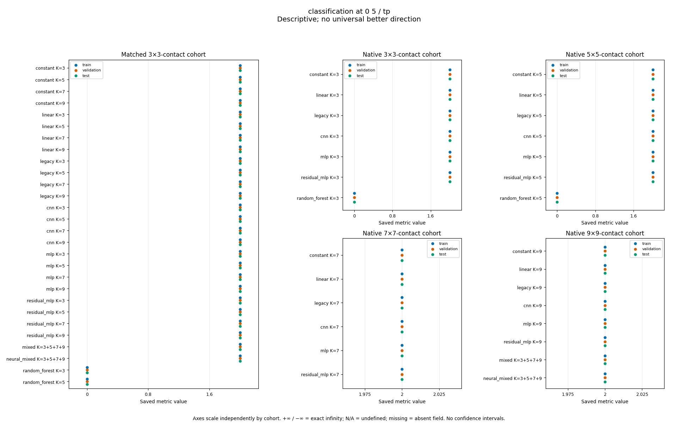

| Model | Native K | Matched train | Matched validation | Matched test | Native train | Native validation | Native test |
|---|---:|---:|---:|---:|---:|---:|---:|
| constant K=3 (`k3_constant_00_lr0.003_constant`) | 3 | 2 | 2 | 2 | 2 | 2 | 2 |
| constant K=5 (`k5_constant_00_lr0.003_constant`) | 5 | 2 | 2 | 2 | 2 | 2 | 2 |
| constant K=7 (`k7_constant_00_lr0.003_constant`) | 7 | 2 | 2 | 2 | 2 | 2 | 2 |
| constant K=9 (`k9_constant_00_lr0.003_constant`) | 9 | 2 | 2 | 2 | 2 | 2 | 2 |
| linear K=3 (`k3_linear_01_lr0.003_constant`) | 3 | 2 | 2 | 2 | 2 | 2 | 2 |
| linear K=5 (`k5_linear_01_lr0.003_constant`) | 5 | 2 | 2 | 2 | 2 | 2 | 2 |
| linear K=7 (`k7_linear_01_lr0.003_constant`) | 7 | 2 | 2 | 2 | 2 | 2 | 2 |
| linear K=9 (`k9_linear_01_lr0.003_constant`) | 9 | 2 | 2 | 2 | 2 | 2 | 2 |
| legacy K=3 (`k3_legacy_02_lr0.003_constant`) | 3 | 2 | 2 | 2 | 2 | 2 | 2 |
| legacy K=5 (`k5_legacy_02_lr0.003_constant`) | 5 | 2 | 2 | 2 | 2 | 2 | 2 |
| legacy K=7 (`k7_legacy_02_lr0.003_constant`) | 7 | 2 | 2 | 2 | 2 | 2 | 2 |
| legacy K=9 (`k9_legacy_02_lr0.003_constant`) | 9 | 2 | 2 | 2 | 2 | 2 | 2 |
| cnn K=3 (`k3_cnn_03_lr0.003_constant`) | 3 | 2 | 2 | 2 | 2 | 2 | 2 |
| cnn K=5 (`k5_cnn_03_lr0.003_constant`) | 5 | 2 | 2 | 2 | 2 | 2 | 2 |
| cnn K=7 (`k7_cnn_03_lr0.003_constant`) | 7 | 2 | 2 | 2 | 2 | 2 | 2 |
| cnn K=9 (`k9_cnn_03_lr0.003_constant`) | 9 | 2 | 2 | 2 | 2 | 2 | 2 |
| mlp K=3 (`k3_mlp_04_lr0.003_constant`) | 3 | 2 | 2 | 2 | 2 | 2 | 2 |
| mlp K=5 (`k5_mlp_05_lr0.003_constant`) | 5 | 2 | 2 | 2 | 2 | 2 | 2 |
| mlp K=7 (`k7_mlp_04_lr0.003_constant`) | 7 | 2 | 2 | 2 | 2 | 2 | 2 |
| mlp K=9 (`k9_mlp_04_lr0.003_constant`) | 9 | 2 | 2 | 2 | 2 | 2 | 2 |
| residual_mlp K=3 (`k3_residual_mlp_08_lr0.003_constant`) | 3 | 2 | 2 | 2 | 2 | 2 | 2 |
| residual_mlp K=5 (`k5_residual_mlp_09_lr0.003_constant`) | 5 | 2 | 2 | 2 | 2 | 2 | 2 |
| residual_mlp K=7 (`k7_residual_mlp_08_lr0.003_constant`) | 7 | 2 | 2 | 2 | 2 | 2 | 2 |
| residual_mlp K=9 (`k9_residual_mlp_08_lr0.003_constant`) | 9 | 2 | 2 | 2 | 2 | 2 | 2 |
| mixed K=3+5+7+9 (`mixed_3_5_7_9_00_lr0.003_constant`) | 9 | 2 | 2 | 2 | 2 | 2 | 2 |
| neural_mixed K=3+5+7+9 (`neural_mixed_3_5_7_9_00_lr0.003_constant`) | 9 | 2 | 2 | 2 | 2 | 2 | 2 |
| random_forest K=3 (`rf3_depth8`) | 3 | 0 | 0 | 0 | 0 | 0 | 0 |
| random_forest K=5 (`rf5_depth8`) | 5 | 0 | 0 | 0 | 0 | 0 | 0 |

#### classification at validation f1 threshold / f1

Saved field: `classification_at_validation_f1_threshold.f1`. Higher is better.

| Model | Native K | Matched train | Matched validation | Matched test | Native train | Native validation | Native test |
|---|---:|---:|---:|---:|---:|---:|---:|
| constant K=3 (`k3_constant_00_lr0.003_constant`) | 3 | 0.8 | 0.8 | 0.8 | 0.8 | 0.8 | 0.8 |
| constant K=5 (`k5_constant_00_lr0.003_constant`) | 5 | 0.8 | 0.8 | 0.8 | 0.8 | 0.8 | 0.8 |
| constant K=7 (`k7_constant_00_lr0.003_constant`) | 7 | 0.8 | 0.8 | 0.8 | 0.8 | 0.8 | 0.8 |
| constant K=9 (`k9_constant_00_lr0.003_constant`) | 9 | 0.8 | 0.8 | 0.8 | 0.8 | 0.8 | 0.8 |
| linear K=3 (`k3_linear_01_lr0.003_constant`) | 3 | 0.8 | 0.8 | 0.8 | 0.8 | 0.8 | 0.8 |
| linear K=5 (`k5_linear_01_lr0.003_constant`) | 5 | 0.8 | 0.8 | 0.8 | 0.8 | 0.8 | 0.8 |
| linear K=7 (`k7_linear_01_lr0.003_constant`) | 7 | 0.8 | 0.8 | 0.8 | 0.8 | 0.8 | 0.8 |
| linear K=9 (`k9_linear_01_lr0.003_constant`) | 9 | 0.8 | 0.8 | 0.8 | 0.8 | 0.8 | 0.8 |
| legacy K=3 (`k3_legacy_02_lr0.003_constant`) | 3 | 0.8 | 0.8 | 0.8 | 0.8 | 0.8 | 0.8 |
| legacy K=5 (`k5_legacy_02_lr0.003_constant`) | 5 | 0.8 | 0.8 | 0.8 | 0.8 | 0.8 | 0.8 |
| legacy K=7 (`k7_legacy_02_lr0.003_constant`) | 7 | 0.8 | 0.8 | 0.8 | 0.8 | 0.8 | 0.8 |
| legacy K=9 (`k9_legacy_02_lr0.003_constant`) | 9 | 0.8 | 0.8 | 0.8 | 0.8 | 0.8 | 0.8 |
| cnn K=3 (`k3_cnn_03_lr0.003_constant`) | 3 | 0.8 | 0.8 | 0.8 | 0.8 | 0.8 | 0.8 |
| cnn K=5 (`k5_cnn_03_lr0.003_constant`) | 5 | 0.8 | 0.8 | 0.8 | 0.8 | 0.8 | 0.8 |
| cnn K=7 (`k7_cnn_03_lr0.003_constant`) | 7 | 0.8 | 0.8 | 0.8 | 0.8 | 0.8 | 0.8 |
| cnn K=9 (`k9_cnn_03_lr0.003_constant`) | 9 | 0.8 | 0.8 | 0.8 | 0.8 | 0.8 | 0.8 |
| mlp K=3 (`k3_mlp_04_lr0.003_constant`) | 3 | 0.8 | 0.8 | 0.8 | 0.8 | 0.8 | 0.8 |
| mlp K=5 (`k5_mlp_05_lr0.003_constant`) | 5 | 0.8 | 0.8 | 0.8 | 0.8 | 0.8 | 0.8 |
| mlp K=7 (`k7_mlp_04_lr0.003_constant`) | 7 | 0.8 | 0.8 | 0.8 | 0.8 | 0.8 | 0.8 |
| mlp K=9 (`k9_mlp_04_lr0.003_constant`) | 9 | 0.8 | 0.8 | 0.8 | 0.8 | 0.8 | 0.8 |
| residual_mlp K=3 (`k3_residual_mlp_08_lr0.003_constant`) | 3 | 0.8 | 0.8 | 0.8 | 0.8 | 0.8 | 0.8 |
| residual_mlp K=5 (`k5_residual_mlp_09_lr0.003_constant`) | 5 | 0.8 | 0.8 | 0.8 | 0.8 | 0.8 | 0.8 |
| residual_mlp K=7 (`k7_residual_mlp_08_lr0.003_constant`) | 7 | 0.8 | 0.8 | 0.8 | 0.8 | 0.8 | 0.8 |
| residual_mlp K=9 (`k9_residual_mlp_08_lr0.003_constant`) | 9 | 0.8 | 0.8 | 0.8 | 0.8 | 0.8 | 0.8 |
| mixed K=3+5+7+9 (`mixed_3_5_7_9_00_lr0.003_constant`) | 9 | 0.8 | 0.8 | 0.8 | 0.8 | 0.8 | 0.8 |
| neural_mixed K=3+5+7+9 (`neural_mixed_3_5_7_9_00_lr0.003_constant`) | 9 | 0.8 | 0.8 | 0.8 | 0.8 | 0.8 | 0.8 |
| random_forest K=3 (`rf3_depth8`) | 3 | 0.8 | 0.8 | 0.8 | 0.8 | 0.8 | 0.8 |
| random_forest K=5 (`rf5_depth8`) | 5 | 0.8 | 0.8 | 0.8 | 0.8 | 0.8 | 0.8 |

#### classification at validation f1 threshold / fn

Saved field: `classification_at_validation_f1_threshold.fn`. Descriptive; no universal better direction.

| Model | Native K | Matched train | Matched validation | Matched test | Native train | Native validation | Native test |
|---|---:|---:|---:|---:|---:|---:|---:|
| constant K=3 (`k3_constant_00_lr0.003_constant`) | 3 | 0 | 0 | 0 | 0 | 0 | 0 |
| constant K=5 (`k5_constant_00_lr0.003_constant`) | 5 | 0 | 0 | 0 | 0 | 0 | 0 |
| constant K=7 (`k7_constant_00_lr0.003_constant`) | 7 | 0 | 0 | 0 | 0 | 0 | 0 |
| constant K=9 (`k9_constant_00_lr0.003_constant`) | 9 | 0 | 0 | 0 | 0 | 0 | 0 |
| linear K=3 (`k3_linear_01_lr0.003_constant`) | 3 | 0 | 0 | 0 | 0 | 0 | 0 |
| linear K=5 (`k5_linear_01_lr0.003_constant`) | 5 | 0 | 0 | 0 | 0 | 0 | 0 |
| linear K=7 (`k7_linear_01_lr0.003_constant`) | 7 | 0 | 0 | 0 | 0 | 0 | 0 |
| linear K=9 (`k9_linear_01_lr0.003_constant`) | 9 | 0 | 0 | 0 | 0 | 0 | 0 |
| legacy K=3 (`k3_legacy_02_lr0.003_constant`) | 3 | 0 | 0 | 0 | 0 | 0 | 0 |
| legacy K=5 (`k5_legacy_02_lr0.003_constant`) | 5 | 0 | 0 | 0 | 0 | 0 | 0 |
| legacy K=7 (`k7_legacy_02_lr0.003_constant`) | 7 | 0 | 0 | 0 | 0 | 0 | 0 |
| legacy K=9 (`k9_legacy_02_lr0.003_constant`) | 9 | 0 | 0 | 0 | 0 | 0 | 0 |
| cnn K=3 (`k3_cnn_03_lr0.003_constant`) | 3 | 0 | 0 | 0 | 0 | 0 | 0 |
| cnn K=5 (`k5_cnn_03_lr0.003_constant`) | 5 | 0 | 0 | 0 | 0 | 0 | 0 |
| cnn K=7 (`k7_cnn_03_lr0.003_constant`) | 7 | 0 | 0 | 0 | 0 | 0 | 0 |
| cnn K=9 (`k9_cnn_03_lr0.003_constant`) | 9 | 0 | 0 | 0 | 0 | 0 | 0 |
| mlp K=3 (`k3_mlp_04_lr0.003_constant`) | 3 | 0 | 0 | 0 | 0 | 0 | 0 |
| mlp K=5 (`k5_mlp_05_lr0.003_constant`) | 5 | 0 | 0 | 0 | 0 | 0 | 0 |
| mlp K=7 (`k7_mlp_04_lr0.003_constant`) | 7 | 0 | 0 | 0 | 0 | 0 | 0 |
| mlp K=9 (`k9_mlp_04_lr0.003_constant`) | 9 | 0 | 0 | 0 | 0 | 0 | 0 |
| residual_mlp K=3 (`k3_residual_mlp_08_lr0.003_constant`) | 3 | 0 | 0 | 0 | 0 | 0 | 0 |
| residual_mlp K=5 (`k5_residual_mlp_09_lr0.003_constant`) | 5 | 0 | 0 | 0 | 0 | 0 | 0 |
| residual_mlp K=7 (`k7_residual_mlp_08_lr0.003_constant`) | 7 | 0 | 0 | 0 | 0 | 0 | 0 |
| residual_mlp K=9 (`k9_residual_mlp_08_lr0.003_constant`) | 9 | 0 | 0 | 0 | 0 | 0 | 0 |
| mixed K=3+5+7+9 (`mixed_3_5_7_9_00_lr0.003_constant`) | 9 | 0 | 0 | 0 | 0 | 0 | 0 |
| neural_mixed K=3+5+7+9 (`neural_mixed_3_5_7_9_00_lr0.003_constant`) | 9 | 0 | 0 | 0 | 0 | 0 | 0 |
| random_forest K=3 (`rf3_depth8`) | 3 | 0 | 0 | 0 | 0 | 0 | 0 |
| random_forest K=5 (`rf5_depth8`) | 5 | 0 | 0 | 0 | 0 | 0 | 0 |

#### classification at validation f1 threshold / fp

Saved field: `classification_at_validation_f1_threshold.fp`. Descriptive; no universal better direction.

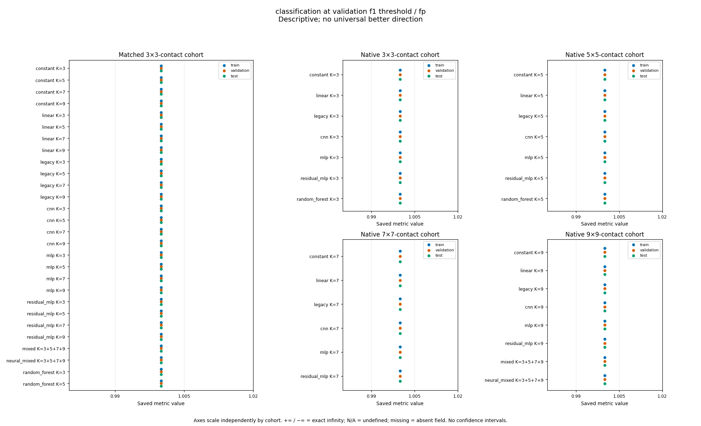

| Model | Native K | Matched train | Matched validation | Matched test | Native train | Native validation | Native test |
|---|---:|---:|---:|---:|---:|---:|---:|
| constant K=3 (`k3_constant_00_lr0.003_constant`) | 3 | 1 | 1 | 1 | 1 | 1 | 1 |
| constant K=5 (`k5_constant_00_lr0.003_constant`) | 5 | 1 | 1 | 1 | 1 | 1 | 1 |
| constant K=7 (`k7_constant_00_lr0.003_constant`) | 7 | 1 | 1 | 1 | 1 | 1 | 1 |
| constant K=9 (`k9_constant_00_lr0.003_constant`) | 9 | 1 | 1 | 1 | 1 | 1 | 1 |
| linear K=3 (`k3_linear_01_lr0.003_constant`) | 3 | 1 | 1 | 1 | 1 | 1 | 1 |
| linear K=5 (`k5_linear_01_lr0.003_constant`) | 5 | 1 | 1 | 1 | 1 | 1 | 1 |
| linear K=7 (`k7_linear_01_lr0.003_constant`) | 7 | 1 | 1 | 1 | 1 | 1 | 1 |
| linear K=9 (`k9_linear_01_lr0.003_constant`) | 9 | 1 | 1 | 1 | 1 | 1 | 1 |
| legacy K=3 (`k3_legacy_02_lr0.003_constant`) | 3 | 1 | 1 | 1 | 1 | 1 | 1 |
| legacy K=5 (`k5_legacy_02_lr0.003_constant`) | 5 | 1 | 1 | 1 | 1 | 1 | 1 |
| legacy K=7 (`k7_legacy_02_lr0.003_constant`) | 7 | 1 | 1 | 1 | 1 | 1 | 1 |
| legacy K=9 (`k9_legacy_02_lr0.003_constant`) | 9 | 1 | 1 | 1 | 1 | 1 | 1 |
| cnn K=3 (`k3_cnn_03_lr0.003_constant`) | 3 | 1 | 1 | 1 | 1 | 1 | 1 |
| cnn K=5 (`k5_cnn_03_lr0.003_constant`) | 5 | 1 | 1 | 1 | 1 | 1 | 1 |
| cnn K=7 (`k7_cnn_03_lr0.003_constant`) | 7 | 1 | 1 | 1 | 1 | 1 | 1 |
| cnn K=9 (`k9_cnn_03_lr0.003_constant`) | 9 | 1 | 1 | 1 | 1 | 1 | 1 |
| mlp K=3 (`k3_mlp_04_lr0.003_constant`) | 3 | 1 | 1 | 1 | 1 | 1 | 1 |
| mlp K=5 (`k5_mlp_05_lr0.003_constant`) | 5 | 1 | 1 | 1 | 1 | 1 | 1 |
| mlp K=7 (`k7_mlp_04_lr0.003_constant`) | 7 | 1 | 1 | 1 | 1 | 1 | 1 |
| mlp K=9 (`k9_mlp_04_lr0.003_constant`) | 9 | 1 | 1 | 1 | 1 | 1 | 1 |
| residual_mlp K=3 (`k3_residual_mlp_08_lr0.003_constant`) | 3 | 1 | 1 | 1 | 1 | 1 | 1 |
| residual_mlp K=5 (`k5_residual_mlp_09_lr0.003_constant`) | 5 | 1 | 1 | 1 | 1 | 1 | 1 |
| residual_mlp K=7 (`k7_residual_mlp_08_lr0.003_constant`) | 7 | 1 | 1 | 1 | 1 | 1 | 1 |
| residual_mlp K=9 (`k9_residual_mlp_08_lr0.003_constant`) | 9 | 1 | 1 | 1 | 1 | 1 | 1 |
| mixed K=3+5+7+9 (`mixed_3_5_7_9_00_lr0.003_constant`) | 9 | 1 | 1 | 1 | 1 | 1 | 1 |
| neural_mixed K=3+5+7+9 (`neural_mixed_3_5_7_9_00_lr0.003_constant`) | 9 | 1 | 1 | 1 | 1 | 1 | 1 |
| random_forest K=3 (`rf3_depth8`) | 3 | 1 | 1 | 1 | 1 | 1 | 1 |
| random_forest K=5 (`rf5_depth8`) | 5 | 1 | 1 | 1 | 1 | 1 | 1 |

#### classification at validation f1 threshold / mcc

Saved field: `classification_at_validation_f1_threshold.mcc`. Higher is better.

| Model | Native K | Matched train | Matched validation | Matched test | Native train | Native validation | Native test |
|---|---:|---:|---:|---:|---:|---:|---:|
| constant K=3 (`k3_constant_00_lr0.003_constant`) | 3 | 0 | 0 | 0 | 0 | 0 | 0 |
| constant K=5 (`k5_constant_00_lr0.003_constant`) | 5 | 0 | 0 | 0 | 0 | 0 | 0 |
| constant K=7 (`k7_constant_00_lr0.003_constant`) | 7 | 0 | 0 | 0 | 0 | 0 | 0 |
| constant K=9 (`k9_constant_00_lr0.003_constant`) | 9 | 0 | 0 | 0 | 0 | 0 | 0 |
| linear K=3 (`k3_linear_01_lr0.003_constant`) | 3 | 0 | 0 | 0 | 0 | 0 | 0 |
| linear K=5 (`k5_linear_01_lr0.003_constant`) | 5 | 0 | 0 | 0 | 0 | 0 | 0 |
| linear K=7 (`k7_linear_01_lr0.003_constant`) | 7 | 0 | 0 | 0 | 0 | 0 | 0 |
| linear K=9 (`k9_linear_01_lr0.003_constant`) | 9 | 0 | 0 | 0 | 0 | 0 | 0 |
| legacy K=3 (`k3_legacy_02_lr0.003_constant`) | 3 | 0 | 0 | 0 | 0 | 0 | 0 |
| legacy K=5 (`k5_legacy_02_lr0.003_constant`) | 5 | 0 | 0 | 0 | 0 | 0 | 0 |
| legacy K=7 (`k7_legacy_02_lr0.003_constant`) | 7 | 0 | 0 | 0 | 0 | 0 | 0 |
| legacy K=9 (`k9_legacy_02_lr0.003_constant`) | 9 | 0 | 0 | 0 | 0 | 0 | 0 |
| cnn K=3 (`k3_cnn_03_lr0.003_constant`) | 3 | 0 | 0 | 0 | 0 | 0 | 0 |
| cnn K=5 (`k5_cnn_03_lr0.003_constant`) | 5 | 0 | 0 | 0 | 0 | 0 | 0 |
| cnn K=7 (`k7_cnn_03_lr0.003_constant`) | 7 | 0 | 0 | 0 | 0 | 0 | 0 |
| cnn K=9 (`k9_cnn_03_lr0.003_constant`) | 9 | 0 | 0 | 0 | 0 | 0 | 0 |
| mlp K=3 (`k3_mlp_04_lr0.003_constant`) | 3 | 0 | 0 | 0 | 0 | 0 | 0 |
| mlp K=5 (`k5_mlp_05_lr0.003_constant`) | 5 | 0 | 0 | 0 | 0 | 0 | 0 |
| mlp K=7 (`k7_mlp_04_lr0.003_constant`) | 7 | 0 | 0 | 0 | 0 | 0 | 0 |
| mlp K=9 (`k9_mlp_04_lr0.003_constant`) | 9 | 0 | 0 | 0 | 0 | 0 | 0 |
| residual_mlp K=3 (`k3_residual_mlp_08_lr0.003_constant`) | 3 | 0 | 0 | 0 | 0 | 0 | 0 |
| residual_mlp K=5 (`k5_residual_mlp_09_lr0.003_constant`) | 5 | 0 | 0 | 0 | 0 | 0 | 0 |
| residual_mlp K=7 (`k7_residual_mlp_08_lr0.003_constant`) | 7 | 0 | 0 | 0 | 0 | 0 | 0 |
| residual_mlp K=9 (`k9_residual_mlp_08_lr0.003_constant`) | 9 | 0 | 0 | 0 | 0 | 0 | 0 |
| mixed K=3+5+7+9 (`mixed_3_5_7_9_00_lr0.003_constant`) | 9 | 0 | 0 | 0 | 0 | 0 | 0 |
| neural_mixed K=3+5+7+9 (`neural_mixed_3_5_7_9_00_lr0.003_constant`) | 9 | 0 | 0 | 0 | 0 | 0 | 0 |
| random_forest K=3 (`rf3_depth8`) | 3 | 0 | 0 | 0 | 0 | 0 | 0 |
| random_forest K=5 (`rf5_depth8`) | 5 | 0 | 0 | 0 | 0 | 0 | 0 |

#### classification at validation f1 threshold / precision

Saved field: `classification_at_validation_f1_threshold.precision`. Higher is better.

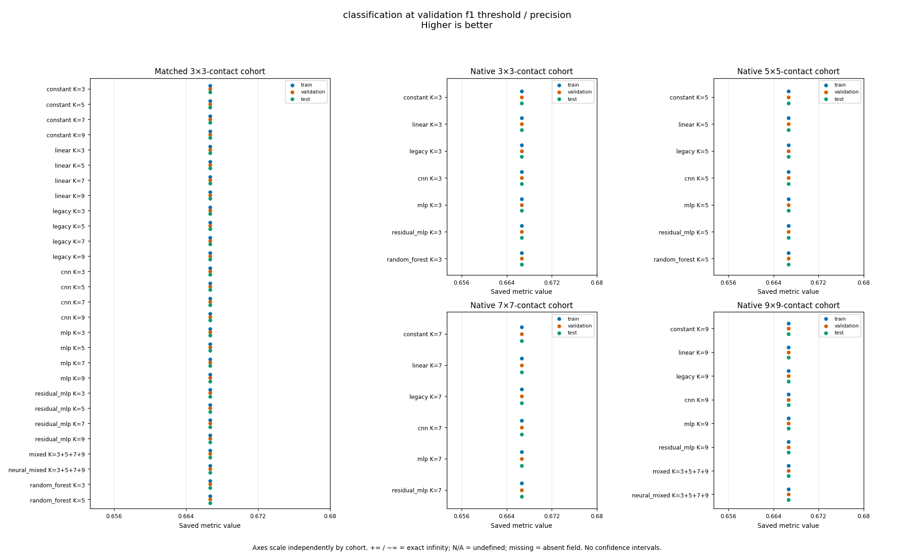

| Model | Native K | Matched train | Matched validation | Matched test | Native train | Native validation | Native test |
|---|---:|---:|---:|---:|---:|---:|---:|
| constant K=3 (`k3_constant_00_lr0.003_constant`) | 3 | 0.66666667 | 0.66666667 | 0.66666667 | 0.66666667 | 0.66666667 | 0.66666667 |
| constant K=5 (`k5_constant_00_lr0.003_constant`) | 5 | 0.66666667 | 0.66666667 | 0.66666667 | 0.66666667 | 0.66666667 | 0.66666667 |
| constant K=7 (`k7_constant_00_lr0.003_constant`) | 7 | 0.66666667 | 0.66666667 | 0.66666667 | 0.66666667 | 0.66666667 | 0.66666667 |
| constant K=9 (`k9_constant_00_lr0.003_constant`) | 9 | 0.66666667 | 0.66666667 | 0.66666667 | 0.66666667 | 0.66666667 | 0.66666667 |
| linear K=3 (`k3_linear_01_lr0.003_constant`) | 3 | 0.66666667 | 0.66666667 | 0.66666667 | 0.66666667 | 0.66666667 | 0.66666667 |
| linear K=5 (`k5_linear_01_lr0.003_constant`) | 5 | 0.66666667 | 0.66666667 | 0.66666667 | 0.66666667 | 0.66666667 | 0.66666667 |
| linear K=7 (`k7_linear_01_lr0.003_constant`) | 7 | 0.66666667 | 0.66666667 | 0.66666667 | 0.66666667 | 0.66666667 | 0.66666667 |
| linear K=9 (`k9_linear_01_lr0.003_constant`) | 9 | 0.66666667 | 0.66666667 | 0.66666667 | 0.66666667 | 0.66666667 | 0.66666667 |
| legacy K=3 (`k3_legacy_02_lr0.003_constant`) | 3 | 0.66666667 | 0.66666667 | 0.66666667 | 0.66666667 | 0.66666667 | 0.66666667 |
| legacy K=5 (`k5_legacy_02_lr0.003_constant`) | 5 | 0.66666667 | 0.66666667 | 0.66666667 | 0.66666667 | 0.66666667 | 0.66666667 |
| legacy K=7 (`k7_legacy_02_lr0.003_constant`) | 7 | 0.66666667 | 0.66666667 | 0.66666667 | 0.66666667 | 0.66666667 | 0.66666667 |
| legacy K=9 (`k9_legacy_02_lr0.003_constant`) | 9 | 0.66666667 | 0.66666667 | 0.66666667 | 0.66666667 | 0.66666667 | 0.66666667 |
| cnn K=3 (`k3_cnn_03_lr0.003_constant`) | 3 | 0.66666667 | 0.66666667 | 0.66666667 | 0.66666667 | 0.66666667 | 0.66666667 |
| cnn K=5 (`k5_cnn_03_lr0.003_constant`) | 5 | 0.66666667 | 0.66666667 | 0.66666667 | 0.66666667 | 0.66666667 | 0.66666667 |
| cnn K=7 (`k7_cnn_03_lr0.003_constant`) | 7 | 0.66666667 | 0.66666667 | 0.66666667 | 0.66666667 | 0.66666667 | 0.66666667 |
| cnn K=9 (`k9_cnn_03_lr0.003_constant`) | 9 | 0.66666667 | 0.66666667 | 0.66666667 | 0.66666667 | 0.66666667 | 0.66666667 |
| mlp K=3 (`k3_mlp_04_lr0.003_constant`) | 3 | 0.66666667 | 0.66666667 | 0.66666667 | 0.66666667 | 0.66666667 | 0.66666667 |
| mlp K=5 (`k5_mlp_05_lr0.003_constant`) | 5 | 0.66666667 | 0.66666667 | 0.66666667 | 0.66666667 | 0.66666667 | 0.66666667 |
| mlp K=7 (`k7_mlp_04_lr0.003_constant`) | 7 | 0.66666667 | 0.66666667 | 0.66666667 | 0.66666667 | 0.66666667 | 0.66666667 |
| mlp K=9 (`k9_mlp_04_lr0.003_constant`) | 9 | 0.66666667 | 0.66666667 | 0.66666667 | 0.66666667 | 0.66666667 | 0.66666667 |
| residual_mlp K=3 (`k3_residual_mlp_08_lr0.003_constant`) | 3 | 0.66666667 | 0.66666667 | 0.66666667 | 0.66666667 | 0.66666667 | 0.66666667 |
| residual_mlp K=5 (`k5_residual_mlp_09_lr0.003_constant`) | 5 | 0.66666667 | 0.66666667 | 0.66666667 | 0.66666667 | 0.66666667 | 0.66666667 |
| residual_mlp K=7 (`k7_residual_mlp_08_lr0.003_constant`) | 7 | 0.66666667 | 0.66666667 | 0.66666667 | 0.66666667 | 0.66666667 | 0.66666667 |
| residual_mlp K=9 (`k9_residual_mlp_08_lr0.003_constant`) | 9 | 0.66666667 | 0.66666667 | 0.66666667 | 0.66666667 | 0.66666667 | 0.66666667 |
| mixed K=3+5+7+9 (`mixed_3_5_7_9_00_lr0.003_constant`) | 9 | 0.66666667 | 0.66666667 | 0.66666667 | 0.66666667 | 0.66666667 | 0.66666667 |
| neural_mixed K=3+5+7+9 (`neural_mixed_3_5_7_9_00_lr0.003_constant`) | 9 | 0.66666667 | 0.66666667 | 0.66666667 | 0.66666667 | 0.66666667 | 0.66666667 |
| random_forest K=3 (`rf3_depth8`) | 3 | 0.66666667 | 0.66666667 | 0.66666667 | 0.66666667 | 0.66666667 | 0.66666667 |
| random_forest K=5 (`rf5_depth8`) | 5 | 0.66666667 | 0.66666667 | 0.66666667 | 0.66666667 | 0.66666667 | 0.66666667 |

#### classification at validation f1 threshold / recall

Saved field: `classification_at_validation_f1_threshold.recall`. Higher is better.

| Model | Native K | Matched train | Matched validation | Matched test | Native train | Native validation | Native test |
|---|---:|---:|---:|---:|---:|---:|---:|
| constant K=3 (`k3_constant_00_lr0.003_constant`) | 3 | 1 | 1 | 1 | 1 | 1 | 1 |
| constant K=5 (`k5_constant_00_lr0.003_constant`) | 5 | 1 | 1 | 1 | 1 | 1 | 1 |
| constant K=7 (`k7_constant_00_lr0.003_constant`) | 7 | 1 | 1 | 1 | 1 | 1 | 1 |
| constant K=9 (`k9_constant_00_lr0.003_constant`) | 9 | 1 | 1 | 1 | 1 | 1 | 1 |
| linear K=3 (`k3_linear_01_lr0.003_constant`) | 3 | 1 | 1 | 1 | 1 | 1 | 1 |
| linear K=5 (`k5_linear_01_lr0.003_constant`) | 5 | 1 | 1 | 1 | 1 | 1 | 1 |
| linear K=7 (`k7_linear_01_lr0.003_constant`) | 7 | 1 | 1 | 1 | 1 | 1 | 1 |
| linear K=9 (`k9_linear_01_lr0.003_constant`) | 9 | 1 | 1 | 1 | 1 | 1 | 1 |
| legacy K=3 (`k3_legacy_02_lr0.003_constant`) | 3 | 1 | 1 | 1 | 1 | 1 | 1 |
| legacy K=5 (`k5_legacy_02_lr0.003_constant`) | 5 | 1 | 1 | 1 | 1 | 1 | 1 |
| legacy K=7 (`k7_legacy_02_lr0.003_constant`) | 7 | 1 | 1 | 1 | 1 | 1 | 1 |
| legacy K=9 (`k9_legacy_02_lr0.003_constant`) | 9 | 1 | 1 | 1 | 1 | 1 | 1 |
| cnn K=3 (`k3_cnn_03_lr0.003_constant`) | 3 | 1 | 1 | 1 | 1 | 1 | 1 |
| cnn K=5 (`k5_cnn_03_lr0.003_constant`) | 5 | 1 | 1 | 1 | 1 | 1 | 1 |
| cnn K=7 (`k7_cnn_03_lr0.003_constant`) | 7 | 1 | 1 | 1 | 1 | 1 | 1 |
| cnn K=9 (`k9_cnn_03_lr0.003_constant`) | 9 | 1 | 1 | 1 | 1 | 1 | 1 |
| mlp K=3 (`k3_mlp_04_lr0.003_constant`) | 3 | 1 | 1 | 1 | 1 | 1 | 1 |
| mlp K=5 (`k5_mlp_05_lr0.003_constant`) | 5 | 1 | 1 | 1 | 1 | 1 | 1 |
| mlp K=7 (`k7_mlp_04_lr0.003_constant`) | 7 | 1 | 1 | 1 | 1 | 1 | 1 |
| mlp K=9 (`k9_mlp_04_lr0.003_constant`) | 9 | 1 | 1 | 1 | 1 | 1 | 1 |
| residual_mlp K=3 (`k3_residual_mlp_08_lr0.003_constant`) | 3 | 1 | 1 | 1 | 1 | 1 | 1 |
| residual_mlp K=5 (`k5_residual_mlp_09_lr0.003_constant`) | 5 | 1 | 1 | 1 | 1 | 1 | 1 |
| residual_mlp K=7 (`k7_residual_mlp_08_lr0.003_constant`) | 7 | 1 | 1 | 1 | 1 | 1 | 1 |
| residual_mlp K=9 (`k9_residual_mlp_08_lr0.003_constant`) | 9 | 1 | 1 | 1 | 1 | 1 | 1 |
| mixed K=3+5+7+9 (`mixed_3_5_7_9_00_lr0.003_constant`) | 9 | 1 | 1 | 1 | 1 | 1 | 1 |
| neural_mixed K=3+5+7+9 (`neural_mixed_3_5_7_9_00_lr0.003_constant`) | 9 | 1 | 1 | 1 | 1 | 1 | 1 |
| random_forest K=3 (`rf3_depth8`) | 3 | 1 | 1 | 1 | 1 | 1 | 1 |
| random_forest K=5 (`rf5_depth8`) | 5 | 1 | 1 | 1 | 1 | 1 | 1 |

#### classification at validation f1 threshold / tn

Saved field: `classification_at_validation_f1_threshold.tn`. Descriptive; no universal better direction.

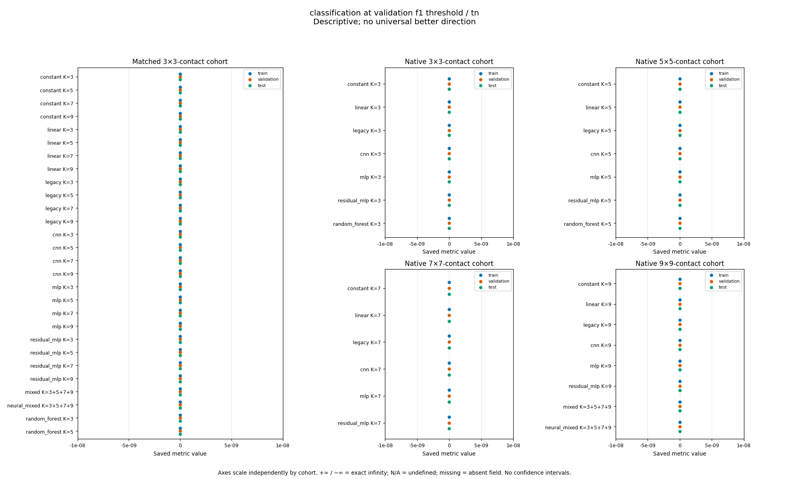

| Model | Native K | Matched train | Matched validation | Matched test | Native train | Native validation | Native test |
|---|---:|---:|---:|---:|---:|---:|---:|
| constant K=3 (`k3_constant_00_lr0.003_constant`) | 3 | 0 | 0 | 0 | 0 | 0 | 0 |
| constant K=5 (`k5_constant_00_lr0.003_constant`) | 5 | 0 | 0 | 0 | 0 | 0 | 0 |
| constant K=7 (`k7_constant_00_lr0.003_constant`) | 7 | 0 | 0 | 0 | 0 | 0 | 0 |
| constant K=9 (`k9_constant_00_lr0.003_constant`) | 9 | 0 | 0 | 0 | 0 | 0 | 0 |
| linear K=3 (`k3_linear_01_lr0.003_constant`) | 3 | 0 | 0 | 0 | 0 | 0 | 0 |
| linear K=5 (`k5_linear_01_lr0.003_constant`) | 5 | 0 | 0 | 0 | 0 | 0 | 0 |
| linear K=7 (`k7_linear_01_lr0.003_constant`) | 7 | 0 | 0 | 0 | 0 | 0 | 0 |
| linear K=9 (`k9_linear_01_lr0.003_constant`) | 9 | 0 | 0 | 0 | 0 | 0 | 0 |
| legacy K=3 (`k3_legacy_02_lr0.003_constant`) | 3 | 0 | 0 | 0 | 0 | 0 | 0 |
| legacy K=5 (`k5_legacy_02_lr0.003_constant`) | 5 | 0 | 0 | 0 | 0 | 0 | 0 |
| legacy K=7 (`k7_legacy_02_lr0.003_constant`) | 7 | 0 | 0 | 0 | 0 | 0 | 0 |
| legacy K=9 (`k9_legacy_02_lr0.003_constant`) | 9 | 0 | 0 | 0 | 0 | 0 | 0 |
| cnn K=3 (`k3_cnn_03_lr0.003_constant`) | 3 | 0 | 0 | 0 | 0 | 0 | 0 |
| cnn K=5 (`k5_cnn_03_lr0.003_constant`) | 5 | 0 | 0 | 0 | 0 | 0 | 0 |
| cnn K=7 (`k7_cnn_03_lr0.003_constant`) | 7 | 0 | 0 | 0 | 0 | 0 | 0 |
| cnn K=9 (`k9_cnn_03_lr0.003_constant`) | 9 | 0 | 0 | 0 | 0 | 0 | 0 |
| mlp K=3 (`k3_mlp_04_lr0.003_constant`) | 3 | 0 | 0 | 0 | 0 | 0 | 0 |
| mlp K=5 (`k5_mlp_05_lr0.003_constant`) | 5 | 0 | 0 | 0 | 0 | 0 | 0 |
| mlp K=7 (`k7_mlp_04_lr0.003_constant`) | 7 | 0 | 0 | 0 | 0 | 0 | 0 |
| mlp K=9 (`k9_mlp_04_lr0.003_constant`) | 9 | 0 | 0 | 0 | 0 | 0 | 0 |
| residual_mlp K=3 (`k3_residual_mlp_08_lr0.003_constant`) | 3 | 0 | 0 | 0 | 0 | 0 | 0 |
| residual_mlp K=5 (`k5_residual_mlp_09_lr0.003_constant`) | 5 | 0 | 0 | 0 | 0 | 0 | 0 |
| residual_mlp K=7 (`k7_residual_mlp_08_lr0.003_constant`) | 7 | 0 | 0 | 0 | 0 | 0 | 0 |
| residual_mlp K=9 (`k9_residual_mlp_08_lr0.003_constant`) | 9 | 0 | 0 | 0 | 0 | 0 | 0 |
| mixed K=3+5+7+9 (`mixed_3_5_7_9_00_lr0.003_constant`) | 9 | 0 | 0 | 0 | 0 | 0 | 0 |
| neural_mixed K=3+5+7+9 (`neural_mixed_3_5_7_9_00_lr0.003_constant`) | 9 | 0 | 0 | 0 | 0 | 0 | 0 |
| random_forest K=3 (`rf3_depth8`) | 3 | 0 | 0 | 0 | 0 | 0 | 0 |
| random_forest K=5 (`rf5_depth8`) | 5 | 0 | 0 | 0 | 0 | 0 | 0 |

#### classification at validation f1 threshold / tp

Saved field: `classification_at_validation_f1_threshold.tp`. Descriptive; no universal better direction.

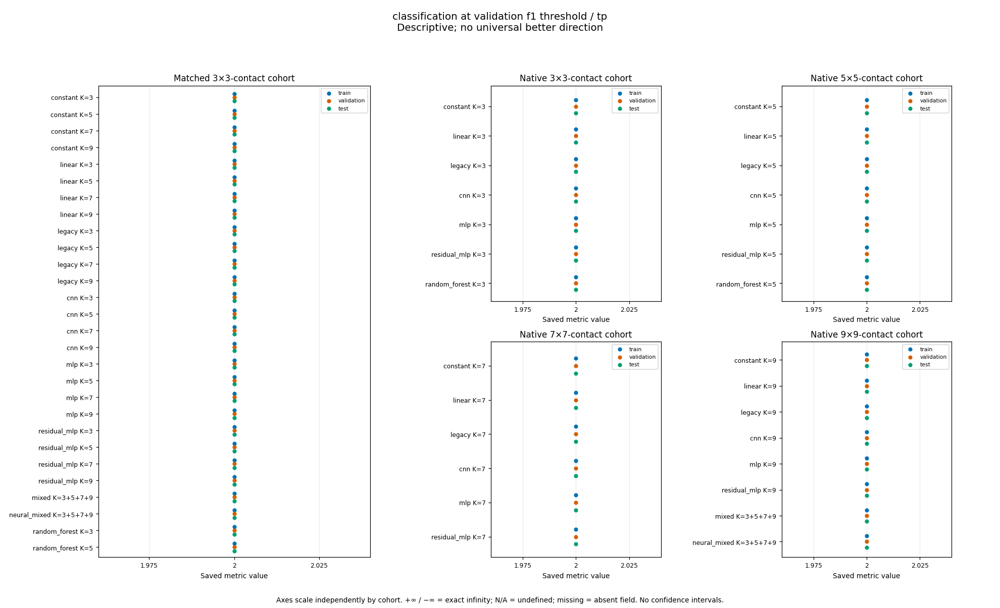

| Model | Native K | Matched train | Matched validation | Matched test | Native train | Native validation | Native test |
|---|---:|---:|---:|---:|---:|---:|---:|
| constant K=3 (`k3_constant_00_lr0.003_constant`) | 3 | 2 | 2 | 2 | 2 | 2 | 2 |
| constant K=5 (`k5_constant_00_lr0.003_constant`) | 5 | 2 | 2 | 2 | 2 | 2 | 2 |
| constant K=7 (`k7_constant_00_lr0.003_constant`) | 7 | 2 | 2 | 2 | 2 | 2 | 2 |
| constant K=9 (`k9_constant_00_lr0.003_constant`) | 9 | 2 | 2 | 2 | 2 | 2 | 2 |
| linear K=3 (`k3_linear_01_lr0.003_constant`) | 3 | 2 | 2 | 2 | 2 | 2 | 2 |
| linear K=5 (`k5_linear_01_lr0.003_constant`) | 5 | 2 | 2 | 2 | 2 | 2 | 2 |
| linear K=7 (`k7_linear_01_lr0.003_constant`) | 7 | 2 | 2 | 2 | 2 | 2 | 2 |
| linear K=9 (`k9_linear_01_lr0.003_constant`) | 9 | 2 | 2 | 2 | 2 | 2 | 2 |
| legacy K=3 (`k3_legacy_02_lr0.003_constant`) | 3 | 2 | 2 | 2 | 2 | 2 | 2 |
| legacy K=5 (`k5_legacy_02_lr0.003_constant`) | 5 | 2 | 2 | 2 | 2 | 2 | 2 |
| legacy K=7 (`k7_legacy_02_lr0.003_constant`) | 7 | 2 | 2 | 2 | 2 | 2 | 2 |
| legacy K=9 (`k9_legacy_02_lr0.003_constant`) | 9 | 2 | 2 | 2 | 2 | 2 | 2 |
| cnn K=3 (`k3_cnn_03_lr0.003_constant`) | 3 | 2 | 2 | 2 | 2 | 2 | 2 |
| cnn K=5 (`k5_cnn_03_lr0.003_constant`) | 5 | 2 | 2 | 2 | 2 | 2 | 2 |
| cnn K=7 (`k7_cnn_03_lr0.003_constant`) | 7 | 2 | 2 | 2 | 2 | 2 | 2 |
| cnn K=9 (`k9_cnn_03_lr0.003_constant`) | 9 | 2 | 2 | 2 | 2 | 2 | 2 |
| mlp K=3 (`k3_mlp_04_lr0.003_constant`) | 3 | 2 | 2 | 2 | 2 | 2 | 2 |
| mlp K=5 (`k5_mlp_05_lr0.003_constant`) | 5 | 2 | 2 | 2 | 2 | 2 | 2 |
| mlp K=7 (`k7_mlp_04_lr0.003_constant`) | 7 | 2 | 2 | 2 | 2 | 2 | 2 |
| mlp K=9 (`k9_mlp_04_lr0.003_constant`) | 9 | 2 | 2 | 2 | 2 | 2 | 2 |
| residual_mlp K=3 (`k3_residual_mlp_08_lr0.003_constant`) | 3 | 2 | 2 | 2 | 2 | 2 | 2 |
| residual_mlp K=5 (`k5_residual_mlp_09_lr0.003_constant`) | 5 | 2 | 2 | 2 | 2 | 2 | 2 |
| residual_mlp K=7 (`k7_residual_mlp_08_lr0.003_constant`) | 7 | 2 | 2 | 2 | 2 | 2 | 2 |
| residual_mlp K=9 (`k9_residual_mlp_08_lr0.003_constant`) | 9 | 2 | 2 | 2 | 2 | 2 | 2 |
| mixed K=3+5+7+9 (`mixed_3_5_7_9_00_lr0.003_constant`) | 9 | 2 | 2 | 2 | 2 | 2 | 2 |
| neural_mixed K=3+5+7+9 (`neural_mixed_3_5_7_9_00_lr0.003_constant`) | 9 | 2 | 2 | 2 | 2 | 2 | 2 |
| random_forest K=3 (`rf3_depth8`) | 3 | 2 | 2 | 2 | 2 | 2 | 2 |
| random_forest K=5 (`rf5_depth8`) | 5 | 2 | 2 | 2 | 2 | 2 | 2 |

#### classification at validation mcc threshold / f1

Saved field: `classification_at_validation_mcc_threshold.f1`. Higher is better.

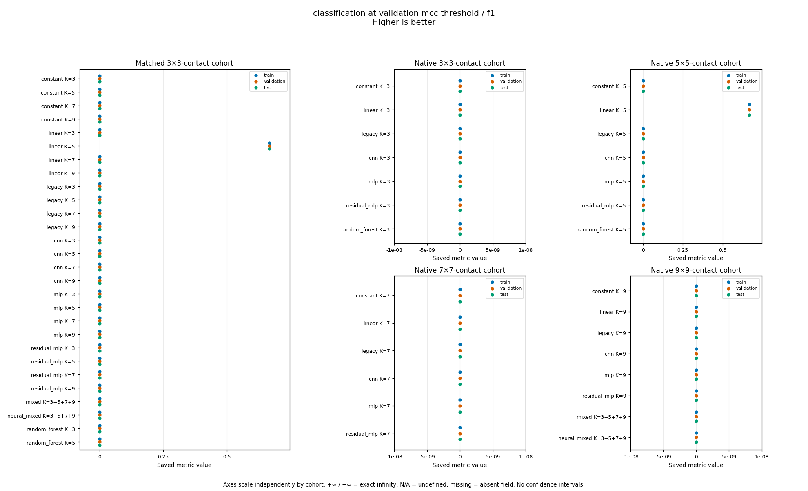

| Model | Native K | Matched train | Matched validation | Matched test | Native train | Native validation | Native test |
|---|---:|---:|---:|---:|---:|---:|---:|
| constant K=3 (`k3_constant_00_lr0.003_constant`) | 3 | 0 | 0 | 0 | 0 | 0 | 0 |
| constant K=5 (`k5_constant_00_lr0.003_constant`) | 5 | 0 | 0 | 0 | 0 | 0 | 0 |
| constant K=7 (`k7_constant_00_lr0.003_constant`) | 7 | 0 | 0 | 0 | 0 | 0 | 0 |
| constant K=9 (`k9_constant_00_lr0.003_constant`) | 9 | 0 | 0 | 0 | 0 | 0 | 0 |
| linear K=3 (`k3_linear_01_lr0.003_constant`) | 3 | 0 | 0 | 0 | 0 | 0 | 0 |
| linear K=5 (`k5_linear_01_lr0.003_constant`) | 5 | 0.66666667 | 0.66666667 | 0.66666667 | 0.66666667 | 0.66666667 | 0.66666667 |
| linear K=7 (`k7_linear_01_lr0.003_constant`) | 7 | 0 | 0 | 0 | 0 | 0 | 0 |
| linear K=9 (`k9_linear_01_lr0.003_constant`) | 9 | 0 | 0 | 0 | 0 | 0 | 0 |
| legacy K=3 (`k3_legacy_02_lr0.003_constant`) | 3 | 0 | 0 | 0 | 0 | 0 | 0 |
| legacy K=5 (`k5_legacy_02_lr0.003_constant`) | 5 | 0 | 0 | 0 | 0 | 0 | 0 |
| legacy K=7 (`k7_legacy_02_lr0.003_constant`) | 7 | 0 | 0 | 0 | 0 | 0 | 0 |
| legacy K=9 (`k9_legacy_02_lr0.003_constant`) | 9 | 0 | 0 | 0 | 0 | 0 | 0 |
| cnn K=3 (`k3_cnn_03_lr0.003_constant`) | 3 | 0 | 0 | 0 | 0 | 0 | 0 |
| cnn K=5 (`k5_cnn_03_lr0.003_constant`) | 5 | 0 | 0 | 0 | 0 | 0 | 0 |
| cnn K=7 (`k7_cnn_03_lr0.003_constant`) | 7 | 0 | 0 | 0 | 0 | 0 | 0 |
| cnn K=9 (`k9_cnn_03_lr0.003_constant`) | 9 | 0 | 0 | 0 | 0 | 0 | 0 |
| mlp K=3 (`k3_mlp_04_lr0.003_constant`) | 3 | 0 | 0 | 0 | 0 | 0 | 0 |
| mlp K=5 (`k5_mlp_05_lr0.003_constant`) | 5 | 0 | 0 | 0 | 0 | 0 | 0 |
| mlp K=7 (`k7_mlp_04_lr0.003_constant`) | 7 | 0 | 0 | 0 | 0 | 0 | 0 |
| mlp K=9 (`k9_mlp_04_lr0.003_constant`) | 9 | 0 | 0 | 0 | 0 | 0 | 0 |
| residual_mlp K=3 (`k3_residual_mlp_08_lr0.003_constant`) | 3 | 0 | 0 | 0 | 0 | 0 | 0 |
| residual_mlp K=5 (`k5_residual_mlp_09_lr0.003_constant`) | 5 | 0 | 0 | 0 | 0 | 0 | 0 |
| residual_mlp K=7 (`k7_residual_mlp_08_lr0.003_constant`) | 7 | 0 | 0 | 0 | 0 | 0 | 0 |
| residual_mlp K=9 (`k9_residual_mlp_08_lr0.003_constant`) | 9 | 0 | 0 | 0 | 0 | 0 | 0 |
| mixed K=3+5+7+9 (`mixed_3_5_7_9_00_lr0.003_constant`) | 9 | 0 | 0 | 0 | 0 | 0 | 0 |
| neural_mixed K=3+5+7+9 (`neural_mixed_3_5_7_9_00_lr0.003_constant`) | 9 | 0 | 0 | 0 | 0 | 0 | 0 |
| random_forest K=3 (`rf3_depth8`) | 3 | 0 | 0 | 0 | 0 | 0 | 0 |
| random_forest K=5 (`rf5_depth8`) | 5 | 0 | 0 | 0 | 0 | 0 | 0 |

#### classification at validation mcc threshold / fn

Saved field: `classification_at_validation_mcc_threshold.fn`. Descriptive; no universal better direction.

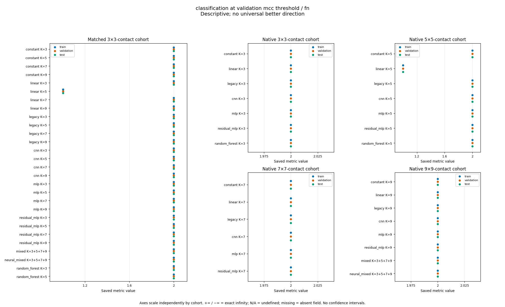

| Model | Native K | Matched train | Matched validation | Matched test | Native train | Native validation | Native test |
|---|---:|---:|---:|---:|---:|---:|---:|
| constant K=3 (`k3_constant_00_lr0.003_constant`) | 3 | 2 | 2 | 2 | 2 | 2 | 2 |
| constant K=5 (`k5_constant_00_lr0.003_constant`) | 5 | 2 | 2 | 2 | 2 | 2 | 2 |
| constant K=7 (`k7_constant_00_lr0.003_constant`) | 7 | 2 | 2 | 2 | 2 | 2 | 2 |
| constant K=9 (`k9_constant_00_lr0.003_constant`) | 9 | 2 | 2 | 2 | 2 | 2 | 2 |
| linear K=3 (`k3_linear_01_lr0.003_constant`) | 3 | 2 | 2 | 2 | 2 | 2 | 2 |
| linear K=5 (`k5_linear_01_lr0.003_constant`) | 5 | 1 | 1 | 1 | 1 | 1 | 1 |
| linear K=7 (`k7_linear_01_lr0.003_constant`) | 7 | 2 | 2 | 2 | 2 | 2 | 2 |
| linear K=9 (`k9_linear_01_lr0.003_constant`) | 9 | 2 | 2 | 2 | 2 | 2 | 2 |
| legacy K=3 (`k3_legacy_02_lr0.003_constant`) | 3 | 2 | 2 | 2 | 2 | 2 | 2 |
| legacy K=5 (`k5_legacy_02_lr0.003_constant`) | 5 | 2 | 2 | 2 | 2 | 2 | 2 |
| legacy K=7 (`k7_legacy_02_lr0.003_constant`) | 7 | 2 | 2 | 2 | 2 | 2 | 2 |
| legacy K=9 (`k9_legacy_02_lr0.003_constant`) | 9 | 2 | 2 | 2 | 2 | 2 | 2 |
| cnn K=3 (`k3_cnn_03_lr0.003_constant`) | 3 | 2 | 2 | 2 | 2 | 2 | 2 |
| cnn K=5 (`k5_cnn_03_lr0.003_constant`) | 5 | 2 | 2 | 2 | 2 | 2 | 2 |
| cnn K=7 (`k7_cnn_03_lr0.003_constant`) | 7 | 2 | 2 | 2 | 2 | 2 | 2 |
| cnn K=9 (`k9_cnn_03_lr0.003_constant`) | 9 | 2 | 2 | 2 | 2 | 2 | 2 |
| mlp K=3 (`k3_mlp_04_lr0.003_constant`) | 3 | 2 | 2 | 2 | 2 | 2 | 2 |
| mlp K=5 (`k5_mlp_05_lr0.003_constant`) | 5 | 2 | 2 | 2 | 2 | 2 | 2 |
| mlp K=7 (`k7_mlp_04_lr0.003_constant`) | 7 | 2 | 2 | 2 | 2 | 2 | 2 |
| mlp K=9 (`k9_mlp_04_lr0.003_constant`) | 9 | 2 | 2 | 2 | 2 | 2 | 2 |
| residual_mlp K=3 (`k3_residual_mlp_08_lr0.003_constant`) | 3 | 2 | 2 | 2 | 2 | 2 | 2 |
| residual_mlp K=5 (`k5_residual_mlp_09_lr0.003_constant`) | 5 | 2 | 2 | 2 | 2 | 2 | 2 |
| residual_mlp K=7 (`k7_residual_mlp_08_lr0.003_constant`) | 7 | 2 | 2 | 2 | 2 | 2 | 2 |
| residual_mlp K=9 (`k9_residual_mlp_08_lr0.003_constant`) | 9 | 2 | 2 | 2 | 2 | 2 | 2 |
| mixed K=3+5+7+9 (`mixed_3_5_7_9_00_lr0.003_constant`) | 9 | 2 | 2 | 2 | 2 | 2 | 2 |
| neural_mixed K=3+5+7+9 (`neural_mixed_3_5_7_9_00_lr0.003_constant`) | 9 | 2 | 2 | 2 | 2 | 2 | 2 |
| random_forest K=3 (`rf3_depth8`) | 3 | 2 | 2 | 2 | 2 | 2 | 2 |
| random_forest K=5 (`rf5_depth8`) | 5 | 2 | 2 | 2 | 2 | 2 | 2 |

#### classification at validation mcc threshold / fp

Saved field: `classification_at_validation_mcc_threshold.fp`. Descriptive; no universal better direction.

| Model | Native K | Matched train | Matched validation | Matched test | Native train | Native validation | Native test |
|---|---:|---:|---:|---:|---:|---:|---:|
| constant K=3 (`k3_constant_00_lr0.003_constant`) | 3 | 0 | 0 | 0 | 0 | 0 | 0 |
| constant K=5 (`k5_constant_00_lr0.003_constant`) | 5 | 0 | 0 | 0 | 0 | 0 | 0 |
| constant K=7 (`k7_constant_00_lr0.003_constant`) | 7 | 0 | 0 | 0 | 0 | 0 | 0 |
| constant K=9 (`k9_constant_00_lr0.003_constant`) | 9 | 0 | 0 | 0 | 0 | 0 | 0 |
| linear K=3 (`k3_linear_01_lr0.003_constant`) | 3 | 0 | 0 | 0 | 0 | 0 | 0 |
| linear K=5 (`k5_linear_01_lr0.003_constant`) | 5 | 0 | 0 | 0 | 0 | 0 | 0 |
| linear K=7 (`k7_linear_01_lr0.003_constant`) | 7 | 0 | 0 | 0 | 0 | 0 | 0 |
| linear K=9 (`k9_linear_01_lr0.003_constant`) | 9 | 0 | 0 | 0 | 0 | 0 | 0 |
| legacy K=3 (`k3_legacy_02_lr0.003_constant`) | 3 | 0 | 0 | 0 | 0 | 0 | 0 |
| legacy K=5 (`k5_legacy_02_lr0.003_constant`) | 5 | 0 | 0 | 0 | 0 | 0 | 0 |
| legacy K=7 (`k7_legacy_02_lr0.003_constant`) | 7 | 0 | 0 | 0 | 0 | 0 | 0 |
| legacy K=9 (`k9_legacy_02_lr0.003_constant`) | 9 | 0 | 0 | 0 | 0 | 0 | 0 |
| cnn K=3 (`k3_cnn_03_lr0.003_constant`) | 3 | 0 | 0 | 0 | 0 | 0 | 0 |
| cnn K=5 (`k5_cnn_03_lr0.003_constant`) | 5 | 0 | 0 | 0 | 0 | 0 | 0 |
| cnn K=7 (`k7_cnn_03_lr0.003_constant`) | 7 | 0 | 0 | 0 | 0 | 0 | 0 |
| cnn K=9 (`k9_cnn_03_lr0.003_constant`) | 9 | 0 | 0 | 0 | 0 | 0 | 0 |
| mlp K=3 (`k3_mlp_04_lr0.003_constant`) | 3 | 0 | 0 | 0 | 0 | 0 | 0 |
| mlp K=5 (`k5_mlp_05_lr0.003_constant`) | 5 | 0 | 0 | 0 | 0 | 0 | 0 |
| mlp K=7 (`k7_mlp_04_lr0.003_constant`) | 7 | 0 | 0 | 0 | 0 | 0 | 0 |
| mlp K=9 (`k9_mlp_04_lr0.003_constant`) | 9 | 0 | 0 | 0 | 0 | 0 | 0 |
| residual_mlp K=3 (`k3_residual_mlp_08_lr0.003_constant`) | 3 | 0 | 0 | 0 | 0 | 0 | 0 |
| residual_mlp K=5 (`k5_residual_mlp_09_lr0.003_constant`) | 5 | 0 | 0 | 0 | 0 | 0 | 0 |
| residual_mlp K=7 (`k7_residual_mlp_08_lr0.003_constant`) | 7 | 0 | 0 | 0 | 0 | 0 | 0 |
| residual_mlp K=9 (`k9_residual_mlp_08_lr0.003_constant`) | 9 | 0 | 0 | 0 | 0 | 0 | 0 |
| mixed K=3+5+7+9 (`mixed_3_5_7_9_00_lr0.003_constant`) | 9 | 0 | 0 | 0 | 0 | 0 | 0 |
| neural_mixed K=3+5+7+9 (`neural_mixed_3_5_7_9_00_lr0.003_constant`) | 9 | 0 | 0 | 0 | 0 | 0 | 0 |
| random_forest K=3 (`rf3_depth8`) | 3 | 0 | 0 | 0 | 0 | 0 | 0 |
| random_forest K=5 (`rf5_depth8`) | 5 | 0 | 0 | 0 | 0 | 0 | 0 |

#### classification at validation mcc threshold / mcc

Saved field: `classification_at_validation_mcc_threshold.mcc`. Higher is better.

| Model | Native K | Matched train | Matched validation | Matched test | Native train | Native validation | Native test |
|---|---:|---:|---:|---:|---:|---:|---:|
| constant K=3 (`k3_constant_00_lr0.003_constant`) | 3 | 0 | 0 | 0 | 0 | 0 | 0 |
| constant K=5 (`k5_constant_00_lr0.003_constant`) | 5 | 0 | 0 | 0 | 0 | 0 | 0 |
| constant K=7 (`k7_constant_00_lr0.003_constant`) | 7 | 0 | 0 | 0 | 0 | 0 | 0 |
| constant K=9 (`k9_constant_00_lr0.003_constant`) | 9 | 0 | 0 | 0 | 0 | 0 | 0 |
| linear K=3 (`k3_linear_01_lr0.003_constant`) | 3 | 0 | 0 | 0 | 0 | 0 | 0 |
| linear K=5 (`k5_linear_01_lr0.003_constant`) | 5 | 0.5 | 0.5 | 0.5 | 0.5 | 0.5 | 0.5 |
| linear K=7 (`k7_linear_01_lr0.003_constant`) | 7 | 0 | 0 | 0 | 0 | 0 | 0 |
| linear K=9 (`k9_linear_01_lr0.003_constant`) | 9 | 0 | 0 | 0 | 0 | 0 | 0 |
| legacy K=3 (`k3_legacy_02_lr0.003_constant`) | 3 | 0 | 0 | 0 | 0 | 0 | 0 |
| legacy K=5 (`k5_legacy_02_lr0.003_constant`) | 5 | 0 | 0 | 0 | 0 | 0 | 0 |
| legacy K=7 (`k7_legacy_02_lr0.003_constant`) | 7 | 0 | 0 | 0 | 0 | 0 | 0 |
| legacy K=9 (`k9_legacy_02_lr0.003_constant`) | 9 | 0 | 0 | 0 | 0 | 0 | 0 |
| cnn K=3 (`k3_cnn_03_lr0.003_constant`) | 3 | 0 | 0 | 0 | 0 | 0 | 0 |
| cnn K=5 (`k5_cnn_03_lr0.003_constant`) | 5 | 0 | 0 | 0 | 0 | 0 | 0 |
| cnn K=7 (`k7_cnn_03_lr0.003_constant`) | 7 | 0 | 0 | 0 | 0 | 0 | 0 |
| cnn K=9 (`k9_cnn_03_lr0.003_constant`) | 9 | 0 | 0 | 0 | 0 | 0 | 0 |
| mlp K=3 (`k3_mlp_04_lr0.003_constant`) | 3 | 0 | 0 | 0 | 0 | 0 | 0 |
| mlp K=5 (`k5_mlp_05_lr0.003_constant`) | 5 | 0 | 0 | 0 | 0 | 0 | 0 |
| mlp K=7 (`k7_mlp_04_lr0.003_constant`) | 7 | 0 | 0 | 0 | 0 | 0 | 0 |
| mlp K=9 (`k9_mlp_04_lr0.003_constant`) | 9 | 0 | 0 | 0 | 0 | 0 | 0 |
| residual_mlp K=3 (`k3_residual_mlp_08_lr0.003_constant`) | 3 | 0 | 0 | 0 | 0 | 0 | 0 |
| residual_mlp K=5 (`k5_residual_mlp_09_lr0.003_constant`) | 5 | 0 | 0 | 0 | 0 | 0 | 0 |
| residual_mlp K=7 (`k7_residual_mlp_08_lr0.003_constant`) | 7 | 0 | 0 | 0 | 0 | 0 | 0 |
| residual_mlp K=9 (`k9_residual_mlp_08_lr0.003_constant`) | 9 | 0 | 0 | 0 | 0 | 0 | 0 |
| mixed K=3+5+7+9 (`mixed_3_5_7_9_00_lr0.003_constant`) | 9 | 0 | 0 | 0 | 0 | 0 | 0 |
| neural_mixed K=3+5+7+9 (`neural_mixed_3_5_7_9_00_lr0.003_constant`) | 9 | 0 | 0 | 0 | 0 | 0 | 0 |
| random_forest K=3 (`rf3_depth8`) | 3 | 0 | 0 | 0 | 0 | 0 | 0 |
| random_forest K=5 (`rf5_depth8`) | 5 | 0 | 0 | 0 | 0 | 0 | 0 |

#### classification at validation mcc threshold / precision

Saved field: `classification_at_validation_mcc_threshold.precision`. Higher is better.

| Model | Native K | Matched train | Matched validation | Matched test | Native train | Native validation | Native test |
|---|---:|---:|---:|---:|---:|---:|---:|
| constant K=3 (`k3_constant_00_lr0.003_constant`) | 3 | 0 | 0 | 0 | 0 | 0 | 0 |
| constant K=5 (`k5_constant_00_lr0.003_constant`) | 5 | 0 | 0 | 0 | 0 | 0 | 0 |
| constant K=7 (`k7_constant_00_lr0.003_constant`) | 7 | 0 | 0 | 0 | 0 | 0 | 0 |
| constant K=9 (`k9_constant_00_lr0.003_constant`) | 9 | 0 | 0 | 0 | 0 | 0 | 0 |
| linear K=3 (`k3_linear_01_lr0.003_constant`) | 3 | 0 | 0 | 0 | 0 | 0 | 0 |
| linear K=5 (`k5_linear_01_lr0.003_constant`) | 5 | 1 | 1 | 1 | 1 | 1 | 1 |
| linear K=7 (`k7_linear_01_lr0.003_constant`) | 7 | 0 | 0 | 0 | 0 | 0 | 0 |
| linear K=9 (`k9_linear_01_lr0.003_constant`) | 9 | 0 | 0 | 0 | 0 | 0 | 0 |
| legacy K=3 (`k3_legacy_02_lr0.003_constant`) | 3 | 0 | 0 | 0 | 0 | 0 | 0 |
| legacy K=5 (`k5_legacy_02_lr0.003_constant`) | 5 | 0 | 0 | 0 | 0 | 0 | 0 |
| legacy K=7 (`k7_legacy_02_lr0.003_constant`) | 7 | 0 | 0 | 0 | 0 | 0 | 0 |
| legacy K=9 (`k9_legacy_02_lr0.003_constant`) | 9 | 0 | 0 | 0 | 0 | 0 | 0 |
| cnn K=3 (`k3_cnn_03_lr0.003_constant`) | 3 | 0 | 0 | 0 | 0 | 0 | 0 |
| cnn K=5 (`k5_cnn_03_lr0.003_constant`) | 5 | 0 | 0 | 0 | 0 | 0 | 0 |
| cnn K=7 (`k7_cnn_03_lr0.003_constant`) | 7 | 0 | 0 | 0 | 0 | 0 | 0 |
| cnn K=9 (`k9_cnn_03_lr0.003_constant`) | 9 | 0 | 0 | 0 | 0 | 0 | 0 |
| mlp K=3 (`k3_mlp_04_lr0.003_constant`) | 3 | 0 | 0 | 0 | 0 | 0 | 0 |
| mlp K=5 (`k5_mlp_05_lr0.003_constant`) | 5 | 0 | 0 | 0 | 0 | 0 | 0 |
| mlp K=7 (`k7_mlp_04_lr0.003_constant`) | 7 | 0 | 0 | 0 | 0 | 0 | 0 |
| mlp K=9 (`k9_mlp_04_lr0.003_constant`) | 9 | 0 | 0 | 0 | 0 | 0 | 0 |
| residual_mlp K=3 (`k3_residual_mlp_08_lr0.003_constant`) | 3 | 0 | 0 | 0 | 0 | 0 | 0 |
| residual_mlp K=5 (`k5_residual_mlp_09_lr0.003_constant`) | 5 | 0 | 0 | 0 | 0 | 0 | 0 |
| residual_mlp K=7 (`k7_residual_mlp_08_lr0.003_constant`) | 7 | 0 | 0 | 0 | 0 | 0 | 0 |
| residual_mlp K=9 (`k9_residual_mlp_08_lr0.003_constant`) | 9 | 0 | 0 | 0 | 0 | 0 | 0 |
| mixed K=3+5+7+9 (`mixed_3_5_7_9_00_lr0.003_constant`) | 9 | 0 | 0 | 0 | 0 | 0 | 0 |
| neural_mixed K=3+5+7+9 (`neural_mixed_3_5_7_9_00_lr0.003_constant`) | 9 | 0 | 0 | 0 | 0 | 0 | 0 |
| random_forest K=3 (`rf3_depth8`) | 3 | 0 | 0 | 0 | 0 | 0 | 0 |
| random_forest K=5 (`rf5_depth8`) | 5 | 0 | 0 | 0 | 0 | 0 | 0 |

#### classification at validation mcc threshold / recall

Saved field: `classification_at_validation_mcc_threshold.recall`. Higher is better.

| Model | Native K | Matched train | Matched validation | Matched test | Native train | Native validation | Native test |
|---|---:|---:|---:|---:|---:|---:|---:|
| constant K=3 (`k3_constant_00_lr0.003_constant`) | 3 | 0 | 0 | 0 | 0 | 0 | 0 |
| constant K=5 (`k5_constant_00_lr0.003_constant`) | 5 | 0 | 0 | 0 | 0 | 0 | 0 |
| constant K=7 (`k7_constant_00_lr0.003_constant`) | 7 | 0 | 0 | 0 | 0 | 0 | 0 |
| constant K=9 (`k9_constant_00_lr0.003_constant`) | 9 | 0 | 0 | 0 | 0 | 0 | 0 |
| linear K=3 (`k3_linear_01_lr0.003_constant`) | 3 | 0 | 0 | 0 | 0 | 0 | 0 |
| linear K=5 (`k5_linear_01_lr0.003_constant`) | 5 | 0.5 | 0.5 | 0.5 | 0.5 | 0.5 | 0.5 |
| linear K=7 (`k7_linear_01_lr0.003_constant`) | 7 | 0 | 0 | 0 | 0 | 0 | 0 |
| linear K=9 (`k9_linear_01_lr0.003_constant`) | 9 | 0 | 0 | 0 | 0 | 0 | 0 |
| legacy K=3 (`k3_legacy_02_lr0.003_constant`) | 3 | 0 | 0 | 0 | 0 | 0 | 0 |
| legacy K=5 (`k5_legacy_02_lr0.003_constant`) | 5 | 0 | 0 | 0 | 0 | 0 | 0 |
| legacy K=7 (`k7_legacy_02_lr0.003_constant`) | 7 | 0 | 0 | 0 | 0 | 0 | 0 |
| legacy K=9 (`k9_legacy_02_lr0.003_constant`) | 9 | 0 | 0 | 0 | 0 | 0 | 0 |
| cnn K=3 (`k3_cnn_03_lr0.003_constant`) | 3 | 0 | 0 | 0 | 0 | 0 | 0 |
| cnn K=5 (`k5_cnn_03_lr0.003_constant`) | 5 | 0 | 0 | 0 | 0 | 0 | 0 |
| cnn K=7 (`k7_cnn_03_lr0.003_constant`) | 7 | 0 | 0 | 0 | 0 | 0 | 0 |
| cnn K=9 (`k9_cnn_03_lr0.003_constant`) | 9 | 0 | 0 | 0 | 0 | 0 | 0 |
| mlp K=3 (`k3_mlp_04_lr0.003_constant`) | 3 | 0 | 0 | 0 | 0 | 0 | 0 |
| mlp K=5 (`k5_mlp_05_lr0.003_constant`) | 5 | 0 | 0 | 0 | 0 | 0 | 0 |
| mlp K=7 (`k7_mlp_04_lr0.003_constant`) | 7 | 0 | 0 | 0 | 0 | 0 | 0 |
| mlp K=9 (`k9_mlp_04_lr0.003_constant`) | 9 | 0 | 0 | 0 | 0 | 0 | 0 |
| residual_mlp K=3 (`k3_residual_mlp_08_lr0.003_constant`) | 3 | 0 | 0 | 0 | 0 | 0 | 0 |
| residual_mlp K=5 (`k5_residual_mlp_09_lr0.003_constant`) | 5 | 0 | 0 | 0 | 0 | 0 | 0 |
| residual_mlp K=7 (`k7_residual_mlp_08_lr0.003_constant`) | 7 | 0 | 0 | 0 | 0 | 0 | 0 |
| residual_mlp K=9 (`k9_residual_mlp_08_lr0.003_constant`) | 9 | 0 | 0 | 0 | 0 | 0 | 0 |
| mixed K=3+5+7+9 (`mixed_3_5_7_9_00_lr0.003_constant`) | 9 | 0 | 0 | 0 | 0 | 0 | 0 |
| neural_mixed K=3+5+7+9 (`neural_mixed_3_5_7_9_00_lr0.003_constant`) | 9 | 0 | 0 | 0 | 0 | 0 | 0 |
| random_forest K=3 (`rf3_depth8`) | 3 | 0 | 0 | 0 | 0 | 0 | 0 |
| random_forest K=5 (`rf5_depth8`) | 5 | 0 | 0 | 0 | 0 | 0 | 0 |

#### classification at validation mcc threshold / tn

Saved field: `classification_at_validation_mcc_threshold.tn`. Descriptive; no universal better direction.

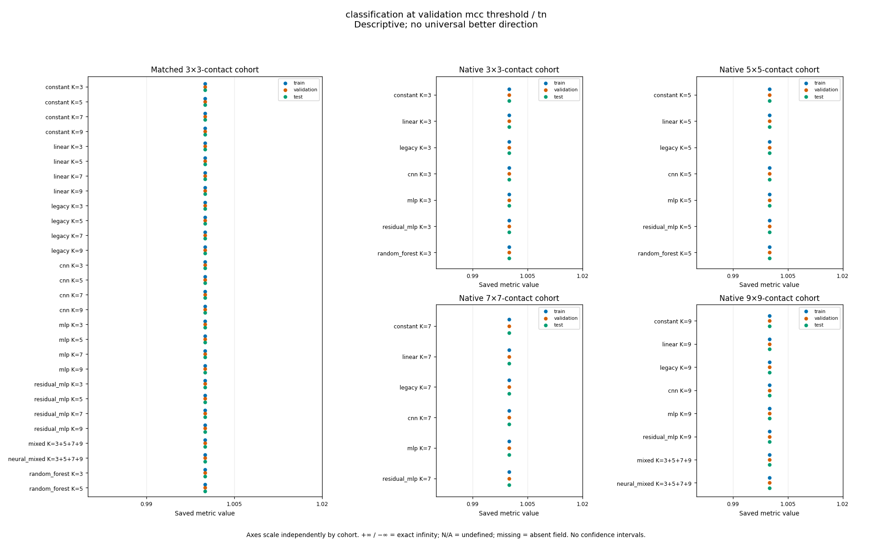

| Model | Native K | Matched train | Matched validation | Matched test | Native train | Native validation | Native test |
|---|---:|---:|---:|---:|---:|---:|---:|
| constant K=3 (`k3_constant_00_lr0.003_constant`) | 3 | 1 | 1 | 1 | 1 | 1 | 1 |
| constant K=5 (`k5_constant_00_lr0.003_constant`) | 5 | 1 | 1 | 1 | 1 | 1 | 1 |
| constant K=7 (`k7_constant_00_lr0.003_constant`) | 7 | 1 | 1 | 1 | 1 | 1 | 1 |
| constant K=9 (`k9_constant_00_lr0.003_constant`) | 9 | 1 | 1 | 1 | 1 | 1 | 1 |
| linear K=3 (`k3_linear_01_lr0.003_constant`) | 3 | 1 | 1 | 1 | 1 | 1 | 1 |
| linear K=5 (`k5_linear_01_lr0.003_constant`) | 5 | 1 | 1 | 1 | 1 | 1 | 1 |
| linear K=7 (`k7_linear_01_lr0.003_constant`) | 7 | 1 | 1 | 1 | 1 | 1 | 1 |
| linear K=9 (`k9_linear_01_lr0.003_constant`) | 9 | 1 | 1 | 1 | 1 | 1 | 1 |
| legacy K=3 (`k3_legacy_02_lr0.003_constant`) | 3 | 1 | 1 | 1 | 1 | 1 | 1 |
| legacy K=5 (`k5_legacy_02_lr0.003_constant`) | 5 | 1 | 1 | 1 | 1 | 1 | 1 |
| legacy K=7 (`k7_legacy_02_lr0.003_constant`) | 7 | 1 | 1 | 1 | 1 | 1 | 1 |
| legacy K=9 (`k9_legacy_02_lr0.003_constant`) | 9 | 1 | 1 | 1 | 1 | 1 | 1 |
| cnn K=3 (`k3_cnn_03_lr0.003_constant`) | 3 | 1 | 1 | 1 | 1 | 1 | 1 |
| cnn K=5 (`k5_cnn_03_lr0.003_constant`) | 5 | 1 | 1 | 1 | 1 | 1 | 1 |
| cnn K=7 (`k7_cnn_03_lr0.003_constant`) | 7 | 1 | 1 | 1 | 1 | 1 | 1 |
| cnn K=9 (`k9_cnn_03_lr0.003_constant`) | 9 | 1 | 1 | 1 | 1 | 1 | 1 |
| mlp K=3 (`k3_mlp_04_lr0.003_constant`) | 3 | 1 | 1 | 1 | 1 | 1 | 1 |
| mlp K=5 (`k5_mlp_05_lr0.003_constant`) | 5 | 1 | 1 | 1 | 1 | 1 | 1 |
| mlp K=7 (`k7_mlp_04_lr0.003_constant`) | 7 | 1 | 1 | 1 | 1 | 1 | 1 |
| mlp K=9 (`k9_mlp_04_lr0.003_constant`) | 9 | 1 | 1 | 1 | 1 | 1 | 1 |
| residual_mlp K=3 (`k3_residual_mlp_08_lr0.003_constant`) | 3 | 1 | 1 | 1 | 1 | 1 | 1 |
| residual_mlp K=5 (`k5_residual_mlp_09_lr0.003_constant`) | 5 | 1 | 1 | 1 | 1 | 1 | 1 |
| residual_mlp K=7 (`k7_residual_mlp_08_lr0.003_constant`) | 7 | 1 | 1 | 1 | 1 | 1 | 1 |
| residual_mlp K=9 (`k9_residual_mlp_08_lr0.003_constant`) | 9 | 1 | 1 | 1 | 1 | 1 | 1 |
| mixed K=3+5+7+9 (`mixed_3_5_7_9_00_lr0.003_constant`) | 9 | 1 | 1 | 1 | 1 | 1 | 1 |
| neural_mixed K=3+5+7+9 (`neural_mixed_3_5_7_9_00_lr0.003_constant`) | 9 | 1 | 1 | 1 | 1 | 1 | 1 |
| random_forest K=3 (`rf3_depth8`) | 3 | 1 | 1 | 1 | 1 | 1 | 1 |
| random_forest K=5 (`rf5_depth8`) | 5 | 1 | 1 | 1 | 1 | 1 | 1 |

#### classification at validation mcc threshold / tp

Saved field: `classification_at_validation_mcc_threshold.tp`. Descriptive; no universal better direction.

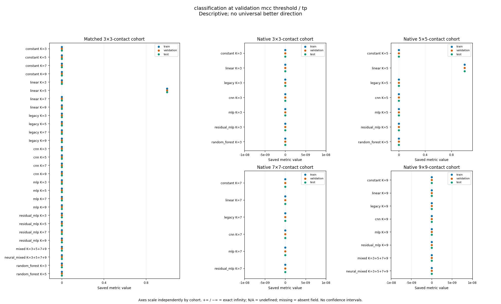

| Model | Native K | Matched train | Matched validation | Matched test | Native train | Native validation | Native test |
|---|---:|---:|---:|---:|---:|---:|---:|
| constant K=3 (`k3_constant_00_lr0.003_constant`) | 3 | 0 | 0 | 0 | 0 | 0 | 0 |
| constant K=5 (`k5_constant_00_lr0.003_constant`) | 5 | 0 | 0 | 0 | 0 | 0 | 0 |
| constant K=7 (`k7_constant_00_lr0.003_constant`) | 7 | 0 | 0 | 0 | 0 | 0 | 0 |
| constant K=9 (`k9_constant_00_lr0.003_constant`) | 9 | 0 | 0 | 0 | 0 | 0 | 0 |
| linear K=3 (`k3_linear_01_lr0.003_constant`) | 3 | 0 | 0 | 0 | 0 | 0 | 0 |
| linear K=5 (`k5_linear_01_lr0.003_constant`) | 5 | 1 | 1 | 1 | 1 | 1 | 1 |
| linear K=7 (`k7_linear_01_lr0.003_constant`) | 7 | 0 | 0 | 0 | 0 | 0 | 0 |
| linear K=9 (`k9_linear_01_lr0.003_constant`) | 9 | 0 | 0 | 0 | 0 | 0 | 0 |
| legacy K=3 (`k3_legacy_02_lr0.003_constant`) | 3 | 0 | 0 | 0 | 0 | 0 | 0 |
| legacy K=5 (`k5_legacy_02_lr0.003_constant`) | 5 | 0 | 0 | 0 | 0 | 0 | 0 |
| legacy K=7 (`k7_legacy_02_lr0.003_constant`) | 7 | 0 | 0 | 0 | 0 | 0 | 0 |
| legacy K=9 (`k9_legacy_02_lr0.003_constant`) | 9 | 0 | 0 | 0 | 0 | 0 | 0 |
| cnn K=3 (`k3_cnn_03_lr0.003_constant`) | 3 | 0 | 0 | 0 | 0 | 0 | 0 |
| cnn K=5 (`k5_cnn_03_lr0.003_constant`) | 5 | 0 | 0 | 0 | 0 | 0 | 0 |
| cnn K=7 (`k7_cnn_03_lr0.003_constant`) | 7 | 0 | 0 | 0 | 0 | 0 | 0 |
| cnn K=9 (`k9_cnn_03_lr0.003_constant`) | 9 | 0 | 0 | 0 | 0 | 0 | 0 |
| mlp K=3 (`k3_mlp_04_lr0.003_constant`) | 3 | 0 | 0 | 0 | 0 | 0 | 0 |
| mlp K=5 (`k5_mlp_05_lr0.003_constant`) | 5 | 0 | 0 | 0 | 0 | 0 | 0 |
| mlp K=7 (`k7_mlp_04_lr0.003_constant`) | 7 | 0 | 0 | 0 | 0 | 0 | 0 |
| mlp K=9 (`k9_mlp_04_lr0.003_constant`) | 9 | 0 | 0 | 0 | 0 | 0 | 0 |
| residual_mlp K=3 (`k3_residual_mlp_08_lr0.003_constant`) | 3 | 0 | 0 | 0 | 0 | 0 | 0 |
| residual_mlp K=5 (`k5_residual_mlp_09_lr0.003_constant`) | 5 | 0 | 0 | 0 | 0 | 0 | 0 |
| residual_mlp K=7 (`k7_residual_mlp_08_lr0.003_constant`) | 7 | 0 | 0 | 0 | 0 | 0 | 0 |
| residual_mlp K=9 (`k9_residual_mlp_08_lr0.003_constant`) | 9 | 0 | 0 | 0 | 0 | 0 | 0 |
| mixed K=3+5+7+9 (`mixed_3_5_7_9_00_lr0.003_constant`) | 9 | 0 | 0 | 0 | 0 | 0 | 0 |
| neural_mixed K=3+5+7+9 (`neural_mixed_3_5_7_9_00_lr0.003_constant`) | 9 | 0 | 0 | 0 | 0 | 0 | 0 |
| random_forest K=3 (`rf3_depth8`) | 3 | 0 | 0 | 0 | 0 | 0 | 0 |
| random_forest K=5 (`rf5_depth8`) | 5 | 0 | 0 | 0 | 0 | 0 | 0 |

#### f1 at 0 5

Saved field: `f1_at_0_5`. Higher is better.

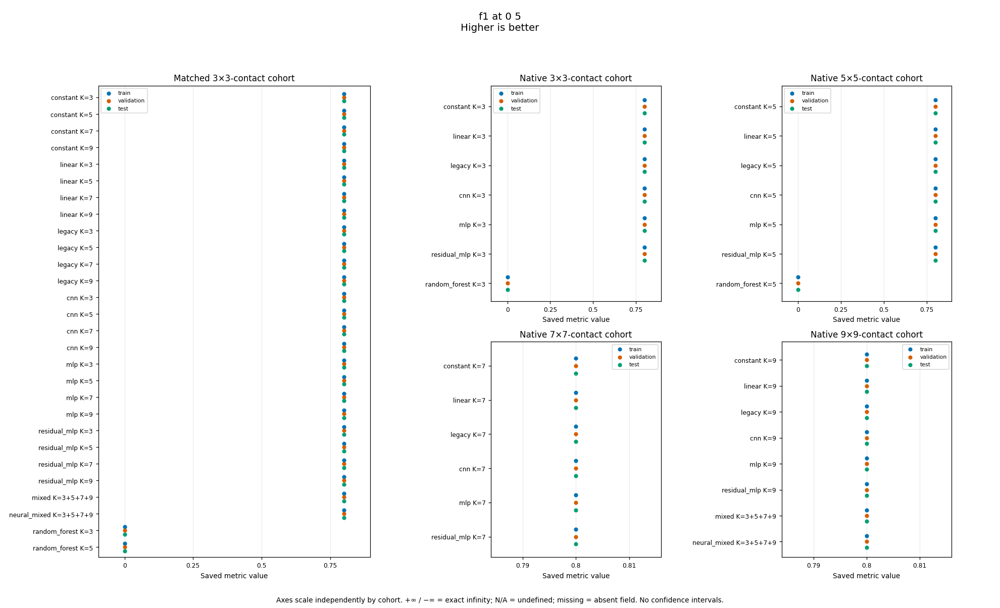

| Model | Native K | Matched train | Matched validation | Matched test | Native train | Native validation | Native test |
|---|---:|---:|---:|---:|---:|---:|---:|
| constant K=3 (`k3_constant_00_lr0.003_constant`) | 3 | 0.8 | 0.8 | 0.8 | 0.8 | 0.8 | 0.8 |
| constant K=5 (`k5_constant_00_lr0.003_constant`) | 5 | 0.8 | 0.8 | 0.8 | 0.8 | 0.8 | 0.8 |
| constant K=7 (`k7_constant_00_lr0.003_constant`) | 7 | 0.8 | 0.8 | 0.8 | 0.8 | 0.8 | 0.8 |
| constant K=9 (`k9_constant_00_lr0.003_constant`) | 9 | 0.8 | 0.8 | 0.8 | 0.8 | 0.8 | 0.8 |
| linear K=3 (`k3_linear_01_lr0.003_constant`) | 3 | 0.8 | 0.8 | 0.8 | 0.8 | 0.8 | 0.8 |
| linear K=5 (`k5_linear_01_lr0.003_constant`) | 5 | 0.8 | 0.8 | 0.8 | 0.8 | 0.8 | 0.8 |
| linear K=7 (`k7_linear_01_lr0.003_constant`) | 7 | 0.8 | 0.8 | 0.8 | 0.8 | 0.8 | 0.8 |
| linear K=9 (`k9_linear_01_lr0.003_constant`) | 9 | 0.8 | 0.8 | 0.8 | 0.8 | 0.8 | 0.8 |
| legacy K=3 (`k3_legacy_02_lr0.003_constant`) | 3 | 0.8 | 0.8 | 0.8 | 0.8 | 0.8 | 0.8 |
| legacy K=5 (`k5_legacy_02_lr0.003_constant`) | 5 | 0.8 | 0.8 | 0.8 | 0.8 | 0.8 | 0.8 |
| legacy K=7 (`k7_legacy_02_lr0.003_constant`) | 7 | 0.8 | 0.8 | 0.8 | 0.8 | 0.8 | 0.8 |
| legacy K=9 (`k9_legacy_02_lr0.003_constant`) | 9 | 0.8 | 0.8 | 0.8 | 0.8 | 0.8 | 0.8 |
| cnn K=3 (`k3_cnn_03_lr0.003_constant`) | 3 | 0.8 | 0.8 | 0.8 | 0.8 | 0.8 | 0.8 |
| cnn K=5 (`k5_cnn_03_lr0.003_constant`) | 5 | 0.8 | 0.8 | 0.8 | 0.8 | 0.8 | 0.8 |
| cnn K=7 (`k7_cnn_03_lr0.003_constant`) | 7 | 0.8 | 0.8 | 0.8 | 0.8 | 0.8 | 0.8 |
| cnn K=9 (`k9_cnn_03_lr0.003_constant`) | 9 | 0.8 | 0.8 | 0.8 | 0.8 | 0.8 | 0.8 |
| mlp K=3 (`k3_mlp_04_lr0.003_constant`) | 3 | 0.8 | 0.8 | 0.8 | 0.8 | 0.8 | 0.8 |
| mlp K=5 (`k5_mlp_05_lr0.003_constant`) | 5 | 0.8 | 0.8 | 0.8 | 0.8 | 0.8 | 0.8 |
| mlp K=7 (`k7_mlp_04_lr0.003_constant`) | 7 | 0.8 | 0.8 | 0.8 | 0.8 | 0.8 | 0.8 |
| mlp K=9 (`k9_mlp_04_lr0.003_constant`) | 9 | 0.8 | 0.8 | 0.8 | 0.8 | 0.8 | 0.8 |
| residual_mlp K=3 (`k3_residual_mlp_08_lr0.003_constant`) | 3 | 0.8 | 0.8 | 0.8 | 0.8 | 0.8 | 0.8 |
| residual_mlp K=5 (`k5_residual_mlp_09_lr0.003_constant`) | 5 | 0.8 | 0.8 | 0.8 | 0.8 | 0.8 | 0.8 |
| residual_mlp K=7 (`k7_residual_mlp_08_lr0.003_constant`) | 7 | 0.8 | 0.8 | 0.8 | 0.8 | 0.8 | 0.8 |
| residual_mlp K=9 (`k9_residual_mlp_08_lr0.003_constant`) | 9 | 0.8 | 0.8 | 0.8 | 0.8 | 0.8 | 0.8 |
| mixed K=3+5+7+9 (`mixed_3_5_7_9_00_lr0.003_constant`) | 9 | 0.8 | 0.8 | 0.8 | 0.8 | 0.8 | 0.8 |
| neural_mixed K=3+5+7+9 (`neural_mixed_3_5_7_9_00_lr0.003_constant`) | 9 | 0.8 | 0.8 | 0.8 | 0.8 | 0.8 | 0.8 |
| random_forest K=3 (`rf3_depth8`) | 3 | 0 | 0 | 0 | 0 | 0 | 0 |
| random_forest K=5 (`rf5_depth8`) | 5 | 0 | 0 | 0 | 0 | 0 | 0 |

#### f1 at validation f1 threshold

Saved field: `f1_at_validation_f1_threshold`. Higher is better.

| Model | Native K | Matched train | Matched validation | Matched test | Native train | Native validation | Native test |
|---|---:|---:|---:|---:|---:|---:|---:|
| constant K=3 (`k3_constant_00_lr0.003_constant`) | 3 | 0.8 | 0.8 | 0.8 | 0.8 | 0.8 | 0.8 |
| constant K=5 (`k5_constant_00_lr0.003_constant`) | 5 | 0.8 | 0.8 | 0.8 | 0.8 | 0.8 | 0.8 |
| constant K=7 (`k7_constant_00_lr0.003_constant`) | 7 | 0.8 | 0.8 | 0.8 | 0.8 | 0.8 | 0.8 |
| constant K=9 (`k9_constant_00_lr0.003_constant`) | 9 | 0.8 | 0.8 | 0.8 | 0.8 | 0.8 | 0.8 |
| linear K=3 (`k3_linear_01_lr0.003_constant`) | 3 | 0.8 | 0.8 | 0.8 | 0.8 | 0.8 | 0.8 |
| linear K=5 (`k5_linear_01_lr0.003_constant`) | 5 | 0.8 | 0.8 | 0.8 | 0.8 | 0.8 | 0.8 |
| linear K=7 (`k7_linear_01_lr0.003_constant`) | 7 | 0.8 | 0.8 | 0.8 | 0.8 | 0.8 | 0.8 |
| linear K=9 (`k9_linear_01_lr0.003_constant`) | 9 | 0.8 | 0.8 | 0.8 | 0.8 | 0.8 | 0.8 |
| legacy K=3 (`k3_legacy_02_lr0.003_constant`) | 3 | 0.8 | 0.8 | 0.8 | 0.8 | 0.8 | 0.8 |
| legacy K=5 (`k5_legacy_02_lr0.003_constant`) | 5 | 0.8 | 0.8 | 0.8 | 0.8 | 0.8 | 0.8 |
| legacy K=7 (`k7_legacy_02_lr0.003_constant`) | 7 | 0.8 | 0.8 | 0.8 | 0.8 | 0.8 | 0.8 |
| legacy K=9 (`k9_legacy_02_lr0.003_constant`) | 9 | 0.8 | 0.8 | 0.8 | 0.8 | 0.8 | 0.8 |
| cnn K=3 (`k3_cnn_03_lr0.003_constant`) | 3 | 0.8 | 0.8 | 0.8 | 0.8 | 0.8 | 0.8 |
| cnn K=5 (`k5_cnn_03_lr0.003_constant`) | 5 | 0.8 | 0.8 | 0.8 | 0.8 | 0.8 | 0.8 |
| cnn K=7 (`k7_cnn_03_lr0.003_constant`) | 7 | 0.8 | 0.8 | 0.8 | 0.8 | 0.8 | 0.8 |
| cnn K=9 (`k9_cnn_03_lr0.003_constant`) | 9 | 0.8 | 0.8 | 0.8 | 0.8 | 0.8 | 0.8 |
| mlp K=3 (`k3_mlp_04_lr0.003_constant`) | 3 | 0.8 | 0.8 | 0.8 | 0.8 | 0.8 | 0.8 |
| mlp K=5 (`k5_mlp_05_lr0.003_constant`) | 5 | 0.8 | 0.8 | 0.8 | 0.8 | 0.8 | 0.8 |
| mlp K=7 (`k7_mlp_04_lr0.003_constant`) | 7 | 0.8 | 0.8 | 0.8 | 0.8 | 0.8 | 0.8 |
| mlp K=9 (`k9_mlp_04_lr0.003_constant`) | 9 | 0.8 | 0.8 | 0.8 | 0.8 | 0.8 | 0.8 |
| residual_mlp K=3 (`k3_residual_mlp_08_lr0.003_constant`) | 3 | 0.8 | 0.8 | 0.8 | 0.8 | 0.8 | 0.8 |
| residual_mlp K=5 (`k5_residual_mlp_09_lr0.003_constant`) | 5 | 0.8 | 0.8 | 0.8 | 0.8 | 0.8 | 0.8 |
| residual_mlp K=7 (`k7_residual_mlp_08_lr0.003_constant`) | 7 | 0.8 | 0.8 | 0.8 | 0.8 | 0.8 | 0.8 |
| residual_mlp K=9 (`k9_residual_mlp_08_lr0.003_constant`) | 9 | 0.8 | 0.8 | 0.8 | 0.8 | 0.8 | 0.8 |
| mixed K=3+5+7+9 (`mixed_3_5_7_9_00_lr0.003_constant`) | 9 | 0.8 | 0.8 | 0.8 | 0.8 | 0.8 | 0.8 |
| neural_mixed K=3+5+7+9 (`neural_mixed_3_5_7_9_00_lr0.003_constant`) | 9 | 0.8 | 0.8 | 0.8 | 0.8 | 0.8 | 0.8 |
| random_forest K=3 (`rf3_depth8`) | 3 | 0.8 | 0.8 | 0.8 | 0.8 | 0.8 | 0.8 |
| random_forest K=5 (`rf5_depth8`) | 5 | 0.8 | 0.8 | 0.8 | 0.8 | 0.8 | 0.8 |

#### f1 at validation mcc threshold

Saved field: `f1_at_validation_mcc_threshold`. Higher is better.

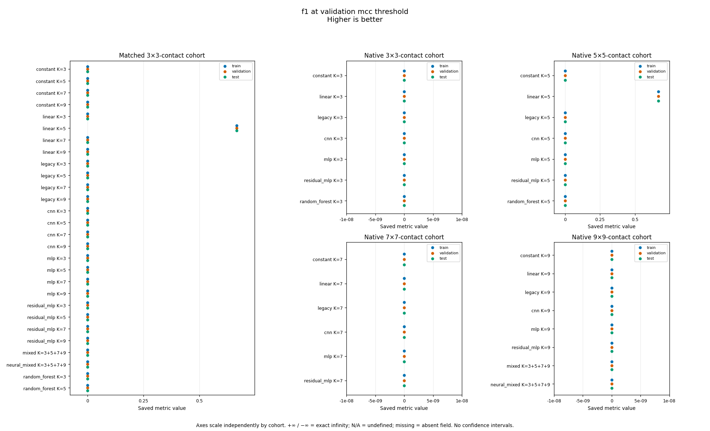

| Model | Native K | Matched train | Matched validation | Matched test | Native train | Native validation | Native test |
|---|---:|---:|---:|---:|---:|---:|---:|
| constant K=3 (`k3_constant_00_lr0.003_constant`) | 3 | 0 | 0 | 0 | 0 | 0 | 0 |
| constant K=5 (`k5_constant_00_lr0.003_constant`) | 5 | 0 | 0 | 0 | 0 | 0 | 0 |
| constant K=7 (`k7_constant_00_lr0.003_constant`) | 7 | 0 | 0 | 0 | 0 | 0 | 0 |
| constant K=9 (`k9_constant_00_lr0.003_constant`) | 9 | 0 | 0 | 0 | 0 | 0 | 0 |
| linear K=3 (`k3_linear_01_lr0.003_constant`) | 3 | 0 | 0 | 0 | 0 | 0 | 0 |
| linear K=5 (`k5_linear_01_lr0.003_constant`) | 5 | 0.66666667 | 0.66666667 | 0.66666667 | 0.66666667 | 0.66666667 | 0.66666667 |
| linear K=7 (`k7_linear_01_lr0.003_constant`) | 7 | 0 | 0 | 0 | 0 | 0 | 0 |
| linear K=9 (`k9_linear_01_lr0.003_constant`) | 9 | 0 | 0 | 0 | 0 | 0 | 0 |
| legacy K=3 (`k3_legacy_02_lr0.003_constant`) | 3 | 0 | 0 | 0 | 0 | 0 | 0 |
| legacy K=5 (`k5_legacy_02_lr0.003_constant`) | 5 | 0 | 0 | 0 | 0 | 0 | 0 |
| legacy K=7 (`k7_legacy_02_lr0.003_constant`) | 7 | 0 | 0 | 0 | 0 | 0 | 0 |
| legacy K=9 (`k9_legacy_02_lr0.003_constant`) | 9 | 0 | 0 | 0 | 0 | 0 | 0 |
| cnn K=3 (`k3_cnn_03_lr0.003_constant`) | 3 | 0 | 0 | 0 | 0 | 0 | 0 |
| cnn K=5 (`k5_cnn_03_lr0.003_constant`) | 5 | 0 | 0 | 0 | 0 | 0 | 0 |
| cnn K=7 (`k7_cnn_03_lr0.003_constant`) | 7 | 0 | 0 | 0 | 0 | 0 | 0 |
| cnn K=9 (`k9_cnn_03_lr0.003_constant`) | 9 | 0 | 0 | 0 | 0 | 0 | 0 |
| mlp K=3 (`k3_mlp_04_lr0.003_constant`) | 3 | 0 | 0 | 0 | 0 | 0 | 0 |
| mlp K=5 (`k5_mlp_05_lr0.003_constant`) | 5 | 0 | 0 | 0 | 0 | 0 | 0 |
| mlp K=7 (`k7_mlp_04_lr0.003_constant`) | 7 | 0 | 0 | 0 | 0 | 0 | 0 |
| mlp K=9 (`k9_mlp_04_lr0.003_constant`) | 9 | 0 | 0 | 0 | 0 | 0 | 0 |
| residual_mlp K=3 (`k3_residual_mlp_08_lr0.003_constant`) | 3 | 0 | 0 | 0 | 0 | 0 | 0 |
| residual_mlp K=5 (`k5_residual_mlp_09_lr0.003_constant`) | 5 | 0 | 0 | 0 | 0 | 0 | 0 |
| residual_mlp K=7 (`k7_residual_mlp_08_lr0.003_constant`) | 7 | 0 | 0 | 0 | 0 | 0 | 0 |
| residual_mlp K=9 (`k9_residual_mlp_08_lr0.003_constant`) | 9 | 0 | 0 | 0 | 0 | 0 | 0 |
| mixed K=3+5+7+9 (`mixed_3_5_7_9_00_lr0.003_constant`) | 9 | 0 | 0 | 0 | 0 | 0 | 0 |
| neural_mixed K=3+5+7+9 (`neural_mixed_3_5_7_9_00_lr0.003_constant`) | 9 | 0 | 0 | 0 | 0 | 0 | 0 |
| random_forest K=3 (`rf3_depth8`) | 3 | 0 | 0 | 0 | 0 | 0 | 0 |
| random_forest K=5 (`rf5_depth8`) | 5 | 0 | 0 | 0 | 0 | 0 | 0 |

#### mcc at 0 5

Saved field: `mcc_at_0_5`. Higher is better.

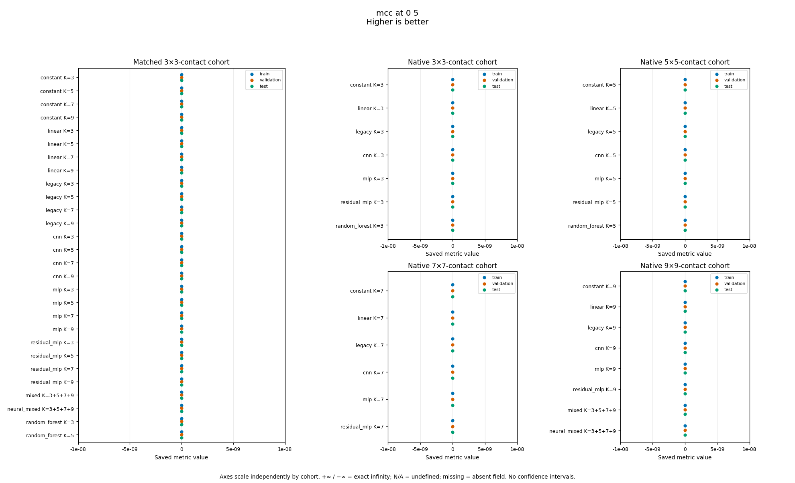

| Model | Native K | Matched train | Matched validation | Matched test | Native train | Native validation | Native test |
|---|---:|---:|---:|---:|---:|---:|---:|
| constant K=3 (`k3_constant_00_lr0.003_constant`) | 3 | 0 | 0 | 0 | 0 | 0 | 0 |
| constant K=5 (`k5_constant_00_lr0.003_constant`) | 5 | 0 | 0 | 0 | 0 | 0 | 0 |
| constant K=7 (`k7_constant_00_lr0.003_constant`) | 7 | 0 | 0 | 0 | 0 | 0 | 0 |
| constant K=9 (`k9_constant_00_lr0.003_constant`) | 9 | 0 | 0 | 0 | 0 | 0 | 0 |
| linear K=3 (`k3_linear_01_lr0.003_constant`) | 3 | 0 | 0 | 0 | 0 | 0 | 0 |
| linear K=5 (`k5_linear_01_lr0.003_constant`) | 5 | 0 | 0 | 0 | 0 | 0 | 0 |
| linear K=7 (`k7_linear_01_lr0.003_constant`) | 7 | 0 | 0 | 0 | 0 | 0 | 0 |
| linear K=9 (`k9_linear_01_lr0.003_constant`) | 9 | 0 | 0 | 0 | 0 | 0 | 0 |
| legacy K=3 (`k3_legacy_02_lr0.003_constant`) | 3 | 0 | 0 | 0 | 0 | 0 | 0 |
| legacy K=5 (`k5_legacy_02_lr0.003_constant`) | 5 | 0 | 0 | 0 | 0 | 0 | 0 |
| legacy K=7 (`k7_legacy_02_lr0.003_constant`) | 7 | 0 | 0 | 0 | 0 | 0 | 0 |
| legacy K=9 (`k9_legacy_02_lr0.003_constant`) | 9 | 0 | 0 | 0 | 0 | 0 | 0 |
| cnn K=3 (`k3_cnn_03_lr0.003_constant`) | 3 | 0 | 0 | 0 | 0 | 0 | 0 |
| cnn K=5 (`k5_cnn_03_lr0.003_constant`) | 5 | 0 | 0 | 0 | 0 | 0 | 0 |
| cnn K=7 (`k7_cnn_03_lr0.003_constant`) | 7 | 0 | 0 | 0 | 0 | 0 | 0 |
| cnn K=9 (`k9_cnn_03_lr0.003_constant`) | 9 | 0 | 0 | 0 | 0 | 0 | 0 |
| mlp K=3 (`k3_mlp_04_lr0.003_constant`) | 3 | 0 | 0 | 0 | 0 | 0 | 0 |
| mlp K=5 (`k5_mlp_05_lr0.003_constant`) | 5 | 0 | 0 | 0 | 0 | 0 | 0 |
| mlp K=7 (`k7_mlp_04_lr0.003_constant`) | 7 | 0 | 0 | 0 | 0 | 0 | 0 |
| mlp K=9 (`k9_mlp_04_lr0.003_constant`) | 9 | 0 | 0 | 0 | 0 | 0 | 0 |
| residual_mlp K=3 (`k3_residual_mlp_08_lr0.003_constant`) | 3 | 0 | 0 | 0 | 0 | 0 | 0 |
| residual_mlp K=5 (`k5_residual_mlp_09_lr0.003_constant`) | 5 | 0 | 0 | 0 | 0 | 0 | 0 |
| residual_mlp K=7 (`k7_residual_mlp_08_lr0.003_constant`) | 7 | 0 | 0 | 0 | 0 | 0 | 0 |
| residual_mlp K=9 (`k9_residual_mlp_08_lr0.003_constant`) | 9 | 0 | 0 | 0 | 0 | 0 | 0 |
| mixed K=3+5+7+9 (`mixed_3_5_7_9_00_lr0.003_constant`) | 9 | 0 | 0 | 0 | 0 | 0 | 0 |
| neural_mixed K=3+5+7+9 (`neural_mixed_3_5_7_9_00_lr0.003_constant`) | 9 | 0 | 0 | 0 | 0 | 0 | 0 |
| random_forest K=3 (`rf3_depth8`) | 3 | 0 | 0 | 0 | 0 | 0 | 0 |
| random_forest K=5 (`rf5_depth8`) | 5 | 0 | 0 | 0 | 0 | 0 | 0 |

#### mcc at validation f1 threshold

Saved field: `mcc_at_validation_f1_threshold`. Higher is better.

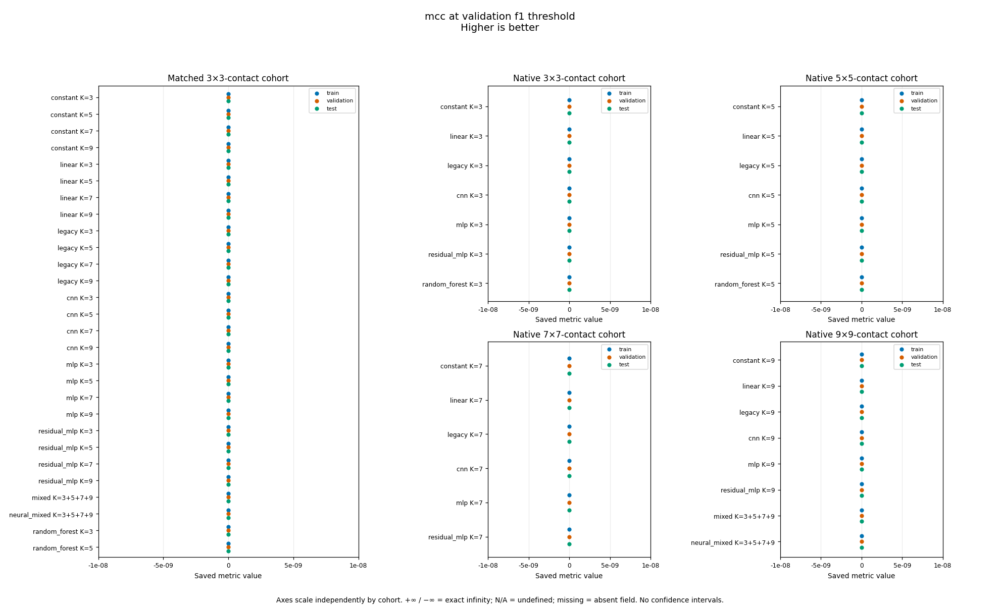

| Model | Native K | Matched train | Matched validation | Matched test | Native train | Native validation | Native test |
|---|---:|---:|---:|---:|---:|---:|---:|
| constant K=3 (`k3_constant_00_lr0.003_constant`) | 3 | 0 | 0 | 0 | 0 | 0 | 0 |
| constant K=5 (`k5_constant_00_lr0.003_constant`) | 5 | 0 | 0 | 0 | 0 | 0 | 0 |
| constant K=7 (`k7_constant_00_lr0.003_constant`) | 7 | 0 | 0 | 0 | 0 | 0 | 0 |
| constant K=9 (`k9_constant_00_lr0.003_constant`) | 9 | 0 | 0 | 0 | 0 | 0 | 0 |
| linear K=3 (`k3_linear_01_lr0.003_constant`) | 3 | 0 | 0 | 0 | 0 | 0 | 0 |
| linear K=5 (`k5_linear_01_lr0.003_constant`) | 5 | 0 | 0 | 0 | 0 | 0 | 0 |
| linear K=7 (`k7_linear_01_lr0.003_constant`) | 7 | 0 | 0 | 0 | 0 | 0 | 0 |
| linear K=9 (`k9_linear_01_lr0.003_constant`) | 9 | 0 | 0 | 0 | 0 | 0 | 0 |
| legacy K=3 (`k3_legacy_02_lr0.003_constant`) | 3 | 0 | 0 | 0 | 0 | 0 | 0 |
| legacy K=5 (`k5_legacy_02_lr0.003_constant`) | 5 | 0 | 0 | 0 | 0 | 0 | 0 |
| legacy K=7 (`k7_legacy_02_lr0.003_constant`) | 7 | 0 | 0 | 0 | 0 | 0 | 0 |
| legacy K=9 (`k9_legacy_02_lr0.003_constant`) | 9 | 0 | 0 | 0 | 0 | 0 | 0 |
| cnn K=3 (`k3_cnn_03_lr0.003_constant`) | 3 | 0 | 0 | 0 | 0 | 0 | 0 |
| cnn K=5 (`k5_cnn_03_lr0.003_constant`) | 5 | 0 | 0 | 0 | 0 | 0 | 0 |
| cnn K=7 (`k7_cnn_03_lr0.003_constant`) | 7 | 0 | 0 | 0 | 0 | 0 | 0 |
| cnn K=9 (`k9_cnn_03_lr0.003_constant`) | 9 | 0 | 0 | 0 | 0 | 0 | 0 |
| mlp K=3 (`k3_mlp_04_lr0.003_constant`) | 3 | 0 | 0 | 0 | 0 | 0 | 0 |
| mlp K=5 (`k5_mlp_05_lr0.003_constant`) | 5 | 0 | 0 | 0 | 0 | 0 | 0 |
| mlp K=7 (`k7_mlp_04_lr0.003_constant`) | 7 | 0 | 0 | 0 | 0 | 0 | 0 |
| mlp K=9 (`k9_mlp_04_lr0.003_constant`) | 9 | 0 | 0 | 0 | 0 | 0 | 0 |
| residual_mlp K=3 (`k3_residual_mlp_08_lr0.003_constant`) | 3 | 0 | 0 | 0 | 0 | 0 | 0 |
| residual_mlp K=5 (`k5_residual_mlp_09_lr0.003_constant`) | 5 | 0 | 0 | 0 | 0 | 0 | 0 |
| residual_mlp K=7 (`k7_residual_mlp_08_lr0.003_constant`) | 7 | 0 | 0 | 0 | 0 | 0 | 0 |
| residual_mlp K=9 (`k9_residual_mlp_08_lr0.003_constant`) | 9 | 0 | 0 | 0 | 0 | 0 | 0 |
| mixed K=3+5+7+9 (`mixed_3_5_7_9_00_lr0.003_constant`) | 9 | 0 | 0 | 0 | 0 | 0 | 0 |
| neural_mixed K=3+5+7+9 (`neural_mixed_3_5_7_9_00_lr0.003_constant`) | 9 | 0 | 0 | 0 | 0 | 0 | 0 |
| random_forest K=3 (`rf3_depth8`) | 3 | 0 | 0 | 0 | 0 | 0 | 0 |
| random_forest K=5 (`rf5_depth8`) | 5 | 0 | 0 | 0 | 0 | 0 | 0 |

#### mcc at validation mcc threshold

Saved field: `mcc_at_validation_mcc_threshold`. Higher is better.

| Model | Native K | Matched train | Matched validation | Matched test | Native train | Native validation | Native test |
|---|---:|---:|---:|---:|---:|---:|---:|
| constant K=3 (`k3_constant_00_lr0.003_constant`) | 3 | 0 | 0 | 0 | 0 | 0 | 0 |
| constant K=5 (`k5_constant_00_lr0.003_constant`) | 5 | 0 | 0 | 0 | 0 | 0 | 0 |
| constant K=7 (`k7_constant_00_lr0.003_constant`) | 7 | 0 | 0 | 0 | 0 | 0 | 0 |
| constant K=9 (`k9_constant_00_lr0.003_constant`) | 9 | 0 | 0 | 0 | 0 | 0 | 0 |
| linear K=3 (`k3_linear_01_lr0.003_constant`) | 3 | 0 | 0 | 0 | 0 | 0 | 0 |
| linear K=5 (`k5_linear_01_lr0.003_constant`) | 5 | 0.5 | 0.5 | 0.5 | 0.5 | 0.5 | 0.5 |
| linear K=7 (`k7_linear_01_lr0.003_constant`) | 7 | 0 | 0 | 0 | 0 | 0 | 0 |
| linear K=9 (`k9_linear_01_lr0.003_constant`) | 9 | 0 | 0 | 0 | 0 | 0 | 0 |
| legacy K=3 (`k3_legacy_02_lr0.003_constant`) | 3 | 0 | 0 | 0 | 0 | 0 | 0 |
| legacy K=5 (`k5_legacy_02_lr0.003_constant`) | 5 | 0 | 0 | 0 | 0 | 0 | 0 |
| legacy K=7 (`k7_legacy_02_lr0.003_constant`) | 7 | 0 | 0 | 0 | 0 | 0 | 0 |
| legacy K=9 (`k9_legacy_02_lr0.003_constant`) | 9 | 0 | 0 | 0 | 0 | 0 | 0 |
| cnn K=3 (`k3_cnn_03_lr0.003_constant`) | 3 | 0 | 0 | 0 | 0 | 0 | 0 |
| cnn K=5 (`k5_cnn_03_lr0.003_constant`) | 5 | 0 | 0 | 0 | 0 | 0 | 0 |
| cnn K=7 (`k7_cnn_03_lr0.003_constant`) | 7 | 0 | 0 | 0 | 0 | 0 | 0 |
| cnn K=9 (`k9_cnn_03_lr0.003_constant`) | 9 | 0 | 0 | 0 | 0 | 0 | 0 |
| mlp K=3 (`k3_mlp_04_lr0.003_constant`) | 3 | 0 | 0 | 0 | 0 | 0 | 0 |
| mlp K=5 (`k5_mlp_05_lr0.003_constant`) | 5 | 0 | 0 | 0 | 0 | 0 | 0 |
| mlp K=7 (`k7_mlp_04_lr0.003_constant`) | 7 | 0 | 0 | 0 | 0 | 0 | 0 |
| mlp K=9 (`k9_mlp_04_lr0.003_constant`) | 9 | 0 | 0 | 0 | 0 | 0 | 0 |
| residual_mlp K=3 (`k3_residual_mlp_08_lr0.003_constant`) | 3 | 0 | 0 | 0 | 0 | 0 | 0 |
| residual_mlp K=5 (`k5_residual_mlp_09_lr0.003_constant`) | 5 | 0 | 0 | 0 | 0 | 0 | 0 |
| residual_mlp K=7 (`k7_residual_mlp_08_lr0.003_constant`) | 7 | 0 | 0 | 0 | 0 | 0 | 0 |
| residual_mlp K=9 (`k9_residual_mlp_08_lr0.003_constant`) | 9 | 0 | 0 | 0 | 0 | 0 | 0 |
| mixed K=3+5+7+9 (`mixed_3_5_7_9_00_lr0.003_constant`) | 9 | 0 | 0 | 0 | 0 | 0 | 0 |
| neural_mixed K=3+5+7+9 (`neural_mixed_3_5_7_9_00_lr0.003_constant`) | 9 | 0 | 0 | 0 | 0 | 0 | 0 |
| random_forest K=3 (`rf3_depth8`) | 3 | 0 | 0 | 0 | 0 | 0 | 0 |
| random_forest K=5 (`rf5_depth8`) | 5 | 0 | 0 | 0 | 0 | 0 | 0 |

#### precision at 0 5

Saved field: `precision_at_0_5`. Higher is better.

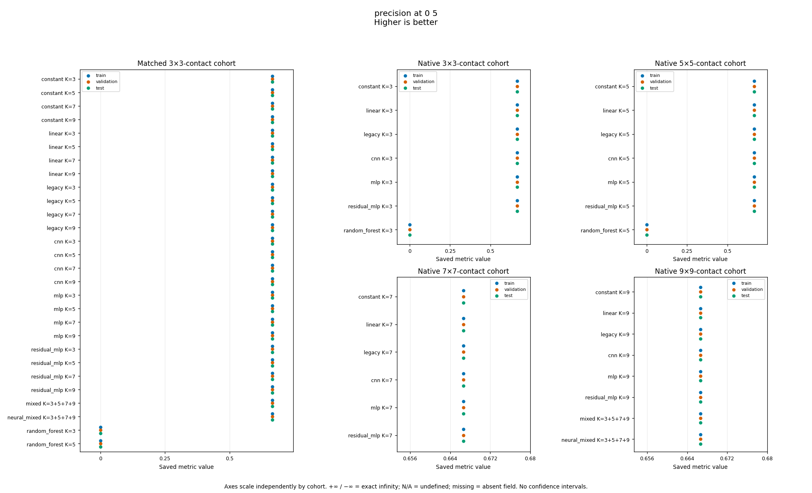

| Model | Native K | Matched train | Matched validation | Matched test | Native train | Native validation | Native test |
|---|---:|---:|---:|---:|---:|---:|---:|
| constant K=3 (`k3_constant_00_lr0.003_constant`) | 3 | 0.66666667 | 0.66666667 | 0.66666667 | 0.66666667 | 0.66666667 | 0.66666667 |
| constant K=5 (`k5_constant_00_lr0.003_constant`) | 5 | 0.66666667 | 0.66666667 | 0.66666667 | 0.66666667 | 0.66666667 | 0.66666667 |
| constant K=7 (`k7_constant_00_lr0.003_constant`) | 7 | 0.66666667 | 0.66666667 | 0.66666667 | 0.66666667 | 0.66666667 | 0.66666667 |
| constant K=9 (`k9_constant_00_lr0.003_constant`) | 9 | 0.66666667 | 0.66666667 | 0.66666667 | 0.66666667 | 0.66666667 | 0.66666667 |
| linear K=3 (`k3_linear_01_lr0.003_constant`) | 3 | 0.66666667 | 0.66666667 | 0.66666667 | 0.66666667 | 0.66666667 | 0.66666667 |
| linear K=5 (`k5_linear_01_lr0.003_constant`) | 5 | 0.66666667 | 0.66666667 | 0.66666667 | 0.66666667 | 0.66666667 | 0.66666667 |
| linear K=7 (`k7_linear_01_lr0.003_constant`) | 7 | 0.66666667 | 0.66666667 | 0.66666667 | 0.66666667 | 0.66666667 | 0.66666667 |
| linear K=9 (`k9_linear_01_lr0.003_constant`) | 9 | 0.66666667 | 0.66666667 | 0.66666667 | 0.66666667 | 0.66666667 | 0.66666667 |
| legacy K=3 (`k3_legacy_02_lr0.003_constant`) | 3 | 0.66666667 | 0.66666667 | 0.66666667 | 0.66666667 | 0.66666667 | 0.66666667 |
| legacy K=5 (`k5_legacy_02_lr0.003_constant`) | 5 | 0.66666667 | 0.66666667 | 0.66666667 | 0.66666667 | 0.66666667 | 0.66666667 |
| legacy K=7 (`k7_legacy_02_lr0.003_constant`) | 7 | 0.66666667 | 0.66666667 | 0.66666667 | 0.66666667 | 0.66666667 | 0.66666667 |
| legacy K=9 (`k9_legacy_02_lr0.003_constant`) | 9 | 0.66666667 | 0.66666667 | 0.66666667 | 0.66666667 | 0.66666667 | 0.66666667 |
| cnn K=3 (`k3_cnn_03_lr0.003_constant`) | 3 | 0.66666667 | 0.66666667 | 0.66666667 | 0.66666667 | 0.66666667 | 0.66666667 |
| cnn K=5 (`k5_cnn_03_lr0.003_constant`) | 5 | 0.66666667 | 0.66666667 | 0.66666667 | 0.66666667 | 0.66666667 | 0.66666667 |
| cnn K=7 (`k7_cnn_03_lr0.003_constant`) | 7 | 0.66666667 | 0.66666667 | 0.66666667 | 0.66666667 | 0.66666667 | 0.66666667 |
| cnn K=9 (`k9_cnn_03_lr0.003_constant`) | 9 | 0.66666667 | 0.66666667 | 0.66666667 | 0.66666667 | 0.66666667 | 0.66666667 |
| mlp K=3 (`k3_mlp_04_lr0.003_constant`) | 3 | 0.66666667 | 0.66666667 | 0.66666667 | 0.66666667 | 0.66666667 | 0.66666667 |
| mlp K=5 (`k5_mlp_05_lr0.003_constant`) | 5 | 0.66666667 | 0.66666667 | 0.66666667 | 0.66666667 | 0.66666667 | 0.66666667 |
| mlp K=7 (`k7_mlp_04_lr0.003_constant`) | 7 | 0.66666667 | 0.66666667 | 0.66666667 | 0.66666667 | 0.66666667 | 0.66666667 |
| mlp K=9 (`k9_mlp_04_lr0.003_constant`) | 9 | 0.66666667 | 0.66666667 | 0.66666667 | 0.66666667 | 0.66666667 | 0.66666667 |
| residual_mlp K=3 (`k3_residual_mlp_08_lr0.003_constant`) | 3 | 0.66666667 | 0.66666667 | 0.66666667 | 0.66666667 | 0.66666667 | 0.66666667 |
| residual_mlp K=5 (`k5_residual_mlp_09_lr0.003_constant`) | 5 | 0.66666667 | 0.66666667 | 0.66666667 | 0.66666667 | 0.66666667 | 0.66666667 |
| residual_mlp K=7 (`k7_residual_mlp_08_lr0.003_constant`) | 7 | 0.66666667 | 0.66666667 | 0.66666667 | 0.66666667 | 0.66666667 | 0.66666667 |
| residual_mlp K=9 (`k9_residual_mlp_08_lr0.003_constant`) | 9 | 0.66666667 | 0.66666667 | 0.66666667 | 0.66666667 | 0.66666667 | 0.66666667 |
| mixed K=3+5+7+9 (`mixed_3_5_7_9_00_lr0.003_constant`) | 9 | 0.66666667 | 0.66666667 | 0.66666667 | 0.66666667 | 0.66666667 | 0.66666667 |
| neural_mixed K=3+5+7+9 (`neural_mixed_3_5_7_9_00_lr0.003_constant`) | 9 | 0.66666667 | 0.66666667 | 0.66666667 | 0.66666667 | 0.66666667 | 0.66666667 |
| random_forest K=3 (`rf3_depth8`) | 3 | 0 | 0 | 0 | 0 | 0 | 0 |
| random_forest K=5 (`rf5_depth8`) | 5 | 0 | 0 | 0 | 0 | 0 | 0 |

#### precision at validation f1 threshold

Saved field: `precision_at_validation_f1_threshold`. Higher is better.

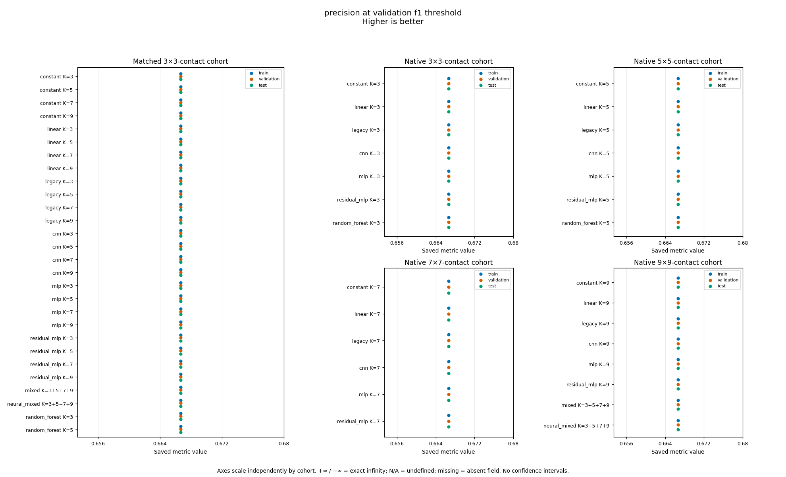

| Model | Native K | Matched train | Matched validation | Matched test | Native train | Native validation | Native test |
|---|---:|---:|---:|---:|---:|---:|---:|
| constant K=3 (`k3_constant_00_lr0.003_constant`) | 3 | 0.66666667 | 0.66666667 | 0.66666667 | 0.66666667 | 0.66666667 | 0.66666667 |
| constant K=5 (`k5_constant_00_lr0.003_constant`) | 5 | 0.66666667 | 0.66666667 | 0.66666667 | 0.66666667 | 0.66666667 | 0.66666667 |
| constant K=7 (`k7_constant_00_lr0.003_constant`) | 7 | 0.66666667 | 0.66666667 | 0.66666667 | 0.66666667 | 0.66666667 | 0.66666667 |
| constant K=9 (`k9_constant_00_lr0.003_constant`) | 9 | 0.66666667 | 0.66666667 | 0.66666667 | 0.66666667 | 0.66666667 | 0.66666667 |
| linear K=3 (`k3_linear_01_lr0.003_constant`) | 3 | 0.66666667 | 0.66666667 | 0.66666667 | 0.66666667 | 0.66666667 | 0.66666667 |
| linear K=5 (`k5_linear_01_lr0.003_constant`) | 5 | 0.66666667 | 0.66666667 | 0.66666667 | 0.66666667 | 0.66666667 | 0.66666667 |
| linear K=7 (`k7_linear_01_lr0.003_constant`) | 7 | 0.66666667 | 0.66666667 | 0.66666667 | 0.66666667 | 0.66666667 | 0.66666667 |
| linear K=9 (`k9_linear_01_lr0.003_constant`) | 9 | 0.66666667 | 0.66666667 | 0.66666667 | 0.66666667 | 0.66666667 | 0.66666667 |
| legacy K=3 (`k3_legacy_02_lr0.003_constant`) | 3 | 0.66666667 | 0.66666667 | 0.66666667 | 0.66666667 | 0.66666667 | 0.66666667 |
| legacy K=5 (`k5_legacy_02_lr0.003_constant`) | 5 | 0.66666667 | 0.66666667 | 0.66666667 | 0.66666667 | 0.66666667 | 0.66666667 |
| legacy K=7 (`k7_legacy_02_lr0.003_constant`) | 7 | 0.66666667 | 0.66666667 | 0.66666667 | 0.66666667 | 0.66666667 | 0.66666667 |
| legacy K=9 (`k9_legacy_02_lr0.003_constant`) | 9 | 0.66666667 | 0.66666667 | 0.66666667 | 0.66666667 | 0.66666667 | 0.66666667 |
| cnn K=3 (`k3_cnn_03_lr0.003_constant`) | 3 | 0.66666667 | 0.66666667 | 0.66666667 | 0.66666667 | 0.66666667 | 0.66666667 |
| cnn K=5 (`k5_cnn_03_lr0.003_constant`) | 5 | 0.66666667 | 0.66666667 | 0.66666667 | 0.66666667 | 0.66666667 | 0.66666667 |
| cnn K=7 (`k7_cnn_03_lr0.003_constant`) | 7 | 0.66666667 | 0.66666667 | 0.66666667 | 0.66666667 | 0.66666667 | 0.66666667 |
| cnn K=9 (`k9_cnn_03_lr0.003_constant`) | 9 | 0.66666667 | 0.66666667 | 0.66666667 | 0.66666667 | 0.66666667 | 0.66666667 |
| mlp K=3 (`k3_mlp_04_lr0.003_constant`) | 3 | 0.66666667 | 0.66666667 | 0.66666667 | 0.66666667 | 0.66666667 | 0.66666667 |
| mlp K=5 (`k5_mlp_05_lr0.003_constant`) | 5 | 0.66666667 | 0.66666667 | 0.66666667 | 0.66666667 | 0.66666667 | 0.66666667 |
| mlp K=7 (`k7_mlp_04_lr0.003_constant`) | 7 | 0.66666667 | 0.66666667 | 0.66666667 | 0.66666667 | 0.66666667 | 0.66666667 |
| mlp K=9 (`k9_mlp_04_lr0.003_constant`) | 9 | 0.66666667 | 0.66666667 | 0.66666667 | 0.66666667 | 0.66666667 | 0.66666667 |
| residual_mlp K=3 (`k3_residual_mlp_08_lr0.003_constant`) | 3 | 0.66666667 | 0.66666667 | 0.66666667 | 0.66666667 | 0.66666667 | 0.66666667 |
| residual_mlp K=5 (`k5_residual_mlp_09_lr0.003_constant`) | 5 | 0.66666667 | 0.66666667 | 0.66666667 | 0.66666667 | 0.66666667 | 0.66666667 |
| residual_mlp K=7 (`k7_residual_mlp_08_lr0.003_constant`) | 7 | 0.66666667 | 0.66666667 | 0.66666667 | 0.66666667 | 0.66666667 | 0.66666667 |
| residual_mlp K=9 (`k9_residual_mlp_08_lr0.003_constant`) | 9 | 0.66666667 | 0.66666667 | 0.66666667 | 0.66666667 | 0.66666667 | 0.66666667 |
| mixed K=3+5+7+9 (`mixed_3_5_7_9_00_lr0.003_constant`) | 9 | 0.66666667 | 0.66666667 | 0.66666667 | 0.66666667 | 0.66666667 | 0.66666667 |
| neural_mixed K=3+5+7+9 (`neural_mixed_3_5_7_9_00_lr0.003_constant`) | 9 | 0.66666667 | 0.66666667 | 0.66666667 | 0.66666667 | 0.66666667 | 0.66666667 |
| random_forest K=3 (`rf3_depth8`) | 3 | 0.66666667 | 0.66666667 | 0.66666667 | 0.66666667 | 0.66666667 | 0.66666667 |
| random_forest K=5 (`rf5_depth8`) | 5 | 0.66666667 | 0.66666667 | 0.66666667 | 0.66666667 | 0.66666667 | 0.66666667 |

#### recall at 0 5

Saved field: `recall_at_0_5`. Higher is better.

| Model | Native K | Matched train | Matched validation | Matched test | Native train | Native validation | Native test |
|---|---:|---:|---:|---:|---:|---:|---:|
| constant K=3 (`k3_constant_00_lr0.003_constant`) | 3 | 1 | 1 | 1 | 1 | 1 | 1 |
| constant K=5 (`k5_constant_00_lr0.003_constant`) | 5 | 1 | 1 | 1 | 1 | 1 | 1 |
| constant K=7 (`k7_constant_00_lr0.003_constant`) | 7 | 1 | 1 | 1 | 1 | 1 | 1 |
| constant K=9 (`k9_constant_00_lr0.003_constant`) | 9 | 1 | 1 | 1 | 1 | 1 | 1 |
| linear K=3 (`k3_linear_01_lr0.003_constant`) | 3 | 1 | 1 | 1 | 1 | 1 | 1 |
| linear K=5 (`k5_linear_01_lr0.003_constant`) | 5 | 1 | 1 | 1 | 1 | 1 | 1 |
| linear K=7 (`k7_linear_01_lr0.003_constant`) | 7 | 1 | 1 | 1 | 1 | 1 | 1 |
| linear K=9 (`k9_linear_01_lr0.003_constant`) | 9 | 1 | 1 | 1 | 1 | 1 | 1 |
| legacy K=3 (`k3_legacy_02_lr0.003_constant`) | 3 | 1 | 1 | 1 | 1 | 1 | 1 |
| legacy K=5 (`k5_legacy_02_lr0.003_constant`) | 5 | 1 | 1 | 1 | 1 | 1 | 1 |
| legacy K=7 (`k7_legacy_02_lr0.003_constant`) | 7 | 1 | 1 | 1 | 1 | 1 | 1 |
| legacy K=9 (`k9_legacy_02_lr0.003_constant`) | 9 | 1 | 1 | 1 | 1 | 1 | 1 |
| cnn K=3 (`k3_cnn_03_lr0.003_constant`) | 3 | 1 | 1 | 1 | 1 | 1 | 1 |
| cnn K=5 (`k5_cnn_03_lr0.003_constant`) | 5 | 1 | 1 | 1 | 1 | 1 | 1 |
| cnn K=7 (`k7_cnn_03_lr0.003_constant`) | 7 | 1 | 1 | 1 | 1 | 1 | 1 |
| cnn K=9 (`k9_cnn_03_lr0.003_constant`) | 9 | 1 | 1 | 1 | 1 | 1 | 1 |
| mlp K=3 (`k3_mlp_04_lr0.003_constant`) | 3 | 1 | 1 | 1 | 1 | 1 | 1 |
| mlp K=5 (`k5_mlp_05_lr0.003_constant`) | 5 | 1 | 1 | 1 | 1 | 1 | 1 |
| mlp K=7 (`k7_mlp_04_lr0.003_constant`) | 7 | 1 | 1 | 1 | 1 | 1 | 1 |
| mlp K=9 (`k9_mlp_04_lr0.003_constant`) | 9 | 1 | 1 | 1 | 1 | 1 | 1 |
| residual_mlp K=3 (`k3_residual_mlp_08_lr0.003_constant`) | 3 | 1 | 1 | 1 | 1 | 1 | 1 |
| residual_mlp K=5 (`k5_residual_mlp_09_lr0.003_constant`) | 5 | 1 | 1 | 1 | 1 | 1 | 1 |
| residual_mlp K=7 (`k7_residual_mlp_08_lr0.003_constant`) | 7 | 1 | 1 | 1 | 1 | 1 | 1 |
| residual_mlp K=9 (`k9_residual_mlp_08_lr0.003_constant`) | 9 | 1 | 1 | 1 | 1 | 1 | 1 |
| mixed K=3+5+7+9 (`mixed_3_5_7_9_00_lr0.003_constant`) | 9 | 1 | 1 | 1 | 1 | 1 | 1 |
| neural_mixed K=3+5+7+9 (`neural_mixed_3_5_7_9_00_lr0.003_constant`) | 9 | 1 | 1 | 1 | 1 | 1 | 1 |
| random_forest K=3 (`rf3_depth8`) | 3 | 0 | 0 | 0 | 0 | 0 | 0 |
| random_forest K=5 (`rf5_depth8`) | 5 | 0 | 0 | 0 | 0 | 0 | 0 |

#### recall at validation f1 threshold

Saved field: `recall_at_validation_f1_threshold`. Higher is better.

| Model | Native K | Matched train | Matched validation | Matched test | Native train | Native validation | Native test |
|---|---:|---:|---:|---:|---:|---:|---:|
| constant K=3 (`k3_constant_00_lr0.003_constant`) | 3 | 1 | 1 | 1 | 1 | 1 | 1 |
| constant K=5 (`k5_constant_00_lr0.003_constant`) | 5 | 1 | 1 | 1 | 1 | 1 | 1 |
| constant K=7 (`k7_constant_00_lr0.003_constant`) | 7 | 1 | 1 | 1 | 1 | 1 | 1 |
| constant K=9 (`k9_constant_00_lr0.003_constant`) | 9 | 1 | 1 | 1 | 1 | 1 | 1 |
| linear K=3 (`k3_linear_01_lr0.003_constant`) | 3 | 1 | 1 | 1 | 1 | 1 | 1 |
| linear K=5 (`k5_linear_01_lr0.003_constant`) | 5 | 1 | 1 | 1 | 1 | 1 | 1 |
| linear K=7 (`k7_linear_01_lr0.003_constant`) | 7 | 1 | 1 | 1 | 1 | 1 | 1 |
| linear K=9 (`k9_linear_01_lr0.003_constant`) | 9 | 1 | 1 | 1 | 1 | 1 | 1 |
| legacy K=3 (`k3_legacy_02_lr0.003_constant`) | 3 | 1 | 1 | 1 | 1 | 1 | 1 |
| legacy K=5 (`k5_legacy_02_lr0.003_constant`) | 5 | 1 | 1 | 1 | 1 | 1 | 1 |
| legacy K=7 (`k7_legacy_02_lr0.003_constant`) | 7 | 1 | 1 | 1 | 1 | 1 | 1 |
| legacy K=9 (`k9_legacy_02_lr0.003_constant`) | 9 | 1 | 1 | 1 | 1 | 1 | 1 |
| cnn K=3 (`k3_cnn_03_lr0.003_constant`) | 3 | 1 | 1 | 1 | 1 | 1 | 1 |
| cnn K=5 (`k5_cnn_03_lr0.003_constant`) | 5 | 1 | 1 | 1 | 1 | 1 | 1 |
| cnn K=7 (`k7_cnn_03_lr0.003_constant`) | 7 | 1 | 1 | 1 | 1 | 1 | 1 |
| cnn K=9 (`k9_cnn_03_lr0.003_constant`) | 9 | 1 | 1 | 1 | 1 | 1 | 1 |
| mlp K=3 (`k3_mlp_04_lr0.003_constant`) | 3 | 1 | 1 | 1 | 1 | 1 | 1 |
| mlp K=5 (`k5_mlp_05_lr0.003_constant`) | 5 | 1 | 1 | 1 | 1 | 1 | 1 |
| mlp K=7 (`k7_mlp_04_lr0.003_constant`) | 7 | 1 | 1 | 1 | 1 | 1 | 1 |
| mlp K=9 (`k9_mlp_04_lr0.003_constant`) | 9 | 1 | 1 | 1 | 1 | 1 | 1 |
| residual_mlp K=3 (`k3_residual_mlp_08_lr0.003_constant`) | 3 | 1 | 1 | 1 | 1 | 1 | 1 |
| residual_mlp K=5 (`k5_residual_mlp_09_lr0.003_constant`) | 5 | 1 | 1 | 1 | 1 | 1 | 1 |
| residual_mlp K=7 (`k7_residual_mlp_08_lr0.003_constant`) | 7 | 1 | 1 | 1 | 1 | 1 | 1 |
| residual_mlp K=9 (`k9_residual_mlp_08_lr0.003_constant`) | 9 | 1 | 1 | 1 | 1 | 1 | 1 |
| mixed K=3+5+7+9 (`mixed_3_5_7_9_00_lr0.003_constant`) | 9 | 1 | 1 | 1 | 1 | 1 | 1 |
| neural_mixed K=3+5+7+9 (`neural_mixed_3_5_7_9_00_lr0.003_constant`) | 9 | 1 | 1 | 1 | 1 | 1 | 1 |
| random_forest K=3 (`rf3_depth8`) | 3 | 1 | 1 | 1 | 1 | 1 | 1 |
| random_forest K=5 (`rf5_depth8`) | 5 | 1 | 1 | 1 | 1 | 1 | 1 |

### Calibration

#### Weighted expected calibration error

Saved field: `calibration.weighted_expected_calibration_error`. Lower is better.

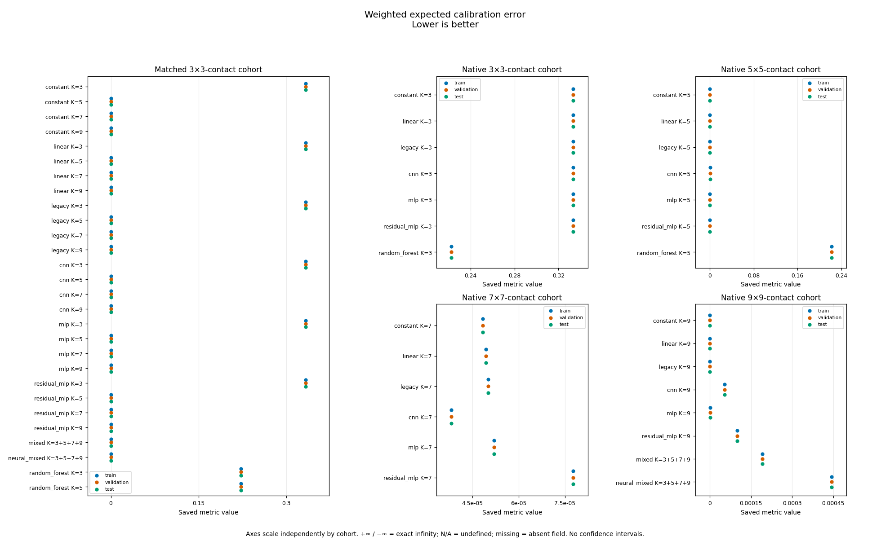

| Model | Native K | Matched train | Matched validation | Matched test | Native train | Native validation | Native test |
|---|---:|---:|---:|---:|---:|---:|---:|
| constant K=3 (`k3_constant_00_lr0.003_constant`) | 3 | 0.33333333 | 0.33333333 | 0.33333333 | 0.33333333 | 0.33333333 | 0.33333333 |
| constant K=5 (`k5_constant_00_lr0.003_constant`) | 5 | 9.1413657e-05 | 9.1413657e-05 | 9.1413657e-05 | 9.1413657e-05 | 9.1413657e-05 | 9.1413657e-05 |
| constant K=7 (`k7_constant_00_lr0.003_constant`) | 7 | 4.8319499e-05 | 4.8319499e-05 | 4.8319499e-05 | 4.8319499e-05 | 4.8319499e-05 | 4.8319499e-05 |
| constant K=9 (`k9_constant_00_lr0.003_constant`) | 9 | 1.9868215e-08 | 1.9868215e-08 | 1.9868215e-08 | 1.9868215e-08 | 1.9868215e-08 | 1.9868215e-08 |
| linear K=3 (`k3_linear_01_lr0.003_constant`) | 3 | 0.33333333 | 0.33333333 | 0.33333333 | 0.33333333 | 0.33333333 | 0.33333333 |
| linear K=5 (`k5_linear_01_lr0.003_constant`) | 5 | 9.1095765e-05 | 9.1095765e-05 | 9.1095765e-05 | 9.1095765e-05 | 9.1095765e-05 | 9.1095765e-05 |
| linear K=7 (`k7_linear_01_lr0.003_constant`) | 7 | 4.9332778e-05 | 4.9332778e-05 | 4.9332778e-05 | 4.9332778e-05 | 4.9332778e-05 | 4.9332778e-05 |
| linear K=9 (`k9_linear_01_lr0.003_constant`) | 9 | 4.9670537e-07 | 4.9670537e-07 | 4.9670537e-07 | 4.9670537e-07 | 4.9670537e-07 | 4.9670537e-07 |
| legacy K=3 (`k3_legacy_02_lr0.003_constant`) | 3 | 0.33333333 | 0.33333333 | 0.33333333 | 0.33333333 | 0.33333333 | 0.33333333 |
| legacy K=5 (`k5_legacy_02_lr0.003_constant`) | 5 | 9.3857447e-05 | 9.3857447e-05 | 9.3857447e-05 | 9.3857447e-05 | 9.3857447e-05 | 9.3857447e-05 |
| legacy K=7 (`k7_legacy_02_lr0.003_constant`) | 7 | 5.0107638e-05 | 5.0107638e-05 | 5.0107638e-05 | 5.0107638e-05 | 5.0107638e-05 | 5.0107638e-05 |
| legacy K=9 (`k9_legacy_02_lr0.003_constant`) | 9 | 4.9670537e-07 | 4.9670537e-07 | 4.9670537e-07 | 4.9670537e-07 | 4.9670537e-07 | 4.9670537e-07 |
| cnn K=3 (`k3_cnn_03_lr0.003_constant`) | 3 | 0.33333333 | 0.33333333 | 0.33333333 | 0.33333333 | 0.33333333 | 0.33333333 |
| cnn K=5 (`k5_cnn_03_lr0.003_constant`) | 5 | 0.00036929051 | 0.00036929051 | 0.00036929051 | 0.00036929051 | 0.00036929051 | 0.00036929051 |
| cnn K=7 (`k7_cnn_03_lr0.003_constant`) | 7 | 3.8186709e-05 | 3.8186709e-05 | 3.8186709e-05 | 3.8186709e-05 | 3.8186709e-05 | 3.8186709e-05 |
| cnn K=9 (`k9_cnn_03_lr0.003_constant`) | 9 | 5.3266684e-05 | 5.3266684e-05 | 5.3266684e-05 | 5.3266684e-05 | 5.3266684e-05 | 5.3266684e-05 |
| mlp K=3 (`k3_mlp_04_lr0.003_constant`) | 3 | 0.33333333 | 0.33333333 | 0.33333333 | 0.33333333 | 0.33333333 | 0.33333333 |
| mlp K=5 (`k5_mlp_05_lr0.003_constant`) | 5 | 8.7340673e-05 | 8.7340673e-05 | 8.7340673e-05 | 8.7340673e-05 | 8.7340673e-05 | 8.7340673e-05 |
| mlp K=7 (`k7_mlp_04_lr0.003_constant`) | 7 | 5.2074591e-05 | 5.2074591e-05 | 5.2074591e-05 | 5.2074591e-05 | 5.2074591e-05 | 5.2074591e-05 |
| mlp K=9 (`k9_mlp_04_lr0.003_constant`) | 9 | 8.5433324e-07 | 8.5433324e-07 | 8.5433324e-07 | 8.5433324e-07 | 8.5433324e-07 | 8.5433324e-07 |
| residual_mlp K=3 (`k3_residual_mlp_08_lr0.003_constant`) | 3 | 0.33333333 | 0.33333333 | 0.33333333 | 0.33333333 | 0.33333333 | 0.33333333 |
| residual_mlp K=5 (`k5_residual_mlp_09_lr0.003_constant`) | 5 | 0.00014098485 | 0.00014098485 | 0.00014098485 | 0.00014098485 | 0.00014098485 | 0.00014098485 |
| residual_mlp K=7 (`k7_residual_mlp_08_lr0.003_constant`) | 7 | 7.7625116e-05 | 7.7625116e-05 | 7.7625116e-05 | 7.7625116e-05 | 7.7625116e-05 | 7.7625116e-05 |
| residual_mlp K=9 (`k9_residual_mlp_08_lr0.003_constant`) | 9 | 0.00010023514 | 0.00010023514 | 0.00010023514 | 0.00010023514 | 0.00010023514 | 0.00010023514 |
| mixed K=3+5+7+9 (`mixed_3_5_7_9_00_lr0.003_constant`) | 9 | 0.00019212564 | 0.00019212564 | 0.00019212564 | 0.00019212564 | 0.00019212564 | 0.00019212564 |
| neural_mixed K=3+5+7+9 (`neural_mixed_3_5_7_9_00_lr0.003_constant`) | 9 | 0.00044413408 | 0.00044413408 | 0.00044413408 | 0.00044413408 | 0.00044413408 | 0.00044413408 |
| random_forest K=3 (`rf3_depth8`) | 3 | 0.22222222 | 0.22222222 | 0.22222222 | 0.22222222 | 0.22222222 | 0.22222222 |
| random_forest K=5 (`rf5_depth8`) | 5 | 0.22222222 | 0.22222222 | 0.22222222 | 0.22222222 | 0.22222222 | 0.22222222 |

### Cohort and support diagnostics

#### mean probability

Saved field: `mean_probability`. Descriptive; no universal better direction.

| Model | Native K | Matched train | Matched validation | Matched test | Native train | Native validation | Native test |
|---|---:|---:|---:|---:|---:|---:|---:|
| constant K=3 (`k3_constant_00_lr0.003_constant`) | 3 | 1 | 1 | 1 | 1 | 1 | 1 |
| constant K=5 (`k5_constant_00_lr0.003_constant`) | 5 | 0.66657525 | 0.66657525 | 0.66657525 | 0.66657525 | 0.66657525 | 0.66657525 |
| constant K=7 (`k7_constant_00_lr0.003_constant`) | 7 | 0.66661835 | 0.66661835 | 0.66661835 | 0.66661835 | 0.66661835 | 0.66661835 |
| constant K=9 (`k9_constant_00_lr0.003_constant`) | 9 | 0.66666669 | 0.66666669 | 0.66666669 | 0.66666669 | 0.66666669 | 0.66666669 |
| linear K=3 (`k3_linear_01_lr0.003_constant`) | 3 | 1 | 1 | 1 | 1 | 1 | 1 |
| linear K=5 (`k5_linear_01_lr0.003_constant`) | 5 | 0.66657557 | 0.66657557 | 0.66657557 | 0.66657557 | 0.66657557 | 0.66657557 |
| linear K=7 (`k7_linear_01_lr0.003_constant`) | 7 | 0.66661733 | 0.66661733 | 0.66661733 | 0.66661733 | 0.66661733 | 0.66661733 |
| linear K=9 (`k9_linear_01_lr0.003_constant`) | 9 | 0.66666716 | 0.66666716 | 0.66666716 | 0.66666716 | 0.66666716 | 0.66666716 |
| legacy K=3 (`k3_legacy_02_lr0.003_constant`) | 3 | 1 | 1 | 1 | 1 | 1 | 1 |
| legacy K=5 (`k5_legacy_02_lr0.003_constant`) | 5 | 0.66657281 | 0.66657281 | 0.66657281 | 0.66657281 | 0.66657281 | 0.66657281 |
| legacy K=7 (`k7_legacy_02_lr0.003_constant`) | 7 | 0.66661656 | 0.66661656 | 0.66661656 | 0.66661656 | 0.66661656 | 0.66661656 |
| legacy K=9 (`k9_legacy_02_lr0.003_constant`) | 9 | 0.66666716 | 0.66666716 | 0.66666716 | 0.66666716 | 0.66666716 | 0.66666716 |
| cnn K=3 (`k3_cnn_03_lr0.003_constant`) | 3 | 1 | 1 | 1 | 1 | 1 | 1 |
| cnn K=5 (`k5_cnn_03_lr0.003_constant`) | 5 | 0.66629738 | 0.66629738 | 0.66629738 | 0.66629738 | 0.66629738 | 0.66629738 |
| cnn K=7 (`k7_cnn_03_lr0.003_constant`) | 7 | 0.66662848 | 0.66662848 | 0.66662848 | 0.66662848 | 0.66662848 | 0.66662848 |
| cnn K=9 (`k9_cnn_03_lr0.003_constant`) | 9 | 0.6666134 | 0.6666134 | 0.6666134 | 0.6666134 | 0.6666134 | 0.6666134 |
| mlp K=3 (`k3_mlp_04_lr0.003_constant`) | 3 | 1 | 1 | 1 | 1 | 1 | 1 |
| mlp K=5 (`k5_mlp_05_lr0.003_constant`) | 5 | 0.66675401 | 0.66675401 | 0.66675401 | 0.66675401 | 0.66675401 | 0.66675401 |
| mlp K=7 (`k7_mlp_04_lr0.003_constant`) | 7 | 0.66661459 | 0.66661459 | 0.66661459 | 0.66661459 | 0.66661459 | 0.66661459 |
| mlp K=9 (`k9_mlp_04_lr0.003_constant`) | 9 | 0.66666752 | 0.66666752 | 0.66666752 | 0.66666752 | 0.66666752 | 0.66666752 |
| residual_mlp K=3 (`k3_residual_mlp_08_lr0.003_constant`) | 3 | 1 | 1 | 1 | 1 | 1 | 1 |
| residual_mlp K=5 (`k5_residual_mlp_09_lr0.003_constant`) | 5 | 0.66680765 | 0.66680765 | 0.66680765 | 0.66680765 | 0.66680765 | 0.66680765 |
| residual_mlp K=7 (`k7_residual_mlp_08_lr0.003_constant`) | 7 | 0.66674429 | 0.66674429 | 0.66674429 | 0.66674429 | 0.66674429 | 0.66674429 |
| residual_mlp K=9 (`k9_residual_mlp_08_lr0.003_constant`) | 9 | 0.66656643 | 0.66656643 | 0.66656643 | 0.66656643 | 0.66656643 | 0.66656643 |
| mixed K=3+5+7+9 (`mixed_3_5_7_9_00_lr0.003_constant`) | 9 | 0.66685879 | 0.66685879 | 0.66685879 | 0.66685879 | 0.66685879 | 0.66685879 |
| neural_mixed K=3+5+7+9 (`neural_mixed_3_5_7_9_00_lr0.003_constant`) | 9 | 0.6671108 | 0.6671108 | 0.6671108 | 0.6671108 | 0.6671108 | 0.6671108 |
| random_forest K=3 (`rf3_depth8`) | 3 | 0.44444444 | 0.44444444 | 0.44444444 | 0.44444444 | 0.44444444 | 0.44444444 |
| random_forest K=5 (`rf5_depth8`) | 5 | 0.44444444 | 0.44444444 | 0.44444444 | 0.44444444 | 0.44444444 | 0.44444444 |

#### positive population weight

Saved field: `positive_population_weight`. Descriptive; no universal better direction.

| Model | Native K | Matched train | Matched validation | Matched test | Native train | Native validation | Native test |
|---|---:|---:|---:|---:|---:|---:|---:|
| constant K=3 (`k3_constant_00_lr0.003_constant`) | 3 | 2 | 2 | 2 | 2 | 2 | 2 |
| constant K=5 (`k5_constant_00_lr0.003_constant`) | 5 | 2 | 2 | 2 | 2 | 2 | 2 |
| constant K=7 (`k7_constant_00_lr0.003_constant`) | 7 | 2 | 2 | 2 | 2 | 2 | 2 |
| constant K=9 (`k9_constant_00_lr0.003_constant`) | 9 | 2 | 2 | 2 | 2 | 2 | 2 |
| linear K=3 (`k3_linear_01_lr0.003_constant`) | 3 | 2 | 2 | 2 | 2 | 2 | 2 |
| linear K=5 (`k5_linear_01_lr0.003_constant`) | 5 | 2 | 2 | 2 | 2 | 2 | 2 |
| linear K=7 (`k7_linear_01_lr0.003_constant`) | 7 | 2 | 2 | 2 | 2 | 2 | 2 |
| linear K=9 (`k9_linear_01_lr0.003_constant`) | 9 | 2 | 2 | 2 | 2 | 2 | 2 |
| legacy K=3 (`k3_legacy_02_lr0.003_constant`) | 3 | 2 | 2 | 2 | 2 | 2 | 2 |
| legacy K=5 (`k5_legacy_02_lr0.003_constant`) | 5 | 2 | 2 | 2 | 2 | 2 | 2 |
| legacy K=7 (`k7_legacy_02_lr0.003_constant`) | 7 | 2 | 2 | 2 | 2 | 2 | 2 |
| legacy K=9 (`k9_legacy_02_lr0.003_constant`) | 9 | 2 | 2 | 2 | 2 | 2 | 2 |
| cnn K=3 (`k3_cnn_03_lr0.003_constant`) | 3 | 2 | 2 | 2 | 2 | 2 | 2 |
| cnn K=5 (`k5_cnn_03_lr0.003_constant`) | 5 | 2 | 2 | 2 | 2 | 2 | 2 |
| cnn K=7 (`k7_cnn_03_lr0.003_constant`) | 7 | 2 | 2 | 2 | 2 | 2 | 2 |
| cnn K=9 (`k9_cnn_03_lr0.003_constant`) | 9 | 2 | 2 | 2 | 2 | 2 | 2 |
| mlp K=3 (`k3_mlp_04_lr0.003_constant`) | 3 | 2 | 2 | 2 | 2 | 2 | 2 |
| mlp K=5 (`k5_mlp_05_lr0.003_constant`) | 5 | 2 | 2 | 2 | 2 | 2 | 2 |
| mlp K=7 (`k7_mlp_04_lr0.003_constant`) | 7 | 2 | 2 | 2 | 2 | 2 | 2 |
| mlp K=9 (`k9_mlp_04_lr0.003_constant`) | 9 | 2 | 2 | 2 | 2 | 2 | 2 |
| residual_mlp K=3 (`k3_residual_mlp_08_lr0.003_constant`) | 3 | 2 | 2 | 2 | 2 | 2 | 2 |
| residual_mlp K=5 (`k5_residual_mlp_09_lr0.003_constant`) | 5 | 2 | 2 | 2 | 2 | 2 | 2 |
| residual_mlp K=7 (`k7_residual_mlp_08_lr0.003_constant`) | 7 | 2 | 2 | 2 | 2 | 2 | 2 |
| residual_mlp K=9 (`k9_residual_mlp_08_lr0.003_constant`) | 9 | 2 | 2 | 2 | 2 | 2 | 2 |
| mixed K=3+5+7+9 (`mixed_3_5_7_9_00_lr0.003_constant`) | 9 | 2 | 2 | 2 | 2 | 2 | 2 |
| neural_mixed K=3+5+7+9 (`neural_mixed_3_5_7_9_00_lr0.003_constant`) | 9 | 2 | 2 | 2 | 2 | 2 | 2 |
| random_forest K=3 (`rf3_depth8`) | 3 | 2 | 2 | 2 | 2 | 2 | 2 |
| random_forest K=5 (`rf5_depth8`) | 5 | 2 | 2 | 2 | 2 | 2 | 2 |

#### positive sample count

Saved field: `positive_sample_count`. Descriptive; no universal better direction.

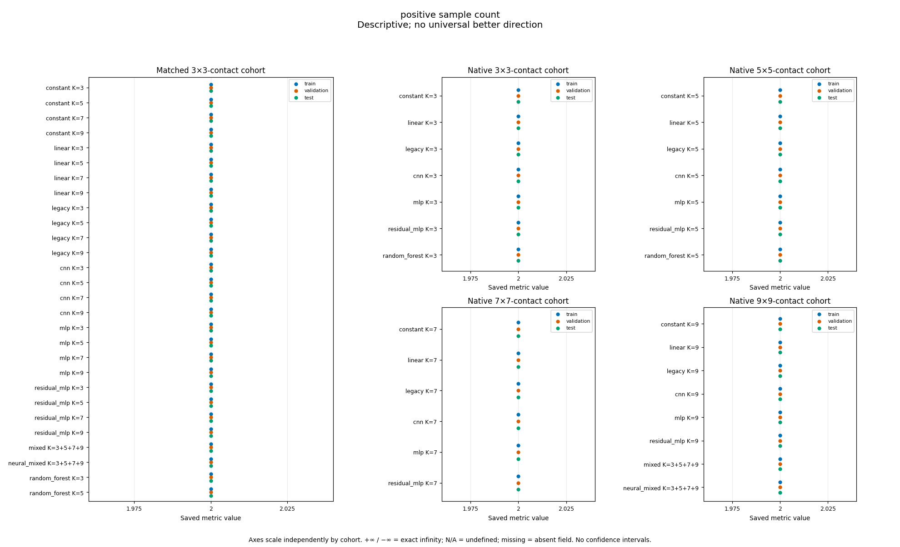

| Model | Native K | Matched train | Matched validation | Matched test | Native train | Native validation | Native test |
|---|---:|---:|---:|---:|---:|---:|---:|
| constant K=3 (`k3_constant_00_lr0.003_constant`) | 3 | 2 | 2 | 2 | 2 | 2 | 2 |
| constant K=5 (`k5_constant_00_lr0.003_constant`) | 5 | 2 | 2 | 2 | 2 | 2 | 2 |
| constant K=7 (`k7_constant_00_lr0.003_constant`) | 7 | 2 | 2 | 2 | 2 | 2 | 2 |
| constant K=9 (`k9_constant_00_lr0.003_constant`) | 9 | 2 | 2 | 2 | 2 | 2 | 2 |
| linear K=3 (`k3_linear_01_lr0.003_constant`) | 3 | 2 | 2 | 2 | 2 | 2 | 2 |
| linear K=5 (`k5_linear_01_lr0.003_constant`) | 5 | 2 | 2 | 2 | 2 | 2 | 2 |
| linear K=7 (`k7_linear_01_lr0.003_constant`) | 7 | 2 | 2 | 2 | 2 | 2 | 2 |
| linear K=9 (`k9_linear_01_lr0.003_constant`) | 9 | 2 | 2 | 2 | 2 | 2 | 2 |
| legacy K=3 (`k3_legacy_02_lr0.003_constant`) | 3 | 2 | 2 | 2 | 2 | 2 | 2 |
| legacy K=5 (`k5_legacy_02_lr0.003_constant`) | 5 | 2 | 2 | 2 | 2 | 2 | 2 |
| legacy K=7 (`k7_legacy_02_lr0.003_constant`) | 7 | 2 | 2 | 2 | 2 | 2 | 2 |
| legacy K=9 (`k9_legacy_02_lr0.003_constant`) | 9 | 2 | 2 | 2 | 2 | 2 | 2 |
| cnn K=3 (`k3_cnn_03_lr0.003_constant`) | 3 | 2 | 2 | 2 | 2 | 2 | 2 |
| cnn K=5 (`k5_cnn_03_lr0.003_constant`) | 5 | 2 | 2 | 2 | 2 | 2 | 2 |
| cnn K=7 (`k7_cnn_03_lr0.003_constant`) | 7 | 2 | 2 | 2 | 2 | 2 | 2 |
| cnn K=9 (`k9_cnn_03_lr0.003_constant`) | 9 | 2 | 2 | 2 | 2 | 2 | 2 |
| mlp K=3 (`k3_mlp_04_lr0.003_constant`) | 3 | 2 | 2 | 2 | 2 | 2 | 2 |
| mlp K=5 (`k5_mlp_05_lr0.003_constant`) | 5 | 2 | 2 | 2 | 2 | 2 | 2 |
| mlp K=7 (`k7_mlp_04_lr0.003_constant`) | 7 | 2 | 2 | 2 | 2 | 2 | 2 |
| mlp K=9 (`k9_mlp_04_lr0.003_constant`) | 9 | 2 | 2 | 2 | 2 | 2 | 2 |
| residual_mlp K=3 (`k3_residual_mlp_08_lr0.003_constant`) | 3 | 2 | 2 | 2 | 2 | 2 | 2 |
| residual_mlp K=5 (`k5_residual_mlp_09_lr0.003_constant`) | 5 | 2 | 2 | 2 | 2 | 2 | 2 |
| residual_mlp K=7 (`k7_residual_mlp_08_lr0.003_constant`) | 7 | 2 | 2 | 2 | 2 | 2 | 2 |
| residual_mlp K=9 (`k9_residual_mlp_08_lr0.003_constant`) | 9 | 2 | 2 | 2 | 2 | 2 | 2 |
| mixed K=3+5+7+9 (`mixed_3_5_7_9_00_lr0.003_constant`) | 9 | 2 | 2 | 2 | 2 | 2 | 2 |
| neural_mixed K=3+5+7+9 (`neural_mixed_3_5_7_9_00_lr0.003_constant`) | 9 | 2 | 2 | 2 | 2 | 2 | 2 |
| random_forest K=3 (`rf3_depth8`) | 3 | 2 | 2 | 2 | 2 | 2 | 2 |
| random_forest K=5 (`rf5_depth8`) | 5 | 2 | 2 | 2 | 2 | 2 | 2 |

#### represented population weight

Saved field: `represented_population_weight`. Descriptive; no universal better direction.

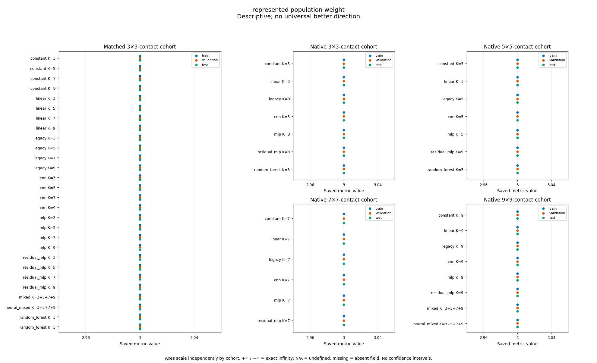

| Model | Native K | Matched train | Matched validation | Matched test | Native train | Native validation | Native test |
|---|---:|---:|---:|---:|---:|---:|---:|
| constant K=3 (`k3_constant_00_lr0.003_constant`) | 3 | 3 | 3 | 3 | 3 | 3 | 3 |
| constant K=5 (`k5_constant_00_lr0.003_constant`) | 5 | 3 | 3 | 3 | 3 | 3 | 3 |
| constant K=7 (`k7_constant_00_lr0.003_constant`) | 7 | 3 | 3 | 3 | 3 | 3 | 3 |
| constant K=9 (`k9_constant_00_lr0.003_constant`) | 9 | 3 | 3 | 3 | 3 | 3 | 3 |
| linear K=3 (`k3_linear_01_lr0.003_constant`) | 3 | 3 | 3 | 3 | 3 | 3 | 3 |
| linear K=5 (`k5_linear_01_lr0.003_constant`) | 5 | 3 | 3 | 3 | 3 | 3 | 3 |
| linear K=7 (`k7_linear_01_lr0.003_constant`) | 7 | 3 | 3 | 3 | 3 | 3 | 3 |
| linear K=9 (`k9_linear_01_lr0.003_constant`) | 9 | 3 | 3 | 3 | 3 | 3 | 3 |
| legacy K=3 (`k3_legacy_02_lr0.003_constant`) | 3 | 3 | 3 | 3 | 3 | 3 | 3 |
| legacy K=5 (`k5_legacy_02_lr0.003_constant`) | 5 | 3 | 3 | 3 | 3 | 3 | 3 |
| legacy K=7 (`k7_legacy_02_lr0.003_constant`) | 7 | 3 | 3 | 3 | 3 | 3 | 3 |
| legacy K=9 (`k9_legacy_02_lr0.003_constant`) | 9 | 3 | 3 | 3 | 3 | 3 | 3 |
| cnn K=3 (`k3_cnn_03_lr0.003_constant`) | 3 | 3 | 3 | 3 | 3 | 3 | 3 |
| cnn K=5 (`k5_cnn_03_lr0.003_constant`) | 5 | 3 | 3 | 3 | 3 | 3 | 3 |
| cnn K=7 (`k7_cnn_03_lr0.003_constant`) | 7 | 3 | 3 | 3 | 3 | 3 | 3 |
| cnn K=9 (`k9_cnn_03_lr0.003_constant`) | 9 | 3 | 3 | 3 | 3 | 3 | 3 |
| mlp K=3 (`k3_mlp_04_lr0.003_constant`) | 3 | 3 | 3 | 3 | 3 | 3 | 3 |
| mlp K=5 (`k5_mlp_05_lr0.003_constant`) | 5 | 3 | 3 | 3 | 3 | 3 | 3 |
| mlp K=7 (`k7_mlp_04_lr0.003_constant`) | 7 | 3 | 3 | 3 | 3 | 3 | 3 |
| mlp K=9 (`k9_mlp_04_lr0.003_constant`) | 9 | 3 | 3 | 3 | 3 | 3 | 3 |
| residual_mlp K=3 (`k3_residual_mlp_08_lr0.003_constant`) | 3 | 3 | 3 | 3 | 3 | 3 | 3 |
| residual_mlp K=5 (`k5_residual_mlp_09_lr0.003_constant`) | 5 | 3 | 3 | 3 | 3 | 3 | 3 |
| residual_mlp K=7 (`k7_residual_mlp_08_lr0.003_constant`) | 7 | 3 | 3 | 3 | 3 | 3 | 3 |
| residual_mlp K=9 (`k9_residual_mlp_08_lr0.003_constant`) | 9 | 3 | 3 | 3 | 3 | 3 | 3 |
| mixed K=3+5+7+9 (`mixed_3_5_7_9_00_lr0.003_constant`) | 9 | 3 | 3 | 3 | 3 | 3 | 3 |
| neural_mixed K=3+5+7+9 (`neural_mixed_3_5_7_9_00_lr0.003_constant`) | 9 | 3 | 3 | 3 | 3 | 3 | 3 |
| random_forest K=3 (`rf3_depth8`) | 3 | 3 | 3 | 3 | 3 | 3 | 3 |
| random_forest K=5 (`rf5_depth8`) | 5 | 3 | 3 | 3 | 3 | 3 | 3 |

#### sample count

Saved field: `sample_count`. Descriptive; no universal better direction.

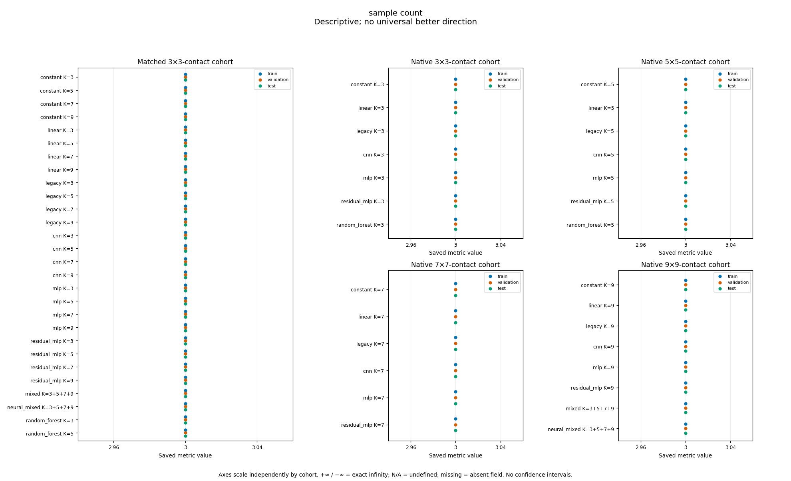

| Model | Native K | Matched train | Matched validation | Matched test | Native train | Native validation | Native test |
|---|---:|---:|---:|---:|---:|---:|---:|
| constant K=3 (`k3_constant_00_lr0.003_constant`) | 3 | 3 | 3 | 3 | 3 | 3 | 3 |
| constant K=5 (`k5_constant_00_lr0.003_constant`) | 5 | 3 | 3 | 3 | 3 | 3 | 3 |
| constant K=7 (`k7_constant_00_lr0.003_constant`) | 7 | 3 | 3 | 3 | 3 | 3 | 3 |
| constant K=9 (`k9_constant_00_lr0.003_constant`) | 9 | 3 | 3 | 3 | 3 | 3 | 3 |
| linear K=3 (`k3_linear_01_lr0.003_constant`) | 3 | 3 | 3 | 3 | 3 | 3 | 3 |
| linear K=5 (`k5_linear_01_lr0.003_constant`) | 5 | 3 | 3 | 3 | 3 | 3 | 3 |
| linear K=7 (`k7_linear_01_lr0.003_constant`) | 7 | 3 | 3 | 3 | 3 | 3 | 3 |
| linear K=9 (`k9_linear_01_lr0.003_constant`) | 9 | 3 | 3 | 3 | 3 | 3 | 3 |
| legacy K=3 (`k3_legacy_02_lr0.003_constant`) | 3 | 3 | 3 | 3 | 3 | 3 | 3 |
| legacy K=5 (`k5_legacy_02_lr0.003_constant`) | 5 | 3 | 3 | 3 | 3 | 3 | 3 |
| legacy K=7 (`k7_legacy_02_lr0.003_constant`) | 7 | 3 | 3 | 3 | 3 | 3 | 3 |
| legacy K=9 (`k9_legacy_02_lr0.003_constant`) | 9 | 3 | 3 | 3 | 3 | 3 | 3 |
| cnn K=3 (`k3_cnn_03_lr0.003_constant`) | 3 | 3 | 3 | 3 | 3 | 3 | 3 |
| cnn K=5 (`k5_cnn_03_lr0.003_constant`) | 5 | 3 | 3 | 3 | 3 | 3 | 3 |
| cnn K=7 (`k7_cnn_03_lr0.003_constant`) | 7 | 3 | 3 | 3 | 3 | 3 | 3 |
| cnn K=9 (`k9_cnn_03_lr0.003_constant`) | 9 | 3 | 3 | 3 | 3 | 3 | 3 |
| mlp K=3 (`k3_mlp_04_lr0.003_constant`) | 3 | 3 | 3 | 3 | 3 | 3 | 3 |
| mlp K=5 (`k5_mlp_05_lr0.003_constant`) | 5 | 3 | 3 | 3 | 3 | 3 | 3 |
| mlp K=7 (`k7_mlp_04_lr0.003_constant`) | 7 | 3 | 3 | 3 | 3 | 3 | 3 |
| mlp K=9 (`k9_mlp_04_lr0.003_constant`) | 9 | 3 | 3 | 3 | 3 | 3 | 3 |
| residual_mlp K=3 (`k3_residual_mlp_08_lr0.003_constant`) | 3 | 3 | 3 | 3 | 3 | 3 | 3 |
| residual_mlp K=5 (`k5_residual_mlp_09_lr0.003_constant`) | 5 | 3 | 3 | 3 | 3 | 3 | 3 |
| residual_mlp K=7 (`k7_residual_mlp_08_lr0.003_constant`) | 7 | 3 | 3 | 3 | 3 | 3 | 3 |
| residual_mlp K=9 (`k9_residual_mlp_08_lr0.003_constant`) | 9 | 3 | 3 | 3 | 3 | 3 | 3 |
| mixed K=3+5+7+9 (`mixed_3_5_7_9_00_lr0.003_constant`) | 9 | 3 | 3 | 3 | 3 | 3 | 3 |
| neural_mixed K=3+5+7+9 (`neural_mixed_3_5_7_9_00_lr0.003_constant`) | 9 | 3 | 3 | 3 | 3 | 3 | 3 |
| random_forest K=3 (`rf3_depth8`) | 3 | 3 | 3 | 3 | 3 | 3 | 3 |
| random_forest K=5 (`rf5_depth8`) | 5 | 3 | 3 | 3 | 3 | 3 | 3 |

#### sample positive fraction

Saved field: `sample_positive_fraction`. Descriptive; no universal better direction.

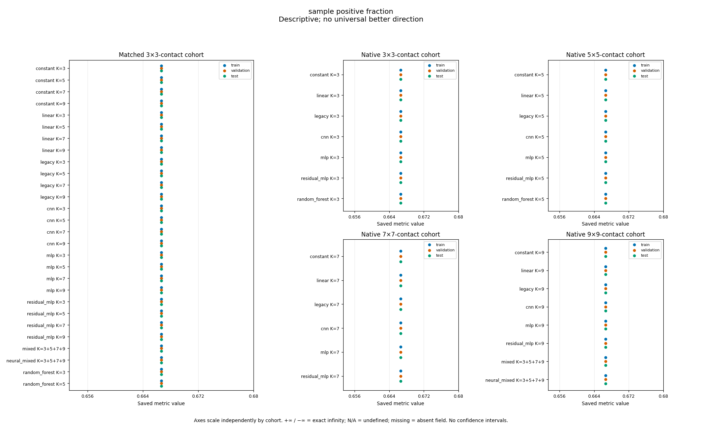

| Model | Native K | Matched train | Matched validation | Matched test | Native train | Native validation | Native test |
|---|---:|---:|---:|---:|---:|---:|---:|
| constant K=3 (`k3_constant_00_lr0.003_constant`) | 3 | 0.66666667 | 0.66666667 | 0.66666667 | 0.66666667 | 0.66666667 | 0.66666667 |
| constant K=5 (`k5_constant_00_lr0.003_constant`) | 5 | 0.66666667 | 0.66666667 | 0.66666667 | 0.66666667 | 0.66666667 | 0.66666667 |
| constant K=7 (`k7_constant_00_lr0.003_constant`) | 7 | 0.66666667 | 0.66666667 | 0.66666667 | 0.66666667 | 0.66666667 | 0.66666667 |
| constant K=9 (`k9_constant_00_lr0.003_constant`) | 9 | 0.66666667 | 0.66666667 | 0.66666667 | 0.66666667 | 0.66666667 | 0.66666667 |
| linear K=3 (`k3_linear_01_lr0.003_constant`) | 3 | 0.66666667 | 0.66666667 | 0.66666667 | 0.66666667 | 0.66666667 | 0.66666667 |
| linear K=5 (`k5_linear_01_lr0.003_constant`) | 5 | 0.66666667 | 0.66666667 | 0.66666667 | 0.66666667 | 0.66666667 | 0.66666667 |
| linear K=7 (`k7_linear_01_lr0.003_constant`) | 7 | 0.66666667 | 0.66666667 | 0.66666667 | 0.66666667 | 0.66666667 | 0.66666667 |
| linear K=9 (`k9_linear_01_lr0.003_constant`) | 9 | 0.66666667 | 0.66666667 | 0.66666667 | 0.66666667 | 0.66666667 | 0.66666667 |
| legacy K=3 (`k3_legacy_02_lr0.003_constant`) | 3 | 0.66666667 | 0.66666667 | 0.66666667 | 0.66666667 | 0.66666667 | 0.66666667 |
| legacy K=5 (`k5_legacy_02_lr0.003_constant`) | 5 | 0.66666667 | 0.66666667 | 0.66666667 | 0.66666667 | 0.66666667 | 0.66666667 |
| legacy K=7 (`k7_legacy_02_lr0.003_constant`) | 7 | 0.66666667 | 0.66666667 | 0.66666667 | 0.66666667 | 0.66666667 | 0.66666667 |
| legacy K=9 (`k9_legacy_02_lr0.003_constant`) | 9 | 0.66666667 | 0.66666667 | 0.66666667 | 0.66666667 | 0.66666667 | 0.66666667 |
| cnn K=3 (`k3_cnn_03_lr0.003_constant`) | 3 | 0.66666667 | 0.66666667 | 0.66666667 | 0.66666667 | 0.66666667 | 0.66666667 |
| cnn K=5 (`k5_cnn_03_lr0.003_constant`) | 5 | 0.66666667 | 0.66666667 | 0.66666667 | 0.66666667 | 0.66666667 | 0.66666667 |
| cnn K=7 (`k7_cnn_03_lr0.003_constant`) | 7 | 0.66666667 | 0.66666667 | 0.66666667 | 0.66666667 | 0.66666667 | 0.66666667 |
| cnn K=9 (`k9_cnn_03_lr0.003_constant`) | 9 | 0.66666667 | 0.66666667 | 0.66666667 | 0.66666667 | 0.66666667 | 0.66666667 |
| mlp K=3 (`k3_mlp_04_lr0.003_constant`) | 3 | 0.66666667 | 0.66666667 | 0.66666667 | 0.66666667 | 0.66666667 | 0.66666667 |
| mlp K=5 (`k5_mlp_05_lr0.003_constant`) | 5 | 0.66666667 | 0.66666667 | 0.66666667 | 0.66666667 | 0.66666667 | 0.66666667 |
| mlp K=7 (`k7_mlp_04_lr0.003_constant`) | 7 | 0.66666667 | 0.66666667 | 0.66666667 | 0.66666667 | 0.66666667 | 0.66666667 |
| mlp K=9 (`k9_mlp_04_lr0.003_constant`) | 9 | 0.66666667 | 0.66666667 | 0.66666667 | 0.66666667 | 0.66666667 | 0.66666667 |
| residual_mlp K=3 (`k3_residual_mlp_08_lr0.003_constant`) | 3 | 0.66666667 | 0.66666667 | 0.66666667 | 0.66666667 | 0.66666667 | 0.66666667 |
| residual_mlp K=5 (`k5_residual_mlp_09_lr0.003_constant`) | 5 | 0.66666667 | 0.66666667 | 0.66666667 | 0.66666667 | 0.66666667 | 0.66666667 |
| residual_mlp K=7 (`k7_residual_mlp_08_lr0.003_constant`) | 7 | 0.66666667 | 0.66666667 | 0.66666667 | 0.66666667 | 0.66666667 | 0.66666667 |
| residual_mlp K=9 (`k9_residual_mlp_08_lr0.003_constant`) | 9 | 0.66666667 | 0.66666667 | 0.66666667 | 0.66666667 | 0.66666667 | 0.66666667 |
| mixed K=3+5+7+9 (`mixed_3_5_7_9_00_lr0.003_constant`) | 9 | 0.66666667 | 0.66666667 | 0.66666667 | 0.66666667 | 0.66666667 | 0.66666667 |
| neural_mixed K=3+5+7+9 (`neural_mixed_3_5_7_9_00_lr0.003_constant`) | 9 | 0.66666667 | 0.66666667 | 0.66666667 | 0.66666667 | 0.66666667 | 0.66666667 |
| random_forest K=3 (`rf3_depth8`) | 3 | 0.66666667 | 0.66666667 | 0.66666667 | 0.66666667 | 0.66666667 | 0.66666667 |
| random_forest K=5 (`rf5_depth8`) | 5 | 0.66666667 | 0.66666667 | 0.66666667 | 0.66666667 | 0.66666667 | 0.66666667 |

#### unsupported positive population weight

Saved field: `unsupported_positive_population_weight`. Descriptive; no universal better direction.

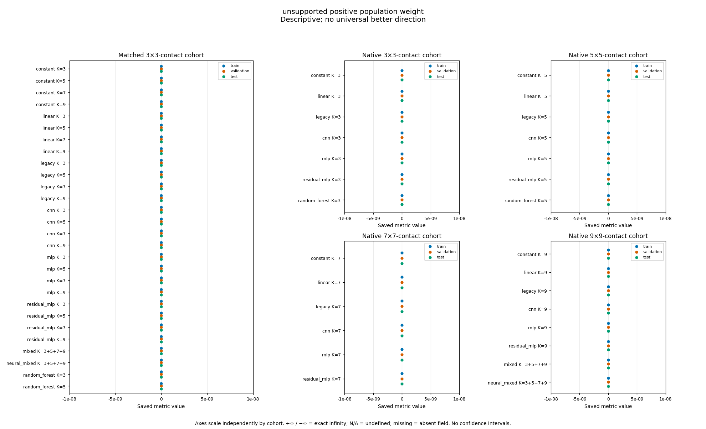

| Model | Native K | Matched train | Matched validation | Matched test | Native train | Native validation | Native test |
|---|---:|---:|---:|---:|---:|---:|---:|
| constant K=3 (`k3_constant_00_lr0.003_constant`) | 3 | 0 | 0 | 0 | 0 | 0 | 0 |
| constant K=5 (`k5_constant_00_lr0.003_constant`) | 5 | 0 | 0 | 0 | 0 | 0 | 0 |
| constant K=7 (`k7_constant_00_lr0.003_constant`) | 7 | 0 | 0 | 0 | 0 | 0 | 0 |
| constant K=9 (`k9_constant_00_lr0.003_constant`) | 9 | 0 | 0 | 0 | 0 | 0 | 0 |
| linear K=3 (`k3_linear_01_lr0.003_constant`) | 3 | 0 | 0 | 0 | 0 | 0 | 0 |
| linear K=5 (`k5_linear_01_lr0.003_constant`) | 5 | 0 | 0 | 0 | 0 | 0 | 0 |
| linear K=7 (`k7_linear_01_lr0.003_constant`) | 7 | 0 | 0 | 0 | 0 | 0 | 0 |
| linear K=9 (`k9_linear_01_lr0.003_constant`) | 9 | 0 | 0 | 0 | 0 | 0 | 0 |
| legacy K=3 (`k3_legacy_02_lr0.003_constant`) | 3 | 0 | 0 | 0 | 0 | 0 | 0 |
| legacy K=5 (`k5_legacy_02_lr0.003_constant`) | 5 | 0 | 0 | 0 | 0 | 0 | 0 |
| legacy K=7 (`k7_legacy_02_lr0.003_constant`) | 7 | 0 | 0 | 0 | 0 | 0 | 0 |
| legacy K=9 (`k9_legacy_02_lr0.003_constant`) | 9 | 0 | 0 | 0 | 0 | 0 | 0 |
| cnn K=3 (`k3_cnn_03_lr0.003_constant`) | 3 | 0 | 0 | 0 | 0 | 0 | 0 |
| cnn K=5 (`k5_cnn_03_lr0.003_constant`) | 5 | 0 | 0 | 0 | 0 | 0 | 0 |
| cnn K=7 (`k7_cnn_03_lr0.003_constant`) | 7 | 0 | 0 | 0 | 0 | 0 | 0 |
| cnn K=9 (`k9_cnn_03_lr0.003_constant`) | 9 | 0 | 0 | 0 | 0 | 0 | 0 |
| mlp K=3 (`k3_mlp_04_lr0.003_constant`) | 3 | 0 | 0 | 0 | 0 | 0 | 0 |
| mlp K=5 (`k5_mlp_05_lr0.003_constant`) | 5 | 0 | 0 | 0 | 0 | 0 | 0 |
| mlp K=7 (`k7_mlp_04_lr0.003_constant`) | 7 | 0 | 0 | 0 | 0 | 0 | 0 |
| mlp K=9 (`k9_mlp_04_lr0.003_constant`) | 9 | 0 | 0 | 0 | 0 | 0 | 0 |
| residual_mlp K=3 (`k3_residual_mlp_08_lr0.003_constant`) | 3 | 0 | 0 | 0 | 0 | 0 | 0 |
| residual_mlp K=5 (`k5_residual_mlp_09_lr0.003_constant`) | 5 | 0 | 0 | 0 | 0 | 0 | 0 |
| residual_mlp K=7 (`k7_residual_mlp_08_lr0.003_constant`) | 7 | 0 | 0 | 0 | 0 | 0 | 0 |
| residual_mlp K=9 (`k9_residual_mlp_08_lr0.003_constant`) | 9 | 0 | 0 | 0 | 0 | 0 | 0 |
| mixed K=3+5+7+9 (`mixed_3_5_7_9_00_lr0.003_constant`) | 9 | 0 | 0 | 0 | 0 | 0 | 0 |
| neural_mixed K=3+5+7+9 (`neural_mixed_3_5_7_9_00_lr0.003_constant`) | 9 | 0 | 0 | 0 | 0 | 0 | 0 |
| random_forest K=3 (`rf3_depth8`) | 3 | 0 | 0 | 0 | 0 | 0 | 0 |
| random_forest K=5 (`rf5_depth8`) | 5 | 0 | 0 | 0 | 0 | 0 | 0 |

#### unsupported positive sample count

Saved field: `unsupported_positive_sample_count`. Descriptive; no universal better direction.

| Model | Native K | Matched train | Matched validation | Matched test | Native train | Native validation | Native test |
|---|---:|---:|---:|---:|---:|---:|---:|
| constant K=3 (`k3_constant_00_lr0.003_constant`) | 3 | 0 | 0 | 0 | 0 | 0 | 0 |
| constant K=5 (`k5_constant_00_lr0.003_constant`) | 5 | 0 | 0 | 0 | 0 | 0 | 0 |
| constant K=7 (`k7_constant_00_lr0.003_constant`) | 7 | 0 | 0 | 0 | 0 | 0 | 0 |
| constant K=9 (`k9_constant_00_lr0.003_constant`) | 9 | 0 | 0 | 0 | 0 | 0 | 0 |
| linear K=3 (`k3_linear_01_lr0.003_constant`) | 3 | 0 | 0 | 0 | 0 | 0 | 0 |
| linear K=5 (`k5_linear_01_lr0.003_constant`) | 5 | 0 | 0 | 0 | 0 | 0 | 0 |
| linear K=7 (`k7_linear_01_lr0.003_constant`) | 7 | 0 | 0 | 0 | 0 | 0 | 0 |
| linear K=9 (`k9_linear_01_lr0.003_constant`) | 9 | 0 | 0 | 0 | 0 | 0 | 0 |
| legacy K=3 (`k3_legacy_02_lr0.003_constant`) | 3 | 0 | 0 | 0 | 0 | 0 | 0 |
| legacy K=5 (`k5_legacy_02_lr0.003_constant`) | 5 | 0 | 0 | 0 | 0 | 0 | 0 |
| legacy K=7 (`k7_legacy_02_lr0.003_constant`) | 7 | 0 | 0 | 0 | 0 | 0 | 0 |
| legacy K=9 (`k9_legacy_02_lr0.003_constant`) | 9 | 0 | 0 | 0 | 0 | 0 | 0 |
| cnn K=3 (`k3_cnn_03_lr0.003_constant`) | 3 | 0 | 0 | 0 | 0 | 0 | 0 |
| cnn K=5 (`k5_cnn_03_lr0.003_constant`) | 5 | 0 | 0 | 0 | 0 | 0 | 0 |
| cnn K=7 (`k7_cnn_03_lr0.003_constant`) | 7 | 0 | 0 | 0 | 0 | 0 | 0 |
| cnn K=9 (`k9_cnn_03_lr0.003_constant`) | 9 | 0 | 0 | 0 | 0 | 0 | 0 |
| mlp K=3 (`k3_mlp_04_lr0.003_constant`) | 3 | 0 | 0 | 0 | 0 | 0 | 0 |
| mlp K=5 (`k5_mlp_05_lr0.003_constant`) | 5 | 0 | 0 | 0 | 0 | 0 | 0 |
| mlp K=7 (`k7_mlp_04_lr0.003_constant`) | 7 | 0 | 0 | 0 | 0 | 0 | 0 |
| mlp K=9 (`k9_mlp_04_lr0.003_constant`) | 9 | 0 | 0 | 0 | 0 | 0 | 0 |
| residual_mlp K=3 (`k3_residual_mlp_08_lr0.003_constant`) | 3 | 0 | 0 | 0 | 0 | 0 | 0 |
| residual_mlp K=5 (`k5_residual_mlp_09_lr0.003_constant`) | 5 | 0 | 0 | 0 | 0 | 0 | 0 |
| residual_mlp K=7 (`k7_residual_mlp_08_lr0.003_constant`) | 7 | 0 | 0 | 0 | 0 | 0 | 0 |
| residual_mlp K=9 (`k9_residual_mlp_08_lr0.003_constant`) | 9 | 0 | 0 | 0 | 0 | 0 | 0 |
| mixed K=3+5+7+9 (`mixed_3_5_7_9_00_lr0.003_constant`) | 9 | 0 | 0 | 0 | 0 | 0 | 0 |
| neural_mixed K=3+5+7+9 (`neural_mixed_3_5_7_9_00_lr0.003_constant`) | 9 | 0 | 0 | 0 | 0 | 0 | 0 |
| random_forest K=3 (`rf3_depth8`) | 3 | 0 | 0 | 0 | 0 | 0 | 0 |
| random_forest K=5 (`rf5_depth8`) | 5 | 0 | 0 | 0 | 0 | 0 | 0 |

#### weighted prevalence

Saved field: `weighted_prevalence`. Descriptive; no universal better direction.

| Model | Native K | Matched train | Matched validation | Matched test | Native train | Native validation | Native test |
|---|---:|---:|---:|---:|---:|---:|---:|
| constant K=3 (`k3_constant_00_lr0.003_constant`) | 3 | 0.66666667 | 0.66666667 | 0.66666667 | 0.66666667 | 0.66666667 | 0.66666667 |
| constant K=5 (`k5_constant_00_lr0.003_constant`) | 5 | 0.66666667 | 0.66666667 | 0.66666667 | 0.66666667 | 0.66666667 | 0.66666667 |
| constant K=7 (`k7_constant_00_lr0.003_constant`) | 7 | 0.66666667 | 0.66666667 | 0.66666667 | 0.66666667 | 0.66666667 | 0.66666667 |
| constant K=9 (`k9_constant_00_lr0.003_constant`) | 9 | 0.66666667 | 0.66666667 | 0.66666667 | 0.66666667 | 0.66666667 | 0.66666667 |
| linear K=3 (`k3_linear_01_lr0.003_constant`) | 3 | 0.66666667 | 0.66666667 | 0.66666667 | 0.66666667 | 0.66666667 | 0.66666667 |
| linear K=5 (`k5_linear_01_lr0.003_constant`) | 5 | 0.66666667 | 0.66666667 | 0.66666667 | 0.66666667 | 0.66666667 | 0.66666667 |
| linear K=7 (`k7_linear_01_lr0.003_constant`) | 7 | 0.66666667 | 0.66666667 | 0.66666667 | 0.66666667 | 0.66666667 | 0.66666667 |
| linear K=9 (`k9_linear_01_lr0.003_constant`) | 9 | 0.66666667 | 0.66666667 | 0.66666667 | 0.66666667 | 0.66666667 | 0.66666667 |
| legacy K=3 (`k3_legacy_02_lr0.003_constant`) | 3 | 0.66666667 | 0.66666667 | 0.66666667 | 0.66666667 | 0.66666667 | 0.66666667 |
| legacy K=5 (`k5_legacy_02_lr0.003_constant`) | 5 | 0.66666667 | 0.66666667 | 0.66666667 | 0.66666667 | 0.66666667 | 0.66666667 |
| legacy K=7 (`k7_legacy_02_lr0.003_constant`) | 7 | 0.66666667 | 0.66666667 | 0.66666667 | 0.66666667 | 0.66666667 | 0.66666667 |
| legacy K=9 (`k9_legacy_02_lr0.003_constant`) | 9 | 0.66666667 | 0.66666667 | 0.66666667 | 0.66666667 | 0.66666667 | 0.66666667 |
| cnn K=3 (`k3_cnn_03_lr0.003_constant`) | 3 | 0.66666667 | 0.66666667 | 0.66666667 | 0.66666667 | 0.66666667 | 0.66666667 |
| cnn K=5 (`k5_cnn_03_lr0.003_constant`) | 5 | 0.66666667 | 0.66666667 | 0.66666667 | 0.66666667 | 0.66666667 | 0.66666667 |
| cnn K=7 (`k7_cnn_03_lr0.003_constant`) | 7 | 0.66666667 | 0.66666667 | 0.66666667 | 0.66666667 | 0.66666667 | 0.66666667 |
| cnn K=9 (`k9_cnn_03_lr0.003_constant`) | 9 | 0.66666667 | 0.66666667 | 0.66666667 | 0.66666667 | 0.66666667 | 0.66666667 |
| mlp K=3 (`k3_mlp_04_lr0.003_constant`) | 3 | 0.66666667 | 0.66666667 | 0.66666667 | 0.66666667 | 0.66666667 | 0.66666667 |
| mlp K=5 (`k5_mlp_05_lr0.003_constant`) | 5 | 0.66666667 | 0.66666667 | 0.66666667 | 0.66666667 | 0.66666667 | 0.66666667 |
| mlp K=7 (`k7_mlp_04_lr0.003_constant`) | 7 | 0.66666667 | 0.66666667 | 0.66666667 | 0.66666667 | 0.66666667 | 0.66666667 |
| mlp K=9 (`k9_mlp_04_lr0.003_constant`) | 9 | 0.66666667 | 0.66666667 | 0.66666667 | 0.66666667 | 0.66666667 | 0.66666667 |
| residual_mlp K=3 (`k3_residual_mlp_08_lr0.003_constant`) | 3 | 0.66666667 | 0.66666667 | 0.66666667 | 0.66666667 | 0.66666667 | 0.66666667 |
| residual_mlp K=5 (`k5_residual_mlp_09_lr0.003_constant`) | 5 | 0.66666667 | 0.66666667 | 0.66666667 | 0.66666667 | 0.66666667 | 0.66666667 |
| residual_mlp K=7 (`k7_residual_mlp_08_lr0.003_constant`) | 7 | 0.66666667 | 0.66666667 | 0.66666667 | 0.66666667 | 0.66666667 | 0.66666667 |
| residual_mlp K=9 (`k9_residual_mlp_08_lr0.003_constant`) | 9 | 0.66666667 | 0.66666667 | 0.66666667 | 0.66666667 | 0.66666667 | 0.66666667 |
| mixed K=3+5+7+9 (`mixed_3_5_7_9_00_lr0.003_constant`) | 9 | 0.66666667 | 0.66666667 | 0.66666667 | 0.66666667 | 0.66666667 | 0.66666667 |
| neural_mixed K=3+5+7+9 (`neural_mixed_3_5_7_9_00_lr0.003_constant`) | 9 | 0.66666667 | 0.66666667 | 0.66666667 | 0.66666667 | 0.66666667 | 0.66666667 |
| random_forest K=3 (`rf3_depth8`) | 3 | 0.66666667 | 0.66666667 | 0.66666667 | 0.66666667 | 0.66666667 | 0.66666667 |
| random_forest K=5 (`rf5_depth8`) | 5 | 0.66666667 | 0.66666667 | 0.66666667 | 0.66666667 | 0.66666667 | 0.66666667 |

#### wrong probability one negative sample count

Saved field: `wrong_probability_one_negative_sample_count`. Descriptive; no universal better direction.

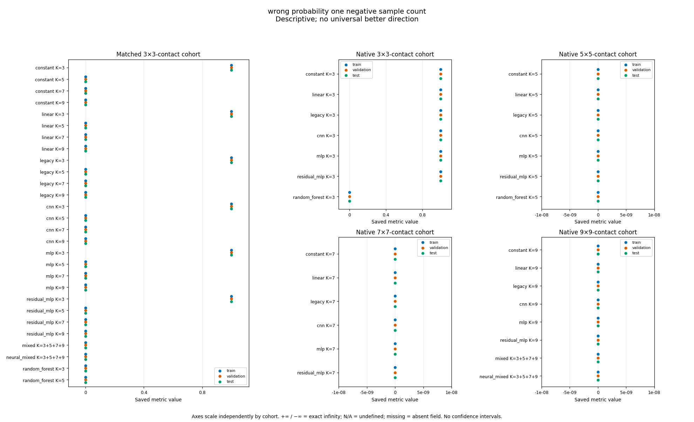

| Model | Native K | Matched train | Matched validation | Matched test | Native train | Native validation | Native test |
|---|---:|---:|---:|---:|---:|---:|---:|
| constant K=3 (`k3_constant_00_lr0.003_constant`) | 3 | 1 | 1 | 1 | 1 | 1 | 1 |
| constant K=5 (`k5_constant_00_lr0.003_constant`) | 5 | 0 | 0 | 0 | 0 | 0 | 0 |
| constant K=7 (`k7_constant_00_lr0.003_constant`) | 7 | 0 | 0 | 0 | 0 | 0 | 0 |
| constant K=9 (`k9_constant_00_lr0.003_constant`) | 9 | 0 | 0 | 0 | 0 | 0 | 0 |
| linear K=3 (`k3_linear_01_lr0.003_constant`) | 3 | 1 | 1 | 1 | 1 | 1 | 1 |
| linear K=5 (`k5_linear_01_lr0.003_constant`) | 5 | 0 | 0 | 0 | 0 | 0 | 0 |
| linear K=7 (`k7_linear_01_lr0.003_constant`) | 7 | 0 | 0 | 0 | 0 | 0 | 0 |
| linear K=9 (`k9_linear_01_lr0.003_constant`) | 9 | 0 | 0 | 0 | 0 | 0 | 0 |
| legacy K=3 (`k3_legacy_02_lr0.003_constant`) | 3 | 1 | 1 | 1 | 1 | 1 | 1 |
| legacy K=5 (`k5_legacy_02_lr0.003_constant`) | 5 | 0 | 0 | 0 | 0 | 0 | 0 |
| legacy K=7 (`k7_legacy_02_lr0.003_constant`) | 7 | 0 | 0 | 0 | 0 | 0 | 0 |
| legacy K=9 (`k9_legacy_02_lr0.003_constant`) | 9 | 0 | 0 | 0 | 0 | 0 | 0 |
| cnn K=3 (`k3_cnn_03_lr0.003_constant`) | 3 | 1 | 1 | 1 | 1 | 1 | 1 |
| cnn K=5 (`k5_cnn_03_lr0.003_constant`) | 5 | 0 | 0 | 0 | 0 | 0 | 0 |
| cnn K=7 (`k7_cnn_03_lr0.003_constant`) | 7 | 0 | 0 | 0 | 0 | 0 | 0 |
| cnn K=9 (`k9_cnn_03_lr0.003_constant`) | 9 | 0 | 0 | 0 | 0 | 0 | 0 |
| mlp K=3 (`k3_mlp_04_lr0.003_constant`) | 3 | 1 | 1 | 1 | 1 | 1 | 1 |
| mlp K=5 (`k5_mlp_05_lr0.003_constant`) | 5 | 0 | 0 | 0 | 0 | 0 | 0 |
| mlp K=7 (`k7_mlp_04_lr0.003_constant`) | 7 | 0 | 0 | 0 | 0 | 0 | 0 |
| mlp K=9 (`k9_mlp_04_lr0.003_constant`) | 9 | 0 | 0 | 0 | 0 | 0 | 0 |
| residual_mlp K=3 (`k3_residual_mlp_08_lr0.003_constant`) | 3 | 1 | 1 | 1 | 1 | 1 | 1 |
| residual_mlp K=5 (`k5_residual_mlp_09_lr0.003_constant`) | 5 | 0 | 0 | 0 | 0 | 0 | 0 |
| residual_mlp K=7 (`k7_residual_mlp_08_lr0.003_constant`) | 7 | 0 | 0 | 0 | 0 | 0 | 0 |
| residual_mlp K=9 (`k9_residual_mlp_08_lr0.003_constant`) | 9 | 0 | 0 | 0 | 0 | 0 | 0 |
| mixed K=3+5+7+9 (`mixed_3_5_7_9_00_lr0.003_constant`) | 9 | 0 | 0 | 0 | 0 | 0 | 0 |
| neural_mixed K=3+5+7+9 (`neural_mixed_3_5_7_9_00_lr0.003_constant`) | 9 | 0 | 0 | 0 | 0 | 0 | 0 |
| random_forest K=3 (`rf3_depth8`) | 3 | 0 | 0 | 0 | 0 | 0 | 0 |
| random_forest K=5 (`rf5_depth8`) | 5 | 0 | 0 | 0 | 0 | 0 | 0 |

#### zero contact population weight

Saved field: `zero_contact_population_weight`. Descriptive; no universal better direction.

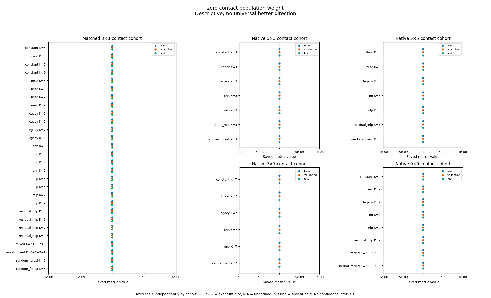

| Model | Native K | Matched train | Matched validation | Matched test | Native train | Native validation | Native test |
|---|---:|---:|---:|---:|---:|---:|---:|
| constant K=3 (`k3_constant_00_lr0.003_constant`) | 3 | 0 | 0 | 0 | 0 | 0 | 0 |
| constant K=5 (`k5_constant_00_lr0.003_constant`) | 5 | 0 | 0 | 0 | 0 | 0 | 0 |
| constant K=7 (`k7_constant_00_lr0.003_constant`) | 7 | 0 | 0 | 0 | 0 | 0 | 0 |
| constant K=9 (`k9_constant_00_lr0.003_constant`) | 9 | 0 | 0 | 0 | 0 | 0 | 0 |
| linear K=3 (`k3_linear_01_lr0.003_constant`) | 3 | 0 | 0 | 0 | 0 | 0 | 0 |
| linear K=5 (`k5_linear_01_lr0.003_constant`) | 5 | 0 | 0 | 0 | 0 | 0 | 0 |
| linear K=7 (`k7_linear_01_lr0.003_constant`) | 7 | 0 | 0 | 0 | 0 | 0 | 0 |
| linear K=9 (`k9_linear_01_lr0.003_constant`) | 9 | 0 | 0 | 0 | 0 | 0 | 0 |
| legacy K=3 (`k3_legacy_02_lr0.003_constant`) | 3 | 0 | 0 | 0 | 0 | 0 | 0 |
| legacy K=5 (`k5_legacy_02_lr0.003_constant`) | 5 | 0 | 0 | 0 | 0 | 0 | 0 |
| legacy K=7 (`k7_legacy_02_lr0.003_constant`) | 7 | 0 | 0 | 0 | 0 | 0 | 0 |
| legacy K=9 (`k9_legacy_02_lr0.003_constant`) | 9 | 0 | 0 | 0 | 0 | 0 | 0 |
| cnn K=3 (`k3_cnn_03_lr0.003_constant`) | 3 | 0 | 0 | 0 | 0 | 0 | 0 |
| cnn K=5 (`k5_cnn_03_lr0.003_constant`) | 5 | 0 | 0 | 0 | 0 | 0 | 0 |
| cnn K=7 (`k7_cnn_03_lr0.003_constant`) | 7 | 0 | 0 | 0 | 0 | 0 | 0 |
| cnn K=9 (`k9_cnn_03_lr0.003_constant`) | 9 | 0 | 0 | 0 | 0 | 0 | 0 |
| mlp K=3 (`k3_mlp_04_lr0.003_constant`) | 3 | 0 | 0 | 0 | 0 | 0 | 0 |
| mlp K=5 (`k5_mlp_05_lr0.003_constant`) | 5 | 0 | 0 | 0 | 0 | 0 | 0 |
| mlp K=7 (`k7_mlp_04_lr0.003_constant`) | 7 | 0 | 0 | 0 | 0 | 0 | 0 |
| mlp K=9 (`k9_mlp_04_lr0.003_constant`) | 9 | 0 | 0 | 0 | 0 | 0 | 0 |
| residual_mlp K=3 (`k3_residual_mlp_08_lr0.003_constant`) | 3 | 0 | 0 | 0 | 0 | 0 | 0 |
| residual_mlp K=5 (`k5_residual_mlp_09_lr0.003_constant`) | 5 | 0 | 0 | 0 | 0 | 0 | 0 |
| residual_mlp K=7 (`k7_residual_mlp_08_lr0.003_constant`) | 7 | 0 | 0 | 0 | 0 | 0 | 0 |
| residual_mlp K=9 (`k9_residual_mlp_08_lr0.003_constant`) | 9 | 0 | 0 | 0 | 0 | 0 | 0 |
| mixed K=3+5+7+9 (`mixed_3_5_7_9_00_lr0.003_constant`) | 9 | 0 | 0 | 0 | 0 | 0 | 0 |
| neural_mixed K=3+5+7+9 (`neural_mixed_3_5_7_9_00_lr0.003_constant`) | 9 | 0 | 0 | 0 | 0 | 0 | 0 |
| random_forest K=3 (`rf3_depth8`) | 3 | 0 | 0 | 0 | 0 | 0 | 0 |
| random_forest K=5 (`rf5_depth8`) | 5 | 0 | 0 | 0 | 0 | 0 | 0 |

#### zero contact positive fraction

Saved field: `zero_contact_positive_fraction`. Descriptive; no universal better direction.

| Model | Native K | Matched train | Matched validation | Matched test | Native train | Native validation | Native test |
|---|---:|---:|---:|---:|---:|---:|---:|
| constant K=3 (`k3_constant_00_lr0.003_constant`) | 3 | 0 | 0 | 0 | 0 | 0 | 0 |
| constant K=5 (`k5_constant_00_lr0.003_constant`) | 5 | 0 | 0 | 0 | 0 | 0 | 0 |
| constant K=7 (`k7_constant_00_lr0.003_constant`) | 7 | 0 | 0 | 0 | 0 | 0 | 0 |
| constant K=9 (`k9_constant_00_lr0.003_constant`) | 9 | 0 | 0 | 0 | 0 | 0 | 0 |
| linear K=3 (`k3_linear_01_lr0.003_constant`) | 3 | 0 | 0 | 0 | 0 | 0 | 0 |
| linear K=5 (`k5_linear_01_lr0.003_constant`) | 5 | 0 | 0 | 0 | 0 | 0 | 0 |
| linear K=7 (`k7_linear_01_lr0.003_constant`) | 7 | 0 | 0 | 0 | 0 | 0 | 0 |
| linear K=9 (`k9_linear_01_lr0.003_constant`) | 9 | 0 | 0 | 0 | 0 | 0 | 0 |
| legacy K=3 (`k3_legacy_02_lr0.003_constant`) | 3 | 0 | 0 | 0 | 0 | 0 | 0 |
| legacy K=5 (`k5_legacy_02_lr0.003_constant`) | 5 | 0 | 0 | 0 | 0 | 0 | 0 |
| legacy K=7 (`k7_legacy_02_lr0.003_constant`) | 7 | 0 | 0 | 0 | 0 | 0 | 0 |
| legacy K=9 (`k9_legacy_02_lr0.003_constant`) | 9 | 0 | 0 | 0 | 0 | 0 | 0 |
| cnn K=3 (`k3_cnn_03_lr0.003_constant`) | 3 | 0 | 0 | 0 | 0 | 0 | 0 |
| cnn K=5 (`k5_cnn_03_lr0.003_constant`) | 5 | 0 | 0 | 0 | 0 | 0 | 0 |
| cnn K=7 (`k7_cnn_03_lr0.003_constant`) | 7 | 0 | 0 | 0 | 0 | 0 | 0 |
| cnn K=9 (`k9_cnn_03_lr0.003_constant`) | 9 | 0 | 0 | 0 | 0 | 0 | 0 |
| mlp K=3 (`k3_mlp_04_lr0.003_constant`) | 3 | 0 | 0 | 0 | 0 | 0 | 0 |
| mlp K=5 (`k5_mlp_05_lr0.003_constant`) | 5 | 0 | 0 | 0 | 0 | 0 | 0 |
| mlp K=7 (`k7_mlp_04_lr0.003_constant`) | 7 | 0 | 0 | 0 | 0 | 0 | 0 |
| mlp K=9 (`k9_mlp_04_lr0.003_constant`) | 9 | 0 | 0 | 0 | 0 | 0 | 0 |
| residual_mlp K=3 (`k3_residual_mlp_08_lr0.003_constant`) | 3 | 0 | 0 | 0 | 0 | 0 | 0 |
| residual_mlp K=5 (`k5_residual_mlp_09_lr0.003_constant`) | 5 | 0 | 0 | 0 | 0 | 0 | 0 |
| residual_mlp K=7 (`k7_residual_mlp_08_lr0.003_constant`) | 7 | 0 | 0 | 0 | 0 | 0 | 0 |
| residual_mlp K=9 (`k9_residual_mlp_08_lr0.003_constant`) | 9 | 0 | 0 | 0 | 0 | 0 | 0 |
| mixed K=3+5+7+9 (`mixed_3_5_7_9_00_lr0.003_constant`) | 9 | 0 | 0 | 0 | 0 | 0 | 0 |
| neural_mixed K=3+5+7+9 (`neural_mixed_3_5_7_9_00_lr0.003_constant`) | 9 | 0 | 0 | 0 | 0 | 0 | 0 |
| random_forest K=3 (`rf3_depth8`) | 3 | 0 | 0 | 0 | 0 | 0 | 0 |
| random_forest K=5 (`rf5_depth8`) | 5 | 0 | 0 | 0 | 0 | 0 | 0 |

#### zero contact positive population weight

Saved field: `zero_contact_positive_population_weight`. Descriptive; no universal better direction.

| Model | Native K | Matched train | Matched validation | Matched test | Native train | Native validation | Native test |
|---|---:|---:|---:|---:|---:|---:|---:|
| constant K=3 (`k3_constant_00_lr0.003_constant`) | 3 | 0 | 0 | 0 | 0 | 0 | 0 |
| constant K=5 (`k5_constant_00_lr0.003_constant`) | 5 | 0 | 0 | 0 | 0 | 0 | 0 |
| constant K=7 (`k7_constant_00_lr0.003_constant`) | 7 | 0 | 0 | 0 | 0 | 0 | 0 |
| constant K=9 (`k9_constant_00_lr0.003_constant`) | 9 | 0 | 0 | 0 | 0 | 0 | 0 |
| linear K=3 (`k3_linear_01_lr0.003_constant`) | 3 | 0 | 0 | 0 | 0 | 0 | 0 |
| linear K=5 (`k5_linear_01_lr0.003_constant`) | 5 | 0 | 0 | 0 | 0 | 0 | 0 |
| linear K=7 (`k7_linear_01_lr0.003_constant`) | 7 | 0 | 0 | 0 | 0 | 0 | 0 |
| linear K=9 (`k9_linear_01_lr0.003_constant`) | 9 | 0 | 0 | 0 | 0 | 0 | 0 |
| legacy K=3 (`k3_legacy_02_lr0.003_constant`) | 3 | 0 | 0 | 0 | 0 | 0 | 0 |
| legacy K=5 (`k5_legacy_02_lr0.003_constant`) | 5 | 0 | 0 | 0 | 0 | 0 | 0 |
| legacy K=7 (`k7_legacy_02_lr0.003_constant`) | 7 | 0 | 0 | 0 | 0 | 0 | 0 |
| legacy K=9 (`k9_legacy_02_lr0.003_constant`) | 9 | 0 | 0 | 0 | 0 | 0 | 0 |
| cnn K=3 (`k3_cnn_03_lr0.003_constant`) | 3 | 0 | 0 | 0 | 0 | 0 | 0 |
| cnn K=5 (`k5_cnn_03_lr0.003_constant`) | 5 | 0 | 0 | 0 | 0 | 0 | 0 |
| cnn K=7 (`k7_cnn_03_lr0.003_constant`) | 7 | 0 | 0 | 0 | 0 | 0 | 0 |
| cnn K=9 (`k9_cnn_03_lr0.003_constant`) | 9 | 0 | 0 | 0 | 0 | 0 | 0 |
| mlp K=3 (`k3_mlp_04_lr0.003_constant`) | 3 | 0 | 0 | 0 | 0 | 0 | 0 |
| mlp K=5 (`k5_mlp_05_lr0.003_constant`) | 5 | 0 | 0 | 0 | 0 | 0 | 0 |
| mlp K=7 (`k7_mlp_04_lr0.003_constant`) | 7 | 0 | 0 | 0 | 0 | 0 | 0 |
| mlp K=9 (`k9_mlp_04_lr0.003_constant`) | 9 | 0 | 0 | 0 | 0 | 0 | 0 |
| residual_mlp K=3 (`k3_residual_mlp_08_lr0.003_constant`) | 3 | 0 | 0 | 0 | 0 | 0 | 0 |
| residual_mlp K=5 (`k5_residual_mlp_09_lr0.003_constant`) | 5 | 0 | 0 | 0 | 0 | 0 | 0 |
| residual_mlp K=7 (`k7_residual_mlp_08_lr0.003_constant`) | 7 | 0 | 0 | 0 | 0 | 0 | 0 |
| residual_mlp K=9 (`k9_residual_mlp_08_lr0.003_constant`) | 9 | 0 | 0 | 0 | 0 | 0 | 0 |
| mixed K=3+5+7+9 (`mixed_3_5_7_9_00_lr0.003_constant`) | 9 | 0 | 0 | 0 | 0 | 0 | 0 |
| neural_mixed K=3+5+7+9 (`neural_mixed_3_5_7_9_00_lr0.003_constant`) | 9 | 0 | 0 | 0 | 0 | 0 | 0 |
| random_forest K=3 (`rf3_depth8`) | 3 | 0 | 0 | 0 | 0 | 0 | 0 |
| random_forest K=5 (`rf5_depth8`) | 5 | 0 | 0 | 0 | 0 | 0 | 0 |

#### zero contact positive sample count

Saved field: `zero_contact_positive_sample_count`. Descriptive; no universal better direction.

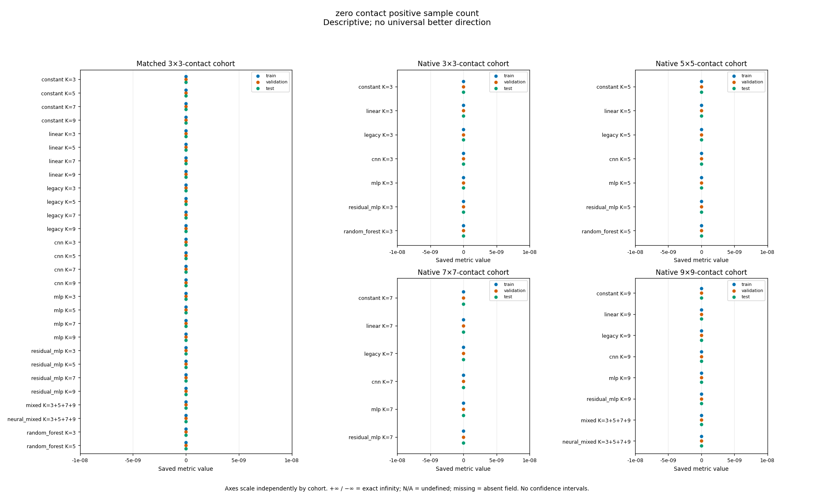

| Model | Native K | Matched train | Matched validation | Matched test | Native train | Native validation | Native test |
|---|---:|---:|---:|---:|---:|---:|---:|
| constant K=3 (`k3_constant_00_lr0.003_constant`) | 3 | 0 | 0 | 0 | 0 | 0 | 0 |
| constant K=5 (`k5_constant_00_lr0.003_constant`) | 5 | 0 | 0 | 0 | 0 | 0 | 0 |
| constant K=7 (`k7_constant_00_lr0.003_constant`) | 7 | 0 | 0 | 0 | 0 | 0 | 0 |
| constant K=9 (`k9_constant_00_lr0.003_constant`) | 9 | 0 | 0 | 0 | 0 | 0 | 0 |
| linear K=3 (`k3_linear_01_lr0.003_constant`) | 3 | 0 | 0 | 0 | 0 | 0 | 0 |
| linear K=5 (`k5_linear_01_lr0.003_constant`) | 5 | 0 | 0 | 0 | 0 | 0 | 0 |
| linear K=7 (`k7_linear_01_lr0.003_constant`) | 7 | 0 | 0 | 0 | 0 | 0 | 0 |
| linear K=9 (`k9_linear_01_lr0.003_constant`) | 9 | 0 | 0 | 0 | 0 | 0 | 0 |
| legacy K=3 (`k3_legacy_02_lr0.003_constant`) | 3 | 0 | 0 | 0 | 0 | 0 | 0 |
| legacy K=5 (`k5_legacy_02_lr0.003_constant`) | 5 | 0 | 0 | 0 | 0 | 0 | 0 |
| legacy K=7 (`k7_legacy_02_lr0.003_constant`) | 7 | 0 | 0 | 0 | 0 | 0 | 0 |
| legacy K=9 (`k9_legacy_02_lr0.003_constant`) | 9 | 0 | 0 | 0 | 0 | 0 | 0 |
| cnn K=3 (`k3_cnn_03_lr0.003_constant`) | 3 | 0 | 0 | 0 | 0 | 0 | 0 |
| cnn K=5 (`k5_cnn_03_lr0.003_constant`) | 5 | 0 | 0 | 0 | 0 | 0 | 0 |
| cnn K=7 (`k7_cnn_03_lr0.003_constant`) | 7 | 0 | 0 | 0 | 0 | 0 | 0 |
| cnn K=9 (`k9_cnn_03_lr0.003_constant`) | 9 | 0 | 0 | 0 | 0 | 0 | 0 |
| mlp K=3 (`k3_mlp_04_lr0.003_constant`) | 3 | 0 | 0 | 0 | 0 | 0 | 0 |
| mlp K=5 (`k5_mlp_05_lr0.003_constant`) | 5 | 0 | 0 | 0 | 0 | 0 | 0 |
| mlp K=7 (`k7_mlp_04_lr0.003_constant`) | 7 | 0 | 0 | 0 | 0 | 0 | 0 |
| mlp K=9 (`k9_mlp_04_lr0.003_constant`) | 9 | 0 | 0 | 0 | 0 | 0 | 0 |
| residual_mlp K=3 (`k3_residual_mlp_08_lr0.003_constant`) | 3 | 0 | 0 | 0 | 0 | 0 | 0 |
| residual_mlp K=5 (`k5_residual_mlp_09_lr0.003_constant`) | 5 | 0 | 0 | 0 | 0 | 0 | 0 |
| residual_mlp K=7 (`k7_residual_mlp_08_lr0.003_constant`) | 7 | 0 | 0 | 0 | 0 | 0 | 0 |
| residual_mlp K=9 (`k9_residual_mlp_08_lr0.003_constant`) | 9 | 0 | 0 | 0 | 0 | 0 | 0 |
| mixed K=3+5+7+9 (`mixed_3_5_7_9_00_lr0.003_constant`) | 9 | 0 | 0 | 0 | 0 | 0 | 0 |
| neural_mixed K=3+5+7+9 (`neural_mixed_3_5_7_9_00_lr0.003_constant`) | 9 | 0 | 0 | 0 | 0 | 0 | 0 |
| random_forest K=3 (`rf3_depth8`) | 3 | 0 | 0 | 0 | 0 | 0 | 0 |
| random_forest K=5 (`rf5_depth8`) | 5 | 0 | 0 | 0 | 0 | 0 | 0 |

### Thresholds and scoring configuration

#### classification at 0 5 / threshold

Saved field: `classification_at_0_5.threshold`. Descriptive; no universal better direction.

| Model | Native K | Matched train | Matched validation | Matched test | Native train | Native validation | Native test |
|---|---:|---:|---:|---:|---:|---:|---:|
| constant K=3 (`k3_constant_00_lr0.003_constant`) | 3 | 0.5 | 0.5 | 0.5 | 0.5 | 0.5 | 0.5 |
| constant K=5 (`k5_constant_00_lr0.003_constant`) | 5 | 0.5 | 0.5 | 0.5 | 0.5 | 0.5 | 0.5 |
| constant K=7 (`k7_constant_00_lr0.003_constant`) | 7 | 0.5 | 0.5 | 0.5 | 0.5 | 0.5 | 0.5 |
| constant K=9 (`k9_constant_00_lr0.003_constant`) | 9 | 0.5 | 0.5 | 0.5 | 0.5 | 0.5 | 0.5 |
| linear K=3 (`k3_linear_01_lr0.003_constant`) | 3 | 0.5 | 0.5 | 0.5 | 0.5 | 0.5 | 0.5 |
| linear K=5 (`k5_linear_01_lr0.003_constant`) | 5 | 0.5 | 0.5 | 0.5 | 0.5 | 0.5 | 0.5 |
| linear K=7 (`k7_linear_01_lr0.003_constant`) | 7 | 0.5 | 0.5 | 0.5 | 0.5 | 0.5 | 0.5 |
| linear K=9 (`k9_linear_01_lr0.003_constant`) | 9 | 0.5 | 0.5 | 0.5 | 0.5 | 0.5 | 0.5 |
| legacy K=3 (`k3_legacy_02_lr0.003_constant`) | 3 | 0.5 | 0.5 | 0.5 | 0.5 | 0.5 | 0.5 |
| legacy K=5 (`k5_legacy_02_lr0.003_constant`) | 5 | 0.5 | 0.5 | 0.5 | 0.5 | 0.5 | 0.5 |
| legacy K=7 (`k7_legacy_02_lr0.003_constant`) | 7 | 0.5 | 0.5 | 0.5 | 0.5 | 0.5 | 0.5 |
| legacy K=9 (`k9_legacy_02_lr0.003_constant`) | 9 | 0.5 | 0.5 | 0.5 | 0.5 | 0.5 | 0.5 |
| cnn K=3 (`k3_cnn_03_lr0.003_constant`) | 3 | 0.5 | 0.5 | 0.5 | 0.5 | 0.5 | 0.5 |
| cnn K=5 (`k5_cnn_03_lr0.003_constant`) | 5 | 0.5 | 0.5 | 0.5 | 0.5 | 0.5 | 0.5 |
| cnn K=7 (`k7_cnn_03_lr0.003_constant`) | 7 | 0.5 | 0.5 | 0.5 | 0.5 | 0.5 | 0.5 |
| cnn K=9 (`k9_cnn_03_lr0.003_constant`) | 9 | 0.5 | 0.5 | 0.5 | 0.5 | 0.5 | 0.5 |
| mlp K=3 (`k3_mlp_04_lr0.003_constant`) | 3 | 0.5 | 0.5 | 0.5 | 0.5 | 0.5 | 0.5 |
| mlp K=5 (`k5_mlp_05_lr0.003_constant`) | 5 | 0.5 | 0.5 | 0.5 | 0.5 | 0.5 | 0.5 |
| mlp K=7 (`k7_mlp_04_lr0.003_constant`) | 7 | 0.5 | 0.5 | 0.5 | 0.5 | 0.5 | 0.5 |
| mlp K=9 (`k9_mlp_04_lr0.003_constant`) | 9 | 0.5 | 0.5 | 0.5 | 0.5 | 0.5 | 0.5 |
| residual_mlp K=3 (`k3_residual_mlp_08_lr0.003_constant`) | 3 | 0.5 | 0.5 | 0.5 | 0.5 | 0.5 | 0.5 |
| residual_mlp K=5 (`k5_residual_mlp_09_lr0.003_constant`) | 5 | 0.5 | 0.5 | 0.5 | 0.5 | 0.5 | 0.5 |
| residual_mlp K=7 (`k7_residual_mlp_08_lr0.003_constant`) | 7 | 0.5 | 0.5 | 0.5 | 0.5 | 0.5 | 0.5 |
| residual_mlp K=9 (`k9_residual_mlp_08_lr0.003_constant`) | 9 | 0.5 | 0.5 | 0.5 | 0.5 | 0.5 | 0.5 |
| mixed K=3+5+7+9 (`mixed_3_5_7_9_00_lr0.003_constant`) | 9 | 0.5 | 0.5 | 0.5 | 0.5 | 0.5 | 0.5 |
| neural_mixed K=3+5+7+9 (`neural_mixed_3_5_7_9_00_lr0.003_constant`) | 9 | 0.5 | 0.5 | 0.5 | 0.5 | 0.5 | 0.5 |
| random_forest K=3 (`rf3_depth8`) | 3 | 0.5 | 0.5 | 0.5 | 0.5 | 0.5 | 0.5 |
| random_forest K=5 (`rf5_depth8`) | 5 | 0.5 | 0.5 | 0.5 | 0.5 | 0.5 | 0.5 |

#### classification at validation f1 threshold / threshold

Saved field: `classification_at_validation_f1_threshold.threshold`. Descriptive; no universal better direction.

| Model | Native K | Matched train | Matched validation | Matched test | Native train | Native validation | Native test |
|---|---:|---:|---:|---:|---:|---:|---:|
| constant K=3 (`k3_constant_00_lr0.003_constant`) | 3 | 1 | 1 | 1 | 1 | 1 | 1 |
| constant K=5 (`k5_constant_00_lr0.003_constant`) | 5 | 0.66657525 | 0.66657525 | 0.66657525 | 0.66657525 | 0.66657525 | 0.66657525 |
| constant K=7 (`k7_constant_00_lr0.003_constant`) | 7 | 0.66661835 | 0.66661835 | 0.66661835 | 0.66661835 | 0.66661835 | 0.66661835 |
| constant K=9 (`k9_constant_00_lr0.003_constant`) | 9 | 0.66666669 | 0.66666669 | 0.66666669 | 0.66666669 | 0.66666669 | 0.66666669 |
| linear K=3 (`k3_linear_01_lr0.003_constant`) | 3 | 1 | 1 | 1 | 1 | 1 | 1 |
| linear K=5 (`k5_linear_01_lr0.003_constant`) | 5 | 0.66657555 | 0.66657555 | 0.66657555 | 0.66657555 | 0.66657555 | 0.66657555 |
| linear K=7 (`k7_linear_01_lr0.003_constant`) | 7 | 0.66661733 | 0.66661733 | 0.66661733 | 0.66661733 | 0.66661733 | 0.66661733 |
| linear K=9 (`k9_linear_01_lr0.003_constant`) | 9 | 0.66666716 | 0.66666716 | 0.66666716 | 0.66666716 | 0.66666716 | 0.66666716 |
| legacy K=3 (`k3_legacy_02_lr0.003_constant`) | 3 | 1 | 1 | 1 | 1 | 1 | 1 |
| legacy K=5 (`k5_legacy_02_lr0.003_constant`) | 5 | 0.66657281 | 0.66657281 | 0.66657281 | 0.66657281 | 0.66657281 | 0.66657281 |
| legacy K=7 (`k7_legacy_02_lr0.003_constant`) | 7 | 0.66661656 | 0.66661656 | 0.66661656 | 0.66661656 | 0.66661656 | 0.66661656 |
| legacy K=9 (`k9_legacy_02_lr0.003_constant`) | 9 | 0.66666716 | 0.66666716 | 0.66666716 | 0.66666716 | 0.66666716 | 0.66666716 |
| cnn K=3 (`k3_cnn_03_lr0.003_constant`) | 3 | 1 | 1 | 1 | 1 | 1 | 1 |
| cnn K=5 (`k5_cnn_03_lr0.003_constant`) | 5 | 0.66629738 | 0.66629738 | 0.66629738 | 0.66629738 | 0.66629738 | 0.66629738 |
| cnn K=7 (`k7_cnn_03_lr0.003_constant`) | 7 | 0.66662848 | 0.66662848 | 0.66662848 | 0.66662848 | 0.66662848 | 0.66662848 |
| cnn K=9 (`k9_cnn_03_lr0.003_constant`) | 9 | 0.6666134 | 0.6666134 | 0.6666134 | 0.6666134 | 0.6666134 | 0.6666134 |
| mlp K=3 (`k3_mlp_04_lr0.003_constant`) | 3 | 1 | 1 | 1 | 1 | 1 | 1 |
| mlp K=5 (`k5_mlp_05_lr0.003_constant`) | 5 | 0.66675401 | 0.66675401 | 0.66675401 | 0.66675401 | 0.66675401 | 0.66675401 |
| mlp K=7 (`k7_mlp_04_lr0.003_constant`) | 7 | 0.66661459 | 0.66661459 | 0.66661459 | 0.66661459 | 0.66661459 | 0.66661459 |
| mlp K=9 (`k9_mlp_04_lr0.003_constant`) | 9 | 0.66666752 | 0.66666752 | 0.66666752 | 0.66666752 | 0.66666752 | 0.66666752 |
| residual_mlp K=3 (`k3_residual_mlp_08_lr0.003_constant`) | 3 | 1 | 1 | 1 | 1 | 1 | 1 |
| residual_mlp K=5 (`k5_residual_mlp_09_lr0.003_constant`) | 5 | 0.66680765 | 0.66680765 | 0.66680765 | 0.66680765 | 0.66680765 | 0.66680765 |
| residual_mlp K=7 (`k7_residual_mlp_08_lr0.003_constant`) | 7 | 0.66674429 | 0.66674429 | 0.66674429 | 0.66674429 | 0.66674429 | 0.66674429 |
| residual_mlp K=9 (`k9_residual_mlp_08_lr0.003_constant`) | 9 | 0.66656643 | 0.66656643 | 0.66656643 | 0.66656643 | 0.66656643 | 0.66656643 |
| mixed K=3+5+7+9 (`mixed_3_5_7_9_00_lr0.003_constant`) | 9 | 0.66685879 | 0.66685879 | 0.66685879 | 0.66685879 | 0.66685879 | 0.66685879 |
| neural_mixed K=3+5+7+9 (`neural_mixed_3_5_7_9_00_lr0.003_constant`) | 9 | 0.6671108 | 0.6671108 | 0.6671108 | 0.6671108 | 0.6671108 | 0.6671108 |
| random_forest K=3 (`rf3_depth8`) | 3 | 0.44444444 | 0.44444444 | 0.44444444 | 0.44444444 | 0.44444444 | 0.44444444 |
| random_forest K=5 (`rf5_depth8`) | 5 | 0.44444444 | 0.44444444 | 0.44444444 | 0.44444444 | 0.44444444 | 0.44444444 |

#### classification at validation mcc threshold / threshold

Saved field: `classification_at_validation_mcc_threshold.threshold`. Descriptive; no universal better direction.

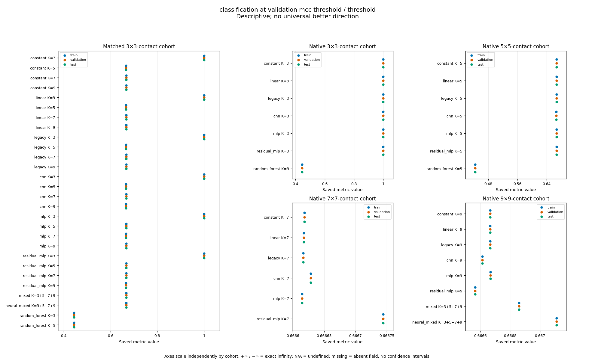

| Model | Native K | Matched train | Matched validation | Matched test | Native train | Native validation | Native test |
|---|---:|---:|---:|---:|---:|---:|---:|
| constant K=3 (`k3_constant_00_lr0.003_constant`) | 3 | 1 | 1 | 1 | 1 | 1 | 1 |
| constant K=5 (`k5_constant_00_lr0.003_constant`) | 5 | 0.66657525 | 0.66657525 | 0.66657525 | 0.66657525 | 0.66657525 | 0.66657525 |
| constant K=7 (`k7_constant_00_lr0.003_constant`) | 7 | 0.66661835 | 0.66661835 | 0.66661835 | 0.66661835 | 0.66661835 | 0.66661835 |
| constant K=9 (`k9_constant_00_lr0.003_constant`) | 9 | 0.66666669 | 0.66666669 | 0.66666669 | 0.66666669 | 0.66666669 | 0.66666669 |
| linear K=3 (`k3_linear_01_lr0.003_constant`) | 3 | 1 | 1 | 1 | 1 | 1 | 1 |
| linear K=5 (`k5_linear_01_lr0.003_constant`) | 5 | 0.66657561 | 0.66657561 | 0.66657561 | 0.66657561 | 0.66657561 | 0.66657561 |
| linear K=7 (`k7_linear_01_lr0.003_constant`) | 7 | 0.66661733 | 0.66661733 | 0.66661733 | 0.66661733 | 0.66661733 | 0.66661733 |
| linear K=9 (`k9_linear_01_lr0.003_constant`) | 9 | 0.66666716 | 0.66666716 | 0.66666716 | 0.66666716 | 0.66666716 | 0.66666716 |
| legacy K=3 (`k3_legacy_02_lr0.003_constant`) | 3 | 1 | 1 | 1 | 1 | 1 | 1 |
| legacy K=5 (`k5_legacy_02_lr0.003_constant`) | 5 | 0.66657281 | 0.66657281 | 0.66657281 | 0.66657281 | 0.66657281 | 0.66657281 |
| legacy K=7 (`k7_legacy_02_lr0.003_constant`) | 7 | 0.66661656 | 0.66661656 | 0.66661656 | 0.66661656 | 0.66661656 | 0.66661656 |
| legacy K=9 (`k9_legacy_02_lr0.003_constant`) | 9 | 0.66666716 | 0.66666716 | 0.66666716 | 0.66666716 | 0.66666716 | 0.66666716 |
| cnn K=3 (`k3_cnn_03_lr0.003_constant`) | 3 | 1 | 1 | 1 | 1 | 1 | 1 |
| cnn K=5 (`k5_cnn_03_lr0.003_constant`) | 5 | 0.66629738 | 0.66629738 | 0.66629738 | 0.66629738 | 0.66629738 | 0.66629738 |
| cnn K=7 (`k7_cnn_03_lr0.003_constant`) | 7 | 0.66662848 | 0.66662848 | 0.66662848 | 0.66662848 | 0.66662848 | 0.66662848 |
| cnn K=9 (`k9_cnn_03_lr0.003_constant`) | 9 | 0.6666134 | 0.6666134 | 0.6666134 | 0.6666134 | 0.6666134 | 0.6666134 |
| mlp K=3 (`k3_mlp_04_lr0.003_constant`) | 3 | 1 | 1 | 1 | 1 | 1 | 1 |
| mlp K=5 (`k5_mlp_05_lr0.003_constant`) | 5 | 0.66675401 | 0.66675401 | 0.66675401 | 0.66675401 | 0.66675401 | 0.66675401 |
| mlp K=7 (`k7_mlp_04_lr0.003_constant`) | 7 | 0.66661459 | 0.66661459 | 0.66661459 | 0.66661459 | 0.66661459 | 0.66661459 |
| mlp K=9 (`k9_mlp_04_lr0.003_constant`) | 9 | 0.66666752 | 0.66666752 | 0.66666752 | 0.66666752 | 0.66666752 | 0.66666752 |
| residual_mlp K=3 (`k3_residual_mlp_08_lr0.003_constant`) | 3 | 1 | 1 | 1 | 1 | 1 | 1 |
| residual_mlp K=5 (`k5_residual_mlp_09_lr0.003_constant`) | 5 | 0.66680765 | 0.66680765 | 0.66680765 | 0.66680765 | 0.66680765 | 0.66680765 |
| residual_mlp K=7 (`k7_residual_mlp_08_lr0.003_constant`) | 7 | 0.66674429 | 0.66674429 | 0.66674429 | 0.66674429 | 0.66674429 | 0.66674429 |
| residual_mlp K=9 (`k9_residual_mlp_08_lr0.003_constant`) | 9 | 0.66656643 | 0.66656643 | 0.66656643 | 0.66656643 | 0.66656643 | 0.66656643 |
| mixed K=3+5+7+9 (`mixed_3_5_7_9_00_lr0.003_constant`) | 9 | 0.66685879 | 0.66685879 | 0.66685879 | 0.66685879 | 0.66685879 | 0.66685879 |
| neural_mixed K=3+5+7+9 (`neural_mixed_3_5_7_9_00_lr0.003_constant`) | 9 | 0.6671108 | 0.6671108 | 0.6671108 | 0.6671108 | 0.6671108 | 0.6671108 |
| random_forest K=3 (`rf3_depth8`) | 3 | 0.44444444 | 0.44444444 | 0.44444444 | 0.44444444 | 0.44444444 | 0.44444444 |
| random_forest K=5 (`rf5_depth8`) | 5 | 0.44444444 | 0.44444444 | 0.44444444 | 0.44444444 | 0.44444444 | 0.44444444 |

#### log loss probability floor

Saved field: `log_loss_probability_floor`. Descriptive; no universal better direction.

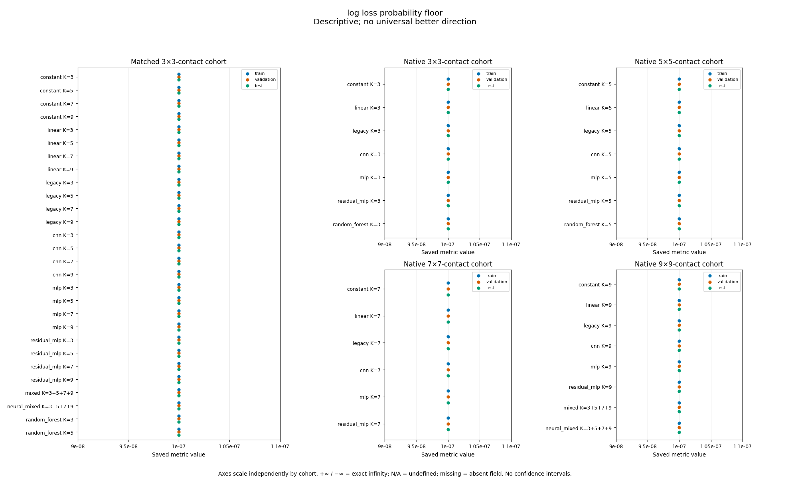

| Model | Native K | Matched train | Matched validation | Matched test | Native train | Native validation | Native test |
|---|---:|---:|---:|---:|---:|---:|---:|
| constant K=3 (`k3_constant_00_lr0.003_constant`) | 3 | 1e-07 | 1e-07 | 1e-07 | 1e-07 | 1e-07 | 1e-07 |
| constant K=5 (`k5_constant_00_lr0.003_constant`) | 5 | 1e-07 | 1e-07 | 1e-07 | 1e-07 | 1e-07 | 1e-07 |
| constant K=7 (`k7_constant_00_lr0.003_constant`) | 7 | 1e-07 | 1e-07 | 1e-07 | 1e-07 | 1e-07 | 1e-07 |
| constant K=9 (`k9_constant_00_lr0.003_constant`) | 9 | 1e-07 | 1e-07 | 1e-07 | 1e-07 | 1e-07 | 1e-07 |
| linear K=3 (`k3_linear_01_lr0.003_constant`) | 3 | 1e-07 | 1e-07 | 1e-07 | 1e-07 | 1e-07 | 1e-07 |
| linear K=5 (`k5_linear_01_lr0.003_constant`) | 5 | 1e-07 | 1e-07 | 1e-07 | 1e-07 | 1e-07 | 1e-07 |
| linear K=7 (`k7_linear_01_lr0.003_constant`) | 7 | 1e-07 | 1e-07 | 1e-07 | 1e-07 | 1e-07 | 1e-07 |
| linear K=9 (`k9_linear_01_lr0.003_constant`) | 9 | 1e-07 | 1e-07 | 1e-07 | 1e-07 | 1e-07 | 1e-07 |
| legacy K=3 (`k3_legacy_02_lr0.003_constant`) | 3 | 1e-07 | 1e-07 | 1e-07 | 1e-07 | 1e-07 | 1e-07 |
| legacy K=5 (`k5_legacy_02_lr0.003_constant`) | 5 | 1e-07 | 1e-07 | 1e-07 | 1e-07 | 1e-07 | 1e-07 |
| legacy K=7 (`k7_legacy_02_lr0.003_constant`) | 7 | 1e-07 | 1e-07 | 1e-07 | 1e-07 | 1e-07 | 1e-07 |
| legacy K=9 (`k9_legacy_02_lr0.003_constant`) | 9 | 1e-07 | 1e-07 | 1e-07 | 1e-07 | 1e-07 | 1e-07 |
| cnn K=3 (`k3_cnn_03_lr0.003_constant`) | 3 | 1e-07 | 1e-07 | 1e-07 | 1e-07 | 1e-07 | 1e-07 |
| cnn K=5 (`k5_cnn_03_lr0.003_constant`) | 5 | 1e-07 | 1e-07 | 1e-07 | 1e-07 | 1e-07 | 1e-07 |
| cnn K=7 (`k7_cnn_03_lr0.003_constant`) | 7 | 1e-07 | 1e-07 | 1e-07 | 1e-07 | 1e-07 | 1e-07 |
| cnn K=9 (`k9_cnn_03_lr0.003_constant`) | 9 | 1e-07 | 1e-07 | 1e-07 | 1e-07 | 1e-07 | 1e-07 |
| mlp K=3 (`k3_mlp_04_lr0.003_constant`) | 3 | 1e-07 | 1e-07 | 1e-07 | 1e-07 | 1e-07 | 1e-07 |
| mlp K=5 (`k5_mlp_05_lr0.003_constant`) | 5 | 1e-07 | 1e-07 | 1e-07 | 1e-07 | 1e-07 | 1e-07 |
| mlp K=7 (`k7_mlp_04_lr0.003_constant`) | 7 | 1e-07 | 1e-07 | 1e-07 | 1e-07 | 1e-07 | 1e-07 |
| mlp K=9 (`k9_mlp_04_lr0.003_constant`) | 9 | 1e-07 | 1e-07 | 1e-07 | 1e-07 | 1e-07 | 1e-07 |
| residual_mlp K=3 (`k3_residual_mlp_08_lr0.003_constant`) | 3 | 1e-07 | 1e-07 | 1e-07 | 1e-07 | 1e-07 | 1e-07 |
| residual_mlp K=5 (`k5_residual_mlp_09_lr0.003_constant`) | 5 | 1e-07 | 1e-07 | 1e-07 | 1e-07 | 1e-07 | 1e-07 |
| residual_mlp K=7 (`k7_residual_mlp_08_lr0.003_constant`) | 7 | 1e-07 | 1e-07 | 1e-07 | 1e-07 | 1e-07 | 1e-07 |
| residual_mlp K=9 (`k9_residual_mlp_08_lr0.003_constant`) | 9 | 1e-07 | 1e-07 | 1e-07 | 1e-07 | 1e-07 | 1e-07 |
| mixed K=3+5+7+9 (`mixed_3_5_7_9_00_lr0.003_constant`) | 9 | 1e-07 | 1e-07 | 1e-07 | 1e-07 | 1e-07 | 1e-07 |
| neural_mixed K=3+5+7+9 (`neural_mixed_3_5_7_9_00_lr0.003_constant`) | 9 | 1e-07 | 1e-07 | 1e-07 | 1e-07 | 1e-07 | 1e-07 |
| random_forest K=3 (`rf3_depth8`) | 3 | 1e-07 | 1e-07 | 1e-07 | 1e-07 | 1e-07 | 1e-07 |
| random_forest K=5 (`rf5_depth8`) | 5 | 1e-07 | 1e-07 | 1e-07 | 1e-07 | 1e-07 | 1e-07 |

#### validation f1 threshold

Saved field: `validation_f1_threshold`. Descriptive; no universal better direction.

| Model | Native K | Matched train | Matched validation | Matched test | Native train | Native validation | Native test |
|---|---:|---:|---:|---:|---:|---:|---:|
| constant K=3 (`k3_constant_00_lr0.003_constant`) | 3 | 1 | 1 | 1 | 1 | 1 | 1 |
| constant K=5 (`k5_constant_00_lr0.003_constant`) | 5 | 0.66657525 | 0.66657525 | 0.66657525 | 0.66657525 | 0.66657525 | 0.66657525 |
| constant K=7 (`k7_constant_00_lr0.003_constant`) | 7 | 0.66661835 | 0.66661835 | 0.66661835 | 0.66661835 | 0.66661835 | 0.66661835 |
| constant K=9 (`k9_constant_00_lr0.003_constant`) | 9 | 0.66666669 | 0.66666669 | 0.66666669 | 0.66666669 | 0.66666669 | 0.66666669 |
| linear K=3 (`k3_linear_01_lr0.003_constant`) | 3 | 1 | 1 | 1 | 1 | 1 | 1 |
| linear K=5 (`k5_linear_01_lr0.003_constant`) | 5 | 0.66657555 | 0.66657555 | 0.66657555 | 0.66657555 | 0.66657555 | 0.66657555 |
| linear K=7 (`k7_linear_01_lr0.003_constant`) | 7 | 0.66661733 | 0.66661733 | 0.66661733 | 0.66661733 | 0.66661733 | 0.66661733 |
| linear K=9 (`k9_linear_01_lr0.003_constant`) | 9 | 0.66666716 | 0.66666716 | 0.66666716 | 0.66666716 | 0.66666716 | 0.66666716 |
| legacy K=3 (`k3_legacy_02_lr0.003_constant`) | 3 | 1 | 1 | 1 | 1 | 1 | 1 |
| legacy K=5 (`k5_legacy_02_lr0.003_constant`) | 5 | 0.66657281 | 0.66657281 | 0.66657281 | 0.66657281 | 0.66657281 | 0.66657281 |
| legacy K=7 (`k7_legacy_02_lr0.003_constant`) | 7 | 0.66661656 | 0.66661656 | 0.66661656 | 0.66661656 | 0.66661656 | 0.66661656 |
| legacy K=9 (`k9_legacy_02_lr0.003_constant`) | 9 | 0.66666716 | 0.66666716 | 0.66666716 | 0.66666716 | 0.66666716 | 0.66666716 |
| cnn K=3 (`k3_cnn_03_lr0.003_constant`) | 3 | 1 | 1 | 1 | 1 | 1 | 1 |
| cnn K=5 (`k5_cnn_03_lr0.003_constant`) | 5 | 0.66629738 | 0.66629738 | 0.66629738 | 0.66629738 | 0.66629738 | 0.66629738 |
| cnn K=7 (`k7_cnn_03_lr0.003_constant`) | 7 | 0.66662848 | 0.66662848 | 0.66662848 | 0.66662848 | 0.66662848 | 0.66662848 |
| cnn K=9 (`k9_cnn_03_lr0.003_constant`) | 9 | 0.6666134 | 0.6666134 | 0.6666134 | 0.6666134 | 0.6666134 | 0.6666134 |
| mlp K=3 (`k3_mlp_04_lr0.003_constant`) | 3 | 1 | 1 | 1 | 1 | 1 | 1 |
| mlp K=5 (`k5_mlp_05_lr0.003_constant`) | 5 | 0.66675401 | 0.66675401 | 0.66675401 | 0.66675401 | 0.66675401 | 0.66675401 |
| mlp K=7 (`k7_mlp_04_lr0.003_constant`) | 7 | 0.66661459 | 0.66661459 | 0.66661459 | 0.66661459 | 0.66661459 | 0.66661459 |
| mlp K=9 (`k9_mlp_04_lr0.003_constant`) | 9 | 0.66666752 | 0.66666752 | 0.66666752 | 0.66666752 | 0.66666752 | 0.66666752 |
| residual_mlp K=3 (`k3_residual_mlp_08_lr0.003_constant`) | 3 | 1 | 1 | 1 | 1 | 1 | 1 |
| residual_mlp K=5 (`k5_residual_mlp_09_lr0.003_constant`) | 5 | 0.66680765 | 0.66680765 | 0.66680765 | 0.66680765 | 0.66680765 | 0.66680765 |
| residual_mlp K=7 (`k7_residual_mlp_08_lr0.003_constant`) | 7 | 0.66674429 | 0.66674429 | 0.66674429 | 0.66674429 | 0.66674429 | 0.66674429 |
| residual_mlp K=9 (`k9_residual_mlp_08_lr0.003_constant`) | 9 | 0.66656643 | 0.66656643 | 0.66656643 | 0.66656643 | 0.66656643 | 0.66656643 |
| mixed K=3+5+7+9 (`mixed_3_5_7_9_00_lr0.003_constant`) | 9 | 0.66685879 | 0.66685879 | 0.66685879 | 0.66685879 | 0.66685879 | 0.66685879 |
| neural_mixed K=3+5+7+9 (`neural_mixed_3_5_7_9_00_lr0.003_constant`) | 9 | 0.6671108 | 0.6671108 | 0.6671108 | 0.6671108 | 0.6671108 | 0.6671108 |
| random_forest K=3 (`rf3_depth8`) | 3 | 0.44444444 | 0.44444444 | 0.44444444 | 0.44444444 | 0.44444444 | 0.44444444 |
| random_forest K=5 (`rf5_depth8`) | 5 | 0.44444444 | 0.44444444 | 0.44444444 | 0.44444444 | 0.44444444 | 0.44444444 |

#### validation mcc threshold

Saved field: `validation_mcc_threshold`. Descriptive; no universal better direction.

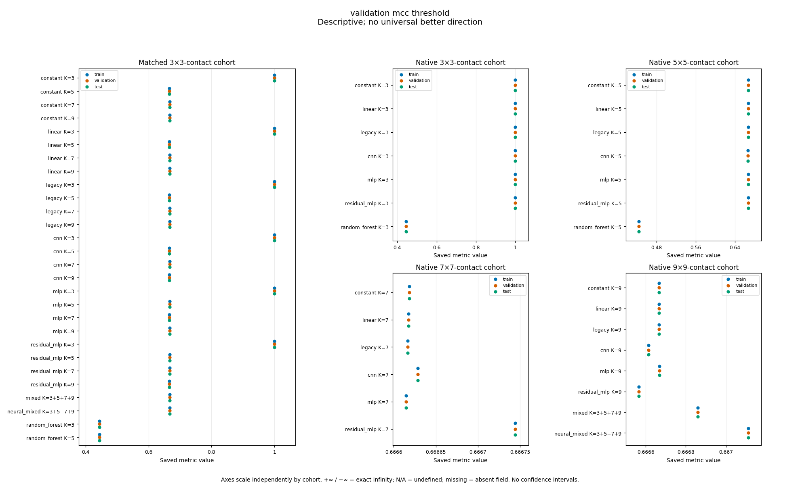

| Model | Native K | Matched train | Matched validation | Matched test | Native train | Native validation | Native test |
|---|---:|---:|---:|---:|---:|---:|---:|
| constant K=3 (`k3_constant_00_lr0.003_constant`) | 3 | 1 | 1 | 1 | 1 | 1 | 1 |
| constant K=5 (`k5_constant_00_lr0.003_constant`) | 5 | 0.66657525 | 0.66657525 | 0.66657525 | 0.66657525 | 0.66657525 | 0.66657525 |
| constant K=7 (`k7_constant_00_lr0.003_constant`) | 7 | 0.66661835 | 0.66661835 | 0.66661835 | 0.66661835 | 0.66661835 | 0.66661835 |
| constant K=9 (`k9_constant_00_lr0.003_constant`) | 9 | 0.66666669 | 0.66666669 | 0.66666669 | 0.66666669 | 0.66666669 | 0.66666669 |
| linear K=3 (`k3_linear_01_lr0.003_constant`) | 3 | 1 | 1 | 1 | 1 | 1 | 1 |
| linear K=5 (`k5_linear_01_lr0.003_constant`) | 5 | 0.66657561 | 0.66657561 | 0.66657561 | 0.66657561 | 0.66657561 | 0.66657561 |
| linear K=7 (`k7_linear_01_lr0.003_constant`) | 7 | 0.66661733 | 0.66661733 | 0.66661733 | 0.66661733 | 0.66661733 | 0.66661733 |
| linear K=9 (`k9_linear_01_lr0.003_constant`) | 9 | 0.66666716 | 0.66666716 | 0.66666716 | 0.66666716 | 0.66666716 | 0.66666716 |
| legacy K=3 (`k3_legacy_02_lr0.003_constant`) | 3 | 1 | 1 | 1 | 1 | 1 | 1 |
| legacy K=5 (`k5_legacy_02_lr0.003_constant`) | 5 | 0.66657281 | 0.66657281 | 0.66657281 | 0.66657281 | 0.66657281 | 0.66657281 |
| legacy K=7 (`k7_legacy_02_lr0.003_constant`) | 7 | 0.66661656 | 0.66661656 | 0.66661656 | 0.66661656 | 0.66661656 | 0.66661656 |
| legacy K=9 (`k9_legacy_02_lr0.003_constant`) | 9 | 0.66666716 | 0.66666716 | 0.66666716 | 0.66666716 | 0.66666716 | 0.66666716 |
| cnn K=3 (`k3_cnn_03_lr0.003_constant`) | 3 | 1 | 1 | 1 | 1 | 1 | 1 |
| cnn K=5 (`k5_cnn_03_lr0.003_constant`) | 5 | 0.66629738 | 0.66629738 | 0.66629738 | 0.66629738 | 0.66629738 | 0.66629738 |
| cnn K=7 (`k7_cnn_03_lr0.003_constant`) | 7 | 0.66662848 | 0.66662848 | 0.66662848 | 0.66662848 | 0.66662848 | 0.66662848 |
| cnn K=9 (`k9_cnn_03_lr0.003_constant`) | 9 | 0.6666134 | 0.6666134 | 0.6666134 | 0.6666134 | 0.6666134 | 0.6666134 |
| mlp K=3 (`k3_mlp_04_lr0.003_constant`) | 3 | 1 | 1 | 1 | 1 | 1 | 1 |
| mlp K=5 (`k5_mlp_05_lr0.003_constant`) | 5 | 0.66675401 | 0.66675401 | 0.66675401 | 0.66675401 | 0.66675401 | 0.66675401 |
| mlp K=7 (`k7_mlp_04_lr0.003_constant`) | 7 | 0.66661459 | 0.66661459 | 0.66661459 | 0.66661459 | 0.66661459 | 0.66661459 |
| mlp K=9 (`k9_mlp_04_lr0.003_constant`) | 9 | 0.66666752 | 0.66666752 | 0.66666752 | 0.66666752 | 0.66666752 | 0.66666752 |
| residual_mlp K=3 (`k3_residual_mlp_08_lr0.003_constant`) | 3 | 1 | 1 | 1 | 1 | 1 | 1 |
| residual_mlp K=5 (`k5_residual_mlp_09_lr0.003_constant`) | 5 | 0.66680765 | 0.66680765 | 0.66680765 | 0.66680765 | 0.66680765 | 0.66680765 |
| residual_mlp K=7 (`k7_residual_mlp_08_lr0.003_constant`) | 7 | 0.66674429 | 0.66674429 | 0.66674429 | 0.66674429 | 0.66674429 | 0.66674429 |
| residual_mlp K=9 (`k9_residual_mlp_08_lr0.003_constant`) | 9 | 0.66656643 | 0.66656643 | 0.66656643 | 0.66656643 | 0.66656643 | 0.66656643 |
| mixed K=3+5+7+9 (`mixed_3_5_7_9_00_lr0.003_constant`) | 9 | 0.66685879 | 0.66685879 | 0.66685879 | 0.66685879 | 0.66685879 | 0.66685879 |
| neural_mixed K=3+5+7+9 (`neural_mixed_3_5_7_9_00_lr0.003_constant`) | 9 | 0.6671108 | 0.6671108 | 0.6671108 | 0.6671108 | 0.6671108 | 0.6671108 |
| random_forest K=3 (`rf3_depth8`) | 3 | 0.44444444 | 0.44444444 | 0.44444444 | 0.44444444 | 0.44444444 | 0.44444444 |
| random_forest K=5 (`rf5_depth8`) | 5 | 0.44444444 | 0.44444444 | 0.44444444 | 0.44444444 | 0.44444444 | 0.44444444 |

### Full prediction coverage

#### coverage / no contact count

Saved field: `coverage.no_contact_count`. Descriptive; no universal better direction.

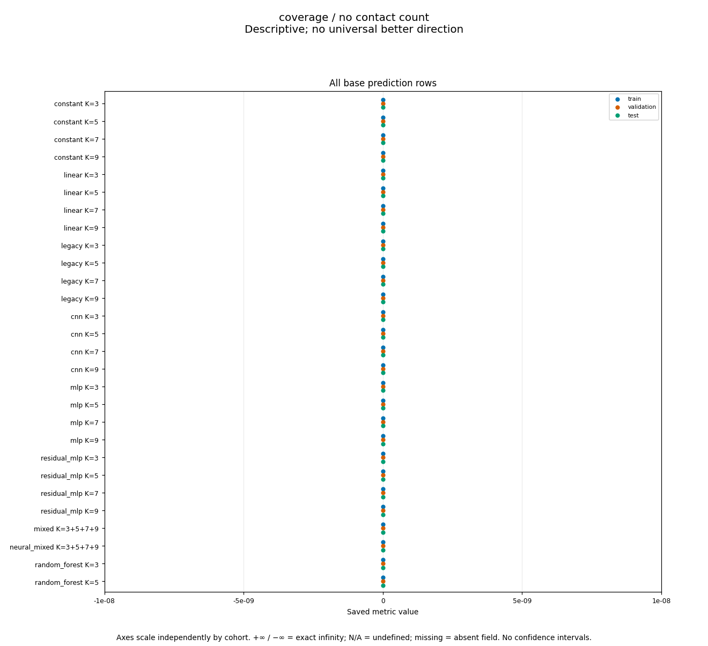

| Model | Train: full rows | Validation: full rows | Test: full rows |
|---|---:|---:|---:|
| constant K=3 (`k3_constant_00_lr0.003_constant`) | 0 | 0 | 0 |
| constant K=5 (`k5_constant_00_lr0.003_constant`) | 0 | 0 | 0 |
| constant K=7 (`k7_constant_00_lr0.003_constant`) | 0 | 0 | 0 |
| constant K=9 (`k9_constant_00_lr0.003_constant`) | 0 | 0 | 0 |
| linear K=3 (`k3_linear_01_lr0.003_constant`) | 0 | 0 | 0 |
| linear K=5 (`k5_linear_01_lr0.003_constant`) | 0 | 0 | 0 |
| linear K=7 (`k7_linear_01_lr0.003_constant`) | 0 | 0 | 0 |
| linear K=9 (`k9_linear_01_lr0.003_constant`) | 0 | 0 | 0 |
| legacy K=3 (`k3_legacy_02_lr0.003_constant`) | 0 | 0 | 0 |
| legacy K=5 (`k5_legacy_02_lr0.003_constant`) | 0 | 0 | 0 |
| legacy K=7 (`k7_legacy_02_lr0.003_constant`) | 0 | 0 | 0 |
| legacy K=9 (`k9_legacy_02_lr0.003_constant`) | 0 | 0 | 0 |
| cnn K=3 (`k3_cnn_03_lr0.003_constant`) | 0 | 0 | 0 |
| cnn K=5 (`k5_cnn_03_lr0.003_constant`) | 0 | 0 | 0 |
| cnn K=7 (`k7_cnn_03_lr0.003_constant`) | 0 | 0 | 0 |
| cnn K=9 (`k9_cnn_03_lr0.003_constant`) | 0 | 0 | 0 |
| mlp K=3 (`k3_mlp_04_lr0.003_constant`) | 0 | 0 | 0 |
| mlp K=5 (`k5_mlp_05_lr0.003_constant`) | 0 | 0 | 0 |
| mlp K=7 (`k7_mlp_04_lr0.003_constant`) | 0 | 0 | 0 |
| mlp K=9 (`k9_mlp_04_lr0.003_constant`) | 0 | 0 | 0 |
| residual_mlp K=3 (`k3_residual_mlp_08_lr0.003_constant`) | 0 | 0 | 0 |
| residual_mlp K=5 (`k5_residual_mlp_09_lr0.003_constant`) | 0 | 0 | 0 |
| residual_mlp K=7 (`k7_residual_mlp_08_lr0.003_constant`) | 0 | 0 | 0 |
| residual_mlp K=9 (`k9_residual_mlp_08_lr0.003_constant`) | 0 | 0 | 0 |
| mixed K=3+5+7+9 (`mixed_3_5_7_9_00_lr0.003_constant`) | 0 | 0 | 0 |
| neural_mixed K=3+5+7+9 (`neural_mixed_3_5_7_9_00_lr0.003_constant`) | 0 | 0 | 0 |
| random_forest K=3 (`rf3_depth8`) | 0 | 0 | 0 |
| random_forest K=5 (`rf5_depth8`) | 0 | 0 | 0 |

#### coverage / no contact probability max

Saved field: `coverage.no_contact_probability_max`. Descriptive; no universal better direction.

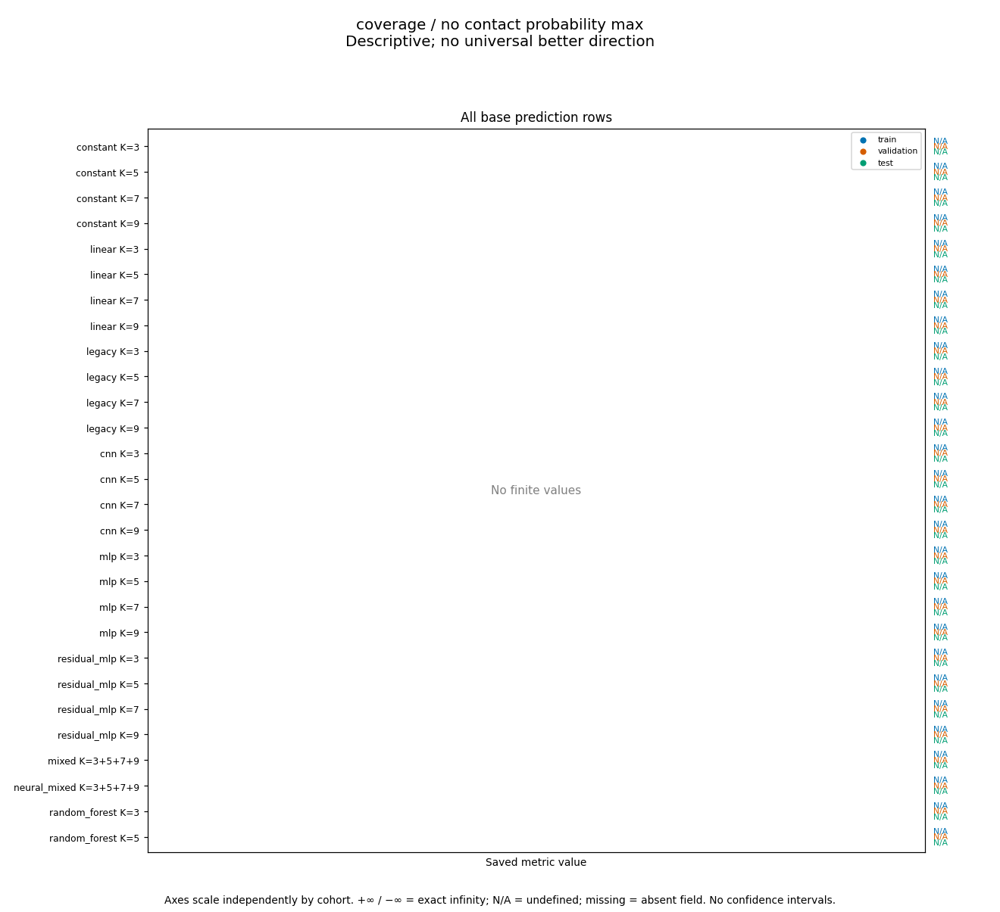

| Model | Train: full rows | Validation: full rows | Test: full rows |
|---|---:|---:|---:|
| constant K=3 (`k3_constant_00_lr0.003_constant`) | N/A | N/A | N/A |
| constant K=5 (`k5_constant_00_lr0.003_constant`) | N/A | N/A | N/A |
| constant K=7 (`k7_constant_00_lr0.003_constant`) | N/A | N/A | N/A |
| constant K=9 (`k9_constant_00_lr0.003_constant`) | N/A | N/A | N/A |
| linear K=3 (`k3_linear_01_lr0.003_constant`) | N/A | N/A | N/A |
| linear K=5 (`k5_linear_01_lr0.003_constant`) | N/A | N/A | N/A |
| linear K=7 (`k7_linear_01_lr0.003_constant`) | N/A | N/A | N/A |
| linear K=9 (`k9_linear_01_lr0.003_constant`) | N/A | N/A | N/A |
| legacy K=3 (`k3_legacy_02_lr0.003_constant`) | N/A | N/A | N/A |
| legacy K=5 (`k5_legacy_02_lr0.003_constant`) | N/A | N/A | N/A |
| legacy K=7 (`k7_legacy_02_lr0.003_constant`) | N/A | N/A | N/A |
| legacy K=9 (`k9_legacy_02_lr0.003_constant`) | N/A | N/A | N/A |
| cnn K=3 (`k3_cnn_03_lr0.003_constant`) | N/A | N/A | N/A |
| cnn K=5 (`k5_cnn_03_lr0.003_constant`) | N/A | N/A | N/A |
| cnn K=7 (`k7_cnn_03_lr0.003_constant`) | N/A | N/A | N/A |
| cnn K=9 (`k9_cnn_03_lr0.003_constant`) | N/A | N/A | N/A |
| mlp K=3 (`k3_mlp_04_lr0.003_constant`) | N/A | N/A | N/A |
| mlp K=5 (`k5_mlp_05_lr0.003_constant`) | N/A | N/A | N/A |
| mlp K=7 (`k7_mlp_04_lr0.003_constant`) | N/A | N/A | N/A |
| mlp K=9 (`k9_mlp_04_lr0.003_constant`) | N/A | N/A | N/A |
| residual_mlp K=3 (`k3_residual_mlp_08_lr0.003_constant`) | N/A | N/A | N/A |
| residual_mlp K=5 (`k5_residual_mlp_09_lr0.003_constant`) | N/A | N/A | N/A |
| residual_mlp K=7 (`k7_residual_mlp_08_lr0.003_constant`) | N/A | N/A | N/A |
| residual_mlp K=9 (`k9_residual_mlp_08_lr0.003_constant`) | N/A | N/A | N/A |
| mixed K=3+5+7+9 (`mixed_3_5_7_9_00_lr0.003_constant`) | N/A | N/A | N/A |
| neural_mixed K=3+5+7+9 (`neural_mixed_3_5_7_9_00_lr0.003_constant`) | N/A | N/A | N/A |
| random_forest K=3 (`rf3_depth8`) | N/A | N/A | N/A |
| random_forest K=5 (`rf5_depth8`) | N/A | N/A | N/A |

#### coverage / predicted count

Saved field: `coverage.predicted_count`. Descriptive; no universal better direction.

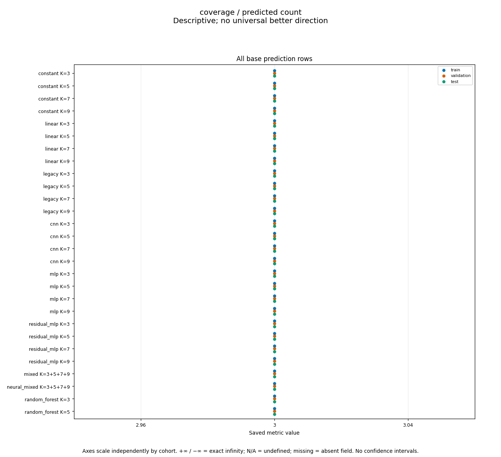

| Model | Train: full rows | Validation: full rows | Test: full rows |
|---|---:|---:|---:|
| constant K=3 (`k3_constant_00_lr0.003_constant`) | 3 | 3 | 3 |
| constant K=5 (`k5_constant_00_lr0.003_constant`) | 3 | 3 | 3 |
| constant K=7 (`k7_constant_00_lr0.003_constant`) | 3 | 3 | 3 |
| constant K=9 (`k9_constant_00_lr0.003_constant`) | 3 | 3 | 3 |
| linear K=3 (`k3_linear_01_lr0.003_constant`) | 3 | 3 | 3 |
| linear K=5 (`k5_linear_01_lr0.003_constant`) | 3 | 3 | 3 |
| linear K=7 (`k7_linear_01_lr0.003_constant`) | 3 | 3 | 3 |
| linear K=9 (`k9_linear_01_lr0.003_constant`) | 3 | 3 | 3 |
| legacy K=3 (`k3_legacy_02_lr0.003_constant`) | 3 | 3 | 3 |
| legacy K=5 (`k5_legacy_02_lr0.003_constant`) | 3 | 3 | 3 |
| legacy K=7 (`k7_legacy_02_lr0.003_constant`) | 3 | 3 | 3 |
| legacy K=9 (`k9_legacy_02_lr0.003_constant`) | 3 | 3 | 3 |
| cnn K=3 (`k3_cnn_03_lr0.003_constant`) | 3 | 3 | 3 |
| cnn K=5 (`k5_cnn_03_lr0.003_constant`) | 3 | 3 | 3 |
| cnn K=7 (`k7_cnn_03_lr0.003_constant`) | 3 | 3 | 3 |
| cnn K=9 (`k9_cnn_03_lr0.003_constant`) | 3 | 3 | 3 |
| mlp K=3 (`k3_mlp_04_lr0.003_constant`) | 3 | 3 | 3 |
| mlp K=5 (`k5_mlp_05_lr0.003_constant`) | 3 | 3 | 3 |
| mlp K=7 (`k7_mlp_04_lr0.003_constant`) | 3 | 3 | 3 |
| mlp K=9 (`k9_mlp_04_lr0.003_constant`) | 3 | 3 | 3 |
| residual_mlp K=3 (`k3_residual_mlp_08_lr0.003_constant`) | 3 | 3 | 3 |
| residual_mlp K=5 (`k5_residual_mlp_09_lr0.003_constant`) | 3 | 3 | 3 |
| residual_mlp K=7 (`k7_residual_mlp_08_lr0.003_constant`) | 3 | 3 | 3 |
| residual_mlp K=9 (`k9_residual_mlp_08_lr0.003_constant`) | 3 | 3 | 3 |
| mixed K=3+5+7+9 (`mixed_3_5_7_9_00_lr0.003_constant`) | 3 | 3 | 3 |
| neural_mixed K=3+5+7+9 (`neural_mixed_3_5_7_9_00_lr0.003_constant`) | 3 | 3 | 3 |
| random_forest K=3 (`rf3_depth8`) | 3 | 3 | 3 |
| random_forest K=5 (`rf5_depth8`) | 3 | 3 | 3 |

### Reliability curves and calibration bins

Each point is a populated, prespecified probability bin. Its horizontal coordinate is the weighted mean prediction and its vertical coordinate is the weighted observed outcome rate. Empty bins are retained in the bin CSV and create gaps in curves. The diagonal represents equal predicted and observed bin means. These are descriptive pooled summaries without confidence intervals or independent-cell assumptions. ECE is Σ_b(W_b/W)|p̄_b−ȳ_b| and appears above as a scalar metric.

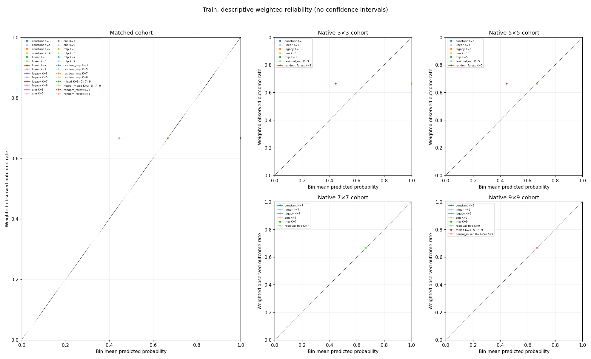

