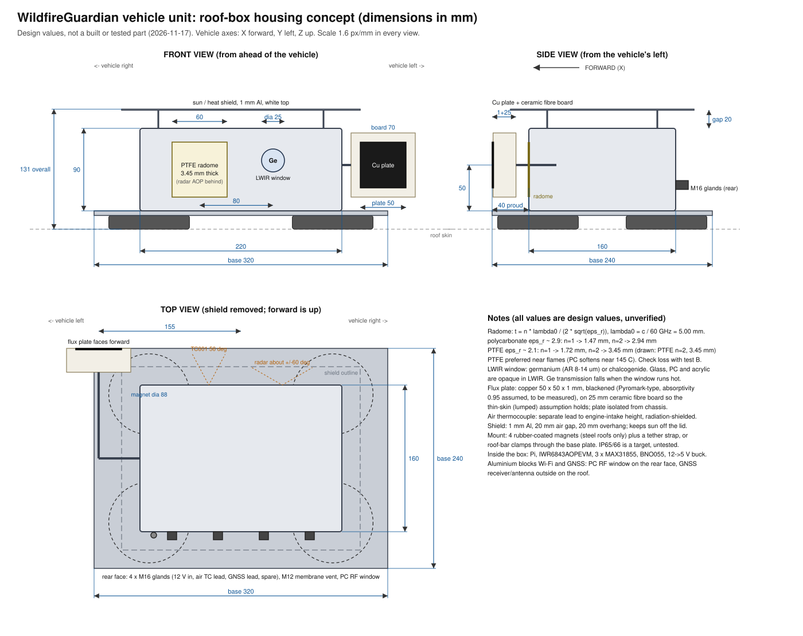

# Vehicle unit housing (roof-box concept)

Status 2026-11-17: this is a concept drawing and a parametric model. Nothing has been fabricated, fitted, sealed,
heated, sprayed or driven. The ingress rating (IP65/66) is a target, not a result. Every number below is a
design value or a handbook value, and is marked where it must be measured.

Files:
- [`housing.svg`](housing.svg): front, side and top views with dimensions in mm (generated by
  `make_drawings.py`).
- [`housing.scad`](housing.scad): parametric OpenSCAD model. Its parameters have the same names as `HOUSING` in
  `make_drawings.py`, and `test_docs.py` checks that they agree. OpenSCAD was not installed on the machine where
  this was written, so the `.scad` file has been syntax-checked by the tests but **not rendered**.



Axes are X forward, Y to the vehicle's left, Z up. Z = 0 is the roof skin.

## 1. Layout and main dimensions

| Part | Design value | Notes |
|---|---|---|
| Enclosure | 160 (X) x 220 (Y) x 90 (Z) mm external, 3 mm die-cast aluminium, gasketed lid | Choose a stock die-cast box close to this size. It holds the Pi, IWR6843AOPEVM, 3 x MAX31855, BNO055 and the 12->5 V buck. |
| Base plate | 240 x 320 x 5 mm aluminium | Carries the enclosure, the plate bracket and the mounts. |
| Mounts | 4 rubber-coated pot magnets, 88 mm dia, 15 mm high, **plus a tether strap** | Magnets work on steel roofs only. The alternative is roof-bar clamps (U-bolts) through the base plate. |
| Sun/heat shield | 1 mm aluminium, white top, 20 mm air gap above the lid, 20 mm overhang | Keeps direct sun and some radiant heat off the lid. It must not cut into the radar or camera field of view (it does not in the drawing: the shield edge is about 70 deg above the camera axis). |
| Radar window | 60 x 60 mm opening in the front face, radome slab behind it | Centre Y = -45 mm (vehicle right), 45 mm above the enclosure floor. |
| LWIR window | 25 mm dia germanium, 2 mm thick | Centre Y = +35 mm, 55 mm above the floor. Camera and radar boresights are 80 mm apart. |
| Flux plate | Copper, 50 x 50 x 1 mm, on 70 x 70 x 25 mm ceramic fibre board | Outboard on the vehicle-left side, front face 40 mm ahead of the enclosure front, centre 50 mm above the floor. |
| Rear face | 4 x M16 cable glands (12 V in, air thermocouple lead, GNSS lead, spare), M12 membrane vent, 80 x 30 mm polycarbonate RF window | See section 6. |
| Overall height | 131 mm above the roof skin | Magnets 15 + base 5 + box 90 + gap 20 + shield 1. |

## 2. Radar radome (IWR6843AOP, 60-64 GHz)

A flat dielectric slab is nearly transparent at normal incidence when its thickness is a whole number of half
wavelengths *inside the material*:

```
t_n = n * lambda0 / (2 * sqrt(eps_r)),   lambda0 = c / f = 299.79e6 m/s / 60e9 Hz = 4.997 mm
```

| Material | eps_r (typical, measure your sheet) | n = 1 | n = 2 | n = 3 |
|---|---|---|---|---|
| Polycarbonate | ~2.9 | **1.47 mm** | 2.93 mm | 4.40 mm |
| PTFE | ~2.1 | **1.72 mm** | 3.45 mm | 5.17 mm |

- The stock demo chirps sweep roughly 60-64 GHz. At 62 GHz the n = 1 values are 1.42 mm (PC) and 1.67 mm (PTFE),
  so a slab matched at 60 GHz is slightly off at mid-band. Thinner multiples (n = 1) are less sensitive to this.
  Thickness tolerance and eps_r uncertainty matter more than the choice of n.
- **Drawn: PTFE, n = 2, 3.45 mm.** PTFE keeps its properties up to about 260 C. Polycarbonate softens near its
  glass transition (~145 C), which matters next to a flame front. n = 2 is chosen for stiffness and impact
  resistance over a 60 mm span. n = 1 PTFE (1.72 mm) is the alternative if test B shows too much loss.
- Keep the slab parallel to the antenna, with no metal, paint containing metal, or labels in the aperture. The
  window must also cover the antenna's useful cone. For an aperture of size a at gap g, the needed opening is
  about a + 2 g tan(theta). With a 60 deg half angle and g = 10 mm, the cone adds about 35 mm to the antenna
  size. The 60 mm opening clears the central beam but clips the extreme angles; the decision logic uses
  near-boresight bins.
- **To be measured (test B, corner reflector at 2-5 m):** return level with and without the radome, and with a
  wet radome (water film is very lossy at 60 GHz). Until then the radome loss is unknown.

## 3. Thermal camera window (TC001, LWIR 8-14 um)

- **Glass, polycarbonate and acrylic are opaque in the LWIR band.** Behind one of them the camera sees the
  window, not the scene.
- Use **germanium** (anti-reflection coated for 8-14 um, transmission about 0.9 when cool) or a **chalcogenide**
  glass window. Every window lowers apparent temperatures and adds its own emission. The laptop's `flame_mask`
  threshold (300 C) is coarse enough that this matters less than for radiometry. A window correction has not
  been measured.
- Germanium transmission falls as the window heats (free-carrier absorption, noticeable above roughly 100 C).
  Its thermal environment is therefore part of what test F must watch.
- **Option without a window:** an open aperture with a spring shutter that closes when idle, or an air knife
  across the lens. This is cheaper and loses no transmission, but lets in water and ash. The concept drawing
  uses the germanium window.
- Clearance: with a lens of diameter a and the window g mm in front of it, the opening must be at least
  a + 2 g tan(28 deg) to clear the 56 deg horizontal field of view. With g = 5 mm and a lens under 10 mm, the
  25 mm window is ample. Vertically, with the camera pitched 18 deg down (below), the lowest ray leaves at
  18 + 21 = 39 deg below horizontal: the opening must reach a/2 + g tan(39 deg) = 5 + 4.0 = 9.0 mm below the lens
  axis and a/2 + g tan(3 deg) = 5.3 mm above it, inside the 12.5 mm radius of the 25 mm window.
- **Camera mount angle: 18 deg nose-down** relative to the enclosure (which also holds the BNO055), on a wedge or
  slotted bracket; `config/unit.yaml` `mount.camera_pitch_deg: -18.0` (+ up convention). Why: with a 42 deg vertical
  field of view at 2.6 m, a level camera sees no ground nearer than 2.6 / tan(21 deg) = 6.8 m, so a close flame's
  base is cut off by the bottom of the image. At 18 deg down the nearest visible ground is 2.6 / tan(39 deg) =
  3.2 m and the top of the image is still 3 deg above horizontal (the horizon is about 15 px below the top row).
  Cost: flames taller than 2.6 + d tan(3 deg) (3.1 m at 10 m, 4.2 m at 30 m) are cut by the top edge, and the
  horizon leaves the frame when the vehicle is more than 3 deg nose-down. The drawings (`housing.svg`,
  `housing.scad`) still show the camera level; the bracket is not drawn. **The real angle must be measured** on
  the vehicle (inclinometer on the camera face, minus the enclosure's own pitch) and written into
  `config/unit.yaml`; the unit sends it to the laptop in its `hello` message.

## 4. Copper flux plate (`tc_plate`)

- Copper, **50 x 50 x 1 mm**, blackened with a high-temperature paint (Pyromark-type), cured per the maker's
  schedule. **Absorptivity 0.95 and emissivity 0.95 are assumed** (DESIGN.md section 6.1 `PlateSpec`) and must be
  measured.
- **Thin-skin (lumped) assumption.** With a 1 mm plate, the Biot number h d / k ~ 50 x 0.001 / 390 ~ 1e-4, so the
  plate is isothermal through its thickness. The heat balance is
  rho c d dT/dt = alpha q_inc - loss(T), with rho c d = 8960 x 385 x 0.001 ~ 3450 J/(m2 K). At 20 kW/m2 incident,
  the plate warms at about 5.5 K/s.
- **Insulated backing.** 25 mm of ceramic fibre board (k ~ 0.1 W/(m K), handbook value) behind the plate keeps
  the rear loss small compared with the front exchange. The rear loss is not zero: the board conducts and heats
  up. The cooldown fit (`flux.fit_cooldown`) lumps the rear loss into its convective term h. **Repeat the fit
  after any change to the backing.**
- **Electrical isolation.** The thermocouple is welded or peened into the plate (WIRING.md section 4), so the
  plate must not touch the chassis. Hold the board in a bracket with ceramic spacers or washers. A
  grounded plate gives `fault = "short_gnd"`.
- **Proud of the housing, facing forward:** the front face is 40 mm ahead of the enclosure, outboard on the
  vehicle-left side. In the drawing it is about 70 deg off the camera axis and about 80 deg off the radar axis,
  so it sees the scene ahead without the enclosure shading it or the sensors seeing the plate.

## 5. Intake-height air thermocouple (`tc_air`)

- This probe stands in for the air the engine breathes. It is mounted on a **separate type-K extension lead**
  (about 3 m) at the vehicle's engine-intake height (vehicle-specific; for example at the grille). The lead
  enters the roof box through its own gland.
- **Radiation shield:** two concentric polished stainless tubes (for example 20 and 32 mm diameter, 80 mm
  long, open ends) with the ungrounded sheathed junction (~1.5 mm) centred inside. The shield reduces but does
  not remove radiant error. Under tens of kW/m2 the probe still reads high, and that error has **not been
  quantified**.
- The probe's time constant (several seconds for a 1.5 mm sheath) is not measured.

## 6. Sealing, venting, RF and the GNSS antenna

- **Target IP65/66 (unverified).** The lid is gasketed. Use IP68-rated M16 cable glands sized to each cable,
  and a membrane vent (M12) to equalise pressure and limit condensation when a hot box meets water spray.
- **Aluminium blocks Wi-Fi and GNSS.** The Pi hotspot (DESIGN.md: `10.42.0.1`, the Pi's own Wi-Fi) needs an RF
  path. The concept uses an 80 x 30 mm polycarbonate window in the rear face near the Pi's antenna. The
  alternative is a USB Wi-Fi adapter with a bulkhead antenna. That would move the hotspot to another interface,
  which `system/hotspot.sh` would have to know about.
- The GNSS receiver or puck sits **outside** the box on the roof, with its lead through a gland.

## 7. Temperature limits inside the box

These are datasheet and handbook figures, to be checked against the actual parts. The "unit limit" column holds
**placeholders**, not tested values.

| Part | Published limit (check the datasheet) | Behaviour |
|---|---|---|
| Raspberry Pi 4 / 5 | Board ambient 0-50 C (product brief); SoC soft throttle from 80 C, harder at 85 C | Throttling shows in `pi.throttled_hex`. CPU temperature is in `pi.cpu_c`. |
| IWR6843AOP device | Junction -40 to 105 C | EVM-level parts (USB bridge, regulators) may be lower; see the EVM user guide. |
| Topdon TC001 | Operating range per the Topdon specification (not checked here) | Its image drifts as the body warms. The shutter (FFC) frequency rises. |
| MAX31855 | Operating -40 to 125 C; accuracy is specified for die temperatures -20 to 85 C | The cold junction is the die, so a hot box shifts `cj_c`. |
| BNO055 | -40 to 85 C | |
| 12->5 V buck | Per its datasheet (derates when hot) | |
| **Unit limit (placeholder)** | `tc_housing` warn at 50 C; above 60 C the unit should be treated as out of its envelope | To be set from test F results. The laptop does not use `tc_housing` in decisions (DESIGN.md section 8 required-sensor lists). It is shown as health information. |

## 8. Test F: water spray and hot-air gun (expectations, not results)

Test F checks that the unit keeps running and keeps reporting truthfully while it is wet and hot. The test
protocol and results belong in `apps/crossing/field_tests/` and `apps/crossing/RESULTS.md`.

| Step | Expected | Fail if |
|---|---|---|
| Water spray (garden hose or spray nozzle, all faces, about 5 min, with the unit running and recording) | The unit keeps streaming. No water inside (check with paper towel and tc_housing). `pi.under_voltage_*` stays false. Radar frames keep coming. Radar returns may drop while the radome is wet. Thermal readings stay plausible. | Any reboot, a lost WebSocket, water inside, or a sensor that silently stops while its heartbeat says "ok". |
| Hot-air gun on the front face and the shield (stand-in for radiant heat; not a flame) | `tc_housing` rises slowly, `pi.cpu_c` stays below the throttle point, and the radome and germanium window show no damage. | Throttling, a radome that deforms, or a `tc_housing` reading over the placeholder limit while the Pi claims to be healthy. |
| Hot-air gun on the flux plate | `tc_plate` rises and falls smoothly. The laptop shows a flux pulse. No `short_gnd` fault. | Faults, a step in the reading, or a reading that falls while heat is applied (polarity). |
| Hot-air gun on the air probe | `tc_air` rises. The laptop CLOSES if it exceeds the vehicle's (placeholder) intake limit. | No CLOSED above the limit. |
| Spray on the radome while the laptop runs | The laptop shows no FLAME status from water alone (smoke and mist must not trigger). | Any CROSS FAST or REOPENED caused by the spray. |

## 9. Not verified

- No enclosure has been bought, machined or assembled. Board positions inside the box have not been fitted.
- IP65/66: no ingress test has been done.
- The radome thickness rests on handbook eps_r values. Radar loss through the radome has not been measured,
  dry or wet.
- Germanium window transmission, its effect on TC001 readings, and its behaviour when hot have not been measured.
- Plate absorptivity (0.95 assumed), the rear loss through the board, and the plate's isolation from the chassis
  have not been measured.
- The air probe's radiation error and time constant have not been measured.
- Internal temperatures under sun and near flame have not been measured. The 50/60 C limits are placeholders.
- Magnet holding force at speed and under braking has not been tested. Wind load on the plate bracket has not
  been calculated.
- `housing.scad` has not been rendered (no OpenSCAD on the authoring machine). Its dimensions agree with the
  SVG by test, not by inspection of a 3D model.
