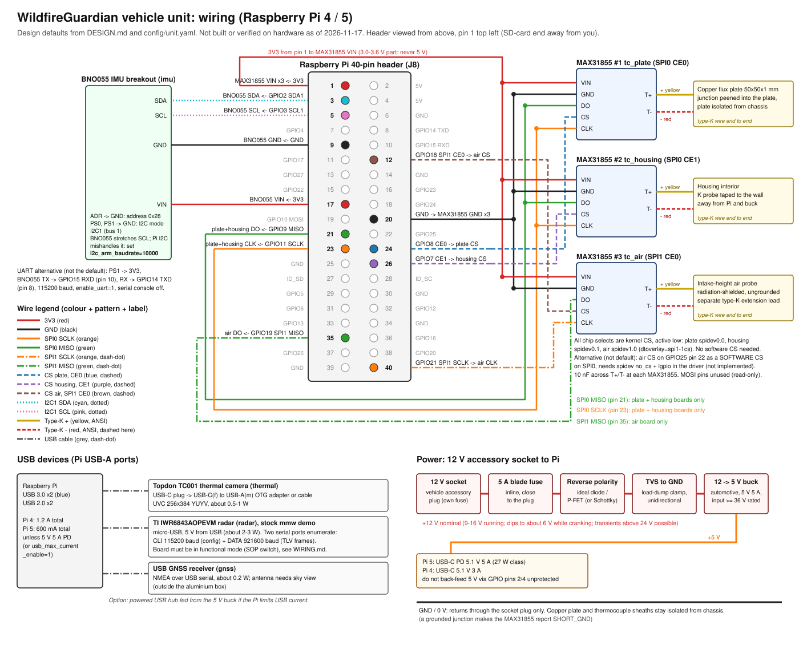

# Vehicle unit wiring

Status 2026-11-17: pin map from the user's printed build manual (2026-11-17). This page follows that manual
exactly. Nothing on this page has been wired, powered or measured by this project. The pin assignments match
[`../config/unit.yaml`](../config/unit.yaml) (section 8). The protocol and sensor names come from
[`../DESIGN.md`](../DESIGN.md).

Drawing: [`wiring.svg`](wiring.svg), generated by `make_drawings.py` from one pin list (`PIN_MAP`), the same list as
the table in section 2. `test_docs.py` checks the table, the drawing, `config/unit.yaml` and the README against the
user's map.



## 1. What connects where

| Device | Protocol sensor name | Interface on the Pi | Linux device (typical) |
|---|---|---|---|
| MAX31855 #1, copper flux disc thermocouple | `tc_plate` | SPI0, CE0 = GPIO8 (kernel chip select) | `/dev/spidev0.0` |
| MAX31855 #2, housing thermocouple | `tc_housing` | SPI0, CE1 = GPIO7 (kernel chip select) | `/dev/spidev0.1` |
| MAX31855 #3, intake-height air thermocouple | `tc_air` | SPI0 SCLK/MISO, chip select GPIO5 driven by the driver (software chip select) | `/dev/spidev0.0` opened with `no_cs`, plus GPIO5 |
| BNO055 IMU | `imu` | I2C1, address 0x28 | `/dev/i2c-1` |
| InfiRay P2 Pro thermal camera (USB id 0bda:5830; same 256x384 frame as the Topdon TC001) | `thermal` | USB (UVC) | `/dev/videoN` |
| TI IWR6843AOPEVM radar, stock demo | `radar` | USB, two serial ports (CLI 115200, data 921600) | `/dev/ttyUSB0/1` or `/dev/ttyACM0/1` |
| USB GNSS receiver | `gnss` | USB serial (NMEA) | `/dev/ttyACM0` or `/dev/ttyUSB0` |
| Pi itself | `pi` | on-board (`vcgencmd`, thermal zone) | none |

`config/unit.yaml` names `/dev/ttyUSB0`, `/dev/ttyUSB1` (radar) and `/dev/ttyACM0` (GNSS). Those numbers change with
plug order. On the real unit, replace them with `/dev/serial/by-id/...` paths.

## 2. 40-pin header (J8), pins in use

Pin 1 is the square pad, at the corner nearest the board edge away from the USB/Ethernet ports. Odd pins are the
inner row (towards the SoC), even pins the outer row. Pi 4 and Pi 5 share this pinout.

| Pin | Pi signal | Net | Goes to | Wire colour in wiring.svg |
|---|---|---|---|---|
| 1 | 3V3 | 3V3 | BNO055 VIN (3.3 V) | red, solid |
| 3 | GPIO2 SDA1 | SDA | BNO055 SDA | cyan, dotted |
| 5 | GPIO3 SCL1 | SCL | BNO055 SCL | pink, dotted |
| 6 | GND | GND | BNO055 GND | black, solid |
| 17 | 3V3 | 3V3 | VIN of all three MAX31855 boards | red, solid |
| 20 | GND | GND | GND of all three MAX31855 boards | black, solid |
| 21 | GPIO9 SPI0 MISO | MISO | DO (SO) of all three MAX31855 boards | green, solid |
| 23 | GPIO11 SPI0 SCLK | SCLK | CLK of all three MAX31855 boards | orange, solid |
| 24 | GPIO8 SPI0 CE0 | CS_PLATE | CS of MAX31855 #1 (`tc_plate`, flux plate) | blue, dashed |
| 26 | GPIO7 SPI0 CE1 | CS_HOUSING | CS of MAX31855 #2 (`tc_housing`) | purple, dashed |
| 29 | GPIO5 | CS_AIR | CS of MAX31855 #3 (`tc_air`, intake air), software chip select | brown, dashed |

Not used: pin 19 (SPI0 MOSI). The MAX31855 has no data input, so leave it unconnected. Pins 2 and 4 (5 V) are not
used for power (section 7).

Each colour in the drawing also has a dash pattern and a text label, so the drawing still reads in greyscale and for
colour-blind readers. In the real harness, label both ends of every wire (for example `CS-AIR / P29`).

## 3. Three MAX31855 boards on SPI0

The MAX31855 is a read-only SPI device: the Pi drives CS low, clocks 32 bits out of DO, and drives CS high again. It
runs on 3.0-3.6 V, so it gets **3V3, never 5 V**. SPI mode 0. The chip allows up to 5 MHz; the driver default is
1 MHz (`spi_hz`). One conversion takes up to 100 ms, so 10 Hz is the useful maximum rate.

- All three boards share **3V3 (pin 17)**, **GND (pin 20)**, **CLK = GPIO11 (pin 23)** and **DO = GPIO9 MISO
  (pin 21)**. A MAX31855 drives DO only while its own CS is low, so sharing DO is safe as long as only one CS is low
  at a time. Every CS idles high.
- **`tc_plate`** (flux plate): CE0 = **GPIO8, pin 24**. `spidev` bus 0, device 0 (`/dev/spidev0.0`), kernel chip
  select.
- **`tc_housing`**: CE1 = **GPIO7, pin 26**. `spidev` bus 0, device 1 (`/dev/spidev0.1`), kernel chip select.
- **`tc_air`** (intake air): **GPIO5, pin 29**, software chip select (section 3.1). `config/unit.yaml`:
  `spi_bus: 0`, `spi_dev: 0`, `cs_gpio: 5`.
- A **10 nF capacitor across T+ and T-** at each MAX31855 (datasheet recommendation) filters noise. Most breakout
  boards already fit one; check the board.
- Keep the three boards away from the Pi SoC and the buck converter. The cold junction is the MAX31855 die itself,
  so a temperature gradient between the screw terminal and the chip shows up as error.

### 3.1 Software chip select on GPIO5 (`tc_air`)

This is the design (the user's build manual), not an alternative. How the driver (`wfgvu/drivers/max31855.py`) is
meant to read the air board:

1. It opens `/dev/spidev0.0` with `no_cs = True`, so that the kernel does **not** assert CE0 (GPIO8) for this
   transfer.
2. It holds **one lock shared with `tc_plate` and `tc_housing`**, so that no CE0/CE1 transfer runs while GPIO5 is
   low and GPIO5 is never low during theirs.
3. Under that lock it drives GPIO5 low (with `lgpio` / `gpiod`; on Bookworm `python3-lgpio`; `RPi.GPIO` does not
   work on a Pi 5), reads 4 bytes, and drives GPIO5 high again.
4. **Fail closed:** if the kernel refuses `no_cs` (some SPI controller drivers reject `SPI_NO_CS`; the driver checks
   the kernel's own mode byte, not py-spidev's cached value), the driver reports a fault for `tc_air` (no reading,
   heartbeat not "ok"). If GPIO5 cannot be claimed, ALL THREE thermocouple channels fault (`tc_plate`, `tc_housing`
   and `tc_air` report `no_device`): GPIO5's state is then unknown and could select the air chip during a plate
   read, so no channel on SPI0 reads. It never falls back to reading with CE0 asserted: CE0 and GPIO5 low together
   would put two chips on DO and give garbage. The laptop then gives CLOSED, because the thermocouples are required
   for every go verdict.

**GPIO5 at reset.** On the Pi 4 (BCM2711) GPIO0-8 come out of reset with the internal pull-**up** enabled (about
50 kOhm), so GPIO5 idles high and the air chip stays deselected during boot. The Pi 5 (RP1) reset pull state has not
been checked here. **Advice (not a pin change): fit a 10 kOhm pull-up from GPIO5 (pin 29) to 3V3.** It keeps the air
chip deselected on either Pi, while the line is unclaimed between boot and the driver start, and if a later overlay
changes the internal pull. The internal pull alone is weak against noise on a harness lead. Optional, also advice:
`gpio=5=op,dh` in `/boot/firmware/config.txt` drives GPIO5 high from early boot.

How to check it on the bench: `python3 -m wfgvu.tccheck` (README "First run") reads all three boards. Warm only the
flux-plate junction: only `tc_plate` may rise. Warm only the air probe: only `tc_air` may rise. A reading on the
wrong channel, or garbage on both plate and air, means a chip-select problem.

## 4. Thermocouples (type K)

| Item | Rule |
|---|---|
| Wire | Type-K thermocouple or type-K extension (KX) wire **all the way** from the junction to the MAX31855 terminal. No copper wire, copper PCB track, or ordinary connector anywhere in the loop: every copper-to-K joint away from the cold junction adds a spurious junction. |
| Connectors | Type-K miniature thermocouple connectors (yellow body in ANSI colours), or no connector at all. |
| Polarity, ANSI/ASTM E230 (US) | Yellow jacket. **+ (chromel) = yellow**, **- (alumel) = red**. Red is negative, the opposite of power-wiring habit. |
| Polarity, IEC 60584 (EU/KR stock) | Green jacket. + = green, - = white. Check which standard your probes follow. |
| Reversed polarity | Reads roughly the negative of the true rise above the cold junction. Check with a hot-air gun: the reading must go **up**. |
| Isolation | The MAX31855 detects a thermocouple shorted to GND or VCC (`fault = "short_gnd"`/`"short_vcc"`). Use ungrounded junctions and keep every junction and sheath electrically isolated from the chassis, the aluminium heat shield and the vehicle. |
| Disc junction | Peen or spot-weld the two K wires into the copper disc. By the law of intermediate metals the copper is allowed in the junction because both wires join it at the same temperature. The disc sits on printed PETG tabs, which keep it isolated (see HOUSING.md section 4). **Flux runs stop and warn at 70 C disc temperature** (PETG tabs). |
| Housing junction | Glass-fibre or PTFE insulated K junction taped (Kapton) to the inside of the housing wall, away from the Pi and the buck. |
| Air junction | Ungrounded, sheathed probe (about 1.5 mm) inside a radiation shield, at engine-intake height, on its own type-K extension lead (about 3 m). |
| Routing | Twist each pair. Keep it away from the buck converter and the 12 V lead. |

## 5. BNO055 on I2C1

- **VIN to 3V3 (pin 1), GND to pin 6, SDA to GPIO2 (pin 3), SCL to GPIO3 (pin 5).** Most breakouts (Adafruit-style)
  carry their own 10 kOhm pull-ups and a 3.3 V regulator. The Pi also has 1.8 kOhm pull-ups on GPIO2/3.
- **Address 0x28:** ADR/COM3 pin low (the breakout default). Address 0x29 is ADR high. The driver default
  (`address`) is 0x28.
- **Mode:** PS0 and PS1 low gives I2C (the breakout default).
- **Clock-stretching problem:** the BNO055 stretches SCL, and the Raspberry Pi hardware I2C controller handles clock
  stretching badly. The symptoms are NACKs, wrong bytes, or Euler angles that jump. The fixes, in order of
  preference:
  1. Slow the bus. In `/boot/firmware/config.txt` (Bookworm), set `dtparam=i2c_arm=on` and
     `dtparam=i2c_arm_baudrate=10000`, then reboot.
  2. Use the software `i2c-gpio` overlay, which handles stretching. This puts the IMU on another bus number, so
     `i2c_bus` in `config/unit.yaml` must change (and the pins would no longer match the build manual).
  3. **UART mode:** PS1 high (3V3), PS0 low. BNO055 TX goes to GPIO15/RXD (pin 10) and RX to GPIO14/TXD (pin 8), at
     115200 baud. Set `enable_uart=1` and turn the serial console off. This needs a UART driver path, which
     `wfgvu/drivers/bno055.py` does not have today (I2C only).

  Whether the Pi 5 controller (on the RP1 chip) still shows the problem has not been checked. Keep the 10 kHz setting
  until it has been tested.
- Mount the BNO055 rigidly to the housing floor (on the rails) with its axes along the vehicle axes, and record the
  axis remap (`axis_map_config`, `axis_map_sign`) in `config/unit.yaml`. Magnetic heading is unreliable on a steel
  roof. DESIGN.md uses the GNSS course, not the IMU heading, for the slope lookup.

## 6. USB devices

All three devices plug into the Pi's USB-A ports. Use short, strain-relieved cables and right-angle plugs inside the
housing.

- **InfiRay P2 Pro (`thermal`).** USB id **0bda:5830**. It has the same 256x384 YUYV frame as the Topdon TC001
  (lower half = raw temperature x 64), so the driver module keeps its name `thermal_tc001.py` and the sensor keeps the
  name `thermal`. The camera has a USB-C plug meant for a phone; connect it with a USB-C (female) to USB-A (male) OTG
  adapter or cable. It enumerates as a UVC camera (`/dev/videoN`). `config/unit.yaml` `sensors.thermal.index: auto`
  picks the capture node whose USB parent is 0bda:5830; an integer index still works. Check with
  `v4l2-ctl --list-devices` and `lsusb -d 0bda:5830`. Power is about 0.5-1 W (approximate).
- **TI IWR6843AOPEVM (`radar`), stock out-of-box mmWave demo firmware.**
  - One micro-USB cable carries **both power (5 V from the USB port) and data**. Power is about 2-3 W (approximate,
    to be measured).
  - **Two serial ports** enumerate: **CLI** at **115200** baud (the driver sends `config/iwr6843aop_vu.cfg`, the
    long-range default: 128 bins x 0.468 m to 54 m at 10 Hz, about 70 % of the data port without points; UNTESTED on
    the EVM, arithmetic in the file header) and **DATA** at **921600** baud (TLV frames, magic
    `02 01 04 03 06 05 08 07`). Which USB bridge you see depends on the board revision and carrier:
    - With an XDS110 debug probe (for example on an MMWAVEICBOOST carrier), the ports are "XDS110 Class
      Application/User UART" (CLI) and "XDS110 Class Auxiliary Data Port" (data), as `/dev/ttyACM0/1`.
    - The standalone AOPEVM uses a Silicon Labs CP2105 dual UART. Its "Enhanced" port is the CLI and its "Standard"
      port is data, as `/dev/ttyUSB0/1`.

    Identify the ports with `ls -l /dev/serial/by-id/` and put both paths in `config/unit.yaml`. Do not guess from
    the numbers.
  - **Functional mode.** The stock demo runs only when the sense-on-power (SOP) switches select functional mode, not
    flashing mode. Set them according to the EVM user guide for your board revision, power-cycle, and confirm that
    the demo answers on the CLI port. **Our board's switch positions have not been checked.**
  - The firmware is the stock demo. This project does not re-flash it.
- **USB GNSS (`gnss`).** An NMEA receiver at about 0.2 W (approximate). It enumerates as `/dev/ttyACM0` or
  `/dev/ttyUSB0`. Its antenna must see the sky: keep it clear of the aluminium heat shield and outside the housing if
  reception inside is poor.
- **USB current limit.** A Pi 4 supplies 1.2 A in total across its USB ports. A Pi 5 supplies **600 mA** in total
  unless it negotiated a 5 V 5 A USB-PD supply, or `usb_max_current_enable=1` is set and the supply really delivers
  5 A. Camera + EVM + GNSS together may draw 0.6-0.9 A (estimate, MOUNTING_AND_POWER.md section 3). On a Pi 5 with a
  weaker supply, use a powered USB hub fed from the 5 V buck.

## 7. Power and ground

```
12 V accessory socket -- plug (own fuse) -- 5 A blade fuse (inline, near the plug)
   -- reverse-polarity protection (ideal-diode controller / P-FET; a Schottky diode also works but loses ~0.4 V)
   -- TVS diode to ground (load-dump clamp, unidirectional, rated for 12 V vehicle systems)
   -- automotive 12 V -> 5 V buck, 5 A output, input rated >= 36 V, low-voltage operation down to ~6 V if possible
   -- Pi 5: USB-C, 5.1 V 5 A with USB-PD (27 W class) | Pi 4: USB-C, 5.1 V 3 A
```

- **Pi 5:** use a buck with a USB-C PD output that advertises 5 V 5 A. Many car USB-C chargers advertise 5 V 3 A
  only; the Pi 5 then boots but limits USB current to 600 mA (section 6). Hard-wiring 5 V to header pins 2/4 bypasses
  the Pi's input protection.
- **Pi 4:** 5.1 V 3 A through USB-C.
- **Ground:** the unit's 0 V returns through the socket plug only. Do not add a second ground path to the vehicle
  body. Keep thermocouple junctions and sheaths isolated (section 4).
- The behaviour on under-voltage and brown-out is described in [MOUNTING_AND_POWER.md](MOUNTING_AND_POWER.md).

## 8. Defaults in `config/unit.yaml`

The values in `config/unit.yaml` (`sensors:` section). `docs/test_docs.py` loads the file and fails if it disagrees
with this table or with the user's pin map.

| Sensor | Keys | Value | Pins |
|---|---|---|---|
| `tc_plate` | `spi_bus`, `spi_dev` | 0, 0 | CE0 GPIO8 pin 24; SCLK GPIO11 pin 23; MISO GPIO9 pin 21 |
| `tc_housing` | `spi_bus`, `spi_dev` | 0, 1 | CE1 GPIO7 pin 26; SCLK GPIO11 pin 23; MISO GPIO9 pin 21 |
| `tc_air` | `spi_bus`, `spi_dev`, `cs_gpio` | 0, 0, 5 | software CS GPIO5 pin 29; SCLK GPIO11 pin 23; MISO GPIO9 pin 21 |
| `tc_plate` | `disc_max_c` | 70 (user-set) | |
| all `tc_*` | `rate_hz` (driver default `spi_hz` 1000000) | 10 | 3V3 pin 17, GND pin 20 |
| `imu` | `i2c_bus`, `address` | 1, 0x28 | 3V3 pin 1, GND pin 6, SDA GPIO2 pin 3, SCL GPIO3 pin 5 |
| `radar` | `cli_port` / `cli_baud`, `data_port` / `data_baud` | `/dev/ttyUSB0` / 115200, `/dev/ttyUSB1` / 921600 | USB |
| `thermal` | `model`, `usb_id`, `index` | "InfiRay P2 Pro", "0bda:5830", auto | USB |
| `gnss` | `port`, `baud` | `/dev/ttyACM0`, 9600 | USB |

## 9. Bench bring-up checks (to do; none of these has run yet)

1. Enable SPI and I2C: `sudo raspi-config nonint do_spi 0`, `sudo raspi-config nonint do_i2c 0`, add
   `dtparam=i2c_arm_baudrate=10000` to `/boot/firmware/config.txt`, reboot. No other SPI overlay is needed.
2. Run `ls /dev/spidev*`. Expect `spidev0.0` and `spidev0.1` only.
3. Run `i2cdetect -y 1`. Expect `28`.
4. Run `ls -l /dev/serial/by-id/`. Expect the two EVM ports and the GNSS.
5. Run `lsusb -d 0bda:5830` and `v4l2-ctl --list-devices`. Expect the P2 Pro.
6. Run `vcgencmd get_throttled`. Expect `0x0` while all devices run. Bit 0 set means under-voltage now; bit 16 means
   under-voltage has occurred since boot.
7. Stop the service if it runs (`sudo systemctl stop wfgvu`), then run the thermocouple check
   `python3 -m wfgvu.tccheck` (README "First run"). Warm each junction in turn and confirm that only its own channel
   rises (polarity and chip-select mapping). Unplug each probe and confirm `fault = "open"`.
