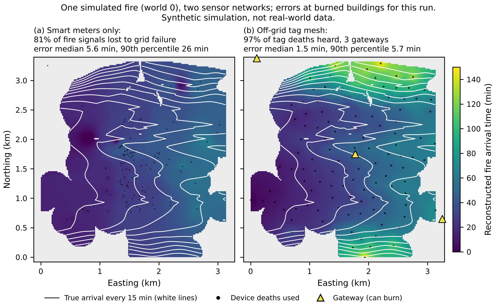

# Last Gasp: what the simulations say

Every number on this page comes from a synthetic simulation of a 10.4 km² area around Yeongdeok-eup. The roads and substation are real (OpenStreetMap); the buildings, fire, power network and radios are simulated. These are not real-world measurements. Each number is in `results/NUMBERS.json` (key in brackets).

## 1. Smart meters fail because the grid dies first (synthetic)

When fire touches a power line, the line trips and every meter downstream goes dark before the flames reach it. With meters on half the buildings:
- 75% of the meters in buildings the fire reached had already lost power upstream [`sweep.meter_density.0.5.frac_fire_censored_by_grid`].
- Only 24% of delivered last-gasp messages were caused by fire at that building [`sweep.meter_density.0.5.frac_deaths_fire`].
- The reconstructed map is off by 5.4 min at the median and 26.7 min at the 90th percentile [`sweep.meter_density.0.5.idw_topology_bldg_med`, `_p90`].
- Adding more meters does not fix this.

## 2. Off-grid tags work if their gateways survive (synthetic)

Battery radio tags every 200 m of road (12 per km²) relay to each other, and a few gateways collect the signals.

| Gateway setup | Tag deaths heard | Error at burned buildings (median / 90th pct) |
|---|---|---|
| Perfect reception (reference) | 100% | 1.5 / 4.9 min [`p2.receive.mesh|exposed|4.perfect_bldg_*`] |
| 3 gateways spread apart | 96% [`p2.placement.spread|3`] | 1.6 / 5.6 min |
| 3 gateways placed for best coverage (clustered) | 60% [`p2.placement.coverage|3`] | 1.9 / 18.9 min |
| 4 gateways placed for best coverage | 77% [`p2.placement.coverage|4`] | 1.8 / 11.4 min |
| 4 gateways on grid power | 59% [`p2.receive_gridpower`] | 2.0 / 19.0 min |

Gateways placed for coverage end up together in the town and the same fire run destroys them all. Spread them apart, and keep every part off the grid.

## 3. What a pilot would need

- **Cost (estimate).** About $1,049 per km² up front and $62 per km² per year for tags every 200 m of road plus 4 solar gateways [`p2.econ.cost_per_km2_roads.200`].
  - Parts per tag: $26.09 [`p2.econ.tag_unit_usd`].
  - Battery life: 3.3 years with a beacon every 30 s [`p2.econ.battery.life_years`].
- **A burn test.** The simulation assumes a tag dies 10 to 120 s after the flames arrive. That has never been measured. Burning a few tags on a test bed is the cheapest decisive experiment.
- **A radio walk test** at 922 MHz in a Gyeongbuk pine forest. No Korean measurements exist, and a pessimistic radio model drops reception to 69% [`p2.receive_lora_pessimistic.mesh|exposed|4.frac_deaths_observed`].

## What is new and what is not

Using a node's last heartbeat as the fire's arrival time is already patented by IBM (US9721458B2, priority 2014).

Our contribution is:
- the arrival-time map reconstructed from many deaths;
- the finding that gateways must be placed for survival, not coverage;
- the requirement that the whole system run off the grid.

---

# Last Gasp: 시뮬레이션 결과 요약

이 페이지의 모든 수치는 영덕읍 일대 10.4 km² 지역을 대상으로 한 가상(합성) 시뮬레이션 결과입니다. 도로와 변전소 위치만 실제 자료(OpenStreetMap)이고, 건물·산불·배전망·무선 통신은 모두 모의한 것입니다. 실제 현장 측정값이 아닙니다. 각 수치는 `results/NUMBERS.json`에 있습니다(대괄호 안이 키 이름).

## 1. 스마트 계량기는 전력망이 먼저 끊겨서 실패합니다 (가상 결과)

산불이 전선에 닿으면 선로가 차단되어, 불길이 도착하기 전에 하류의 계량기가 모두 꺼집니다. 건물 절반에 계량기가 있을 때:
- 불이 도달한 건물의 계량기 중 75%가 이미 상류에서 전원을 잃었습니다 [`sweep.meter_density.0.5.frac_fire_censored_by_grid`].
- 전달된 라스트 가스프(last gasp) 신호 중 그 건물의 화재 때문인 것은 24%뿐이었습니다 [`sweep.meter_density.0.5.frac_deaths_fire`].
- 복원한 도달 시간 지도의 오차는 중앙값 5.4분, 90번째 백분위 26.7분입니다 [`sweep.meter_density.0.5.idw_topology_bldg_med`, `_p90`].
- 계량기를 더 늘려도 해결되지 않습니다.

## 2. 전력망과 독립된 태그는 게이트웨이가 살아남으면 작동합니다 (가상 결과)

도로 200 m마다 설치한 배터리 무선 태그(km²당 12개)가 서로 신호를 중계하고, 소수의 게이트웨이가 신호를 수집합니다.

| 게이트웨이 구성 | 감지된 태그 소멸 | 불탄 건물 기준 오차 (중앙값 / 90번째 백분위) |
|---|---|---|
| 완벽한 수신 (기준) | 100% | 1.5 / 4.9분 |
| 서로 떨어뜨려 배치한 게이트웨이 3대 | 96% | 1.6 / 5.6분 |
| 커버리지 기준으로 모아서 배치한 게이트웨이 3대 | 60% | 1.9 / 18.9분 |
| 커버리지 기준 게이트웨이 4대 | 77% | 1.8 / 11.4분 |
| 전력망 전원을 쓰는 게이트웨이 4대 | 59% | 2.0 / 19.0분 |

커버리지만 보고 배치하면 게이트웨이가 마을 한가운데에 모이고, 같은 불길에 한꺼번에 소실됩니다. 게이트웨이는 서로 떨어뜨려 배치하고, 모든 장비를 전력망과 분리해야 합니다.

## 3. 시범 사업에 필요한 것

- **비용(추정).** 도로 200 m 간격 태그와 태양광 게이트웨이 4대 기준으로 km²당 초기 비용 약 1,049달러, 연간 62달러입니다 [`p2.econ.cost_per_km2_roads.200`].
  - 태그 부품비: 26.09달러 [`p2.econ.tag_unit_usd`].
  - 배터리 수명: 30초마다 신호를 보낼 때 3.3년 [`p2.econ.battery.life_years`].
- **연소 시험.** 시뮬레이션은 태그가 불길 도착 후 10~120초 안에 꺼진다고 가정했지만, 실제로 측정된 적은 없습니다. 태그 몇 개를 시험장에서 태워 보는 것이 가장 저렴하고 결정적인 실험입니다.
- **무선 도보 시험.** 경북 소나무 숲에서 922 MHz로 측정해야 합니다. 국내 측정 자료가 없고, 비관적인 전파 모델에서는 수신율이 69%로 떨어집니다 [`p2.receive_lora_pessimistic.mesh|exposed|4.frac_deaths_observed`].

## 새로운 것과 새롭지 않은 것

노드의 마지막 하트비트를 화재 도달 시간으로 쓰는 방법은 이미 IBM이 특허를 받았습니다(US9721458B2, 우선일 2014년).

우리의 기여는 다음과 같습니다.
- 여러 노드의 소멸 시각으로 만든 도달 시간 지도;
- 게이트웨이는 커버리지가 아니라 생존을 기준으로 배치해야 한다는 발견;
- 시스템 전체가 전력망과 독립되어야 한다는 요건.
