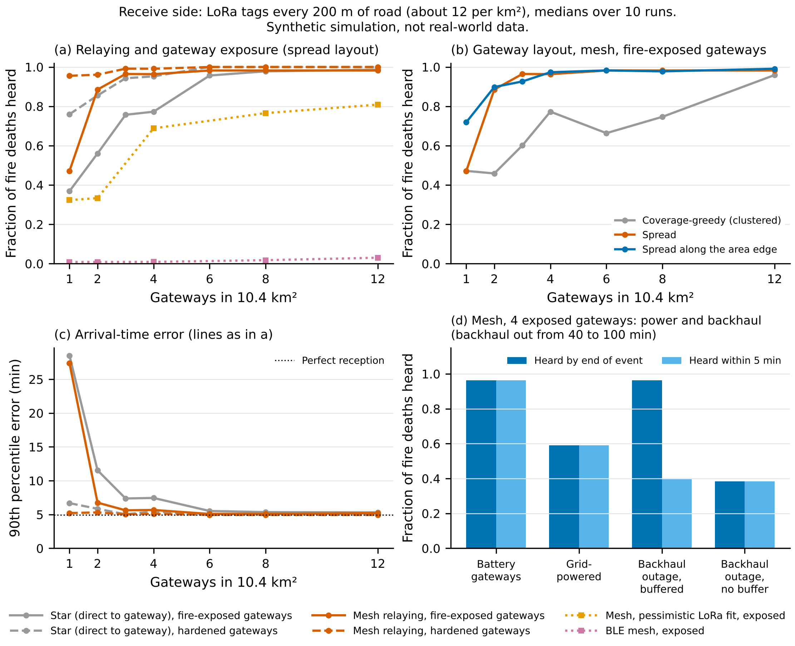
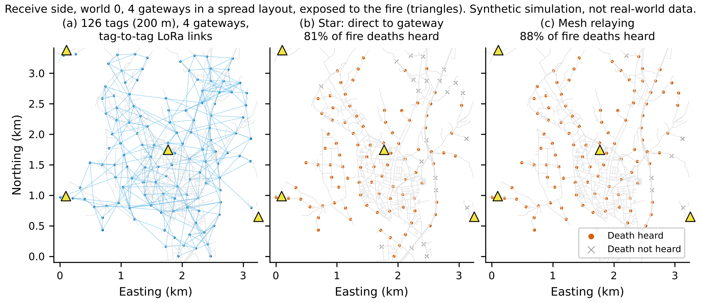
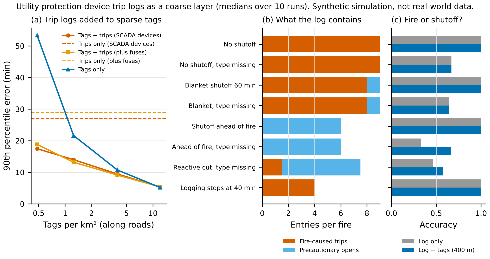
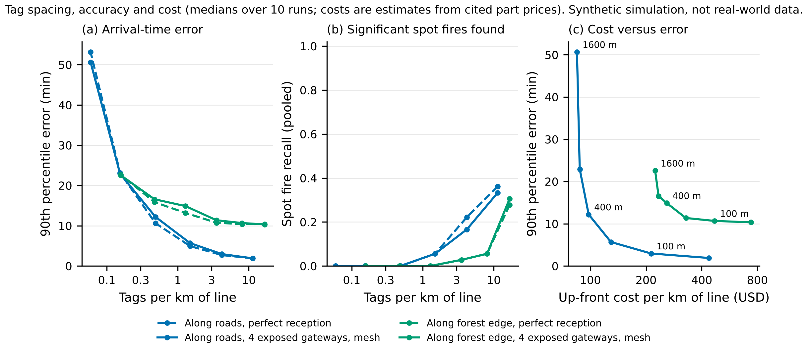

# Last Gasp phase 2: an independent tag network

## Bottom line

- **Everything below is synthetic**, from the phase 1 world:
  - real OSM roads and substation for a 10.4 km² area around Yeongdeok-eup;
  - synthetic buildings, fire, power network and radios;
  - radio and cost parameters taken from cited measurements and price lists.

  None of it is real-world performance.
- **The receive side is solvable in simulation.**
  - LoRa tags relaying in a mesh, with only 3 spread-out gateways that the fire can destroy, hear 96% of tag deaths.
  - Arrival-time error is 1.6 / 5.6 min (median / 90th percentile, at burned buildings), against 1.5 / 4.9 min with perfect reception.
  - What breaks it: gateways clustered together, gateways on grid power, and cellular backhaul outages without buffering.
- **Utility trip logs are a weak coarse layer.**
  - About 9 logged breaker and recloser trips per fire give 7.1 / 27.1 min on their own.
  - They help only when tags are very sparse.
  - A shutoff ahead of the fire removes the fire signal entirely, and a shutoff whose type is not logged corrupts it.
  - No public, timestamped KEPCO trip log was found.
- **Cost.** Tags every 200 m of road (12 per km²) with 4 solar LoRa gateways come to about $1,050 per km² up front and $62 per km² per year (estimates). That gives about 1.6 / 5.7 min error.
- **Spot fire detection does not work at affordable spacing.** Recall of significant spot fires is 6% at 200 m and 33% even at 50 m (36% with perfect reception).
- **Not novel at its core.** Arrival time from a destroyed node's last heartbeat is in a 2014 IBM patent. What Last Gasp can claim is the reconstruction and spotting layer, plus the design rule that every part must be independently powered.

Provenance:
- Sweeps (1,150 runs, 0 errors): commit 54f6e9a with clean code.
- Economics and booth metrics: commit 46f7903.
- Every number is in `results/NUMBERS.json` under `p2.*` and `booth.*`.
- Parameters: `docs/PARAMETERS_PHASE2.md`. Sources: `data/SOURCES.md`.

## Setup changes from phase 1

- **Tags.**
  - Placed along roads, or along a forest-edge proxy (the line 100 m from the nearest building).
  - Spacing is a minimum 2D separation, so the road network's density gives 1.5 tags per km of road at 200 m spacing (126 tags, 12 per km²).
  - A tag dies 10 to 120 s after the flames arrive (Antoine-Santoni et al. 2009: unprotected nodes last seconds). 5% survive.
- **Radio.** Log-distance path loss with per-link shadowing from published forest fits:
  - Tag to tag: Callebaut and Van der Perre 2020, n = 3.63, sigma = 8.85 dB.
  - Tag to an 8 m gateway: Boonlom et al. 2026 at 923 MHz, n = 3.22.
  - LoRa SF7 at 14 dBm EIRP, the KR920 default on 922.1 to 923.3 MHz.
  - Median ranges: 282 m tag to tag, 1.7 km tag to gateway.
  - A pessimistic profile (no gateway height advantage, n = 4.68 between tags) stands in for Korean ridges. No Korean forest measurement exists.
- **Reception modes.**
  - Star: direct to a gateway.
  - Mesh: relaying over live tags, up to 8 hops.
  - Store-and-forward at the tags.
  - Gateways can burn, can depend on grid power, and can lose their cellular backhaul.

## 1. Gateway survival and relaying

Figure 10. Medians over 10 runs. Tags every 200 m of road.

| Layout (fire-exposed gateways unless stated) | Fire deaths heard | Error (min, median / P90) |
|---|---|---|
| Perfect reception (reference) | 100% | 1.5 / 4.9 |
| Star, 1 gateway | 37% | 4.0 / 28.5 |
| Star, 4 gateways | 77% | 1.7 / 7.5 |
| Star, 6 gateways | 96% | 1.6 / 5.5 |
| Mesh, 1 gateway | 47% | 3.6 / 27.4 |
| Mesh, 2 gateways, spread | 89% | 1.6 / 6.8 |
| Mesh, 3 gateways, spread | 96% | 1.6 / 5.6 |
| Mesh, 4 gateways, along the area edge | 97% | 1.5 / 5.4 |
| Mesh, 4 gateways, coverage-greedy (clustered in the town) | 77% | 1.8 / 11.4 |
| Mesh, 1 hardened gateway (survives the fire) | 95.5% | 1.6 / 5.2 |
| Mesh, 4 gateways, pessimistic radio fit | 69% | 2.2 / 11.1 |
| BLE mesh, 4 gateways, tags 200 m apart | 1% | not usable |

Findings:
- **Gateway survival matters more than coverage.**
  - Greedy coverage puts gateways together in the town centre, where one fire run destroys them all: 4 such gateways hear only 77%.
  - Spreading the same number apart, or along the edge of the area, raises this to 96 to 97%.
- **Cheapest layout that keeps most deaths heard (95% or more), in this world:**
  - one hardened gateway (a site the fire will not reach, such as a protected rooftop or a hill outside the fuel bed) with mesh relaying: 95.5%;
  - otherwise, 3 spread-out, fire-exposed gateways with mesh: 96%.

  A star network needs 6 exposed gateways for the same result.
- **Relaying is the key design choice.** At 200 m spacing, each LoRa SF7 tag links to about 5 others on average.
  - BLE (median range about 42 m in forest) has essentially no tag-to-tag links at that spacing. It suits only the booth or very dense deployments.
- **Store-and-forward at the tags adds nothing** (mesh and mesh plus store-and-forward give identical results). Fire only removes links: a group of tags cut off from every gateway never reconnects, so records stored there are lost.

  Store-and-forward matters at the gateway, for cellular backhaul outages (1,192 base stations were down in the five counties in 2025):
  - Backhaul down from 40 to 100 min, mesh, 4 gateways:
    - buffered gateways still deliver 96% of deaths, but only 40% within 5 min;
    - without a buffer, 39% are ever delivered, and error rises to 7.3 / 25.8 min.
- **Grid-powered gateways repeat the phase 1 failure.** They hear 59% (error 2.0 / 19.0 min), because the grid fails ahead of the fire.
- **Heartbeat interval:**

  | Interval | Median delivery lag | Heard within 5 min |
  |---|---|---|
  | 10 s | 0.9 min | 96% |
  | 30 s | 1.8 min | 96% |
  | 60 s | 3.0 min | 94% |
  | 120 s | 5.5 min | 23% |

  Map accuracy at the end of the event hardly changes (90th percentile 5.7 to 5.9 min). The interval sets latency, not accuracy.
- **Spot detection** with realistic reception equals perfect reception at this spacing (recall 6%). The receive side is not what limits spot detection.

Figure 9. One world: tag links and which deaths each mode hears.

## 2. Utility fault logs as a coarse layer

Figure 11. Medians over 10 runs.

The simulated log records:
- only SCADA-monitored devices (feeder breakers and reclosers);
- nothing from a device after an upstream device has opened;
- timestamps to about 1 s, with an optional event type.

Each fire-classified trip becomes a point at the upwind end of the device's protection zone, at the trip time minus 5 min.

| What is reconstructed | Error (min, median / P90) |
|---|---|
| Trips only (about 9 entries per fire) | 7.1 / 27.1 |
| Trips only, also logging lateral fuses (33 entries) | 5.2 / 28.9 |
| Tags every 200 m (12 per km²): tags only / tags plus trips | 1.5 / 5.2 vs 1.6 / 5.3 (no gain) |
| Tags every 400 m (3.9 per km²) | 3.6 / 10.7 vs 3.3 / 9.5 |
| Tags every 800 m (1.25 per km²) | 7.2 / 21.6 vs 5.2 / 14.0 |
| Tags every 1,600 m (0.5 per km²) | 30.9 / 53.3 vs 6.6 / 17.5 |

Shutoffs and logging gaps (tags every 400 m):

| Scenario | Fire-caused entries per fire | Trips-only error (min) | Entries labelled correctly, log only / with tags |
|---|---|---|---|
| No shutoff, event type logged | 9 | 7.1 / 27.1 | 1.00 / 1.00 |
| No shutoff, type missing | 9 | 7.6 / 25.7 | 0.67 / 0.67 |
| Blanket shutoff at 60 min, type missing | 8 | 7.7 / 29.7 | 0.65 / 0.65 |
| Shutoff ahead of the fire, typed | 0 | no information | 1.00 / 1.00 |
| Shutoff ahead of the fire, type missing | 0 | 19.2 / 43.9 (shutoffs misread as fire) | 0.33 / 0.67 |
| Reactive cut of lines already reached, type missing | 1.5 | 11.1 / 35.5 | 0.46 / 0.57 |
| Logging stops at 40 min | 4 | 15.9 / 43.6 | 1.00 / 1.00 |

Separating fire-caused trips from precautionary opens:
- When the log records the event type (protection trip or remote open), separation is trivial.
- When it does not, two rules help partly:
  - shutoffs open several feeders within minutes of each other;
  - tags show whether the fire had reached the zone (accuracy 0.33 to 0.67 for an untyped shutoff ahead of the fire).
- A reactive cut of a line the fire has already reached is close in time to fire contact. It is mislabelled but still carries rough timing.

Desk research (`docs/UTILITY_LOGS.md`):
- **What KEPCO's systems record.**
  - Distribution automation (DAS, now the Grid-K ADMS, completed in March 2025) receives fault and switch events from field terminal units into a history database.
  - Relays on 154 kV and above keep fault records.
  - Two-thirds of switches were automated in 2018.
- **What was not found:** a public, timestamped trip log, KEPCO's time-synchronisation practice, or the share of reclosers that are remotely monitored.
- **What 2025 showed (verified):**
  - 20 of 55 towers on the Angye to Uiseong line were cut while 17 were already affected by fire (2025-03-22).
  - Yeongdeok was de-energised from 21:00 on 2025-03-25, while flames also tripped transmission lines.
  - "The automation equipment all stopped", so the record for the critical hours is likely incomplete.
- **No formal pre-emptive shutoff policy** (like the US PSPS) was found.

Conclusion: trip logs are worth requesting as a sanity layer and for areas without tags, but they cannot replace tags. Interpreting them needs the event type and the operator's shutoff record.

## 3. Deployment economics

Figure 12. Tag spacing versus accuracy, spot recall and cost. Mesh, 4 fire-exposed gateways, medians over 10 runs.

Along roads (84.5 km of road in 10.4 km²; 4 gateways throughout):

| Spacing | Tags per km² | Tags per km of road | Error, received (min) | Spot recall | Up-front cost per km² | Per year per km² |
|---|---|---|---|---|---|---|
| 50 m | 92 | 11.4 | 0.5 / 1.9 | 0.33 | $3,545 | $322 |
| 100 m | 34 | 4.2 | 0.8 / 3.0 | 0.17 | $1,730 | $133 |
| 200 m | 12 | 1.5 | 1.6 / 5.7 | 0.06 | $1,049 | $62 |
| 400 m | 3.9 | 0.5 | 3.8 / 12.2 | 0 | $795 | $36 |
| 800 m | 1.25 | 0.15 | 6.5 / 22.9 | 0 | $711 | $27 |

Per km of road, up-front cost is $436 at 50 m, $213 at 100 m, $129 at 200 m and $98 at 400 m. This includes the gateways' share.

Along the forest-edge proxy (31.9 km of edge), errors at buildings stay at 3.6 to 3.8 min median and 10.3 to 11.4 min at the 90th percentile from 50 to 200 m spacing, because edge tags sit 100 m from the buildings. Edge tags give early warning that the fire has entered the settlement; road tags inside the settlement give the building-level map.

Cost inputs (prices as seen on 2026-10-15, about 100 to 1,000 units; estimates, not quotes):

| Item | Cost | Source |
|---|---|---|
| Tag bill of materials | $26.09 | RAK3172 LoRa module $6.49; Saft LS14500 battery $5.60; enclosure $10 (Hammond, IP68); PCB and assembly $3 (assumption); antenna $1 (assumption) |
| Tag install | $5 | Assumption |
| Gateway | $1,249 hardware plus $500 install (assumption) | RAK solar LTE gateway bundle $1,199 plus an antenna |
| Gateway backhaul | $60 per year | Assumption |

Battery life (LoRa SF7, 12-byte beacon, 41 ms on air, 45 mA transmit, 3 µA sleep, 2.6 Ah cell, 80% usable, 2% per year self-discharge):

| Setting | Battery life |
|---|---|
| Beacon every 10 s | 1.2 years |
| Every 30 s | 3.3 years |
| Every 60 s | 5.8 years |
| Every 120 s | 9.6 years |
| SF9 at 30 s | 1.0 years |
| SF12 at 30 s | 0.14 years |
| BLE at 30 s | Over 10 years, set by battery shelf life rather than current draw (assumption) |

Under Korean listen-before-talk rules (MSIT Notice 2019-105), beacons every 10 to 60 s at SF7 are allowed. SF11 and SF12 packets exceed 0.4 s and are impractical anyway.

Assumptions that matter most:
- The enclosure dominates the tag cost and could probably be halved.
- Gateways are about two-thirds of the up-front cost at 200 m spacing.
- Install and maintenance labour, permits, and annual inspection after storms are assumptions or not included.
- Tags destroyed in a fire must be replaced. That cost scales with the burned area and is not included.

Recommended first design point (synthetic):
- LoRa SF7 tags every 200 m of road inside settlements and every 200 m along the settlement edge;
- 30 s heartbeat;
- mesh relaying;
- at least 3 spread or edge-placed solar gateways per 10 km² with buffered LTE backhaul, ideally one hardened site.

## 4. Novelty check

Details: `docs/NOVELTY.md`.

- **Prior art (verified on Google Patents).**
  - IBM US9721458B2 (priority 2014-10-30) determines "a fire arrival time for the adjacent node... determined to be destroyed" from "the time at which application 104 received the last heartbeat signal". It also forecasts arrival elsewhere.
  - Smith US9619996B1 (2014) derives "information... from the loss of signals from the sensors" to "chart the location, intensity, progress and direction of the wildfire".
  - Sacrificial tags whose silence signals fire appear in EP1952368 (2005).
  - Fitting a front to smart-meter outage times was publicly disclosed in July 2026.
- **Commercial systems.** Dryad Silvanet (gas sensors, LoRaWAN mesh), N5 Sensors, camera networks and satellites detect fires. None uses node death to map spread.
- **What Last Gasp adds**, as far as could be found:
  - a full arrival-time map reconstructed from many node deaths;
  - spot fire detection from deaths that break the expected order, with jump distance;
  - the quantitative design rule that grid-powered nodes and gateways are censored by upstream outages.
- **Gap:** Chinese, Korean and Japanese patents were not searched systematically.

## 5. Booth demo software

`demo/` is a separate module (numpy and matplotlib only).
- It reads heartbeats from a simulator, from a receiver ESP32 over serial (JSON lines), or directly over BLE.
- It declares a tag dead after 3 missed heartbeats.
- It redraws the burned area, arrival-time shading and spot fire flags live: black background, white type, green live tags, orange burned tags.
- The heartbeat format (a 13-byte BLE manufacturer-data payload, plus a JSON line for a serial receiver) is specified in `demo/README.md` and `demo/lastgasp_demo/protocol.py`.
- An example ESP32 sketch is included. It has not been compiled or tested on hardware.

Simulator-mode metrics (20 runs, 1 s heartbeats, 5% packet loss):
- Detection latency is 2.6 s median and 3.0 s at the 90th percentile.
- The simulated spot fire was flagged in 20 of 20 runs, with no extra spot flags. The simulator places the spot fire next to a node, so this is a best case, not evidence that spot detection works in the field.

Run it: `cd demo && python -m lastgasp_demo --sim`.

## Updated go or no-go

| Option | Decision | Reason (synthetic unless stated) |
|---|---|---|
| Smart-meter last gasp as the fire sensor | **No-go** | 75% of fire signals censored by upstream outages (phase 1); no public evidence that KEPCO AMI logs timestamped last gasps; 2025 outages dominated by upstream trips and shutoffs |
| Independent LoRa tag mesh for arrival-time maps | **Conditional go** for a field pilot | 96% of deaths heard with 3 exposed gateways; 1.6 / 5.7 min error at 12 tags per km²; about $1,050 per km² |
| Spot fire detection from tag deaths | **No-go for now** | Recall 6% at 200 m spacing, 33% at 50 m; needs a better method and probably denser tags along likely ember paths |
| Utility trip logs | **Request, but only as a coarse layer** | Helps only at under about 1 tag per km²; destroyed by shutoffs ahead of the fire; logs not public |
| Booth demo | **Go** | Software works in simulator mode; firmware sketch untested |

## Honest rating of real-world feasibility

Overall: **low to moderate (2 out of 5)** for an operational system in Korea today.

The simulation gives a clear, cheap design for arrival-time maps. Every key physical assumption is still unmeasured, and the core idea is prior art.

Biggest remaining risks, in rough order:
1. **Tag death timing in a real fire.** Do tags die within a minute of flame arrival, or earlier from radiant pre-heating and ember showers, or later behind a rock? Untested. A burn-table or prescribed-burn test is the cheapest decisive experiment.
2. **Radio in Korean mountain terrain.** No 920 MHz forest measurements exist for Korea. Ridges block links completely (Japanese data), and the pessimistic fit drops reception to 69%. A one-day walk test with RSSI logging is needed.
3. **Gateway survival and backhaul.** Results depend on at least one gateway surviving, and on buffered backhaul that survives the 2025-style telecom outage. Hardened sites and permits are unresolved.
4. **False deaths and maintenance.** Thousands of tags along roads face theft, vandalism, mowing, animals and battery failures. In operation, a random silence looks like a single-node spot fire. The tag random-failure rate used here (0.0005 per hour) is an assumption.
5. **Spot fires**, the most valuable output, are the weakest. The simulated fire spreads spots downwind in narrow strips, so a spot reaches a tag late. Real ember-driven spread in 2025 may differ either way.
6. **Synthetic world limits.** A single area and wind direction, no terrain, smooth fuel, synthetic buildings and synthetic feeders.
7. **Prior art.** Patent claims are limited to the reconstruction and spotting layer.
8. **Operations.** Who installs and maintains the network (county, KEPCO, the Korea Forest Service), and who watches the map during a fire, is undefined.

## Most useful real data to request next

1. **Field measurements Last Gasp can do itself:**
   - 922 MHz RSSI walk tests between ground-level tags and an 8 m gateway in a Gyeongbuk pine forest;
   - a burn test of the tag enclosure to time its death.
2. **KEPCO, via its Data Safe Zone or a research request:**
   - ADMS/DAS event logs with event types (protection trip versus remote open) for the Yeongdeok and Cheongsong feeders on 2025-03-25 and 26;
   - the operators' de-energisation record for the same period.
3. **Korea Forest Service:** the fire progression products (VIIRS, drone and aircraft infrared) for the same night, as ground truth for any reconstruction.
4. **Carriers, via MSIT:** base-station power-fail times, to quantify backhaul outages for gateway design.
