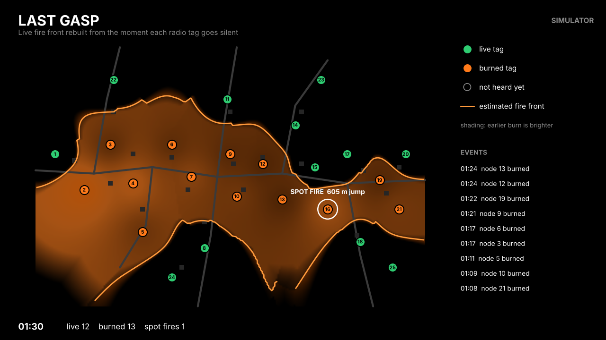

# Last Gasp booth demo

This is a live display for the tabletop demo. About 25 ESP32 tags broadcast heartbeats on a village map. When a tag is "burned" its heartbeats stop, and the display redraws three things within a few seconds:
- the burned area;
- the arrival-time shading;
- spot fire flags.

The module is self-contained: it needs only numpy and matplotlib and does not import the research code in `../lastgasp/`.

Simulator mode shows a synthetic fire. It is not real data.



## Run it without hardware (simulator mode)

From this `demo/` folder:

```sh
python3 -m venv .venv && .venv/bin/pip install -r requirements.txt
.venv/bin/python -m lastgasp_demo --sim
```

A full-screen-friendly 16:9 window opens. On macOS, matplotlib uses its native `macosx` backend, so no Tk install is needed. The simulated fire crosses the village in about 2.5 minutes, and a spot fire ignites near node 16 well ahead of the front.

Options:

| Option | Meaning |
|---|---|
| `--speed 2` | Run the simulator twice as fast. |
| `--no-spot` | Simulate without a spot fire. |
| `--seed N` | Change the simulator's random draws (heartbeat phase, packet loss, jitter). |
| `--interval 1.0 --timeout-beats 3` | Heartbeat interval (s) and missed beats before a node is declared dead. |
| `--village my_board.json` | Your own map (see below). |
| `--headless --duration 170 --snapshots 60,90,170 --out out/` | No window; writes PNG snapshots and prints the event list. Use this for testing. |

Self-test: `.venv/bin/python test_demo.py`. It checks the message encoding and that the simulator run burns the village and flags exactly one spot fire, at node 16.

## Run it with hardware

1. Flash each board with `firmware/lastgasp_tag/lastgasp_tag.ino` (Arduino-ESP32 core), with `NODE_ID` set from 1 to 25.
   - This sketch follows the format below, but it has not been compiled or tested on hardware yet.
2. Either:
   - scan directly from the laptop: `pip install bleak`, then `python -m lastgasp_demo --ble`; or
   - use a receiver ESP32 that scans BLE and prints JSON lines over USB: `pip install pyserial`, then `python -m lastgasp_demo --serial /dev/tty.usbserial-XXXX`.
3. Burn a node by removing its battery, switching it off, or covering it in a foil cup (a Faraday shield). After 3 missed heartbeats (3 s) it turns orange.

## Heartbeat message format (what the ESP32 firmware must send)

Every tag sends one BLE advertisement per heartbeat (1 s at the booth). Field units would use 30 s or more to save battery.

It uses one manufacturer-specific data field. The 13 bytes after the AD type `0xFF` are little-endian:

| Offset | Size | Field | Value |
|---|---|---|---|
| 0 | 2 | company_id | `0xFFFF` while prototyping (the Bluetooth SIG value reserved for testing); register an ID before any product |
| 2 | 2 | magic | ASCII `LG` |
| 4 | 1 | version | `1` |
| 5 | 2 | node_id | 1 to 65535, printed on the board |
| 7 | 2 | seq | +1 every heartbeat, wraps at 65535 |
| 9 | 2 | battery_mv | supply voltage, mV |
| 11 | 1 | temp_c | signed, degrees C |
| 12 | 1 | flags | bit0 test, bit1 low battery, bit2 over-temperature, bit3 tamper or manual burn |

Full advertisement: `02 01 06` (Flags) then `0E FF <13 bytes>`.

A receiver ESP32 forwards each heartbeat to the laptop as one JSON line:

```json
{"v":1,"id":7,"seq":1234,"bat_mv":3010,"temp_c":31,"flags":0,"rssi":-67,"rx":"gw1"}
```

The laptop stamps arrival time itself, so tag clocks never matter. The encoder and decoder are in `lastgasp_demo/protocol.py`.

## What the display does

- **Dead node.** A node is dead after `timeout_beats` missed heartbeats. Its death time is the arrival time of its last heartbeat. A node that starts beating again is revived and logged.
- **Spot fire.** A newly dead node is flagged when:
  - its nearest earlier-dead node is at least 250 m away (map units); and
  - at least one live node sits in the corridor between them.

  The jump distance shown is the distance to that earlier-dead node.
- **Burned area.** Each map point takes the inverse-distance-weighted share of dead nodes among its 4 nearest heard nodes. The orange line is where that share is 0.5.
  - The area fades out beyond 300 m from any node, because nothing is known there.
- **Arrival-time shading.** Inverse-distance weighting of death times inside the burned area. Earlier burn is brighter.

These are the same rules the research code tested in simulation (`../RESULTS.md`, `../RESULTS_PHASE2.md`). There, 25 tags in 1 km² gave a median detection latency of about 2 minutes with 30 s heartbeats.

## Village map file

`village.json` holds:
- the map size in metres;
- road polylines;
- house positions;
- the node list, each with `id`, `x` and `y`.

Measure your physical board, choose a scale (for example 1 cm = 10 m), and edit the node positions to match where the boards sit.
