# Cumulative wildfire evaluation — 6 hours

Status: **complete**. Models: 573; cases: 1.

Simulation budget: 8 trajectories per model/cutoff; base seed: 0; trajectory block size: 8. Classification threshold: 0.5. Tensor device: cpu; saved forests run on CPU.

Each case retains the original rectangle. The simulation uses unburned exterior padding, initializes missing burned observations as unburned, and repeats cutoff environmental conditions. Missing environmental inputs remain unavailable.

Primary scores use the intersection of model validity for each case, followed by original reference masks. New-burn scoring requires a known unburned cutoff and a known endpoint. Total burned occupancy includes initial burns. Pooled scores are recomputed from cell/cutoff entries with equal entry weights; they are not averages of event scores.

The event partition is test; exclusive held-out status is recorded per model. Thresholds and fitted model parameters are not selected using these results. Pointwise simulation intervals are not confidence intervals for evaluation metrics.

## Shared-cohort new-burn results

Rows are ordered by pooled Brier score for display; this does not fit or select a model.

| Model | Entries | Positives | Brier | AP | ROC AUC | Exact NLL | F1 | Shared/reference coverage |
| --- | ---: | ---: | ---: | ---: | ---: | ---: | ---: | ---: |
| 20261009_multiscale_mps_lr_0p001_0p01_0p1_floor_0p1/candidates/k3_cnn_03_lr0.001_constant/checkpoint.pt | 51 | 4 | 0.0579044 | 0.369608 | 0.768617 | infinity | 0.4 | 1 |
| 20261009_multiscale_mps_lr_0p001_0p01_0p1_floor_0p1/candidates/k3_cnn_03_lr0.01_constant/checkpoint.pt | 51 | 4 | 0.0579044 | 0.369608 | 0.768617 | infinity | 0.4 | 1 |
| 20261009_multiscale_mps_lr_0p001_0p01_0p1_floor_0p1/candidates/k3_cnn_03_lr0.1_warmup_cosine/checkpoint.pt | 51 | 4 | 0.0579044 | 0.369608 | 0.768617 | infinity | 0.4 | 1 |
| 20261009_multiscale_mps_lr_0p001_0p01_0p1_floor_0p1/candidates/k3_linear_01_lr0.01_constant/checkpoint.pt | 51 | 4 | 0.0579044 | 0.369608 | 0.768617 | infinity | 0.4 | 1 |
| 20261010_categorical_balanced_benchmark/candidates/k3_residual_mlp_09_lr0.05_constant/checkpoint.pt | 51 | 4 | 0.0579044 | 0.369608 | 0.768617 | infinity | 0.4 | 1 |
| 20261009_multiscale_mps_lr_0p001_0p01_0p1_floor_0p1/candidates/k3_mlp_04_lr0.1_warmup_cosine/checkpoint.pt | 51 | 4 | 0.0588235 | 0.402941 | 0.784574 | infinity | 0.4 | 1 |
| 20261010_categorical_balanced_benchmark/candidates/k3_constant_00_lr0.1_constant/checkpoint.pt | 51 | 4 | 0.0603554 | 0.376751 | 0.760638 | infinity | 0.4 | 1 |
| 20261010_categorical_balanced_benchmark/candidates/k3_residual_mlp_09_lr0.1_warmup_cosine/checkpoint.pt | 51 | 4 | 0.0603554 | 0.363358 | 0.739362 | infinity | 0.4 | 1 |
| 20261010_categorical_balanced_benchmark/candidates/k9_constant_00_lr0.05_constant/checkpoint.pt | 51 | 4 | 0.0603554 | 0.376751 | 0.760638 | infinity | 0.4 | 1 |
| 20261010_categorical_balanced_benchmark/candidates/k9_constant_00_lr0.05_warmup_cosine/checkpoint.pt | 51 | 4 | 0.0603554 | 0.376751 | 0.760638 | infinity | 0.4 | 1 |
| 20261010_categorical_balanced_benchmark/candidates/k9_constant_00_lr0.1_constant/checkpoint.pt | 51 | 4 | 0.0603554 | 0.376751 | 0.760638 | infinity | 0.4 | 1 |
| 20261010_categorical_balanced_benchmark/candidates/k9_constant_00_lr0.1_warmup_cosine/checkpoint.pt | 51 | 4 | 0.0603554 | 0.376751 | 0.760638 | infinity | 0.4 | 1 |
| 20261010_categorical_balanced_benchmark/candidates/k5_constant_00_lr0.01_constant/checkpoint.pt | 51 | 4 | 0.0606618 | 0.369608 | 0.75266 | infinity | 0.4 | 1 |
| 20261010_categorical_balanced_benchmark/candidates/k5_constant_00_lr0.01_warmup_cosine/checkpoint.pt | 51 | 4 | 0.0606618 | 0.369608 | 0.75266 | infinity | 0.4 | 1 |
| 20261010_categorical_balanced_benchmark/candidates/k5_constant_00_lr0.1_warmup_cosine/checkpoint.pt | 51 | 4 | 0.0606618 | 0.369608 | 0.75266 | infinity | 0.4 | 1 |
| 20261010_categorical_balanced_benchmark/candidates/k7_constant_00_lr0.01_constant/checkpoint.pt | 51 | 4 | 0.0606618 | 0.369608 | 0.75266 | infinity | 0.4 | 1 |
| 20261010_categorical_balanced_benchmark/candidates/k7_constant_00_lr0.01_warmup_cosine/checkpoint.pt | 51 | 4 | 0.0606618 | 0.369608 | 0.75266 | infinity | 0.4 | 1 |
| 20261009_multiscale_mps_lr_0p001_0p01_0p1_floor_0p1/candidates/k5_mlp_04_lr0.1_constant/checkpoint.pt | 51 | 4 | 0.0612745 | 0.339216 | 0.680851 | infinity | 0.4 | 1 |
| 20261010_categorical_balanced_benchmark/candidates/k3_residual_mlp_09_lr0.05_warmup_cosine/checkpoint.pt | 51 | 4 | 0.0615809 | 0.327677 | 0.654255 | infinity | 0.4 | 1 |
| 20261009_multiscale_mps_lr_0p001_0p01_0p1_floor_0p1/candidates/k3_mlp_07_lr0.1_warmup_cosine/checkpoint.pt | 51 | 4 | 0.0615809 | 0.369608 | 0.74734 | infinity | 0.4 | 1 |
| 20261009_multiscale_mps_lr_0p001_0p01_0p1_floor_0p1/candidates/k3_constant_00_lr0.1_constant/checkpoint.pt | 51 | 4 | 0.0618873 | 0.33467 | 0.667553 | infinity | 0.4 | 1 |
| 20261009_multiscale_mps_lr_0p001_0p01_0p1_floor_0p1/candidates/k3_constant_00_lr0.1_warmup_cosine/checkpoint.pt | 51 | 4 | 0.0618873 | 0.33467 | 0.667553 | infinity | 0.4 | 1 |
| 20261010_categorical_balanced_benchmark/candidates/k3_constant_00_lr0.001_constant/checkpoint.pt | 51 | 4 | 0.0618873 | 0.351716 | 0.699468 | infinity | 0.4 | 1 |
| 20261010_categorical_balanced_benchmark/candidates/k3_constant_00_lr0.001_warmup_cosine/checkpoint.pt | 51 | 4 | 0.0618873 | 0.351716 | 0.699468 | infinity | 0.4 | 1 |
| 20261010_categorical_balanced_benchmark/candidates/k3_constant_00_lr0.003_constant/checkpoint.pt | 51 | 4 | 0.0618873 | 0.351716 | 0.699468 | infinity | 0.4 | 1 |
| 20261010_categorical_balanced_benchmark/candidates/k3_constant_00_lr0.003_warmup_cosine/checkpoint.pt | 51 | 4 | 0.0618873 | 0.351716 | 0.699468 | infinity | 0.4 | 1 |
| 20261010_categorical_balanced_benchmark/candidates/k3_constant_00_lr0.01_constant/checkpoint.pt | 51 | 4 | 0.0618873 | 0.351716 | 0.699468 | infinity | 0.4 | 1 |
| 20261010_categorical_balanced_benchmark/candidates/k3_constant_00_lr0.01_warmup_cosine/checkpoint.pt | 51 | 4 | 0.0618873 | 0.351716 | 0.699468 | infinity | 0.4 | 1 |
| 20261010_categorical_balanced_benchmark/candidates/k3_constant_00_lr0.03_warmup_cosine/checkpoint.pt | 51 | 4 | 0.0618873 | 0.351716 | 0.699468 | infinity | 0.4 | 1 |
| 20261010_categorical_balanced_benchmark/candidates/k3_constant_00_lr0.05_warmup_cosine/checkpoint.pt | 51 | 4 | 0.0618873 | 0.351716 | 0.699468 | infinity | 0.4 | 1 |
| 20261010_categorical_balanced_benchmark/candidates/k3_constant_00_lr0.1_warmup_cosine/checkpoint.pt | 51 | 4 | 0.0618873 | 0.351716 | 0.699468 | infinity | 0.4 | 1 |
| 20261009_multiscale_mps_lr_0p001_0p01_0p1_floor_0p1/candidates/k3_mlp_05_lr0.1_constant/checkpoint.pt | 51 | 4 | 0.0618873 | 0.330882 | 0.664894 | infinity | 0.4 | 1 |
| 20261009_multiscale_mps_lr_0p001_0p01_0p1_floor_0p1/candidates/k3_mlp_07_lr0.1_constant/checkpoint.pt | 51 | 4 | 0.0618873 | 0.344771 | 0.68617 | infinity | 0.4 | 1 |
| 20261010_categorical_balanced_benchmark/candidates/k5_constant_00_lr0.05_constant/checkpoint.pt | 51 | 4 | 0.0618873 | 0.376751 | 0.760638 | infinity | 0.4 | 1 |
| 20261010_categorical_balanced_benchmark/candidates/k5_constant_00_lr0.05_warmup_cosine/checkpoint.pt | 51 | 4 | 0.0618873 | 0.376751 | 0.760638 | infinity | 0.4 | 1 |
| 20261010_categorical_balanced_benchmark/candidates/k5_constant_00_lr0.1_constant/checkpoint.pt | 51 | 4 | 0.0618873 | 0.376751 | 0.760638 | infinity | 0.4 | 1 |
| 20261010_categorical_balanced_benchmark/candidates/k3_constant_00_lr0.03_constant/checkpoint.pt | 51 | 4 | 0.0621936 | 0.344771 | 0.691489 | infinity | 0.4 | 1 |
| 20261009_multiscale_mps_lr_0p001_0p01_0p1_floor_0p1/candidates/k3_cnn_03_lr0.001_warmup_cosine/checkpoint.pt | 51 | 4 | 0.0621936 | 0.327677 | 0.656915 | infinity | 0.4 | 1 |
| 20261009_multiscale_mps_lr_0p001_0p01_0p1_floor_0p1/candidates/k3_mlp_04_lr0.001_constant/checkpoint.pt | 51 | 4 | 0.0621936 | 0.327677 | 0.656915 | infinity | 0.4 | 1 |
| 20261009_multiscale_mps_lr_0p001_0p01_0p1_floor_0p1/candidates/k3_mlp_04_lr0.001_warmup_cosine/checkpoint.pt | 51 | 4 | 0.0621936 | 0.327677 | 0.656915 | infinity | 0.4 | 1 |
| 20261009_multiscale_mps_lr_0p001_0p01_0p1_floor_0p1/candidates/k3_mlp_04_lr0.1_constant/checkpoint.pt | 51 | 4 | 0.0621936 | 0.327677 | 0.656915 | infinity | 0.4 | 1 |
| 20261009_multiscale_mps_lr_0p001_0p01_0p1_floor_0p1/candidates/k3_mlp_05_lr0.001_warmup_cosine/checkpoint.pt | 51 | 4 | 0.0621936 | 0.327677 | 0.656915 | infinity | 0.4 | 1 |
| 20261010_categorical_balanced_benchmark/candidates/k3_cnn_03_lr0.01_warmup_cosine/checkpoint.pt | 51 | 4 | 0.0621936 | 0.327677 | 0.656915 | infinity | 0.4 | 1 |
| 20261010_categorical_balanced_benchmark/candidates/k3_cnn_03_lr0.1_constant/checkpoint.pt | 51 | 4 | 0.0621936 | 0.327677 | 0.656915 | infinity | 0.4 | 1 |
| 20261010_categorical_balanced_benchmark/candidates/k3_legacy_02_lr0.1_constant/checkpoint.pt | 51 | 4 | 0.0621936 | 0.327677 | 0.656915 | infinity | 0.4 | 1 |
| 20261009_multiscale_mps_lr_0p001_0p01_0p1_floor_0p1/candidates/k7_constant_00_lr0.1_constant/checkpoint.pt | 51 | 4 | 0.0621936 | 0.330882 | 0.659574 | infinity | 0.4 | 1 |
| 20261009_multiscale_mps_lr_0p001_0p01_0p1_floor_0p1/candidates/k7_constant_00_lr0.1_warmup_cosine/checkpoint.pt | 51 | 4 | 0.0621936 | 0.330882 | 0.659574 | infinity | 0.4 | 1 |
| 20261009_multiscale_mps_lr_0p001_0p01_0p1_floor_0p1/candidates/k9_constant_00_lr0.1_constant/checkpoint.pt | 51 | 4 | 0.0621936 | 0.330882 | 0.659574 | infinity | 0.4 | 1 |
| 20261009_multiscale_mps_lr_0p001_0p01_0p1_floor_0p1/candidates/k9_constant_00_lr0.1_warmup_cosine/checkpoint.pt | 51 | 4 | 0.0621936 | 0.330882 | 0.659574 | infinity | 0.4 | 1 |
| 20261010_categorical_balanced_benchmark/candidates/k5_residual_mlp_09_lr0.05_warmup_cosine/checkpoint.pt | 51 | 4 | 0.0621936 | 0.330882 | 0.659574 | infinity | 0.4 | 1 |
| 20261009_multiscale_mps_lr_0p001_0p01_0p1_floor_0p1/candidates/k3_linear_01_lr0.001_warmup_cosine/checkpoint.pt | 51 | 4 | 0.0625 | 0.339216 | 0.683511 | infinity | 0.4 | 1 |
| 20261010_categorical_balanced_benchmark/candidates/k3_constant_00_lr0.05_constant/checkpoint.pt | 51 | 4 | 0.0625 | 0.339216 | 0.683511 | infinity | 0.4 | 1 |
| 20261009_multiscale_mps_lr_0p001_0p01_0p1_floor_0p1/candidates/k5_constant_00_lr0.001_constant/checkpoint.pt | 51 | 4 | 0.0625 | 0.339216 | 0.683511 | infinity | 0.4 | 1 |
| 20261009_multiscale_mps_lr_0p001_0p01_0p1_floor_0p1/candidates/k5_constant_00_lr0.001_warmup_cosine/checkpoint.pt | 51 | 4 | 0.0625 | 0.339216 | 0.683511 | infinity | 0.4 | 1 |
| 20261009_multiscale_mps_lr_0p001_0p01_0p1_floor_0p1/candidates/k5_constant_00_lr0.1_constant/checkpoint.pt | 51 | 4 | 0.0625 | 0.339216 | 0.683511 | infinity | 0.4 | 1 |
| 20261009_multiscale_mps_lr_0p001_0p01_0p1_floor_0p1/candidates/k5_constant_00_lr0.01_constant/checkpoint.pt | 51 | 4 | 0.0628064 | 0.33467 | 0.675532 | infinity | 0.4 | 1 |
| 20261009_multiscale_mps_lr_0p001_0p01_0p1_floor_0p1/candidates/k5_constant_00_lr0.01_warmup_cosine/checkpoint.pt | 51 | 4 | 0.0628064 | 0.33467 | 0.675532 | infinity | 0.4 | 1 |
| 20261009_multiscale_mps_lr_0p001_0p01_0p1_floor_0p1/candidates/k5_constant_00_lr0.1_warmup_cosine/checkpoint.pt | 51 | 4 | 0.0628064 | 0.33467 | 0.675532 | infinity | 0.4 | 1 |
| 20261009_multiscale_mps_lr_0p001_0p01_0p1_floor_0p1/candidates/k5_legacy_02_lr0.001_constant/checkpoint.pt | 51 | 4 | 0.0628064 | 0.33467 | 0.675532 | infinity | 0.4 | 1 |
| 20261009_multiscale_mps_lr_0p001_0p01_0p1_floor_0p1/candidates/k5_legacy_02_lr0.001_warmup_cosine/checkpoint.pt | 51 | 4 | 0.0628064 | 0.33467 | 0.675532 | infinity | 0.4 | 1 |
| 20261009_multiscale_mps_lr_0p001_0p01_0p1_floor_0p1/candidates/k5_legacy_02_lr0.01_warmup_cosine/checkpoint.pt | 51 | 4 | 0.0628064 | 0.33467 | 0.675532 | infinity | 0.4 | 1 |
| 20261009_multiscale_mps_lr_0p001_0p01_0p1_floor_0p1/candidates/k5_linear_01_lr0.001_warmup_cosine/checkpoint.pt | 51 | 4 | 0.0628064 | 0.33467 | 0.675532 | infinity | 0.4 | 1 |
| 20261010_categorical_balanced_benchmark/candidates/k3_mlp_06_lr0.1_constant/checkpoint.pt | 51 | 4 | 0.0628064 | 0.363358 | 0.734043 | infinity | 0.4 | 1 |
| 20261009_multiscale_mps_lr_0p001_0p01_0p1_floor_0p1/candidates/k3_mlp_06_lr0.1_warmup_cosine/checkpoint.pt | 51 | 4 | 0.0631127 | 0.344771 | 0.68883 | infinity | 0.4 | 1 |
| 20261009_multiscale_mps_lr_0p001_0p01_0p1_floor_0p1/candidates/k7_constant_00_lr0.01_constant/checkpoint.pt | 51 | 4 | 0.0631127 | 0.330882 | 0.667553 | infinity | 0.4 | 1 |
| 20261009_multiscale_mps_lr_0p001_0p01_0p1_floor_0p1/candidates/k7_constant_00_lr0.01_warmup_cosine/checkpoint.pt | 51 | 4 | 0.0631127 | 0.330882 | 0.667553 | infinity | 0.4 | 1 |
| 20261010_categorical_balanced_benchmark/candidates/k3_cnn_03_lr0.05_warmup_cosine/checkpoint.pt | 51 | 4 | 0.0631127 | 0.327677 | 0.654255 | infinity | 0.4 | 1 |
| 20261010_categorical_balanced_benchmark/candidates/k3_linear_01_lr0.05_constant/checkpoint.pt | 51 | 4 | 0.0631127 | 0.344771 | 0.68883 | infinity | 0.4 | 1 |
| 20261010_categorical_balanced_benchmark/candidates/k5_cnn_03_lr0.01_constant/checkpoint.pt | 51 | 4 | 0.0631127 | 0.330882 | 0.667553 | infinity | 0.4 | 1 |
| 20261009_multiscale_mps_lr_0p001_0p01_0p1_floor_0p1/candidates/k3_constant_00_lr0.001_constant/checkpoint.pt | 51 | 4 | 0.0634191 | 0.339216 | 0.680851 | infinity | 0.4 | 1 |
| 20261009_multiscale_mps_lr_0p001_0p01_0p1_floor_0p1/candidates/k3_constant_00_lr0.001_warmup_cosine/checkpoint.pt | 51 | 4 | 0.0634191 | 0.339216 | 0.680851 | infinity | 0.4 | 1 |
| 20261009_multiscale_mps_lr_0p001_0p01_0p1_floor_0p1/candidates/k3_constant_00_lr0.01_constant/checkpoint.pt | 51 | 4 | 0.0634191 | 0.339216 | 0.680851 | infinity | 0.4 | 1 |
| 20261009_multiscale_mps_lr_0p001_0p01_0p1_floor_0p1/candidates/k3_constant_00_lr0.01_warmup_cosine/checkpoint.pt | 51 | 4 | 0.0634191 | 0.339216 | 0.680851 | infinity | 0.4 | 1 |
| 20261009_multiscale_mps_lr_0p001_0p01_0p1_floor_0p1/candidates/k3_linear_01_lr0.001_constant/checkpoint.pt | 51 | 4 | 0.0634191 | 0.339216 | 0.680851 | infinity | 0.4 | 1 |
| 20261009_multiscale_mps_lr_0p001_0p01_0p1_floor_0p1/candidates/k3_linear_01_lr0.01_warmup_cosine/checkpoint.pt | 51 | 4 | 0.0634191 | 0.339216 | 0.680851 | infinity | 0.4 | 1 |
| 20261009_multiscale_mps_lr_0p001_0p01_0p1_floor_0p1/candidates/k3_residual_mlp_09_lr0.1_warmup_cosine/checkpoint.pt | 51 | 4 | 0.0634191 | 0.344771 | 0.683511 | infinity | 0.4 | 1 |
| 20261009_multiscale_mps_lr_0p001_0p01_0p1_floor_0p1/candidates/k9_constant_00_lr0.01_warmup_cosine/checkpoint.pt | 51 | 4 | 0.0634191 | 0.327677 | 0.659574 | infinity | 0.4 | 1 |
| 20261010_categorical_balanced_benchmark/candidates/k7_mlp_04_lr0.1_constant/checkpoint.pt | 51 | 4 | 0.0634191 | 0.327677 | 0.659574 | infinity | 0.4 | 1 |
| 20261010_categorical_balanced_benchmark/candidates/k9_constant_00_lr0.01_constant/checkpoint.pt | 51 | 4 | 0.0634191 | 0.327677 | 0.648936 | infinity | 0.4 | 1 |
| 20261010_categorical_balanced_benchmark/candidates/k9_constant_00_lr0.01_warmup_cosine/checkpoint.pt | 51 | 4 | 0.0634191 | 0.327677 | 0.648936 | infinity | 0.4 | 1 |
| 20261009_multiscale_mps_lr_0p001_0p01_0p1_floor_0p1/candidates/k5_linear_01_lr0.001_constant/checkpoint.pt | 51 | 4 | 0.0637255 | 0.33467 | 0.672872 | infinity | 0.4 | 1 |
| 20261009_multiscale_mps_lr_0p001_0p01_0p1_floor_0p1/candidates/k5_linear_01_lr0.01_warmup_cosine/checkpoint.pt | 51 | 4 | 0.0637255 | 0.33467 | 0.672872 | infinity | 0.4 | 1 |
| 20261009_multiscale_mps_lr_0p001_0p01_0p1_floor_0p1/candidates/k9_constant_00_lr0.01_constant/checkpoint.pt | 51 | 4 | 0.0637255 | 0.32493 | 0.651596 | infinity | 0.4 | 1 |
| 20261010_categorical_balanced_benchmark/candidates/k3_linear_01_lr0.001_constant/checkpoint.pt | 51 | 4 | 0.0637255 | 0.33467 | 0.672872 | infinity | 0.4 | 1 |
| 20261010_categorical_balanced_benchmark/candidates/k3_linear_01_lr0.001_warmup_cosine/checkpoint.pt | 51 | 4 | 0.0637255 | 0.33467 | 0.672872 | infinity | 0.4 | 1 |
| 20261010_categorical_balanced_benchmark/candidates/k3_linear_01_lr0.01_constant/checkpoint.pt | 51 | 4 | 0.0637255 | 0.33467 | 0.672872 | infinity | 0.4 | 1 |
| 20261010_categorical_balanced_benchmark/candidates/k3_linear_01_lr0.01_warmup_cosine/checkpoint.pt | 51 | 4 | 0.0637255 | 0.33467 | 0.672872 | infinity | 0.4 | 1 |
| 20261010_categorical_balanced_benchmark/candidates/k3_linear_01_lr0.05_warmup_cosine/checkpoint.pt | 51 | 4 | 0.0637255 | 0.33467 | 0.672872 | infinity | 0.4 | 1 |
| 20261010_categorical_balanced_benchmark/candidates/k3_linear_01_lr0.1_constant/checkpoint.pt | 51 | 4 | 0.0637255 | 0.33467 | 0.672872 | infinity | 0.4 | 1 |
| 20261010_categorical_balanced_benchmark/candidates/k3_linear_01_lr0.1_warmup_cosine/checkpoint.pt | 51 | 4 | 0.0637255 | 0.33467 | 0.672872 | infinity | 0.4 | 1 |
| 20261010_categorical_balanced_benchmark/candidates/k5_legacy_02_lr0.1_constant/checkpoint.pt | 51 | 4 | 0.0637255 | 0.33467 | 0.672872 | infinity | 0.4 | 1 |
| 20261009_multiscale_mps_lr_0p001_0p01_0p1_floor_0p1/candidates/k5_cnn_03_lr0.1_warmup_cosine/checkpoint.pt | 51 | 4 | 0.0640319 | 0.372549 | 0.715426 | infinity | 0 | 1 |
| 20261009_multiscale_mps_lr_0p001_0p01_0p1_floor_0p1/candidates/k5_legacy_02_lr0.01_constant/checkpoint.pt | 51 | 4 | 0.0640319 | 0.330882 | 0.664894 | infinity | 0.4 | 1 |
| 20261009_multiscale_mps_lr_0p001_0p01_0p1_floor_0p1/candidates/k5_mlp_05_lr0.001_constant/checkpoint.pt | 51 | 4 | 0.0640319 | 0.330882 | 0.664894 | infinity | 0.4 | 1 |
| 20261009_multiscale_mps_lr_0p001_0p01_0p1_floor_0p1/candidates/k5_mlp_05_lr0.001_warmup_cosine/checkpoint.pt | 51 | 4 | 0.0640319 | 0.330882 | 0.664894 | infinity | 0.4 | 1 |
| 20261009_multiscale_mps_lr_0p001_0p01_0p1_floor_0p1/candidates/k5_mlp_05_lr0.1_warmup_cosine/checkpoint.pt | 51 | 4 | 0.0640319 | 0.330882 | 0.664894 | infinity | 0.4 | 1 |
| 20261009_multiscale_mps_lr_0p001_0p01_0p1_floor_0p1/candidates/k5_mlp_04_lr0.001_constant/checkpoint.pt | 51 | 4 | 0.0643382 | 0.327677 | 0.656915 | infinity | 0.4 | 1 |
| 20261009_multiscale_mps_lr_0p001_0p01_0p1_floor_0p1/candidates/k5_mlp_04_lr0.001_warmup_cosine/checkpoint.pt | 51 | 4 | 0.0643382 | 0.327677 | 0.656915 | infinity | 0.4 | 1 |
| 20261009_multiscale_mps_lr_0p001_0p01_0p1_floor_0p1/candidates/k5_mlp_04_lr0.01_constant/checkpoint.pt | 51 | 4 | 0.0643382 | 0.327677 | 0.656915 | infinity | 0.4 | 1 |
| 20261009_multiscale_mps_lr_0p001_0p01_0p1_floor_0p1/candidates/k9_residual_mlp_08_lr0.1_constant/checkpoint.pt | 51 | 4 | 0.0643382 | 0.360644 | 0.707447 | infinity | 0 | 1 |
| 20261010_categorical_balanced_benchmark/candidates/k5_residual_mlp_09_lr0.1_warmup_cosine/checkpoint.pt | 51 | 4 | 0.0643382 | 0.327677 | 0.656915 | infinity | 0.4 | 1 |
| 20261010_categorical_balanced_benchmark/candidates/k7_constant_00_lr0.05_constant/checkpoint.pt | 51 | 4 | 0.0643382 | 0.33467 | 0.664894 | infinity | 0.4 | 1 |
| 20261010_categorical_balanced_benchmark/candidates/k7_constant_00_lr0.05_warmup_cosine/checkpoint.pt | 51 | 4 | 0.0643382 | 0.33467 | 0.664894 | infinity | 0.4 | 1 |
| 20261010_categorical_balanced_benchmark/candidates/k7_constant_00_lr0.1_constant/checkpoint.pt | 51 | 4 | 0.0643382 | 0.33467 | 0.664894 | infinity | 0.4 | 1 |
| 20261010_categorical_balanced_benchmark/candidates/k7_constant_00_lr0.1_warmup_cosine/checkpoint.pt | 51 | 4 | 0.0643382 | 0.33467 | 0.664894 | infinity | 0.4 | 1 |
| 20261010_categorical_balanced_benchmark/candidates/mixed_3_5_7_9_02_lr0.1_warmup_cosine/checkpoint.pt | 51 | 4 | 0.0643382 | 0.360644 | 0.707447 | infinity | 0 | 1 |
| 20261009_multiscale_mps_lr_0p001_0p01_0p1_floor_0p1/candidates/k5_mlp_07_lr0.1_constant/checkpoint.pt | 51 | 4 | 0.0646446 | 0.351716 | 0.699468 | infinity | 0 | 1 |
| 20261009_multiscale_mps_lr_0p001_0p01_0p1_floor_0p1/candidates/k9_mlp_07_lr0.1_constant/checkpoint.pt | 51 | 4 | 0.0652574 | 0.360644 | 0.704787 | infinity | 0 | 1 |
| 20261010_categorical_balanced_benchmark/candidates/k5_cnn_03_lr0.05_constant/checkpoint.pt | 51 | 4 | 0.0652574 | 0.339216 | 0.683511 | infinity | 0 | 1 |
| 20261009_multiscale_mps_lr_0p001_0p01_0p1_floor_0p1/candidates/k7_mlp_07_lr0.1_constant/checkpoint.pt | 51 | 4 | 0.0652574 | 0.360644 | 0.704787 | infinity | 0 | 1 |
| 20261009_multiscale_mps_lr_0p001_0p01_0p1_floor_0p1/candidates/k5_linear_01_lr0.01_constant/checkpoint.pt | 51 | 4 | 0.0658701 | 0.322549 | 0.638298 | infinity | 0.4 | 1 |
| 20261009_multiscale_mps_lr_0p001_0p01_0p1_floor_0p1/candidates/k9_residual_mlp_09_lr0.1_warmup_cosine/checkpoint.pt | 51 | 4 | 0.0658701 | 0.315531 | 0.603723 | infinity | 0.4 | 1 |
| 20261010_categorical_balanced_benchmark/candidates/k5_mlp_06_lr0.05_constant/checkpoint.pt | 51 | 4 | 0.0658701 | 0.322549 | 0.638298 | infinity | 0.4 | 1 |
| 20261009_multiscale_mps_lr_0p001_0p01_0p1_floor_0p1/candidates/mixed_3_5_7_9_00_lr0.1_warmup_cosine/checkpoint.pt | 51 | 4 | 0.0658701 | 0.414216 | 0.734043 | infinity | 0 | 1 |
| 20261009_multiscale_mps_lr_0p001_0p01_0p1_floor_0p1/candidates/neural_mixed_3_5_7_9_00_lr0.1_warmup_cosine/checkpoint.pt | 51 | 4 | 0.0658701 | 0.414216 | 0.734043 | infinity | 0 | 1 |
| 20261009_multiscale_mps_lr_0p001_0p01_0p1_floor_0p1/candidates/neural_mixed_3_5_7_9_01_lr0.01_warmup_cosine/checkpoint.pt | 51 | 4 | 0.0661765 | 0.320466 | 0.630319 | infinity | 0.4 | 1 |
| 20261010_categorical_balanced_benchmark/candidates/k7_residual_mlp_09_lr0.05_warmup_cosine/checkpoint.pt | 51 | 4 | 0.0661765 | 0.320466 | 0.630319 | infinity | 0.4 | 1 |
| 20261009_multiscale_mps_lr_0p001_0p01_0p1_floor_0p1/candidates/mixed_3_5_7_9_02_lr0.1_constant/checkpoint.pt | 51 | 4 | 0.0661765 | 0.389216 | 0.726064 | infinity | 0 | 1 |
| 20261009_multiscale_mps_lr_0p001_0p01_0p1_floor_0p1/candidates/k9_mlp_07_lr0.1_warmup_cosine/checkpoint.pt | 51 | 4 | 0.0667892 | 0.330882 | 0.664894 | infinity | 0 | 1 |
| 20261010_categorical_balanced_benchmark/candidates/k5_residual_mlp_09_lr0.05_constant/checkpoint.pt | 51 | 4 | 0.0667892 | 0.322549 | 0.635638 | infinity | 0.4 | 1 |
| 20261009_multiscale_mps_lr_0p001_0p01_0p1_floor_0p1/candidates/k9_legacy_02_lr0.1_warmup_cosine/checkpoint.pt | 51 | 4 | 0.0670956 | 0.327677 | 0.656915 | infinity | 0 | 1 |
| 20261010_categorical_balanced_benchmark/candidates/k7_cnn_03_lr0.05_constant/checkpoint.pt | 51 | 4 | 0.0670956 | 0.320466 | 0.62766 | infinity | 0.4 | 1 |
| 20261010_categorical_balanced_benchmark/candidates/k7_residual_mlp_09_lr0.05_constant/checkpoint.pt | 51 | 4 | 0.0670956 | 0.320466 | 0.62766 | infinity | 0.4 | 1 |
| 20261010_categorical_balanced_benchmark/candidates/k7_residual_mlp_09_lr0.1_warmup_cosine/checkpoint.pt | 51 | 4 | 0.0670956 | 0.320466 | 0.62766 | infinity | 0.4 | 1 |
| 20261009_multiscale_mps_lr_0p001_0p01_0p1_floor_0p1/candidates/k5_legacy_02_lr0.1_warmup_cosine/checkpoint.pt | 51 | 4 | 0.0670956 | 0.264216 | 0.720745 | infinity | 0 | 1 |
| 20261009_multiscale_mps_lr_0p001_0p01_0p1_floor_0p1/candidates/mixed_3_5_7_9_01_lr0.1_constant/checkpoint.pt | 51 | 4 | 0.0670956 | 0.264216 | 0.720745 | infinity | 0 | 1 |
| 20261010_categorical_balanced_benchmark/candidates/k3_residual_mlp_09_lr0.1_constant/checkpoint.pt | 51 | 4 | 0.0670956 | 0.357843 | 0.720745 | infinity | 0.4 | 1 |
| 20261010_categorical_balanced_benchmark/candidates/k9_cnn_03_lr0.1_warmup_cosine/checkpoint.pt | 51 | 4 | 0.0670956 | 0.264216 | 0.720745 | infinity | 0 | 1 |
| 20261009_multiscale_mps_lr_0p001_0p01_0p1_floor_0p1/candidates/k7_cnn_03_lr0.01_warmup_cosine/checkpoint.pt | 51 | 4 | 0.067402 | 0.32493 | 0.648936 | infinity | 0 | 1 |
| 20261009_multiscale_mps_lr_0p001_0p01_0p1_floor_0p1/candidates/k7_constant_00_lr0.001_constant/checkpoint.pt | 51 | 4 | 0.067402 | 0.32493 | 0.648936 | infinity | 0 | 1 |
| 20261009_multiscale_mps_lr_0p001_0p01_0p1_floor_0p1/candidates/k7_constant_00_lr0.001_warmup_cosine/checkpoint.pt | 51 | 4 | 0.067402 | 0.32493 | 0.648936 | infinity | 0 | 1 |
| 20261009_multiscale_mps_lr_0p001_0p01_0p1_floor_0p1/candidates/k7_legacy_02_lr0.001_constant/checkpoint.pt | 51 | 4 | 0.067402 | 0.32493 | 0.648936 | infinity | 0 | 1 |
| 20261009_multiscale_mps_lr_0p001_0p01_0p1_floor_0p1/candidates/k7_legacy_02_lr0.001_warmup_cosine/checkpoint.pt | 51 | 4 | 0.067402 | 0.32493 | 0.648936 | infinity | 0 | 1 |
| 20261009_multiscale_mps_lr_0p001_0p01_0p1_floor_0p1/candidates/k7_legacy_02_lr0.01_warmup_cosine/checkpoint.pt | 51 | 4 | 0.067402 | 0.32493 | 0.648936 | infinity | 0 | 1 |
| 20261009_multiscale_mps_lr_0p001_0p01_0p1_floor_0p1/candidates/k7_linear_01_lr0.001_constant/checkpoint.pt | 51 | 4 | 0.067402 | 0.32493 | 0.648936 | infinity | 0 | 1 |
| 20261009_multiscale_mps_lr_0p001_0p01_0p1_floor_0p1/candidates/k7_linear_01_lr0.001_warmup_cosine/checkpoint.pt | 51 | 4 | 0.067402 | 0.32493 | 0.648936 | infinity | 0 | 1 |
| 20261010_categorical_balanced_benchmark/candidates/k7_legacy_02_lr0.05_constant/checkpoint.pt | 51 | 4 | 0.067402 | 0.32493 | 0.648936 | infinity | 0 | 1 |
| 20261010_categorical_balanced_benchmark/candidates/neural_mixed_3_5_7_9_01_lr0.1_warmup_cosine/checkpoint.pt | 51 | 4 | 0.067402 | 0.32493 | 0.648936 | infinity | 0 | 1 |
| 20261009_multiscale_mps_lr_0p001_0p01_0p1_floor_0p1/candidates/k9_constant_00_lr0.001_constant/checkpoint.pt | 51 | 4 | 0.0677083 | 0.322549 | 0.640957 | infinity | 0 | 1 |
| 20261009_multiscale_mps_lr_0p001_0p01_0p1_floor_0p1/candidates/k9_constant_00_lr0.001_warmup_cosine/checkpoint.pt | 51 | 4 | 0.0677083 | 0.322549 | 0.640957 | infinity | 0 | 1 |
| 20261009_multiscale_mps_lr_0p001_0p01_0p1_floor_0p1/candidates/k9_legacy_02_lr0.01_constant/checkpoint.pt | 51 | 4 | 0.0677083 | 0.322549 | 0.640957 | infinity | 0 | 1 |
| 20261009_multiscale_mps_lr_0p001_0p01_0p1_floor_0p1/candidates/k9_legacy_02_lr0.01_warmup_cosine/checkpoint.pt | 51 | 4 | 0.0677083 | 0.322549 | 0.640957 | infinity | 0 | 1 |
| 20261009_multiscale_mps_lr_0p001_0p01_0p1_floor_0p1/candidates/k9_linear_01_lr0.001_constant/checkpoint.pt | 51 | 4 | 0.0677083 | 0.322549 | 0.640957 | infinity | 0 | 1 |
| 20261009_multiscale_mps_lr_0p001_0p01_0p1_floor_0p1/candidates/k9_linear_01_lr0.001_warmup_cosine/checkpoint.pt | 51 | 4 | 0.0677083 | 0.322549 | 0.640957 | infinity | 0 | 1 |
| 20261009_multiscale_mps_lr_0p001_0p01_0p1_floor_0p1/candidates/neural_mixed_3_5_7_9_01_lr0.1_warmup_cosine/checkpoint.pt | 51 | 4 | 0.0677083 | 0.322549 | 0.640957 | infinity | 0 | 1 |
| 20261010_categorical_balanced_benchmark/candidates/k9_cnn_03_lr0.05_constant/checkpoint.pt | 51 | 4 | 0.0677083 | 0.322549 | 0.640957 | infinity | 0 | 1 |
| 20261010_categorical_balanced_benchmark/candidates/k9_cnn_03_lr0.1_constant/checkpoint.pt | 51 | 4 | 0.0677083 | 0.322549 | 0.640957 | infinity | 0 | 1 |
| 20261010_categorical_balanced_benchmark/candidates/k9_legacy_02_lr0.1_constant/checkpoint.pt | 51 | 4 | 0.0677083 | 0.322549 | 0.640957 | infinity | 0 | 1 |
| 20261010_categorical_balanced_benchmark/candidates/k9_residual_mlp_09_lr0.1_warmup_cosine/checkpoint.pt | 51 | 4 | 0.0677083 | 0.322549 | 0.640957 | infinity | 0 | 1 |
| 20261010_categorical_balanced_benchmark/candidates/mixed_3_5_7_9_01_lr0.05_constant/checkpoint.pt | 51 | 4 | 0.0677083 | 0.322549 | 0.640957 | infinity | 0 | 1 |
| 20261010_categorical_balanced_benchmark/candidates/neural_mixed_3_5_7_9_00_lr0.05_constant/checkpoint.pt | 51 | 4 | 0.0677083 | 0.322549 | 0.640957 | infinity | 0 | 1 |
| 20261009_multiscale_mps_lr_0p001_0p01_0p1_floor_0p1/candidates/neural_mixed_3_5_7_9_02_lr0.1_warmup_cosine/checkpoint.pt | 51 | 4 | 0.0677083 | 0.316993 | 0.611702 | infinity | 0.4 | 1 |
| 20261010_categorical_balanced_benchmark/candidates/k9_legacy_02_lr0.05_constant/checkpoint.pt | 51 | 4 | 0.0677083 | 0.327677 | 0.651596 | infinity | 0.4 | 1 |
| 20261010_categorical_balanced_benchmark/candidates/neural_mixed_3_5_7_9_01_lr0.1_constant/checkpoint.pt | 51 | 4 | 0.0677083 | 0.316993 | 0.611702 | infinity | 0.4 | 1 |
| 20261009_multiscale_mps_lr_0p001_0p01_0p1_floor_0p1/candidates/mixed_3_5_7_9_02_lr0.1_warmup_cosine/checkpoint.pt | 51 | 4 | 0.0680147 | 0.320466 | 0.632979 | infinity | 0 | 1 |
| 20261010_categorical_balanced_benchmark/candidates/k9_residual_mlp_09_lr0.05_constant/checkpoint.pt | 51 | 4 | 0.0680147 | 0.320466 | 0.632979 | infinity | 0 | 1 |
| 20261010_categorical_balanced_benchmark/candidates/k9_residual_mlp_09_lr0.05_warmup_cosine/checkpoint.pt | 51 | 4 | 0.0680147 | 0.320466 | 0.632979 | infinity | 0 | 1 |
| 20261010_categorical_balanced_benchmark/candidates/mixed_3_5_7_9_01_lr0.1_constant/checkpoint.pt | 51 | 4 | 0.0680147 | 0.320466 | 0.632979 | infinity | 0 | 1 |
| 20261010_categorical_balanced_benchmark/candidates/neural_mixed_3_5_7_9_00_lr0.1_constant/checkpoint.pt | 51 | 4 | 0.0680147 | 0.320466 | 0.632979 | infinity | 0 | 1 |
| 20261010_categorical_balanced_benchmark/candidates/neural_mixed_3_5_7_9_01_lr0.05_constant/checkpoint.pt | 51 | 4 | 0.0680147 | 0.320466 | 0.632979 | infinity | 0 | 1 |
| 20261010_categorical_balanced_benchmark/candidates/neural_mixed_3_5_7_9_02_lr0.05_constant/checkpoint.pt | 51 | 4 | 0.0680147 | 0.320466 | 0.632979 | infinity | 0 | 1 |
| 20261009_multiscale_mps_lr_0p001_0p01_0p1_floor_0p1/candidates/mixed_3_5_7_9_02_lr0.01_warmup_cosine/checkpoint.pt | 51 | 4 | 0.0683211 | 0.32493 | 0.646277 | infinity | 0 | 1 |
| 20261010_categorical_balanced_benchmark/candidates/mixed_3_5_7_9_02_lr0.1_constant/checkpoint.pt | 51 | 4 | 0.0683211 | 0.318627 | 0.617021 | infinity | 0.4 | 1 |
| 20261009_multiscale_mps_lr_0p001_0p01_0p1_floor_0p1/candidates/k7_legacy_02_lr0.01_constant/checkpoint.pt | 51 | 4 | 0.0686275 | 0.322549 | 0.638298 | infinity | 0 | 1 |
| 20261009_multiscale_mps_lr_0p001_0p01_0p1_floor_0p1/candidates/k9_cnn_03_lr0.01_warmup_cosine/checkpoint.pt | 51 | 4 | 0.0686275 | 0.322549 | 0.638298 | infinity | 0 | 1 |
| 20261010_categorical_balanced_benchmark/candidates/k7_legacy_02_lr0.1_constant/checkpoint.pt | 51 | 4 | 0.0686275 | 0.322549 | 0.638298 | infinity | 0 | 1 |
| 20261010_categorical_balanced_benchmark/candidates/k3_mlp_04_lr0.1_warmup_cosine/checkpoint.pt | 51 | 4 | 0.0689338 | 0.402632 | 0.848404 | 0.208342 | 0.285714 | 1 |
| 20261010_categorical_balanced_benchmark/candidates/k7_cnn_03_lr0.1_constant/checkpoint.pt | 51 | 4 | 0.0689338 | 0.320466 | 0.62234 | infinity | 0.4 | 1 |
| 20261010_categorical_balanced_benchmark/candidates/mixed_3_5_7_9_00_lr0.1_warmup_cosine/checkpoint.pt | 51 | 4 | 0.0692402 | 0.316993 | 0.611702 | infinity | 0.4 | 1 |
| 20261010_categorical_balanced_benchmark/candidates/neural_mixed_3_5_7_9_00_lr0.1_warmup_cosine/checkpoint.pt | 51 | 4 | 0.0692402 | 0.316993 | 0.611702 | infinity | 0.4 | 1 |
| 20261009_multiscale_mps_lr_0p001_0p01_0p1_floor_0p1/candidates/k7_mlp_07_lr0.01_warmup_cosine/checkpoint.pt | 51 | 4 | 0.0692402 | 0.318627 | 0.614362 | infinity | 0.4 | 1 |
| 20261010_categorical_balanced_benchmark/candidates/k3_mlp_05_lr0.1_warmup_cosine/checkpoint.pt | 51 | 4 | 0.0695466 | 0.391036 | 0.773936 | infinity | 0.333333 | 1 |
| 20261010_categorical_balanced_benchmark/candidates/k5_mlp_06_lr0.1_constant/checkpoint.pt | 51 | 4 | 0.0695466 | 0.318627 | 0.611702 | infinity | 0.4 | 1 |
| 20261010_categorical_balanced_benchmark/candidates/k9_mlp_06_lr0.1_constant/checkpoint.pt | 51 | 4 | 0.0695466 | 0.316993 | 0.606383 | infinity | 0.4 | 1 |
| 20261010_categorical_balanced_benchmark/candidates/k9_residual_mlp_09_lr0.1_constant/checkpoint.pt | 51 | 4 | 0.0695466 | 0.316993 | 0.606383 | infinity | 0.4 | 1 |
| 20261010_categorical_balanced_benchmark/candidates/k9_cnn_03_lr0.01_constant/checkpoint.pt | 51 | 4 | 0.0698529 | 0.318627 | 0.617021 | infinity | 0.4 | 1 |
| 20261010_categorical_balanced_benchmark/candidates/neural_mixed_3_5_7_9_01_lr0.05_warmup_cosine/checkpoint.pt | 51 | 4 | 0.0698529 | 0.318627 | 0.617021 | infinity | 0.4 | 1 |
| 20261009_multiscale_mps_lr_0p001_0p01_0p1_floor_0p1/candidates/mixed_3_5_7_9_01_lr0.1_warmup_cosine/checkpoint.pt | 51 | 4 | 0.0701593 | 0.308824 | 0.617021 | infinity | 0 | 1 |
| 20261010_categorical_balanced_benchmark/candidates/k7_mlp_06_lr0.1_constant/checkpoint.pt | 51 | 4 | 0.0701593 | 0.318627 | 0.611702 | infinity | 0.4 | 1 |
| 20261009_multiscale_mps_lr_0p001_0p01_0p1_floor_0p1/candidates/k7_residual_mlp_09_lr0.01_constant/checkpoint.pt | 51 | 4 | 0.0704657 | 0.363358 | 0.728723 | infinity | 0.333333 | 1 |
| 20261010_categorical_balanced_benchmark/candidates/k5_residual_mlp_09_lr0.1_constant/checkpoint.pt | 51 | 4 | 0.0704657 | 0.318627 | 0.609043 | infinity | 0.4 | 1 |
| 20261010_categorical_balanced_benchmark/candidates/k7_residual_mlp_09_lr0.1_constant/checkpoint.pt | 51 | 4 | 0.0704657 | 0.316993 | 0.603723 | infinity | 0.4 | 1 |
| 20261010_categorical_balanced_benchmark/candidates/k5_cnn_03_lr0.1_constant/checkpoint.pt | 51 | 4 | 0.0707721 | 0.318627 | 0.614362 | infinity | 0.4 | 1 |
| 20261009_multiscale_mps_lr_0p001_0p01_0p1_floor_0p1/candidates/k7_legacy_02_lr0.1_warmup_cosine/checkpoint.pt | 51 | 4 | 0.0710784 | 0.183824 | 0.614362 | infinity | 0 | 1 |
| 20261009_multiscale_mps_lr_0p001_0p01_0p1_floor_0p1/candidates/k7_mlp_05_lr0.1_constant/checkpoint.pt | 51 | 4 | 0.0713848 | 0.330882 | 0.654255 | infinity | 0.333333 | 1 |
| 20261010_categorical_balanced_benchmark/candidates/k9_mlp_07_lr0.1_constant/checkpoint.pt | 51 | 4 | 0.0719975 | 0.339216 | 0.675532 | infinity | 0.333333 | 1 |
| 20261010_categorical_balanced_benchmark/candidates/mixed_3_5_7_9_02_lr0.01_constant/checkpoint.pt | 51 | 4 | 0.0719975 | 0.327677 | 0.643617 | infinity | 0.4 | 1 |
| 20261010_categorical_balanced_benchmark/candidates/neural_mixed_3_5_7_9_02_lr0.1_constant/checkpoint.pt | 51 | 4 | 0.0719975 | 0.314216 | 0.585106 | infinity | 0.4 | 1 |
| 20261010_categorical_balanced_benchmark/candidates/k7_legacy_02_lr0.1_warmup_cosine/checkpoint.pt | 51 | 4 | 0.0723039 | 0.318627 | 0.614362 | infinity | 0.333333 | 1 |
| 20261009_multiscale_mps_lr_0p001_0p01_0p1_floor_0p1/candidates/k9_mlp_07_lr0.01_constant/checkpoint.pt | 51 | 4 | 0.073223 | 0.313025 | 0.574468 | infinity | 0.4 | 1 |
| 20261009_multiscale_mps_lr_0p001_0p01_0p1_floor_0p1/candidates/neural_mixed_3_5_7_9_02_lr0.01_warmup_cosine/checkpoint.pt | 51 | 4 | 0.0741422 | 0.320466 | 0.625 | infinity | 0.333333 | 1 |
| 20261009_multiscale_mps_lr_0p001_0p01_0p1_floor_0p1/candidates/neural_mixed_3_5_7_9_00_lr0.1_constant/checkpoint.pt | 51 | 4 | 0.0753676 | 0.311943 | 0.56117 | infinity | 0.4 | 1 |
| 20261010_categorical_balanced_benchmark/candidates/k9_legacy_02_lr0.05_warmup_cosine/checkpoint.pt | 51 | 4 | 0.0765931 | 0.310955 | 0.553191 | infinity | 0.4 | 1 |
| 20261009_multiscale_mps_lr_0p001_0p01_0p1_floor_0p1/candidates/k5_mlp_06_lr0.1_warmup_cosine/checkpoint.pt | 51 | 4 | 0.0768995 | 0.34216 | 0.696809 | infinity | 0.285714 | 1 |
| 20261009_multiscale_mps_lr_0p001_0p01_0p1_floor_0p1/candidates/mixed_3_5_7_9_00_lr0.1_constant/checkpoint.pt | 51 | 4 | 0.0772059 | 0.310955 | 0.553191 | infinity | 0.4 | 1 |
| 20261010_categorical_balanced_benchmark/candidates/k3_cnn_03_lr0.1_warmup_cosine/checkpoint.pt | 51 | 4 | 0.0772059 | 0.363358 | 0.731383 | infinity | 0.333333 | 1 |
| 20261009_multiscale_mps_lr_0p001_0p01_0p1_floor_0p1/candidates/k5_residual_mlp_08_lr0.1_warmup_cosine/checkpoint.pt | 51 | 4 | 0.0775123 | 0.313025 | 0.566489 | infinity | 0.333333 | 1 |
| 20261010_categorical_balanced_benchmark/candidates/k3_mlp_04_lr0.05_constant/checkpoint.pt | 51 | 4 | 0.0778186 | 0.280062 | 0.843085 | 0.233706 | 0.25 | 1 |
| 20261009_multiscale_mps_lr_0p001_0p01_0p1_floor_0p1/candidates/k3_legacy_02_lr0.1_constant/checkpoint.pt | 51 | 4 | 0.0784314 | 0.0784314 | 0.5 | infinity | 0 | 1 |
| 20261009_multiscale_mps_lr_0p001_0p01_0p1_floor_0p1/candidates/k5_residual_mlp_08_lr0.1_constant/checkpoint.pt | 51 | 4 | 0.0784314 | 0.0784314 | 0.5 | infinity | 0 | 1 |
| 20261009_multiscale_mps_lr_0p001_0p01_0p1_floor_0p1/candidates/k7_mlp_06_lr0.1_warmup_cosine/checkpoint.pt | 51 | 4 | 0.0784314 | 0.0784314 | 0.5 | infinity | 0 | 1 |
| 20261009_multiscale_mps_lr_0p001_0p01_0p1_floor_0p1/candidates/neural_mixed_3_5_7_9_01_lr0.1_constant/checkpoint.pt | 51 | 4 | 0.0784314 | 0.0784314 | 0.5 | infinity | 0 | 1 |
| 20261009_multiscale_mps_lr_0p001_0p01_0p1_floor_0p1/candidates/neural_mixed_3_5_7_9_02_lr0.01_constant/checkpoint.pt | 51 | 4 | 0.0784314 | 0.0784314 | 0.5 | infinity | 0 | 1 |
| 20261009_multiscale_mps_lr_0p001_0p01_0p1_floor_0p1/candidates/neural_mixed_3_5_7_9_02_lr0.1_constant/checkpoint.pt | 51 | 4 | 0.0784314 | 0.0784314 | 0.5 | infinity | 0 | 1 |
| 20261010_categorical_balanced_benchmark/candidates/k9_legacy_02_lr0.1_warmup_cosine/checkpoint.pt | 51 | 4 | 0.0784314 | 0.0784314 | 0.5 | infinity | 0 | 1 |
| 20261010_categorical_balanced_benchmark/candidates/neural_mixed_3_5_7_9_02_lr0.1_warmup_cosine/checkpoint.pt | 51 | 4 | 0.0784314 | 0.0784314 | 0.5 | infinity | 0 | 1 |
| 20261009_multiscale_mps_lr_0p001_0p01_0p1_floor_0p1/candidates/k3_residual_mlp_08_lr0.1_constant/checkpoint.pt | 51 | 4 | 0.0787377 | 0.42406 | 0.856383 | 0.229418 | 0.363636 | 1 |
| 20261009_multiscale_mps_lr_0p001_0p01_0p1_floor_0p1/candidates/k3_mlp_06_lr0.01_constant/checkpoint.pt | 51 | 4 | 0.0790441 | 0.320166 | 0.875 | 0.23244 | 0.363636 | 1 |
| 20261009_multiscale_mps_lr_0p001_0p01_0p1_floor_0p1/candidates/k9_mlp_06_lr0.1_warmup_cosine/checkpoint.pt | 51 | 4 | 0.0790441 | 0.0784314 | 0.478723 | infinity | 0 | 1 |
| 20261009_multiscale_mps_lr_0p001_0p01_0p1_floor_0p1/candidates/k7_legacy_02_lr0.1_constant/checkpoint.pt | 51 | 4 | 0.0793505 | 0.311943 | 0.558511 | infinity | 0.333333 | 1 |
| 20261009_multiscale_mps_lr_0p001_0p01_0p1_floor_0p1/candidates/k7_cnn_03_lr0.1_warmup_cosine/checkpoint.pt | 51 | 4 | 0.0796569 | 0.0784314 | 0.489362 | infinity | 0 | 1 |
| 20261009_multiscale_mps_lr_0p001_0p01_0p1_floor_0p1/candidates/mixed_3_5_7_9_02_lr0.001_warmup_cosine/checkpoint.pt | 51 | 4 | 0.080576 | 0.329608 | 0.635638 | infinity | 0.333333 | 1 |
| 20261010_categorical_balanced_benchmark/candidates/k9_mlp_07_lr0.1_warmup_cosine/checkpoint.pt | 51 | 4 | 0.0808824 | 0.348555 | 0.678191 | infinity | 0.333333 | 1 |
| 20261010_categorical_balanced_benchmark/candidates/neural_mixed_3_5_7_9_02_lr0.01_constant/checkpoint.pt | 51 | 4 | 0.0833333 | 0.327677 | 0.640957 | infinity | 0.285714 | 1 |
| 20261009_multiscale_mps_lr_0p001_0p01_0p1_floor_0p1/candidates/k5_cnn_03_lr0.01_warmup_cosine/checkpoint.pt | 51 | 4 | 0.0842525 | 0.232843 | 0.704787 | infinity | 0.333333 | 1 |
| 20261009_multiscale_mps_lr_0p001_0p01_0p1_floor_0p1/candidates/k3_residual_mlp_08_lr0.1_warmup_cosine/checkpoint.pt | 51 | 4 | 0.0848652 | 0.281513 | 0.771277 | infinity | 0.4 | 1 |
| 20261010_categorical_balanced_benchmark/candidates/mixed_3_5_7_9_00_lr0.05_warmup_cosine/checkpoint.pt | 51 | 4 | 0.0854779 | 0.309216 | 0.534574 | infinity | 0.285714 | 1 |
| 20261009_multiscale_mps_lr_0p001_0p01_0p1_floor_0p1/candidates/k9_mlp_07_lr0.001_constant/checkpoint.pt | 51 | 4 | 0.0857843 | 0.310955 | 0.550532 | infinity | 0.333333 | 1 |
| 20261009_multiscale_mps_lr_0p001_0p01_0p1_floor_0p1/candidates/k9_mlp_07_lr0.001_warmup_cosine/checkpoint.pt | 51 | 4 | 0.0857843 | 0.310955 | 0.550532 | infinity | 0.333333 | 1 |
| 20261009_multiscale_mps_lr_0p001_0p01_0p1_floor_0p1/candidates/k7_mlp_06_lr0.01_warmup_cosine/checkpoint.pt | 51 | 4 | 0.0863971 | 0.214216 | 0.638298 | infinity | 0.25 | 1 |
| 20261009_multiscale_mps_lr_0p001_0p01_0p1_floor_0p1/candidates/k5_mlp_06_lr0.01_warmup_cosine/checkpoint.pt | 51 | 4 | 0.0870098 | 0.290385 | 0.845745 | 0.254756 | 0.222222 | 1 |
| 20261010_categorical_balanced_benchmark/candidates/k3_mlp_05_lr0.1_constant/checkpoint.pt | 51 | 4 | 0.0870098 | 0.232843 | 0.702128 | infinity | 0.25 | 1 |
| 20261010_categorical_balanced_benchmark/candidates/k5_legacy_02_lr0.05_constant/checkpoint.pt | 51 | 4 | 0.0873162 | 0.415441 | 0.792553 | infinity | 0.4 | 1 |
| 20261010_categorical_balanced_benchmark/candidates/k3_legacy_02_lr0.05_constant/checkpoint.pt | 51 | 4 | 0.0876225 | 0.293803 | 0.861702 | 0.251672 | 0.307692 | 1 |
| 20261010_categorical_balanced_benchmark/candidates/neural_mixed_3_5_7_9_00_lr0.05_warmup_cosine/checkpoint.pt | 51 | 4 | 0.0885417 | 0.308446 | 0.526596 | infinity | 0.285714 | 1 |
| 20261009_multiscale_mps_lr_0p001_0p01_0p1_floor_0p1/candidates/k9_mlp_05_lr0.01_warmup_cosine/checkpoint.pt | 51 | 4 | 0.088848 | 0.364423 | 0.776596 | 0.270008 | 0.181818 | 1 |
| 20261009_multiscale_mps_lr_0p001_0p01_0p1_floor_0p1/candidates/k5_residual_mlp_09_lr0.01_constant/checkpoint.pt | 51 | 4 | 0.0891544 | 0.394608 | 0.757979 | infinity | 0.363636 | 1 |
| 20261009_multiscale_mps_lr_0p001_0p01_0p1_floor_0p1/candidates/k3_mlp_05_lr0.01_constant/checkpoint.pt | 51 | 4 | 0.0897672 | 0.359127 | 0.87766 | 0.259131 | 0.333333 | 1 |
| 20261010_categorical_balanced_benchmark/candidates/k3_mlp_04_lr0.05_warmup_cosine/checkpoint.pt | 51 | 4 | 0.0897672 | 0.290546 | 0.837766 | 0.263198 | 0.363636 | 1 |
| 20261009_multiscale_mps_lr_0p001_0p01_0p1_floor_0p1/candidates/mixed_3_5_7_9_00_lr0.01_constant/checkpoint.pt | 51 | 4 | 0.0909926 | 0.280971 | 0.773936 | infinity | 0.222222 | 1 |
| 20261009_multiscale_mps_lr_0p001_0p01_0p1_floor_0p1/candidates/k7_mlp_07_lr0.001_warmup_cosine/checkpoint.pt | 51 | 4 | 0.0922181 | 0.35084 | 0.726064 | 0.285814 | 0.2 | 1 |
| 20261009_multiscale_mps_lr_0p001_0p01_0p1_floor_0p1/candidates/mixed_3_5_7_9_02_lr0.001_constant/checkpoint.pt | 51 | 4 | 0.0922181 | 0.365385 | 0.696809 | 0.287727 | 0.222222 | 1 |
| 20261009_multiscale_mps_lr_0p001_0p01_0p1_floor_0p1/candidates/mixed_3_5_7_9_00_lr0.01_warmup_cosine/checkpoint.pt | 51 | 4 | 0.0925245 | 0.267262 | 0.792553 | 0.292007 | 0.363636 | 1 |
| 20261010_categorical_balanced_benchmark/candidates/k9_linear_01_lr0.01_constant/checkpoint.pt | 51 | 4 | 0.09375 | 0.188025 | 0.566489 | infinity | 0.222222 | 1 |
| 20261009_multiscale_mps_lr_0p001_0p01_0p1_floor_0p1/candidates/k3_mlp_06_lr0.01_warmup_cosine/checkpoint.pt | 51 | 4 | 0.0943627 | 0.46781 | 0.87234 | 0.269243 | 0.5 | 1 |
| 20261009_multiscale_mps_lr_0p001_0p01_0p1_floor_0p1/candidates/k5_cnn_03_lr0.01_constant/checkpoint.pt | 51 | 4 | 0.0949755 | 0.278095 | 0.808511 | 0.285661 | 0.363636 | 1 |
| 20261009_multiscale_mps_lr_0p001_0p01_0p1_floor_0p1/candidates/k7_mlp_05_lr0.1_warmup_cosine/checkpoint.pt | 51 | 4 | 0.0949755 | 0.399364 | 0.808511 | 0.282643 | 0.363636 | 1 |
| 20261009_multiscale_mps_lr_0p001_0p01_0p1_floor_0p1/candidates/k7_mlp_07_lr0.001_constant/checkpoint.pt | 51 | 4 | 0.0958946 | 0.361111 | 0.696809 | 0.296786 | 0.2 | 1 |
| 20261010_categorical_balanced_benchmark/candidates/k9_mlp_05_lr0.05_constant/checkpoint.pt | 51 | 4 | 0.0958946 | 0.193627 | 0.595745 | infinity | 0.25 | 1 |
| 20261010_categorical_balanced_benchmark/candidates/k5_mlp_07_lr0.1_constant/checkpoint.pt | 51 | 4 | 0.0968137 | 0.402569 | 0.816489 | 0.282247 | 0.333333 | 1 |
| 20261009_multiscale_mps_lr_0p001_0p01_0p1_floor_0p1/candidates/mixed_3_5_7_9_01_lr0.01_warmup_cosine/checkpoint.pt | 51 | 4 | 0.0974265 | 0.286534 | 0.837766 | 0.280421 | 0.307692 | 1 |
| 20261009_multiscale_mps_lr_0p001_0p01_0p1_floor_0p1/candidates/k9_mlp_04_lr0.1_constant/checkpoint.pt | 51 | 4 | 0.100797 | 0.367186 | 0.781915 | 0.304728 | 0.266667 | 1 |
| 20261009_multiscale_mps_lr_0p001_0p01_0p1_floor_0p1/candidates/k3_mlp_07_lr0.01_constant/checkpoint.pt | 51 | 4 | 0.100797 | 0.446749 | 0.848404 | 0.279811 | 0.307692 | 1 |
| 20261010_categorical_balanced_benchmark/candidates/k9_legacy_02_lr0.01_constant/checkpoint.pt | 51 | 4 | 0.100797 | 0.311943 | 0.555851 | infinity | 0.222222 | 1 |
| 20261010_categorical_balanced_benchmark/candidates/k3_cnn_03_lr0.01_constant/checkpoint.pt | 51 | 4 | 0.101103 | 0.314536 | 0.859043 | 0.292903 | 0.285714 | 1 |
| 20261010_categorical_balanced_benchmark/candidates/k9_linear_01_lr0.01_warmup_cosine/checkpoint.pt | 51 | 4 | 0.101103 | 0.188025 | 0.566489 | infinity | 0.222222 | 1 |
| 20261009_multiscale_mps_lr_0p001_0p01_0p1_floor_0p1/candidates/k9_residual_mlp_08_lr0.1_warmup_cosine/checkpoint.pt | 51 | 4 | 0.101409 | 0.284127 | 0.848404 | 0.286401 | 0.285714 | 1 |
| 20261009_multiscale_mps_lr_0p001_0p01_0p1_floor_0p1/candidates/k3_mlp_07_lr0.01_warmup_cosine/checkpoint.pt | 51 | 4 | 0.102635 | 0.344118 | 0.843085 | 0.294264 | 0.333333 | 1 |
| 20261010_categorical_balanced_benchmark/candidates/mixed_3_5_7_9_01_lr0.01_constant/checkpoint.pt | 51 | 4 | 0.102635 | 0.253623 | 0.776596 | 0.302523 | 0.2 | 1 |
| 20261009_multiscale_mps_lr_0p001_0p01_0p1_floor_0p1/candidates/k7_mlp_07_lr0.1_warmup_cosine/checkpoint.pt | 51 | 4 | 0.102941 | 0.418803 | 0.859043 | 0.284187 | 0.307692 | 1 |
| 20261010_categorical_balanced_benchmark/candidates/k7_legacy_02_lr0.01_warmup_cosine/checkpoint.pt | 51 | 4 | 0.103248 | 0.34375 | 0.648936 | 0.324177 | 0.222222 | 1 |
| 20261009_multiscale_mps_lr_0p001_0p01_0p1_floor_0p1/candidates/neural_mixed_3_5_7_9_00_lr0.01_constant/checkpoint.pt | 51 | 4 | 0.10386 | 0.218326 | 0.744681 | infinity | 0.181818 | 1 |
| 20261010_categorical_balanced_benchmark/candidates/k9_mlp_05_lr0.05_warmup_cosine/checkpoint.pt | 51 | 4 | 0.10386 | 0.251488 | 0.765957 | 0.301413 | 0.222222 | 1 |
| 20261010_categorical_balanced_benchmark/candidates/k7_legacy_02_lr0.05_warmup_cosine/checkpoint.pt | 51 | 4 | 0.105699 | 0.221774 | 0.662234 | 0.330619 | 0.222222 | 1 |
| 20261010_categorical_balanced_benchmark/candidates/neural_mixed_3_5_7_9_01_lr0.01_constant/checkpoint.pt | 51 | 4 | 0.106005 | 0.207108 | 0.625 | infinity | 0.2 | 1 |
| 20261010_categorical_balanced_benchmark/candidates/k9_cnn_03_lr0.01_warmup_cosine/checkpoint.pt | 51 | 4 | 0.106311 | 0.3273 | 0.611702 | infinity | 0.181818 | 1 |
| 20261010_categorical_balanced_benchmark/candidates/k3_residual_mlp_08_lr0.01_warmup_cosine/checkpoint.pt | 51 | 4 | 0.10815 | 0.284024 | 0.824468 | 0.308251 | 0.285714 | 1 |
| 20261010_categorical_balanced_benchmark/candidates/k7_residual_mlp_09_lr0.01_constant/checkpoint.pt | 51 | 4 | 0.10815 | 0.418803 | 0.859043 | 0.308251 | 0.307692 | 1 |
| 20261009_multiscale_mps_lr_0p001_0p01_0p1_floor_0p1/candidates/k3_mlp_07_lr0.001_constant/checkpoint.pt | 51 | 4 | 0.109681 | 0.516667 | 0.869681 | 0.309516 | 0.285714 | 1 |
| 20261009_multiscale_mps_lr_0p001_0p01_0p1_floor_0p1/candidates/k3_mlp_07_lr0.001_warmup_cosine/checkpoint.pt | 51 | 4 | 0.109681 | 0.516667 | 0.869681 | 0.309516 | 0.285714 | 1 |
| 20261010_categorical_balanced_benchmark/candidates/k3_mlp_05_lr0.01_constant/checkpoint.pt | 51 | 4 | 0.109681 | 0.293703 | 0.851064 | 0.309516 | 0.285714 | 1 |
| 20261009_multiscale_mps_lr_0p001_0p01_0p1_floor_0p1/candidates/k3_cnn_03_lr0.01_warmup_cosine/checkpoint.pt | 51 | 4 | 0.109681 | 0.409082 | 0.75266 | infinity | 0.333333 | 1 |
| 20261009_multiscale_mps_lr_0p001_0p01_0p1_floor_0p1/candidates/k5_mlp_07_lr0.001_warmup_cosine/checkpoint.pt | 51 | 4 | 0.110907 | 0.306818 | 0.837766 | 0.322616 | 0.4 | 1 |
| 20261010_categorical_balanced_benchmark/candidates/k5_mlp_07_lr0.05_warmup_cosine/checkpoint.pt | 51 | 4 | 0.11152 | 0.280556 | 0.843085 | 0.313804 | 0.285714 | 1 |
| 20261009_multiscale_mps_lr_0p001_0p01_0p1_floor_0p1/candidates/k5_mlp_07_lr0.001_constant/checkpoint.pt | 51 | 4 | 0.112745 | 0.295455 | 0.832447 | 0.324373 | 0.375 | 1 |
| 20261009_multiscale_mps_lr_0p001_0p01_0p1_floor_0p1/candidates/k9_residual_mlp_09_lr0.01_constant/checkpoint.pt | 51 | 4 | 0.113971 | 0.422619 | 0.851064 | 0.333985 | 0.285714 | 1 |
| 20261010_categorical_balanced_benchmark/candidates/k7_legacy_02_lr0.01_constant/checkpoint.pt | 51 | 4 | 0.11489 | 0.21875 | 0.646277 | 0.352961 | 0.166667 | 1 |
| 20261010_categorical_balanced_benchmark/candidates/k5_mlp_05_lr0.05_constant/checkpoint.pt | 51 | 4 | 0.115196 | 0.276557 | 0.805851 | 0.330653 | 0.266667 | 1 |
| 20261009_multiscale_mps_lr_0p001_0p01_0p1_floor_0p1/candidates/mixed_3_5_7_9_02_lr0.01_constant/checkpoint.pt | 51 | 4 | 0.115196 | 0.262663 | 0.771277 | infinity | 0.307692 | 1 |
| 20261009_multiscale_mps_lr_0p001_0p01_0p1_floor_0p1/candidates/k7_mlp_06_lr0.1_constant/checkpoint.pt | 51 | 4 | 0.117647 | 0.0784314 | 0.478723 | infinity | 0 | 1 |
| 20261009_multiscale_mps_lr_0p001_0p01_0p1_floor_0p1/candidates/k5_mlp_05_lr0.01_warmup_cosine/checkpoint.pt | 51 | 4 | 0.118566 | 0.441919 | 0.859043 | 0.332506 | 0.4 | 1 |
| 20261009_multiscale_mps_lr_0p001_0p01_0p1_floor_0p1/candidates/k9_legacy_02_lr0.1_constant/checkpoint.pt | 51 | 4 | 0.118566 | 0.218132 | 0.707447 | 0.362498 | 0.153846 | 1 |
| 20261009_multiscale_mps_lr_0p001_0p01_0p1_floor_0p1/candidates/k5_legacy_02_lr0.1_constant/checkpoint.pt | 51 | 4 | 0.120404 | 0.248925 | 0.773936 | 0.353991 | 0.285714 | 1 |
| 20261009_multiscale_mps_lr_0p001_0p01_0p1_floor_0p1/candidates/k3_legacy_02_lr0.1_warmup_cosine/checkpoint.pt | 51 | 4 | 0.122243 | 0.431752 | 0.861702 | 0.342279 | 0.266667 | 1 |
| 20261010_categorical_balanced_benchmark/candidates/k7_mlp_05_lr0.05_warmup_cosine/checkpoint.pt | 51 | 4 | 0.123162 | 0.427632 | 0.851064 | 0.352995 | 0.375 | 1 |
| 20261010_categorical_balanced_benchmark/candidates/k3_residual_mlp_09_lr0.01_constant/checkpoint.pt | 51 | 4 | 0.123468 | 0.302632 | 0.861702 | infinity | 0.375 | 1 |
| 20261009_multiscale_mps_lr_0p001_0p01_0p1_floor_0p1/candidates/k9_cnn_03_lr0.01_constant/checkpoint.pt | 51 | 4 | 0.123775 | 0.257071 | 0.859043 | infinity | 0.285714 | 1 |
| 20261009_multiscale_mps_lr_0p001_0p01_0p1_floor_0p1/candidates/k9_residual_mlp_08_lr0.01_constant/checkpoint.pt | 51 | 4 | 0.124081 | 0.403571 | 0.837766 | 0.354974 | 0.285714 | 1 |
| 20261009_multiscale_mps_lr_0p001_0p01_0p1_floor_0p1/candidates/mixed_3_5_7_9_01_lr0.001_constant/checkpoint.pt | 51 | 4 | 0.124387 | 0.213271 | 0.789894 | 0.359806 | 0.266667 | 1 |
| 20261009_multiscale_mps_lr_0p001_0p01_0p1_floor_0p1/candidates/k9_mlp_05_lr0.1_constant/checkpoint.pt | 51 | 4 | 0.124694 | 0.284127 | 0.837766 | infinity | 0.307692 | 1 |
| 20261009_multiscale_mps_lr_0p001_0p01_0p1_floor_0p1/candidates/k5_mlp_05_lr0.1_constant/checkpoint.pt | 51 | 4 | 0.125 | 0.233497 | 0.773936 | infinity | 0.307692 | 1 |
| 20261009_multiscale_mps_lr_0p001_0p01_0p1_floor_0p1/candidates/k5_mlp_07_lr0.1_warmup_cosine/checkpoint.pt | 51 | 4 | 0.125613 | 0.243262 | 0.763298 | 0.365368 | 0.266667 | 1 |
| 20261010_categorical_balanced_benchmark/candidates/k9_mlp_04_lr0.1_constant/checkpoint.pt | 51 | 4 | 0.125613 | 0.187032 | 0.699468 | infinity | 0.285714 | 1 |
| 20261010_categorical_balanced_benchmark/candidates/k9_legacy_02_lr0.01_warmup_cosine/checkpoint.pt | 51 | 4 | 0.127757 | 0.170833 | 0.670213 | 0.382613 | 0.153846 | 1 |
| 20261010_categorical_balanced_benchmark/candidates/k9_residual_mlp_09_lr0.01_warmup_cosine/checkpoint.pt | 51 | 4 | 0.129289 | 0.274127 | 0.81383 | infinity | 0.307692 | 1 |
| 20261009_multiscale_mps_lr_0p001_0p01_0p1_floor_0p1/candidates/k3_residual_mlp_08_lr0.01_warmup_cosine/checkpoint.pt | 51 | 4 | 0.129596 | 0.275253 | 0.843085 | infinity | 0.4 | 1 |
| 20261010_categorical_balanced_benchmark/candidates/neural_mixed_3_5_7_9_00_lr0.01_constant/checkpoint.pt | 51 | 4 | 0.129596 | 0.172149 | 0.678191 | 0.385231 | 0.153846 | 1 |
| 20261009_multiscale_mps_lr_0p001_0p01_0p1_floor_0p1/candidates/k7_cnn_03_lr0.01_constant/checkpoint.pt | 51 | 4 | 0.129902 | 0.258333 | 0.840426 | infinity | 0.285714 | 1 |
| 20261009_multiscale_mps_lr_0p001_0p01_0p1_floor_0p1/candidates/k3_mlp_05_lr0.001_constant/checkpoint.pt | 51 | 4 | 0.130208 | 0.415879 | 0.851064 | 0.365329 | 0.352941 | 1 |
| 20261009_multiscale_mps_lr_0p001_0p01_0p1_floor_0p1/candidates/k9_mlp_04_lr0.001_warmup_cosine/checkpoint.pt | 51 | 4 | 0.130208 | 0.26495 | 0.795213 | 0.377289 | 0.352941 | 1 |
| 20261009_multiscale_mps_lr_0p001_0p01_0p1_floor_0p1/candidates/k9_mlp_05_lr0.1_warmup_cosine/checkpoint.pt | 51 | 4 | 0.130208 | 0.267157 | 0.853723 | infinity | 0.375 | 1 |
| 20261009_multiscale_mps_lr_0p001_0p01_0p1_floor_0p1/candidates/k7_mlp_04_lr0.001_warmup_cosine/checkpoint.pt | 51 | 4 | 0.132047 | 0.263393 | 0.771277 | 0.38126 | 0.333333 | 1 |
| 20261009_multiscale_mps_lr_0p001_0p01_0p1_floor_0p1/candidates/k3_mlp_05_lr0.1_warmup_cosine/checkpoint.pt | 51 | 4 | 0.132659 | 0.263889 | 0.848404 | infinity | 0.375 | 1 |
| 20261010_categorical_balanced_benchmark/candidates/mixed_3_5_7_9_00_lr0.01_constant/checkpoint.pt | 51 | 4 | 0.133578 | 0.177083 | 0.635638 | 0.398822 | 0.153846 | 1 |
| 20261009_multiscale_mps_lr_0p001_0p01_0p1_floor_0p1/candidates/k5_residual_mlp_08_lr0.01_constant/checkpoint.pt | 51 | 4 | 0.134498 | 0.275253 | 0.848404 | infinity | 0.4 | 1 |
| 20261009_multiscale_mps_lr_0p001_0p01_0p1_floor_0p1/candidates/k9_linear_01_lr0.1_constant/checkpoint.pt | 51 | 4 | 0.134498 | 0.209218 | 0.755319 | infinity | 0.4 | 1 |
| 20261010_categorical_balanced_benchmark/candidates/k7_mlp_06_lr0.01_warmup_cosine/checkpoint.pt | 51 | 4 | 0.13511 | 0.327632 | 0.856383 | infinity | 0.375 | 1 |
| 20261009_multiscale_mps_lr_0p001_0p01_0p1_floor_0p1/candidates/k9_mlp_04_lr0.001_constant/checkpoint.pt | 51 | 4 | 0.136029 | 0.260405 | 0.789894 | 0.39008 | 0.352941 | 1 |
| 20261009_multiscale_mps_lr_0p001_0p01_0p1_floor_0p1/candidates/k7_mlp_04_lr0.001_constant/checkpoint.pt | 51 | 4 | 0.136336 | 0.263393 | 0.768617 | 0.392233 | 0.333333 | 1 |
| 20261010_categorical_balanced_benchmark/candidates/k7_residual_mlp_09_lr0.01_warmup_cosine/checkpoint.pt | 51 | 4 | 0.136336 | 0.313995 | 0.853723 | infinity | 0.375 | 1 |
| 20261010_categorical_balanced_benchmark/candidates/k7_mlp_06_lr0.01_constant/checkpoint.pt | 51 | 4 | 0.137561 | 0.267628 | 0.800532 | infinity | 0.25 | 1 |
| 20261010_categorical_balanced_benchmark/candidates/k5_residual_mlp_08_lr0.05_constant/checkpoint.pt | 51 | 4 | 0.137868 | 0.418056 | 0.848404 | 0.398609 | 0.375 | 1 |
| 20261009_multiscale_mps_lr_0p001_0p01_0p1_floor_0p1/candidates/neural_mixed_3_5_7_9_01_lr0.01_constant/checkpoint.pt | 51 | 4 | 0.139093 | 0.244281 | 0.707447 | infinity | 0.307692 | 1 |
| 20261010_categorical_balanced_benchmark/candidates/k7_mlp_04_lr0.05_warmup_cosine/checkpoint.pt | 51 | 4 | 0.140931 | 0.251511 | 0.779255 | infinity | 0.285714 | 1 |
| 20261009_multiscale_mps_lr_0p001_0p01_0p1_floor_0p1/candidates/mixed_3_5_7_9_01_lr0.01_constant/checkpoint.pt | 51 | 4 | 0.140931 | 0.202941 | 0.744681 | infinity | 0.285714 | 1 |
| 20261010_categorical_balanced_benchmark/candidates/k9_residual_mlp_08_lr0.05_warmup_cosine/checkpoint.pt | 51 | 4 | 0.141544 | 0.28455 | 0.837766 | infinity | 0.266667 | 1 |
| 20261009_multiscale_mps_lr_0p001_0p01_0p1_floor_0p1/candidates/k9_mlp_06_lr0.01_warmup_cosine/checkpoint.pt | 51 | 4 | 0.143382 | 0.216667 | 0.781915 | 0.428792 | 0.375 | 1 |
| 20261010_categorical_balanced_benchmark/candidates/k3_mlp_05_lr0.05_constant/checkpoint.pt | 51 | 4 | 0.145833 | 0.593478 | 0.856383 | 0.405307 | 0.235294 | 1 |
| 20261010_categorical_balanced_benchmark/candidates/k9_mlp_05_lr0.01_constant/checkpoint.pt | 51 | 4 | 0.146446 | 0.263889 | 0.861702 | infinity | 0.375 | 1 |
| 20261009_multiscale_mps_lr_0p001_0p01_0p1_floor_0p1/candidates/k3_mlp_05_lr0.01_warmup_cosine/checkpoint.pt | 51 | 4 | 0.146752 | 0.311905 | 0.856383 | infinity | 0.333333 | 1 |
| 20261009_multiscale_mps_lr_0p001_0p01_0p1_floor_0p1/candidates/k9_residual_mlp_09_lr0.01_warmup_cosine/checkpoint.pt | 51 | 4 | 0.146752 | 0.282197 | 0.853723 | infinity | 0.4 | 1 |
| 20261010_categorical_balanced_benchmark/candidates/k3_mlp_06_lr0.01_constant/checkpoint.pt | 51 | 4 | 0.148284 | 0.239536 | 0.835106 | infinity | 0.333333 | 1 |
| 20261010_categorical_balanced_benchmark/candidates/k9_mlp_05_lr0.01_warmup_cosine/checkpoint.pt | 51 | 4 | 0.150123 | 0.265894 | 0.861702 | infinity | 0.375 | 1 |
| 20261009_multiscale_mps_lr_0p001_0p01_0p1_floor_0p1/candidates/k7_mlp_05_lr0.001_constant/checkpoint.pt | 51 | 4 | 0.153493 | 0.233954 | 0.81383 | infinity | 0.333333 | 1 |
| 20261009_multiscale_mps_lr_0p001_0p01_0p1_floor_0p1/candidates/k7_mlp_05_lr0.001_warmup_cosine/checkpoint.pt | 51 | 4 | 0.153799 | 0.233954 | 0.81383 | infinity | 0.333333 | 1 |
| 20261010_categorical_balanced_benchmark/candidates/k7_mlp_04_lr0.05_constant/checkpoint.pt | 51 | 4 | 0.153799 | 0.236742 | 0.821809 | infinity | 0.375 | 1 |
| 20261009_multiscale_mps_lr_0p001_0p01_0p1_floor_0p1/candidates/neural_mixed_3_5_7_9_02_lr0.001_constant/checkpoint.pt | 51 | 4 | 0.155331 | 0.379412 | 0.736702 | 0.440721 | 0.315789 | 1 |
| 20261009_multiscale_mps_lr_0p001_0p01_0p1_floor_0p1/candidates/k9_mlp_05_lr0.01_constant/checkpoint.pt | 51 | 4 | 0.15625 | 0.243657 | 0.832447 | infinity | 0.352941 | 1 |
| 20261009_multiscale_mps_lr_0p001_0p01_0p1_floor_0p1/candidates/k7_residual_mlp_08_lr0.1_constant/checkpoint.pt | 51 | 4 | 0.157169 | 0.220192 | 0.832447 | infinity | 0.352941 | 1 |
| 20261009_multiscale_mps_lr_0p001_0p01_0p1_floor_0p1/candidates/k5_mlp_07_lr0.01_warmup_cosine/checkpoint.pt | 51 | 4 | 0.157782 | 0.243452 | 0.829787 | infinity | 0.375 | 1 |
| 20261010_categorical_balanced_benchmark/candidates/k3_mlp_04_lr0.01_warmup_cosine/checkpoint.pt | 51 | 4 | 0.159314 | 0.249008 | 0.835106 | infinity | 0.352941 | 1 |
| 20261009_multiscale_mps_lr_0p001_0p01_0p1_floor_0p1/candidates/neural_mixed_3_5_7_9_02_lr0.001_warmup_cosine/checkpoint.pt | 51 | 4 | 0.15962 | 0.380208 | 0.81117 | 0.453512 | 0.3 | 1 |
| 20261010_categorical_balanced_benchmark/candidates/k3_mlp_07_lr0.01_constant/checkpoint.pt | 51 | 4 | 0.15962 | 0.260073 | 0.851064 | infinity | 0.333333 | 1 |
| 20261010_categorical_balanced_benchmark/candidates/k9_mlp_07_lr0.01_constant/checkpoint.pt | 51 | 4 | 0.160539 | 0.245728 | 0.848404 | infinity | 0.333333 | 1 |
| 20261010_categorical_balanced_benchmark/candidates/k3_mlp_07_lr0.1_warmup_cosine/checkpoint.pt | 51 | 4 | 0.161765 | 0.403095 | 0.816489 | 0.454891 | 0.210526 | 1 |
| 20261010_categorical_balanced_benchmark/candidates/k7_mlp_07_lr0.1_warmup_cosine/checkpoint.pt | 51 | 4 | 0.164522 | 0.268478 | 0.800532 | infinity | 0.315789 | 1 |
| 20261010_categorical_balanced_benchmark/candidates/k9_mlp_06_lr0.01_constant/checkpoint.pt | 51 | 4 | 0.164522 | 0.244859 | 0.840426 | infinity | 0.333333 | 1 |
| 20261010_categorical_balanced_benchmark/candidates/k3_residual_mlp_08_lr0.01_constant/checkpoint.pt | 51 | 4 | 0.165441 | 0.241621 | 0.845745 | infinity | 0.333333 | 1 |
| 20261010_categorical_balanced_benchmark/candidates/neural_mixed_3_5_7_9_02_lr0.01_warmup_cosine/checkpoint.pt | 51 | 4 | 0.165748 | 0.245728 | 0.843085 | infinity | 0.333333 | 1 |
| 20261009_multiscale_mps_lr_0p001_0p01_0p1_floor_0p1/candidates/k9_cnn_03_lr0.001_warmup_cosine/checkpoint.pt | 51 | 4 | 0.16636 | 0.265385 | 0.848404 | infinity | 0.421053 | 1 |
| 20261009_multiscale_mps_lr_0p001_0p01_0p1_floor_0p1/candidates/k7_mlp_05_lr0.01_warmup_cosine/checkpoint.pt | 51 | 4 | 0.167586 | 0.201433 | 0.81117 | infinity | 0.315789 | 1 |
| 20261009_multiscale_mps_lr_0p001_0p01_0p1_floor_0p1/candidates/k9_residual_mlp_09_lr0.001_warmup_cosine/checkpoint.pt | 51 | 4 | 0.168199 | 0.227632 | 0.832447 | infinity | 0.375 | 1 |
| 20261010_categorical_balanced_benchmark/candidates/k3_mlp_04_lr0.01_constant/checkpoint.pt | 51 | 4 | 0.168505 | 0.23924 | 0.843085 | infinity | 0.315789 | 1 |
| 20261009_multiscale_mps_lr_0p001_0p01_0p1_floor_0p1/candidates/k7_residual_mlp_08_lr0.01_warmup_cosine/checkpoint.pt | 51 | 4 | 0.168811 | 0.215097 | 0.81117 | infinity | 0.333333 | 1 |
| 20261010_categorical_balanced_benchmark/candidates/k3_mlp_06_lr0.05_constant/checkpoint.pt | 51 | 4 | 0.16973 | 0.218199 | 0.829787 | infinity | 0.235294 | 1 |
| 20261009_multiscale_mps_lr_0p001_0p01_0p1_floor_0p1/candidates/k9_mlp_05_lr0.001_constant/checkpoint.pt | 51 | 4 | 0.170343 | 0.240385 | 0.816489 | infinity | 0.333333 | 1 |
| 20261010_categorical_balanced_benchmark/candidates/k3_residual_mlp_08_lr0.1_constant/checkpoint.pt | 51 | 4 | 0.170343 | 0.355311 | 0.856383 | infinity | 0.315789 | 1 |
| 20261010_categorical_balanced_benchmark/candidates/neural_mixed_3_5_7_9_00_lr0.01_warmup_cosine/checkpoint.pt | 51 | 4 | 0.171569 | 0.263462 | 0.816489 | infinity | 0.315789 | 1 |
| 20261009_multiscale_mps_lr_0p001_0p01_0p1_floor_0p1/candidates/k9_mlp_06_lr0.001_warmup_cosine/checkpoint.pt | 51 | 4 | 0.171569 | 0.210324 | 0.837766 | infinity | 0.352941 | 1 |
| 20261009_multiscale_mps_lr_0p001_0p01_0p1_floor_0p1/candidates/k9_mlp_07_lr0.01_warmup_cosine/checkpoint.pt | 51 | 4 | 0.173407 | 0.187229 | 0.757979 | infinity | 0.352941 | 1 |
| 20261010_categorical_balanced_benchmark/candidates/k3_mlp_07_lr0.05_constant/checkpoint.pt | 51 | 4 | 0.173407 | 0.271978 | 0.845745 | infinity | 0.285714 | 1 |
| 20261009_multiscale_mps_lr_0p001_0p01_0p1_floor_0p1/candidates/k9_mlp_06_lr0.001_constant/checkpoint.pt | 51 | 4 | 0.174632 | 0.220813 | 0.840426 | infinity | 0.352941 | 1 |
| 20261010_categorical_balanced_benchmark/candidates/k9_mlp_06_lr0.01_warmup_cosine/checkpoint.pt | 51 | 4 | 0.176471 | 0.258333 | 0.851064 | infinity | 0.315789 | 1 |
| 20261009_multiscale_mps_lr_0p001_0p01_0p1_floor_0p1/candidates/k3_residual_mlp_08_lr0.01_constant/checkpoint.pt | 51 | 4 | 0.178309 | 0.213266 | 0.819149 | infinity | 0.333333 | 1 |
| 20261009_multiscale_mps_lr_0p001_0p01_0p1_floor_0p1/candidates/mixed_3_5_7_9_01_lr0.001_warmup_cosine/checkpoint.pt | 51 | 4 | 0.178309 | 0.2125 | 0.800532 | infinity | 0.315789 | 1 |
| 20261009_multiscale_mps_lr_0p001_0p01_0p1_floor_0p1/candidates/k3_residual_mlp_09_lr0.01_warmup_cosine/checkpoint.pt | 51 | 4 | 0.178922 | 0.214683 | 0.832447 | infinity | 0.333333 | 1 |
| 20261010_categorical_balanced_benchmark/candidates/k5_linear_01_lr0.01_constant/checkpoint.pt | 51 | 4 | 0.179534 | 0.205316 | 0.765957 | infinity | 0.266667 | 1 |
| 20261009_multiscale_mps_lr_0p001_0p01_0p1_floor_0p1/candidates/k5_mlp_06_lr0.001_constant/checkpoint.pt | 51 | 4 | 0.180453 | 0.203193 | 0.803191 | infinity | 0.333333 | 1 |
| 20261009_multiscale_mps_lr_0p001_0p01_0p1_floor_0p1/candidates/k5_linear_01_lr0.1_constant/checkpoint.pt | 51 | 4 | 0.181373 | 0.223611 | 0.845745 | infinity | 0.3 | 1 |
| 20261009_multiscale_mps_lr_0p001_0p01_0p1_floor_0p1/candidates/k9_residual_mlp_09_lr0.001_constant/checkpoint.pt | 51 | 4 | 0.182292 | 0.19787 | 0.827128 | infinity | 0.333333 | 1 |
| 20261010_categorical_balanced_benchmark/candidates/k3_cnn_03_lr0.05_constant/checkpoint.pt | 51 | 4 | 0.182292 | 0.198232 | 0.808511 | infinity | 0.235294 | 1 |
| 20261010_categorical_balanced_benchmark/candidates/mixed_3_5_7_9_01_lr0.01_warmup_cosine/checkpoint.pt | 51 | 4 | 0.182292 | 0.221627 | 0.840426 | infinity | 0.333333 | 1 |
| 20261009_multiscale_mps_lr_0p001_0p01_0p1_floor_0p1/candidates/k3_mlp_04_lr0.01_warmup_cosine/checkpoint.pt | 51 | 4 | 0.182904 | 0.590353 | 0.845745 | 0.502997 | 0.3 | 1 |
| 20261010_categorical_balanced_benchmark/candidates/k5_linear_01_lr0.01_warmup_cosine/checkpoint.pt | 51 | 4 | 0.183211 | 0.204762 | 0.757979 | infinity | 0.266667 | 1 |
| 20261009_multiscale_mps_lr_0p001_0p01_0p1_floor_0p1/candidates/k9_mlp_05_lr0.001_warmup_cosine/checkpoint.pt | 51 | 4 | 0.185049 | 0.23648 | 0.827128 | infinity | 0.315789 | 1 |
| 20261010_categorical_balanced_benchmark/candidates/k9_linear_01_lr0.1_warmup_cosine/checkpoint.pt | 51 | 4 | 0.186275 | 0.225764 | 0.81117 | infinity | 0.3 | 1 |
| 20261009_multiscale_mps_lr_0p001_0p01_0p1_floor_0p1/candidates/k5_residual_mlp_08_lr0.01_warmup_cosine/checkpoint.pt | 51 | 4 | 0.186275 | 0.202152 | 0.800532 | infinity | 0.333333 | 1 |
| 20261009_multiscale_mps_lr_0p001_0p01_0p1_floor_0p1/candidates/k9_cnn_03_lr0.001_constant/checkpoint.pt | 51 | 4 | 0.187806 | 0.228147 | 0.837766 | infinity | 0.4 | 1 |
| 20261009_multiscale_mps_lr_0p001_0p01_0p1_floor_0p1/candidates/k7_mlp_05_lr0.01_constant/checkpoint.pt | 51 | 4 | 0.188113 | 0.194167 | 0.789894 | infinity | 0.315789 | 1 |
| 20261010_categorical_balanced_benchmark/candidates/k9_residual_mlp_08_lr0.1_constant/checkpoint.pt | 51 | 4 | 0.188419 | 0.318182 | 0.869681 | infinity | 0.315789 | 1 |
| 20261009_multiscale_mps_lr_0p001_0p01_0p1_floor_0p1/candidates/k5_residual_mlp_08_lr0.001_constant/checkpoint.pt | 51 | 4 | 0.188725 | 0.200621 | 0.803191 | infinity | 0.333333 | 1 |
| 20261010_categorical_balanced_benchmark/candidates/k3_mlp_05_lr0.01_warmup_cosine/checkpoint.pt | 51 | 4 | 0.188725 | 0.343478 | 0.837766 | infinity | 0.315789 | 1 |
| 20261009_multiscale_mps_lr_0p001_0p01_0p1_floor_0p1/candidates/k5_residual_mlp_08_lr0.001_warmup_cosine/checkpoint.pt | 51 | 4 | 0.189951 | 0.195238 | 0.808511 | infinity | 0.333333 | 1 |
| 20261010_categorical_balanced_benchmark/candidates/mixed_3_5_7_9_00_lr0.01_warmup_cosine/checkpoint.pt | 51 | 4 | 0.190257 | 0.207955 | 0.816489 | infinity | 0.315789 | 1 |
| 20261009_multiscale_mps_lr_0p001_0p01_0p1_floor_0p1/candidates/k3_residual_mlp_08_lr0.001_warmup_cosine/checkpoint.pt | 51 | 4 | 0.191483 | 0.192837 | 0.808511 | infinity | 0.315789 | 1 |
| 20261009_multiscale_mps_lr_0p001_0p01_0p1_floor_0p1/candidates/k3_linear_01_lr0.1_constant/checkpoint.pt | 51 | 4 | 0.192402 | 0.216036 | 0.757979 | infinity | 0.235294 | 1 |
| 20261009_multiscale_mps_lr_0p001_0p01_0p1_floor_0p1/candidates/k3_mlp_04_lr0.01_constant/checkpoint.pt | 51 | 4 | 0.192402 | 0.340353 | 0.835106 | infinity | 0.3 | 1 |
| 20261009_multiscale_mps_lr_0p001_0p01_0p1_floor_0p1/candidates/k9_residual_mlp_08_lr0.001_constant/checkpoint.pt | 51 | 4 | 0.192708 | 0.204108 | 0.797872 | infinity | 0.315789 | 1 |
| 20261010_categorical_balanced_benchmark/candidates/k7_cnn_03_lr0.01_constant/checkpoint.pt | 51 | 4 | 0.192708 | 0.233333 | 0.845745 | infinity | 0.421053 | 1 |
| 20261010_categorical_balanced_benchmark/candidates/mixed_3_5_7_9_02_lr0.01_warmup_cosine/checkpoint.pt | 51 | 4 | 0.192708 | 0.167822 | 0.715426 | infinity | 0.375 | 1 |
| 20261009_multiscale_mps_lr_0p001_0p01_0p1_floor_0p1/candidates/k9_residual_mlp_08_lr0.001_warmup_cosine/checkpoint.pt | 51 | 4 | 0.19424 | 0.204108 | 0.795213 | infinity | 0.315789 | 1 |
| 20261009_multiscale_mps_lr_0p001_0p01_0p1_floor_0p1/candidates/k7_residual_mlp_08_lr0.001_warmup_cosine/checkpoint.pt | 51 | 4 | 0.194547 | 0.187121 | 0.795213 | infinity | 0.315789 | 1 |
| 20261009_multiscale_mps_lr_0p001_0p01_0p1_floor_0p1/candidates/k3_residual_mlp_08_lr0.001_constant/checkpoint.pt | 51 | 4 | 0.194853 | 0.201216 | 0.81117 | infinity | 0.315789 | 1 |
| 20261009_multiscale_mps_lr_0p001_0p01_0p1_floor_0p1/candidates/k3_linear_01_lr0.1_warmup_cosine/checkpoint.pt | 51 | 4 | 0.195772 | 0.216036 | 0.757979 | infinity | 0.235294 | 1 |
| 20261009_multiscale_mps_lr_0p001_0p01_0p1_floor_0p1/candidates/k5_residual_mlp_09_lr0.01_warmup_cosine/checkpoint.pt | 51 | 4 | 0.195772 | 0.20053 | 0.797872 | infinity | 0.333333 | 1 |
| 20261009_multiscale_mps_lr_0p001_0p01_0p1_floor_0p1/candidates/k5_mlp_07_lr0.01_constant/checkpoint.pt | 51 | 4 | 0.196078 | 0.210145 | 0.816489 | infinity | 0.3 | 1 |
| 20261010_categorical_balanced_benchmark/candidates/k7_linear_01_lr0.01_constant/checkpoint.pt | 51 | 4 | 0.196385 | 0.202941 | 0.715426 | infinity | 0.315789 | 1 |
| 20261010_categorical_balanced_benchmark/candidates/k7_linear_01_lr0.01_warmup_cosine/checkpoint.pt | 51 | 4 | 0.19761 | 0.1898 | 0.720745 | infinity | 0.352941 | 1 |
| 20261009_multiscale_mps_lr_0p001_0p01_0p1_floor_0p1/candidates/k7_residual_mlp_08_lr0.001_constant/checkpoint.pt | 51 | 4 | 0.197917 | 0.187121 | 0.792553 | infinity | 0.315789 | 1 |
| 20261010_categorical_balanced_benchmark/candidates/mixed_3_5_7_9_01_lr0.1_warmup_cosine/checkpoint.pt | 51 | 4 | 0.20098 | 0.0900735 | 0.542553 | infinity | 0.153846 | 1 |
| 20261010_categorical_balanced_benchmark/candidates/k9_residual_mlp_08_lr0.05_constant/checkpoint.pt | 51 | 4 | 0.201287 | 0.220238 | 0.843085 | infinity | 0.333333 | 1 |
| 20261009_multiscale_mps_lr_0p001_0p01_0p1_floor_0p1/candidates/k5_mlp_05_lr0.01_constant/checkpoint.pt | 51 | 4 | 0.201287 | 0.195909 | 0.803191 | infinity | 0.3 | 1 |
| 20261010_categorical_balanced_benchmark/candidates/k7_residual_mlp_08_lr0.01_warmup_cosine/checkpoint.pt | 51 | 4 | 0.201287 | 0.192433 | 0.816489 | infinity | 0.333333 | 1 |
| 20261010_categorical_balanced_benchmark/candidates/k9_linear_01_lr0.05_warmup_cosine/checkpoint.pt | 51 | 4 | 0.202206 | 0.192745 | 0.731383 | infinity | 0.210526 | 1 |
| 20261009_multiscale_mps_lr_0p001_0p01_0p1_floor_0p1/candidates/k3_residual_mlp_09_lr0.001_warmup_cosine/checkpoint.pt | 51 | 4 | 0.203125 | 0.207341 | 0.832447 | infinity | 0.3 | 1 |
| 20261009_multiscale_mps_lr_0p001_0p01_0p1_floor_0p1/candidates/k9_legacy_02_lr0.001_warmup_cosine/checkpoint.pt | 51 | 4 | 0.204657 | 0.219814 | 0.848404 | infinity | 0.380952 | 1 |
| 20261010_categorical_balanced_benchmark/candidates/k9_cnn_03_lr0.05_warmup_cosine/checkpoint.pt | 51 | 4 | 0.206801 | 0.240132 | 0.851064 | infinity | 0.333333 | 1 |
| 20261009_multiscale_mps_lr_0p001_0p01_0p1_floor_0p1/candidates/k7_mlp_06_lr0.01_constant/checkpoint.pt | 51 | 4 | 0.207108 | 0.173687 | 0.779255 | infinity | 0.3 | 1 |
| 20261009_multiscale_mps_lr_0p001_0p01_0p1_floor_0p1/candidates/k7_residual_mlp_08_lr0.01_constant/checkpoint.pt | 51 | 4 | 0.209252 | 0.197051 | 0.781915 | infinity | 0.3 | 1 |
| 20261010_categorical_balanced_benchmark/candidates/k5_legacy_02_lr0.01_constant/checkpoint.pt | 51 | 4 | 0.209252 | 0.171795 | 0.771277 | infinity | 0.272727 | 1 |
| 20261010_categorical_balanced_benchmark/candidates/k9_linear_01_lr0.05_constant/checkpoint.pt | 51 | 4 | 0.209865 | 0.171071 | 0.723404 | infinity | 0.210526 | 1 |
| 20261010_categorical_balanced_benchmark/candidates/k9_linear_01_lr0.1_constant/checkpoint.pt | 51 | 4 | 0.210172 | 0.202538 | 0.792553 | infinity | 0.3 | 1 |
| 20261009_multiscale_mps_lr_0p001_0p01_0p1_floor_0p1/candidates/k7_residual_mlp_09_lr0.001_warmup_cosine/checkpoint.pt | 51 | 4 | 0.212623 | 0.188959 | 0.81117 | infinity | 0.285714 | 1 |
| 20261009_multiscale_mps_lr_0p001_0p01_0p1_floor_0p1/candidates/k7_mlp_04_lr0.1_constant/checkpoint.pt | 51 | 4 | 0.214154 | 0.242216 | 0.829787 | infinity | 0.272727 | 1 |
| 20261010_categorical_balanced_benchmark/candidates/k7_linear_01_lr0.1_constant/checkpoint.pt | 51 | 4 | 0.214767 | 0.196618 | 0.803191 | infinity | 0.285714 | 1 |
| 20261009_multiscale_mps_lr_0p001_0p01_0p1_floor_0p1/candidates/k5_residual_mlp_09_lr0.001_constant/checkpoint.pt | 51 | 4 | 0.215074 | 0.212121 | 0.827128 | infinity | 0.285714 | 1 |
| 20261009_multiscale_mps_lr_0p001_0p01_0p1_floor_0p1/candidates/k5_residual_mlp_09_lr0.001_warmup_cosine/checkpoint.pt | 51 | 4 | 0.216605 | 0.198718 | 0.795213 | infinity | 0.285714 | 1 |
| 20261010_categorical_balanced_benchmark/candidates/k3_mlp_04_lr0.1_constant/checkpoint.pt | 51 | 4 | 0.218444 | 0.234524 | 0.81117 | infinity | 0.285714 | 1 |
| 20261009_multiscale_mps_lr_0p001_0p01_0p1_floor_0p1/candidates/k9_residual_mlp_08_lr0.01_warmup_cosine/checkpoint.pt | 51 | 4 | 0.219363 | 0.279167 | 0.853723 | infinity | 0.333333 | 1 |
| 20261010_categorical_balanced_benchmark/candidates/k7_cnn_03_lr0.05_warmup_cosine/checkpoint.pt | 51 | 4 | 0.219669 | 0.194352 | 0.81117 | infinity | 0.380952 | 1 |
| 20261009_multiscale_mps_lr_0p001_0p01_0p1_floor_0p1/candidates/k7_mlp_04_lr0.1_warmup_cosine/checkpoint.pt | 51 | 4 | 0.224265 | 0.255208 | 0.81383 | infinity | 0.285714 | 1 |
| 20261010_categorical_balanced_benchmark/candidates/k3_mlp_06_lr0.05_warmup_cosine/checkpoint.pt | 51 | 4 | 0.229473 | 0.176211 | 0.797872 | infinity | 0.3 | 1 |
| 20261010_categorical_balanced_benchmark/candidates/k5_residual_mlp_08_lr0.01_constant/checkpoint.pt | 51 | 4 | 0.229779 | 0.260145 | 0.827128 | infinity | 0.272727 | 1 |
| 20261009_multiscale_mps_lr_0p001_0p01_0p1_floor_0p1/candidates/k9_mlp_04_lr0.01_warmup_cosine/checkpoint.pt | 51 | 4 | 0.230392 | 0.269814 | 0.837766 | infinity | 0.26087 | 1 |
| 20261010_categorical_balanced_benchmark/candidates/k5_linear_01_lr0.05_warmup_cosine/checkpoint.pt | 51 | 4 | 0.231924 | 0.191173 | 0.81383 | infinity | 0.347826 | 1 |
| 20261010_categorical_balanced_benchmark/candidates/k7_linear_01_lr0.05_warmup_cosine/checkpoint.pt | 51 | 4 | 0.232843 | 0.215647 | 0.845745 | infinity | 0.347826 | 1 |
| 20261009_multiscale_mps_lr_0p001_0p01_0p1_floor_0p1/candidates/k9_linear_01_lr0.1_warmup_cosine/checkpoint.pt | 51 | 4 | 0.233762 | 0.239744 | 0.864362 | infinity | 0.380952 | 1 |
| 20261010_categorical_balanced_benchmark/candidates/k5_legacy_02_lr0.05_warmup_cosine/checkpoint.pt | 51 | 4 | 0.234069 | 0.151378 | 0.757979 | infinity | 0.272727 | 1 |
| 20261009_multiscale_mps_lr_0p001_0p01_0p1_floor_0p1/candidates/k9_legacy_02_lr0.001_constant/checkpoint.pt | 51 | 4 | 0.234681 | 0.321429 | 0.909574 | infinity | 0.333333 | 1 |
| 20261010_categorical_balanced_benchmark/candidates/k7_linear_01_lr0.05_constant/checkpoint.pt | 51 | 4 | 0.2356 | 0.215647 | 0.845745 | infinity | 0.32 | 1 |
| 20261009_multiscale_mps_lr_0p001_0p01_0p1_floor_0p1/candidates/k7_residual_mlp_09_lr0.01_warmup_cosine/checkpoint.pt | 51 | 4 | 0.23652 | 0.185145 | 0.805851 | infinity | 0.26087 | 1 |
| 20261009_multiscale_mps_lr_0p001_0p01_0p1_floor_0p1/candidates/k5_mlp_06_lr0.01_constant/checkpoint.pt | 51 | 4 | 0.237132 | 0.217647 | 0.829787 | infinity | 0.363636 | 1 |
| 20261010_categorical_balanced_benchmark/candidates/k5_linear_01_lr0.05_constant/checkpoint.pt | 51 | 4 | 0.237439 | 0.195076 | 0.821809 | infinity | 0.307692 | 1 |
| 20261010_categorical_balanced_benchmark/candidates/mixed_3_5_7_9_02_lr0.05_constant/checkpoint.pt | 51 | 4 | 0.238664 | 0.207108 | 0.765957 | infinity | 0.315789 | 1 |
| 20261009_multiscale_mps_lr_0p001_0p01_0p1_floor_0p1/candidates/k7_linear_01_lr0.1_constant/checkpoint.pt | 51 | 4 | 0.239583 | 0.215909 | 0.829787 | infinity | 0.363636 | 1 |
| 20261010_categorical_balanced_benchmark/candidates/mixed_3_5_7_9_02_lr0.05_warmup_cosine/checkpoint.pt | 51 | 4 | 0.239583 | 0.192685 | 0.760638 | infinity | 0.315789 | 1 |
| 20261010_categorical_balanced_benchmark/candidates/k7_mlp_04_lr0.01_constant/checkpoint.pt | 51 | 4 | 0.241115 | 0.185337 | 0.795213 | infinity | 0.333333 | 1 |
| 20261010_categorical_balanced_benchmark/candidates/k7_mlp_04_lr0.01_warmup_cosine/checkpoint.pt | 51 | 4 | 0.241115 | 0.185337 | 0.795213 | infinity | 0.333333 | 1 |
| 20261010_categorical_balanced_benchmark/candidates/k7_residual_mlp_08_lr0.05_warmup_cosine/checkpoint.pt | 51 | 4 | 0.24326 | 0.316667 | 0.906915 | infinity | 0.333333 | 1 |
| 20261009_multiscale_mps_lr_0p001_0p01_0p1_floor_0p1/candidates/k7_linear_01_lr0.1_warmup_cosine/checkpoint.pt | 51 | 4 | 0.244485 | 0.192157 | 0.819149 | infinity | 0.363636 | 1 |
| 20261009_multiscale_mps_lr_0p001_0p01_0p1_floor_0p1/candidates/k3_mlp_06_lr0.001_constant/checkpoint.pt | 51 | 4 | 0.244792 | 0.206566 | 0.816489 | infinity | 0.272727 | 1 |
| 20261010_categorical_balanced_benchmark/candidates/k5_mlp_05_lr0.1_constant/checkpoint.pt | 51 | 4 | 0.245404 | 0.160517 | 0.723404 | infinity | 0.315789 | 1 |
| 20261010_categorical_balanced_benchmark/candidates/k3_mlp_06_lr0.01_warmup_cosine/checkpoint.pt | 51 | 4 | 0.246017 | 0.216667 | 0.832447 | infinity | 0.347826 | 1 |
| 20261009_multiscale_mps_lr_0p001_0p01_0p1_floor_0p1/candidates/neural_mixed_3_5_7_9_01_lr0.001_constant/checkpoint.pt | 51 | 4 | 0.247243 | 0.219066 | 0.821809 | infinity | 0.296296 | 1 |
| 20261010_categorical_balanced_benchmark/candidates/k3_mlp_06_lr0.1_warmup_cosine/checkpoint.pt | 51 | 4 | 0.247549 | 0.180322 | 0.75266 | infinity | 0.315789 | 1 |
| 20261010_categorical_balanced_benchmark/candidates/k5_legacy_02_lr0.1_warmup_cosine/checkpoint.pt | 51 | 4 | 0.247855 | 0.180322 | 0.75266 | infinity | 0.3 | 1 |
| 20261010_categorical_balanced_benchmark/candidates/k5_linear_01_lr0.1_warmup_cosine/checkpoint.pt | 51 | 4 | 0.248162 | 0.186147 | 0.81117 | infinity | 0.307692 | 1 |
| 20261010_categorical_balanced_benchmark/candidates/k5_mlp_05_lr0.01_constant/checkpoint.pt | 51 | 4 | 0.248468 | 0.246499 | 0.797872 | infinity | 0.26087 | 1 |
| 20261010_categorical_balanced_benchmark/candidates/k9_residual_mlp_08_lr0.01_constant/checkpoint.pt | 51 | 4 | 0.249387 | 0.277632 | 0.87234 | infinity | 0.333333 | 1 |
| 20261009_multiscale_mps_lr_0p001_0p01_0p1_floor_0p1/candidates/k5_mlp_04_lr0.1_warmup_cosine/checkpoint.pt | 51 | 4 | 0.250613 | 0.220238 | 0.824468 | infinity | 0.285714 | 1 |
| 20261010_categorical_balanced_benchmark/candidates/k5_residual_mlp_08_lr0.1_warmup_cosine/checkpoint.pt | 51 | 4 | 0.250613 | 0.258929 | 0.87766 | infinity | 0.347826 | 1 |
| 20261010_categorical_balanced_benchmark/candidates/k5_mlp_04_lr0.1_warmup_cosine/checkpoint.pt | 51 | 4 | 0.252145 | 0.20172 | 0.800532 | infinity | 0.26087 | 1 |
| 20261009_multiscale_mps_lr_0p001_0p01_0p1_floor_0p1/candidates/k9_mlp_04_lr0.01_constant/checkpoint.pt | 51 | 4 | 0.253983 | 0.2375 | 0.853723 | infinity | 0.32 | 1 |
| 20261009_multiscale_mps_lr_0p001_0p01_0p1_floor_0p1/candidates/neural_mixed_3_5_7_9_01_lr0.001_warmup_cosine/checkpoint.pt | 51 | 4 | 0.254289 | 0.201526 | 0.81117 | infinity | 0.275862 | 1 |
| 20261010_categorical_balanced_benchmark/candidates/k3_legacy_02_lr0.01_constant/checkpoint.pt | 51 | 4 | 0.254902 | 0.191099 | 0.795213 | infinity | 0.24 | 1 |
| 20261010_categorical_balanced_benchmark/candidates/k3_legacy_02_lr0.05_warmup_cosine/checkpoint.pt | 51 | 4 | 0.255821 | 0.191099 | 0.795213 | infinity | 0.24 | 1 |
| 20261009_multiscale_mps_lr_0p001_0p01_0p1_floor_0p1/candidates/k3_mlp_06_lr0.001_warmup_cosine/checkpoint.pt | 51 | 4 | 0.257353 | 0.195455 | 0.808511 | infinity | 0.272727 | 1 |
| 20261009_multiscale_mps_lr_0p001_0p01_0p1_floor_0p1/candidates/k3_residual_mlp_09_lr0.001_constant/checkpoint.pt | 51 | 4 | 0.259498 | 0.195076 | 0.808511 | infinity | 0.26087 | 1 |
| 20261009_multiscale_mps_lr_0p001_0p01_0p1_floor_0p1/candidates/k7_linear_01_lr0.01_constant/checkpoint.pt | 51 | 4 | 0.260723 | 0.21627 | 0.845745 | infinity | 0.347826 | 1 |
| 20261010_categorical_balanced_benchmark/candidates/k3_mlp_05_lr0.05_warmup_cosine/checkpoint.pt | 51 | 4 | 0.261336 | 0.219298 | 0.819149 | infinity | 0.333333 | 1 |
| 20261010_categorical_balanced_benchmark/candidates/k7_linear_01_lr0.1_warmup_cosine/checkpoint.pt | 51 | 4 | 0.261949 | 0.228788 | 0.848404 | infinity | 0.266667 | 1 |
| 20261010_categorical_balanced_benchmark/candidates/k7_mlp_05_lr0.1_constant/checkpoint.pt | 51 | 4 | 0.262255 | 0.180481 | 0.795213 | infinity | 0.272727 | 1 |
| 20261010_categorical_balanced_benchmark/candidates/k3_residual_mlp_08_lr0.05_warmup_cosine/checkpoint.pt | 51 | 4 | 0.263787 | 0.180322 | 0.74734 | infinity | 0.3 | 1 |
| 20261009_multiscale_mps_lr_0p001_0p01_0p1_floor_0p1/candidates/k9_mlp_06_lr0.01_constant/checkpoint.pt | 51 | 4 | 0.264093 | 0.246324 | 0.867021 | infinity | 0.307692 | 1 |
| 20261009_multiscale_mps_lr_0p001_0p01_0p1_floor_0p1/candidates/k7_linear_01_lr0.01_warmup_cosine/checkpoint.pt | 51 | 4 | 0.264706 | 0.21627 | 0.843085 | infinity | 0.347826 | 1 |
| 20261009_multiscale_mps_lr_0p001_0p01_0p1_floor_0p1/candidates/k9_mlp_04_lr0.1_warmup_cosine/checkpoint.pt | 51 | 4 | 0.265012 | 0.15768 | 0.755319 | infinity | 0.214286 | 1 |
| 20261010_categorical_balanced_benchmark/candidates/k5_mlp_04_lr0.01_constant/checkpoint.pt | 51 | 4 | 0.265319 | 0.197807 | 0.771277 | infinity | 0.26087 | 1 |
| 20261010_categorical_balanced_benchmark/candidates/k5_mlp_05_lr0.01_warmup_cosine/checkpoint.pt | 51 | 4 | 0.266544 | 0.167003 | 0.779255 | infinity | 0.25 | 1 |
| 20261009_multiscale_mps_lr_0p001_0p01_0p1_floor_0p1/candidates/k5_linear_01_lr0.1_warmup_cosine/checkpoint.pt | 51 | 4 | 0.26685 | 0.208824 | 0.835106 | infinity | 0.347826 | 1 |
| 20261010_categorical_balanced_benchmark/candidates/k9_mlp_04_lr0.1_warmup_cosine/checkpoint.pt | 51 | 4 | 0.269608 | 0.19705 | 0.821809 | infinity | 0.296296 | 1 |
| 20261009_multiscale_mps_lr_0p001_0p01_0p1_floor_0p1/candidates/k3_legacy_02_lr0.001_constant/checkpoint.pt | 51 | 4 | 0.269608 | 0.257177 | 0.867021 | infinity | 0.32 | 1 |
| 20261009_multiscale_mps_lr_0p001_0p01_0p1_floor_0p1/candidates/k3_residual_mlp_09_lr0.1_constant/checkpoint.pt | 51 | 4 | 0.269914 | 0.170833 | 0.74734 | infinity | 0.181818 | 1 |
| 20261010_categorical_balanced_benchmark/candidates/k7_mlp_06_lr0.1_warmup_cosine/checkpoint.pt | 51 | 4 | 0.270221 | 0.268478 | 0.853723 | infinity | 0.296296 | 1 |
| 20261010_categorical_balanced_benchmark/candidates/k3_legacy_02_lr0.1_warmup_cosine/checkpoint.pt | 51 | 4 | 0.270833 | 0.203571 | 0.829787 | infinity | 0.307692 | 1 |
| 20261009_multiscale_mps_lr_0p001_0p01_0p1_floor_0p1/candidates/k7_residual_mlp_09_lr0.001_constant/checkpoint.pt | 51 | 4 | 0.27114 | 0.197112 | 0.824468 | infinity | 0.32 | 1 |
| 20261010_categorical_balanced_benchmark/candidates/k9_mlp_05_lr0.1_constant/checkpoint.pt | 51 | 4 | 0.272365 | 0.188596 | 0.797872 | infinity | 0.333333 | 1 |
| 20261009_multiscale_mps_lr_0p001_0p01_0p1_floor_0p1/candidates/neural_mixed_3_5_7_9_00_lr0.01_warmup_cosine/checkpoint.pt | 51 | 4 | 0.273591 | 0.147059 | 0.670213 | infinity | 0.285714 | 1 |
| 20261010_categorical_balanced_benchmark/candidates/k5_cnn_03_lr0.1_warmup_cosine/checkpoint.pt | 51 | 4 | 0.27451 | 0.160233 | 0.736702 | infinity | 0.3 | 1 |
| 20261009_multiscale_mps_lr_0p001_0p01_0p1_floor_0p1/candidates/k3_legacy_02_lr0.001_warmup_cosine/checkpoint.pt | 51 | 4 | 0.275123 | 0.2375 | 0.848404 | infinity | 0.32 | 1 |
| 20261010_categorical_balanced_benchmark/candidates/k5_residual_mlp_08_lr0.1_constant/checkpoint.pt | 51 | 4 | 0.278799 | 0.363636 | 0.925532 | infinity | 0.296296 | 1 |
| 20261010_categorical_balanced_benchmark/candidates/k5_residual_mlp_09_lr0.01_constant/checkpoint.pt | 51 | 4 | 0.278799 | 0.180322 | 0.736702 | infinity | 0.285714 | 1 |
| 20261009_multiscale_mps_lr_0p001_0p01_0p1_floor_0p1/candidates/k5_cnn_03_lr0.001_constant/checkpoint.pt | 51 | 4 | 0.280331 | 0.2036 | 0.776596 | infinity | 0.24 | 1 |
| 20261010_categorical_balanced_benchmark/candidates/k9_mlp_04_lr0.05_constant/checkpoint.pt | 51 | 4 | 0.28125 | 0.200397 | 0.795213 | infinity | 0.214286 | 1 |
| 20261010_categorical_balanced_benchmark/candidates/k5_linear_01_lr0.1_constant/checkpoint.pt | 51 | 4 | 0.283395 | 0.201111 | 0.803191 | infinity | 0.275862 | 1 |
| 20261010_categorical_balanced_benchmark/candidates/k3_mlp_07_lr0.05_warmup_cosine/checkpoint.pt | 51 | 4 | 0.284314 | 0.268478 | 0.851064 | infinity | 0.296296 | 1 |
| 20261009_multiscale_mps_lr_0p001_0p01_0p1_floor_0p1/candidates/k7_residual_mlp_08_lr0.1_warmup_cosine/checkpoint.pt | 51 | 4 | 0.286458 | 0.228147 | 0.837766 | infinity | 0.275862 | 1 |
| 20261009_multiscale_mps_lr_0p001_0p01_0p1_floor_0p1/candidates/k9_cnn_03_lr0.1_constant/checkpoint.pt | 51 | 4 | 0.287377 | 0.26733 | 0.835106 | infinity | 0.228571 | 1 |
| 20261010_categorical_balanced_benchmark/candidates/neural_mixed_3_5_7_9_02_lr0.05_warmup_cosine/checkpoint.pt | 51 | 4 | 0.287377 | 0.169608 | 0.734043 | infinity | 0.272727 | 1 |
| 20261010_categorical_balanced_benchmark/candidates/k9_mlp_06_lr0.05_constant/checkpoint.pt | 51 | 4 | 0.288297 | 0.193257 | 0.819149 | infinity | 0.347826 | 1 |
| 20261009_multiscale_mps_lr_0p001_0p01_0p1_floor_0p1/candidates/k5_mlp_06_lr0.001_warmup_cosine/checkpoint.pt | 51 | 4 | 0.288603 | 0.192033 | 0.800532 | infinity | 0.24 | 1 |
| 20261010_categorical_balanced_benchmark/candidates/k5_mlp_04_lr0.1_constant/checkpoint.pt | 51 | 4 | 0.288603 | 0.160233 | 0.723404 | infinity | 0.285714 | 1 |
| 20261010_categorical_balanced_benchmark/candidates/mixed_3_5_7_9_01_lr0.05_warmup_cosine/checkpoint.pt | 51 | 4 | 0.290441 | 0.169608 | 0.726064 | infinity | 0.26087 | 1 |
| 20261010_categorical_balanced_benchmark/candidates/k5_mlp_06_lr0.01_constant/checkpoint.pt | 51 | 4 | 0.29136 | 0.25 | 0.87234 | infinity | 0.296296 | 1 |
| 20261010_categorical_balanced_benchmark/candidates/k7_mlp_04_lr0.1_warmup_cosine/checkpoint.pt | 51 | 4 | 0.293505 | 0.246324 | 0.859043 | infinity | 0.285714 | 1 |
| 20261010_categorical_balanced_benchmark/candidates/k5_mlp_06_lr0.05_warmup_cosine/checkpoint.pt | 51 | 4 | 0.295956 | 0.151961 | 0.718085 | infinity | 0.285714 | 1 |
| 20261010_categorical_balanced_benchmark/candidates/k7_residual_mlp_08_lr0.01_constant/checkpoint.pt | 51 | 4 | 0.296262 | 0.239744 | 0.864362 | infinity | 0.285714 | 1 |
| 20261010_categorical_balanced_benchmark/candidates/k5_legacy_02_lr0.01_warmup_cosine/checkpoint.pt | 51 | 4 | 0.296569 | 0.141693 | 0.744681 | infinity | 0.26087 | 1 |
| 20261010_categorical_balanced_benchmark/candidates/k5_mlp_06_lr0.01_warmup_cosine/checkpoint.pt | 51 | 4 | 0.296569 | 0.246324 | 0.869681 | infinity | 0.296296 | 1 |
| 20261010_categorical_balanced_benchmark/candidates/k5_cnn_03_lr0.01_warmup_cosine/checkpoint.pt | 51 | 4 | 0.297794 | 0.160714 | 0.760638 | infinity | 0.296296 | 1 |
| 20261010_categorical_balanced_benchmark/candidates/k5_residual_mlp_08_lr0.05_warmup_cosine/checkpoint.pt | 51 | 4 | 0.298407 | 0.202632 | 0.827128 | infinity | 0.333333 | 1 |
| 20261009_multiscale_mps_lr_0p001_0p01_0p1_floor_0p1/candidates/mixed_3_5_7_9_00_lr0.001_warmup_cosine/checkpoint.pt | 51 | 4 | 0.304534 | 0.223077 | 0.845745 | infinity | 0.307692 | 1 |
| 20261009_multiscale_mps_lr_0p001_0p01_0p1_floor_0p1/candidates/neural_mixed_3_5_7_9_00_lr0.001_constant/checkpoint.pt | 51 | 4 | 0.305453 | 0.254167 | 0.875 | infinity | 0.285714 | 1 |
| 20261009_multiscale_mps_lr_0p001_0p01_0p1_floor_0p1/candidates/k7_mlp_06_lr0.001_constant/checkpoint.pt | 51 | 4 | 0.30576 | 0.216555 | 0.835106 | infinity | 0.285714 | 1 |
| 20261009_multiscale_mps_lr_0p001_0p01_0p1_floor_0p1/candidates/k7_mlp_06_lr0.001_warmup_cosine/checkpoint.pt | 51 | 4 | 0.310662 | 0.219538 | 0.843085 | infinity | 0.285714 | 1 |
| 20261010_categorical_balanced_benchmark/candidates/k5_cnn_03_lr0.05_warmup_cosine/checkpoint.pt | 51 | 4 | 0.310662 | 0.19457 | 0.81383 | infinity | 0.296296 | 1 |
| 20261010_categorical_balanced_benchmark/candidates/k7_residual_mlp_08_lr0.1_warmup_cosine/checkpoint.pt | 51 | 4 | 0.310968 | 0.220696 | 0.843085 | infinity | 0.285714 | 1 |
| 20261010_categorical_balanced_benchmark/candidates/k5_mlp_04_lr0.05_constant/checkpoint.pt | 51 | 4 | 0.314338 | 0.167972 | 0.731383 | infinity | 0.222222 | 1 |
| 20261009_multiscale_mps_lr_0p001_0p01_0p1_floor_0p1/candidates/mixed_3_5_7_9_00_lr0.001_constant/checkpoint.pt | 51 | 4 | 0.314951 | 0.25 | 0.87234 | infinity | 0.285714 | 1 |
| 20261010_categorical_balanced_benchmark/candidates/k7_mlp_05_lr0.01_warmup_cosine/checkpoint.pt | 51 | 4 | 0.315564 | 0.266667 | 0.882979 | infinity | 0.275862 | 1 |
| 20261010_categorical_balanced_benchmark/candidates/k3_legacy_02_lr0.01_warmup_cosine/checkpoint.pt | 51 | 4 | 0.318934 | 0.214744 | 0.827128 | infinity | 0.275862 | 1 |
| 20261010_categorical_balanced_benchmark/candidates/k5_residual_mlp_09_lr0.01_warmup_cosine/checkpoint.pt | 51 | 4 | 0.321385 | 0.197619 | 0.824468 | infinity | 0.285714 | 1 |
| 20261010_categorical_balanced_benchmark/candidates/k5_mlp_04_lr0.01_warmup_cosine/checkpoint.pt | 51 | 4 | 0.321691 | 0.167424 | 0.728723 | infinity | 0.214286 | 1 |
| 20261009_multiscale_mps_lr_0p001_0p01_0p1_floor_0p1/candidates/k5_cnn_03_lr0.001_warmup_cosine/checkpoint.pt | 51 | 4 | 0.325061 | 0.181155 | 0.784574 | infinity | 0.222222 | 1 |
| 20261010_categorical_balanced_benchmark/candidates/k7_mlp_06_lr0.05_warmup_cosine/checkpoint.pt | 51 | 4 | 0.325368 | 0.172619 | 0.792553 | infinity | 0.32 | 1 |
| 20261010_categorical_balanced_benchmark/candidates/k7_mlp_07_lr0.01_constant/checkpoint.pt | 51 | 4 | 0.326287 | 0.213346 | 0.837766 | infinity | 0.266667 | 1 |
| 20261010_categorical_balanced_benchmark/candidates/neural_mixed_3_5_7_9_01_lr0.01_warmup_cosine/checkpoint.pt | 51 | 4 | 0.327819 | 0.225709 | 0.843085 | infinity | 0.258065 | 1 |
| 20261009_multiscale_mps_lr_0p001_0p01_0p1_floor_0p1/candidates/neural_mixed_3_5_7_9_00_lr0.001_warmup_cosine/checkpoint.pt | 51 | 4 | 0.332414 | 0.2319 | 0.859043 | infinity | 0.266667 | 1 |
| 20261010_categorical_balanced_benchmark/candidates/k7_mlp_06_lr0.05_constant/checkpoint.pt | 51 | 4 | 0.332414 | 0.188244 | 0.808511 | infinity | 0.296296 | 1 |
| 20261010_categorical_balanced_benchmark/candidates/k7_cnn_03_lr0.01_warmup_cosine/checkpoint.pt | 51 | 4 | 0.333333 | 0.220696 | 0.840426 | infinity | 0.275862 | 1 |
| 20261010_categorical_balanced_benchmark/candidates/k3_mlp_07_lr0.01_warmup_cosine/checkpoint.pt | 51 | 4 | 0.334865 | 0.175831 | 0.797872 | infinity | 0.275862 | 1 |
| 20261010_categorical_balanced_benchmark/candidates/k7_mlp_05_lr0.01_constant/checkpoint.pt | 51 | 4 | 0.337316 | 0.266667 | 0.882979 | infinity | 0.266667 | 1 |
| 20261009_multiscale_mps_lr_0p001_0p01_0p1_floor_0p1/candidates/k5_mlp_04_lr0.01_warmup_cosine/checkpoint.pt | 51 | 4 | 0.337623 | 0.158078 | 0.755319 | infinity | 0.258065 | 1 |
| 20261010_categorical_balanced_benchmark/candidates/k7_residual_mlp_08_lr0.05_constant/checkpoint.pt | 51 | 4 | 0.337929 | 0.18608 | 0.803191 | infinity | 0.285714 | 1 |
| 20261010_categorical_balanced_benchmark/candidates/k9_mlp_04_lr0.05_warmup_cosine/checkpoint.pt | 51 | 4 | 0.338542 | 0.266667 | 0.882979 | infinity | 0.25 | 1 |
| 20261010_categorical_balanced_benchmark/candidates/k3_residual_mlp_09_lr0.01_warmup_cosine/checkpoint.pt | 51 | 4 | 0.34712 | 0.235294 | 0.861702 | infinity | 0.275862 | 1 |
| 20261009_multiscale_mps_lr_0p001_0p01_0p1_floor_0p1/candidates/k7_cnn_03_lr0.001_constant/checkpoint.pt | 51 | 4 | 0.349265 | 0.25 | 0.87234 | infinity | 0.258065 | 1 |
| 20261009_multiscale_mps_lr_0p001_0p01_0p1_floor_0p1/candidates/k7_cnn_03_lr0.001_warmup_cosine/checkpoint.pt | 51 | 4 | 0.349571 | 0.25 | 0.87234 | infinity | 0.258065 | 1 |
| 20261010_categorical_balanced_benchmark/candidates/k5_mlp_05_lr0.1_warmup_cosine/checkpoint.pt | 51 | 4 | 0.352328 | 0.163876 | 0.779255 | infinity | 0.296296 | 1 |
| 20261010_categorical_balanced_benchmark/candidates/k3_residual_mlp_08_lr0.05_constant/checkpoint.pt | 51 | 4 | 0.355392 | 0.222222 | 0.851064 | infinity | 0.275862 | 1 |
| 20261010_categorical_balanced_benchmark/candidates/k7_mlp_07_lr0.05_warmup_cosine/checkpoint.pt | 51 | 4 | 0.356005 | 0.172751 | 0.755319 | infinity | 0.258065 | 1 |
| 20261010_categorical_balanced_benchmark/candidates/k9_mlp_06_lr0.1_warmup_cosine/checkpoint.pt | 51 | 4 | 0.356005 | 0.175831 | 0.789894 | infinity | 0.285714 | 1 |
| 20261009_multiscale_mps_lr_0p001_0p01_0p1_floor_0p1/candidates/k3_residual_mlp_09_lr0.01_constant/checkpoint.pt | 51 | 4 | 0.359375 | 0.172619 | 0.795213 | infinity | 0.275862 | 1 |
| 20261010_categorical_balanced_benchmark/candidates/k5_mlp_04_lr0.05_warmup_cosine/checkpoint.pt | 51 | 4 | 0.3606 | 0.202632 | 0.832447 | infinity | 0.258065 | 1 |
| 20261010_categorical_balanced_benchmark/candidates/k7_mlp_07_lr0.05_constant/checkpoint.pt | 51 | 4 | 0.3606 | 0.175831 | 0.795213 | infinity | 0.266667 | 1 |
| 20261009_multiscale_mps_lr_0p001_0p01_0p1_floor_0p1/candidates/k7_residual_mlp_09_lr0.1_warmup_cosine/checkpoint.pt | 51 | 4 | 0.363051 | 0.136012 | 0.699468 | infinity | 0.214286 | 1 |
| 20261010_categorical_balanced_benchmark/candidates/k9_mlp_05_lr0.1_warmup_cosine/checkpoint.pt | 51 | 4 | 0.364277 | 0.202632 | 0.832447 | infinity | 0.25 | 1 |
| 20261010_categorical_balanced_benchmark/candidates/k3_residual_mlp_08_lr0.1_warmup_cosine/checkpoint.pt | 51 | 4 | 0.365196 | 0.223077 | 0.851064 | infinity | 0.242424 | 1 |
| 20261009_multiscale_mps_lr_0p001_0p01_0p1_floor_0p1/candidates/k7_mlp_04_lr0.01_constant/checkpoint.pt | 51 | 4 | 0.366115 | 0.18608 | 0.81117 | infinity | 0.258065 | 1 |
| 20261009_multiscale_mps_lr_0p001_0p01_0p1_floor_0p1/candidates/k9_linear_01_lr0.01_warmup_cosine/checkpoint.pt | 51 | 4 | 0.36826 | 0.266667 | 0.882979 | infinity | 0.258065 | 1 |
| 20261010_categorical_balanced_benchmark/candidates/k5_mlp_06_lr0.1_warmup_cosine/checkpoint.pt | 51 | 4 | 0.36826 | 0.179972 | 0.803191 | infinity | 0.25 | 1 |
| 20261010_categorical_balanced_benchmark/candidates/k9_residual_mlp_08_lr0.1_warmup_cosine/checkpoint.pt | 51 | 4 | 0.370098 | 0.166495 | 0.789894 | infinity | 0.235294 | 1 |
| 20261010_categorical_balanced_benchmark/candidates/k5_mlp_05_lr0.05_warmup_cosine/checkpoint.pt | 51 | 4 | 0.373468 | 0.210526 | 0.840426 | infinity | 0.266667 | 1 |
| 20261010_categorical_balanced_benchmark/candidates/k5_residual_mlp_08_lr0.01_warmup_cosine/checkpoint.pt | 51 | 4 | 0.374081 | 0.235294 | 0.861702 | infinity | 0.242424 | 1 |
| 20261010_categorical_balanced_benchmark/candidates/k9_mlp_06_lr0.05_warmup_cosine/checkpoint.pt | 51 | 4 | 0.374694 | 0.222222 | 0.851064 | infinity | 0.266667 | 1 |
| 20261011_bayesian_kernel_average/checkpoint.pt | 51 | 4 | 0.374694 | 0.222222 | 0.851064 | infinity | 0.266667 | 1 |
| 20261010_categorical_balanced_benchmark/candidates/k7_mlp_07_lr0.01_warmup_cosine/checkpoint.pt | 51 | 4 | 0.379289 | 0.235294 | 0.861702 | infinity | 0.242424 | 1 |
| 20261009_multiscale_mps_lr_0p001_0p01_0p1_floor_0p1/candidates/k7_mlp_04_lr0.01_warmup_cosine/checkpoint.pt | 51 | 4 | 0.379902 | 0.18608 | 0.805851 | infinity | 0.242424 | 1 |
| 20261010_categorical_balanced_benchmark/candidates/k7_mlp_05_lr0.05_constant/checkpoint.pt | 51 | 4 | 0.385417 | 0.2 | 0.829787 | infinity | 0.275862 | 1 |
| 20261009_multiscale_mps_lr_0p001_0p01_0p1_floor_0p1/candidates/k9_linear_01_lr0.01_constant/checkpoint.pt | 51 | 4 | 0.386949 | 0.25 | 0.87234 | infinity | 0.25 | 1 |
| 20261010_categorical_balanced_benchmark/candidates/k5_mlp_07_lr0.01_constant/checkpoint.pt | 51 | 4 | 0.387255 | 0.163876 | 0.781915 | infinity | 0.266667 | 1 |
| 20261010_categorical_balanced_benchmark/candidates/k9_mlp_07_lr0.01_warmup_cosine/checkpoint.pt | 51 | 4 | 0.387868 | 0.25 | 0.87234 | infinity | 0.235294 | 1 |
| 20261010_categorical_balanced_benchmark/candidates/k9_residual_mlp_09_lr0.01_constant/checkpoint.pt | 51 | 4 | 0.389706 | 0.235294 | 0.861702 | infinity | 0.228571 | 1 |
| 20261009_multiscale_mps_lr_0p001_0p01_0p1_floor_0p1/candidates/k3_legacy_02_lr0.01_constant/checkpoint.pt | 51 | 4 | 0.390012 | 0.222222 | 0.851064 | infinity | 0.242424 | 1 |
| 20261010_categorical_balanced_benchmark/candidates/k7_cnn_03_lr0.1_warmup_cosine/checkpoint.pt | 51 | 4 | 0.393689 | 0.143939 | 0.742021 | infinity | 0.285714 | 1 |
| 20261010_categorical_balanced_benchmark/candidates/k9_mlp_04_lr0.01_constant/checkpoint.pt | 51 | 4 | 0.394301 | 0.25 | 0.87234 | infinity | 0.210526 | 1 |
| 20261010_categorical_balanced_benchmark/candidates/k5_mlp_07_lr0.01_warmup_cosine/checkpoint.pt | 51 | 4 | 0.397059 | 0.2 | 0.829787 | infinity | 0.258065 | 1 |
| 20261010_categorical_balanced_benchmark/candidates/k3_mlp_07_lr0.1_constant/checkpoint.pt | 51 | 4 | 0.399203 | 0.266667 | 0.882979 | infinity | 0.222222 | 1 |
| 20261010_categorical_balanced_benchmark/candidates/k7_mlp_05_lr0.1_warmup_cosine/checkpoint.pt | 51 | 4 | 0.400735 | 0.2 | 0.829787 | infinity | 0.25 | 1 |
| 20261009_multiscale_mps_lr_0p001_0p01_0p1_floor_0p1/candidates/k5_mlp_06_lr0.1_constant/checkpoint.pt | 51 | 4 | 0.40288 | 0.236111 | 0.861702 | infinity | 0.2 | 1 |
| 20261010_categorical_balanced_benchmark/candidates/k9_mlp_04_lr0.01_warmup_cosine/checkpoint.pt | 51 | 4 | 0.416973 | 0.25 | 0.87234 | infinity | 0.210526 | 1 |
| 20261009_multiscale_mps_lr_0p001_0p01_0p1_floor_0p1/candidates/k3_legacy_02_lr0.01_warmup_cosine/checkpoint.pt | 51 | 4 | 0.42402 | 0.2 | 0.829787 | infinity | 0.235294 | 1 |
| 20261010_categorical_balanced_benchmark/candidates/k9_residual_mlp_08_lr0.01_warmup_cosine/checkpoint.pt | 51 | 4 | 0.428002 | 0.210526 | 0.840426 | infinity | 0.235294 | 1 |
| 20261009_multiscale_mps_lr_0p001_0p01_0p1_floor_0p1/forests/rf5_depth8.joblib | 51 | 4 | 0.436275 | 0.148459 | 0.731383 | infinity | 0.195122 | 1 |
| 20261010_categorical_balanced_benchmark/candidates/k9_mlp_07_lr0.05_constant/checkpoint.pt | 51 | 4 | 0.442096 | 0.210526 | 0.840426 | infinity | 0.222222 | 1 |
| 20261009_multiscale_mps_lr_0p001_0p01_0p1_floor_0p1/candidates/k7_mlp_07_lr0.01_constant/checkpoint.pt | 51 | 4 | 0.453738 | 0.210526 | 0.840426 | infinity | 0.216216 | 1 |
| 20261010_categorical_balanced_benchmark/candidates/mixed_3_5_7_9_00_lr0.1_constant/checkpoint.pt | 51 | 4 | 0.456495 | 0.190476 | 0.819149 | infinity | 0.222222 | 1 |
| 20261010_categorical_balanced_benchmark/candidates/k7_mlp_07_lr0.1_constant/checkpoint.pt | 51 | 4 | 0.469363 | 0.235294 | 0.861702 | infinity | 0.2 | 1 |
| 20261010_categorical_balanced_benchmark/candidates/k5_mlp_07_lr0.05_constant/checkpoint.pt | 51 | 4 | 0.472426 | 0.181818 | 0.808511 | infinity | 0.222222 | 1 |
| 20261009_multiscale_mps_lr_0p001_0p01_0p1_floor_0p1/candidates/k3_cnn_03_lr0.1_constant/checkpoint.pt | 51 | 4 | 0.474265 | 0.155458 | 0.760638 | infinity | 0.210526 | 1 |
| 20261009_multiscale_mps_lr_0p001_0p01_0p1_floor_0p1/forests/rf3_depth8.joblib | 51 | 4 | 0.493566 | 0.202381 | 0.829787 | infinity | 0.195122 | 1 |
| 20261010_categorical_balanced_benchmark/candidates/k7_residual_mlp_08_lr0.1_constant/checkpoint.pt | 51 | 4 | 0.496017 | 0.166667 | 0.787234 | infinity | 0.210526 | 1 |
| 20261010_categorical_balanced_benchmark/candidates/k5_mlp_07_lr0.1_warmup_cosine/checkpoint.pt | 51 | 4 | 0.49663 | 0.210526 | 0.840426 | infinity | 0.195122 | 1 |
| 20261009_multiscale_mps_lr_0p001_0p01_0p1_floor_0p1/candidates/k5_residual_mlp_09_lr0.1_warmup_cosine/checkpoint.pt | 51 | 4 | 0.5481 | 0.166667 | 0.787234 | infinity | 0.2 | 1 |
| 20261010_categorical_balanced_benchmark/candidates/k9_mlp_07_lr0.05_warmup_cosine/checkpoint.pt | 51 | 4 | 0.607843 | 0.137931 | 0.734043 | infinity | 0.181818 | 1 |
| 20261010_categorical_balanced_benchmark/candidates/mixed_3_5_7_9_00_lr0.05_constant/checkpoint.pt | 51 | 4 | 0.641238 | 0.133333 | 0.723404 | infinity | 0.177778 | 1 |
| 20261010_categorical_balanced_benchmark/forests/rf5_depth8.joblib | 51 | 4 | 0.645221 | 0.210526 | 0.840426 | infinity | 0.153846 | 1 |
| 20261010_categorical_balanced_benchmark/forests/rf3_depth8.joblib | 51 | 4 | 0.6731 | 0.16 | 0.776596 | infinity | 0.16 | 1 |
| 20261009_multiscale_mps_lr_0p001_0p01_0p1_floor_0p1/candidates/k3_mlp_06_lr0.1_constant/checkpoint.pt | 51 | 4 | 0.713848 | 0.121212 | 0.691489 | infinity | 0.16 | 1 |
| 20261009_multiscale_mps_lr_0p001_0p01_0p1_floor_0p1/candidates/k7_cnn_03_lr0.1_constant/checkpoint.pt | 51 | 4 | 0.740502 | 0.117647 | 0.680851 | infinity | 0.156863 | 1 |
| 20261009_multiscale_mps_lr_0p001_0p01_0p1_floor_0p1/candidates/k9_mlp_06_lr0.1_constant/checkpoint.pt | 51 | 4 | 0.754596 | 0.105263 | 0.638298 | infinity | 0.163265 | 1 |
| 20261009_multiscale_mps_lr_0p001_0p01_0p1_floor_0p1/forests/rf3_depth15.joblib | 51 | 4 | 0.828738 | 0.1 | 0.617021 | infinity | 0.148148 | 1 |
| 20261010_categorical_balanced_benchmark/forests/rf3_depth15.joblib | 51 | 4 | 0.837623 | 0.1 | 0.617021 | infinity | 0.145455 | 1 |
| 20261009_multiscale_mps_lr_0p001_0p01_0p1_floor_0p1/forests/rf3_depthNone.joblib | 51 | 4 | 0.870098 | 0.0909091 | 0.574468 | infinity | 0.145455 | 1 |
| 20261010_categorical_balanced_benchmark/forests/rf3_depthNone.joblib | 51 | 4 | 0.895221 | 0.0851064 | 0.542553 | infinity | 0.145455 | 1 |
| 20261009_multiscale_mps_lr_0p001_0p01_0p1_floor_0p1/candidates/k5_cnn_03_lr0.1_constant/checkpoint.pt | 51 | 4 | 0.902267 | 0.0816327 | 0.521277 | infinity | 0.145455 | 1 |
| 20261009_multiscale_mps_lr_0p001_0p01_0p1_floor_0p1/candidates/k9_residual_mlp_09_lr0.1_constant/checkpoint.pt | 51 | 4 | 0.902267 | 0.0816327 | 0.521277 | infinity | 0.145455 | 1 |
| 20261009_multiscale_mps_lr_0p001_0p01_0p1_floor_0p1/forests/rf5_depth15.joblib | 51 | 4 | 0.903799 | 0.0833333 | 0.531915 | infinity | 0.145455 | 1 |
| 20261009_multiscale_mps_lr_0p001_0p01_0p1_floor_0p1/candidates/k9_cnn_03_lr0.1_warmup_cosine/checkpoint.pt | 51 | 4 | 0.905025 | 0.0816327 | 0.521277 | infinity | 0.145455 | 1 |
| 20261010_categorical_balanced_benchmark/forests/rf5_depth15.joblib | 51 | 4 | 0.912377 | 0.0816327 | 0.521277 | infinity | 0.145455 | 1 |
| 20261009_multiscale_mps_lr_0p001_0p01_0p1_floor_0p1/candidates/k7_residual_mlp_09_lr0.1_constant/checkpoint.pt | 51 | 4 | 0.916973 | 0.08 | 0.510638 | infinity | 0.145455 | 1 |
| 20261009_multiscale_mps_lr_0p001_0p01_0p1_floor_0p1/forests/rf5_depthNone.joblib | 51 | 4 | 0.916973 | 0.08 | 0.510638 | infinity | 0.145455 | 1 |
| 20261010_categorical_balanced_benchmark/forests/rf5_depthNone.joblib | 51 | 4 | 0.916973 | 0.08 | 0.510638 | infinity | 0.145455 | 1 |
| 20261009_multiscale_mps_lr_0p001_0p01_0p1_floor_0p1/candidates/k5_residual_mlp_09_lr0.1_constant/checkpoint.pt | 51 | 4 | 0.921569 | 0.0784314 | 0.5 | infinity | 0.145455 | 1 |

## Probability distances

Each row reports the equal-weight mean of a per-cell distance between the observed reference P = (1 − y, y) and prediction Q = (1 − p, p), on binary outcomes {0, 1}. KL is directed from P to Q. Natural logarithms give KL, JS divergence, and Bhattacharyya distance in nats; JS distance is in square-root nats. Wasserstein distances use unit distance between binary outcomes.

Exact KL equals exact negative log likelihood for binary outcomes. Floored KL clips p to [1e-07, 1 − 1e-07] and is reported separately. TV = Wasserstein-1 = |y − p|; Wasserstein-2 = sqrt(|y − p|). Hellinger = sqrt(1 − sum(sqrt(P Q))); JS divergence = (KL(P || M) + KL(Q || M))/2 with M = (P + Q)/2; JS distance is its per-cell square root; Bhattacharyya = −log(sum(sqrt(P Q))). Square roots are taken before pooling. Infinite and undefined values are preserved.

Shared cohorts allow comparison on identical reference entries across every model. Native cohorts describe each model’s own available entries. New burns exclude initial burns; burned occupancy includes them. These distances measure disagreement with observed outcomes rather than distance between two forecast models or spatial displacement.

### shared_models: future new burns

| Model | Entries | Exact KL | Floored KL | TV | Hellinger | JS divergence | JS distance | Bhattacharyya | Wasserstein-1 | Wasserstein-2 |
| --- | ---: | ---: | ---: | ---: | ---: | ---: | ---: | ---: | ---: | ---: |
| 20261009_multiscale_mps_lr_0p001_0p01_0p1_floor_0p1/candidates/k3_cnn_03_lr0.001_constant/checkpoint.pt | 51 | infinity | 0.444268 | 0.0955882 | 0.124296 | 0.0487073 | 0.105516 | infinity | 0.0955882 | 0.15723 |
| 20261009_multiscale_mps_lr_0p001_0p01_0p1_floor_0p1/candidates/k3_cnn_03_lr0.001_warmup_cosine/checkpoint.pt | 51 | infinity | 0.716917 | 0.0955882 | 0.123156 | 0.0516644 | 0.10384 | infinity | 0.0955882 | 0.151564 |
| 20261009_multiscale_mps_lr_0p001_0p01_0p1_floor_0p1/candidates/k3_cnn_03_lr0.01_constant/checkpoint.pt | 51 | infinity | 0.444268 | 0.0955882 | 0.124296 | 0.0487073 | 0.105516 | infinity | 0.0955882 | 0.15723 |
| 20261009_multiscale_mps_lr_0p001_0p01_0p1_floor_0p1/candidates/k3_cnn_03_lr0.01_warmup_cosine/checkpoint.pt | 51 | infinity | 0.580187 | 0.166667 | 0.187272 | 0.0847397 | 0.160507 | infinity | 0.166667 | 0.233429 |
| 20261009_multiscale_mps_lr_0p001_0p01_0p1_floor_0p1/candidates/k3_cnn_03_lr0.1_constant/checkpoint.pt | 51 | infinity | 5.49732 | 0.573529 | 0.594042 | 0.341092 | 0.502878 | infinity | 0.573529 | 0.67063 |
| 20261009_multiscale_mps_lr_0p001_0p01_0p1_floor_0p1/candidates/k3_cnn_03_lr0.1_warmup_cosine/checkpoint.pt | 51 | infinity | 0.444268 | 0.0955882 | 0.124296 | 0.0487073 | 0.105516 | infinity | 0.0955882 | 0.15723 |
| 20261009_multiscale_mps_lr_0p001_0p01_0p1_floor_0p1/candidates/k3_constant_00_lr0.001_constant/checkpoint.pt | 51 | infinity | 0.713438 | 0.0906863 | 0.109845 | 0.0502476 | 0.0927738 | infinity | 0.0906863 | 0.132624 |
| 20261009_multiscale_mps_lr_0p001_0p01_0p1_floor_0p1/candidates/k3_constant_00_lr0.001_warmup_cosine/checkpoint.pt | 51 | infinity | 0.713438 | 0.0906863 | 0.109845 | 0.0502476 | 0.0927738 | infinity | 0.0906863 | 0.132624 |
| 20261009_multiscale_mps_lr_0p001_0p01_0p1_floor_0p1/candidates/k3_constant_00_lr0.01_constant/checkpoint.pt | 51 | infinity | 0.713438 | 0.0906863 | 0.109845 | 0.0502476 | 0.0927738 | infinity | 0.0906863 | 0.132624 |
| 20261009_multiscale_mps_lr_0p001_0p01_0p1_floor_0p1/candidates/k3_constant_00_lr0.01_warmup_cosine/checkpoint.pt | 51 | infinity | 0.713438 | 0.0906863 | 0.109845 | 0.0502476 | 0.0927738 | infinity | 0.0906863 | 0.132624 |
| 20261009_multiscale_mps_lr_0p001_0p01_0p1_floor_0p1/candidates/k3_constant_00_lr0.1_constant/checkpoint.pt | 51 | infinity | 0.714151 | 0.0931373 | 0.115781 | 0.0507504 | 0.0976758 | infinity | 0.0931373 | 0.141239 |
| 20261009_multiscale_mps_lr_0p001_0p01_0p1_floor_0p1/candidates/k3_constant_00_lr0.1_warmup_cosine/checkpoint.pt | 51 | infinity | 0.714151 | 0.0931373 | 0.115781 | 0.0507504 | 0.0976758 | infinity | 0.0931373 | 0.141239 |
| 20261009_multiscale_mps_lr_0p001_0p01_0p1_floor_0p1/candidates/k3_legacy_02_lr0.001_constant/checkpoint.pt | 51 | infinity | 2.84684 | 0.338235 | 0.35919 | 0.196151 | 0.304828 | infinity | 0.338235 | 0.414569 |
| 20261009_multiscale_mps_lr_0p001_0p01_0p1_floor_0p1/candidates/k3_legacy_02_lr0.001_warmup_cosine/checkpoint.pt | 51 | infinity | 3.12337 | 0.343137 | 0.364768 | 0.200795 | 0.308835 | infinity | 0.343137 | 0.418195 |
| 20261009_multiscale_mps_lr_0p001_0p01_0p1_floor_0p1/candidates/k3_legacy_02_lr0.01_constant/checkpoint.pt | 51 | infinity | 4.74358 | 0.453431 | 0.467954 | 0.277441 | 0.395472 | infinity | 0.453431 | 0.519194 |
| 20261009_multiscale_mps_lr_0p001_0p01_0p1_floor_0p1/candidates/k3_legacy_02_lr0.01_warmup_cosine/checkpoint.pt | 51 | infinity | 5.36278 | 0.480392 | 0.491757 | 0.299716 | 0.414963 | infinity | 0.480392 | 0.537651 |
| 20261009_multiscale_mps_lr_0p001_0p01_0p1_floor_0p1/candidates/k3_legacy_02_lr0.1_constant/checkpoint.pt | 51 | infinity | 1.26416 | 0.0784314 | 0.0784314 | 0.0543645 | 0.0652984 | infinity | 0.0784314 | 0.0784314 |
| 20261009_multiscale_mps_lr_0p001_0p01_0p1_floor_0p1/candidates/k3_legacy_02_lr0.1_warmup_cosine/checkpoint.pt | 51 | 0.342279 | 0.342279 | 0.198529 | 0.218704 | 0.0949304 | 0.188385 | 0.171139 | 0.198529 | 0.278761 |
| 20261009_multiscale_mps_lr_0p001_0p01_0p1_floor_0p1/candidates/k3_linear_01_lr0.001_constant/checkpoint.pt | 51 | infinity | 0.713438 | 0.0906863 | 0.109845 | 0.0502476 | 0.0927738 | infinity | 0.0906863 | 0.132624 |
| 20261009_multiscale_mps_lr_0p001_0p01_0p1_floor_0p1/candidates/k3_linear_01_lr0.001_warmup_cosine/checkpoint.pt | 51 | infinity | 0.710415 | 0.0882353 | 0.107651 | 0.0492634 | 0.0908893 | infinity | 0.0882353 | 0.129753 |
| 20261009_multiscale_mps_lr_0p001_0p01_0p1_floor_0p1/candidates/k3_linear_01_lr0.01_constant/checkpoint.pt | 51 | infinity | 0.444268 | 0.0955882 | 0.124296 | 0.0487073 | 0.105516 | infinity | 0.0955882 | 0.15723 |
| 20261009_multiscale_mps_lr_0p001_0p01_0p1_floor_0p1/candidates/k3_linear_01_lr0.01_warmup_cosine/checkpoint.pt | 51 | infinity | 0.713438 | 0.0906863 | 0.109845 | 0.0502476 | 0.0927738 | infinity | 0.0906863 | 0.132624 |
| 20261009_multiscale_mps_lr_0p001_0p01_0p1_floor_0p1/candidates/k3_linear_01_lr0.1_constant/checkpoint.pt | 51 | infinity | 2.08683 | 0.220588 | 0.21827 | 0.1334 | 0.185451 | infinity | 0.220588 | 0.241847 |
| 20261009_multiscale_mps_lr_0p001_0p01_0p1_floor_0p1/candidates/k3_linear_01_lr0.1_warmup_cosine/checkpoint.pt | 51 | infinity | 2.09478 | 0.223039 | 0.219927 | 0.135167 | 0.18698 | infinity | 0.223039 | 0.243327 |
| 20261009_multiscale_mps_lr_0p001_0p01_0p1_floor_0p1/candidates/k3_mlp_04_lr0.001_constant/checkpoint.pt | 51 | infinity | 0.716917 | 0.0955882 | 0.123156 | 0.0516644 | 0.10384 | infinity | 0.0955882 | 0.151564 |
| 20261009_multiscale_mps_lr_0p001_0p01_0p1_floor_0p1/candidates/k3_mlp_04_lr0.001_warmup_cosine/checkpoint.pt | 51 | infinity | 0.716917 | 0.0955882 | 0.123156 | 0.0516644 | 0.10384 | infinity | 0.0955882 | 0.151564 |
| 20261009_multiscale_mps_lr_0p001_0p01_0p1_floor_0p1/candidates/k3_mlp_04_lr0.01_constant/checkpoint.pt | 51 | infinity | 1.05615 | 0.269608 | 0.28413 | 0.141132 | 0.244264 | infinity | 0.269608 | 0.346902 |
| 20261009_multiscale_mps_lr_0p001_0p01_0p1_floor_0p1/candidates/k3_mlp_04_lr0.01_warmup_cosine/checkpoint.pt | 51 | 0.502997 | 0.502997 | 0.262255 | 0.271461 | 0.132547 | 0.235081 | 0.251499 | 0.262255 | 0.337437 |
| 20261009_multiscale_mps_lr_0p001_0p01_0p1_floor_0p1/candidates/k3_mlp_04_lr0.1_constant/checkpoint.pt | 51 | infinity | 0.716917 | 0.0955882 | 0.123156 | 0.0516644 | 0.10384 | infinity | 0.0955882 | 0.151564 |
| 20261009_multiscale_mps_lr_0p001_0p01_0p1_floor_0p1/candidates/k3_mlp_04_lr0.1_warmup_cosine/checkpoint.pt | 51 | infinity | 0.445542 | 0.107843 | 0.134903 | 0.0518983 | 0.114526 | infinity | 0.107843 | 0.172486 |
| 20261009_multiscale_mps_lr_0p001_0p01_0p1_floor_0p1/candidates/k3_mlp_05_lr0.001_constant/checkpoint.pt | 51 | 0.365329 | 0.365329 | 0.208333 | 0.226035 | 0.100313 | 0.194855 | 0.182665 | 0.208333 | 0.286953 |
| 20261009_multiscale_mps_lr_0p001_0p01_0p1_floor_0p1/candidates/k3_mlp_05_lr0.001_warmup_cosine/checkpoint.pt | 51 | infinity | 0.716917 | 0.0955882 | 0.123156 | 0.0516644 | 0.10384 | infinity | 0.0955882 | 0.151564 |
| 20261009_multiscale_mps_lr_0p001_0p01_0p1_floor_0p1/candidates/k3_mlp_05_lr0.01_constant/checkpoint.pt | 51 | 0.259131 | 0.259131 | 0.169118 | 0.194848 | 0.0761407 | 0.167079 | 0.129566 | 0.169118 | 0.253519 |
| 20261009_multiscale_mps_lr_0p001_0p01_0p1_floor_0p1/candidates/k3_mlp_05_lr0.01_warmup_cosine/checkpoint.pt | 51 | infinity | 0.669132 | 0.223039 | 0.24141 | 0.1113 | 0.207519 | infinity | 0.223039 | 0.301605 |
| 20261009_multiscale_mps_lr_0p001_0p01_0p1_floor_0p1/candidates/k3_mlp_05_lr0.1_constant/checkpoint.pt | 51 | infinity | 0.714299 | 0.0931373 | 0.118173 | 0.0507741 | 0.0996618 | infinity | 0.0931373 | 0.144632 |
| 20261009_multiscale_mps_lr_0p001_0p01_0p1_floor_0p1/candidates/k3_mlp_05_lr0.1_warmup_cosine/checkpoint.pt | 51 | infinity | 0.890131 | 0.198529 | 0.212942 | 0.101271 | 0.182208 | infinity | 0.198529 | 0.262096 |
| 20261009_multiscale_mps_lr_0p001_0p01_0p1_floor_0p1/candidates/k3_mlp_06_lr0.001_constant/checkpoint.pt | 51 | infinity | 2.5149 | 0.311275 | 0.330687 | 0.178614 | 0.28084 | infinity | 0.311275 | 0.383834 |
| 20261009_multiscale_mps_lr_0p001_0p01_0p1_floor_0p1/candidates/k3_mlp_06_lr0.001_warmup_cosine/checkpoint.pt | 51 | infinity | 2.81504 | 0.323529 | 0.345203 | 0.188083 | 0.292591 | infinity | 0.323529 | 0.397902 |
| 20261009_multiscale_mps_lr_0p001_0p01_0p1_floor_0p1/candidates/k3_mlp_06_lr0.01_constant/checkpoint.pt | 51 | 0.23244 | 0.232441 | 0.147059 | 0.168969 | 0.0668928 | 0.144909 | 0.11622 | 0.147059 | 0.21918 |
| 20261009_multiscale_mps_lr_0p001_0p01_0p1_floor_0p1/candidates/k3_mlp_06_lr0.01_warmup_cosine/checkpoint.pt | 51 | 0.269243 | 0.269243 | 0.161765 | 0.179882 | 0.0758298 | 0.154709 | 0.134621 | 0.161765 | 0.230777 |
| 20261009_multiscale_mps_lr_0p001_0p01_0p1_floor_0p1/candidates/k3_mlp_06_lr0.1_constant/checkpoint.pt | 51 | infinity | 9.55653 | 0.77451 | 0.775405 | 0.498031 | 0.652777 | infinity | 0.77451 | 0.824626 |
| 20261009_multiscale_mps_lr_0p001_0p01_0p1_floor_0p1/candidates/k3_mlp_06_lr0.1_warmup_cosine/checkpoint.pt | 51 | infinity | 0.71082 | 0.0882353 | 0.104862 | 0.0493573 | 0.0885956 | infinity | 0.0882353 | 0.125692 |
| 20261009_multiscale_mps_lr_0p001_0p01_0p1_floor_0p1/candidates/k3_mlp_07_lr0.001_constant/checkpoint.pt | 51 | 0.309516 | 0.309516 | 0.196078 | 0.223571 | 0.0898624 | 0.191983 | 0.154758 | 0.196078 | 0.289338 |
| 20261009_multiscale_mps_lr_0p001_0p01_0p1_floor_0p1/candidates/k3_mlp_07_lr0.001_warmup_cosine/checkpoint.pt | 51 | 0.309516 | 0.309516 | 0.196078 | 0.223571 | 0.0898624 | 0.191983 | 0.154758 | 0.196078 | 0.289338 |
| 20261009_multiscale_mps_lr_0p001_0p01_0p1_floor_0p1/candidates/k3_mlp_07_lr0.01_constant/checkpoint.pt | 51 | 0.279811 | 0.279811 | 0.17402 | 0.19143 | 0.0806089 | 0.164706 | 0.139906 | 0.17402 | 0.246107 |
| 20261009_multiscale_mps_lr_0p001_0p01_0p1_floor_0p1/candidates/k3_mlp_07_lr0.01_warmup_cosine/checkpoint.pt | 51 | 0.294264 | 0.294264 | 0.17402 | 0.194725 | 0.0820642 | 0.16746 | 0.147132 | 0.17402 | 0.249552 |
| 20261009_multiscale_mps_lr_0p001_0p01_0p1_floor_0p1/candidates/k3_mlp_07_lr0.1_constant/checkpoint.pt | 51 | infinity | 0.709467 | 0.0882353 | 0.105417 | 0.0490873 | 0.0890116 | infinity | 0.0882353 | 0.126706 |
| 20261009_multiscale_mps_lr_0p001_0p01_0p1_floor_0p1/candidates/k3_mlp_07_lr0.1_warmup_cosine/checkpoint.pt | 51 | infinity | 0.456358 | 0.105392 | 0.133072 | 0.0526442 | 0.113054 | infinity | 0.105392 | 0.168716 |
| 20261009_multiscale_mps_lr_0p001_0p01_0p1_floor_0p1/candidates/k3_residual_mlp_08_lr0.001_constant/checkpoint.pt | 51 | infinity | 1.8561 | 0.27451 | 0.300726 | 0.148332 | 0.255558 | infinity | 0.27451 | 0.360938 |
| 20261009_multiscale_mps_lr_0p001_0p01_0p1_floor_0p1/candidates/k3_residual_mlp_08_lr0.001_warmup_cosine/checkpoint.pt | 51 | infinity | 1.84991 | 0.272059 | 0.299527 | 0.146753 | 0.254409 | infinity | 0.272059 | 0.35997 |
| 20261009_multiscale_mps_lr_0p001_0p01_0p1_floor_0p1/candidates/k3_residual_mlp_08_lr0.01_constant/checkpoint.pt | 51 | infinity | 1.28713 | 0.254902 | 0.278897 | 0.134508 | 0.238364 | infinity | 0.254902 | 0.339977 |
| 20261009_multiscale_mps_lr_0p001_0p01_0p1_floor_0p1/candidates/k3_residual_mlp_08_lr0.01_warmup_cosine/checkpoint.pt | 51 | infinity | 0.883755 | 0.198529 | 0.216165 | 0.100297 | 0.184774 | infinity | 0.198529 | 0.267485 |
| 20261009_multiscale_mps_lr_0p001_0p01_0p1_floor_0p1/candidates/k3_residual_mlp_08_lr0.1_constant/checkpoint.pt | 51 | 0.229418 | 0.229418 | 0.14951 | 0.173709 | 0.0672646 | 0.148887 | 0.114709 | 0.14951 | 0.226231 |
| 20261009_multiscale_mps_lr_0p001_0p01_0p1_floor_0p1/candidates/k3_residual_mlp_08_lr0.1_warmup_cosine/checkpoint.pt | 51 | infinity | 0.506443 | 0.134804 | 0.151204 | 0.0671717 | 0.129316 | infinity | 0.134804 | 0.189247 |
| 20261009_multiscale_mps_lr_0p001_0p01_0p1_floor_0p1/candidates/k3_residual_mlp_09_lr0.001_constant/checkpoint.pt | 51 | infinity | 3.07727 | 0.330882 | 0.35546 | 0.191708 | 0.300436 | infinity | 0.330882 | 0.409644 |
| 20261009_multiscale_mps_lr_0p001_0p01_0p1_floor_0p1/candidates/k3_residual_mlp_09_lr0.001_warmup_cosine/checkpoint.pt | 51 | infinity | 1.87915 | 0.281863 | 0.306258 | 0.153216 | 0.26052 | infinity | 0.281863 | 0.366461 |
| 20261009_multiscale_mps_lr_0p001_0p01_0p1_floor_0p1/candidates/k3_residual_mlp_09_lr0.01_constant/checkpoint.pt | 51 | infinity | 4.93012 | 0.42402 | 0.449228 | 0.261088 | 0.37761 | infinity | 0.42402 | 0.49768 |
| 20261009_multiscale_mps_lr_0p001_0p01_0p1_floor_0p1/candidates/k3_residual_mlp_09_lr0.01_warmup_cosine/checkpoint.pt | 51 | infinity | 1.54366 | 0.235294 | 0.249134 | 0.130638 | 0.212529 | infinity | 0.235294 | 0.294631 |
| 20261009_multiscale_mps_lr_0p001_0p01_0p1_floor_0p1/candidates/k3_residual_mlp_09_lr0.1_constant/checkpoint.pt | 51 | infinity | 2.83738 | 0.335784 | 0.353086 | 0.194762 | 0.29977 | infinity | 0.335784 | 0.406488 |
| 20261009_multiscale_mps_lr_0p001_0p01_0p1_floor_0p1/candidates/k3_residual_mlp_09_lr0.1_warmup_cosine/checkpoint.pt | 51 | infinity | 0.713042 | 0.0906863 | 0.107214 | 0.0501892 | 0.0905884 | infinity | 0.0906863 | 0.128909 |
| 20261009_multiscale_mps_lr_0p001_0p01_0p1_floor_0p1/candidates/k5_cnn_03_lr0.001_constant/checkpoint.pt | 51 | infinity | 2.36185 | 0.375 | 0.405527 | 0.207084 | 0.345885 | infinity | 0.375 | 0.483168 |
| 20261009_multiscale_mps_lr_0p001_0p01_0p1_floor_0p1/candidates/k5_cnn_03_lr0.001_warmup_cosine/checkpoint.pt | 51 | infinity | 3.00712 | 0.419118 | 0.450785 | 0.237401 | 0.383813 | infinity | 0.419118 | 0.52956 |
| 20261009_multiscale_mps_lr_0p001_0p01_0p1_floor_0p1/candidates/k5_cnn_03_lr0.01_constant/checkpoint.pt | 51 | 0.285661 | 0.285661 | 0.186275 | 0.221071 | 0.0833534 | 0.189222 | 0.14283 | 0.186275 | 0.288818 |
| 20261009_multiscale_mps_lr_0p001_0p01_0p1_floor_0p1/candidates/k5_cnn_03_lr0.01_warmup_cosine/checkpoint.pt | 51 | infinity | 0.519542 | 0.139706 | 0.16579 | 0.0695365 | 0.141438 | infinity | 0.139706 | 0.209215 |
| 20261009_multiscale_mps_lr_0p001_0p01_0p1_floor_0p1/candidates/k5_cnn_03_lr0.1_constant/checkpoint.pt | 51 | infinity | 14.2762 | 0.909314 | 0.90873 | 0.625575 | 0.757537 | infinity | 0.909314 | 0.914559 |
| 20261009_multiscale_mps_lr_0p001_0p01_0p1_floor_0p1/candidates/k5_cnn_03_lr0.1_warmup_cosine/checkpoint.pt | 51 | infinity | 0.705583 | 0.0808824 | 0.0893148 | 0.0471637 | 0.0756334 | infinity | 0.0808824 | 0.10366 |
| 20261009_multiscale_mps_lr_0p001_0p01_0p1_floor_0p1/candidates/k5_constant_00_lr0.001_constant/checkpoint.pt | 51 | infinity | 0.710415 | 0.0882353 | 0.107651 | 0.0492634 | 0.0908893 | infinity | 0.0882353 | 0.129753 |
| 20261009_multiscale_mps_lr_0p001_0p01_0p1_floor_0p1/candidates/k5_constant_00_lr0.001_warmup_cosine/checkpoint.pt | 51 | infinity | 0.710415 | 0.0882353 | 0.107651 | 0.0492634 | 0.0908893 | infinity | 0.0882353 | 0.129753 |
| 20261009_multiscale_mps_lr_0p001_0p01_0p1_floor_0p1/candidates/k5_constant_00_lr0.01_constant/checkpoint.pt | 51 | infinity | 0.713034 | 0.0906863 | 0.112634 | 0.0501537 | 0.0950675 | infinity | 0.0906863 | 0.136685 |
| 20261009_multiscale_mps_lr_0p001_0p01_0p1_floor_0p1/candidates/k5_constant_00_lr0.01_warmup_cosine/checkpoint.pt | 51 | infinity | 0.713034 | 0.0906863 | 0.112634 | 0.0501537 | 0.0950675 | infinity | 0.0906863 | 0.136685 |
| 20261009_multiscale_mps_lr_0p001_0p01_0p1_floor_0p1/candidates/k5_constant_00_lr0.1_constant/checkpoint.pt | 51 | infinity | 0.710415 | 0.0882353 | 0.107651 | 0.0492634 | 0.0908893 | infinity | 0.0882353 | 0.129753 |
| 20261009_multiscale_mps_lr_0p001_0p01_0p1_floor_0p1/candidates/k5_constant_00_lr0.1_warmup_cosine/checkpoint.pt | 51 | infinity | 0.713034 | 0.0906863 | 0.112634 | 0.0501537 | 0.0950675 | infinity | 0.0906863 | 0.136685 |
| 20261009_multiscale_mps_lr_0p001_0p01_0p1_floor_0p1/candidates/k5_legacy_02_lr0.001_constant/checkpoint.pt | 51 | infinity | 0.713034 | 0.0906863 | 0.112634 | 0.0501537 | 0.0950675 | infinity | 0.0906863 | 0.136685 |
| 20261009_multiscale_mps_lr_0p001_0p01_0p1_floor_0p1/candidates/k5_legacy_02_lr0.001_warmup_cosine/checkpoint.pt | 51 | infinity | 0.713034 | 0.0906863 | 0.112634 | 0.0501537 | 0.0950675 | infinity | 0.0906863 | 0.136685 |
| 20261009_multiscale_mps_lr_0p001_0p01_0p1_floor_0p1/candidates/k5_legacy_02_lr0.01_constant/checkpoint.pt | 51 | infinity | 0.718674 | 0.0955882 | 0.119811 | 0.0520283 | 0.10113 | infinity | 0.0955882 | 0.146489 |
| 20261009_multiscale_mps_lr_0p001_0p01_0p1_floor_0p1/candidates/k5_legacy_02_lr0.01_warmup_cosine/checkpoint.pt | 51 | infinity | 0.713034 | 0.0906863 | 0.112634 | 0.0501537 | 0.0950675 | infinity | 0.0906863 | 0.136685 |
| 20261009_multiscale_mps_lr_0p001_0p01_0p1_floor_0p1/candidates/k5_legacy_02_lr0.1_constant/checkpoint.pt | 51 | 0.353991 | 0.353991 | 0.232843 | 0.274576 | 0.10414 | 0.235143 | 0.176995 | 0.232843 | 0.358581 |
| 20261009_multiscale_mps_lr_0p001_0p01_0p1_floor_0p1/candidates/k5_legacy_02_lr0.1_warmup_cosine/checkpoint.pt | 51 | infinity | 0.710915 | 0.0808824 | 0.0859887 | 0.0480399 | 0.0729839 | infinity | 0.0808824 | 0.0982068 |
| 20261009_multiscale_mps_lr_0p001_0p01_0p1_floor_0p1/candidates/k5_linear_01_lr0.001_constant/checkpoint.pt | 51 | infinity | 0.716056 | 0.0931373 | 0.114828 | 0.051138 | 0.096952 | infinity | 0.0931373 | 0.139557 |
| 20261009_multiscale_mps_lr_0p001_0p01_0p1_floor_0p1/candidates/k5_linear_01_lr0.001_warmup_cosine/checkpoint.pt | 51 | infinity | 0.713034 | 0.0906863 | 0.112634 | 0.0501537 | 0.0950675 | infinity | 0.0906863 | 0.136685 |
| 20261009_multiscale_mps_lr_0p001_0p01_0p1_floor_0p1/candidates/k5_linear_01_lr0.01_constant/checkpoint.pt | 51 | infinity | 0.729552 | 0.105392 | 0.136954 | 0.0556835 | 0.115549 | infinity | 0.105392 | 0.170158 |
| 20261009_multiscale_mps_lr_0p001_0p01_0p1_floor_0p1/candidates/k5_linear_01_lr0.01_warmup_cosine/checkpoint.pt | 51 | infinity | 0.716056 | 0.0931373 | 0.114828 | 0.051138 | 0.096952 | infinity | 0.0931373 | 0.139557 |
| 20261009_multiscale_mps_lr_0p001_0p01_0p1_floor_0p1/candidates/k5_linear_01_lr0.1_constant/checkpoint.pt | 51 | infinity | 1.54582 | 0.235294 | 0.243 | 0.131096 | 0.207526 | infinity | 0.235294 | 0.285495 |
| 20261009_multiscale_mps_lr_0p001_0p01_0p1_floor_0p1/candidates/k5_linear_01_lr0.1_warmup_cosine/checkpoint.pt | 51 | infinity | 3.88452 | 0.291667 | 0.297406 | 0.189126 | 0.249275 | infinity | 0.291667 | 0.315184 |
| 20261009_multiscale_mps_lr_0p001_0p01_0p1_floor_0p1/candidates/k5_mlp_04_lr0.001_constant/checkpoint.pt | 51 | infinity | 0.721293 | 0.0980392 | 0.124794 | 0.0529186 | 0.105308 | infinity | 0.0980392 | 0.153422 |
| 20261009_multiscale_mps_lr_0p001_0p01_0p1_floor_0p1/candidates/k5_mlp_04_lr0.001_warmup_cosine/checkpoint.pt | 51 | infinity | 0.721293 | 0.0980392 | 0.124794 | 0.0529186 | 0.105308 | infinity | 0.0980392 | 0.153422 |
| 20261009_multiscale_mps_lr_0p001_0p01_0p1_floor_0p1/candidates/k5_mlp_04_lr0.01_constant/checkpoint.pt | 51 | infinity | 0.721293 | 0.0980392 | 0.124794 | 0.0529186 | 0.105308 | infinity | 0.0980392 | 0.153422 |
| 20261009_multiscale_mps_lr_0p001_0p01_0p1_floor_0p1/candidates/k5_mlp_04_lr0.01_warmup_cosine/checkpoint.pt | 51 | infinity | 3.82333 | 0.436275 | 0.464892 | 0.25016 | 0.393558 | infinity | 0.436275 | 0.538189 |
| 20261009_multiscale_mps_lr_0p001_0p01_0p1_floor_0p1/candidates/k5_mlp_04_lr0.1_constant/checkpoint.pt | 51 | infinity | 0.709063 | 0.0882353 | 0.108206 | 0.0489934 | 0.0913054 | infinity | 0.0882353 | 0.130767 |
| 20261009_multiscale_mps_lr_0p001_0p01_0p1_floor_0p1/candidates/k5_mlp_04_lr0.1_warmup_cosine/checkpoint.pt | 51 | infinity | 2.26309 | 0.343137 | 0.36308 | 0.186583 | 0.309266 | infinity | 0.343137 | 0.432291 |
| 20261009_multiscale_mps_lr_0p001_0p01_0p1_floor_0p1/candidates/k5_mlp_05_lr0.001_constant/checkpoint.pt | 51 | infinity | 0.718674 | 0.0955882 | 0.119811 | 0.0520283 | 0.10113 | infinity | 0.0955882 | 0.146489 |
| 20261009_multiscale_mps_lr_0p001_0p01_0p1_floor_0p1/candidates/k5_mlp_05_lr0.001_warmup_cosine/checkpoint.pt | 51 | infinity | 0.718674 | 0.0955882 | 0.119811 | 0.0520283 | 0.10113 | infinity | 0.0955882 | 0.146489 |
| 20261009_multiscale_mps_lr_0p001_0p01_0p1_floor_0p1/candidates/k5_mlp_05_lr0.01_constant/checkpoint.pt | 51 | infinity | 1.607 | 0.276961 | 0.296738 | 0.149412 | 0.253375 | infinity | 0.276961 | 0.356525 |
| 20261009_multiscale_mps_lr_0p001_0p01_0p1_floor_0p1/candidates/k5_mlp_05_lr0.01_warmup_cosine/checkpoint.pt | 51 | 0.332506 | 0.332506 | 0.193627 | 0.211927 | 0.0923362 | 0.182562 | 0.166253 | 0.193627 | 0.270091 |
| 20261009_multiscale_mps_lr_0p001_0p01_0p1_floor_0p1/candidates/k5_mlp_05_lr0.1_constant/checkpoint.pt | 51 | infinity | 1.12209 | 0.156863 | 0.15958 | 0.0888274 | 0.136213 | infinity | 0.156863 | 0.185204 |
| 20261009_multiscale_mps_lr_0p001_0p01_0p1_floor_0p1/candidates/k5_mlp_05_lr0.1_warmup_cosine/checkpoint.pt | 51 | infinity | 0.718674 | 0.0955882 | 0.119811 | 0.0520283 | 0.10113 | infinity | 0.0955882 | 0.146489 |
| 20261009_multiscale_mps_lr_0p001_0p01_0p1_floor_0p1/candidates/k5_mlp_06_lr0.001_constant/checkpoint.pt | 51 | infinity | 1.29801 | 0.267157 | 0.297818 | 0.138753 | 0.2543 | infinity | 0.267157 | 0.366227 |
| 20261009_multiscale_mps_lr_0p001_0p01_0p1_floor_0p1/candidates/k5_mlp_06_lr0.001_warmup_cosine/checkpoint.pt | 51 | infinity | 2.89411 | 0.367647 | 0.389787 | 0.210005 | 0.331285 | infinity | 0.367647 | 0.453472 |
| 20261009_multiscale_mps_lr_0p001_0p01_0p1_floor_0p1/candidates/k5_mlp_06_lr0.01_constant/checkpoint.pt | 51 | infinity | 2.76521 | 0.303922 | 0.328598 | 0.176248 | 0.277848 | infinity | 0.303922 | 0.379504 |
| 20261009_multiscale_mps_lr_0p001_0p01_0p1_floor_0p1/candidates/k5_mlp_06_lr0.01_warmup_cosine/checkpoint.pt | 51 | 0.254756 | 0.254756 | 0.161765 | 0.186276 | 0.0735304 | 0.159748 | 0.127378 | 0.161765 | 0.241738 |
| 20261009_multiscale_mps_lr_0p001_0p01_0p1_floor_0p1/candidates/k5_mlp_06_lr0.1_constant/checkpoint.pt | 51 | infinity | 2.66866 | 0.536765 | 0.552575 | 0.289753 | 0.474368 | infinity | 0.536765 | 0.661529 |
| 20261009_multiscale_mps_lr_0p001_0p01_0p1_floor_0p1/candidates/k5_mlp_06_lr0.1_warmup_cosine/checkpoint.pt | 51 | infinity | 0.503385 | 0.14951 | 0.188883 | 0.0696479 | 0.160507 | infinity | 0.14951 | 0.244304 |
| 20261009_multiscale_mps_lr_0p001_0p01_0p1_floor_0p1/candidates/k5_mlp_07_lr0.001_constant/checkpoint.pt | 51 | 0.324373 | 0.324373 | 0.215686 | 0.248857 | 0.0963054 | 0.213324 | 0.162186 | 0.215686 | 0.32448 |
| 20261009_multiscale_mps_lr_0p001_0p01_0p1_floor_0p1/candidates/k5_mlp_07_lr0.001_warmup_cosine/checkpoint.pt | 51 | 0.322616 | 0.322616 | 0.215686 | 0.252202 | 0.0959415 | 0.216034 | 0.161308 | 0.215686 | 0.329554 |
| 20261009_multiscale_mps_lr_0p001_0p01_0p1_floor_0p1/candidates/k5_mlp_07_lr0.01_constant/checkpoint.pt | 51 | infinity | 1.8569 | 0.279412 | 0.307502 | 0.149841 | 0.261313 | infinity | 0.279412 | 0.370515 |
| 20261009_multiscale_mps_lr_0p001_0p01_0p1_floor_0p1/candidates/k5_mlp_07_lr0.01_warmup_cosine/checkpoint.pt | 51 | infinity | 0.978549 | 0.242647 | 0.272032 | 0.123176 | 0.232648 | infinity | 0.242647 | 0.338277 |
| 20261009_multiscale_mps_lr_0p001_0p01_0p1_floor_0p1/candidates/k5_mlp_07_lr0.1_constant/checkpoint.pt | 51 | infinity | 0.71082 | 0.0857843 | 0.0992809 | 0.0489444 | 0.0839898 | infinity | 0.0857843 | 0.117525 |
| 20261009_multiscale_mps_lr_0p001_0p01_0p1_floor_0p1/candidates/k5_mlp_07_lr0.1_warmup_cosine/checkpoint.pt | 51 | 0.365368 | 0.365368 | 0.240196 | 0.277416 | 0.107575 | 0.237779 | 0.182684 | 0.240196 | 0.361452 |
| 20261009_multiscale_mps_lr_0p001_0p01_0p1_floor_0p1/candidates/k5_residual_mlp_08_lr0.001_constant/checkpoint.pt | 51 | infinity | 1.58496 | 0.269608 | 0.298933 | 0.144085 | 0.254649 | infinity | 0.269608 | 0.362369 |
| 20261009_multiscale_mps_lr_0p001_0p01_0p1_floor_0p1/candidates/k5_residual_mlp_08_lr0.001_warmup_cosine/checkpoint.pt | 51 | infinity | 1.5906 | 0.27451 | 0.30611 | 0.145959 | 0.260711 | infinity | 0.27451 | 0.372173 |
| 20261009_multiscale_mps_lr_0p001_0p01_0p1_floor_0p1/candidates/k5_residual_mlp_08_lr0.01_constant/checkpoint.pt | 51 | infinity | 0.901869 | 0.208333 | 0.232832 | 0.10504 | 0.198909 | infinity | 0.208333 | 0.289605 |
| 20261009_multiscale_mps_lr_0p001_0p01_0p1_floor_0p1/candidates/k5_residual_mlp_08_lr0.01_warmup_cosine/checkpoint.pt | 51 | infinity | 1.31422 | 0.269608 | 0.29912 | 0.141515 | 0.255601 | infinity | 0.269608 | 0.366353 |
| 20261009_multiscale_mps_lr_0p001_0p01_0p1_floor_0p1/candidates/k5_residual_mlp_08_lr0.1_constant/checkpoint.pt | 51 | infinity | 1.26416 | 0.0784314 | 0.0784314 | 0.0543645 | 0.0652984 | infinity | 0.0784314 | 0.0784314 |
| 20261009_multiscale_mps_lr_0p001_0p01_0p1_floor_0p1/candidates/k5_residual_mlp_08_lr0.1_warmup_cosine/checkpoint.pt | 51 | infinity | 0.776039 | 0.144608 | 0.188394 | 0.0709854 | 0.159156 | infinity | 0.144608 | 0.239799 |
| 20261009_multiscale_mps_lr_0p001_0p01_0p1_floor_0p1/candidates/k5_residual_mlp_09_lr0.001_constant/checkpoint.pt | 51 | infinity | 1.9169 | 0.294118 | 0.318476 | 0.161032 | 0.271201 | infinity | 0.294118 | 0.380176 |
| 20261009_multiscale_mps_lr_0p001_0p01_0p1_floor_0p1/candidates/k5_residual_mlp_09_lr0.001_warmup_cosine/checkpoint.pt | 51 | infinity | 1.92294 | 0.301471 | 0.333441 | 0.163731 | 0.283795 | infinity | 0.301471 | 0.401036 |
| 20261009_multiscale_mps_lr_0p001_0p01_0p1_floor_0p1/candidates/k5_residual_mlp_09_lr0.01_constant/checkpoint.pt | 51 | infinity | 0.520491 | 0.159314 | 0.188577 | 0.0751366 | 0.160847 | infinity | 0.159314 | 0.241607 |
| 20261009_multiscale_mps_lr_0p001_0p01_0p1_floor_0p1/candidates/k5_residual_mlp_09_lr0.01_warmup_cosine/checkpoint.pt | 51 | infinity | 1.87055 | 0.281863 | 0.316535 | 0.151557 | 0.268781 | infinity | 0.281863 | 0.382474 |
| 20261009_multiscale_mps_lr_0p001_0p01_0p1_floor_0p1/candidates/k5_residual_mlp_09_lr0.1_constant/checkpoint.pt | 51 | infinity | 14.8539 | 0.921569 | 0.921569 | 0.638783 | 0.767256 | infinity | 0.921569 | 0.921569 |
| 20261009_multiscale_mps_lr_0p001_0p01_0p1_floor_0p1/candidates/k5_residual_mlp_09_lr0.1_warmup_cosine/checkpoint.pt | 51 | infinity | 6.75537 | 0.625 | 0.639068 | 0.3876 | 0.539872 | infinity | 0.625 | 0.701707 |
| 20261009_multiscale_mps_lr_0p001_0p01_0p1_floor_0p1/candidates/k7_cnn_03_lr0.001_constant/checkpoint.pt | 51 | infinity | 4.11378 | 0.431373 | 0.455624 | 0.254503 | 0.385321 | infinity | 0.431373 | 0.518715 |
| 20261009_multiscale_mps_lr_0p001_0p01_0p1_floor_0p1/candidates/k7_cnn_03_lr0.001_warmup_cosine/checkpoint.pt | 51 | infinity | 4.11973 | 0.433824 | 0.460789 | 0.255607 | 0.389627 | infinity | 0.433824 | 0.525685 |
| 20261009_multiscale_mps_lr_0p001_0p01_0p1_floor_0p1/candidates/k7_cnn_03_lr0.01_constant/checkpoint.pt | 51 | infinity | 0.881776 | 0.191176 | 0.206716 | 0.0984082 | 0.17685 | infinity | 0.191176 | 0.253929 |
| 20261009_multiscale_mps_lr_0p001_0p01_0p1_floor_0p1/candidates/k7_cnn_03_lr0.01_warmup_cosine/checkpoint.pt | 51 | infinity | 0.729552 | 0.102941 | 0.131373 | 0.0552706 | 0.110943 | infinity | 0.102941 | 0.161991 |
| 20261009_multiscale_mps_lr_0p001_0p01_0p1_floor_0p1/candidates/k7_cnn_03_lr0.1_constant/checkpoint.pt | 51 | infinity | 9.88435 | 0.786765 | 0.778832 | 0.511754 | 0.655816 | infinity | 0.786765 | 0.8194 |
| 20261009_multiscale_mps_lr_0p001_0p01_0p1_floor_0p1/candidates/k7_cnn_03_lr0.1_warmup_cosine/checkpoint.pt | 51 | infinity | 1.26981 | 0.0833333 | 0.0856083 | 0.056239 | 0.0713611 | infinity | 0.0833333 | 0.0882353 |
| 20261009_multiscale_mps_lr_0p001_0p01_0p1_floor_0p1/candidates/k7_constant_00_lr0.001_constant/checkpoint.pt | 51 | infinity | 0.729552 | 0.102941 | 0.131373 | 0.0552706 | 0.110943 | infinity | 0.102941 | 0.161991 |
| 20261009_multiscale_mps_lr_0p001_0p01_0p1_floor_0p1/candidates/k7_constant_00_lr0.001_warmup_cosine/checkpoint.pt | 51 | infinity | 0.729552 | 0.102941 | 0.131373 | 0.0552706 | 0.110943 | infinity | 0.102941 | 0.161991 |
| 20261009_multiscale_mps_lr_0p001_0p01_0p1_floor_0p1/candidates/k7_constant_00_lr0.01_constant/checkpoint.pt | 51 | infinity | 0.715652 | 0.0931373 | 0.117617 | 0.0510441 | 0.0992457 | infinity | 0.0931373 | 0.143618 |
| 20261009_multiscale_mps_lr_0p001_0p01_0p1_floor_0p1/candidates/k7_constant_00_lr0.01_warmup_cosine/checkpoint.pt | 51 | infinity | 0.715652 | 0.0931373 | 0.117617 | 0.0510441 | 0.0992457 | infinity | 0.0931373 | 0.143618 |
| 20261009_multiscale_mps_lr_0p001_0p01_0p1_floor_0p1/candidates/k7_constant_00_lr0.1_constant/checkpoint.pt | 51 | infinity | 0.716769 | 0.0955882 | 0.120764 | 0.0516407 | 0.101854 | infinity | 0.0955882 | 0.148171 |
| 20261009_multiscale_mps_lr_0p001_0p01_0p1_floor_0p1/candidates/k7_constant_00_lr0.1_warmup_cosine/checkpoint.pt | 51 | infinity | 0.716769 | 0.0955882 | 0.120764 | 0.0516407 | 0.101854 | infinity | 0.0955882 | 0.148171 |
| 20261009_multiscale_mps_lr_0p001_0p01_0p1_floor_0p1/candidates/k7_legacy_02_lr0.001_constant/checkpoint.pt | 51 | infinity | 0.729552 | 0.102941 | 0.131373 | 0.0552706 | 0.110943 | infinity | 0.102941 | 0.161991 |
| 20261009_multiscale_mps_lr_0p001_0p01_0p1_floor_0p1/candidates/k7_legacy_02_lr0.001_warmup_cosine/checkpoint.pt | 51 | infinity | 0.729552 | 0.102941 | 0.131373 | 0.0552706 | 0.110943 | infinity | 0.102941 | 0.161991 |
| 20261009_multiscale_mps_lr_0p001_0p01_0p1_floor_0p1/candidates/k7_legacy_02_lr0.01_constant/checkpoint.pt | 51 | infinity | 0.735193 | 0.107843 | 0.13855 | 0.0571451 | 0.117006 | infinity | 0.107843 | 0.171794 |
| 20261009_multiscale_mps_lr_0p001_0p01_0p1_floor_0p1/candidates/k7_legacy_02_lr0.01_warmup_cosine/checkpoint.pt | 51 | infinity | 0.729552 | 0.102941 | 0.131373 | 0.0552706 | 0.110943 | infinity | 0.102941 | 0.161991 |
| 20261009_multiscale_mps_lr_0p001_0p01_0p1_floor_0p1/candidates/k7_legacy_02_lr0.1_constant/checkpoint.pt | 51 | infinity | 0.782233 | 0.14951 | 0.195173 | 0.0729776 | 0.16491 | infinity | 0.14951 | 0.248935 |
| 20261009_multiscale_mps_lr_0p001_0p01_0p1_floor_0p1/candidates/k7_legacy_02_lr0.1_warmup_cosine/checkpoint.pt | 51 | infinity | 0.980946 | 0.0784314 | 0.0798653 | 0.0501067 | 0.0671299 | infinity | 0.0784314 | 0.0856083 |
| 20261009_multiscale_mps_lr_0p001_0p01_0p1_floor_0p1/candidates/k7_linear_01_lr0.001_constant/checkpoint.pt | 51 | infinity | 0.729552 | 0.102941 | 0.131373 | 0.0552706 | 0.110943 | infinity | 0.102941 | 0.161991 |
| 20261009_multiscale_mps_lr_0p001_0p01_0p1_floor_0p1/candidates/k7_linear_01_lr0.001_warmup_cosine/checkpoint.pt | 51 | infinity | 0.729552 | 0.102941 | 0.131373 | 0.0552706 | 0.110943 | infinity | 0.102941 | 0.161991 |
| 20261009_multiscale_mps_lr_0p001_0p01_0p1_floor_0p1/candidates/k7_linear_01_lr0.01_constant/checkpoint.pt | 51 | infinity | 3.59828 | 0.291667 | 0.297999 | 0.184827 | 0.250478 | infinity | 0.291667 | 0.321245 |
| 20261009_multiscale_mps_lr_0p001_0p01_0p1_floor_0p1/candidates/k7_linear_01_lr0.01_warmup_cosine/checkpoint.pt | 51 | infinity | 3.61187 | 0.294118 | 0.299899 | 0.187112 | 0.252207 | infinity | 0.294118 | 0.322605 |
| 20261009_multiscale_mps_lr_0p001_0p01_0p1_floor_0p1/candidates/k7_linear_01_lr0.1_constant/checkpoint.pt | 51 | infinity | 3.02032 | 0.27451 | 0.281768 | 0.170141 | 0.237794 | infinity | 0.27451 | 0.309489 |
| 20261009_multiscale_mps_lr_0p001_0p01_0p1_floor_0p1/candidates/k7_linear_01_lr0.1_warmup_cosine/checkpoint.pt | 51 | infinity | 3.2971 | 0.279412 | 0.287608 | 0.174731 | 0.241993 | infinity | 0.279412 | 0.313525 |
| 20261009_multiscale_mps_lr_0p001_0p01_0p1_floor_0p1/candidates/k7_mlp_04_lr0.001_constant/checkpoint.pt | 51 | 0.392233 | 0.392233 | 0.252451 | 0.291779 | 0.114412 | 0.250246 | 0.196116 | 0.252451 | 0.37912 |
| 20261009_multiscale_mps_lr_0p001_0p01_0p1_floor_0p1/candidates/k7_mlp_04_lr0.001_warmup_cosine/checkpoint.pt | 51 | 0.38126 | 0.38126 | 0.247549 | 0.287928 | 0.111662 | 0.246832 | 0.19063 | 0.247549 | 0.374769 |
| 20261009_multiscale_mps_lr_0p001_0p01_0p1_floor_0p1/candidates/k7_mlp_04_lr0.01_constant/checkpoint.pt | 51 | infinity | 4.42148 | 0.453431 | 0.477877 | 0.267625 | 0.403794 | infinity | 0.453431 | 0.543051 |
| 20261009_multiscale_mps_lr_0p001_0p01_0p1_floor_0p1/candidates/k7_mlp_04_lr0.01_warmup_cosine/checkpoint.pt | 51 | infinity | 4.46099 | 0.465686 | 0.486751 | 0.275805 | 0.411765 | infinity | 0.465686 | 0.55169 |
| 20261009_multiscale_mps_lr_0p001_0p01_0p1_floor_0p1/candidates/k7_mlp_04_lr0.1_constant/checkpoint.pt | 51 | infinity | 1.9038 | 0.291667 | 0.312849 | 0.159257 | 0.266514 | infinity | 0.291667 | 0.373135 |
| 20261009_multiscale_mps_lr_0p001_0p01_0p1_floor_0p1/candidates/k7_mlp_04_lr0.1_warmup_cosine/checkpoint.pt | 51 | infinity | 1.66724 | 0.29902 | 0.315835 | 0.163201 | 0.270315 | infinity | 0.29902 | 0.377447 |
| 20261009_multiscale_mps_lr_0p001_0p01_0p1_floor_0p1/candidates/k7_mlp_05_lr0.001_constant/checkpoint.pt | 51 | infinity | 0.958704 | 0.242647 | 0.269159 | 0.120883 | 0.230153 | infinity | 0.242647 | 0.336099 |
| 20261009_multiscale_mps_lr_0p001_0p01_0p1_floor_0p1/candidates/k7_mlp_05_lr0.001_warmup_cosine/checkpoint.pt | 51 | infinity | 0.961322 | 0.245098 | 0.274142 | 0.121774 | 0.234332 | infinity | 0.245098 | 0.343032 |
| 20261009_multiscale_mps_lr_0p001_0p01_0p1_floor_0p1/candidates/k7_mlp_05_lr0.01_constant/checkpoint.pt | 51 | infinity | 1.31417 | 0.27451 | 0.297729 | 0.142946 | 0.254594 | infinity | 0.27451 | 0.364314 |
| 20261009_multiscale_mps_lr_0p001_0p01_0p1_floor_0p1/candidates/k7_mlp_05_lr0.01_warmup_cosine/checkpoint.pt | 51 | infinity | 1.25884 | 0.252451 | 0.278094 | 0.129939 | 0.237298 | infinity | 0.252451 | 0.341999 |
| 20261009_multiscale_mps_lr_0p001_0p01_0p1_floor_0p1/candidates/k7_mlp_05_lr0.1_constant/checkpoint.pt | 51 | infinity | 0.738467 | 0.110294 | 0.131782 | 0.0582865 | 0.111514 | infinity | 0.110294 | 0.161714 |
| 20261009_multiscale_mps_lr_0p001_0p01_0p1_floor_0p1/candidates/k7_mlp_05_lr0.1_warmup_cosine/checkpoint.pt | 51 | 0.282643 | 0.282643 | 0.186275 | 0.224012 | 0.0832254 | 0.191691 | 0.141321 | 0.186275 | 0.2932 |
| 20261009_multiscale_mps_lr_0p001_0p01_0p1_floor_0p1/candidates/k7_mlp_06_lr0.001_constant/checkpoint.pt | 51 | infinity | 3.47199 | 0.382353 | 0.405581 | 0.223421 | 0.343384 | infinity | 0.382353 | 0.465004 |
| 20261009_multiscale_mps_lr_0p001_0p01_0p1_floor_0p1/candidates/k7_mlp_06_lr0.001_warmup_cosine/checkpoint.pt | 51 | infinity | 3.74988 | 0.387255 | 0.414407 | 0.228159 | 0.350065 | infinity | 0.387255 | 0.473203 |
| 20261009_multiscale_mps_lr_0p001_0p01_0p1_floor_0p1/candidates/k7_mlp_06_lr0.01_constant/checkpoint.pt | 51 | infinity | 1.8952 | 0.294118 | 0.324903 | 0.158188 | 0.276292 | infinity | 0.294118 | 0.391729 |
| 20261009_multiscale_mps_lr_0p001_0p01_0p1_floor_0p1/candidates/k7_mlp_06_lr0.01_warmup_cosine/checkpoint.pt | 51 | infinity | 0.780902 | 0.137255 | 0.164428 | 0.0706547 | 0.139495 | infinity | 0.137255 | 0.204221 |
| 20261009_multiscale_mps_lr_0p001_0p01_0p1_floor_0p1/candidates/k7_mlp_06_lr0.1_constant/checkpoint.pt | 51 | infinity | 1.89625 | 0.117647 | 0.117647 | 0.0815467 | 0.0979476 | infinity | 0.117647 | 0.117647 |
| 20261009_multiscale_mps_lr_0p001_0p01_0p1_floor_0p1/candidates/k7_mlp_06_lr0.1_warmup_cosine/checkpoint.pt | 51 | infinity | 1.26416 | 0.0784314 | 0.0784314 | 0.0543645 | 0.0652984 | infinity | 0.0784314 | 0.0784314 |
| 20261009_multiscale_mps_lr_0p001_0p01_0p1_floor_0p1/candidates/k7_mlp_07_lr0.001_constant/checkpoint.pt | 51 | 0.296786 | 0.296786 | 0.188725 | 0.229742 | 0.0850978 | 0.196462 | 0.148393 | 0.188725 | 0.300304 |
| 20261009_multiscale_mps_lr_0p001_0p01_0p1_floor_0p1/candidates/k7_mlp_07_lr0.001_warmup_cosine/checkpoint.pt | 51 | 0.285814 | 0.285814 | 0.188725 | 0.232825 | 0.0837031 | 0.198911 | 0.142907 | 0.188725 | 0.305876 |
| 20261009_multiscale_mps_lr_0p001_0p01_0p1_floor_0p1/candidates/k7_mlp_07_lr0.01_constant/checkpoint.pt | 51 | infinity | 5.1817 | 0.526961 | 0.540177 | 0.320732 | 0.457677 | infinity | 0.526961 | 0.601584 |
| 20261009_multiscale_mps_lr_0p001_0p01_0p1_floor_0p1/candidates/k7_mlp_07_lr0.01_warmup_cosine/checkpoint.pt | 51 | infinity | 0.743856 | 0.117647 | 0.153502 | 0.0604169 | 0.129559 | infinity | 0.117647 | 0.192637 |
| 20261009_multiscale_mps_lr_0p001_0p01_0p1_floor_0p1/candidates/k7_mlp_07_lr0.1_constant/checkpoint.pt | 51 | infinity | 0.711224 | 0.0857843 | 0.0964917 | 0.0490383 | 0.081696 | infinity | 0.0857843 | 0.113464 |
| 20261009_multiscale_mps_lr_0p001_0p01_0p1_floor_0p1/candidates/k7_mlp_07_lr0.1_warmup_cosine/checkpoint.pt | 51 | 0.284187 | 0.284187 | 0.176471 | 0.193069 | 0.0818631 | 0.166174 | 0.142093 | 0.176471 | 0.247965 |
| 20261009_multiscale_mps_lr_0p001_0p01_0p1_floor_0p1/candidates/k7_residual_mlp_08_lr0.001_constant/checkpoint.pt | 51 | infinity | 1.60714 | 0.279412 | 0.308513 | 0.149672 | 0.263057 | infinity | 0.279412 | 0.373671 |
| 20261009_multiscale_mps_lr_0p001_0p01_0p1_floor_0p1/candidates/k7_residual_mlp_08_lr0.001_warmup_cosine/checkpoint.pt | 51 | infinity | 1.59919 | 0.276961 | 0.306856 | 0.147906 | 0.261528 | infinity | 0.276961 | 0.372191 |
| 20261009_multiscale_mps_lr_0p001_0p01_0p1_floor_0p1/candidates/k7_residual_mlp_08_lr0.01_constant/checkpoint.pt | 51 | infinity | 1.90648 | 0.301471 | 0.33748 | 0.161347 | 0.286901 | infinity | 0.301471 | 0.408756 |
| 20261009_multiscale_mps_lr_0p001_0p01_0p1_floor_0p1/candidates/k7_residual_mlp_08_lr0.01_warmup_cosine/checkpoint.pt | 51 | infinity | 1.25989 | 0.247549 | 0.270839 | 0.129034 | 0.231259 | infinity | 0.247549 | 0.331315 |
| 20261009_multiscale_mps_lr_0p001_0p01_0p1_floor_0p1/candidates/k7_residual_mlp_08_lr0.1_constant/checkpoint.pt | 51 | infinity | 1.22833 | 0.227941 | 0.249755 | 0.119908 | 0.213092 | infinity | 0.227941 | 0.304309 |
| 20261009_multiscale_mps_lr_0p001_0p01_0p1_floor_0p1/candidates/k7_residual_mlp_08_lr0.1_warmup_cosine/checkpoint.pt | 51 | infinity | 2.36266 | 0.384804 | 0.40621 | 0.210337 | 0.346844 | infinity | 0.384804 | 0.48372 |
| 20261009_multiscale_mps_lr_0p001_0p01_0p1_floor_0p1/candidates/k7_residual_mlp_09_lr0.001_constant/checkpoint.pt | 51 | infinity | 3.12328 | 0.35049 | 0.383641 | 0.202113 | 0.324447 | infinity | 0.35049 | 0.44568 |
| 20261009_multiscale_mps_lr_0p001_0p01_0p1_floor_0p1/candidates/k7_residual_mlp_09_lr0.001_warmup_cosine/checkpoint.pt | 51 | infinity | 1.90584 | 0.29902 | 0.330624 | 0.161072 | 0.281307 | infinity | 0.29902 | 0.398653 |
| 20261009_multiscale_mps_lr_0p001_0p01_0p1_floor_0p1/candidates/k7_residual_mlp_09_lr0.01_constant/checkpoint.pt | 51 | infinity | 0.480122 | 0.122549 | 0.14947 | 0.0600628 | 0.127199 | infinity | 0.122549 | 0.189859 |
| 20261009_multiscale_mps_lr_0p001_0p01_0p1_floor_0p1/candidates/k7_residual_mlp_09_lr0.01_warmup_cosine/checkpoint.pt | 51 | infinity | 1.96205 | 0.318627 | 0.338586 | 0.173916 | 0.289005 | infinity | 0.318627 | 0.403886 |
| 20261009_multiscale_mps_lr_0p001_0p01_0p1_floor_0p1/candidates/k7_residual_mlp_09_lr0.1_constant/checkpoint.pt | 51 | infinity | 14.5787 | 0.919118 | 0.917726 | 0.634935 | 0.764754 | infinity | 0.919118 | 0.920302 |
| 20261009_multiscale_mps_lr_0p001_0p01_0p1_floor_0p1/candidates/k7_residual_mlp_09_lr0.1_warmup_cosine/checkpoint.pt | 51 | infinity | 4.15027 | 0.433824 | 0.453168 | 0.260107 | 0.383769 | infinity | 0.433824 | 0.511153 |
| 20261009_multiscale_mps_lr_0p001_0p01_0p1_floor_0p1/candidates/k9_cnn_03_lr0.001_constant/checkpoint.pt | 51 | infinity | 1.3329 | 0.281863 | 0.319757 | 0.146383 | 0.272912 | infinity | 0.281863 | 0.39452 |
| 20261009_multiscale_mps_lr_0p001_0p01_0p1_floor_0p1/candidates/k9_cnn_03_lr0.001_warmup_cosine/checkpoint.pt | 51 | infinity | 1.00534 | 0.262255 | 0.294406 | 0.131492 | 0.251776 | infinity | 0.262255 | 0.36779 |
| 20261009_multiscale_mps_lr_0p001_0p01_0p1_floor_0p1/candidates/k9_cnn_03_lr0.01_constant/checkpoint.pt | 51 | infinity | 0.86525 | 0.171569 | 0.184686 | 0.0913103 | 0.158074 | infinity | 0.171569 | 0.223895 |
| 20261009_multiscale_mps_lr_0p001_0p01_0p1_floor_0p1/candidates/k9_cnn_03_lr0.01_warmup_cosine/checkpoint.pt | 51 | infinity | 0.735193 | 0.107843 | 0.13855 | 0.0571451 | 0.117006 | infinity | 0.107843 | 0.171794 |
| 20261009_multiscale_mps_lr_0p001_0p01_0p1_floor_0p1/candidates/k9_cnn_03_lr0.1_constant/checkpoint.pt | 51 | infinity | 1.06029 | 0.45098 | 0.485421 | 0.219981 | 0.417917 | infinity | 0.45098 | 0.611716 |
| 20261009_multiscale_mps_lr_0p001_0p01_0p1_floor_0p1/candidates/k9_cnn_03_lr0.1_warmup_cosine/checkpoint.pt | 51 | infinity | 14.2819 | 0.911765 | 0.910326 | 0.627036 | 0.758994 | infinity | 0.911765 | 0.916196 |
| 20261009_multiscale_mps_lr_0p001_0p01_0p1_floor_0p1/candidates/k9_constant_00_lr0.001_constant/checkpoint.pt | 51 | infinity | 0.73217 | 0.105392 | 0.136356 | 0.0561609 | 0.115122 | infinity | 0.105392 | 0.168923 |
| 20261009_multiscale_mps_lr_0p001_0p01_0p1_floor_0p1/candidates/k9_constant_00_lr0.001_warmup_cosine/checkpoint.pt | 51 | infinity | 0.73217 | 0.105392 | 0.136356 | 0.0561609 | 0.115122 | infinity | 0.105392 | 0.168923 |
| 20261009_multiscale_mps_lr_0p001_0p01_0p1_floor_0p1/candidates/k9_constant_00_lr0.01_constant/checkpoint.pt | 51 | infinity | 0.720888 | 0.0980392 | 0.127583 | 0.0528247 | 0.107602 | infinity | 0.0980392 | 0.157483 |
| 20261009_multiscale_mps_lr_0p001_0p01_0p1_floor_0p1/candidates/k9_constant_00_lr0.01_warmup_cosine/checkpoint.pt | 51 | infinity | 0.71827 | 0.0955882 | 0.1226 | 0.0519344 | 0.103424 | infinity | 0.0955882 | 0.15055 |
| 20261009_multiscale_mps_lr_0p001_0p01_0p1_floor_0p1/candidates/k9_constant_00_lr0.1_constant/checkpoint.pt | 51 | infinity | 0.716769 | 0.0955882 | 0.120764 | 0.0516407 | 0.101854 | infinity | 0.0955882 | 0.148171 |
| 20261009_multiscale_mps_lr_0p001_0p01_0p1_floor_0p1/candidates/k9_constant_00_lr0.1_warmup_cosine/checkpoint.pt | 51 | infinity | 0.716769 | 0.0955882 | 0.120764 | 0.0516407 | 0.101854 | infinity | 0.0955882 | 0.148171 |
| 20261009_multiscale_mps_lr_0p001_0p01_0p1_floor_0p1/candidates/k9_legacy_02_lr0.001_constant/checkpoint.pt | 51 | infinity | 2.23581 | 0.313725 | 0.341529 | 0.174959 | 0.290387 | infinity | 0.313725 | 0.404457 |
| 20261009_multiscale_mps_lr_0p001_0p01_0p1_floor_0p1/candidates/k9_legacy_02_lr0.001_warmup_cosine/checkpoint.pt | 51 | infinity | 1.64401 | 0.29902 | 0.338124 | 0.158602 | 0.288076 | infinity | 0.29902 | 0.412939 |
| 20261009_multiscale_mps_lr_0p001_0p01_0p1_floor_0p1/candidates/k9_legacy_02_lr0.01_constant/checkpoint.pt | 51 | infinity | 0.73217 | 0.105392 | 0.136356 | 0.0561609 | 0.115122 | infinity | 0.105392 | 0.168923 |
| 20261009_multiscale_mps_lr_0p001_0p01_0p1_floor_0p1/candidates/k9_legacy_02_lr0.01_warmup_cosine/checkpoint.pt | 51 | infinity | 0.73217 | 0.105392 | 0.136356 | 0.0561609 | 0.115122 | infinity | 0.105392 | 0.168923 |
| 20261009_multiscale_mps_lr_0p001_0p01_0p1_floor_0p1/candidates/k9_legacy_02_lr0.1_constant/checkpoint.pt | 51 | 0.362498 | 0.362498 | 0.242647 | 0.29636 | 0.107176 | 0.253279 | 0.181249 | 0.242647 | 0.389393 |
| 20261009_multiscale_mps_lr_0p001_0p01_0p1_floor_0p1/candidates/k9_legacy_02_lr0.1_warmup_cosine/checkpoint.pt | 51 | infinity | 0.726934 | 0.10049 | 0.12639 | 0.0543802 | 0.106765 | infinity | 0.10049 | 0.155058 |
| 20261009_multiscale_mps_lr_0p001_0p01_0p1_floor_0p1/candidates/k9_linear_01_lr0.001_constant/checkpoint.pt | 51 | infinity | 0.73217 | 0.105392 | 0.136356 | 0.0561609 | 0.115122 | infinity | 0.105392 | 0.168923 |
| 20261009_multiscale_mps_lr_0p001_0p01_0p1_floor_0p1/candidates/k9_linear_01_lr0.001_warmup_cosine/checkpoint.pt | 51 | infinity | 0.73217 | 0.105392 | 0.136356 | 0.0561609 | 0.115122 | infinity | 0.105392 | 0.168923 |
| 20261009_multiscale_mps_lr_0p001_0p01_0p1_floor_0p1/candidates/k9_linear_01_lr0.01_constant/checkpoint.pt | 51 | infinity | 4.20433 | 0.453431 | 0.45804 | 0.272705 | 0.388901 | infinity | 0.453431 | 0.512159 |
| 20261009_multiscale_mps_lr_0p001_0p01_0p1_floor_0p1/candidates/k9_linear_01_lr0.01_warmup_cosine/checkpoint.pt | 51 | infinity | 3.89131 | 0.436275 | 0.440626 | 0.260098 | 0.374461 | infinity | 0.436275 | 0.495422 |
| 20261009_multiscale_mps_lr_0p001_0p01_0p1_floor_0p1/candidates/k9_linear_01_lr0.1_constant/checkpoint.pt | 51 | infinity | 1.1653 | 0.188725 | 0.207073 | 0.101719 | 0.176352 | infinity | 0.188725 | 0.249504 |
| 20261009_multiscale_mps_lr_0p001_0p01_0p1_floor_0p1/candidates/k9_linear_01_lr0.1_warmup_cosine/checkpoint.pt | 51 | infinity | 3.26729 | 0.257353 | 0.266822 | 0.165344 | 0.224078 | infinity | 0.257353 | 0.286639 |
| 20261009_multiscale_mps_lr_0p001_0p01_0p1_floor_0p1/candidates/k9_mlp_04_lr0.001_constant/checkpoint.pt | 51 | 0.39008 | 0.39008 | 0.25 | 0.286912 | 0.113577 | 0.246164 | 0.19504 | 0.25 | 0.372312 |
| 20261009_multiscale_mps_lr_0p001_0p01_0p1_floor_0p1/candidates/k9_mlp_04_lr0.001_warmup_cosine/checkpoint.pt | 51 | 0.377289 | 0.377289 | 0.242647 | 0.281723 | 0.109912 | 0.241554 | 0.188645 | 0.242647 | 0.366269 |
| 20261009_multiscale_mps_lr_0p001_0p01_0p1_floor_0p1/candidates/k9_mlp_04_lr0.01_constant/checkpoint.pt | 51 | infinity | 2.2838 | 0.35049 | 0.381215 | 0.190758 | 0.324511 | infinity | 0.35049 | 0.456399 |
| 20261009_multiscale_mps_lr_0p001_0p01_0p1_floor_0p1/candidates/k9_mlp_04_lr0.01_warmup_cosine/checkpoint.pt | 51 | infinity | 1.6948 | 0.323529 | 0.35087 | 0.172358 | 0.299901 | infinity | 0.323529 | 0.425358 |
| 20261009_multiscale_mps_lr_0p001_0p01_0p1_floor_0p1/candidates/k9_mlp_04_lr0.1_constant/checkpoint.pt | 51 | 0.304728 | 0.304729 | 0.208333 | 0.256021 | 0.0913097 | 0.218744 | 0.152364 | 0.208333 | 0.33715 |
| 20261009_multiscale_mps_lr_0p001_0p01_0p1_floor_0p1/candidates/k9_mlp_04_lr0.1_warmup_cosine/checkpoint.pt | 51 | infinity | 2.29702 | 0.355392 | 0.370812 | 0.194383 | 0.316338 | infinity | 0.355392 | 0.43965 |
| 20261009_multiscale_mps_lr_0p001_0p01_0p1_floor_0p1/candidates/k9_mlp_05_lr0.001_constant/checkpoint.pt | 51 | infinity | 1.01027 | 0.259804 | 0.288288 | 0.131861 | 0.246814 | infinity | 0.259804 | 0.358231 |
| 20261009_multiscale_mps_lr_0p001_0p01_0p1_floor_0p1/candidates/k9_mlp_05_lr0.001_warmup_cosine/checkpoint.pt | 51 | infinity | 1.05683 | 0.284314 | 0.319202 | 0.143916 | 0.273291 | infinity | 0.284314 | 0.397937 |
| 20261009_multiscale_mps_lr_0p001_0p01_0p1_floor_0p1/candidates/k9_mlp_05_lr0.01_constant/checkpoint.pt | 51 | infinity | 0.958947 | 0.22549 | 0.242188 | 0.117054 | 0.207632 | infinity | 0.22549 | 0.296921 |
| 20261009_multiscale_mps_lr_0p001_0p01_0p1_floor_0p1/candidates/k9_mlp_05_lr0.01_warmup_cosine/checkpoint.pt | 51 | 0.270008 | 0.270008 | 0.186275 | 0.22493 | 0.0812113 | 0.192227 | 0.135004 | 0.186275 | 0.296104 |
| 20261009_multiscale_mps_lr_0p001_0p01_0p1_floor_0p1/candidates/k9_mlp_05_lr0.1_constant/checkpoint.pt | 51 | infinity | 0.609127 | 0.183824 | 0.199145 | 0.0935055 | 0.171147 | infinity | 0.183824 | 0.24709 |
| 20261009_multiscale_mps_lr_0p001_0p01_0p1_floor_0p1/candidates/k9_mlp_05_lr0.1_warmup_cosine/checkpoint.pt | 51 | infinity | 0.883533 | 0.193627 | 0.208952 | 0.099185 | 0.178746 | infinity | 0.193627 | 0.257021 |
| 20261009_multiscale_mps_lr_0p001_0p01_0p1_floor_0p1/candidates/k9_mlp_06_lr0.001_constant/checkpoint.pt | 51 | infinity | 1.54841 | 0.25 | 0.275502 | 0.134126 | 0.234439 | infinity | 0.25 | 0.332657 |
| 20261009_multiscale_mps_lr_0p001_0p01_0p1_floor_0p1/candidates/k9_mlp_06_lr0.001_warmup_cosine/checkpoint.pt | 51 | infinity | 1.53356 | 0.245098 | 0.268064 | 0.13122 | 0.228116 | infinity | 0.245098 | 0.32335 |
| 20261009_multiscale_mps_lr_0p001_0p01_0p1_floor_0p1/candidates/k9_mlp_06_lr0.01_constant/checkpoint.pt | 51 | infinity | 3.11509 | 0.367647 | 0.409115 | 0.204624 | 0.345567 | infinity | 0.367647 | 0.48377 |
| 20261009_multiscale_mps_lr_0p001_0p01_0p1_floor_0p1/candidates/k9_mlp_06_lr0.01_warmup_cosine/checkpoint.pt | 51 | 0.428792 | 0.428792 | 0.254902 | 0.29862 | 0.119219 | 0.25614 | 0.214396 | 0.254902 | 0.385464 |
| 20261009_multiscale_mps_lr_0p001_0p01_0p1_floor_0p1/candidates/k9_mlp_06_lr0.1_constant/checkpoint.pt | 51 | infinity | 10.9872 | 0.796569 | 0.801795 | 0.526762 | 0.671945 | infinity | 0.796569 | 0.835574 |
| 20261009_multiscale_mps_lr_0p001_0p01_0p1_floor_0p1/candidates/k9_mlp_06_lr0.1_warmup_cosine/checkpoint.pt | 51 | infinity | 1.2694 | 0.0833333 | 0.0883975 | 0.0561451 | 0.0736548 | infinity | 0.0833333 | 0.0922962 |
| 20261009_multiscale_mps_lr_0p001_0p01_0p1_floor_0p1/candidates/k9_mlp_07_lr0.001_constant/checkpoint.pt | 51 | infinity | 0.799151 | 0.161765 | 0.207341 | 0.0782752 | 0.175396 | infinity | 0.161765 | 0.264681 |
| 20261009_multiscale_mps_lr_0p001_0p01_0p1_floor_0p1/candidates/k9_mlp_07_lr0.001_warmup_cosine/checkpoint.pt | 51 | infinity | 0.799151 | 0.161765 | 0.207341 | 0.0782752 | 0.175396 | infinity | 0.161765 | 0.264681 |
| 20261009_multiscale_mps_lr_0p001_0p01_0p1_floor_0p1/candidates/k9_mlp_07_lr0.01_constant/checkpoint.pt | 51 | infinity | 0.763397 | 0.134804 | 0.180016 | 0.0669309 | 0.151925 | infinity | 0.134804 | 0.228981 |
| 20261009_multiscale_mps_lr_0p001_0p01_0p1_floor_0p1/candidates/k9_mlp_07_lr0.01_warmup_cosine/checkpoint.pt | 51 | infinity | 1.04179 | 0.284314 | 0.3336 | 0.141146 | 0.284817 | infinity | 0.284314 | 0.420738 |
| 20261009_multiscale_mps_lr_0p001_0p01_0p1_floor_0p1/candidates/k9_mlp_07_lr0.1_constant/checkpoint.pt | 51 | infinity | 0.711224 | 0.0857843 | 0.0964917 | 0.0490383 | 0.081696 | infinity | 0.0857843 | 0.113464 |
| 20261009_multiscale_mps_lr_0p001_0p01_0p1_floor_0p1/candidates/k9_mlp_07_lr0.1_warmup_cosine/checkpoint.pt | 51 | infinity | 0.724315 | 0.0980392 | 0.121407 | 0.0534899 | 0.102587 | infinity | 0.0980392 | 0.148126 |
| 20261009_multiscale_mps_lr_0p001_0p01_0p1_floor_0p1/candidates/k9_residual_mlp_08_lr0.001_constant/checkpoint.pt | 51 | infinity | 1.3326 | 0.281863 | 0.306964 | 0.146953 | 0.262494 | infinity | 0.281863 | 0.375824 |
| 20261009_multiscale_mps_lr_0p001_0p01_0p1_floor_0p1/candidates/k9_residual_mlp_08_lr0.001_warmup_cosine/checkpoint.pt | 51 | infinity | 1.33617 | 0.284314 | 0.30876 | 0.148055 | 0.26407 | infinity | 0.284314 | 0.378028 |
| 20261009_multiscale_mps_lr_0p001_0p01_0p1_floor_0p1/candidates/k9_residual_mlp_08_lr0.01_constant/checkpoint.pt | 51 | 0.354974 | 0.354974 | 0.213235 | 0.242766 | 0.0999131 | 0.208607 | 0.177487 | 0.213235 | 0.31229 |
| 20261009_multiscale_mps_lr_0p001_0p01_0p1_floor_0p1/candidates/k9_residual_mlp_08_lr0.01_warmup_cosine/checkpoint.pt | 51 | infinity | 1.67033 | 0.313725 | 0.341635 | 0.166301 | 0.291708 | infinity | 0.313725 | 0.414908 |
| 20261009_multiscale_mps_lr_0p001_0p01_0p1_floor_0p1/candidates/k9_residual_mlp_08_lr0.1_constant/checkpoint.pt | 51 | infinity | 0.708201 | 0.0833333 | 0.0942978 | 0.0480541 | 0.0798116 | infinity | 0.0833333 | 0.110592 |
| 20261009_multiscale_mps_lr_0p001_0p01_0p1_floor_0p1/candidates/k9_residual_mlp_08_lr0.1_warmup_cosine/checkpoint.pt | 51 | 0.286401 | 0.286401 | 0.183824 | 0.2082 | 0.083662 | 0.178768 | 0.1432 | 0.183824 | 0.269707 |
| 20261009_multiscale_mps_lr_0p001_0p01_0p1_floor_0p1/candidates/k9_residual_mlp_09_lr0.001_constant/checkpoint.pt | 51 | infinity | 1.82679 | 0.252451 | 0.275445 | 0.138607 | 0.233815 | infinity | 0.252451 | 0.327834 |
| 20261009_multiscale_mps_lr_0p001_0p01_0p1_floor_0p1/candidates/k9_residual_mlp_09_lr0.001_warmup_cosine/checkpoint.pt | 51 | infinity | 1.26171 | 0.232843 | 0.252976 | 0.125468 | 0.216182 | infinity | 0.232843 | 0.305417 |
| 20261009_multiscale_mps_lr_0p001_0p01_0p1_floor_0p1/candidates/k9_residual_mlp_09_lr0.01_constant/checkpoint.pt | 51 | 0.333985 | 0.333985 | 0.210784 | 0.248195 | 0.0962155 | 0.212737 | 0.166992 | 0.210784 | 0.322535 |
| 20261009_multiscale_mps_lr_0p001_0p01_0p1_floor_0p1/candidates/k9_residual_mlp_09_lr0.01_warmup_cosine/checkpoint.pt | 51 | infinity | 0.934075 | 0.203431 | 0.21587 | 0.108131 | 0.185142 | infinity | 0.203431 | 0.261693 |
| 20261009_multiscale_mps_lr_0p001_0p01_0p1_floor_0p1/candidates/k9_residual_mlp_09_lr0.1_constant/checkpoint.pt | 51 | infinity | 14.2762 | 0.909314 | 0.90873 | 0.625575 | 0.757537 | infinity | 0.909314 | 0.914559 |
| 20261009_multiscale_mps_lr_0p001_0p01_0p1_floor_0p1/candidates/k9_residual_mlp_09_lr0.1_warmup_cosine/checkpoint.pt | 51 | infinity | 0.738672 | 0.115196 | 0.157442 | 0.0589748 | 0.132678 | infinity | 0.115196 | 0.198902 |
| 20261009_multiscale_mps_lr_0p001_0p01_0p1_floor_0p1/candidates/mixed_3_5_7_9_00_lr0.001_constant/checkpoint.pt | 51 | infinity | 3.24249 | 0.416667 | 0.452259 | 0.234601 | 0.383798 | infinity | 0.416667 | 0.531802 |
| 20261009_multiscale_mps_lr_0p001_0p01_0p1_floor_0p1/candidates/mixed_3_5_7_9_00_lr0.001_warmup_cosine/checkpoint.pt | 51 | infinity | 3.47476 | 0.387255 | 0.421915 | 0.224925 | 0.356984 | infinity | 0.387255 | 0.488257 |
| 20261009_multiscale_mps_lr_0p001_0p01_0p1_floor_0p1/candidates/mixed_3_5_7_9_00_lr0.01_constant/checkpoint.pt | 51 | infinity | 0.519542 | 0.14951 | 0.168248 | 0.0727786 | 0.143895 | infinity | 0.14951 | 0.212302 |
| 20261009_multiscale_mps_lr_0p001_0p01_0p1_floor_0p1/candidates/mixed_3_5_7_9_00_lr0.01_warmup_cosine/checkpoint.pt | 51 | 0.292007 | 0.292007 | 0.196078 | 0.245186 | 0.0861082 | 0.209272 | 0.146003 | 0.196078 | 0.32318 |
| 20261009_multiscale_mps_lr_0p001_0p01_0p1_floor_0p1/candidates/mixed_3_5_7_9_00_lr0.1_constant/checkpoint.pt | 51 | infinity | 0.778253 | 0.147059 | 0.196166 | 0.0717818 | 0.165627 | infinity | 0.147059 | 0.250793 |
| 20261009_multiscale_mps_lr_0p001_0p01_0p1_floor_0p1/candidates/mixed_3_5_7_9_00_lr0.1_warmup_cosine/checkpoint.pt | 51 | infinity | 0.705274 | 0.0759804 | 0.0788118 | 0.0461653 | 0.0669212 | infinity | 0.0759804 | 0.0884029 |
| 20261009_multiscale_mps_lr_0p001_0p01_0p1_floor_0p1/candidates/mixed_3_5_7_9_01_lr0.001_constant/checkpoint.pt | 51 | 0.359806 | 0.359806 | 0.220588 | 0.257299 | 0.102189 | 0.220774 | 0.179903 | 0.220588 | 0.332797 |
| 20261009_multiscale_mps_lr_0p001_0p01_0p1_floor_0p1/candidates/mixed_3_5_7_9_01_lr0.001_warmup_cosine/checkpoint.pt | 51 | infinity | 1.29641 | 0.284314 | 0.321541 | 0.142488 | 0.274148 | infinity | 0.284314 | 0.400833 |
| 20261009_multiscale_mps_lr_0p001_0p01_0p1_floor_0p1/candidates/mixed_3_5_7_9_01_lr0.01_constant/checkpoint.pt | 51 | infinity | 1.1747 | 0.181373 | 0.187949 | 0.101495 | 0.160596 | infinity | 0.181373 | 0.220729 |
| 20261009_multiscale_mps_lr_0p001_0p01_0p1_floor_0p1/candidates/mixed_3_5_7_9_01_lr0.01_warmup_cosine/checkpoint.pt | 51 | 0.280421 | 0.280421 | 0.176471 | 0.205342 | 0.0808012 | 0.176141 | 0.14021 | 0.176471 | 0.266306 |
| 20261009_multiscale_mps_lr_0p001_0p01_0p1_floor_0p1/candidates/mixed_3_5_7_9_01_lr0.1_constant/checkpoint.pt | 51 | infinity | 0.710915 | 0.0808824 | 0.0859887 | 0.0480399 | 0.0729839 | infinity | 0.0808824 | 0.0982068 |
| 20261009_multiscale_mps_lr_0p001_0p01_0p1_floor_0p1/candidates/mixed_3_5_7_9_01_lr0.1_warmup_cosine/checkpoint.pt | 51 | infinity | 0.977924 | 0.0759804 | 0.0776714 | 0.0491224 | 0.0652454 | infinity | 0.0759804 | 0.0827368 |
| 20261009_multiscale_mps_lr_0p001_0p01_0p1_floor_0p1/candidates/mixed_3_5_7_9_02_lr0.001_constant/checkpoint.pt | 51 | 0.287727 | 0.287727 | 0.183824 | 0.223321 | 0.0825934 | 0.190935 | 0.143863 | 0.183824 | 0.292081 |
| 20261009_multiscale_mps_lr_0p001_0p01_0p1_floor_0p1/candidates/mixed_3_5_7_9_02_lr0.001_warmup_cosine/checkpoint.pt | 51 | infinity | 0.523479 | 0.159314 | 0.206288 | 0.0743339 | 0.175187 | infinity | 0.159314 | 0.267476 |
| 20261009_multiscale_mps_lr_0p001_0p01_0p1_floor_0p1/candidates/mixed_3_5_7_9_02_lr0.01_constant/checkpoint.pt | 51 | infinity | 0.836258 | 0.151961 | 0.154678 | 0.0827361 | 0.13261 | infinity | 0.151961 | 0.183693 |
| 20261009_multiscale_mps_lr_0p001_0p01_0p1_floor_0p1/candidates/mixed_3_5_7_9_02_lr0.01_warmup_cosine/checkpoint.pt | 51 | infinity | 0.732574 | 0.105392 | 0.133567 | 0.0562548 | 0.112828 | infinity | 0.105392 | 0.164862 |
| 20261009_multiscale_mps_lr_0p001_0p01_0p1_floor_0p1/candidates/mixed_3_5_7_9_02_lr0.1_constant/checkpoint.pt | 51 | infinity | 0.707893 | 0.0784314 | 0.0837948 | 0.0470557 | 0.0710994 | infinity | 0.0784314 | 0.0953353 |
| 20261009_multiscale_mps_lr_0p001_0p01_0p1_floor_0p1/candidates/mixed_3_5_7_9_02_lr0.1_warmup_cosine/checkpoint.pt | 51 | infinity | 0.734788 | 0.107843 | 0.141339 | 0.0570512 | 0.1193 | infinity | 0.107843 | 0.175855 |
| 20261009_multiscale_mps_lr_0p001_0p01_0p1_floor_0p1/candidates/neural_mixed_3_5_7_9_00_lr0.001_constant/checkpoint.pt | 51 | infinity | 3.21761 | 0.409314 | 0.447167 | 0.229393 | 0.379155 | infinity | 0.409314 | 0.527169 |
| 20261009_multiscale_mps_lr_0p001_0p01_0p1_floor_0p1/candidates/neural_mixed_3_5_7_9_00_lr0.001_warmup_cosine/checkpoint.pt | 51 | infinity | 3.55369 | 0.433824 | 0.470113 | 0.246883 | 0.398557 | infinity | 0.433824 | 0.549428 |
| 20261009_multiscale_mps_lr_0p001_0p01_0p1_floor_0p1/candidates/neural_mixed_3_5_7_9_00_lr0.01_constant/checkpoint.pt | 51 | infinity | 0.557293 | 0.169118 | 0.189178 | 0.0825405 | 0.161955 | infinity | 0.169118 | 0.238521 |
| 20261009_multiscale_mps_lr_0p001_0p01_0p1_floor_0p1/candidates/neural_mixed_3_5_7_9_00_lr0.01_warmup_cosine/checkpoint.pt | 51 | infinity | 3.66118 | 0.35049 | 0.38869 | 0.206614 | 0.326954 | infinity | 0.35049 | 0.445954 |
| 20261009_multiscale_mps_lr_0p001_0p01_0p1_floor_0p1/candidates/neural_mixed_3_5_7_9_00_lr0.1_constant/checkpoint.pt | 51 | infinity | 0.77206 | 0.142157 | 0.189387 | 0.0697897 | 0.159873 | infinity | 0.142157 | 0.241657 |
| 20261009_multiscale_mps_lr_0p001_0p01_0p1_floor_0p1/candidates/neural_mixed_3_5_7_9_00_lr0.1_warmup_cosine/checkpoint.pt | 51 | infinity | 0.705274 | 0.0759804 | 0.0788118 | 0.0461653 | 0.0669212 | infinity | 0.0759804 | 0.0884029 |
| 20261009_multiscale_mps_lr_0p001_0p01_0p1_floor_0p1/candidates/neural_mixed_3_5_7_9_01_lr0.001_constant/checkpoint.pt | 51 | infinity | 1.48779 | 0.370098 | 0.407055 | 0.189393 | 0.34861 | infinity | 0.370098 | 0.503597 |
| 20261009_multiscale_mps_lr_0p001_0p01_0p1_floor_0p1/candidates/neural_mixed_3_5_7_9_01_lr0.001_warmup_cosine/checkpoint.pt | 51 | infinity | 1.50425 | 0.382353 | 0.419086 | 0.194726 | 0.359006 | infinity | 0.382353 | 0.519131 |
| 20261009_multiscale_mps_lr_0p001_0p01_0p1_floor_0p1/candidates/neural_mixed_3_5_7_9_01_lr0.01_constant/checkpoint.pt | 51 | infinity | 0.933236 | 0.220588 | 0.2613 | 0.111494 | 0.222814 | infinity | 0.220588 | 0.327656 |
| 20261009_multiscale_mps_lr_0p001_0p01_0p1_floor_0p1/candidates/neural_mixed_3_5_7_9_01_lr0.01_warmup_cosine/checkpoint.pt | 51 | infinity | 0.73217 | 0.107843 | 0.141937 | 0.0565738 | 0.119728 | infinity | 0.107843 | 0.17709 |
| 20261009_multiscale_mps_lr_0p001_0p01_0p1_floor_0p1/candidates/neural_mixed_3_5_7_9_01_lr0.1_constant/checkpoint.pt | 51 | infinity | 1.26416 | 0.0784314 | 0.0784314 | 0.0543645 | 0.0652984 | infinity | 0.0784314 | 0.0784314 |
| 20261009_multiscale_mps_lr_0p001_0p01_0p1_floor_0p1/candidates/neural_mixed_3_5_7_9_01_lr0.1_warmup_cosine/checkpoint.pt | 51 | infinity | 0.73217 | 0.105392 | 0.136356 | 0.0561609 | 0.115122 | infinity | 0.105392 | 0.168923 |
| 20261009_multiscale_mps_lr_0p001_0p01_0p1_floor_0p1/candidates/neural_mixed_3_5_7_9_02_lr0.001_constant/checkpoint.pt | 51 | 0.440721 | 0.440721 | 0.281863 | 0.317812 | 0.128372 | 0.27291 | 0.220361 | 0.281863 | 0.411426 |
| 20261009_multiscale_mps_lr_0p001_0p01_0p1_floor_0p1/candidates/neural_mixed_3_5_7_9_02_lr0.001_warmup_cosine/checkpoint.pt | 51 | 0.453512 | 0.453512 | 0.291667 | 0.328581 | 0.13245 | 0.282127 | 0.226756 | 0.291667 | 0.425637 |
| 20261009_multiscale_mps_lr_0p001_0p01_0p1_floor_0p1/candidates/neural_mixed_3_5_7_9_02_lr0.01_constant/checkpoint.pt | 51 | infinity | 1.26416 | 0.0784314 | 0.0784314 | 0.0543645 | 0.0652984 | infinity | 0.0784314 | 0.0784314 |
| 20261009_multiscale_mps_lr_0p001_0p01_0p1_floor_0p1/candidates/neural_mixed_3_5_7_9_02_lr0.01_warmup_cosine/checkpoint.pt | 51 | infinity | 0.752515 | 0.122549 | 0.15351 | 0.0629496 | 0.129803 | infinity | 0.122549 | 0.191647 |
| 20261009_multiscale_mps_lr_0p001_0p01_0p1_floor_0p1/candidates/neural_mixed_3_5_7_9_02_lr0.1_constant/checkpoint.pt | 51 | infinity | 1.26416 | 0.0784314 | 0.0784314 | 0.0543645 | 0.0652984 | infinity | 0.0784314 | 0.0784314 |
| 20261009_multiscale_mps_lr_0p001_0p01_0p1_floor_0p1/candidates/neural_mixed_3_5_7_9_02_lr0.1_warmup_cosine/checkpoint.pt | 51 | infinity | 0.740429 | 0.115196 | 0.154097 | 0.0593387 | 0.129968 | infinity | 0.115196 | 0.193827 |
| 20261009_multiscale_mps_lr_0p001_0p01_0p1_floor_0p1/forests/rf3_depth15.joblib | 51 | infinity | 11.7026 | 0.865196 | 0.858034 | 0.57297 | 0.720317 | infinity | 0.865196 | 0.890063 |
| 20261009_multiscale_mps_lr_0p001_0p01_0p1_floor_0p1/forests/rf3_depth8.joblib | 51 | infinity | 4.2228 | 0.605392 | 0.608882 | 0.347159 | 0.520696 | infinity | 0.605392 | 0.702054 |
| 20261009_multiscale_mps_lr_0p001_0p01_0p1_floor_0p1/forests/rf3_depthNone.joblib | 51 | infinity | 12.8647 | 0.892157 | 0.885411 | 0.600944 | 0.741295 | infinity | 0.892157 | 0.905782 |
| 20261009_multiscale_mps_lr_0p001_0p01_0p1_floor_0p1/forests/rf5_depth15.joblib | 51 | infinity | 14.0145 | 0.911765 | 0.90814 | 0.624955 | 0.75802 | infinity | 0.911765 | 0.916409 |
| 20261009_multiscale_mps_lr_0p001_0p01_0p1_floor_0p1/forests/rf5_depth8.joblib | 51 | infinity | 2.7525 | 0.583333 | 0.590627 | 0.312781 | 0.507723 | infinity | 0.583333 | 0.707338 |
| 20261009_multiscale_mps_lr_0p001_0p01_0p1_floor_0p1/forests/rf5_depthNone.joblib | 51 | infinity | 14.5787 | 0.919118 | 0.917726 | 0.634935 | 0.764754 | infinity | 0.919118 | 0.920302 |
| 20261010_categorical_balanced_benchmark/candidates/k3_cnn_03_lr0.01_constant/checkpoint.pt | 51 | 0.292903 | 0.292903 | 0.191176 | 0.223704 | 0.086063 | 0.191719 | 0.146451 | 0.191176 | 0.291518 |
| 20261010_categorical_balanced_benchmark/candidates/k3_cnn_03_lr0.01_warmup_cosine/checkpoint.pt | 51 | infinity | 0.716917 | 0.0955882 | 0.123156 | 0.0516644 | 0.10384 | infinity | 0.0955882 | 0.151564 |
| 20261010_categorical_balanced_benchmark/candidates/k3_cnn_03_lr0.05_constant/checkpoint.pt | 51 | infinity | 1.81622 | 0.247549 | 0.264577 | 0.13648 | 0.224759 | infinity | 0.247549 | 0.313011 |
| 20261010_categorical_balanced_benchmark/candidates/k3_cnn_03_lr0.05_warmup_cosine/checkpoint.pt | 51 | infinity | 0.71994 | 0.0980392 | 0.12535 | 0.0526486 | 0.105724 | infinity | 0.0980392 | 0.154436 |
| 20261010_categorical_balanced_benchmark/candidates/k3_cnn_03_lr0.1_constant/checkpoint.pt | 51 | infinity | 0.716917 | 0.0955882 | 0.123156 | 0.0516644 | 0.10384 | infinity | 0.0955882 | 0.151564 |
| 20261010_categorical_balanced_benchmark/candidates/k3_cnn_03_lr0.1_warmup_cosine/checkpoint.pt | 51 | infinity | 0.491964 | 0.142157 | 0.16807 | 0.0668537 | 0.143174 | infinity | 0.142157 | 0.215283 |
| 20261010_categorical_balanced_benchmark/candidates/k3_constant_00_lr0.001_constant/checkpoint.pt | 51 | infinity | 0.705179 | 0.0833333 | 0.0976848 | 0.0474828 | 0.0825329 | infinity | 0.0833333 | 0.115888 |
| 20261010_categorical_balanced_benchmark/candidates/k3_constant_00_lr0.001_warmup_cosine/checkpoint.pt | 51 | infinity | 0.705179 | 0.0833333 | 0.0976848 | 0.0474828 | 0.0825329 | infinity | 0.0833333 | 0.115888 |
| 20261010_categorical_balanced_benchmark/candidates/k3_constant_00_lr0.003_constant/checkpoint.pt | 51 | infinity | 0.705179 | 0.0833333 | 0.0976848 | 0.0474828 | 0.0825329 | infinity | 0.0833333 | 0.115888 |
| 20261010_categorical_balanced_benchmark/candidates/k3_constant_00_lr0.003_warmup_cosine/checkpoint.pt | 51 | infinity | 0.705179 | 0.0833333 | 0.0976848 | 0.0474828 | 0.0825329 | infinity | 0.0833333 | 0.115888 |
| 20261010_categorical_balanced_benchmark/candidates/k3_constant_00_lr0.01_constant/checkpoint.pt | 51 | infinity | 0.705179 | 0.0833333 | 0.0976848 | 0.0474828 | 0.0825329 | infinity | 0.0833333 | 0.115888 |
| 20261010_categorical_balanced_benchmark/candidates/k3_constant_00_lr0.01_warmup_cosine/checkpoint.pt | 51 | infinity | 0.705179 | 0.0833333 | 0.0976848 | 0.0474828 | 0.0825329 | infinity | 0.0833333 | 0.115888 |
| 20261010_categorical_balanced_benchmark/candidates/k3_constant_00_lr0.03_constant/checkpoint.pt | 51 | infinity | 0.707797 | 0.0857843 | 0.102668 | 0.0483731 | 0.0867111 | infinity | 0.0857843 | 0.12282 |
| 20261010_categorical_balanced_benchmark/candidates/k3_constant_00_lr0.03_warmup_cosine/checkpoint.pt | 51 | infinity | 0.705179 | 0.0833333 | 0.0976848 | 0.0474828 | 0.0825329 | infinity | 0.0833333 | 0.115888 |
| 20261010_categorical_balanced_benchmark/candidates/k3_constant_00_lr0.05_constant/checkpoint.pt | 51 | infinity | 0.710415 | 0.0882353 | 0.107651 | 0.0492634 | 0.0908893 | infinity | 0.0882353 | 0.129753 |
| 20261010_categorical_balanced_benchmark/candidates/k3_constant_00_lr0.05_warmup_cosine/checkpoint.pt | 51 | infinity | 0.705179 | 0.0833333 | 0.0976848 | 0.0474828 | 0.0825329 | infinity | 0.0833333 | 0.115888 |
| 20261010_categorical_balanced_benchmark/candidates/k3_constant_00_lr0.1_constant/checkpoint.pt | 51 | infinity | 0.450717 | 0.10049 | 0.125895 | 0.0507697 | 0.106991 | infinity | 0.10049 | 0.158912 |
| 20261010_categorical_balanced_benchmark/candidates/k3_constant_00_lr0.1_warmup_cosine/checkpoint.pt | 51 | infinity | 0.705179 | 0.0833333 | 0.0976848 | 0.0474828 | 0.0825329 | infinity | 0.0833333 | 0.115888 |
| 20261010_categorical_balanced_benchmark/candidates/k3_legacy_02_lr0.01_constant/checkpoint.pt | 51 | infinity | 2.28333 | 0.343137 | 0.368585 | 0.188934 | 0.313946 | infinity | 0.343137 | 0.438184 |
| 20261010_categorical_balanced_benchmark/candidates/k3_legacy_02_lr0.01_warmup_cosine/checkpoint.pt | 51 | infinity | 3.50134 | 0.394608 | 0.411535 | 0.230748 | 0.348958 | infinity | 0.394608 | 0.470268 |
| 20261010_categorical_balanced_benchmark/candidates/k3_legacy_02_lr0.05_constant/checkpoint.pt | 51 | 0.251672 | 0.251672 | 0.166667 | 0.189889 | 0.0745307 | 0.162853 | 0.125836 | 0.166667 | 0.247185 |
| 20261010_categorical_balanced_benchmark/candidates/k3_legacy_02_lr0.05_warmup_cosine/checkpoint.pt | 51 | infinity | 2.28635 | 0.345588 | 0.370778 | 0.189919 | 0.315831 | infinity | 0.345588 | 0.441056 |
| 20261010_categorical_balanced_benchmark/candidates/k3_legacy_02_lr0.1_constant/checkpoint.pt | 51 | infinity | 0.716917 | 0.0955882 | 0.123156 | 0.0516644 | 0.10384 | infinity | 0.0955882 | 0.151564 |
| 20261010_categorical_balanced_benchmark/candidates/k3_legacy_02_lr0.1_warmup_cosine/checkpoint.pt | 51 | infinity | 2.85279 | 0.348039 | 0.373067 | 0.199201 | 0.316514 | infinity | 0.348039 | 0.434043 |
| 20261010_categorical_balanced_benchmark/candidates/k3_linear_01_lr0.001_constant/checkpoint.pt | 51 | infinity | 0.716056 | 0.0931373 | 0.114828 | 0.051138 | 0.096952 | infinity | 0.0931373 | 0.139557 |
| 20261010_categorical_balanced_benchmark/candidates/k3_linear_01_lr0.001_warmup_cosine/checkpoint.pt | 51 | infinity | 0.716056 | 0.0931373 | 0.114828 | 0.051138 | 0.096952 | infinity | 0.0931373 | 0.139557 |
| 20261010_categorical_balanced_benchmark/candidates/k3_linear_01_lr0.01_constant/checkpoint.pt | 51 | infinity | 0.716056 | 0.0931373 | 0.114828 | 0.051138 | 0.096952 | infinity | 0.0931373 | 0.139557 |
| 20261010_categorical_balanced_benchmark/candidates/k3_linear_01_lr0.01_warmup_cosine/checkpoint.pt | 51 | infinity | 0.716056 | 0.0931373 | 0.114828 | 0.051138 | 0.096952 | infinity | 0.0931373 | 0.139557 |
| 20261010_categorical_balanced_benchmark/candidates/k3_linear_01_lr0.05_constant/checkpoint.pt | 51 | infinity | 0.71082 | 0.0882353 | 0.104862 | 0.0493573 | 0.0885956 | infinity | 0.0882353 | 0.125692 |
| 20261010_categorical_balanced_benchmark/candidates/k3_linear_01_lr0.05_warmup_cosine/checkpoint.pt | 51 | infinity | 0.716056 | 0.0931373 | 0.114828 | 0.051138 | 0.096952 | infinity | 0.0931373 | 0.139557 |
| 20261010_categorical_balanced_benchmark/candidates/k3_linear_01_lr0.1_constant/checkpoint.pt | 51 | infinity | 0.716056 | 0.0931373 | 0.114828 | 0.051138 | 0.096952 | infinity | 0.0931373 | 0.139557 |
| 20261010_categorical_balanced_benchmark/candidates/k3_linear_01_lr0.1_warmup_cosine/checkpoint.pt | 51 | infinity | 0.716056 | 0.0931373 | 0.114828 | 0.051138 | 0.096952 | infinity | 0.0931373 | 0.139557 |
| 20261010_categorical_balanced_benchmark/candidates/k3_mlp_04_lr0.01_constant/checkpoint.pt | 51 | infinity | 1.25637 | 0.245098 | 0.268144 | 0.12807 | 0.228984 | infinity | 0.245098 | 0.327711 |
| 20261010_categorical_balanced_benchmark/candidates/k3_mlp_04_lr0.01_warmup_cosine/checkpoint.pt | 51 | infinity | 0.973312 | 0.240196 | 0.263419 | 0.122338 | 0.225549 | infinity | 0.240196 | 0.326168 |
| 20261010_categorical_balanced_benchmark/candidates/k3_mlp_04_lr0.05_constant/checkpoint.pt | 51 | 0.233706 | 0.233706 | 0.147059 | 0.17273 | 0.0669235 | 0.147987 | 0.116853 | 0.147059 | 0.224545 |
| 20261010_categorical_balanced_benchmark/candidates/k3_mlp_04_lr0.05_warmup_cosine/checkpoint.pt | 51 | 0.263198 | 0.263198 | 0.164216 | 0.188434 | 0.0752767 | 0.161668 | 0.131599 | 0.164216 | 0.24395 |
| 20261010_categorical_balanced_benchmark/candidates/k3_mlp_04_lr0.1_constant/checkpoint.pt | 51 | infinity | 1.91453 | 0.296569 | 0.31646 | 0.161973 | 0.269728 | infinity | 0.296569 | 0.377164 |
| 20261010_categorical_balanced_benchmark/candidates/k3_mlp_04_lr0.1_warmup_cosine/checkpoint.pt | 51 | 0.208342 | 0.208342 | 0.139706 | 0.167137 | 0.0617355 | 0.142953 | 0.104171 | 0.139706 | 0.219179 |
| 20261010_categorical_balanced_benchmark/candidates/k3_mlp_05_lr0.01_constant/checkpoint.pt | 51 | 0.309516 | 0.309516 | 0.196078 | 0.223571 | 0.0898624 | 0.191983 | 0.154758 | 0.196078 | 0.289338 |
| 20261010_categorical_balanced_benchmark/candidates/k3_mlp_05_lr0.01_warmup_cosine/checkpoint.pt | 51 | infinity | 1.04709 | 0.264706 | 0.277709 | 0.138628 | 0.238738 | infinity | 0.264706 | 0.338679 |
| 20261010_categorical_balanced_benchmark/candidates/k3_mlp_05_lr0.05_constant/checkpoint.pt | 51 | 0.405307 | 0.405307 | 0.230392 | 0.248871 | 0.111351 | 0.214656 | 0.202653 | 0.230392 | 0.315476 |
| 20261010_categorical_balanced_benchmark/candidates/k3_mlp_05_lr0.05_warmup_cosine/checkpoint.pt | 51 | infinity | 2.29893 | 0.335784 | 0.351067 | 0.189382 | 0.299522 | infinity | 0.335784 | 0.411192 |
| 20261010_categorical_balanced_benchmark/candidates/k3_mlp_05_lr0.1_constant/checkpoint.pt | 51 | infinity | 0.524718 | 0.142157 | 0.167271 | 0.0709431 | 0.142798 | infinity | 0.142157 | 0.210726 |
| 20261010_categorical_balanced_benchmark/candidates/k3_mlp_05_lr0.1_warmup_cosine/checkpoint.pt | 51 | infinity | 0.470106 | 0.120098 | 0.143785 | 0.0584667 | 0.122442 | infinity | 0.120098 | 0.182535 |
| 20261010_categorical_balanced_benchmark/candidates/k3_mlp_06_lr0.01_constant/checkpoint.pt | 51 | infinity | 0.939068 | 0.22549 | 0.248579 | 0.114271 | 0.212671 | infinity | 0.22549 | 0.308324 |
| 20261010_categorical_balanced_benchmark/candidates/k3_mlp_06_lr0.01_warmup_cosine/checkpoint.pt | 51 | infinity | 2.52699 | 0.316176 | 0.336332 | 0.181018 | 0.285605 | infinity | 0.316176 | 0.390983 |
| 20261010_categorical_balanced_benchmark/candidates/k3_mlp_06_lr0.05_constant/checkpoint.pt | 51 | infinity | 1.51124 | 0.220588 | 0.228434 | 0.122931 | 0.194853 | infinity | 0.220588 | 0.268122 |
| 20261010_categorical_balanced_benchmark/candidates/k3_mlp_06_lr0.05_warmup_cosine/checkpoint.pt | 51 | infinity | 2.47412 | 0.291667 | 0.313144 | 0.168281 | 0.265502 | infinity | 0.291667 | 0.362911 |
| 20261010_categorical_balanced_benchmark/candidates/k3_mlp_06_lr0.1_constant/checkpoint.pt | 51 | infinity | 0.461999 | 0.110294 | 0.140249 | 0.0545188 | 0.119116 | infinity | 0.110294 | 0.17852 |
| 20261010_categorical_balanced_benchmark/candidates/k3_mlp_06_lr0.1_warmup_cosine/checkpoint.pt | 51 | infinity | 3.82532 | 0.254902 | 0.256336 | 0.172427 | 0.214051 | infinity | 0.254902 | 0.262079 |
| 20261010_categorical_balanced_benchmark/candidates/k3_mlp_07_lr0.01_constant/checkpoint.pt | 51 | infinity | 0.96792 | 0.232843 | 0.2509 | 0.120086 | 0.21508 | infinity | 0.232843 | 0.308519 |
| 20261010_categorical_balanced_benchmark/candidates/k3_mlp_07_lr0.01_warmup_cosine/checkpoint.pt | 51 | infinity | 4.58875 | 0.384804 | 0.395315 | 0.239674 | 0.332387 | infinity | 0.384804 | 0.431113 |
| 20261010_categorical_balanced_benchmark/candidates/k3_mlp_07_lr0.05_constant/checkpoint.pt | 51 | infinity | 1.00058 | 0.259804 | 0.279901 | 0.131392 | 0.240011 | infinity | 0.259804 | 0.346693 |
| 20261010_categorical_balanced_benchmark/candidates/k3_mlp_07_lr0.05_warmup_cosine/checkpoint.pt | 51 | infinity | 2.62277 | 0.362745 | 0.378916 | 0.20586 | 0.322902 | infinity | 0.362745 | 0.441826 |
| 20261010_categorical_balanced_benchmark/candidates/k3_mlp_07_lr0.1_constant/checkpoint.pt | 51 | infinity | 3.97674 | 0.492647 | 0.507299 | 0.285542 | 0.431632 | infinity | 0.492647 | 0.58235 |
| 20261010_categorical_balanced_benchmark/candidates/k3_mlp_07_lr0.1_warmup_cosine/checkpoint.pt | 51 | 0.454891 | 0.454891 | 0.259804 | 0.283757 | 0.124979 | 0.244534 | 0.227446 | 0.259804 | 0.360634 |
| 20261010_categorical_balanced_benchmark/candidates/k3_residual_mlp_08_lr0.01_constant/checkpoint.pt | 51 | infinity | 1.24898 | 0.240196 | 0.264312 | 0.125831 | 0.225631 | infinity | 0.240196 | 0.322982 |
| 20261010_categorical_balanced_benchmark/candidates/k3_residual_mlp_08_lr0.01_warmup_cosine/checkpoint.pt | 51 | 0.308251 | 0.308251 | 0.188725 | 0.214901 | 0.0877094 | 0.184616 | 0.154125 | 0.188725 | 0.277055 |
| 20261010_categorical_balanced_benchmark/candidates/k3_residual_mlp_08_lr0.05_constant/checkpoint.pt | 51 | infinity | 4.64876 | 0.411765 | 0.425313 | 0.254344 | 0.358347 | infinity | 0.411765 | 0.46796 |
| 20261010_categorical_balanced_benchmark/candidates/k3_residual_mlp_08_lr0.05_warmup_cosine/checkpoint.pt | 51 | infinity | 3.87173 | 0.276961 | 0.279278 | 0.184045 | 0.233936 | infinity | 0.276961 | 0.290224 |
| 20261010_categorical_balanced_benchmark/candidates/k3_residual_mlp_08_lr0.1_constant/checkpoint.pt | 51 | infinity | 0.994389 | 0.245098 | 0.262632 | 0.126865 | 0.22536 | infinity | 0.245098 | 0.322471 |
| 20261010_categorical_balanced_benchmark/candidates/k3_residual_mlp_08_lr0.1_warmup_cosine/checkpoint.pt | 51 | infinity | 3.6239 | 0.446078 | 0.455288 | 0.260101 | 0.387527 | infinity | 0.446078 | 0.520116 |
| 20261010_categorical_balanced_benchmark/candidates/k3_residual_mlp_09_lr0.01_constant/checkpoint.pt | 51 | infinity | 0.615076 | 0.203431 | 0.231117 | 0.098737 | 0.197907 | infinity | 0.203431 | 0.292823 |
| 20261010_categorical_balanced_benchmark/candidates/k3_residual_mlp_09_lr0.01_warmup_cosine/checkpoint.pt | 51 | infinity | 4.36483 | 0.404412 | 0.417681 | 0.248051 | 0.352503 | infinity | 0.404412 | 0.462186 |
| 20261010_categorical_balanced_benchmark/candidates/k3_residual_mlp_09_lr0.05_constant/checkpoint.pt | 51 | infinity | 0.444268 | 0.0955882 | 0.124296 | 0.0487073 | 0.105516 | infinity | 0.0955882 | 0.15723 |
| 20261010_categorical_balanced_benchmark/candidates/k3_residual_mlp_09_lr0.05_warmup_cosine/checkpoint.pt | 51 | infinity | 0.716365 | 0.0955882 | 0.123553 | 0.0515468 | 0.104148 | infinity | 0.0955882 | 0.152232 |
| 20261010_categorical_balanced_benchmark/candidates/k3_residual_mlp_09_lr0.1_constant/checkpoint.pt | 51 | infinity | 0.47479 | 0.120098 | 0.151018 | 0.058597 | 0.128333 | infinity | 0.120098 | 0.192731 |
| 20261010_categorical_balanced_benchmark/candidates/k3_residual_mlp_09_lr0.1_warmup_cosine/checkpoint.pt | 51 | infinity | 0.455401 | 0.105392 | 0.136258 | 0.0524327 | 0.115655 | infinity | 0.105392 | 0.173445 |
| 20261010_categorical_balanced_benchmark/candidates/k5_cnn_03_lr0.01_constant/checkpoint.pt | 51 | infinity | 0.715652 | 0.0931373 | 0.117617 | 0.0510441 | 0.0992457 | infinity | 0.0931373 | 0.143618 |
| 20261010_categorical_balanced_benchmark/candidates/k5_cnn_03_lr0.01_warmup_cosine/checkpoint.pt | 51 | infinity | 3.20171 | 0.397059 | 0.435141 | 0.223915 | 0.368719 | infinity | 0.397059 | 0.511705 |
| 20261010_categorical_balanced_benchmark/candidates/k5_cnn_03_lr0.05_constant/checkpoint.pt | 51 | infinity | 0.716056 | 0.0906863 | 0.109247 | 0.050725 | 0.0923462 | infinity | 0.0906863 | 0.131389 |
| 20261010_categorical_balanced_benchmark/candidates/k5_cnn_03_lr0.05_warmup_cosine/checkpoint.pt | 51 | infinity | 3.75798 | 0.392157 | 0.42784 | 0.230185 | 0.361275 | infinity | 0.392157 | 0.491829 |
| 20261010_categorical_balanced_benchmark/candidates/k5_cnn_03_lr0.1_constant/checkpoint.pt | 51 | infinity | 0.747431 | 0.120098 | 0.155298 | 0.0615187 | 0.131136 | infinity | 0.120098 | 0.194841 |
| 20261010_categorical_balanced_benchmark/candidates/k5_cnn_03_lr0.1_warmup_cosine/checkpoint.pt | 51 | infinity | 4.42458 | 0.27451 | 0.27451 | 0.190276 | 0.228544 | infinity | 0.27451 | 0.27451 |
| 20261010_categorical_balanced_benchmark/candidates/k5_constant_00_lr0.01_constant/checkpoint.pt | 51 | infinity | 0.453336 | 0.102941 | 0.130878 | 0.05166 | 0.111169 | infinity | 0.102941 | 0.165845 |
| 20261010_categorical_balanced_benchmark/candidates/k5_constant_00_lr0.01_warmup_cosine/checkpoint.pt | 51 | infinity | 0.453336 | 0.102941 | 0.130878 | 0.05166 | 0.111169 | infinity | 0.102941 | 0.165845 |
| 20261010_categorical_balanced_benchmark/candidates/k5_constant_00_lr0.05_constant/checkpoint.pt | 51 | infinity | 0.454292 | 0.102941 | 0.127691 | 0.0518715 | 0.108568 | infinity | 0.102941 | 0.161116 |
| 20261010_categorical_balanced_benchmark/candidates/k5_constant_00_lr0.05_warmup_cosine/checkpoint.pt | 51 | infinity | 0.454292 | 0.102941 | 0.127691 | 0.0518715 | 0.108568 | infinity | 0.102941 | 0.161116 |
| 20261010_categorical_balanced_benchmark/candidates/k5_constant_00_lr0.1_constant/checkpoint.pt | 51 | infinity | 0.454292 | 0.102941 | 0.127691 | 0.0518715 | 0.108568 | infinity | 0.102941 | 0.161116 |
| 20261010_categorical_balanced_benchmark/candidates/k5_constant_00_lr0.1_warmup_cosine/checkpoint.pt | 51 | infinity | 0.453336 | 0.102941 | 0.130878 | 0.05166 | 0.111169 | infinity | 0.102941 | 0.165845 |
| 20261010_categorical_balanced_benchmark/candidates/k5_legacy_02_lr0.01_constant/checkpoint.pt | 51 | infinity | 1.63639 | 0.301471 | 0.331314 | 0.159083 | 0.282669 | infinity | 0.301471 | 0.403415 |
| 20261010_categorical_balanced_benchmark/candidates/k5_legacy_02_lr0.01_warmup_cosine/checkpoint.pt | 51 | infinity | 3.7227 | 0.377451 | 0.415082 | 0.221703 | 0.350013 | infinity | 0.377451 | 0.477317 |
| 20261010_categorical_balanced_benchmark/candidates/k5_legacy_02_lr0.05_constant/checkpoint.pt | 51 | infinity | 0.506538 | 0.129902 | 0.137911 | 0.0662672 | 0.11831 | infinity | 0.129902 | 0.169929 |
| 20261010_categorical_balanced_benchmark/candidates/k5_legacy_02_lr0.05_warmup_cosine/checkpoint.pt | 51 | infinity | 2.48988 | 0.308824 | 0.330562 | 0.174385 | 0.280334 | infinity | 0.308824 | 0.386557 |
| 20261010_categorical_balanced_benchmark/candidates/k5_legacy_02_lr0.1_constant/checkpoint.pt | 51 | infinity | 0.716056 | 0.0931373 | 0.114828 | 0.051138 | 0.096952 | infinity | 0.0931373 | 0.139557 |
| 20261010_categorical_balanced_benchmark/candidates/k5_legacy_02_lr0.1_warmup_cosine/checkpoint.pt | 51 | infinity | 3.82532 | 0.257353 | 0.258114 | 0.173016 | 0.215568 | infinity | 0.257353 | 0.26466 |
| 20261010_categorical_balanced_benchmark/candidates/k5_linear_01_lr0.01_constant/checkpoint.pt | 51 | infinity | 1.04277 | 0.254902 | 0.283694 | 0.134736 | 0.243206 | infinity | 0.254902 | 0.34819 |
| 20261010_categorical_balanced_benchmark/candidates/k5_linear_01_lr0.01_warmup_cosine/checkpoint.pt | 51 | infinity | 1.05033 | 0.259804 | 0.284497 | 0.137034 | 0.244066 | infinity | 0.259804 | 0.348535 |
| 20261010_categorical_balanced_benchmark/candidates/k5_linear_01_lr0.05_constant/checkpoint.pt | 51 | infinity | 1.98406 | 0.345588 | 0.377274 | 0.182445 | 0.321455 | infinity | 0.345588 | 0.458013 |
| 20261010_categorical_balanced_benchmark/candidates/k5_linear_01_lr0.05_warmup_cosine/checkpoint.pt | 51 | infinity | 1.96347 | 0.330882 | 0.359616 | 0.176424 | 0.30644 | infinity | 0.330882 | 0.434532 |
| 20261010_categorical_balanced_benchmark/candidates/k5_linear_01_lr0.1_constant/checkpoint.pt | 51 | infinity | 2.61765 | 0.389706 | 0.415589 | 0.211933 | 0.353716 | infinity | 0.389706 | 0.495255 |
| 20261010_categorical_balanced_benchmark/candidates/k5_linear_01_lr0.1_warmup_cosine/checkpoint.pt | 51 | infinity | 2.00767 | 0.352941 | 0.381984 | 0.1878 | 0.325849 | infinity | 0.352941 | 0.462042 |
| 20261010_categorical_balanced_benchmark/candidates/k5_mlp_04_lr0.01_constant/checkpoint.pt | 51 | infinity | 2.30997 | 0.352941 | 0.373871 | 0.195132 | 0.318835 | infinity | 0.352941 | 0.442894 |
| 20261010_categorical_balanced_benchmark/candidates/k5_mlp_04_lr0.01_warmup_cosine/checkpoint.pt | 51 | infinity | 2.97964 | 0.411765 | 0.429036 | 0.232634 | 0.365591 | infinity | 0.411765 | 0.500802 |
| 20261010_categorical_balanced_benchmark/candidates/k5_mlp_04_lr0.05_constant/checkpoint.pt | 51 | infinity | 2.9647 | 0.406863 | 0.426338 | 0.229136 | 0.363022 | infinity | 0.406863 | 0.4987 |
| 20261010_categorical_balanced_benchmark/candidates/k5_mlp_04_lr0.05_warmup_cosine/checkpoint.pt | 51 | infinity | 4.14667 | 0.448529 | 0.474414 | 0.263031 | 0.401521 | infinity | 0.448529 | 0.542344 |
| 20261010_categorical_balanced_benchmark/candidates/k5_mlp_04_lr0.1_constant/checkpoint.pt | 51 | infinity | 4.46995 | 0.308824 | 0.317222 | 0.204568 | 0.264937 | infinity | 0.308824 | 0.33143 |
| 20261010_categorical_balanced_benchmark/candidates/k5_mlp_04_lr0.1_warmup_cosine/checkpoint.pt | 51 | infinity | 2.53605 | 0.32598 | 0.345884 | 0.185055 | 0.293905 | infinity | 0.32598 | 0.403543 |
| 20261010_categorical_balanced_benchmark/candidates/k5_mlp_05_lr0.01_constant/checkpoint.pt | 51 | infinity | 1.74941 | 0.340686 | 0.367019 | 0.183742 | 0.314127 | infinity | 0.340686 | 0.442888 |
| 20261010_categorical_balanced_benchmark/candidates/k5_mlp_05_lr0.01_warmup_cosine/checkpoint.pt | 51 | infinity | 2.05312 | 0.357843 | 0.380881 | 0.195433 | 0.325622 | infinity | 0.357843 | 0.455328 |
| 20261010_categorical_balanced_benchmark/candidates/k5_mlp_05_lr0.05_constant/checkpoint.pt | 51 | 0.330653 | 0.330653 | 0.205882 | 0.237276 | 0.0948225 | 0.203657 | 0.165327 | 0.205882 | 0.306988 |
| 20261010_categorical_balanced_benchmark/candidates/k5_mlp_05_lr0.05_warmup_cosine/checkpoint.pt | 51 | infinity | 4.96646 | 0.428922 | 0.446157 | 0.267258 | 0.375588 | infinity | 0.428922 | 0.489306 |
| 20261010_categorical_balanced_benchmark/candidates/k5_mlp_05_lr0.1_constant/checkpoint.pt | 51 | infinity | 3.29718 | 0.267157 | 0.271025 | 0.171845 | 0.228087 | infinity | 0.267157 | 0.289479 |
| 20261010_categorical_balanced_benchmark/candidates/k5_mlp_05_lr0.1_warmup_cosine/checkpoint.pt | 51 | infinity | 5.17965 | 0.392157 | 0.417159 | 0.252739 | 0.349407 | infinity | 0.392157 | 0.449987 |
| 20261010_categorical_balanced_benchmark/candidates/k5_mlp_06_lr0.01_constant/checkpoint.pt | 51 | infinity | 3.16661 | 0.360294 | 0.382964 | 0.210957 | 0.324723 | infinity | 0.360294 | 0.439685 |
| 20261010_categorical_balanced_benchmark/candidates/k5_mlp_06_lr0.01_warmup_cosine/checkpoint.pt | 51 | infinity | 3.1864 | 0.372549 | 0.393582 | 0.216273 | 0.33385 | infinity | 0.372549 | 0.453154 |
| 20261010_categorical_balanced_benchmark/candidates/k5_mlp_06_lr0.05_constant/checkpoint.pt | 51 | infinity | 0.729552 | 0.105392 | 0.136954 | 0.0556835 | 0.115549 | infinity | 0.105392 | 0.170158 |
| 20261010_categorical_balanced_benchmark/candidates/k5_mlp_06_lr0.05_warmup_cosine/checkpoint.pt | 51 | infinity | 4.75149 | 0.303922 | 0.311261 | 0.207522 | 0.259288 | infinity | 0.303922 | 0.317786 |
| 20261010_categorical_balanced_benchmark/candidates/k5_mlp_06_lr0.1_constant/checkpoint.pt | 51 | infinity | 0.746078 | 0.120098 | 0.155854 | 0.0612487 | 0.131552 | infinity | 0.120098 | 0.195855 |
| 20261010_categorical_balanced_benchmark/candidates/k5_mlp_06_lr0.1_warmup_cosine/checkpoint.pt | 51 | infinity | 4.68269 | 0.436275 | 0.452897 | 0.265005 | 0.382017 | infinity | 0.436275 | 0.50407 |
| 20261010_categorical_balanced_benchmark/candidates/k5_mlp_07_lr0.01_constant/checkpoint.pt | 51 | infinity | 5.26422 | 0.431373 | 0.448433 | 0.274331 | 0.377104 | infinity | 0.431373 | 0.485711 |
| 20261010_categorical_balanced_benchmark/candidates/k5_mlp_07_lr0.01_warmup_cosine/checkpoint.pt | 51 | infinity | 5.28919 | 0.446078 | 0.460106 | 0.281406 | 0.387331 | infinity | 0.446078 | 0.499866 |
| 20261010_categorical_balanced_benchmark/candidates/k5_mlp_07_lr0.05_constant/checkpoint.pt | 51 | infinity | 6.01925 | 0.54902 | 0.569305 | 0.337611 | 0.480179 | infinity | 0.54902 | 0.629453 |
| 20261010_categorical_balanced_benchmark/candidates/k5_mlp_07_lr0.05_warmup_cosine/checkpoint.pt | 51 | 0.313804 | 0.313804 | 0.20098 | 0.2275 | 0.0916436 | 0.195372 | 0.156902 | 0.20098 | 0.29457 |
| 20261010_categorical_balanced_benchmark/candidates/k5_mlp_07_lr0.1_constant/checkpoint.pt | 51 | 0.282247 | 0.282247 | 0.186275 | 0.217577 | 0.0833436 | 0.186416 | 0.141123 | 0.186275 | 0.283899 |
| 20261010_categorical_balanced_benchmark/candidates/k5_mlp_07_lr0.1_warmup_cosine/checkpoint.pt | 51 | infinity | 5.28343 | 0.57598 | 0.578277 | 0.347242 | 0.491452 | infinity | 0.57598 | 0.645209 |
| 20261010_categorical_balanced_benchmark/candidates/k5_residual_mlp_08_lr0.01_constant/checkpoint.pt | 51 | infinity | 1.69696 | 0.318627 | 0.341627 | 0.171194 | 0.292117 | infinity | 0.318627 | 0.411973 |
| 20261010_categorical_balanced_benchmark/candidates/k5_residual_mlp_08_lr0.01_warmup_cosine/checkpoint.pt | 51 | infinity | 4.43827 | 0.443627 | 0.459294 | 0.267658 | 0.388491 | infinity | 0.443627 | 0.514276 |
| 20261010_categorical_balanced_benchmark/candidates/k5_residual_mlp_08_lr0.05_constant/checkpoint.pt | 51 | 0.398609 | 0.398609 | 0.22549 | 0.255063 | 0.108547 | 0.21942 | 0.199305 | 0.22549 | 0.325469 |
| 20261010_categorical_balanced_benchmark/candidates/k5_residual_mlp_08_lr0.05_warmup_cosine/checkpoint.pt | 51 | infinity | 3.98765 | 0.367647 | 0.394611 | 0.221105 | 0.332052 | infinity | 0.367647 | 0.444715 |
| 20261010_categorical_balanced_benchmark/candidates/k5_residual_mlp_08_lr0.1_constant/checkpoint.pt | 51 | infinity | 2.62163 | 0.372549 | 0.403267 | 0.207493 | 0.343036 | infinity | 0.372549 | 0.477414 |
| 20261010_categorical_balanced_benchmark/candidates/k5_residual_mlp_08_lr0.1_warmup_cosine/checkpoint.pt | 51 | infinity | 3.07304 | 0.328431 | 0.368026 | 0.189684 | 0.310489 | infinity | 0.328431 | 0.428675 |
| 20261010_categorical_balanced_benchmark/candidates/k5_residual_mlp_09_lr0.01_constant/checkpoint.pt | 51 | infinity | 3.91901 | 0.303922 | 0.312325 | 0.196779 | 0.262225 | infinity | 0.303922 | 0.332958 |
| 20261010_categorical_balanced_benchmark/candidates/k5_residual_mlp_09_lr0.01_warmup_cosine/checkpoint.pt | 51 | infinity | 4.0359 | 0.384804 | 0.407529 | 0.232642 | 0.343831 | infinity | 0.384804 | 0.457608 |
| 20261010_categorical_balanced_benchmark/candidates/k5_residual_mlp_09_lr0.05_constant/checkpoint.pt | 51 | infinity | 0.732574 | 0.107843 | 0.139148 | 0.0566677 | 0.117434 | infinity | 0.107843 | 0.173029 |
| 20261010_categorical_balanced_benchmark/candidates/k5_residual_mlp_09_lr0.05_warmup_cosine/checkpoint.pt | 51 | infinity | 0.716769 | 0.0955882 | 0.120764 | 0.0516407 | 0.101854 | infinity | 0.0955882 | 0.148171 |
| 20261010_categorical_balanced_benchmark/candidates/k5_residual_mlp_09_lr0.1_constant/checkpoint.pt | 51 | infinity | 0.749101 | 0.122549 | 0.158048 | 0.0622329 | 0.133436 | infinity | 0.122549 | 0.198726 |
| 20261010_categorical_balanced_benchmark/candidates/k5_residual_mlp_09_lr0.1_warmup_cosine/checkpoint.pt | 51 | infinity | 0.721293 | 0.0980392 | 0.124794 | 0.0529186 | 0.105308 | infinity | 0.0980392 | 0.153422 |
| 20261010_categorical_balanced_benchmark/candidates/k7_cnn_03_lr0.01_constant/checkpoint.pt | 51 | infinity | 1.6061 | 0.281863 | 0.318219 | 0.149458 | 0.270928 | infinity | 0.281863 | 0.388186 |
| 20261010_categorical_balanced_benchmark/candidates/k7_cnn_03_lr0.01_warmup_cosine/checkpoint.pt | 51 | infinity | 3.54448 | 0.421569 | 0.444558 | 0.243116 | 0.377227 | infinity | 0.421569 | 0.51331 |
| 20261010_categorical_balanced_benchmark/candidates/k7_cnn_03_lr0.05_constant/checkpoint.pt | 51 | infinity | 0.735193 | 0.110294 | 0.144131 | 0.0575581 | 0.121612 | infinity | 0.110294 | 0.179962 |
| 20261010_categorical_balanced_benchmark/candidates/k7_cnn_03_lr0.05_warmup_cosine/checkpoint.pt | 51 | infinity | 2.45918 | 0.296569 | 0.325164 | 0.166788 | 0.275177 | infinity | 0.296569 | 0.382307 |
| 20261010_categorical_balanced_benchmark/candidates/k7_cnn_03_lr0.1_constant/checkpoint.pt | 51 | infinity | 0.741238 | 0.115196 | 0.148519 | 0.0595265 | 0.125381 | infinity | 0.115196 | 0.185705 |
| 20261010_categorical_balanced_benchmark/candidates/k7_cnn_03_lr0.1_warmup_cosine/checkpoint.pt | 51 | infinity | 6.07049 | 0.419118 | 0.430477 | 0.278274 | 0.359598 | infinity | 0.419118 | 0.449221 |
| 20261010_categorical_balanced_benchmark/candidates/k7_constant_00_lr0.01_constant/checkpoint.pt | 51 | infinity | 0.453336 | 0.102941 | 0.130878 | 0.05166 | 0.111169 | infinity | 0.102941 | 0.165845 |
| 20261010_categorical_balanced_benchmark/candidates/k7_constant_00_lr0.01_warmup_cosine/checkpoint.pt | 51 | infinity | 0.453336 | 0.102941 | 0.130878 | 0.05166 | 0.111169 | infinity | 0.102941 | 0.165845 |
| 20261010_categorical_balanced_benchmark/candidates/k7_constant_00_lr0.05_constant/checkpoint.pt | 51 | infinity | 0.720749 | 0.0980392 | 0.119771 | 0.0528364 | 0.101137 | infinity | 0.0980392 | 0.146314 |
| 20261010_categorical_balanced_benchmark/candidates/k7_constant_00_lr0.05_warmup_cosine/checkpoint.pt | 51 | infinity | 0.720749 | 0.0980392 | 0.119771 | 0.0528364 | 0.101137 | infinity | 0.0980392 | 0.146314 |
| 20261010_categorical_balanced_benchmark/candidates/k7_constant_00_lr0.1_constant/checkpoint.pt | 51 | infinity | 0.720749 | 0.0980392 | 0.119771 | 0.0528364 | 0.101137 | infinity | 0.0980392 | 0.146314 |
| 20261010_categorical_balanced_benchmark/candidates/k7_constant_00_lr0.1_warmup_cosine/checkpoint.pt | 51 | infinity | 0.720749 | 0.0980392 | 0.119771 | 0.0528364 | 0.101137 | infinity | 0.0980392 | 0.146314 |
| 20261010_categorical_balanced_benchmark/candidates/k7_legacy_02_lr0.01_constant/checkpoint.pt | 51 | 0.352961 | 0.352961 | 0.218137 | 0.266681 | 0.0997746 | 0.228157 | 0.17648 | 0.218137 | 0.347565 |
| 20261010_categorical_balanced_benchmark/candidates/k7_legacy_02_lr0.01_warmup_cosine/checkpoint.pt | 51 | 0.324177 | 0.324177 | 0.208333 | 0.260065 | 0.0933671 | 0.222143 | 0.162089 | 0.208333 | 0.341199 |
| 20261010_categorical_balanced_benchmark/candidates/k7_legacy_02_lr0.05_constant/checkpoint.pt | 51 | infinity | 0.729552 | 0.102941 | 0.131373 | 0.0552706 | 0.110943 | infinity | 0.102941 | 0.161991 |
| 20261010_categorical_balanced_benchmark/candidates/k7_legacy_02_lr0.05_warmup_cosine/checkpoint.pt | 51 | 0.330619 | 0.330619 | 0.203431 | 0.252792 | 0.0930355 | 0.216112 | 0.165309 | 0.203431 | 0.329985 |
| 20261010_categorical_balanced_benchmark/candidates/k7_legacy_02_lr0.1_constant/checkpoint.pt | 51 | infinity | 0.735193 | 0.107843 | 0.13855 | 0.0571451 | 0.117006 | infinity | 0.107843 | 0.171794 |
| 20261010_categorical_balanced_benchmark/candidates/k7_legacy_02_lr0.1_warmup_cosine/checkpoint.pt | 51 | infinity | 0.751006 | 0.122549 | 0.157095 | 0.0626205 | 0.132713 | infinity | 0.122549 | 0.197044 |
| 20261010_categorical_balanced_benchmark/candidates/k7_linear_01_lr0.01_constant/checkpoint.pt | 51 | infinity | 1.35111 | 0.281863 | 0.312395 | 0.149041 | 0.267089 | infinity | 0.281863 | 0.381813 |
| 20261010_categorical_balanced_benchmark/candidates/k7_linear_01_lr0.01_warmup_cosine/checkpoint.pt | 51 | infinity | 1.61596 | 0.276961 | 0.304791 | 0.149702 | 0.259875 | infinity | 0.276961 | 0.367703 |
| 20261010_categorical_balanced_benchmark/candidates/k7_linear_01_lr0.05_constant/checkpoint.pt | 51 | infinity | 1.7296 | 0.360294 | 0.403706 | 0.185143 | 0.344396 | infinity | 0.360294 | 0.498456 |
| 20261010_categorical_balanced_benchmark/candidates/k7_linear_01_lr0.05_warmup_cosine/checkpoint.pt | 51 | infinity | 1.72442 | 0.357843 | 0.402225 | 0.183736 | 0.343036 | infinity | 0.357843 | 0.496944 |
| 20261010_categorical_balanced_benchmark/candidates/k7_linear_01_lr0.1_constant/checkpoint.pt | 51 | infinity | 1.40449 | 0.330882 | 0.371935 | 0.168186 | 0.317812 | infinity | 0.330882 | 0.462066 |
| 20261010_categorical_balanced_benchmark/candidates/k7_linear_01_lr0.1_warmup_cosine/checkpoint.pt | 51 | infinity | 1.79367 | 0.39951 | 0.438884 | 0.203783 | 0.375041 | infinity | 0.39951 | 0.542152 |
| 20261010_categorical_balanced_benchmark/candidates/k7_mlp_04_lr0.01_constant/checkpoint.pt | 51 | infinity | 1.73795 | 0.360294 | 0.396993 | 0.18659 | 0.339025 | infinity | 0.360294 | 0.487707 |
| 20261010_categorical_balanced_benchmark/candidates/k7_mlp_04_lr0.01_warmup_cosine/checkpoint.pt | 51 | infinity | 1.73795 | 0.360294 | 0.396993 | 0.18659 | 0.339025 | infinity | 0.360294 | 0.487707 |
| 20261010_categorical_balanced_benchmark/candidates/k7_mlp_04_lr0.05_constant/checkpoint.pt | 51 | infinity | 0.962648 | 0.245098 | 0.277004 | 0.121942 | 0.23671 | infinity | 0.245098 | 0.346997 |
| 20261010_categorical_balanced_benchmark/candidates/k7_mlp_04_lr0.05_warmup_cosine/checkpoint.pt | 51 | infinity | 0.663308 | 0.22549 | 0.253619 | 0.11068 | 0.217472 | infinity | 0.22549 | 0.320079 |
| 20261010_categorical_balanced_benchmark/candidates/k7_mlp_04_lr0.1_constant/checkpoint.pt | 51 | infinity | 0.71827 | 0.0955882 | 0.1226 | 0.0519344 | 0.103424 | infinity | 0.0955882 | 0.15055 |
| 20261010_categorical_balanced_benchmark/candidates/k7_mlp_04_lr0.1_warmup_cosine/checkpoint.pt | 51 | infinity | 3.18861 | 0.382353 | 0.414293 | 0.218484 | 0.35105 | infinity | 0.382353 | 0.483064 |
| 20261010_categorical_balanced_benchmark/candidates/k7_mlp_05_lr0.01_constant/checkpoint.pt | 51 | infinity | 3.81847 | 0.414216 | 0.439571 | 0.244362 | 0.372235 | infinity | 0.414216 | 0.501901 |
| 20261010_categorical_balanced_benchmark/candidates/k7_mlp_05_lr0.01_warmup_cosine/checkpoint.pt | 51 | infinity | 3.76587 | 0.387255 | 0.414077 | 0.230222 | 0.349944 | infinity | 0.387255 | 0.471032 |
| 20261010_categorical_balanced_benchmark/candidates/k7_mlp_05_lr0.05_constant/checkpoint.pt | 51 | infinity | 5.26462 | 0.426471 | 0.442513 | 0.272892 | 0.372037 | infinity | 0.426471 | 0.477313 |
| 20261010_categorical_balanced_benchmark/candidates/k7_mlp_05_lr0.05_warmup_cosine/checkpoint.pt | 51 | 0.352995 | 0.352995 | 0.210784 | 0.240675 | 0.0990263 | 0.206806 | 0.176498 | 0.210784 | 0.309482 |
| 20261010_categorical_balanced_benchmark/candidates/k7_mlp_05_lr0.1_constant/checkpoint.pt | 51 | infinity | 3.08572 | 0.313725 | 0.324037 | 0.188419 | 0.274167 | infinity | 0.313725 | 0.363562 |
| 20261010_categorical_balanced_benchmark/candidates/k7_mlp_05_lr0.1_warmup_cosine/checkpoint.pt | 51 | infinity | 5.30449 | 0.465686 | 0.495924 | 0.288187 | 0.417467 | infinity | 0.465686 | 0.549858 |
| 20261010_categorical_balanced_benchmark/candidates/k7_mlp_06_lr0.01_constant/checkpoint.pt | 51 | infinity | 0.652827 | 0.218137 | 0.244688 | 0.107496 | 0.209844 | infinity | 0.218137 | 0.308293 |
| 20261010_categorical_balanced_benchmark/candidates/k7_mlp_06_lr0.01_warmup_cosine/checkpoint.pt | 51 | infinity | 0.65027 | 0.218137 | 0.248191 | 0.10698 | 0.212662 | infinity | 0.218137 | 0.313714 |
| 20261010_categorical_balanced_benchmark/candidates/k7_mlp_06_lr0.05_constant/checkpoint.pt | 51 | infinity | 4.33311 | 0.379902 | 0.396495 | 0.237333 | 0.334055 | infinity | 0.379902 | 0.435226 |
| 20261010_categorical_balanced_benchmark/candidates/k7_mlp_06_lr0.05_warmup_cosine/checkpoint.pt | 51 | infinity | 4.84263 | 0.372549 | 0.395534 | 0.236252 | 0.331161 | infinity | 0.372549 | 0.429844 |
| 20261010_categorical_balanced_benchmark/candidates/k7_mlp_06_lr0.1_constant/checkpoint.pt | 51 | infinity | 0.746879 | 0.120098 | 0.155696 | 0.0614011 | 0.131444 | infinity | 0.120098 | 0.195509 |
| 20261010_categorical_balanced_benchmark/candidates/k7_mlp_06_lr0.1_warmup_cosine/checkpoint.pt | 51 | infinity | 2.58548 | 0.362745 | 0.383308 | 0.200693 | 0.326079 | infinity | 0.362745 | 0.452315 |
| 20261010_categorical_balanced_benchmark/candidates/k7_mlp_07_lr0.01_constant/checkpoint.pt | 51 | infinity | 3.78511 | 0.404412 | 0.423995 | 0.237482 | 0.358803 | infinity | 0.404412 | 0.483094 |
| 20261010_categorical_balanced_benchmark/candidates/k7_mlp_07_lr0.01_warmup_cosine/checkpoint.pt | 51 | infinity | 4.44723 | 0.455882 | 0.471158 | 0.272133 | 0.398704 | infinity | 0.455882 | 0.530298 |
| 20261010_categorical_balanced_benchmark/candidates/k7_mlp_07_lr0.05_constant/checkpoint.pt | 51 | infinity | 4.67545 | 0.433824 | 0.455845 | 0.262708 | 0.384126 | infinity | 0.433824 | 0.509537 |
| 20261010_categorical_balanced_benchmark/candidates/k7_mlp_07_lr0.05_warmup_cosine/checkpoint.pt | 51 | infinity | 3.08859 | 0.47549 | 0.503967 | 0.262344 | 0.42978 | infinity | 0.47549 | 0.597599 |
| 20261010_categorical_balanced_benchmark/candidates/k7_mlp_07_lr0.1_constant/checkpoint.pt | 51 | infinity | 4.69379 | 0.563725 | 0.570516 | 0.331934 | 0.485654 | infinity | 0.563725 | 0.647136 |
| 20261010_categorical_balanced_benchmark/candidates/k7_mlp_07_lr0.1_warmup_cosine/checkpoint.pt | 51 | infinity | 0.725871 | 0.257353 | 0.28367 | 0.127045 | 0.243647 | infinity | 0.257353 | 0.356669 |
| 20261010_categorical_balanced_benchmark/candidates/k7_residual_mlp_08_lr0.01_constant/checkpoint.pt | 51 | infinity | 3.44505 | 0.375 | 0.405685 | 0.218171 | 0.343081 | infinity | 0.375 | 0.467887 |
| 20261010_categorical_balanced_benchmark/candidates/k7_residual_mlp_08_lr0.01_warmup_cosine/checkpoint.pt | 51 | infinity | 1.8924 | 0.291667 | 0.330595 | 0.156606 | 0.280751 | infinity | 0.291667 | 0.400571 |
| 20261010_categorical_balanced_benchmark/candidates/k7_residual_mlp_08_lr0.05_constant/checkpoint.pt | 51 | infinity | 4.34852 | 0.39951 | 0.420959 | 0.244247 | 0.354829 | infinity | 0.39951 | 0.468873 |
| 20261010_categorical_balanced_benchmark/candidates/k7_residual_mlp_08_lr0.05_warmup_cosine/checkpoint.pt | 51 | infinity | 2.25005 | 0.308824 | 0.324159 | 0.176044 | 0.276196 | infinity | 0.308824 | 0.377664 |
| 20261010_categorical_balanced_benchmark/candidates/k7_residual_mlp_08_lr0.1_constant/checkpoint.pt | 51 | infinity | 6.60571 | 0.566176 | 0.585421 | 0.353327 | 0.492835 | infinity | 0.566176 | 0.640177 |
| 20261010_categorical_balanced_benchmark/candidates/k7_residual_mlp_08_lr0.1_warmup_cosine/checkpoint.pt | 51 | infinity | 3.48099 | 0.384804 | 0.406917 | 0.225639 | 0.344736 | infinity | 0.384804 | 0.465722 |
| 20261010_categorical_balanced_benchmark/candidates/k7_residual_mlp_09_lr0.01_constant/checkpoint.pt | 51 | 0.308251 | 0.308251 | 0.188725 | 0.214901 | 0.0877094 | 0.184616 | 0.154125 | 0.188725 | 0.277055 |
| 20261010_categorical_balanced_benchmark/candidates/k7_residual_mlp_09_lr0.01_warmup_cosine/checkpoint.pt | 51 | infinity | 0.652335 | 0.218137 | 0.24799 | 0.10734 | 0.212543 | infinity | 0.218137 | 0.313147 |
| 20261010_categorical_balanced_benchmark/candidates/k7_residual_mlp_09_lr0.05_constant/checkpoint.pt | 51 | infinity | 0.735193 | 0.110294 | 0.144131 | 0.0575581 | 0.121612 | infinity | 0.110294 | 0.179962 |
| 20261010_categorical_balanced_benchmark/candidates/k7_residual_mlp_09_lr0.05_warmup_cosine/checkpoint.pt | 51 | infinity | 0.73217 | 0.107843 | 0.141937 | 0.0565738 | 0.119728 | infinity | 0.107843 | 0.17709 |
| 20261010_categorical_balanced_benchmark/candidates/k7_residual_mlp_09_lr0.1_constant/checkpoint.pt | 51 | infinity | 0.749497 | 0.122549 | 0.160679 | 0.0622914 | 0.135622 | infinity | 0.122549 | 0.202441 |
| 20261010_categorical_balanced_benchmark/candidates/k7_residual_mlp_09_lr0.1_warmup_cosine/checkpoint.pt | 51 | infinity | 0.735193 | 0.110294 | 0.144131 | 0.0575581 | 0.121612 | infinity | 0.110294 | 0.179962 |
| 20261010_categorical_balanced_benchmark/candidates/k9_cnn_03_lr0.01_constant/checkpoint.pt | 51 | infinity | 0.744408 | 0.117647 | 0.153104 | 0.0605345 | 0.129251 | infinity | 0.117647 | 0.191969 |
| 20261010_categorical_balanced_benchmark/candidates/k9_cnn_03_lr0.01_warmup_cosine/checkpoint.pt | 51 | infinity | 0.583423 | 0.193627 | 0.234487 | 0.0913415 | 0.199957 | infinity | 0.193627 | 0.30147 |
| 20261010_categorical_balanced_benchmark/candidates/k9_cnn_03_lr0.05_constant/checkpoint.pt | 51 | infinity | 0.73217 | 0.105392 | 0.136356 | 0.0561609 | 0.115122 | infinity | 0.105392 | 0.168923 |
| 20261010_categorical_balanced_benchmark/candidates/k9_cnn_03_lr0.05_warmup_cosine/checkpoint.pt | 51 | infinity | 2.93544 | 0.232843 | 0.241769 | 0.148141 | 0.202902 | infinity | 0.232843 | 0.261089 |
| 20261010_categorical_balanced_benchmark/candidates/k9_cnn_03_lr0.1_constant/checkpoint.pt | 51 | infinity | 0.73217 | 0.105392 | 0.136356 | 0.0561609 | 0.115122 | infinity | 0.105392 | 0.168923 |
| 20261010_categorical_balanced_benchmark/candidates/k9_cnn_03_lr0.1_warmup_cosine/checkpoint.pt | 51 | infinity | 0.710915 | 0.0808824 | 0.0859887 | 0.0480399 | 0.0729839 | infinity | 0.0808824 | 0.0982068 |
| 20261010_categorical_balanced_benchmark/candidates/k9_constant_00_lr0.01_constant/checkpoint.pt | 51 | infinity | 0.72241 | 0.10049 | 0.127941 | 0.0535153 | 0.107917 | infinity | 0.10049 | 0.157975 |
| 20261010_categorical_balanced_benchmark/candidates/k9_constant_00_lr0.01_warmup_cosine/checkpoint.pt | 51 | infinity | 0.72241 | 0.10049 | 0.127941 | 0.0535153 | 0.107917 | infinity | 0.10049 | 0.157975 |
| 20261010_categorical_balanced_benchmark/candidates/k9_constant_00_lr0.05_constant/checkpoint.pt | 51 | infinity | 0.450717 | 0.10049 | 0.125895 | 0.0507697 | 0.106991 | infinity | 0.10049 | 0.158912 |
| 20261010_categorical_balanced_benchmark/candidates/k9_constant_00_lr0.05_warmup_cosine/checkpoint.pt | 51 | infinity | 0.450717 | 0.10049 | 0.125895 | 0.0507697 | 0.106991 | infinity | 0.10049 | 0.158912 |
| 20261010_categorical_balanced_benchmark/candidates/k9_constant_00_lr0.1_constant/checkpoint.pt | 51 | infinity | 0.450717 | 0.10049 | 0.125895 | 0.0507697 | 0.106991 | infinity | 0.10049 | 0.158912 |
| 20261010_categorical_balanced_benchmark/candidates/k9_constant_00_lr0.1_warmup_cosine/checkpoint.pt | 51 | infinity | 0.450717 | 0.10049 | 0.125895 | 0.0507697 | 0.106991 | infinity | 0.10049 | 0.158912 |
| 20261010_categorical_balanced_benchmark/candidates/k9_legacy_02_lr0.01_constant/checkpoint.pt | 51 | infinity | 0.82889 | 0.17402 | 0.212123 | 0.0858373 | 0.180065 | infinity | 0.17402 | 0.268074 |
| 20261010_categorical_balanced_benchmark/candidates/k9_legacy_02_lr0.01_warmup_cosine/checkpoint.pt | 51 | 0.382613 | 0.382613 | 0.232843 | 0.277556 | 0.107687 | 0.237837 | 0.191306 | 0.232843 | 0.359918 |
| 20261010_categorical_balanced_benchmark/candidates/k9_legacy_02_lr0.05_constant/checkpoint.pt | 51 | infinity | 0.730913 | 0.105392 | 0.130978 | 0.0559889 | 0.110654 | infinity | 0.105392 | 0.161368 |
| 20261010_categorical_balanced_benchmark/candidates/k9_legacy_02_lr0.05_warmup_cosine/checkpoint.pt | 51 | infinity | 0.777453 | 0.147059 | 0.196324 | 0.0716294 | 0.165736 | infinity | 0.147059 | 0.251139 |
| 20261010_categorical_balanced_benchmark/candidates/k9_legacy_02_lr0.1_constant/checkpoint.pt | 51 | infinity | 0.73217 | 0.105392 | 0.136356 | 0.0561609 | 0.115122 | infinity | 0.105392 | 0.168923 |
| 20261010_categorical_balanced_benchmark/candidates/k9_legacy_02_lr0.1_warmup_cosine/checkpoint.pt | 51 | infinity | 1.26416 | 0.0784314 | 0.0784314 | 0.0543645 | 0.0652984 | infinity | 0.0784314 | 0.0784314 |
| 20261010_categorical_balanced_benchmark/candidates/k9_linear_01_lr0.01_constant/checkpoint.pt | 51 | infinity | 0.810459 | 0.161765 | 0.199757 | 0.0802975 | 0.169392 | infinity | 0.161765 | 0.252227 |
| 20261010_categorical_balanced_benchmark/candidates/k9_linear_01_lr0.01_warmup_cosine/checkpoint.pt | 51 | infinity | 0.830243 | 0.166667 | 0.202856 | 0.0841617 | 0.17227 | infinity | 0.166667 | 0.254556 |
| 20261010_categorical_balanced_benchmark/candidates/k9_linear_01_lr0.05_constant/checkpoint.pt | 51 | infinity | 1.38892 | 0.306373 | 0.343142 | 0.16021 | 0.29341 | infinity | 0.306373 | 0.422053 |
| 20261010_categorical_balanced_benchmark/candidates/k9_linear_01_lr0.05_warmup_cosine/checkpoint.pt | 51 | infinity | 1.1054 | 0.29902 | 0.33272 | 0.154011 | 0.285272 | infinity | 0.29902 | 0.412218 |
| 20261010_categorical_balanced_benchmark/candidates/k9_linear_01_lr0.1_constant/checkpoint.pt | 51 | infinity | 1.39382 | 0.328431 | 0.376385 | 0.166198 | 0.321335 | infinity | 0.328431 | 0.469565 |
| 20261010_categorical_balanced_benchmark/candidates/k9_linear_01_lr0.1_warmup_cosine/checkpoint.pt | 51 | infinity | 1.06508 | 0.294118 | 0.338561 | 0.147235 | 0.289527 | infinity | 0.294118 | 0.42503 |
| 20261010_categorical_balanced_benchmark/candidates/k9_mlp_04_lr0.01_constant/checkpoint.pt | 51 | infinity | 4.22069 | 0.492647 | 0.509498 | 0.284779 | 0.432441 | infinity | 0.492647 | 0.584523 |
| 20261010_categorical_balanced_benchmark/candidates/k9_mlp_04_lr0.01_warmup_cosine/checkpoint.pt | 51 | infinity | 4.28689 | 0.512255 | 0.526827 | 0.298316 | 0.447824 | infinity | 0.512255 | 0.602493 |
| 20261010_categorical_balanced_benchmark/candidates/k9_mlp_04_lr0.05_constant/checkpoint.pt | 51 | infinity | 2.61829 | 0.377451 | 0.402837 | 0.208635 | 0.342851 | infinity | 0.377451 | 0.476953 |
| 20261010_categorical_balanced_benchmark/candidates/k9_mlp_04_lr0.05_warmup_cosine/checkpoint.pt | 51 | infinity | 3.81068 | 0.42402 | 0.446706 | 0.246223 | 0.378373 | infinity | 0.42402 | 0.512792 |
| 20261010_categorical_balanced_benchmark/candidates/k9_mlp_04_lr0.1_constant/checkpoint.pt | 51 | infinity | 0.619047 | 0.196078 | 0.221252 | 0.0975388 | 0.189684 | infinity | 0.196078 | 0.27807 |
| 20261010_categorical_balanced_benchmark/candidates/k9_mlp_04_lr0.1_warmup_cosine/checkpoint.pt | 51 | infinity | 2.86033 | 0.362745 | 0.397811 | 0.203291 | 0.337187 | infinity | 0.362745 | 0.469249 |
| 20261010_categorical_balanced_benchmark/candidates/k9_mlp_05_lr0.01_constant/checkpoint.pt | 51 | infinity | 0.940333 | 0.220588 | 0.245406 | 0.112946 | 0.209886 | infinity | 0.220588 | 0.303766 |
| 20261010_categorical_balanced_benchmark/candidates/k9_mlp_05_lr0.01_warmup_cosine/checkpoint.pt | 51 | infinity | 0.955742 | 0.22549 | 0.252447 | 0.115969 | 0.215901 | infinity | 0.22549 | 0.312405 |
| 20261010_categorical_balanced_benchmark/candidates/k9_mlp_05_lr0.05_constant/checkpoint.pt | 51 | infinity | 0.812776 | 0.154412 | 0.181883 | 0.0788687 | 0.154516 | infinity | 0.154412 | 0.226203 |
| 20261010_categorical_balanced_benchmark/candidates/k9_mlp_05_lr0.05_warmup_cosine/checkpoint.pt | 51 | 0.301413 | 0.301414 | 0.178922 | 0.20212 | 0.0840912 | 0.173703 | 0.150707 | 0.178922 | 0.259545 |
| 20261010_categorical_balanced_benchmark/candidates/k9_mlp_05_lr0.1_constant/checkpoint.pt | 51 | infinity | 3.38243 | 0.330882 | 0.351663 | 0.198579 | 0.296795 | infinity | 0.330882 | 0.396909 |
| 20261010_categorical_balanced_benchmark/candidates/k9_mlp_05_lr0.1_warmup_cosine/checkpoint.pt | 51 | infinity | 4.14454 | 0.438725 | 0.45319 | 0.260882 | 0.383916 | infinity | 0.438725 | 0.511641 |
| 20261010_categorical_balanced_benchmark/candidates/k9_mlp_06_lr0.01_constant/checkpoint.pt | 51 | infinity | 0.998021 | 0.252451 | 0.288122 | 0.128278 | 0.246375 | infinity | 0.252451 | 0.359296 |
| 20261010_categorical_balanced_benchmark/candidates/k9_mlp_06_lr0.01_warmup_cosine/checkpoint.pt | 51 | infinity | 1.03155 | 0.27451 | 0.311318 | 0.138201 | 0.266336 | infinity | 0.27451 | 0.389196 |
| 20261010_categorical_balanced_benchmark/candidates/k9_mlp_06_lr0.05_constant/checkpoint.pt | 51 | infinity | 4.21452 | 0.335784 | 0.355326 | 0.210266 | 0.297795 | infinity | 0.335784 | 0.388771 |
| 20261010_categorical_balanced_benchmark/candidates/k9_mlp_06_lr0.05_warmup_cosine/checkpoint.pt | 51 | infinity | 4.70916 | 0.428922 | 0.444076 | 0.26636 | 0.374767 | infinity | 0.428922 | 0.488677 |
| 20261010_categorical_balanced_benchmark/candidates/k9_mlp_06_lr0.1_constant/checkpoint.pt | 51 | infinity | 0.746474 | 0.120098 | 0.158485 | 0.0613072 | 0.133737 | infinity | 0.120098 | 0.19957 |
| 20261010_categorical_balanced_benchmark/candidates/k9_mlp_06_lr0.1_warmup_cosine/checkpoint.pt | 51 | infinity | 4.65591 | 0.411765 | 0.425775 | 0.255015 | 0.358727 | infinity | 0.411765 | 0.46803 |
| 20261010_categorical_balanced_benchmark/candidates/k9_mlp_07_lr0.01_constant/checkpoint.pt | 51 | infinity | 0.973465 | 0.245098 | 0.272723 | 0.123808 | 0.233405 | infinity | 0.245098 | 0.339396 |
| 20261010_categorical_balanced_benchmark/candidates/k9_mlp_07_lr0.01_warmup_cosine/checkpoint.pt | 51 | infinity | 4.20766 | 0.465686 | 0.479288 | 0.276185 | 0.40675 | infinity | 0.465686 | 0.5424 |
| 20261010_categorical_balanced_benchmark/candidates/k9_mlp_07_lr0.05_constant/checkpoint.pt | 51 | infinity | 5.14687 | 0.507353 | 0.518415 | 0.311266 | 0.43895 | infinity | 0.507353 | 0.573878 |
| 20261010_categorical_balanced_benchmark/candidates/k9_mlp_07_lr0.05_warmup_cosine/checkpoint.pt | 51 | infinity | 8.21686 | 0.661765 | 0.667893 | 0.42511 | 0.56196 | infinity | 0.661765 | 0.712282 |
| 20261010_categorical_balanced_benchmark/candidates/k9_mlp_07_lr0.1_constant/checkpoint.pt | 51 | infinity | 0.733627 | 0.10049 | 0.117088 | 0.0555618 | 0.0992205 | infinity | 0.10049 | 0.140815 |
| 20261010_categorical_balanced_benchmark/candidates/k9_mlp_07_lr0.1_warmup_cosine/checkpoint.pt | 51 | infinity | 0.512857 | 0.147059 | 0.178383 | 0.070336 | 0.151882 | infinity | 0.147059 | 0.228186 |
| 20261010_categorical_balanced_benchmark/candidates/k9_residual_mlp_08_lr0.01_constant/checkpoint.pt | 51 | infinity | 2.53967 | 0.333333 | 0.367167 | 0.186909 | 0.311563 | infinity | 0.333333 | 0.434043 |
| 20261010_categorical_balanced_benchmark/candidates/k9_residual_mlp_08_lr0.01_warmup_cosine/checkpoint.pt | 51 | infinity | 5.11738 | 0.507353 | 0.52954 | 0.306951 | 0.447713 | infinity | 0.507353 | 0.593323 |
| 20261010_categorical_balanced_benchmark/candidates/k9_residual_mlp_08_lr0.05_constant/checkpoint.pt | 51 | infinity | 2.40062 | 0.252451 | 0.269051 | 0.148359 | 0.227383 | infinity | 0.252451 | 0.307461 |
| 20261010_categorical_balanced_benchmark/candidates/k9_residual_mlp_08_lr0.05_warmup_cosine/checkpoint.pt | 51 | infinity | 0.673081 | 0.235294 | 0.271557 | 0.1141 | 0.232507 | infinity | 0.235294 | 0.345084 |
| 20261010_categorical_balanced_benchmark/candidates/k9_residual_mlp_08_lr0.1_constant/checkpoint.pt | 51 | infinity | 1.32098 | 0.276961 | 0.305641 | 0.144163 | 0.261182 | infinity | 0.276961 | 0.375124 |
| 20261010_categorical_balanced_benchmark/candidates/k9_residual_mlp_08_lr0.1_warmup_cosine/checkpoint.pt | 51 | infinity | 3.8952 | 0.460784 | 0.472126 | 0.266679 | 0.401025 | infinity | 0.460784 | 0.540472 |
| 20261010_categorical_balanced_benchmark/candidates/k9_residual_mlp_09_lr0.01_constant/checkpoint.pt | 51 | infinity | 4.48292 | 0.47549 | 0.49607 | 0.281448 | 0.419981 | infinity | 0.47549 | 0.562582 |
| 20261010_categorical_balanced_benchmark/candidates/k9_residual_mlp_09_lr0.01_warmup_cosine/checkpoint.pt | 51 | infinity | 0.62858 | 0.210784 | 0.236661 | 0.102492 | 0.202813 | infinity | 0.210784 | 0.299313 |
| 20261010_categorical_balanced_benchmark/candidates/k9_residual_mlp_09_lr0.05_constant/checkpoint.pt | 51 | infinity | 0.734788 | 0.107843 | 0.141339 | 0.0570512 | 0.1193 | infinity | 0.107843 | 0.175855 |
| 20261010_categorical_balanced_benchmark/candidates/k9_residual_mlp_09_lr0.05_warmup_cosine/checkpoint.pt | 51 | infinity | 0.734788 | 0.107843 | 0.141339 | 0.0570512 | 0.1193 | infinity | 0.107843 | 0.175855 |
| 20261010_categorical_balanced_benchmark/candidates/k9_residual_mlp_09_lr0.1_constant/checkpoint.pt | 51 | infinity | 0.746474 | 0.120098 | 0.158485 | 0.0613072 | 0.133737 | infinity | 0.120098 | 0.19957 |
| 20261010_categorical_balanced_benchmark/candidates/k9_residual_mlp_09_lr0.1_warmup_cosine/checkpoint.pt | 51 | infinity | 0.73217 | 0.105392 | 0.136356 | 0.0561609 | 0.115122 | infinity | 0.105392 | 0.168923 |
| 20261010_categorical_balanced_benchmark/candidates/mixed_3_5_7_9_00_lr0.01_constant/checkpoint.pt | 51 | 0.398822 | 0.398822 | 0.235294 | 0.278859 | 0.110449 | 0.239138 | 0.199411 | 0.235294 | 0.360044 |
| 20261010_categorical_balanced_benchmark/candidates/mixed_3_5_7_9_00_lr0.01_warmup_cosine/checkpoint.pt | 51 | infinity | 1.33367 | 0.306373 | 0.350929 | 0.15286 | 0.299252 | infinity | 0.306373 | 0.439247 |
| 20261010_categorical_balanced_benchmark/candidates/mixed_3_5_7_9_00_lr0.05_constant/checkpoint.pt | 51 | infinity | 8.56764 | 0.693627 | 0.693457 | 0.446512 | 0.583859 | infinity | 0.693627 | 0.736712 |
| 20261010_categorical_balanced_benchmark/candidates/mixed_3_5_7_9_00_lr0.05_warmup_cosine/checkpoint.pt | 51 | infinity | 0.801613 | 0.164216 | 0.215354 | 0.0791064 | 0.182067 | infinity | 0.164216 | 0.275997 |
| 20261010_categorical_balanced_benchmark/candidates/mixed_3_5_7_9_00_lr0.1_constant/checkpoint.pt | 51 | infinity | 5.71093 | 0.509804 | 0.517759 | 0.320192 | 0.437163 | infinity | 0.509804 | 0.562925 |
| 20261010_categorical_balanced_benchmark/candidates/mixed_3_5_7_9_00_lr0.1_warmup_cosine/checkpoint.pt | 51 | infinity | 0.744004 | 0.117647 | 0.155894 | 0.0604405 | 0.131545 | infinity | 0.117647 | 0.19603 |
| 20261010_categorical_balanced_benchmark/candidates/mixed_3_5_7_9_01_lr0.01_constant/checkpoint.pt | 51 | 0.302523 | 0.302523 | 0.183824 | 0.212466 | 0.085242 | 0.182307 | 0.151261 | 0.183824 | 0.274456 |
| 20261010_categorical_balanced_benchmark/candidates/mixed_3_5_7_9_01_lr0.01_warmup_cosine/checkpoint.pt | 51 | infinity | 1.30802 | 0.262255 | 0.290988 | 0.13858 | 0.248589 | infinity | 0.262255 | 0.355462 |
| 20261010_categorical_balanced_benchmark/candidates/mixed_3_5_7_9_01_lr0.05_constant/checkpoint.pt | 51 | infinity | 0.73217 | 0.105392 | 0.136356 | 0.0561609 | 0.115122 | infinity | 0.105392 | 0.168923 |
| 20261010_categorical_balanced_benchmark/candidates/mixed_3_5_7_9_01_lr0.05_warmup_cosine/checkpoint.pt | 51 | infinity | 4.21224 | 0.318627 | 0.328418 | 0.206112 | 0.275304 | infinity | 0.318627 | 0.349947 |
| 20261010_categorical_balanced_benchmark/candidates/mixed_3_5_7_9_01_lr0.1_constant/checkpoint.pt | 51 | infinity | 0.734788 | 0.107843 | 0.141339 | 0.0570512 | 0.1193 | infinity | 0.107843 | 0.175855 |
| 20261010_categorical_balanced_benchmark/candidates/mixed_3_5_7_9_01_lr0.1_warmup_cosine/checkpoint.pt | 51 | infinity | 3.174 | 0.205882 | 0.20669 | 0.140142 | 0.172354 | infinity | 0.205882 | 0.209943 |
| 20261010_categorical_balanced_benchmark/candidates/mixed_3_5_7_9_02_lr0.01_constant/checkpoint.pt | 51 | infinity | 0.743307 | 0.115196 | 0.139116 | 0.0600087 | 0.117685 | infinity | 0.115196 | 0.171864 |
| 20261010_categorical_balanced_benchmark/candidates/mixed_3_5_7_9_02_lr0.01_warmup_cosine/checkpoint.pt | 51 | infinity | 2.39289 | 0.252451 | 0.285856 | 0.146726 | 0.241023 | infinity | 0.252451 | 0.332812 |
| 20261010_categorical_balanced_benchmark/candidates/mixed_3_5_7_9_02_lr0.05_constant/checkpoint.pt | 51 | infinity | 3.2774 | 0.252451 | 0.253633 | 0.165622 | 0.213225 | infinity | 0.252451 | 0.266479 |
| 20261010_categorical_balanced_benchmark/candidates/mixed_3_5_7_9_02_lr0.05_warmup_cosine/checkpoint.pt | 51 | infinity | 3.5421 | 0.25 | 0.250836 | 0.166813 | 0.21002 | infinity | 0.25 | 0.259333 |
| 20261010_categorical_balanced_benchmark/candidates/mixed_3_5_7_9_02_lr0.1_constant/checkpoint.pt | 51 | infinity | 0.740833 | 0.115196 | 0.151308 | 0.0594326 | 0.127675 | infinity | 0.115196 | 0.189766 |
| 20261010_categorical_balanced_benchmark/candidates/mixed_3_5_7_9_02_lr0.1_warmup_cosine/checkpoint.pt | 51 | infinity | 0.708201 | 0.0833333 | 0.0942978 | 0.0480541 | 0.0798116 | infinity | 0.0833333 | 0.110592 |
| 20261010_categorical_balanced_benchmark/candidates/neural_mixed_3_5_7_9_00_lr0.01_constant/checkpoint.pt | 51 | 0.385231 | 0.385231 | 0.232843 | 0.276958 | 0.108164 | 0.237409 | 0.192616 | 0.232843 | 0.358683 |
| 20261010_categorical_balanced_benchmark/candidates/neural_mixed_3_5_7_9_00_lr0.01_warmup_cosine/checkpoint.pt | 51 | infinity | 0.75802 | 0.289216 | 0.330956 | 0.138656 | 0.28355 | infinity | 0.289216 | 0.421748 |
| 20261010_categorical_balanced_benchmark/candidates/neural_mixed_3_5_7_9_00_lr0.05_constant/checkpoint.pt | 51 | infinity | 0.73217 | 0.105392 | 0.136356 | 0.0561609 | 0.115122 | infinity | 0.105392 | 0.168923 |
| 20261010_categorical_balanced_benchmark/candidates/neural_mixed_3_5_7_9_00_lr0.05_warmup_cosine/checkpoint.pt | 51 | infinity | 0.809872 | 0.169118 | 0.221933 | 0.0814584 | 0.187702 | infinity | 0.169118 | 0.284566 |
| 20261010_categorical_balanced_benchmark/candidates/neural_mixed_3_5_7_9_00_lr0.1_constant/checkpoint.pt | 51 | infinity | 0.734788 | 0.107843 | 0.141339 | 0.0570512 | 0.1193 | infinity | 0.107843 | 0.175855 |
| 20261010_categorical_balanced_benchmark/candidates/neural_mixed_3_5_7_9_00_lr0.1_warmup_cosine/checkpoint.pt | 51 | infinity | 0.744004 | 0.117647 | 0.155894 | 0.0604405 | 0.131545 | infinity | 0.117647 | 0.19603 |
| 20261010_categorical_balanced_benchmark/candidates/neural_mixed_3_5_7_9_01_lr0.01_constant/checkpoint.pt | 51 | infinity | 0.583827 | 0.186275 | 0.222986 | 0.0894897 | 0.190284 | infinity | 0.186275 | 0.284904 |
| 20261010_categorical_balanced_benchmark/candidates/neural_mixed_3_5_7_9_01_lr0.01_warmup_cosine/checkpoint.pt | 51 | infinity | 3.53496 | 0.416667 | 0.438446 | 0.240204 | 0.371863 | infinity | 0.416667 | 0.505788 |
| 20261010_categorical_balanced_benchmark/candidates/neural_mixed_3_5_7_9_01_lr0.05_constant/checkpoint.pt | 51 | infinity | 0.734788 | 0.107843 | 0.141339 | 0.0570512 | 0.1193 | infinity | 0.107843 | 0.175855 |
| 20261010_categorical_balanced_benchmark/candidates/neural_mixed_3_5_7_9_01_lr0.05_warmup_cosine/checkpoint.pt | 51 | infinity | 0.744408 | 0.117647 | 0.153104 | 0.0605345 | 0.129251 | infinity | 0.117647 | 0.191969 |
| 20261010_categorical_balanced_benchmark/candidates/neural_mixed_3_5_7_9_01_lr0.1_constant/checkpoint.pt | 51 | infinity | 0.740429 | 0.115196 | 0.154097 | 0.0593387 | 0.129968 | infinity | 0.115196 | 0.193827 |
| 20261010_categorical_balanced_benchmark/candidates/neural_mixed_3_5_7_9_01_lr0.1_warmup_cosine/checkpoint.pt | 51 | infinity | 0.729552 | 0.102941 | 0.131373 | 0.0552706 | 0.110943 | infinity | 0.102941 | 0.161991 |
| 20261010_categorical_balanced_benchmark/candidates/neural_mixed_3_5_7_9_02_lr0.01_constant/checkpoint.pt | 51 | infinity | 0.768672 | 0.127451 | 0.14784 | 0.0667295 | 0.125492 | infinity | 0.127451 | 0.181566 |
| 20261010_categorical_balanced_benchmark/candidates/neural_mixed_3_5_7_9_02_lr0.01_warmup_cosine/checkpoint.pt | 51 | infinity | 1.00724 | 0.262255 | 0.302676 | 0.131667 | 0.25862 | infinity | 0.262255 | 0.37947 |
| 20261010_categorical_balanced_benchmark/candidates/neural_mixed_3_5_7_9_02_lr0.05_constant/checkpoint.pt | 51 | infinity | 0.734788 | 0.107843 | 0.141339 | 0.0570512 | 0.1193 | infinity | 0.107843 | 0.175855 |
| 20261010_categorical_balanced_benchmark/candidates/neural_mixed_3_5_7_9_02_lr0.05_warmup_cosine/checkpoint.pt | 51 | infinity | 4.19492 | 0.308824 | 0.31119 | 0.201785 | 0.260793 | infinity | 0.308824 | 0.326743 |
| 20261010_categorical_balanced_benchmark/candidates/neural_mixed_3_5_7_9_02_lr0.1_constant/checkpoint.pt | 51 | infinity | 0.757756 | 0.129902 | 0.172839 | 0.0650563 | 0.145863 | infinity | 0.129902 | 0.219178 |
| 20261010_categorical_balanced_benchmark/candidates/neural_mixed_3_5_7_9_02_lr0.1_warmup_cosine/checkpoint.pt | 51 | infinity | 1.26416 | 0.0784314 | 0.0784314 | 0.0543645 | 0.0652984 | infinity | 0.0784314 | 0.0784314 |
| 20261010_categorical_balanced_benchmark/forests/rf3_depth15.joblib | 51 | infinity | 11.7229 | 0.872549 | 0.862987 | 0.577757 | 0.724843 | infinity | 0.872549 | 0.894879 |
| 20261010_categorical_balanced_benchmark/forests/rf3_depth8.joblib | 51 | infinity | 7.3408 | 0.752451 | 0.742762 | 0.464967 | 0.631029 | infinity | 0.752451 | 0.813134 |
| 20261010_categorical_balanced_benchmark/forests/rf3_depthNone.joblib | 51 | infinity | 13.7257 | 0.906863 | 0.902397 | 0.618823 | 0.753789 | infinity | 0.906863 | 0.913782 |
| 20261010_categorical_balanced_benchmark/forests/rf5_depth15.joblib | 51 | infinity | 14.3034 | 0.916667 | 0.913883 | 0.631088 | 0.762251 | infinity | 0.916667 | 0.919036 |
| 20261010_categorical_balanced_benchmark/forests/rf5_depth8.joblib | 51 | infinity | 5.66201 | 0.75 | 0.730453 | 0.442677 | 0.625223 | infinity | 0.75 | 0.823167 |
| 20261010_categorical_balanced_benchmark/forests/rf5_depthNone.joblib | 51 | infinity | 14.5787 | 0.919118 | 0.917726 | 0.634935 | 0.764754 | infinity | 0.919118 | 0.920302 |
| 20261011_bayesian_kernel_average/checkpoint.pt | 51 | infinity | 4.70916 | 0.428922 | 0.444076 | 0.26636 | 0.374767 | infinity | 0.428922 | 0.488677 |

### shared_models: total burned occupancy

| Model | Entries | Exact KL | Floored KL | TV | Hellinger | JS divergence | JS distance | Bhattacharyya | Wasserstein-1 | Wasserstein-2 |
| --- | ---: | ---: | ---: | ---: | ---: | ---: | ---: | ---: | ---: | ---: |
| 20261009_multiscale_mps_lr_0p001_0p01_0p1_floor_0p1/candidates/k3_cnn_03_lr0.001_constant/checkpoint.pt | 78 | infinity | 0.290483 | 0.0625 | 0.0812705 | 0.0318471 | 0.0689911 | infinity | 0.0625 | 0.102804 |
| 20261009_multiscale_mps_lr_0p001_0p01_0p1_floor_0p1/candidates/k3_cnn_03_lr0.001_warmup_cosine/checkpoint.pt | 78 | infinity | 0.468754 | 0.0625 | 0.0805249 | 0.0337806 | 0.0678954 | infinity | 0.0625 | 0.0990996 |
| 20261009_multiscale_mps_lr_0p001_0p01_0p1_floor_0p1/candidates/k3_cnn_03_lr0.01_constant/checkpoint.pt | 78 | infinity | 0.290483 | 0.0625 | 0.0812705 | 0.0318471 | 0.0689911 | infinity | 0.0625 | 0.102804 |
| 20261009_multiscale_mps_lr_0p001_0p01_0p1_floor_0p1/candidates/k3_cnn_03_lr0.01_warmup_cosine/checkpoint.pt | 78 | infinity | 0.379353 | 0.108974 | 0.122447 | 0.0554067 | 0.104947 | infinity | 0.108974 | 0.152627 |
| 20261009_multiscale_mps_lr_0p001_0p01_0p1_floor_0p1/candidates/k3_cnn_03_lr0.1_constant/checkpoint.pt | 78 | infinity | 3.5944 | 0.375 | 0.388412 | 0.223022 | 0.328805 | infinity | 0.375 | 0.438489 |
| 20261009_multiscale_mps_lr_0p001_0p01_0p1_floor_0p1/candidates/k3_cnn_03_lr0.1_warmup_cosine/checkpoint.pt | 78 | infinity | 0.290483 | 0.0625 | 0.0812705 | 0.0318471 | 0.0689911 | infinity | 0.0625 | 0.102804 |
| 20261009_multiscale_mps_lr_0p001_0p01_0p1_floor_0p1/candidates/k3_constant_00_lr0.001_constant/checkpoint.pt | 78 | infinity | 0.466479 | 0.0592949 | 0.0718216 | 0.0328542 | 0.0606598 | infinity | 0.0592949 | 0.0867159 |
| 20261009_multiscale_mps_lr_0p001_0p01_0p1_floor_0p1/candidates/k3_constant_00_lr0.001_warmup_cosine/checkpoint.pt | 78 | infinity | 0.466479 | 0.0592949 | 0.0718216 | 0.0328542 | 0.0606598 | infinity | 0.0592949 | 0.0867159 |
| 20261009_multiscale_mps_lr_0p001_0p01_0p1_floor_0p1/candidates/k3_constant_00_lr0.01_constant/checkpoint.pt | 78 | infinity | 0.466479 | 0.0592949 | 0.0718216 | 0.0328542 | 0.0606598 | infinity | 0.0592949 | 0.0867159 |
| 20261009_multiscale_mps_lr_0p001_0p01_0p1_floor_0p1/candidates/k3_constant_00_lr0.01_warmup_cosine/checkpoint.pt | 78 | infinity | 0.466479 | 0.0592949 | 0.0718216 | 0.0328542 | 0.0606598 | infinity | 0.0592949 | 0.0867159 |
| 20261009_multiscale_mps_lr_0p001_0p01_0p1_floor_0p1/candidates/k3_constant_00_lr0.1_constant/checkpoint.pt | 78 | infinity | 0.466945 | 0.0608974 | 0.075703 | 0.0331829 | 0.0638649 | infinity | 0.0608974 | 0.0923485 |
| 20261009_multiscale_mps_lr_0p001_0p01_0p1_floor_0p1/candidates/k3_constant_00_lr0.1_warmup_cosine/checkpoint.pt | 78 | infinity | 0.466945 | 0.0608974 | 0.075703 | 0.0331829 | 0.0638649 | infinity | 0.0608974 | 0.0923485 |
| 20261009_multiscale_mps_lr_0p001_0p01_0p1_floor_0p1/candidates/k3_legacy_02_lr0.001_constant/checkpoint.pt | 78 | infinity | 1.8614 | 0.221154 | 0.234855 | 0.128253 | 0.199311 | infinity | 0.221154 | 0.271064 |
| 20261009_multiscale_mps_lr_0p001_0p01_0p1_floor_0p1/candidates/k3_legacy_02_lr0.001_warmup_cosine/checkpoint.pt | 78 | infinity | 2.04221 | 0.224359 | 0.238502 | 0.131289 | 0.201931 | infinity | 0.224359 | 0.273435 |
| 20261009_multiscale_mps_lr_0p001_0p01_0p1_floor_0p1/candidates/k3_legacy_02_lr0.01_constant/checkpoint.pt | 78 | infinity | 3.10157 | 0.296474 | 0.30597 | 0.181404 | 0.258578 | infinity | 0.296474 | 0.339473 |
| 20261009_multiscale_mps_lr_0p001_0p01_0p1_floor_0p1/candidates/k3_legacy_02_lr0.01_warmup_cosine/checkpoint.pt | 78 | infinity | 3.50643 | 0.314103 | 0.321533 | 0.195968 | 0.271322 | infinity | 0.314103 | 0.351541 |
| 20261009_multiscale_mps_lr_0p001_0p01_0p1_floor_0p1/candidates/k3_legacy_02_lr0.1_constant/checkpoint.pt | 78 | infinity | 0.826569 | 0.0512821 | 0.0512821 | 0.035546 | 0.0426951 | infinity | 0.0512821 | 0.0512821 |
| 20261009_multiscale_mps_lr_0p001_0p01_0p1_floor_0p1/candidates/k3_legacy_02_lr0.1_warmup_cosine/checkpoint.pt | 78 | 0.223798 | 0.223798 | 0.129808 | 0.142999 | 0.0620699 | 0.123175 | 0.111899 | 0.129808 | 0.182267 |
| 20261009_multiscale_mps_lr_0p001_0p01_0p1_floor_0p1/candidates/k3_linear_01_lr0.001_constant/checkpoint.pt | 78 | infinity | 0.466479 | 0.0592949 | 0.0718216 | 0.0328542 | 0.0606598 | infinity | 0.0592949 | 0.0867159 |
| 20261009_multiscale_mps_lr_0p001_0p01_0p1_floor_0p1/candidates/k3_linear_01_lr0.001_warmup_cosine/checkpoint.pt | 78 | infinity | 0.464502 | 0.0576923 | 0.0703872 | 0.0322107 | 0.0594276 | infinity | 0.0576923 | 0.0848384 |
| 20261009_multiscale_mps_lr_0p001_0p01_0p1_floor_0p1/candidates/k3_linear_01_lr0.01_constant/checkpoint.pt | 78 | infinity | 0.290483 | 0.0625 | 0.0812705 | 0.0318471 | 0.0689911 | infinity | 0.0625 | 0.102804 |
| 20261009_multiscale_mps_lr_0p001_0p01_0p1_floor_0p1/candidates/k3_linear_01_lr0.01_warmup_cosine/checkpoint.pt | 78 | infinity | 0.466479 | 0.0592949 | 0.0718216 | 0.0328542 | 0.0606598 | infinity | 0.0592949 | 0.0867159 |
| 20261009_multiscale_mps_lr_0p001_0p01_0p1_floor_0p1/candidates/k3_linear_01_lr0.1_constant/checkpoint.pt | 78 | infinity | 1.36447 | 0.144231 | 0.142715 | 0.0872232 | 0.121256 | infinity | 0.144231 | 0.158131 |
| 20261009_multiscale_mps_lr_0p001_0p01_0p1_floor_0p1/candidates/k3_linear_01_lr0.1_warmup_cosine/checkpoint.pt | 78 | infinity | 1.36966 | 0.145833 | 0.143799 | 0.0883782 | 0.122256 | infinity | 0.145833 | 0.159098 |
| 20261009_multiscale_mps_lr_0p001_0p01_0p1_floor_0p1/candidates/k3_mlp_04_lr0.001_constant/checkpoint.pt | 78 | infinity | 0.468754 | 0.0625 | 0.0805249 | 0.0337806 | 0.0678954 | infinity | 0.0625 | 0.0990996 |
| 20261009_multiscale_mps_lr_0p001_0p01_0p1_floor_0p1/candidates/k3_mlp_04_lr0.001_warmup_cosine/checkpoint.pt | 78 | infinity | 0.468754 | 0.0625 | 0.0805249 | 0.0337806 | 0.0678954 | infinity | 0.0625 | 0.0990996 |
| 20261009_multiscale_mps_lr_0p001_0p01_0p1_floor_0p1/candidates/k3_mlp_04_lr0.01_constant/checkpoint.pt | 78 | infinity | 0.69056 | 0.176282 | 0.185777 | 0.0922787 | 0.159711 | infinity | 0.176282 | 0.226821 |
| 20261009_multiscale_mps_lr_0p001_0p01_0p1_floor_0p1/candidates/k3_mlp_04_lr0.01_warmup_cosine/checkpoint.pt | 78 | 0.328883 | 0.328883 | 0.171474 | 0.177494 | 0.0866654 | 0.153707 | 0.164441 | 0.171474 | 0.220632 |
| 20261009_multiscale_mps_lr_0p001_0p01_0p1_floor_0p1/candidates/k3_mlp_04_lr0.1_constant/checkpoint.pt | 78 | infinity | 0.468754 | 0.0625 | 0.0805249 | 0.0337806 | 0.0678954 | infinity | 0.0625 | 0.0990996 |
| 20261009_multiscale_mps_lr_0p001_0p01_0p1_floor_0p1/candidates/k3_mlp_04_lr0.1_warmup_cosine/checkpoint.pt | 78 | infinity | 0.291316 | 0.0705128 | 0.0882059 | 0.0339335 | 0.0748826 | infinity | 0.0705128 | 0.112779 |
| 20261009_multiscale_mps_lr_0p001_0p01_0p1_floor_0p1/candidates/k3_mlp_05_lr0.001_constant/checkpoint.pt | 78 | 0.238869 | 0.238869 | 0.136218 | 0.147792 | 0.0655896 | 0.127406 | 0.119435 | 0.136218 | 0.187623 |
| 20261009_multiscale_mps_lr_0p001_0p01_0p1_floor_0p1/candidates/k3_mlp_05_lr0.001_warmup_cosine/checkpoint.pt | 78 | infinity | 0.468754 | 0.0625 | 0.0805249 | 0.0337806 | 0.0678954 | infinity | 0.0625 | 0.0990996 |
| 20261009_multiscale_mps_lr_0p001_0p01_0p1_floor_0p1/candidates/k3_mlp_05_lr0.01_constant/checkpoint.pt | 78 | 0.169432 | 0.169432 | 0.110577 | 0.127401 | 0.0497843 | 0.109244 | 0.0847159 | 0.110577 | 0.165762 |
| 20261009_multiscale_mps_lr_0p001_0p01_0p1_floor_0p1/candidates/k3_mlp_05_lr0.01_warmup_cosine/checkpoint.pt | 78 | infinity | 0.437509 | 0.145833 | 0.157845 | 0.0727731 | 0.135685 | infinity | 0.145833 | 0.197203 |
| 20261009_multiscale_mps_lr_0p001_0p01_0p1_floor_0p1/candidates/k3_mlp_05_lr0.1_constant/checkpoint.pt | 78 | infinity | 0.467042 | 0.0608974 | 0.0772667 | 0.0331984 | 0.0651635 | infinity | 0.0608974 | 0.0945668 |
| 20261009_multiscale_mps_lr_0p001_0p01_0p1_floor_0p1/candidates/k3_mlp_05_lr0.1_warmup_cosine/checkpoint.pt | 78 | infinity | 0.582009 | 0.129808 | 0.139231 | 0.0662157 | 0.119136 | infinity | 0.129808 | 0.171371 |
| 20261009_multiscale_mps_lr_0p001_0p01_0p1_floor_0p1/candidates/k3_mlp_06_lr0.001_constant/checkpoint.pt | 78 | infinity | 1.64436 | 0.203526 | 0.216218 | 0.116786 | 0.183626 | infinity | 0.203526 | 0.250969 |
| 20261009_multiscale_mps_lr_0p001_0p01_0p1_floor_0p1/candidates/k3_mlp_06_lr0.001_warmup_cosine/checkpoint.pt | 78 | infinity | 1.8406 | 0.211538 | 0.22571 | 0.122977 | 0.19131 | infinity | 0.211538 | 0.260166 |
| 20261009_multiscale_mps_lr_0p001_0p01_0p1_floor_0p1/candidates/k3_mlp_06_lr0.01_constant/checkpoint.pt | 78 | 0.15198 | 0.15198 | 0.0961538 | 0.11048 | 0.0437376 | 0.0947481 | 0.0759902 | 0.0961538 | 0.14331 |
| 20261009_multiscale_mps_lr_0p001_0p01_0p1_floor_0p1/candidates/k3_mlp_06_lr0.01_warmup_cosine/checkpoint.pt | 78 | 0.176043 | 0.176043 | 0.105769 | 0.117615 | 0.049581 | 0.101156 | 0.0880217 | 0.105769 | 0.150893 |
| 20261009_multiscale_mps_lr_0p001_0p01_0p1_floor_0p1/candidates/k3_mlp_06_lr0.1_constant/checkpoint.pt | 78 | infinity | 6.2485 | 0.50641 | 0.506995 | 0.325636 | 0.426816 | infinity | 0.50641 | 0.539178 |
| 20261009_multiscale_mps_lr_0p001_0p01_0p1_floor_0p1/candidates/k3_mlp_06_lr0.1_warmup_cosine/checkpoint.pt | 78 | infinity | 0.464767 | 0.0576923 | 0.0685635 | 0.0322721 | 0.0579279 | infinity | 0.0576923 | 0.0821832 |
| 20261009_multiscale_mps_lr_0p001_0p01_0p1_floor_0p1/candidates/k3_mlp_07_lr0.001_constant/checkpoint.pt | 78 | 0.202376 | 0.202376 | 0.128205 | 0.146181 | 0.0587562 | 0.125527 | 0.101188 | 0.128205 | 0.189183 |
| 20261009_multiscale_mps_lr_0p001_0p01_0p1_floor_0p1/candidates/k3_mlp_07_lr0.001_warmup_cosine/checkpoint.pt | 78 | 0.202376 | 0.202376 | 0.128205 | 0.146181 | 0.0587562 | 0.125527 | 0.101188 | 0.128205 | 0.189183 |
| 20261009_multiscale_mps_lr_0p001_0p01_0p1_floor_0p1/candidates/k3_mlp_07_lr0.01_constant/checkpoint.pt | 78 | 0.182954 | 0.182954 | 0.113782 | 0.125166 | 0.0527058 | 0.107692 | 0.0914768 | 0.113782 | 0.160916 |
| 20261009_multiscale_mps_lr_0p001_0p01_0p1_floor_0p1/candidates/k3_mlp_07_lr0.01_warmup_cosine/checkpoint.pt | 78 | 0.192403 | 0.192403 | 0.113782 | 0.12732 | 0.0536573 | 0.109493 | 0.0962016 | 0.113782 | 0.163169 |
| 20261009_multiscale_mps_lr_0p001_0p01_0p1_floor_0p1/candidates/k3_mlp_07_lr0.1_constant/checkpoint.pt | 78 | infinity | 0.463882 | 0.0576923 | 0.0689267 | 0.0320956 | 0.0581999 | infinity | 0.0576923 | 0.0828462 |
| 20261009_multiscale_mps_lr_0p001_0p01_0p1_floor_0p1/candidates/k3_mlp_07_lr0.1_warmup_cosine/checkpoint.pt | 78 | infinity | 0.298388 | 0.0689103 | 0.0870083 | 0.0344212 | 0.0739197 | infinity | 0.0689103 | 0.110314 |
| 20261009_multiscale_mps_lr_0p001_0p01_0p1_floor_0p1/candidates/k3_residual_mlp_08_lr0.001_constant/checkpoint.pt | 78 | infinity | 1.2136 | 0.179487 | 0.196628 | 0.0969865 | 0.167096 | infinity | 0.179487 | 0.235998 |
| 20261009_multiscale_mps_lr_0p001_0p01_0p1_floor_0p1/candidates/k3_residual_mlp_08_lr0.001_warmup_cosine/checkpoint.pt | 78 | infinity | 1.20955 | 0.177885 | 0.195845 | 0.0959539 | 0.166344 | infinity | 0.177885 | 0.235365 |
| 20261009_multiscale_mps_lr_0p001_0p01_0p1_floor_0p1/candidates/k3_residual_mlp_08_lr0.01_constant/checkpoint.pt | 78 | infinity | 0.841586 | 0.166667 | 0.182356 | 0.0879476 | 0.155853 | infinity | 0.166667 | 0.222293 |
| 20261009_multiscale_mps_lr_0p001_0p01_0p1_floor_0p1/candidates/k3_residual_mlp_08_lr0.01_warmup_cosine/checkpoint.pt | 78 | infinity | 0.57784 | 0.129808 | 0.141339 | 0.0655791 | 0.120813 | infinity | 0.129808 | 0.174894 |
| 20261009_multiscale_mps_lr_0p001_0p01_0p1_floor_0p1/candidates/k3_residual_mlp_08_lr0.1_constant/checkpoint.pt | 78 | 0.150004 | 0.150004 | 0.0977564 | 0.113579 | 0.0439807 | 0.0973491 | 0.075002 | 0.0977564 | 0.14792 |
| 20261009_multiscale_mps_lr_0p001_0p01_0p1_floor_0p1/candidates/k3_residual_mlp_08_lr0.1_warmup_cosine/checkpoint.pt | 78 | infinity | 0.331136 | 0.088141 | 0.0988639 | 0.04392 | 0.0845525 | infinity | 0.088141 | 0.123738 |
| 20261009_multiscale_mps_lr_0p001_0p01_0p1_floor_0p1/candidates/k3_residual_mlp_09_lr0.001_constant/checkpoint.pt | 78 | infinity | 2.01206 | 0.216346 | 0.232416 | 0.125348 | 0.196439 | infinity | 0.216346 | 0.267844 |
| 20261009_multiscale_mps_lr_0p001_0p01_0p1_floor_0p1/candidates/k3_residual_mlp_09_lr0.001_warmup_cosine/checkpoint.pt | 78 | infinity | 1.22868 | 0.184295 | 0.200246 | 0.100179 | 0.17034 | infinity | 0.184295 | 0.239609 |
| 20261009_multiscale_mps_lr_0p001_0p01_0p1_floor_0p1/candidates/k3_residual_mlp_09_lr0.01_constant/checkpoint.pt | 78 | infinity | 3.22354 | 0.277244 | 0.293726 | 0.170712 | 0.246899 | infinity | 0.277244 | 0.325406 |
| 20261009_multiscale_mps_lr_0p001_0p01_0p1_floor_0p1/candidates/k3_residual_mlp_09_lr0.01_warmup_cosine/checkpoint.pt | 78 | infinity | 1.00932 | 0.153846 | 0.162895 | 0.085417 | 0.138962 | infinity | 0.153846 | 0.192643 |
| 20261009_multiscale_mps_lr_0p001_0p01_0p1_floor_0p1/candidates/k3_residual_mlp_09_lr0.1_constant/checkpoint.pt | 78 | infinity | 1.85521 | 0.219551 | 0.230864 | 0.127345 | 0.196004 | infinity | 0.219551 | 0.265781 |
| 20261009_multiscale_mps_lr_0p001_0p01_0p1_floor_0p1/candidates/k3_residual_mlp_09_lr0.1_warmup_cosine/checkpoint.pt | 78 | infinity | 0.46622 | 0.0592949 | 0.0701012 | 0.032816 | 0.0592309 | infinity | 0.0592949 | 0.0842868 |
| 20261009_multiscale_mps_lr_0p001_0p01_0p1_floor_0p1/candidates/k5_cnn_03_lr0.001_constant/checkpoint.pt | 78 | infinity | 1.54429 | 0.245192 | 0.265152 | 0.135401 | 0.226155 | infinity | 0.245192 | 0.315917 |
| 20261009_multiscale_mps_lr_0p001_0p01_0p1_floor_0p1/candidates/k5_cnn_03_lr0.001_warmup_cosine/checkpoint.pt | 78 | infinity | 1.9662 | 0.274038 | 0.294744 | 0.155224 | 0.250955 | infinity | 0.274038 | 0.346251 |
| 20261009_multiscale_mps_lr_0p001_0p01_0p1_floor_0p1/candidates/k5_cnn_03_lr0.01_constant/checkpoint.pt | 78 | 0.186778 | 0.186778 | 0.121795 | 0.144546 | 0.0545003 | 0.123722 | 0.0933892 | 0.121795 | 0.188842 |
| 20261009_multiscale_mps_lr_0p001_0p01_0p1_floor_0p1/candidates/k5_cnn_03_lr0.01_warmup_cosine/checkpoint.pt | 78 | infinity | 0.339701 | 0.0913462 | 0.108401 | 0.0454662 | 0.0924785 | infinity | 0.0913462 | 0.136794 |
| 20261009_multiscale_mps_lr_0p001_0p01_0p1_floor_0p1/candidates/k5_cnn_03_lr0.1_constant/checkpoint.pt | 78 | infinity | 9.33445 | 0.594551 | 0.594169 | 0.40903 | 0.495313 | infinity | 0.594551 | 0.597981 |
| 20261009_multiscale_mps_lr_0p001_0p01_0p1_floor_0p1/candidates/k5_cnn_03_lr0.1_warmup_cosine/checkpoint.pt | 78 | infinity | 0.461343 | 0.0528846 | 0.0583981 | 0.0308378 | 0.0494526 | infinity | 0.0528846 | 0.0677775 |
| 20261009_multiscale_mps_lr_0p001_0p01_0p1_floor_0p1/candidates/k5_constant_00_lr0.001_constant/checkpoint.pt | 78 | infinity | 0.464502 | 0.0576923 | 0.0703872 | 0.0322107 | 0.0594276 | infinity | 0.0576923 | 0.0848384 |
| 20261009_multiscale_mps_lr_0p001_0p01_0p1_floor_0p1/candidates/k5_constant_00_lr0.001_warmup_cosine/checkpoint.pt | 78 | infinity | 0.464502 | 0.0576923 | 0.0703872 | 0.0322107 | 0.0594276 | infinity | 0.0576923 | 0.0848384 |
| 20261009_multiscale_mps_lr_0p001_0p01_0p1_floor_0p1/candidates/k5_constant_00_lr0.01_constant/checkpoint.pt | 78 | infinity | 0.466214 | 0.0592949 | 0.0736453 | 0.0327928 | 0.0621595 | infinity | 0.0592949 | 0.0893711 |
| 20261009_multiscale_mps_lr_0p001_0p01_0p1_floor_0p1/candidates/k5_constant_00_lr0.01_warmup_cosine/checkpoint.pt | 78 | infinity | 0.466214 | 0.0592949 | 0.0736453 | 0.0327928 | 0.0621595 | infinity | 0.0592949 | 0.0893711 |
| 20261009_multiscale_mps_lr_0p001_0p01_0p1_floor_0p1/candidates/k5_constant_00_lr0.1_constant/checkpoint.pt | 78 | infinity | 0.464502 | 0.0576923 | 0.0703872 | 0.0322107 | 0.0594276 | infinity | 0.0576923 | 0.0848384 |
| 20261009_multiscale_mps_lr_0p001_0p01_0p1_floor_0p1/candidates/k5_constant_00_lr0.1_warmup_cosine/checkpoint.pt | 78 | infinity | 0.466214 | 0.0592949 | 0.0736453 | 0.0327928 | 0.0621595 | infinity | 0.0592949 | 0.0893711 |
| 20261009_multiscale_mps_lr_0p001_0p01_0p1_floor_0p1/candidates/k5_legacy_02_lr0.001_constant/checkpoint.pt | 78 | infinity | 0.466214 | 0.0592949 | 0.0736453 | 0.0327928 | 0.0621595 | infinity | 0.0592949 | 0.0893711 |
| 20261009_multiscale_mps_lr_0p001_0p01_0p1_floor_0p1/candidates/k5_legacy_02_lr0.001_warmup_cosine/checkpoint.pt | 78 | infinity | 0.466214 | 0.0592949 | 0.0736453 | 0.0327928 | 0.0621595 | infinity | 0.0592949 | 0.0893711 |
| 20261009_multiscale_mps_lr_0p001_0p01_0p1_floor_0p1/candidates/k5_legacy_02_lr0.01_constant/checkpoint.pt | 78 | infinity | 0.469903 | 0.0625 | 0.078338 | 0.0340185 | 0.0661236 | infinity | 0.0625 | 0.0957814 |
| 20261009_multiscale_mps_lr_0p001_0p01_0p1_floor_0p1/candidates/k5_legacy_02_lr0.01_warmup_cosine/checkpoint.pt | 78 | infinity | 0.466214 | 0.0592949 | 0.0736453 | 0.0327928 | 0.0621595 | infinity | 0.0592949 | 0.0893711 |
| 20261009_multiscale_mps_lr_0p001_0p01_0p1_floor_0p1/candidates/k5_legacy_02_lr0.1_constant/checkpoint.pt | 78 | 0.231455 | 0.231455 | 0.152244 | 0.179531 | 0.0680917 | 0.153748 | 0.115728 | 0.152244 | 0.234457 |
| 20261009_multiscale_mps_lr_0p001_0p01_0p1_floor_0p1/candidates/k5_legacy_02_lr0.1_warmup_cosine/checkpoint.pt | 78 | infinity | 0.464829 | 0.0528846 | 0.0562234 | 0.0314107 | 0.0477202 | infinity | 0.0528846 | 0.0642121 |
| 20261009_multiscale_mps_lr_0p001_0p01_0p1_floor_0p1/candidates/k5_linear_01_lr0.001_constant/checkpoint.pt | 78 | infinity | 0.468191 | 0.0608974 | 0.0750798 | 0.0334364 | 0.0633917 | infinity | 0.0608974 | 0.0912487 |
| 20261009_multiscale_mps_lr_0p001_0p01_0p1_floor_0p1/candidates/k5_linear_01_lr0.001_warmup_cosine/checkpoint.pt | 78 | infinity | 0.466214 | 0.0592949 | 0.0736453 | 0.0327928 | 0.0621595 | infinity | 0.0592949 | 0.0893711 |
| 20261009_multiscale_mps_lr_0p001_0p01_0p1_floor_0p1/candidates/k5_linear_01_lr0.01_constant/checkpoint.pt | 78 | infinity | 0.477015 | 0.0689103 | 0.089547 | 0.0364084 | 0.0755515 | infinity | 0.0689103 | 0.111257 |
| 20261009_multiscale_mps_lr_0p001_0p01_0p1_floor_0p1/candidates/k5_linear_01_lr0.01_warmup_cosine/checkpoint.pt | 78 | infinity | 0.468191 | 0.0608974 | 0.0750798 | 0.0334364 | 0.0633917 | infinity | 0.0608974 | 0.0912487 |
| 20261009_multiscale_mps_lr_0p001_0p01_0p1_floor_0p1/candidates/k5_linear_01_lr0.1_constant/checkpoint.pt | 78 | infinity | 1.01073 | 0.153846 | 0.158885 | 0.0857164 | 0.13569 | infinity | 0.153846 | 0.18667 |
| 20261009_multiscale_mps_lr_0p001_0p01_0p1_floor_0p1/candidates/k5_linear_01_lr0.1_warmup_cosine/checkpoint.pt | 78 | infinity | 2.53988 | 0.190705 | 0.194458 | 0.123659 | 0.162987 | infinity | 0.190705 | 0.206082 |
| 20261009_multiscale_mps_lr_0p001_0p01_0p1_floor_0p1/candidates/k5_mlp_04_lr0.001_constant/checkpoint.pt | 78 | infinity | 0.471615 | 0.0641026 | 0.0815961 | 0.0346006 | 0.0688555 | infinity | 0.0641026 | 0.100314 |
| 20261009_multiscale_mps_lr_0p001_0p01_0p1_floor_0p1/candidates/k5_mlp_04_lr0.001_warmup_cosine/checkpoint.pt | 78 | infinity | 0.471615 | 0.0641026 | 0.0815961 | 0.0346006 | 0.0688555 | infinity | 0.0641026 | 0.100314 |
| 20261009_multiscale_mps_lr_0p001_0p01_0p1_floor_0p1/candidates/k5_mlp_04_lr0.01_constant/checkpoint.pt | 78 | infinity | 0.471615 | 0.0641026 | 0.0815961 | 0.0346006 | 0.0688555 | infinity | 0.0641026 | 0.100314 |
| 20261009_multiscale_mps_lr_0p001_0p01_0p1_floor_0p1/candidates/k5_mlp_04_lr0.01_warmup_cosine/checkpoint.pt | 78 | infinity | 2.49987 | 0.285256 | 0.303968 | 0.163566 | 0.257327 | infinity | 0.285256 | 0.351893 |
| 20261009_multiscale_mps_lr_0p001_0p01_0p1_floor_0p1/candidates/k5_mlp_04_lr0.1_constant/checkpoint.pt | 78 | infinity | 0.463618 | 0.0576923 | 0.0707504 | 0.0320342 | 0.0596997 | infinity | 0.0576923 | 0.0855014 |
| 20261009_multiscale_mps_lr_0p001_0p01_0p1_floor_0p1/candidates/k5_mlp_04_lr0.1_warmup_cosine/checkpoint.pt | 78 | infinity | 1.47971 | 0.224359 | 0.237399 | 0.121997 | 0.202212 | infinity | 0.224359 | 0.282652 |
| 20261009_multiscale_mps_lr_0p001_0p01_0p1_floor_0p1/candidates/k5_mlp_05_lr0.001_constant/checkpoint.pt | 78 | infinity | 0.469903 | 0.0625 | 0.078338 | 0.0340185 | 0.0661236 | infinity | 0.0625 | 0.0957814 |
| 20261009_multiscale_mps_lr_0p001_0p01_0p1_floor_0p1/candidates/k5_mlp_05_lr0.001_warmup_cosine/checkpoint.pt | 78 | infinity | 0.469903 | 0.0625 | 0.078338 | 0.0340185 | 0.0661236 | infinity | 0.0625 | 0.0957814 |
| 20261009_multiscale_mps_lr_0p001_0p01_0p1_floor_0p1/candidates/k5_mlp_05_lr0.01_constant/checkpoint.pt | 78 | infinity | 1.05073 | 0.18109 | 0.194021 | 0.0976928 | 0.165669 | infinity | 0.18109 | 0.233112 |
| 20261009_multiscale_mps_lr_0p001_0p01_0p1_floor_0p1/candidates/k5_mlp_05_lr0.01_warmup_cosine/checkpoint.pt | 78 | 0.217408 | 0.217408 | 0.126603 | 0.138568 | 0.0603737 | 0.119367 | 0.108704 | 0.126603 | 0.176598 |
| 20261009_multiscale_mps_lr_0p001_0p01_0p1_floor_0p1/candidates/k5_mlp_05_lr0.1_constant/checkpoint.pt | 78 | infinity | 0.733677 | 0.102564 | 0.104341 | 0.0580795 | 0.0890623 | infinity | 0.102564 | 0.121095 |
| 20261009_multiscale_mps_lr_0p001_0p01_0p1_floor_0p1/candidates/k5_mlp_05_lr0.1_warmup_cosine/checkpoint.pt | 78 | infinity | 0.469903 | 0.0625 | 0.078338 | 0.0340185 | 0.0661236 | infinity | 0.0625 | 0.0957814 |
| 20261009_multiscale_mps_lr_0p001_0p01_0p1_floor_0p1/candidates/k5_mlp_06_lr0.001_constant/checkpoint.pt | 78 | infinity | 0.848698 | 0.174679 | 0.194727 | 0.090723 | 0.166273 | infinity | 0.174679 | 0.239456 |
| 20261009_multiscale_mps_lr_0p001_0p01_0p1_floor_0p1/candidates/k5_mlp_06_lr0.001_warmup_cosine/checkpoint.pt | 78 | infinity | 1.89231 | 0.240385 | 0.254861 | 0.137311 | 0.216609 | infinity | 0.240385 | 0.296501 |
| 20261009_multiscale_mps_lr_0p001_0p01_0p1_floor_0p1/candidates/k5_mlp_06_lr0.01_constant/checkpoint.pt | 78 | infinity | 1.80802 | 0.198718 | 0.214852 | 0.115239 | 0.18167 | infinity | 0.198718 | 0.248138 |
| 20261009_multiscale_mps_lr_0p001_0p01_0p1_floor_0p1/candidates/k5_mlp_06_lr0.01_warmup_cosine/checkpoint.pt | 78 | 0.166571 | 0.166571 | 0.105769 | 0.121796 | 0.0480775 | 0.104451 | 0.0832855 | 0.105769 | 0.15806 |
| 20261009_multiscale_mps_lr_0p001_0p01_0p1_floor_0p1/candidates/k5_mlp_06_lr0.1_constant/checkpoint.pt | 78 | infinity | 1.74489 | 0.350962 | 0.361299 | 0.189454 | 0.310164 | infinity | 0.350962 | 0.432538 |
| 20261009_multiscale_mps_lr_0p001_0p01_0p1_floor_0p1/candidates/k5_mlp_06_lr0.1_warmup_cosine/checkpoint.pt | 78 | infinity | 0.329137 | 0.0977564 | 0.1235 | 0.045539 | 0.104947 | infinity | 0.0977564 | 0.159737 |
| 20261009_multiscale_mps_lr_0p001_0p01_0p1_floor_0p1/candidates/k5_mlp_07_lr0.001_constant/checkpoint.pt | 78 | 0.21209 | 0.21209 | 0.141026 | 0.162714 | 0.0629689 | 0.139481 | 0.106045 | 0.141026 | 0.21216 |
| 20261009_multiscale_mps_lr_0p001_0p01_0p1_floor_0p1/candidates/k5_mlp_07_lr0.001_warmup_cosine/checkpoint.pt | 78 | 0.210941 | 0.210941 | 0.141026 | 0.164901 | 0.062731 | 0.141253 | 0.105471 | 0.141026 | 0.215478 |
| 20261009_multiscale_mps_lr_0p001_0p01_0p1_floor_0p1/candidates/k5_mlp_07_lr0.01_constant/checkpoint.pt | 78 | infinity | 1.21413 | 0.182692 | 0.201059 | 0.0979728 | 0.170858 | infinity | 0.182692 | 0.24226 |
| 20261009_multiscale_mps_lr_0p001_0p01_0p1_floor_0p1/candidates/k5_mlp_07_lr0.01_warmup_cosine/checkpoint.pt | 78 | infinity | 0.63982 | 0.158654 | 0.177867 | 0.0805381 | 0.152116 | infinity | 0.158654 | 0.221181 |
| 20261009_multiscale_mps_lr_0p001_0p01_0p1_floor_0p1/candidates/k5_mlp_07_lr0.1_constant/checkpoint.pt | 78 | infinity | 0.464767 | 0.0560897 | 0.0649145 | 0.0320021 | 0.0549164 | infinity | 0.0560897 | 0.076843 |
| 20261009_multiscale_mps_lr_0p001_0p01_0p1_floor_0p1/candidates/k5_mlp_07_lr0.1_warmup_cosine/checkpoint.pt | 78 | 0.238894 | 0.238894 | 0.157051 | 0.181387 | 0.0703372 | 0.155471 | 0.119447 | 0.157051 | 0.236334 |
| 20261009_multiscale_mps_lr_0p001_0p01_0p1_floor_0p1/candidates/k5_residual_mlp_08_lr0.001_constant/checkpoint.pt | 78 | infinity | 1.03632 | 0.176282 | 0.195456 | 0.0942092 | 0.166501 | infinity | 0.176282 | 0.236933 |
| 20261009_multiscale_mps_lr_0p001_0p01_0p1_floor_0p1/candidates/k5_residual_mlp_08_lr0.001_warmup_cosine/checkpoint.pt | 78 | infinity | 1.04001 | 0.179487 | 0.200149 | 0.0954349 | 0.170465 | infinity | 0.179487 | 0.243344 |
| 20261009_multiscale_mps_lr_0p001_0p01_0p1_floor_0p1/candidates/k5_residual_mlp_08_lr0.01_constant/checkpoint.pt | 78 | infinity | 0.589684 | 0.136218 | 0.152236 | 0.0686799 | 0.130056 | infinity | 0.136218 | 0.189357 |
| 20261009_multiscale_mps_lr_0p001_0p01_0p1_floor_0p1/candidates/k5_residual_mlp_08_lr0.01_warmup_cosine/checkpoint.pt | 78 | infinity | 0.859296 | 0.176282 | 0.195579 | 0.0925292 | 0.167124 | infinity | 0.176282 | 0.239538 |
| 20261009_multiscale_mps_lr_0p001_0p01_0p1_floor_0p1/candidates/k5_residual_mlp_08_lr0.1_constant/checkpoint.pt | 78 | infinity | 0.826569 | 0.0512821 | 0.0512821 | 0.035546 | 0.0426951 | infinity | 0.0512821 | 0.0512821 |
| 20261009_multiscale_mps_lr_0p001_0p01_0p1_floor_0p1/candidates/k5_residual_mlp_08_lr0.1_warmup_cosine/checkpoint.pt | 78 | infinity | 0.50741 | 0.0945513 | 0.123181 | 0.0464135 | 0.104063 | infinity | 0.0945513 | 0.156792 |
| 20261009_multiscale_mps_lr_0p001_0p01_0p1_floor_0p1/candidates/k5_residual_mlp_09_lr0.001_constant/checkpoint.pt | 78 | infinity | 1.25336 | 0.192308 | 0.208235 | 0.10529 | 0.177324 | infinity | 0.192308 | 0.248576 |
| 20261009_multiscale_mps_lr_0p001_0p01_0p1_floor_0p1/candidates/k5_residual_mlp_09_lr0.001_warmup_cosine/checkpoint.pt | 78 | infinity | 1.25731 | 0.197115 | 0.218019 | 0.107055 | 0.185558 | infinity | 0.197115 | 0.262216 |
| 20261009_multiscale_mps_lr_0p001_0p01_0p1_floor_0p1/candidates/k5_residual_mlp_09_lr0.01_constant/checkpoint.pt | 78 | infinity | 0.340321 | 0.104167 | 0.123301 | 0.0491278 | 0.105169 | infinity | 0.104167 | 0.157974 |
| 20261009_multiscale_mps_lr_0p001_0p01_0p1_floor_0p1/candidates/k5_residual_mlp_09_lr0.01_warmup_cosine/checkpoint.pt | 78 | infinity | 1.22305 | 0.184295 | 0.206965 | 0.0990947 | 0.175741 | infinity | 0.184295 | 0.250079 |
| 20261009_multiscale_mps_lr_0p001_0p01_0p1_floor_0p1/candidates/k5_residual_mlp_09_lr0.1_constant/checkpoint.pt | 78 | infinity | 9.71219 | 0.602564 | 0.602564 | 0.417666 | 0.501668 | infinity | 0.602564 | 0.602564 |
| 20261009_multiscale_mps_lr_0p001_0p01_0p1_floor_0p1/candidates/k5_residual_mlp_09_lr0.1_warmup_cosine/checkpoint.pt | 78 | infinity | 4.41697 | 0.408654 | 0.417852 | 0.253431 | 0.352993 | infinity | 0.408654 | 0.458808 |
| 20261009_multiscale_mps_lr_0p001_0p01_0p1_floor_0p1/candidates/k7_cnn_03_lr0.001_constant/checkpoint.pt | 78 | infinity | 2.68978 | 0.282051 | 0.297908 | 0.166406 | 0.25194 | infinity | 0.282051 | 0.33916 |
| 20261009_multiscale_mps_lr_0p001_0p01_0p1_floor_0p1/candidates/k7_cnn_03_lr0.001_warmup_cosine/checkpoint.pt | 78 | infinity | 2.69367 | 0.283654 | 0.301285 | 0.167128 | 0.254756 | infinity | 0.283654 | 0.343717 |
| 20261009_multiscale_mps_lr_0p001_0p01_0p1_floor_0p1/candidates/k7_cnn_03_lr0.01_constant/checkpoint.pt | 78 | infinity | 0.576546 | 0.125 | 0.13516 | 0.0643438 | 0.115633 | infinity | 0.125 | 0.16603 |
| 20261009_multiscale_mps_lr_0p001_0p01_0p1_floor_0p1/candidates/k7_cnn_03_lr0.01_warmup_cosine/checkpoint.pt | 78 | infinity | 0.477015 | 0.0673077 | 0.0858979 | 0.0361385 | 0.0725399 | infinity | 0.0673077 | 0.105917 |
| 20261009_multiscale_mps_lr_0p001_0p01_0p1_floor_0p1/candidates/k7_cnn_03_lr0.1_constant/checkpoint.pt | 78 | infinity | 6.46284 | 0.514423 | 0.509237 | 0.334608 | 0.428803 | infinity | 0.514423 | 0.535761 |
| 20261009_multiscale_mps_lr_0p001_0p01_0p1_floor_0p1/candidates/k7_cnn_03_lr0.1_warmup_cosine/checkpoint.pt | 78 | infinity | 0.830257 | 0.0544872 | 0.0559747 | 0.0367717 | 0.0466592 | infinity | 0.0544872 | 0.0576923 |
| 20261009_multiscale_mps_lr_0p001_0p01_0p1_floor_0p1/candidates/k7_constant_00_lr0.001_constant/checkpoint.pt | 78 | infinity | 0.477015 | 0.0673077 | 0.0858979 | 0.0361385 | 0.0725399 | infinity | 0.0673077 | 0.105917 |
| 20261009_multiscale_mps_lr_0p001_0p01_0p1_floor_0p1/candidates/k7_constant_00_lr0.001_warmup_cosine/checkpoint.pt | 78 | infinity | 0.477015 | 0.0673077 | 0.0858979 | 0.0361385 | 0.0725399 | infinity | 0.0673077 | 0.105917 |
| 20261009_multiscale_mps_lr_0p001_0p01_0p1_floor_0p1/candidates/k7_constant_00_lr0.01_constant/checkpoint.pt | 78 | infinity | 0.467926 | 0.0608974 | 0.0769035 | 0.033375 | 0.0648914 | infinity | 0.0608974 | 0.0939039 |
| 20261009_multiscale_mps_lr_0p001_0p01_0p1_floor_0p1/candidates/k7_constant_00_lr0.01_warmup_cosine/checkpoint.pt | 78 | infinity | 0.467926 | 0.0608974 | 0.0769035 | 0.033375 | 0.0648914 | infinity | 0.0608974 | 0.0939039 |
| 20261009_multiscale_mps_lr_0p001_0p01_0p1_floor_0p1/candidates/k7_constant_00_lr0.1_constant/checkpoint.pt | 78 | infinity | 0.468657 | 0.0625 | 0.0789611 | 0.0337651 | 0.0665968 | infinity | 0.0625 | 0.0968812 |
| 20261009_multiscale_mps_lr_0p001_0p01_0p1_floor_0p1/candidates/k7_constant_00_lr0.1_warmup_cosine/checkpoint.pt | 78 | infinity | 0.468657 | 0.0625 | 0.0789611 | 0.0337651 | 0.0665968 | infinity | 0.0625 | 0.0968812 |
| 20261009_multiscale_mps_lr_0p001_0p01_0p1_floor_0p1/candidates/k7_legacy_02_lr0.001_constant/checkpoint.pt | 78 | infinity | 0.477015 | 0.0673077 | 0.0858979 | 0.0361385 | 0.0725399 | infinity | 0.0673077 | 0.105917 |
| 20261009_multiscale_mps_lr_0p001_0p01_0p1_floor_0p1/candidates/k7_legacy_02_lr0.001_warmup_cosine/checkpoint.pt | 78 | infinity | 0.477015 | 0.0673077 | 0.0858979 | 0.0361385 | 0.0725399 | infinity | 0.0673077 | 0.105917 |
| 20261009_multiscale_mps_lr_0p001_0p01_0p1_floor_0p1/candidates/k7_legacy_02_lr0.01_constant/checkpoint.pt | 78 | infinity | 0.480703 | 0.0705128 | 0.0905906 | 0.0373641 | 0.076504 | infinity | 0.0705128 | 0.112327 |
| 20261009_multiscale_mps_lr_0p001_0p01_0p1_floor_0p1/candidates/k7_legacy_02_lr0.01_warmup_cosine/checkpoint.pt | 78 | infinity | 0.477015 | 0.0673077 | 0.0858979 | 0.0361385 | 0.0725399 | infinity | 0.0673077 | 0.105917 |
| 20261009_multiscale_mps_lr_0p001_0p01_0p1_floor_0p1/candidates/k7_legacy_02_lr0.1_constant/checkpoint.pt | 78 | infinity | 0.51146 | 0.0977564 | 0.127613 | 0.0477161 | 0.107826 | infinity | 0.0977564 | 0.162765 |
| 20261009_multiscale_mps_lr_0p001_0p01_0p1_floor_0p1/candidates/k7_legacy_02_lr0.1_warmup_cosine/checkpoint.pt | 78 | infinity | 0.641388 | 0.0512821 | 0.0522196 | 0.032762 | 0.0438926 | infinity | 0.0512821 | 0.0559747 |
| 20261009_multiscale_mps_lr_0p001_0p01_0p1_floor_0p1/candidates/k7_linear_01_lr0.001_constant/checkpoint.pt | 78 | infinity | 0.477015 | 0.0673077 | 0.0858979 | 0.0361385 | 0.0725399 | infinity | 0.0673077 | 0.105917 |
| 20261009_multiscale_mps_lr_0p001_0p01_0p1_floor_0p1/candidates/k7_linear_01_lr0.001_warmup_cosine/checkpoint.pt | 78 | infinity | 0.477015 | 0.0673077 | 0.0858979 | 0.0361385 | 0.0725399 | infinity | 0.0673077 | 0.105917 |
| 20261009_multiscale_mps_lr_0p001_0p01_0p1_floor_0p1/candidates/k7_linear_01_lr0.01_constant/checkpoint.pt | 78 | infinity | 2.35272 | 0.190705 | 0.194846 | 0.120848 | 0.163774 | infinity | 0.190705 | 0.210045 |
| 20261009_multiscale_mps_lr_0p001_0p01_0p1_floor_0p1/candidates/k7_linear_01_lr0.01_warmup_cosine/checkpoint.pt | 78 | infinity | 2.36161 | 0.192308 | 0.196088 | 0.122342 | 0.164905 | infinity | 0.192308 | 0.210934 |
| 20261009_multiscale_mps_lr_0p001_0p01_0p1_floor_0p1/candidates/k7_linear_01_lr0.1_constant/checkpoint.pt | 78 | infinity | 1.97482 | 0.179487 | 0.184233 | 0.111246 | 0.155481 | infinity | 0.179487 | 0.202358 |
| 20261009_multiscale_mps_lr_0p001_0p01_0p1_floor_0p1/candidates/k7_linear_01_lr0.1_warmup_cosine/checkpoint.pt | 78 | infinity | 2.15579 | 0.182692 | 0.188051 | 0.114247 | 0.158226 | infinity | 0.182692 | 0.204997 |
| 20261009_multiscale_mps_lr_0p001_0p01_0p1_floor_0p1/candidates/k7_mlp_04_lr0.001_constant/checkpoint.pt | 78 | 0.25646 | 0.25646 | 0.165064 | 0.190779 | 0.0748081 | 0.163622 | 0.12823 | 0.165064 | 0.247886 |
| 20261009_multiscale_mps_lr_0p001_0p01_0p1_floor_0p1/candidates/k7_mlp_04_lr0.001_warmup_cosine/checkpoint.pt | 78 | 0.249285 | 0.249286 | 0.161859 | 0.188261 | 0.0730095 | 0.16139 | 0.124643 | 0.161859 | 0.245041 |
| 20261009_multiscale_mps_lr_0p001_0p01_0p1_floor_0p1/candidates/k7_mlp_04_lr0.01_constant/checkpoint.pt | 78 | infinity | 2.89097 | 0.296474 | 0.312458 | 0.174986 | 0.264019 | infinity | 0.296474 | 0.355072 |
| 20261009_multiscale_mps_lr_0p001_0p01_0p1_floor_0p1/candidates/k7_mlp_04_lr0.01_warmup_cosine/checkpoint.pt | 78 | infinity | 2.9168 | 0.304487 | 0.31826 | 0.180334 | 0.269231 | infinity | 0.304487 | 0.360721 |
| 20261009_multiscale_mps_lr_0p001_0p01_0p1_floor_0p1/candidates/k7_mlp_04_lr0.1_constant/checkpoint.pt | 78 | infinity | 1.2448 | 0.190705 | 0.204555 | 0.10413 | 0.174259 | infinity | 0.190705 | 0.243973 |
| 20261009_multiscale_mps_lr_0p001_0p01_0p1_floor_0p1/candidates/k7_mlp_04_lr0.1_warmup_cosine/checkpoint.pt | 78 | infinity | 1.09012 | 0.195513 | 0.206508 | 0.106709 | 0.176745 | infinity | 0.195513 | 0.246792 |
| 20261009_multiscale_mps_lr_0p001_0p01_0p1_floor_0p1/candidates/k7_mlp_05_lr0.001_constant/checkpoint.pt | 78 | infinity | 0.626845 | 0.158654 | 0.175989 | 0.0790391 | 0.150485 | infinity | 0.158654 | 0.219757 |
| 20261009_multiscale_mps_lr_0p001_0p01_0p1_floor_0p1/candidates/k7_mlp_05_lr0.001_warmup_cosine/checkpoint.pt | 78 | infinity | 0.628557 | 0.160256 | 0.179247 | 0.0796212 | 0.153217 | infinity | 0.160256 | 0.22429 |
| 20261009_multiscale_mps_lr_0p001_0p01_0p1_floor_0p1/candidates/k7_mlp_05_lr0.01_constant/checkpoint.pt | 78 | infinity | 0.859262 | 0.179487 | 0.194669 | 0.0934644 | 0.166465 | infinity | 0.179487 | 0.238205 |
| 20261009_multiscale_mps_lr_0p001_0p01_0p1_floor_0p1/candidates/k7_mlp_05_lr0.01_warmup_cosine/checkpoint.pt | 78 | infinity | 0.823091 | 0.165064 | 0.181831 | 0.0849601 | 0.155157 | infinity | 0.165064 | 0.223615 |
| 20261009_multiscale_mps_lr_0p001_0p01_0p1_floor_0p1/candidates/k7_mlp_05_lr0.1_constant/checkpoint.pt | 78 | infinity | 0.482844 | 0.0721154 | 0.0861649 | 0.0381104 | 0.0729129 | infinity | 0.0721154 | 0.105736 |
| 20261009_multiscale_mps_lr_0p001_0p01_0p1_floor_0p1/candidates/k7_mlp_05_lr0.1_warmup_cosine/checkpoint.pt | 78 | 0.184805 | 0.184805 | 0.121795 | 0.146469 | 0.0544166 | 0.125337 | 0.0924025 | 0.121795 | 0.191708 |
| 20261009_multiscale_mps_lr_0p001_0p01_0p1_floor_0p1/candidates/k7_mlp_06_lr0.001_constant/checkpoint.pt | 78 | infinity | 2.27015 | 0.25 | 0.265188 | 0.146083 | 0.22452 | infinity | 0.25 | 0.304041 |
| 20261009_multiscale_mps_lr_0p001_0p01_0p1_floor_0p1/candidates/k7_mlp_06_lr0.001_warmup_cosine/checkpoint.pt | 78 | infinity | 2.45184 | 0.253205 | 0.270958 | 0.149181 | 0.228888 | infinity | 0.253205 | 0.309402 |
| 20261009_multiscale_mps_lr_0p001_0p01_0p1_floor_0p1/candidates/k7_mlp_06_lr0.01_constant/checkpoint.pt | 78 | infinity | 1.23917 | 0.192308 | 0.212437 | 0.10343 | 0.180652 | infinity | 0.192308 | 0.256131 |
| 20261009_multiscale_mps_lr_0p001_0p01_0p1_floor_0p1/candidates/k7_mlp_06_lr0.01_warmup_cosine/checkpoint.pt | 78 | infinity | 0.51059 | 0.0897436 | 0.107511 | 0.0461973 | 0.0912081 | infinity | 0.0897436 | 0.133529 |
| 20261009_multiscale_mps_lr_0p001_0p01_0p1_floor_0p1/candidates/k7_mlp_06_lr0.1_constant/checkpoint.pt | 78 | infinity | 1.23985 | 0.0769231 | 0.0769231 | 0.053319 | 0.0640427 | infinity | 0.0769231 | 0.0769231 |
| 20261009_multiscale_mps_lr_0p001_0p01_0p1_floor_0p1/candidates/k7_mlp_06_lr0.1_warmup_cosine/checkpoint.pt | 78 | infinity | 0.826569 | 0.0512821 | 0.0512821 | 0.035546 | 0.0426951 | infinity | 0.0512821 | 0.0512821 |
| 20261009_multiscale_mps_lr_0p001_0p01_0p1_floor_0p1/candidates/k7_mlp_07_lr0.001_constant/checkpoint.pt | 78 | 0.194053 | 0.194053 | 0.123397 | 0.150216 | 0.0556408 | 0.128456 | 0.0970263 | 0.123397 | 0.196353 |
| 20261009_multiscale_mps_lr_0p001_0p01_0p1_floor_0p1/candidates/k7_mlp_07_lr0.001_warmup_cosine/checkpoint.pt | 78 | 0.186878 | 0.186878 | 0.123397 | 0.152232 | 0.054729 | 0.130057 | 0.093439 | 0.123397 | 0.199996 |
| 20261009_multiscale_mps_lr_0p001_0p01_0p1_floor_0p1/candidates/k7_mlp_07_lr0.01_constant/checkpoint.pt | 78 | infinity | 3.38803 | 0.344551 | 0.353192 | 0.209709 | 0.29925 | infinity | 0.344551 | 0.393343 |
| 20261009_multiscale_mps_lr_0p001_0p01_0p1_floor_0p1/candidates/k7_mlp_07_lr0.01_warmup_cosine/checkpoint.pt | 78 | infinity | 0.486367 | 0.0769231 | 0.100367 | 0.0395033 | 0.0847117 | infinity | 0.0769231 | 0.125955 |
| 20261009_multiscale_mps_lr_0p001_0p01_0p1_floor_0p1/candidates/k7_mlp_07_lr0.1_constant/checkpoint.pt | 78 | infinity | 0.465031 | 0.0560897 | 0.0630908 | 0.0320635 | 0.0534166 | infinity | 0.0560897 | 0.0741877 |
| 20261009_multiscale_mps_lr_0p001_0p01_0p1_floor_0p1/candidates/k7_mlp_07_lr0.1_warmup_cosine/checkpoint.pt | 78 | 0.185814 | 0.185814 | 0.115385 | 0.126237 | 0.0535259 | 0.108652 | 0.0929072 | 0.115385 | 0.162131 |
| 20261009_multiscale_mps_lr_0p001_0p01_0p1_floor_0p1/candidates/k7_residual_mlp_08_lr0.001_constant/checkpoint.pt | 78 | infinity | 1.05082 | 0.182692 | 0.20172 | 0.0978627 | 0.171999 | infinity | 0.182692 | 0.244323 |
| 20261009_multiscale_mps_lr_0p001_0p01_0p1_floor_0p1/candidates/k7_residual_mlp_08_lr0.001_warmup_cosine/checkpoint.pt | 78 | infinity | 1.04563 | 0.18109 | 0.200637 | 0.0967077 | 0.170999 | infinity | 0.18109 | 0.243356 |
| 20261009_multiscale_mps_lr_0p001_0p01_0p1_floor_0p1/candidates/k7_residual_mlp_08_lr0.01_constant/checkpoint.pt | 78 | infinity | 1.24655 | 0.197115 | 0.22066 | 0.105496 | 0.187589 | infinity | 0.197115 | 0.267263 |
| 20261009_multiscale_mps_lr_0p001_0p01_0p1_floor_0p1/candidates/k7_residual_mlp_08_lr0.01_warmup_cosine/checkpoint.pt | 78 | infinity | 0.823773 | 0.161859 | 0.177087 | 0.0843683 | 0.151208 | infinity | 0.161859 | 0.216629 |
| 20261009_multiscale_mps_lr_0p001_0p01_0p1_floor_0p1/candidates/k7_residual_mlp_08_lr0.1_constant/checkpoint.pt | 78 | infinity | 0.803139 | 0.149038 | 0.163301 | 0.0784014 | 0.139329 | infinity | 0.149038 | 0.198971 |
| 20261009_multiscale_mps_lr_0p001_0p01_0p1_floor_0p1/candidates/k7_residual_mlp_08_lr0.1_warmup_cosine/checkpoint.pt | 78 | infinity | 1.54482 | 0.251603 | 0.265599 | 0.137528 | 0.226782 | infinity | 0.251603 | 0.316278 |
| 20261009_multiscale_mps_lr_0p001_0p01_0p1_floor_0p1/candidates/k7_residual_mlp_09_lr0.001_constant/checkpoint.pt | 78 | infinity | 2.04214 | 0.229167 | 0.250842 | 0.132151 | 0.212139 | infinity | 0.229167 | 0.291406 |
| 20261009_multiscale_mps_lr_0p001_0p01_0p1_floor_0p1/candidates/k7_residual_mlp_09_lr0.001_warmup_cosine/checkpoint.pt | 78 | infinity | 1.24612 | 0.195513 | 0.216177 | 0.105316 | 0.183932 | infinity | 0.195513 | 0.260658 |
| 20261009_multiscale_mps_lr_0p001_0p01_0p1_floor_0p1/candidates/k7_residual_mlp_09_lr0.01_constant/checkpoint.pt | 78 | infinity | 0.313926 | 0.0801282 | 0.0977302 | 0.0392718 | 0.0831689 | infinity | 0.0801282 | 0.124139 |
| 20261009_multiscale_mps_lr_0p001_0p01_0p1_floor_0p1/candidates/k7_residual_mlp_09_lr0.01_warmup_cosine/checkpoint.pt | 78 | infinity | 1.28288 | 0.208333 | 0.221383 | 0.113714 | 0.188965 | infinity | 0.208333 | 0.264079 |
| 20261009_multiscale_mps_lr_0p001_0p01_0p1_floor_0p1/candidates/k7_residual_mlp_09_lr0.1_constant/checkpoint.pt | 78 | infinity | 9.5322 | 0.600962 | 0.600052 | 0.41515 | 0.500031 | infinity | 0.600962 | 0.601736 |
| 20261009_multiscale_mps_lr_0p001_0p01_0p1_floor_0p1/candidates/k7_residual_mlp_09_lr0.1_warmup_cosine/checkpoint.pt | 78 | infinity | 2.71364 | 0.283654 | 0.296302 | 0.17007 | 0.250926 | infinity | 0.283654 | 0.334215 |
| 20261009_multiscale_mps_lr_0p001_0p01_0p1_floor_0p1/candidates/k9_cnn_03_lr0.001_constant/checkpoint.pt | 78 | infinity | 0.87151 | 0.184295 | 0.209072 | 0.095712 | 0.178442 | infinity | 0.184295 | 0.257956 |
| 20261009_multiscale_mps_lr_0p001_0p01_0p1_floor_0p1/candidates/k9_cnn_03_lr0.001_warmup_cosine/checkpoint.pt | 78 | infinity | 0.657337 | 0.171474 | 0.192496 | 0.0859754 | 0.164623 | infinity | 0.171474 | 0.240478 |
| 20261009_multiscale_mps_lr_0p001_0p01_0p1_floor_0p1/candidates/k9_cnn_03_lr0.01_constant/checkpoint.pt | 78 | infinity | 0.56574 | 0.112179 | 0.120756 | 0.0597029 | 0.103356 | infinity | 0.112179 | 0.146393 |
| 20261009_multiscale_mps_lr_0p001_0p01_0p1_floor_0p1/candidates/k9_cnn_03_lr0.01_warmup_cosine/checkpoint.pt | 78 | infinity | 0.480703 | 0.0705128 | 0.0905906 | 0.0373641 | 0.076504 | infinity | 0.0705128 | 0.112327 |
| 20261009_multiscale_mps_lr_0p001_0p01_0p1_floor_0p1/candidates/k9_cnn_03_lr0.1_constant/checkpoint.pt | 78 | infinity | 0.693267 | 0.294872 | 0.31739 | 0.143834 | 0.273253 | infinity | 0.294872 | 0.399968 |
| 20261009_multiscale_mps_lr_0p001_0p01_0p1_floor_0p1/candidates/k9_cnn_03_lr0.1_warmup_cosine/checkpoint.pt | 78 | infinity | 9.33814 | 0.596154 | 0.595213 | 0.409985 | 0.496265 | infinity | 0.596154 | 0.599051 |
| 20261009_multiscale_mps_lr_0p001_0p01_0p1_floor_0p1/candidates/k9_constant_00_lr0.001_constant/checkpoint.pt | 78 | infinity | 0.478727 | 0.0689103 | 0.0891561 | 0.0367206 | 0.0752718 | infinity | 0.0689103 | 0.11045 |
| 20261009_multiscale_mps_lr_0p001_0p01_0p1_floor_0p1/candidates/k9_constant_00_lr0.001_warmup_cosine/checkpoint.pt | 78 | infinity | 0.478727 | 0.0689103 | 0.0891561 | 0.0367206 | 0.0752718 | infinity | 0.0689103 | 0.11045 |
| 20261009_multiscale_mps_lr_0p001_0p01_0p1_floor_0p1/candidates/k9_constant_00_lr0.01_constant/checkpoint.pt | 78 | infinity | 0.47135 | 0.0641026 | 0.0834199 | 0.0345392 | 0.0703552 | infinity | 0.0641026 | 0.102969 |
| 20261009_multiscale_mps_lr_0p001_0p01_0p1_floor_0p1/candidates/k9_constant_00_lr0.01_warmup_cosine/checkpoint.pt | 78 | infinity | 0.469638 | 0.0625 | 0.0801617 | 0.0339571 | 0.0676233 | infinity | 0.0625 | 0.0984366 |
| 20261009_multiscale_mps_lr_0p001_0p01_0p1_floor_0p1/candidates/k9_constant_00_lr0.1_constant/checkpoint.pt | 78 | infinity | 0.468657 | 0.0625 | 0.0789611 | 0.0337651 | 0.0665968 | infinity | 0.0625 | 0.0968812 |
| 20261009_multiscale_mps_lr_0p001_0p01_0p1_floor_0p1/candidates/k9_constant_00_lr0.1_warmup_cosine/checkpoint.pt | 78 | infinity | 0.468657 | 0.0625 | 0.0789611 | 0.0337651 | 0.0665968 | infinity | 0.0625 | 0.0968812 |
| 20261009_multiscale_mps_lr_0p001_0p01_0p1_floor_0p1/candidates/k9_legacy_02_lr0.001_constant/checkpoint.pt | 78 | infinity | 1.46188 | 0.205128 | 0.223308 | 0.114396 | 0.189868 | infinity | 0.205128 | 0.264453 |
| 20261009_multiscale_mps_lr_0p001_0p01_0p1_floor_0p1/candidates/k9_legacy_02_lr0.001_warmup_cosine/checkpoint.pt | 78 | infinity | 1.07493 | 0.195513 | 0.221081 | 0.103702 | 0.188357 | infinity | 0.195513 | 0.269998 |
| 20261009_multiscale_mps_lr_0p001_0p01_0p1_floor_0p1/candidates/k9_legacy_02_lr0.01_constant/checkpoint.pt | 78 | infinity | 0.478727 | 0.0689103 | 0.0891561 | 0.0367206 | 0.0752718 | infinity | 0.0689103 | 0.11045 |
| 20261009_multiscale_mps_lr_0p001_0p01_0p1_floor_0p1/candidates/k9_legacy_02_lr0.01_warmup_cosine/checkpoint.pt | 78 | infinity | 0.478727 | 0.0689103 | 0.0891561 | 0.0367206 | 0.0752718 | infinity | 0.0689103 | 0.11045 |
| 20261009_multiscale_mps_lr_0p001_0p01_0p1_floor_0p1/candidates/k9_legacy_02_lr0.1_constant/checkpoint.pt | 78 | 0.237018 | 0.237018 | 0.158654 | 0.193774 | 0.0700768 | 0.165605 | 0.118509 | 0.158654 | 0.254603 |
| 20261009_multiscale_mps_lr_0p001_0p01_0p1_floor_0p1/candidates/k9_legacy_02_lr0.1_warmup_cosine/checkpoint.pt | 78 | infinity | 0.475303 | 0.0657051 | 0.0826398 | 0.0355563 | 0.069808 | infinity | 0.0657051 | 0.101384 |
| 20261009_multiscale_mps_lr_0p001_0p01_0p1_floor_0p1/candidates/k9_linear_01_lr0.001_constant/checkpoint.pt | 78 | infinity | 0.478727 | 0.0689103 | 0.0891561 | 0.0367206 | 0.0752718 | infinity | 0.0689103 | 0.11045 |
| 20261009_multiscale_mps_lr_0p001_0p01_0p1_floor_0p1/candidates/k9_linear_01_lr0.001_warmup_cosine/checkpoint.pt | 78 | infinity | 0.478727 | 0.0689103 | 0.0891561 | 0.0367206 | 0.0752718 | infinity | 0.0689103 | 0.11045 |
| 20261009_multiscale_mps_lr_0p001_0p01_0p1_floor_0p1/candidates/k9_linear_01_lr0.01_constant/checkpoint.pt | 78 | infinity | 2.74899 | 0.296474 | 0.299488 | 0.178307 | 0.254282 | infinity | 0.296474 | 0.334873 |
| 20261009_multiscale_mps_lr_0p001_0p01_0p1_floor_0p1/candidates/k9_linear_01_lr0.01_warmup_cosine/checkpoint.pt | 78 | infinity | 2.54432 | 0.285256 | 0.288102 | 0.170064 | 0.24484 | infinity | 0.285256 | 0.32393 |
| 20261009_multiscale_mps_lr_0p001_0p01_0p1_floor_0p1/candidates/k9_linear_01_lr0.1_constant/checkpoint.pt | 78 | infinity | 0.761929 | 0.123397 | 0.135394 | 0.0665084 | 0.115307 | infinity | 0.123397 | 0.163137 |
| 20261009_multiscale_mps_lr_0p001_0p01_0p1_floor_0p1/candidates/k9_linear_01_lr0.1_warmup_cosine/checkpoint.pt | 78 | infinity | 2.1363 | 0.168269 | 0.17446 | 0.108109 | 0.146513 | infinity | 0.168269 | 0.187418 |
| 20261009_multiscale_mps_lr_0p001_0p01_0p1_floor_0p1/candidates/k9_mlp_04_lr0.001_constant/checkpoint.pt | 78 | 0.255052 | 0.255052 | 0.163462 | 0.187596 | 0.0742619 | 0.160953 | 0.127526 | 0.163462 | 0.243435 |
| 20261009_multiscale_mps_lr_0p001_0p01_0p1_floor_0p1/candidates/k9_mlp_04_lr0.001_warmup_cosine/checkpoint.pt | 78 | 0.246689 | 0.246689 | 0.158654 | 0.184203 | 0.0718654 | 0.157939 | 0.123345 | 0.158654 | 0.239483 |
| 20261009_multiscale_mps_lr_0p001_0p01_0p1_floor_0p1/candidates/k9_mlp_04_lr0.01_constant/checkpoint.pt | 78 | infinity | 1.49325 | 0.229167 | 0.249256 | 0.124727 | 0.21218 | infinity | 0.229167 | 0.298415 |
| 20261009_multiscale_mps_lr_0p001_0p01_0p1_floor_0p1/candidates/k9_mlp_04_lr0.01_warmup_cosine/checkpoint.pt | 78 | infinity | 1.10814 | 0.211538 | 0.229415 | 0.112696 | 0.196089 | infinity | 0.211538 | 0.278118 |
| 20261009_multiscale_mps_lr_0p001_0p01_0p1_floor_0p1/candidates/k9_mlp_04_lr0.1_constant/checkpoint.pt | 78 | 0.199246 | 0.199246 | 0.136218 | 0.167398 | 0.0597025 | 0.143025 | 0.0996228 | 0.136218 | 0.220444 |
| 20261009_multiscale_mps_lr_0p001_0p01_0p1_floor_0p1/candidates/k9_mlp_04_lr0.1_warmup_cosine/checkpoint.pt | 78 | infinity | 1.5019 | 0.232372 | 0.242454 | 0.127096 | 0.206836 | infinity | 0.232372 | 0.287463 |
| 20261009_multiscale_mps_lr_0p001_0p01_0p1_floor_0p1/candidates/k9_mlp_05_lr0.001_constant/checkpoint.pt | 78 | infinity | 0.660559 | 0.169872 | 0.188496 | 0.0862168 | 0.161378 | infinity | 0.169872 | 0.234228 |
| 20261009_multiscale_mps_lr_0p001_0p01_0p1_floor_0p1/candidates/k9_mlp_05_lr0.001_warmup_cosine/checkpoint.pt | 78 | infinity | 0.691004 | 0.185897 | 0.208709 | 0.0940989 | 0.17869 | infinity | 0.185897 | 0.260189 |
| 20261009_multiscale_mps_lr_0p001_0p01_0p1_floor_0p1/candidates/k9_mlp_05_lr0.01_constant/checkpoint.pt | 78 | infinity | 0.627004 | 0.147436 | 0.158354 | 0.0765355 | 0.135759 | infinity | 0.147436 | 0.194141 |
| 20261009_multiscale_mps_lr_0p001_0p01_0p1_floor_0p1/candidates/k9_mlp_05_lr0.01_warmup_cosine/checkpoint.pt | 78 | 0.176544 | 0.176544 | 0.121795 | 0.14707 | 0.0530997 | 0.125687 | 0.088272 | 0.121795 | 0.193606 |
| 20261009_multiscale_mps_lr_0p001_0p01_0p1_floor_0p1/candidates/k9_mlp_05_lr0.1_constant/checkpoint.pt | 78 | infinity | 0.398275 | 0.120192 | 0.13021 | 0.0611382 | 0.111904 | infinity | 0.120192 | 0.161559 |
| 20261009_multiscale_mps_lr_0p001_0p01_0p1_floor_0p1/candidates/k9_mlp_05_lr0.1_warmup_cosine/checkpoint.pt | 78 | infinity | 0.577695 | 0.126603 | 0.136622 | 0.0648518 | 0.116873 | infinity | 0.126603 | 0.168052 |
| 20261009_multiscale_mps_lr_0p001_0p01_0p1_floor_0p1/candidates/k9_mlp_06_lr0.001_constant/checkpoint.pt | 78 | infinity | 1.01242 | 0.163462 | 0.180136 | 0.0876976 | 0.153287 | infinity | 0.163462 | 0.217506 |
| 20261009_multiscale_mps_lr_0p001_0p01_0p1_floor_0p1/candidates/k9_mlp_06_lr0.001_warmup_cosine/checkpoint.pt | 78 | infinity | 1.00271 | 0.160256 | 0.175272 | 0.085798 | 0.149153 | infinity | 0.160256 | 0.211421 |
| 20261009_multiscale_mps_lr_0p001_0p01_0p1_floor_0p1/candidates/k9_mlp_06_lr0.01_constant/checkpoint.pt | 78 | infinity | 2.03679 | 0.240385 | 0.267498 | 0.133792 | 0.225947 | infinity | 0.240385 | 0.316311 |
| 20261009_multiscale_mps_lr_0p001_0p01_0p1_floor_0p1/candidates/k9_mlp_06_lr0.01_warmup_cosine/checkpoint.pt | 78 | 0.280364 | 0.280364 | 0.166667 | 0.195251 | 0.0779509 | 0.167476 | 0.140182 | 0.166667 | 0.252034 |
| 20261009_multiscale_mps_lr_0p001_0p01_0p1_floor_0p1/candidates/k9_mlp_06_lr0.1_constant/checkpoint.pt | 78 | infinity | 7.18396 | 0.520833 | 0.52425 | 0.344421 | 0.439348 | infinity | 0.520833 | 0.546337 |
| 20261009_multiscale_mps_lr_0p001_0p01_0p1_floor_0p1/candidates/k9_mlp_06_lr0.1_warmup_cosine/checkpoint.pt | 78 | infinity | 0.829993 | 0.0544872 | 0.0577984 | 0.0367103 | 0.0481589 | infinity | 0.0544872 | 0.0603475 |
| 20261009_multiscale_mps_lr_0p001_0p01_0p1_floor_0p1/candidates/k9_mlp_07_lr0.001_constant/checkpoint.pt | 78 | infinity | 0.522522 | 0.105769 | 0.135569 | 0.0511799 | 0.114682 | infinity | 0.105769 | 0.173061 |
| 20261009_multiscale_mps_lr_0p001_0p01_0p1_floor_0p1/candidates/k9_mlp_07_lr0.001_warmup_cosine/checkpoint.pt | 78 | infinity | 0.522522 | 0.105769 | 0.135569 | 0.0511799 | 0.114682 | infinity | 0.105769 | 0.173061 |
| 20261009_multiscale_mps_lr_0p001_0p01_0p1_floor_0p1/candidates/k9_mlp_07_lr0.01_constant/checkpoint.pt | 78 | infinity | 0.499144 | 0.088141 | 0.117703 | 0.0437625 | 0.0993358 | infinity | 0.088141 | 0.149719 |
| 20261009_multiscale_mps_lr_0p001_0p01_0p1_floor_0p1/candidates/k9_mlp_07_lr0.01_warmup_cosine/checkpoint.pt | 78 | infinity | 0.68117 | 0.185897 | 0.218123 | 0.0922875 | 0.186226 | infinity | 0.185897 | 0.275098 |
| 20261009_multiscale_mps_lr_0p001_0p01_0p1_floor_0p1/candidates/k9_mlp_07_lr0.1_constant/checkpoint.pt | 78 | infinity | 0.465031 | 0.0560897 | 0.0630908 | 0.0320635 | 0.0534166 | infinity | 0.0560897 | 0.0741877 |
| 20261009_multiscale_mps_lr_0p001_0p01_0p1_floor_0p1/candidates/k9_mlp_07_lr0.1_warmup_cosine/checkpoint.pt | 78 | infinity | 0.473591 | 0.0641026 | 0.0793816 | 0.0349742 | 0.0670761 | infinity | 0.0641026 | 0.0968514 |
| 20261009_multiscale_mps_lr_0p001_0p01_0p1_floor_0p1/candidates/k9_residual_mlp_08_lr0.001_constant/checkpoint.pt | 78 | infinity | 0.871313 | 0.184295 | 0.200707 | 0.0960845 | 0.17163 | infinity | 0.184295 | 0.245731 |
| 20261009_multiscale_mps_lr_0p001_0p01_0p1_floor_0p1/candidates/k9_residual_mlp_08_lr0.001_warmup_cosine/checkpoint.pt | 78 | infinity | 0.873651 | 0.185897 | 0.201882 | 0.0968049 | 0.172661 | infinity | 0.185897 | 0.247172 |
| 20261009_multiscale_mps_lr_0p001_0p01_0p1_floor_0p1/candidates/k9_residual_mlp_08_lr0.01_constant/checkpoint.pt | 78 | 0.232098 | 0.232098 | 0.139423 | 0.158731 | 0.0653278 | 0.136397 | 0.116049 | 0.139423 | 0.204189 |
| 20261009_multiscale_mps_lr_0p001_0p01_0p1_floor_0p1/candidates/k9_residual_mlp_08_lr0.01_warmup_cosine/checkpoint.pt | 78 | infinity | 1.09214 | 0.205128 | 0.223377 | 0.108735 | 0.190732 | infinity | 0.205128 | 0.271286 |
| 20261009_multiscale_mps_lr_0p001_0p01_0p1_floor_0p1/candidates/k9_residual_mlp_08_lr0.1_constant/checkpoint.pt | 78 | infinity | 0.463055 | 0.0544872 | 0.0616563 | 0.03142 | 0.0521845 | infinity | 0.0544872 | 0.0723102 |
| 20261009_multiscale_mps_lr_0p001_0p01_0p1_floor_0p1/candidates/k9_residual_mlp_08_lr0.1_warmup_cosine/checkpoint.pt | 78 | 0.187262 | 0.187262 | 0.120192 | 0.136131 | 0.0547021 | 0.116887 | 0.093631 | 0.120192 | 0.176347 |
| 20261009_multiscale_mps_lr_0p001_0p01_0p1_floor_0p1/candidates/k9_residual_mlp_09_lr0.001_constant/checkpoint.pt | 78 | infinity | 1.19444 | 0.165064 | 0.180099 | 0.0906277 | 0.152879 | infinity | 0.165064 | 0.214353 |
| 20261009_multiscale_mps_lr_0p001_0p01_0p1_floor_0p1/candidates/k9_residual_mlp_09_lr0.001_warmup_cosine/checkpoint.pt | 78 | infinity | 0.824962 | 0.152244 | 0.165407 | 0.0820365 | 0.14135 | infinity | 0.152244 | 0.199696 |
| 20261009_multiscale_mps_lr_0p001_0p01_0p1_floor_0p1/candidates/k9_residual_mlp_09_lr0.01_constant/checkpoint.pt | 78 | 0.218375 | 0.218375 | 0.137821 | 0.162281 | 0.0629101 | 0.139097 | 0.109187 | 0.137821 | 0.210888 |
| 20261009_multiscale_mps_lr_0p001_0p01_0p1_floor_0p1/candidates/k9_residual_mlp_09_lr0.01_warmup_cosine/checkpoint.pt | 78 | infinity | 0.610741 | 0.133013 | 0.141146 | 0.0707013 | 0.121054 | infinity | 0.133013 | 0.171107 |
| 20261009_multiscale_mps_lr_0p001_0p01_0p1_floor_0p1/candidates/k9_residual_mlp_09_lr0.1_constant/checkpoint.pt | 78 | infinity | 9.33445 | 0.594551 | 0.594169 | 0.40903 | 0.495313 | infinity | 0.594551 | 0.597981 |
| 20261009_multiscale_mps_lr_0p001_0p01_0p1_floor_0p1/candidates/k9_residual_mlp_09_lr0.1_warmup_cosine/checkpoint.pt | 78 | infinity | 0.482978 | 0.0753205 | 0.102943 | 0.0385605 | 0.0867511 | infinity | 0.0753205 | 0.130051 |
| 20261009_multiscale_mps_lr_0p001_0p01_0p1_floor_0p1/candidates/mixed_3_5_7_9_00_lr0.001_constant/checkpoint.pt | 78 | infinity | 2.12009 | 0.272436 | 0.295708 | 0.153393 | 0.250945 | infinity | 0.272436 | 0.347717 |
| 20261009_multiscale_mps_lr_0p001_0p01_0p1_floor_0p1/candidates/mixed_3_5_7_9_00_lr0.001_warmup_cosine/checkpoint.pt | 78 | infinity | 2.27196 | 0.253205 | 0.275868 | 0.147066 | 0.233412 | infinity | 0.253205 | 0.319245 |
| 20261009_multiscale_mps_lr_0p001_0p01_0p1_floor_0p1/candidates/mixed_3_5_7_9_00_lr0.01_constant/checkpoint.pt | 78 | infinity | 0.339701 | 0.0977564 | 0.110008 | 0.047586 | 0.094085 | infinity | 0.0977564 | 0.138813 |
| 20261009_multiscale_mps_lr_0p001_0p01_0p1_floor_0p1/candidates/mixed_3_5_7_9_00_lr0.01_warmup_cosine/checkpoint.pt | 78 | 0.190927 | 0.190928 | 0.128205 | 0.160314 | 0.0563015 | 0.136831 | 0.0954637 | 0.128205 | 0.21131 |
| 20261009_multiscale_mps_lr_0p001_0p01_0p1_floor_0p1/candidates/mixed_3_5_7_9_00_lr0.1_constant/checkpoint.pt | 78 | infinity | 0.508858 | 0.0961538 | 0.128263 | 0.0469343 | 0.108295 | infinity | 0.0961538 | 0.16398 |
| 20261009_multiscale_mps_lr_0p001_0p01_0p1_floor_0p1/candidates/mixed_3_5_7_9_00_lr0.1_warmup_cosine/checkpoint.pt | 78 | infinity | 0.461141 | 0.0496795 | 0.0515308 | 0.030185 | 0.0437562 | infinity | 0.0496795 | 0.0578019 |
| 20261009_multiscale_mps_lr_0p001_0p01_0p1_floor_0p1/candidates/mixed_3_5_7_9_01_lr0.001_constant/checkpoint.pt | 78 | 0.235258 | 0.235258 | 0.144231 | 0.168234 | 0.0668161 | 0.144352 | 0.117629 | 0.144231 | 0.217598 |
| 20261009_multiscale_mps_lr_0p001_0p01_0p1_floor_0p1/candidates/mixed_3_5_7_9_01_lr0.001_warmup_cosine/checkpoint.pt | 78 | infinity | 0.847654 | 0.185897 | 0.210238 | 0.0931655 | 0.17925 | infinity | 0.185897 | 0.262083 |
| 20261009_multiscale_mps_lr_0p001_0p01_0p1_floor_0p1/candidates/mixed_3_5_7_9_01_lr0.01_constant/checkpoint.pt | 78 | infinity | 0.768074 | 0.11859 | 0.12289 | 0.0663619 | 0.105005 | infinity | 0.11859 | 0.144323 |
| 20261009_multiscale_mps_lr_0p001_0p01_0p1_floor_0p1/candidates/mixed_3_5_7_9_01_lr0.01_warmup_cosine/checkpoint.pt | 78 | 0.183352 | 0.183352 | 0.115385 | 0.134262 | 0.0528316 | 0.115169 | 0.091676 | 0.115385 | 0.174123 |
| 20261009_multiscale_mps_lr_0p001_0p01_0p1_floor_0p1/candidates/mixed_3_5_7_9_01_lr0.1_constant/checkpoint.pt | 78 | infinity | 0.464829 | 0.0528846 | 0.0562234 | 0.0314107 | 0.0477202 | infinity | 0.0528846 | 0.0642121 |
| 20261009_multiscale_mps_lr_0p001_0p01_0p1_floor_0p1/candidates/mixed_3_5_7_9_01_lr0.1_warmup_cosine/checkpoint.pt | 78 | infinity | 0.639412 | 0.0496795 | 0.0507852 | 0.0321185 | 0.0426604 | infinity | 0.0496795 | 0.0540972 |
| 20261009_multiscale_mps_lr_0p001_0p01_0p1_floor_0p1/candidates/mixed_3_5_7_9_02_lr0.001_constant/checkpoint.pt | 78 | 0.188129 | 0.188129 | 0.120192 | 0.146018 | 0.0540034 | 0.124842 | 0.0940645 | 0.120192 | 0.190976 |
| 20261009_multiscale_mps_lr_0p001_0p01_0p1_floor_0p1/candidates/mixed_3_5_7_9_02_lr0.001_warmup_cosine/checkpoint.pt | 78 | infinity | 0.342274 | 0.104167 | 0.134881 | 0.0486029 | 0.114545 | infinity | 0.104167 | 0.174888 |
| 20261009_multiscale_mps_lr_0p001_0p01_0p1_floor_0p1/candidates/mixed_3_5_7_9_02_lr0.01_constant/checkpoint.pt | 78 | infinity | 0.546784 | 0.099359 | 0.101136 | 0.0540967 | 0.0867062 | infinity | 0.099359 | 0.120107 |
| 20261009_multiscale_mps_lr_0p001_0p01_0p1_floor_0p1/candidates/mixed_3_5_7_9_02_lr0.01_warmup_cosine/checkpoint.pt | 78 | infinity | 0.478991 | 0.0689103 | 0.0873324 | 0.036782 | 0.0737721 | infinity | 0.0689103 | 0.107794 |
| 20261009_multiscale_mps_lr_0p001_0p01_0p1_floor_0p1/candidates/mixed_3_5_7_9_02_lr0.1_constant/checkpoint.pt | 78 | infinity | 0.462853 | 0.0512821 | 0.0547889 | 0.0307672 | 0.0464881 | infinity | 0.0512821 | 0.0623346 |
| 20261009_multiscale_mps_lr_0p001_0p01_0p1_floor_0p1/candidates/mixed_3_5_7_9_02_lr0.1_warmup_cosine/checkpoint.pt | 78 | infinity | 0.480439 | 0.0705128 | 0.0924143 | 0.0373027 | 0.0780037 | infinity | 0.0705128 | 0.114982 |
| 20261009_multiscale_mps_lr_0p001_0p01_0p1_floor_0p1/candidates/neural_mixed_3_5_7_9_00_lr0.001_constant/checkpoint.pt | 78 | infinity | 2.10382 | 0.267628 | 0.292378 | 0.149988 | 0.247909 | infinity | 0.267628 | 0.344687 |
| 20261009_multiscale_mps_lr_0p001_0p01_0p1_floor_0p1/candidates/neural_mixed_3_5_7_9_00_lr0.001_warmup_cosine/checkpoint.pt | 78 | infinity | 2.32357 | 0.283654 | 0.307382 | 0.161424 | 0.260595 | infinity | 0.283654 | 0.359241 |
| 20261009_multiscale_mps_lr_0p001_0p01_0p1_floor_0p1/candidates/neural_mixed_3_5_7_9_00_lr0.01_constant/checkpoint.pt | 78 | infinity | 0.364384 | 0.110577 | 0.123693 | 0.0539688 | 0.105894 | infinity | 0.110577 | 0.155956 |
| 20261009_multiscale_mps_lr_0p001_0p01_0p1_floor_0p1/candidates/neural_mixed_3_5_7_9_00_lr0.01_warmup_cosine/checkpoint.pt | 78 | infinity | 2.39385 | 0.229167 | 0.254143 | 0.135094 | 0.213778 | infinity | 0.229167 | 0.291585 |
| 20261009_multiscale_mps_lr_0p001_0p01_0p1_floor_0p1/candidates/neural_mixed_3_5_7_9_00_lr0.1_constant/checkpoint.pt | 78 | infinity | 0.504809 | 0.0929487 | 0.12383 | 0.0456317 | 0.104532 | infinity | 0.0929487 | 0.158006 |
| 20261009_multiscale_mps_lr_0p001_0p01_0p1_floor_0p1/candidates/neural_mixed_3_5_7_9_00_lr0.1_warmup_cosine/checkpoint.pt | 78 | infinity | 0.461141 | 0.0496795 | 0.0515308 | 0.030185 | 0.0437562 | infinity | 0.0496795 | 0.0578019 |
| 20261009_multiscale_mps_lr_0p001_0p01_0p1_floor_0p1/candidates/neural_mixed_3_5_7_9_01_lr0.001_constant/checkpoint.pt | 78 | infinity | 0.972788 | 0.241987 | 0.266151 | 0.123834 | 0.227937 | infinity | 0.241987 | 0.329275 |
| 20261009_multiscale_mps_lr_0p001_0p01_0p1_floor_0p1/candidates/neural_mixed_3_5_7_9_01_lr0.001_warmup_cosine/checkpoint.pt | 78 | infinity | 0.983548 | 0.25 | 0.274018 | 0.127321 | 0.234735 | infinity | 0.25 | 0.339432 |
| 20261009_multiscale_mps_lr_0p001_0p01_0p1_floor_0p1/candidates/neural_mixed_3_5_7_9_01_lr0.01_constant/checkpoint.pt | 78 | infinity | 0.610193 | 0.144231 | 0.17085 | 0.0728998 | 0.145686 | infinity | 0.144231 | 0.214237 |
| 20261009_multiscale_mps_lr_0p001_0p01_0p1_floor_0p1/candidates/neural_mixed_3_5_7_9_01_lr0.01_warmup_cosine/checkpoint.pt | 78 | infinity | 0.478727 | 0.0705128 | 0.0928051 | 0.0369906 | 0.0782834 | infinity | 0.0705128 | 0.11579 |
| 20261009_multiscale_mps_lr_0p001_0p01_0p1_floor_0p1/candidates/neural_mixed_3_5_7_9_01_lr0.1_constant/checkpoint.pt | 78 | infinity | 0.826569 | 0.0512821 | 0.0512821 | 0.035546 | 0.0426951 | infinity | 0.0512821 | 0.0512821 |
| 20261009_multiscale_mps_lr_0p001_0p01_0p1_floor_0p1/candidates/neural_mixed_3_5_7_9_01_lr0.1_warmup_cosine/checkpoint.pt | 78 | infinity | 0.478727 | 0.0689103 | 0.0891561 | 0.0367206 | 0.0752718 | infinity | 0.0689103 | 0.11045 |
| 20261009_multiscale_mps_lr_0p001_0p01_0p1_floor_0p1/candidates/neural_mixed_3_5_7_9_02_lr0.001_constant/checkpoint.pt | 78 | 0.288164 | 0.288164 | 0.184295 | 0.2078 | 0.0839352 | 0.178441 | 0.144082 | 0.184295 | 0.26901 |
| 20261009_multiscale_mps_lr_0p001_0p01_0p1_floor_0p1/candidates/neural_mixed_3_5_7_9_02_lr0.001_warmup_cosine/checkpoint.pt | 78 | 0.296527 | 0.296527 | 0.190705 | 0.214842 | 0.0866017 | 0.184467 | 0.148264 | 0.190705 | 0.278301 |
| 20261009_multiscale_mps_lr_0p001_0p01_0p1_floor_0p1/candidates/neural_mixed_3_5_7_9_02_lr0.01_constant/checkpoint.pt | 78 | infinity | 0.826569 | 0.0512821 | 0.0512821 | 0.035546 | 0.0426951 | infinity | 0.0512821 | 0.0512821 |
| 20261009_multiscale_mps_lr_0p001_0p01_0p1_floor_0p1/candidates/neural_mixed_3_5_7_9_02_lr0.01_warmup_cosine/checkpoint.pt | 78 | infinity | 0.492029 | 0.0801282 | 0.100372 | 0.0411594 | 0.0848714 | infinity | 0.0801282 | 0.125308 |
| 20261009_multiscale_mps_lr_0p001_0p01_0p1_floor_0p1/candidates/neural_mixed_3_5_7_9_02_lr0.1_constant/checkpoint.pt | 78 | infinity | 0.826569 | 0.0512821 | 0.0512821 | 0.035546 | 0.0426951 | infinity | 0.0512821 | 0.0512821 |
| 20261009_multiscale_mps_lr_0p001_0p01_0p1_floor_0p1/candidates/neural_mixed_3_5_7_9_02_lr0.1_warmup_cosine/checkpoint.pt | 78 | infinity | 0.484127 | 0.0753205 | 0.100756 | 0.0387984 | 0.0849793 | infinity | 0.0753205 | 0.126733 |
| 20261009_multiscale_mps_lr_0p001_0p01_0p1_floor_0p1/forests/rf3_depth15.joblib | 78 | infinity | 7.65171 | 0.565705 | 0.561022 | 0.374634 | 0.470976 | infinity | 0.565705 | 0.581964 |
| 20261009_multiscale_mps_lr_0p001_0p01_0p1_floor_0p1/forests/rf3_depth8.joblib | 78 | infinity | 2.76106 | 0.395833 | 0.398115 | 0.226989 | 0.340455 | infinity | 0.395833 | 0.459035 |
| 20261009_multiscale_mps_lr_0p001_0p01_0p1_floor_0p1/forests/rf3_depthNone.joblib | 78 | infinity | 8.41156 | 0.583333 | 0.578923 | 0.392925 | 0.484693 | infinity | 0.583333 | 0.592242 |
| 20261009_multiscale_mps_lr_0p001_0p01_0p1_floor_0p1/forests/rf5_depth15.joblib | 78 | infinity | 9.16335 | 0.596154 | 0.593784 | 0.408625 | 0.495629 | infinity | 0.596154 | 0.59919 |
| 20261009_multiscale_mps_lr_0p001_0p01_0p1_floor_0p1/forests/rf5_depth8.joblib | 78 | infinity | 1.79971 | 0.38141 | 0.386179 | 0.20451 | 0.331973 | infinity | 0.38141 | 0.46249 |
| 20261009_multiscale_mps_lr_0p001_0p01_0p1_floor_0p1/forests/rf5_depthNone.joblib | 78 | infinity | 9.5322 | 0.600962 | 0.600052 | 0.41515 | 0.500031 | infinity | 0.600962 | 0.601736 |
| 20261010_categorical_balanced_benchmark/candidates/k3_cnn_03_lr0.01_constant/checkpoint.pt | 78 | 0.191513 | 0.191513 | 0.125 | 0.146268 | 0.0562719 | 0.125355 | 0.0957566 | 0.125 | 0.190608 |
| 20261010_categorical_balanced_benchmark/candidates/k3_cnn_03_lr0.01_warmup_cosine/checkpoint.pt | 78 | infinity | 0.468754 | 0.0625 | 0.0805249 | 0.0337806 | 0.0678954 | infinity | 0.0625 | 0.0990996 |
| 20261010_categorical_balanced_benchmark/candidates/k3_cnn_03_lr0.05_constant/checkpoint.pt | 78 | infinity | 1.18753 | 0.161859 | 0.172993 | 0.0892372 | 0.146958 | infinity | 0.161859 | 0.204661 |
| 20261010_categorical_balanced_benchmark/candidates/k3_cnn_03_lr0.05_warmup_cosine/checkpoint.pt | 78 | infinity | 0.47073 | 0.0641026 | 0.0819593 | 0.0344241 | 0.0691275 | infinity | 0.0641026 | 0.100977 |
| 20261010_categorical_balanced_benchmark/candidates/k3_cnn_03_lr0.1_constant/checkpoint.pt | 78 | infinity | 0.468754 | 0.0625 | 0.0805249 | 0.0337806 | 0.0678954 | infinity | 0.0625 | 0.0990996 |
| 20261010_categorical_balanced_benchmark/candidates/k3_cnn_03_lr0.1_warmup_cosine/checkpoint.pt | 78 | infinity | 0.321669 | 0.0929487 | 0.109892 | 0.043712 | 0.0936136 | infinity | 0.0929487 | 0.140762 |
| 20261010_categorical_balanced_benchmark/candidates/k3_constant_00_lr0.001_constant/checkpoint.pt | 78 | infinity | 0.461079 | 0.0544872 | 0.0638708 | 0.0310464 | 0.0539638 | infinity | 0.0544872 | 0.0757729 |
| 20261010_categorical_balanced_benchmark/candidates/k3_constant_00_lr0.001_warmup_cosine/checkpoint.pt | 78 | infinity | 0.461079 | 0.0544872 | 0.0638708 | 0.0310464 | 0.0539638 | infinity | 0.0544872 | 0.0757729 |
| 20261010_categorical_balanced_benchmark/candidates/k3_constant_00_lr0.003_constant/checkpoint.pt | 78 | infinity | 0.461079 | 0.0544872 | 0.0638708 | 0.0310464 | 0.0539638 | infinity | 0.0544872 | 0.0757729 |
| 20261010_categorical_balanced_benchmark/candidates/k3_constant_00_lr0.003_warmup_cosine/checkpoint.pt | 78 | infinity | 0.461079 | 0.0544872 | 0.0638708 | 0.0310464 | 0.0539638 | infinity | 0.0544872 | 0.0757729 |
| 20261010_categorical_balanced_benchmark/candidates/k3_constant_00_lr0.01_constant/checkpoint.pt | 78 | infinity | 0.461079 | 0.0544872 | 0.0638708 | 0.0310464 | 0.0539638 | infinity | 0.0544872 | 0.0757729 |
| 20261010_categorical_balanced_benchmark/candidates/k3_constant_00_lr0.01_warmup_cosine/checkpoint.pt | 78 | infinity | 0.461079 | 0.0544872 | 0.0638708 | 0.0310464 | 0.0539638 | infinity | 0.0544872 | 0.0757729 |
| 20261010_categorical_balanced_benchmark/candidates/k3_constant_00_lr0.03_constant/checkpoint.pt | 78 | infinity | 0.46279 | 0.0560897 | 0.067129 | 0.0316286 | 0.0566957 | infinity | 0.0560897 | 0.0803057 |
| 20261010_categorical_balanced_benchmark/candidates/k3_constant_00_lr0.03_warmup_cosine/checkpoint.pt | 78 | infinity | 0.461079 | 0.0544872 | 0.0638708 | 0.0310464 | 0.0539638 | infinity | 0.0544872 | 0.0757729 |
| 20261010_categorical_balanced_benchmark/candidates/k3_constant_00_lr0.05_constant/checkpoint.pt | 78 | infinity | 0.464502 | 0.0576923 | 0.0703872 | 0.0322107 | 0.0594276 | infinity | 0.0576923 | 0.0848384 |
| 20261010_categorical_balanced_benchmark/candidates/k3_constant_00_lr0.05_warmup_cosine/checkpoint.pt | 78 | infinity | 0.461079 | 0.0544872 | 0.0638708 | 0.0310464 | 0.0539638 | infinity | 0.0544872 | 0.0757729 |
| 20261010_categorical_balanced_benchmark/candidates/k3_constant_00_lr0.1_constant/checkpoint.pt | 78 | infinity | 0.2947 | 0.0657051 | 0.0823157 | 0.0331956 | 0.0699557 | infinity | 0.0657051 | 0.103904 |
| 20261010_categorical_balanced_benchmark/candidates/k3_constant_00_lr0.1_warmup_cosine/checkpoint.pt | 78 | infinity | 0.461079 | 0.0544872 | 0.0638708 | 0.0310464 | 0.0539638 | infinity | 0.0544872 | 0.0757729 |
| 20261010_categorical_balanced_benchmark/candidates/k3_legacy_02_lr0.01_constant/checkpoint.pt | 78 | infinity | 1.49295 | 0.224359 | 0.240998 | 0.123534 | 0.205272 | infinity | 0.224359 | 0.286505 |
| 20261010_categorical_balanced_benchmark/candidates/k3_legacy_02_lr0.01_warmup_cosine/checkpoint.pt | 78 | infinity | 2.28934 | 0.258013 | 0.26908 | 0.150874 | 0.228165 | infinity | 0.258013 | 0.307483 |
| 20261010_categorical_balanced_benchmark/candidates/k3_legacy_02_lr0.05_constant/checkpoint.pt | 78 | 0.164555 | 0.164555 | 0.108974 | 0.124158 | 0.0487316 | 0.106481 | 0.0822775 | 0.108974 | 0.161621 |
| 20261010_categorical_balanced_benchmark/candidates/k3_legacy_02_lr0.05_warmup_cosine/checkpoint.pt | 78 | infinity | 1.49492 | 0.225962 | 0.242432 | 0.124178 | 0.206505 | infinity | 0.225962 | 0.288383 |
| 20261010_categorical_balanced_benchmark/candidates/k3_legacy_02_lr0.1_constant/checkpoint.pt | 78 | infinity | 0.468754 | 0.0625 | 0.0805249 | 0.0337806 | 0.0678954 | infinity | 0.0625 | 0.0990996 |
| 20261010_categorical_balanced_benchmark/candidates/k3_legacy_02_lr0.1_warmup_cosine/checkpoint.pt | 78 | infinity | 1.86529 | 0.227564 | 0.243928 | 0.130247 | 0.206951 | infinity | 0.227564 | 0.283798 |
| 20261010_categorical_balanced_benchmark/candidates/k3_linear_01_lr0.001_constant/checkpoint.pt | 78 | infinity | 0.468191 | 0.0608974 | 0.0750798 | 0.0334364 | 0.0633917 | infinity | 0.0608974 | 0.0912487 |
| 20261010_categorical_balanced_benchmark/candidates/k3_linear_01_lr0.001_warmup_cosine/checkpoint.pt | 78 | infinity | 0.468191 | 0.0608974 | 0.0750798 | 0.0334364 | 0.0633917 | infinity | 0.0608974 | 0.0912487 |
| 20261010_categorical_balanced_benchmark/candidates/k3_linear_01_lr0.01_constant/checkpoint.pt | 78 | infinity | 0.468191 | 0.0608974 | 0.0750798 | 0.0334364 | 0.0633917 | infinity | 0.0608974 | 0.0912487 |
| 20261010_categorical_balanced_benchmark/candidates/k3_linear_01_lr0.01_warmup_cosine/checkpoint.pt | 78 | infinity | 0.468191 | 0.0608974 | 0.0750798 | 0.0334364 | 0.0633917 | infinity | 0.0608974 | 0.0912487 |
| 20261010_categorical_balanced_benchmark/candidates/k3_linear_01_lr0.05_constant/checkpoint.pt | 78 | infinity | 0.464767 | 0.0576923 | 0.0685635 | 0.0322721 | 0.0579279 | infinity | 0.0576923 | 0.0821832 |
| 20261010_categorical_balanced_benchmark/candidates/k3_linear_01_lr0.05_warmup_cosine/checkpoint.pt | 78 | infinity | 0.468191 | 0.0608974 | 0.0750798 | 0.0334364 | 0.0633917 | infinity | 0.0608974 | 0.0912487 |
| 20261010_categorical_balanced_benchmark/candidates/k3_linear_01_lr0.1_constant/checkpoint.pt | 78 | infinity | 0.468191 | 0.0608974 | 0.0750798 | 0.0334364 | 0.0633917 | infinity | 0.0608974 | 0.0912487 |
| 20261010_categorical_balanced_benchmark/candidates/k3_linear_01_lr0.1_warmup_cosine/checkpoint.pt | 78 | infinity | 0.468191 | 0.0608974 | 0.0750798 | 0.0334364 | 0.0633917 | infinity | 0.0608974 | 0.0912487 |
| 20261010_categorical_balanced_benchmark/candidates/k3_mlp_04_lr0.01_constant/checkpoint.pt | 78 | infinity | 0.821475 | 0.160256 | 0.175325 | 0.0837379 | 0.14972 | infinity | 0.160256 | 0.214273 |
| 20261010_categorical_balanced_benchmark/candidates/k3_mlp_04_lr0.01_warmup_cosine/checkpoint.pt | 78 | infinity | 0.636397 | 0.157051 | 0.172235 | 0.0799905 | 0.147474 | infinity | 0.157051 | 0.213264 |
| 20261010_categorical_balanced_benchmark/candidates/k3_mlp_04_lr0.05_constant/checkpoint.pt | 78 | 0.152808 | 0.152808 | 0.0961538 | 0.112939 | 0.0437577 | 0.0967604 | 0.0764039 | 0.0961538 | 0.146818 |
| 20261010_categorical_balanced_benchmark/candidates/k3_mlp_04_lr0.05_warmup_cosine/checkpoint.pt | 78 | 0.172091 | 0.172091 | 0.107372 | 0.123207 | 0.0492194 | 0.105706 | 0.0860454 | 0.107372 | 0.159506 |
| 20261010_categorical_balanced_benchmark/candidates/k3_mlp_04_lr0.1_constant/checkpoint.pt | 78 | infinity | 1.25181 | 0.19391 | 0.206916 | 0.105905 | 0.176361 | infinity | 0.19391 | 0.246607 |
| 20261010_categorical_balanced_benchmark/candidates/k3_mlp_04_lr0.1_warmup_cosine/checkpoint.pt | 78 | 0.136223 | 0.136223 | 0.0913462 | 0.109282 | 0.0403655 | 0.0934692 | 0.0681116 | 0.0913462 | 0.143309 |
| 20261010_categorical_balanced_benchmark/candidates/k3_mlp_05_lr0.01_constant/checkpoint.pt | 78 | 0.202376 | 0.202376 | 0.128205 | 0.146181 | 0.0587562 | 0.125527 | 0.101188 | 0.128205 | 0.189183 |
| 20261010_categorical_balanced_benchmark/candidates/k3_mlp_05_lr0.01_warmup_cosine/checkpoint.pt | 78 | infinity | 0.684637 | 0.173077 | 0.181579 | 0.0906413 | 0.156098 | infinity | 0.173077 | 0.221444 |
| 20261010_categorical_balanced_benchmark/candidates/k3_mlp_05_lr0.05_constant/checkpoint.pt | 78 | 0.265008 | 0.265008 | 0.150641 | 0.162723 | 0.0728061 | 0.140352 | 0.132504 | 0.150641 | 0.206273 |
| 20261010_categorical_balanced_benchmark/candidates/k3_mlp_05_lr0.05_warmup_cosine/checkpoint.pt | 78 | infinity | 1.50315 | 0.219551 | 0.229544 | 0.123827 | 0.195842 | infinity | 0.219551 | 0.268856 |
| 20261010_categorical_balanced_benchmark/candidates/k3_mlp_05_lr0.1_constant/checkpoint.pt | 78 | infinity | 0.343085 | 0.0929487 | 0.109369 | 0.0463859 | 0.0933679 | infinity | 0.0929487 | 0.137783 |
| 20261010_categorical_balanced_benchmark/candidates/k3_mlp_05_lr0.1_warmup_cosine/checkpoint.pt | 78 | infinity | 0.307377 | 0.0785256 | 0.0940132 | 0.0382282 | 0.0800579 | infinity | 0.0785256 | 0.11935 |
| 20261010_categorical_balanced_benchmark/candidates/k3_mlp_06_lr0.01_constant/checkpoint.pt | 78 | infinity | 0.614006 | 0.147436 | 0.162532 | 0.0747158 | 0.139054 | infinity | 0.147436 | 0.201597 |
| 20261010_categorical_balanced_benchmark/candidates/k3_mlp_06_lr0.01_warmup_cosine/checkpoint.pt | 78 | infinity | 1.65226 | 0.206731 | 0.219909 | 0.118358 | 0.186742 | infinity | 0.206731 | 0.255643 |
| 20261010_categorical_balanced_benchmark/candidates/k3_mlp_06_lr0.05_constant/checkpoint.pt | 78 | infinity | 0.988119 | 0.144231 | 0.149361 | 0.080378 | 0.127404 | infinity | 0.144231 | 0.17531 |
| 20261010_categorical_balanced_benchmark/candidates/k3_mlp_06_lr0.05_warmup_cosine/checkpoint.pt | 78 | infinity | 1.6177 | 0.190705 | 0.204748 | 0.11003 | 0.173597 | infinity | 0.190705 | 0.237288 |
| 20261010_categorical_balanced_benchmark/candidates/k3_mlp_06_lr0.1_constant/checkpoint.pt | 78 | infinity | 0.302076 | 0.0721154 | 0.091701 | 0.0356469 | 0.0778838 | infinity | 0.0721154 | 0.116725 |
| 20261010_categorical_balanced_benchmark/candidates/k3_mlp_06_lr0.1_warmup_cosine/checkpoint.pt | 78 | infinity | 2.50117 | 0.166667 | 0.167604 | 0.112741 | 0.139957 | infinity | 0.166667 | 0.171359 |
| 20261010_categorical_balanced_benchmark/candidates/k3_mlp_07_lr0.01_constant/checkpoint.pt | 78 | infinity | 0.632871 | 0.152244 | 0.16405 | 0.0785176 | 0.140629 | infinity | 0.152244 | 0.201724 |
| 20261010_categorical_balanced_benchmark/candidates/k3_mlp_07_lr0.01_warmup_cosine/checkpoint.pt | 78 | infinity | 3.00034 | 0.251603 | 0.258475 | 0.15671 | 0.21733 | infinity | 0.251603 | 0.281881 |
| 20261010_categorical_balanced_benchmark/candidates/k3_mlp_07_lr0.05_constant/checkpoint.pt | 78 | infinity | 0.654227 | 0.169872 | 0.183012 | 0.0859104 | 0.15693 | infinity | 0.169872 | 0.226684 |
| 20261010_categorical_balanced_benchmark/candidates/k3_mlp_07_lr0.05_warmup_cosine/checkpoint.pt | 78 | infinity | 1.71489 | 0.237179 | 0.247753 | 0.134601 | 0.211128 | infinity | 0.237179 | 0.288886 |
| 20261010_categorical_balanced_benchmark/candidates/k3_mlp_07_lr0.1_constant/checkpoint.pt | 78 | infinity | 2.60017 | 0.322115 | 0.331695 | 0.1867 | 0.282221 | infinity | 0.322115 | 0.380767 |
| 20261010_categorical_balanced_benchmark/candidates/k3_mlp_07_lr0.1_warmup_cosine/checkpoint.pt | 78 | 0.297429 | 0.297429 | 0.169872 | 0.185533 | 0.0817172 | 0.159888 | 0.148714 | 0.169872 | 0.235799 |
| 20261010_categorical_balanced_benchmark/candidates/k3_residual_mlp_08_lr0.01_constant/checkpoint.pt | 78 | infinity | 0.816638 | 0.157051 | 0.172819 | 0.0822743 | 0.147528 | infinity | 0.157051 | 0.211181 |
| 20261010_categorical_balanced_benchmark/candidates/k3_residual_mlp_08_lr0.01_warmup_cosine/checkpoint.pt | 78 | 0.201549 | 0.201549 | 0.123397 | 0.140512 | 0.0573484 | 0.12071 | 0.100774 | 0.123397 | 0.181151 |
| 20261010_categorical_balanced_benchmark/candidates/k3_residual_mlp_08_lr0.05_constant/checkpoint.pt | 78 | infinity | 3.03957 | 0.269231 | 0.27809 | 0.166302 | 0.234304 | infinity | 0.269231 | 0.305974 |
| 20261010_categorical_balanced_benchmark/candidates/k3_residual_mlp_08_lr0.05_warmup_cosine/checkpoint.pt | 78 | infinity | 2.53152 | 0.18109 | 0.182605 | 0.120337 | 0.152958 | infinity | 0.18109 | 0.189762 |
| 20261010_categorical_balanced_benchmark/candidates/k3_residual_mlp_08_lr0.1_constant/checkpoint.pt | 78 | infinity | 0.650177 | 0.160256 | 0.171721 | 0.0829502 | 0.147351 | infinity | 0.160256 | 0.210847 |
| 20261010_categorical_balanced_benchmark/candidates/k3_residual_mlp_08_lr0.1_warmup_cosine/checkpoint.pt | 78 | infinity | 2.36947 | 0.291667 | 0.297688 | 0.170066 | 0.253383 | infinity | 0.291667 | 0.340076 |
| 20261010_categorical_balanced_benchmark/candidates/k3_residual_mlp_09_lr0.01_constant/checkpoint.pt | 78 | infinity | 0.402165 | 0.133013 | 0.151115 | 0.0645588 | 0.129401 | infinity | 0.133013 | 0.191461 |
| 20261010_categorical_balanced_benchmark/candidates/k3_residual_mlp_09_lr0.01_warmup_cosine/checkpoint.pt | 78 | infinity | 2.85392 | 0.264423 | 0.273099 | 0.162187 | 0.230483 | infinity | 0.264423 | 0.302198 |
| 20261010_categorical_balanced_benchmark/candidates/k3_residual_mlp_09_lr0.05_constant/checkpoint.pt | 78 | infinity | 0.290483 | 0.0625 | 0.0812705 | 0.0318471 | 0.0689911 | infinity | 0.0625 | 0.102804 |
| 20261010_categorical_balanced_benchmark/candidates/k3_residual_mlp_09_lr0.05_warmup_cosine/checkpoint.pt | 78 | infinity | 0.468393 | 0.0625 | 0.0807848 | 0.0337037 | 0.0680966 | infinity | 0.0625 | 0.0995364 |
| 20261010_categorical_balanced_benchmark/candidates/k3_residual_mlp_09_lr0.1_constant/checkpoint.pt | 78 | infinity | 0.310439 | 0.0785256 | 0.0987426 | 0.0383134 | 0.0839097 | infinity | 0.0785256 | 0.126016 |
| 20261010_categorical_balanced_benchmark/candidates/k3_residual_mlp_09_lr0.1_warmup_cosine/checkpoint.pt | 78 | infinity | 0.297763 | 0.0689103 | 0.089092 | 0.0342829 | 0.0756207 | infinity | 0.0689103 | 0.113406 |
| 20261010_categorical_balanced_benchmark/candidates/k5_cnn_03_lr0.01_constant/checkpoint.pt | 78 | infinity | 0.467926 | 0.0608974 | 0.0769035 | 0.033375 | 0.0648914 | infinity | 0.0608974 | 0.0939039 |
| 20261010_categorical_balanced_benchmark/candidates/k5_cnn_03_lr0.01_warmup_cosine/checkpoint.pt | 78 | infinity | 2.09343 | 0.259615 | 0.284515 | 0.146406 | 0.241085 | infinity | 0.259615 | 0.334577 |
| 20261010_categorical_balanced_benchmark/candidates/k5_cnn_03_lr0.05_constant/checkpoint.pt | 78 | infinity | 0.468191 | 0.0592949 | 0.0714308 | 0.0331664 | 0.0603802 | infinity | 0.0592949 | 0.0859084 |
| 20261010_categorical_balanced_benchmark/candidates/k5_cnn_03_lr0.05_warmup_cosine/checkpoint.pt | 78 | infinity | 2.45714 | 0.25641 | 0.279741 | 0.150506 | 0.236218 | infinity | 0.25641 | 0.32158 |
| 20261010_categorical_balanced_benchmark/candidates/k5_cnn_03_lr0.1_constant/checkpoint.pt | 78 | infinity | 0.488705 | 0.0785256 | 0.101541 | 0.0402238 | 0.0857427 | infinity | 0.0785256 | 0.127396 |
| 20261010_categorical_balanced_benchmark/candidates/k5_cnn_03_lr0.1_warmup_cosine/checkpoint.pt | 78 | infinity | 2.89299 | 0.179487 | 0.179487 | 0.124411 | 0.149433 | infinity | 0.179487 | 0.179487 |
| 20261010_categorical_balanced_benchmark/candidates/k5_constant_00_lr0.01_constant/checkpoint.pt | 78 | infinity | 0.296412 | 0.0673077 | 0.0855739 | 0.0337777 | 0.0726876 | infinity | 0.0673077 | 0.108437 |
| 20261010_categorical_balanced_benchmark/candidates/k5_constant_00_lr0.01_warmup_cosine/checkpoint.pt | 78 | infinity | 0.296412 | 0.0673077 | 0.0855739 | 0.0337777 | 0.0726876 | infinity | 0.0673077 | 0.108437 |
| 20261010_categorical_balanced_benchmark/candidates/k5_constant_00_lr0.05_constant/checkpoint.pt | 78 | infinity | 0.297037 | 0.0673077 | 0.0834902 | 0.033916 | 0.0709866 | infinity | 0.0673077 | 0.105345 |
| 20261010_categorical_balanced_benchmark/candidates/k5_constant_00_lr0.05_warmup_cosine/checkpoint.pt | 78 | infinity | 0.297037 | 0.0673077 | 0.0834902 | 0.033916 | 0.0709866 | infinity | 0.0673077 | 0.105345 |
| 20261010_categorical_balanced_benchmark/candidates/k5_constant_00_lr0.1_constant/checkpoint.pt | 78 | infinity | 0.297037 | 0.0673077 | 0.0834902 | 0.033916 | 0.0709866 | infinity | 0.0673077 | 0.105345 |
| 20261010_categorical_balanced_benchmark/candidates/k5_constant_00_lr0.1_warmup_cosine/checkpoint.pt | 78 | infinity | 0.296412 | 0.0673077 | 0.0855739 | 0.0337777 | 0.0726876 | infinity | 0.0673077 | 0.108437 |
| 20261010_categorical_balanced_benchmark/candidates/k5_legacy_02_lr0.01_constant/checkpoint.pt | 78 | infinity | 1.06995 | 0.197115 | 0.216628 | 0.104016 | 0.184822 | infinity | 0.197115 | 0.263771 |
| 20261010_categorical_balanced_benchmark/candidates/k5_legacy_02_lr0.01_warmup_cosine/checkpoint.pt | 78 | infinity | 2.43407 | 0.246795 | 0.2714 | 0.14496 | 0.228854 | infinity | 0.246795 | 0.312092 |
| 20261010_categorical_balanced_benchmark/candidates/k5_legacy_02_lr0.05_constant/checkpoint.pt | 78 | infinity | 0.331198 | 0.0849359 | 0.0901729 | 0.0433286 | 0.0773563 | infinity | 0.0849359 | 0.111107 |
| 20261010_categorical_balanced_benchmark/candidates/k5_legacy_02_lr0.05_warmup_cosine/checkpoint.pt | 78 | infinity | 1.628 | 0.201923 | 0.216136 | 0.114021 | 0.183295 | infinity | 0.201923 | 0.252749 |
| 20261010_categorical_balanced_benchmark/candidates/k5_legacy_02_lr0.1_constant/checkpoint.pt | 78 | infinity | 0.468191 | 0.0608974 | 0.0750798 | 0.0334364 | 0.0633917 | infinity | 0.0608974 | 0.0912487 |
| 20261010_categorical_balanced_benchmark/candidates/k5_legacy_02_lr0.1_warmup_cosine/checkpoint.pt | 78 | infinity | 2.50117 | 0.168269 | 0.168767 | 0.113126 | 0.140948 | infinity | 0.168269 | 0.173047 |
| 20261010_categorical_balanced_benchmark/candidates/k5_linear_01_lr0.01_constant/checkpoint.pt | 78 | infinity | 0.681813 | 0.166667 | 0.185492 | 0.0880969 | 0.159019 | infinity | 0.166667 | 0.227662 |
| 20261010_categorical_balanced_benchmark/candidates/k5_linear_01_lr0.01_warmup_cosine/checkpoint.pt | 78 | infinity | 0.686753 | 0.169872 | 0.186017 | 0.0895992 | 0.159581 | infinity | 0.169872 | 0.227889 |
| 20261010_categorical_balanced_benchmark/candidates/k5_linear_01_lr0.05_constant/checkpoint.pt | 78 | infinity | 1.29727 | 0.225962 | 0.246679 | 0.119291 | 0.210182 | infinity | 0.225962 | 0.29947 |
| 20261010_categorical_balanced_benchmark/candidates/k5_linear_01_lr0.05_warmup_cosine/checkpoint.pt | 78 | infinity | 1.28381 | 0.216346 | 0.235133 | 0.115354 | 0.200365 | infinity | 0.216346 | 0.284117 |
| 20261010_categorical_balanced_benchmark/candidates/k5_linear_01_lr0.1_constant/checkpoint.pt | 78 | infinity | 1.71154 | 0.254808 | 0.271732 | 0.138572 | 0.231276 | infinity | 0.254808 | 0.323821 |
| 20261010_categorical_balanced_benchmark/candidates/k5_linear_01_lr0.1_warmup_cosine/checkpoint.pt | 78 | infinity | 1.31271 | 0.230769 | 0.249759 | 0.122792 | 0.213055 | infinity | 0.230769 | 0.302104 |
| 20261010_categorical_balanced_benchmark/candidates/k5_mlp_04_lr0.01_constant/checkpoint.pt | 78 | infinity | 1.51036 | 0.230769 | 0.244454 | 0.127586 | 0.208469 | infinity | 0.230769 | 0.289585 |
| 20261010_categorical_balanced_benchmark/candidates/k5_mlp_04_lr0.01_warmup_cosine/checkpoint.pt | 78 | infinity | 1.94823 | 0.269231 | 0.280523 | 0.152107 | 0.23904 | infinity | 0.269231 | 0.327447 |
| 20261010_categorical_balanced_benchmark/candidates/k5_mlp_04_lr0.05_constant/checkpoint.pt | 78 | infinity | 1.93846 | 0.266026 | 0.278759 | 0.14982 | 0.23736 | infinity | 0.266026 | 0.326073 |
| 20261010_categorical_balanced_benchmark/candidates/k5_mlp_04_lr0.05_warmup_cosine/checkpoint.pt | 78 | infinity | 2.71128 | 0.293269 | 0.310194 | 0.171982 | 0.262533 | infinity | 0.293269 | 0.354609 |
| 20261010_categorical_balanced_benchmark/candidates/k5_mlp_04_lr0.1_constant/checkpoint.pt | 78 | infinity | 2.92266 | 0.201923 | 0.207414 | 0.133756 | 0.173228 | infinity | 0.201923 | 0.216704 |
| 20261010_categorical_balanced_benchmark/candidates/k5_mlp_04_lr0.1_warmup_cosine/checkpoint.pt | 78 | infinity | 1.65818 | 0.213141 | 0.226155 | 0.120998 | 0.192169 | infinity | 0.213141 | 0.263855 |
| 20261010_categorical_balanced_benchmark/candidates/k5_mlp_05_lr0.01_constant/checkpoint.pt | 78 | infinity | 1.14384 | 0.222756 | 0.239974 | 0.120139 | 0.205391 | infinity | 0.222756 | 0.289581 |
| 20261010_categorical_balanced_benchmark/candidates/k5_mlp_05_lr0.01_warmup_cosine/checkpoint.pt | 78 | infinity | 1.34243 | 0.233974 | 0.249037 | 0.127783 | 0.212907 | infinity | 0.233974 | 0.297715 |
| 20261010_categorical_balanced_benchmark/candidates/k5_mlp_05_lr0.05_constant/checkpoint.pt | 78 | 0.216196 | 0.216197 | 0.134615 | 0.155142 | 0.0619993 | 0.13316 | 0.108098 | 0.134615 | 0.200723 |
| 20261010_categorical_balanced_benchmark/candidates/k5_mlp_05_lr0.05_warmup_cosine/checkpoint.pt | 78 | infinity | 3.2473 | 0.280449 | 0.291718 | 0.174746 | 0.245577 | infinity | 0.280449 | 0.319931 |
| 20261010_categorical_balanced_benchmark/candidates/k5_mlp_05_lr0.1_constant/checkpoint.pt | 78 | infinity | 2.15585 | 0.174679 | 0.177208 | 0.11236 | 0.149134 | infinity | 0.174679 | 0.189275 |
| 20261010_categorical_balanced_benchmark/candidates/k5_mlp_05_lr0.1_warmup_cosine/checkpoint.pt | 78 | infinity | 3.38669 | 0.25641 | 0.272758 | 0.165252 | 0.228459 | infinity | 0.25641 | 0.294222 |
| 20261010_categorical_balanced_benchmark/candidates/k5_mlp_06_lr0.01_constant/checkpoint.pt | 78 | infinity | 2.07047 | 0.235577 | 0.2504 | 0.137934 | 0.212319 | infinity | 0.235577 | 0.287486 |
| 20261010_categorical_balanced_benchmark/candidates/k5_mlp_06_lr0.01_warmup_cosine/checkpoint.pt | 78 | infinity | 2.08342 | 0.24359 | 0.257342 | 0.141409 | 0.218287 | infinity | 0.24359 | 0.296293 |
| 20261010_categorical_balanced_benchmark/candidates/k5_mlp_06_lr0.05_constant/checkpoint.pt | 78 | infinity | 0.477015 | 0.0689103 | 0.089547 | 0.0364084 | 0.0755515 | infinity | 0.0689103 | 0.111257 |
| 20261010_categorical_balanced_benchmark/candidates/k5_mlp_06_lr0.05_warmup_cosine/checkpoint.pt | 78 | infinity | 3.10675 | 0.198718 | 0.203517 | 0.135687 | 0.169535 | infinity | 0.198718 | 0.207783 |
| 20261010_categorical_balanced_benchmark/candidates/k5_mlp_06_lr0.1_constant/checkpoint.pt | 78 | infinity | 0.48782 | 0.0785256 | 0.101904 | 0.0400472 | 0.0860147 | infinity | 0.0785256 | 0.128059 |
| 20261010_categorical_balanced_benchmark/candidates/k5_mlp_06_lr0.1_warmup_cosine/checkpoint.pt | 78 | infinity | 3.06176 | 0.285256 | 0.296125 | 0.173272 | 0.249781 | infinity | 0.285256 | 0.329584 |
| 20261010_categorical_balanced_benchmark/candidates/k5_mlp_07_lr0.01_constant/checkpoint.pt | 78 | infinity | 3.44199 | 0.282051 | 0.293206 | 0.17937 | 0.246568 | infinity | 0.282051 | 0.31758 |
| 20261010_categorical_balanced_benchmark/candidates/k5_mlp_07_lr0.01_warmup_cosine/checkpoint.pt | 78 | infinity | 3.45831 | 0.291667 | 0.300839 | 0.183996 | 0.253255 | infinity | 0.291667 | 0.326835 |
| 20261010_categorical_balanced_benchmark/candidates/k5_mlp_07_lr0.05_constant/checkpoint.pt | 78 | infinity | 3.93566 | 0.358974 | 0.372238 | 0.220745 | 0.313963 | infinity | 0.358974 | 0.411565 |
| 20261010_categorical_balanced_benchmark/candidates/k5_mlp_07_lr0.05_warmup_cosine/checkpoint.pt | 78 | 0.20518 | 0.20518 | 0.13141 | 0.14875 | 0.0599208 | 0.127744 | 0.10259 | 0.13141 | 0.192604 |
| 20261010_categorical_balanced_benchmark/candidates/k5_mlp_07_lr0.1_constant/checkpoint.pt | 78 | 0.184546 | 0.184546 | 0.121795 | 0.142262 | 0.0544939 | 0.121888 | 0.092273 | 0.121795 | 0.185626 |
| 20261010_categorical_balanced_benchmark/candidates/k5_mlp_07_lr0.1_warmup_cosine/checkpoint.pt | 78 | infinity | 3.45455 | 0.376603 | 0.378104 | 0.227043 | 0.321334 | infinity | 0.376603 | 0.421867 |
| 20261010_categorical_balanced_benchmark/candidates/k5_residual_mlp_08_lr0.01_constant/checkpoint.pt | 78 | infinity | 1.10955 | 0.208333 | 0.223371 | 0.111934 | 0.190999 | infinity | 0.208333 | 0.269367 |
| 20261010_categorical_balanced_benchmark/candidates/k5_residual_mlp_08_lr0.01_warmup_cosine/checkpoint.pt | 78 | infinity | 2.90194 | 0.290064 | 0.300308 | 0.175007 | 0.254013 | infinity | 0.290064 | 0.336258 |
| 20261010_categorical_balanced_benchmark/candidates/k5_residual_mlp_08_lr0.05_constant/checkpoint.pt | 78 | 0.260629 | 0.260629 | 0.147436 | 0.166772 | 0.0709727 | 0.143467 | 0.130314 | 0.147436 | 0.212807 |
| 20261010_categorical_balanced_benchmark/candidates/k5_residual_mlp_08_lr0.05_warmup_cosine/checkpoint.pt | 78 | infinity | 2.60731 | 0.240385 | 0.258015 | 0.144569 | 0.217111 | infinity | 0.240385 | 0.290775 |
| 20261010_categorical_balanced_benchmark/candidates/k5_residual_mlp_08_lr0.1_constant/checkpoint.pt | 78 | infinity | 1.71414 | 0.24359 | 0.263674 | 0.135668 | 0.224293 | infinity | 0.24359 | 0.312155 |
| 20261010_categorical_balanced_benchmark/candidates/k5_residual_mlp_08_lr0.1_warmup_cosine/checkpoint.pt | 78 | infinity | 2.0093 | 0.214744 | 0.240632 | 0.124024 | 0.203012 | infinity | 0.214744 | 0.280288 |
| 20261010_categorical_balanced_benchmark/candidates/k5_residual_mlp_09_lr0.01_constant/checkpoint.pt | 78 | infinity | 2.56243 | 0.198718 | 0.204213 | 0.128663 | 0.171455 | infinity | 0.198718 | 0.217704 |
| 20261010_categorical_balanced_benchmark/candidates/k5_residual_mlp_09_lr0.01_warmup_cosine/checkpoint.pt | 78 | infinity | 2.63886 | 0.251603 | 0.266461 | 0.152112 | 0.224812 | infinity | 0.251603 | 0.299205 |
| 20261010_categorical_balanced_benchmark/candidates/k5_residual_mlp_09_lr0.05_constant/checkpoint.pt | 78 | infinity | 0.478991 | 0.0705128 | 0.0909814 | 0.037052 | 0.0767836 | infinity | 0.0705128 | 0.113135 |
| 20261010_categorical_balanced_benchmark/candidates/k5_residual_mlp_09_lr0.05_warmup_cosine/checkpoint.pt | 78 | infinity | 0.468657 | 0.0625 | 0.0789611 | 0.0337651 | 0.0665968 | infinity | 0.0625 | 0.0968812 |
| 20261010_categorical_balanced_benchmark/candidates/k5_residual_mlp_09_lr0.1_constant/checkpoint.pt | 78 | infinity | 0.489797 | 0.0801282 | 0.103339 | 0.0406908 | 0.0872469 | infinity | 0.0801282 | 0.129936 |
| 20261010_categorical_balanced_benchmark/candidates/k5_residual_mlp_09_lr0.1_warmup_cosine/checkpoint.pt | 78 | infinity | 0.471615 | 0.0641026 | 0.0815961 | 0.0346006 | 0.0688555 | infinity | 0.0641026 | 0.100314 |
| 20261010_categorical_balanced_benchmark/candidates/k7_cnn_03_lr0.01_constant/checkpoint.pt | 78 | infinity | 1.05014 | 0.184295 | 0.208066 | 0.0977223 | 0.177145 | infinity | 0.184295 | 0.253814 |
| 20261010_categorical_balanced_benchmark/candidates/k7_cnn_03_lr0.01_warmup_cosine/checkpoint.pt | 78 | infinity | 2.31754 | 0.275641 | 0.290672 | 0.158961 | 0.246648 | infinity | 0.275641 | 0.335625 |
| 20261010_categorical_balanced_benchmark/candidates/k7_cnn_03_lr0.05_constant/checkpoint.pt | 78 | infinity | 0.480703 | 0.0721154 | 0.0942396 | 0.0376341 | 0.0795155 | infinity | 0.0721154 | 0.117667 |
| 20261010_categorical_balanced_benchmark/candidates/k7_cnn_03_lr0.05_warmup_cosine/checkpoint.pt | 78 | infinity | 1.60793 | 0.19391 | 0.212607 | 0.109053 | 0.179923 | infinity | 0.19391 | 0.24997 |
| 20261010_categorical_balanced_benchmark/candidates/k7_cnn_03_lr0.1_constant/checkpoint.pt | 78 | infinity | 0.484656 | 0.0753205 | 0.0971085 | 0.0389212 | 0.0819798 | infinity | 0.0753205 | 0.121422 |
| 20261010_categorical_balanced_benchmark/candidates/k7_cnn_03_lr0.1_warmup_cosine/checkpoint.pt | 78 | infinity | 3.96917 | 0.274038 | 0.281466 | 0.181949 | 0.235122 | infinity | 0.274038 | 0.293721 |
| 20261010_categorical_balanced_benchmark/candidates/k7_constant_00_lr0.01_constant/checkpoint.pt | 78 | infinity | 0.296412 | 0.0673077 | 0.0855739 | 0.0337777 | 0.0726876 | infinity | 0.0673077 | 0.108437 |
| 20261010_categorical_balanced_benchmark/candidates/k7_constant_00_lr0.01_warmup_cosine/checkpoint.pt | 78 | infinity | 0.296412 | 0.0673077 | 0.0855739 | 0.0337777 | 0.0726876 | infinity | 0.0673077 | 0.108437 |
| 20261010_categorical_balanced_benchmark/candidates/k7_constant_00_lr0.05_constant/checkpoint.pt | 78 | infinity | 0.471259 | 0.0641026 | 0.0783119 | 0.0345469 | 0.066128 | infinity | 0.0641026 | 0.0956667 |
| 20261010_categorical_balanced_benchmark/candidates/k7_constant_00_lr0.05_warmup_cosine/checkpoint.pt | 78 | infinity | 0.471259 | 0.0641026 | 0.0783119 | 0.0345469 | 0.066128 | infinity | 0.0641026 | 0.0956667 |
| 20261010_categorical_balanced_benchmark/candidates/k7_constant_00_lr0.1_constant/checkpoint.pt | 78 | infinity | 0.471259 | 0.0641026 | 0.0783119 | 0.0345469 | 0.066128 | infinity | 0.0641026 | 0.0956667 |
| 20261010_categorical_balanced_benchmark/candidates/k7_constant_00_lr0.1_warmup_cosine/checkpoint.pt | 78 | infinity | 0.471259 | 0.0641026 | 0.0783119 | 0.0345469 | 0.066128 | infinity | 0.0641026 | 0.0956667 |
| 20261010_categorical_balanced_benchmark/candidates/k7_legacy_02_lr0.01_constant/checkpoint.pt | 78 | 0.230782 | 0.230782 | 0.142628 | 0.174368 | 0.0652372 | 0.14918 | 0.115391 | 0.142628 | 0.227254 |
| 20261010_categorical_balanced_benchmark/candidates/k7_legacy_02_lr0.01_warmup_cosine/checkpoint.pt | 78 | 0.211962 | 0.211962 | 0.136218 | 0.170043 | 0.0610478 | 0.145247 | 0.105981 | 0.136218 | 0.223091 |
| 20261010_categorical_balanced_benchmark/candidates/k7_legacy_02_lr0.05_constant/checkpoint.pt | 78 | infinity | 0.477015 | 0.0673077 | 0.0858979 | 0.0361385 | 0.0725399 | infinity | 0.0673077 | 0.105917 |
| 20261010_categorical_balanced_benchmark/candidates/k7_legacy_02_lr0.05_warmup_cosine/checkpoint.pt | 78 | 0.216174 | 0.216174 | 0.133013 | 0.165287 | 0.0608309 | 0.141304 | 0.108087 | 0.133013 | 0.21576 |
| 20261010_categorical_balanced_benchmark/candidates/k7_legacy_02_lr0.1_constant/checkpoint.pt | 78 | infinity | 0.480703 | 0.0705128 | 0.0905906 | 0.0373641 | 0.076504 | infinity | 0.0705128 | 0.112327 |
| 20261010_categorical_balanced_benchmark/candidates/k7_legacy_02_lr0.1_warmup_cosine/checkpoint.pt | 78 | infinity | 0.491042 | 0.0801282 | 0.102716 | 0.0409442 | 0.0867736 | infinity | 0.0801282 | 0.128836 |
| 20261010_categorical_balanced_benchmark/candidates/k7_linear_01_lr0.01_constant/checkpoint.pt | 78 | infinity | 0.883417 | 0.184295 | 0.204258 | 0.0974501 | 0.174635 | infinity | 0.184295 | 0.249647 |
| 20261010_categorical_balanced_benchmark/candidates/k7_linear_01_lr0.01_warmup_cosine/checkpoint.pt | 78 | infinity | 1.05659 | 0.18109 | 0.199286 | 0.0978818 | 0.169918 | infinity | 0.18109 | 0.240421 |
| 20261010_categorical_balanced_benchmark/candidates/k7_linear_01_lr0.05_constant/checkpoint.pt | 78 | infinity | 1.13089 | 0.235577 | 0.263961 | 0.121055 | 0.225182 | infinity | 0.235577 | 0.325913 |
| 20261010_categorical_balanced_benchmark/candidates/k7_linear_01_lr0.05_warmup_cosine/checkpoint.pt | 78 | infinity | 1.12751 | 0.233974 | 0.262993 | 0.120135 | 0.224293 | infinity | 0.233974 | 0.324925 |
| 20261010_categorical_balanced_benchmark/candidates/k7_linear_01_lr0.1_constant/checkpoint.pt | 78 | infinity | 0.91832 | 0.216346 | 0.243188 | 0.109968 | 0.2078 | infinity | 0.216346 | 0.30212 |
| 20261010_categorical_balanced_benchmark/candidates/k7_linear_01_lr0.1_warmup_cosine/checkpoint.pt | 78 | infinity | 1.17278 | 0.261218 | 0.286963 | 0.133243 | 0.245219 | infinity | 0.261218 | 0.354484 |
| 20261010_categorical_balanced_benchmark/candidates/k7_mlp_04_lr0.01_constant/checkpoint.pt | 78 | infinity | 1.13635 | 0.235577 | 0.259572 | 0.122001 | 0.22167 | infinity | 0.235577 | 0.318885 |
| 20261010_categorical_balanced_benchmark/candidates/k7_mlp_04_lr0.01_warmup_cosine/checkpoint.pt | 78 | infinity | 1.13635 | 0.235577 | 0.259572 | 0.122001 | 0.22167 | infinity | 0.235577 | 0.318885 |
| 20261010_categorical_balanced_benchmark/candidates/k7_mlp_04_lr0.05_constant/checkpoint.pt | 78 | infinity | 0.629424 | 0.160256 | 0.181118 | 0.0797314 | 0.154772 | infinity | 0.160256 | 0.226882 |
| 20261010_categorical_balanced_benchmark/candidates/k7_mlp_04_lr0.05_warmup_cosine/checkpoint.pt | 78 | infinity | 0.433702 | 0.147436 | 0.165828 | 0.0723679 | 0.142193 | infinity | 0.147436 | 0.209283 |
| 20261010_categorical_balanced_benchmark/candidates/k7_mlp_04_lr0.1_constant/checkpoint.pt | 78 | infinity | 0.469638 | 0.0625 | 0.0801617 | 0.0339571 | 0.0676233 | infinity | 0.0625 | 0.0984366 |
| 20261010_categorical_balanced_benchmark/candidates/k7_mlp_04_lr0.1_warmup_cosine/checkpoint.pt | 78 | infinity | 2.08486 | 0.25 | 0.270884 | 0.142855 | 0.229533 | infinity | 0.25 | 0.315849 |
| 20261010_categorical_balanced_benchmark/candidates/k7_mlp_05_lr0.01_constant/checkpoint.pt | 78 | infinity | 2.49669 | 0.270833 | 0.287412 | 0.159775 | 0.243385 | infinity | 0.270833 | 0.328166 |
| 20261010_categorical_balanced_benchmark/candidates/k7_mlp_05_lr0.01_warmup_cosine/checkpoint.pt | 78 | infinity | 2.4623 | 0.253205 | 0.270743 | 0.15053 | 0.22881 | infinity | 0.253205 | 0.307982 |
| 20261010_categorical_balanced_benchmark/candidates/k7_mlp_05_lr0.05_constant/checkpoint.pt | 78 | infinity | 3.44225 | 0.278846 | 0.289335 | 0.178429 | 0.243255 | infinity | 0.278846 | 0.312089 |
| 20261010_categorical_balanced_benchmark/candidates/k7_mlp_05_lr0.05_warmup_cosine/checkpoint.pt | 78 | 0.230805 | 0.230805 | 0.137821 | 0.157364 | 0.064748 | 0.135219 | 0.115402 | 0.137821 | 0.202354 |
| 20261010_categorical_balanced_benchmark/candidates/k7_mlp_05_lr0.1_constant/checkpoint.pt | 78 | infinity | 2.01758 | 0.205128 | 0.21187 | 0.123197 | 0.179263 | infinity | 0.205128 | 0.237714 |
| 20261010_categorical_balanced_benchmark/candidates/k7_mlp_05_lr0.1_warmup_cosine/checkpoint.pt | 78 | infinity | 3.46832 | 0.304487 | 0.324258 | 0.18843 | 0.272959 | infinity | 0.304487 | 0.359523 |
| 20261010_categorical_balanced_benchmark/candidates/k7_mlp_06_lr0.01_constant/checkpoint.pt | 78 | infinity | 0.426848 | 0.142628 | 0.159988 | 0.0702862 | 0.137206 | infinity | 0.142628 | 0.201576 |
| 20261010_categorical_balanced_benchmark/candidates/k7_mlp_06_lr0.01_warmup_cosine/checkpoint.pt | 78 | infinity | 0.425176 | 0.142628 | 0.162278 | 0.0699486 | 0.139049 | infinity | 0.142628 | 0.20512 |
| 20261010_categorical_balanced_benchmark/candidates/k7_mlp_06_lr0.05_constant/checkpoint.pt | 78 | infinity | 2.83319 | 0.248397 | 0.259247 | 0.155179 | 0.218421 | infinity | 0.248397 | 0.284571 |
| 20261010_categorical_balanced_benchmark/candidates/k7_mlp_06_lr0.05_warmup_cosine/checkpoint.pt | 78 | infinity | 3.16633 | 0.24359 | 0.258619 | 0.154472 | 0.216528 | infinity | 0.24359 | 0.281052 |
| 20261010_categorical_balanced_benchmark/candidates/k7_mlp_06_lr0.1_constant/checkpoint.pt | 78 | infinity | 0.488344 | 0.0785256 | 0.101801 | 0.0401469 | 0.0859439 | infinity | 0.0785256 | 0.127833 |
| 20261010_categorical_balanced_benchmark/candidates/k7_mlp_06_lr0.1_warmup_cosine/checkpoint.pt | 78 | infinity | 1.69051 | 0.237179 | 0.250624 | 0.131222 | 0.213205 | infinity | 0.237179 | 0.295744 |
| 20261010_categorical_balanced_benchmark/candidates/k7_mlp_07_lr0.01_constant/checkpoint.pt | 78 | infinity | 2.47488 | 0.264423 | 0.277228 | 0.155277 | 0.234602 | infinity | 0.264423 | 0.315869 |
| 20261010_categorical_balanced_benchmark/candidates/k7_mlp_07_lr0.01_warmup_cosine/checkpoint.pt | 78 | infinity | 2.90781 | 0.298077 | 0.308065 | 0.177933 | 0.260691 | infinity | 0.298077 | 0.346734 |
| 20261010_categorical_balanced_benchmark/candidates/k7_mlp_07_lr0.05_constant/checkpoint.pt | 78 | infinity | 3.05702 | 0.283654 | 0.298052 | 0.171771 | 0.251159 | infinity | 0.283654 | 0.333159 |
| 20261010_categorical_balanced_benchmark/candidates/k7_mlp_07_lr0.05_warmup_cosine/checkpoint.pt | 78 | infinity | 2.01946 | 0.310897 | 0.329517 | 0.171533 | 0.28101 | infinity | 0.310897 | 0.390738 |
| 20261010_categorical_balanced_benchmark/candidates/k7_mlp_07_lr0.1_constant/checkpoint.pt | 78 | infinity | 3.06902 | 0.36859 | 0.373029 | 0.217034 | 0.317543 | infinity | 0.36859 | 0.423128 |
| 20261010_categorical_balanced_benchmark/candidates/k7_mlp_07_lr0.1_warmup_cosine/checkpoint.pt | 78 | infinity | 0.474608 | 0.168269 | 0.185477 | 0.0830682 | 0.159308 | infinity | 0.168269 | 0.233206 |
| 20261010_categorical_balanced_benchmark/candidates/k7_residual_mlp_08_lr0.01_constant/checkpoint.pt | 78 | infinity | 2.25253 | 0.245192 | 0.265255 | 0.142651 | 0.224322 | infinity | 0.245192 | 0.305926 |
| 20261010_categorical_balanced_benchmark/candidates/k7_residual_mlp_08_lr0.01_warmup_cosine/checkpoint.pt | 78 | infinity | 1.23734 | 0.190705 | 0.216158 | 0.102397 | 0.183568 | infinity | 0.190705 | 0.261912 |
| 20261010_categorical_balanced_benchmark/candidates/k7_residual_mlp_08_lr0.05_constant/checkpoint.pt | 78 | infinity | 2.84326 | 0.261218 | 0.275242 | 0.1597 | 0.232003 | infinity | 0.261218 | 0.306571 |
| 20261010_categorical_balanced_benchmark/candidates/k7_residual_mlp_08_lr0.05_warmup_cosine/checkpoint.pt | 78 | infinity | 1.47119 | 0.201923 | 0.21195 | 0.115105 | 0.18059 | infinity | 0.201923 | 0.246934 |
| 20261010_categorical_balanced_benchmark/candidates/k7_residual_mlp_08_lr0.1_constant/checkpoint.pt | 78 | infinity | 4.31912 | 0.370192 | 0.382775 | 0.231021 | 0.322239 | infinity | 0.370192 | 0.418577 |
| 20261010_categorical_balanced_benchmark/candidates/k7_residual_mlp_08_lr0.1_warmup_cosine/checkpoint.pt | 78 | infinity | 2.27603 | 0.251603 | 0.266061 | 0.147533 | 0.225405 | infinity | 0.251603 | 0.30451 |
| 20261010_categorical_balanced_benchmark/candidates/k7_residual_mlp_09_lr0.01_constant/checkpoint.pt | 78 | 0.201549 | 0.201549 | 0.123397 | 0.140512 | 0.0573484 | 0.12071 | 0.100774 | 0.123397 | 0.181151 |
| 20261010_categorical_balanced_benchmark/candidates/k7_residual_mlp_09_lr0.01_warmup_cosine/checkpoint.pt | 78 | infinity | 0.426527 | 0.142628 | 0.162148 | 0.0701838 | 0.13897 | infinity | 0.142628 | 0.20475 |
| 20261010_categorical_balanced_benchmark/candidates/k7_residual_mlp_09_lr0.05_constant/checkpoint.pt | 78 | infinity | 0.480703 | 0.0721154 | 0.0942396 | 0.0376341 | 0.0795155 | infinity | 0.0721154 | 0.117667 |
| 20261010_categorical_balanced_benchmark/candidates/k7_residual_mlp_09_lr0.05_warmup_cosine/checkpoint.pt | 78 | infinity | 0.478727 | 0.0705128 | 0.0928051 | 0.0369906 | 0.0782834 | infinity | 0.0705128 | 0.11579 |
| 20261010_categorical_balanced_benchmark/candidates/k7_residual_mlp_09_lr0.1_constant/checkpoint.pt | 78 | infinity | 0.490056 | 0.0801282 | 0.105059 | 0.040729 | 0.0886758 | infinity | 0.0801282 | 0.132365 |
| 20261010_categorical_balanced_benchmark/candidates/k7_residual_mlp_09_lr0.1_warmup_cosine/checkpoint.pt | 78 | infinity | 0.480703 | 0.0721154 | 0.0942396 | 0.0376341 | 0.0795155 | infinity | 0.0721154 | 0.117667 |
| 20261010_categorical_balanced_benchmark/candidates/k9_cnn_03_lr0.01_constant/checkpoint.pt | 78 | infinity | 0.486729 | 0.0769231 | 0.100107 | 0.0395802 | 0.0845105 | infinity | 0.0769231 | 0.125518 |
| 20261010_categorical_balanced_benchmark/candidates/k9_cnn_03_lr0.01_warmup_cosine/checkpoint.pt | 78 | infinity | 0.381469 | 0.126603 | 0.153318 | 0.0597233 | 0.130741 | infinity | 0.126603 | 0.197115 |
| 20261010_categorical_balanced_benchmark/candidates/k9_cnn_03_lr0.05_constant/checkpoint.pt | 78 | infinity | 0.478727 | 0.0689103 | 0.0891561 | 0.0367206 | 0.0752718 | infinity | 0.0689103 | 0.11045 |
| 20261010_categorical_balanced_benchmark/candidates/k9_cnn_03_lr0.05_warmup_cosine/checkpoint.pt | 78 | infinity | 1.91933 | 0.152244 | 0.15808 | 0.0968613 | 0.132667 | infinity | 0.152244 | 0.170712 |
| 20261010_categorical_balanced_benchmark/candidates/k9_cnn_03_lr0.1_constant/checkpoint.pt | 78 | infinity | 0.478727 | 0.0689103 | 0.0891561 | 0.0367206 | 0.0752718 | infinity | 0.0689103 | 0.11045 |
| 20261010_categorical_balanced_benchmark/candidates/k9_cnn_03_lr0.1_warmup_cosine/checkpoint.pt | 78 | infinity | 0.464829 | 0.0528846 | 0.0562234 | 0.0314107 | 0.0477202 | infinity | 0.0528846 | 0.0642121 |
| 20261010_categorical_balanced_benchmark/candidates/k9_constant_00_lr0.01_constant/checkpoint.pt | 78 | infinity | 0.472345 | 0.0657051 | 0.0836538 | 0.0349907 | 0.0705609 | infinity | 0.0657051 | 0.103291 |
| 20261010_categorical_balanced_benchmark/candidates/k9_constant_00_lr0.01_warmup_cosine/checkpoint.pt | 78 | infinity | 0.472345 | 0.0657051 | 0.0836538 | 0.0349907 | 0.0705609 | infinity | 0.0657051 | 0.103291 |
| 20261010_categorical_balanced_benchmark/candidates/k9_constant_00_lr0.05_constant/checkpoint.pt | 78 | infinity | 0.2947 | 0.0657051 | 0.0823157 | 0.0331956 | 0.0699557 | infinity | 0.0657051 | 0.103904 |
| 20261010_categorical_balanced_benchmark/candidates/k9_constant_00_lr0.05_warmup_cosine/checkpoint.pt | 78 | infinity | 0.2947 | 0.0657051 | 0.0823157 | 0.0331956 | 0.0699557 | infinity | 0.0657051 | 0.103904 |
| 20261010_categorical_balanced_benchmark/candidates/k9_constant_00_lr0.1_constant/checkpoint.pt | 78 | infinity | 0.2947 | 0.0657051 | 0.0823157 | 0.0331956 | 0.0699557 | infinity | 0.0657051 | 0.103904 |
| 20261010_categorical_balanced_benchmark/candidates/k9_constant_00_lr0.1_warmup_cosine/checkpoint.pt | 78 | infinity | 0.2947 | 0.0657051 | 0.0823157 | 0.0331956 | 0.0699557 | infinity | 0.0657051 | 0.103904 |
| 20261010_categorical_balanced_benchmark/candidates/k9_legacy_02_lr0.01_constant/checkpoint.pt | 78 | infinity | 0.541967 | 0.113782 | 0.138696 | 0.0561244 | 0.117735 | infinity | 0.113782 | 0.175279 |
| 20261010_categorical_balanced_benchmark/candidates/k9_legacy_02_lr0.01_warmup_cosine/checkpoint.pt | 78 | 0.25017 | 0.25017 | 0.152244 | 0.181479 | 0.0704108 | 0.155509 | 0.125085 | 0.152244 | 0.235331 |
| 20261010_categorical_balanced_benchmark/candidates/k9_legacy_02_lr0.05_constant/checkpoint.pt | 78 | infinity | 0.477905 | 0.0689103 | 0.0856396 | 0.0366081 | 0.0723508 | infinity | 0.0689103 | 0.10551 |
| 20261010_categorical_balanced_benchmark/candidates/k9_legacy_02_lr0.05_warmup_cosine/checkpoint.pt | 78 | infinity | 0.508335 | 0.0961538 | 0.128366 | 0.0468346 | 0.108366 | infinity | 0.0961538 | 0.164206 |
| 20261010_categorical_balanced_benchmark/candidates/k9_legacy_02_lr0.1_constant/checkpoint.pt | 78 | infinity | 0.478727 | 0.0689103 | 0.0891561 | 0.0367206 | 0.0752718 | infinity | 0.0689103 | 0.11045 |
| 20261010_categorical_balanced_benchmark/candidates/k9_legacy_02_lr0.1_warmup_cosine/checkpoint.pt | 78 | infinity | 0.826569 | 0.0512821 | 0.0512821 | 0.035546 | 0.0426951 | infinity | 0.0512821 | 0.0512821 |
| 20261010_categorical_balanced_benchmark/candidates/k9_linear_01_lr0.01_constant/checkpoint.pt | 78 | infinity | 0.529915 | 0.105769 | 0.130611 | 0.0525022 | 0.110756 | infinity | 0.105769 | 0.164917 |
| 20261010_categorical_balanced_benchmark/candidates/k9_linear_01_lr0.01_warmup_cosine/checkpoint.pt | 78 | infinity | 0.542851 | 0.108974 | 0.132637 | 0.0550288 | 0.112638 | infinity | 0.108974 | 0.16644 |
| 20261010_categorical_balanced_benchmark/candidates/k9_linear_01_lr0.05_constant/checkpoint.pt | 78 | infinity | 0.908142 | 0.200321 | 0.224362 | 0.104753 | 0.191845 | infinity | 0.200321 | 0.275958 |
| 20261010_categorical_balanced_benchmark/candidates/k9_linear_01_lr0.05_warmup_cosine/checkpoint.pt | 78 | infinity | 0.72276 | 0.195513 | 0.217548 | 0.100699 | 0.186524 | infinity | 0.195513 | 0.269527 |
| 20261010_categorical_balanced_benchmark/candidates/k9_linear_01_lr0.1_constant/checkpoint.pt | 78 | infinity | 0.911347 | 0.214744 | 0.246098 | 0.108668 | 0.210104 | infinity | 0.214744 | 0.307023 |
| 20261010_categorical_balanced_benchmark/candidates/k9_linear_01_lr0.1_warmup_cosine/checkpoint.pt | 78 | infinity | 0.696399 | 0.192308 | 0.221367 | 0.096269 | 0.189306 | infinity | 0.192308 | 0.277904 |
| 20261010_categorical_balanced_benchmark/candidates/k9_mlp_04_lr0.01_constant/checkpoint.pt | 78 | infinity | 2.75968 | 0.322115 | 0.333133 | 0.186202 | 0.28275 | infinity | 0.322115 | 0.382188 |
| 20261010_categorical_balanced_benchmark/candidates/k9_mlp_04_lr0.01_warmup_cosine/checkpoint.pt | 78 | infinity | 2.80297 | 0.334936 | 0.344464 | 0.195053 | 0.292808 | infinity | 0.334936 | 0.393938 |
| 20261010_categorical_balanced_benchmark/candidates/k9_mlp_04_lr0.05_constant/checkpoint.pt | 78 | infinity | 1.71196 | 0.246795 | 0.263393 | 0.136415 | 0.224172 | infinity | 0.246795 | 0.311854 |
| 20261010_categorical_balanced_benchmark/candidates/k9_mlp_04_lr0.05_warmup_cosine/checkpoint.pt | 78 | infinity | 2.4916 | 0.277244 | 0.292077 | 0.160992 | 0.247398 | infinity | 0.277244 | 0.335287 |
| 20261010_categorical_balanced_benchmark/candidates/k9_mlp_04_lr0.1_constant/checkpoint.pt | 78 | infinity | 0.404762 | 0.128205 | 0.144665 | 0.0637753 | 0.124024 | infinity | 0.128205 | 0.181815 |
| 20261010_categorical_balanced_benchmark/candidates/k9_mlp_04_lr0.1_warmup_cosine/checkpoint.pt | 78 | infinity | 1.87022 | 0.237179 | 0.260107 | 0.132921 | 0.220468 | infinity | 0.237179 | 0.306816 |
| 20261010_categorical_balanced_benchmark/candidates/k9_mlp_05_lr0.01_constant/checkpoint.pt | 78 | infinity | 0.614833 | 0.144231 | 0.160458 | 0.0738493 | 0.137233 | infinity | 0.144231 | 0.198616 |
| 20261010_categorical_balanced_benchmark/candidates/k9_mlp_05_lr0.01_warmup_cosine/checkpoint.pt | 78 | infinity | 0.624908 | 0.147436 | 0.165061 | 0.0758258 | 0.141166 | infinity | 0.147436 | 0.204265 |
| 20261010_categorical_balanced_benchmark/candidates/k9_mlp_05_lr0.05_constant/checkpoint.pt | 78 | infinity | 0.531431 | 0.100962 | 0.118924 | 0.051568 | 0.10103 | infinity | 0.100962 | 0.147902 |
| 20261010_categorical_balanced_benchmark/candidates/k9_mlp_05_lr0.05_warmup_cosine/checkpoint.pt | 78 | 0.197078 | 0.197078 | 0.116987 | 0.132156 | 0.0549827 | 0.113575 | 0.098539 | 0.116987 | 0.169702 |
| 20261010_categorical_balanced_benchmark/candidates/k9_mlp_05_lr0.1_constant/checkpoint.pt | 78 | infinity | 2.21159 | 0.216346 | 0.229934 | 0.12984 | 0.194058 | infinity | 0.216346 | 0.259517 |
| 20261010_categorical_balanced_benchmark/candidates/k9_mlp_05_lr0.1_warmup_cosine/checkpoint.pt | 78 | infinity | 2.70989 | 0.286859 | 0.296316 | 0.170576 | 0.251022 | infinity | 0.286859 | 0.334535 |
| 20261010_categorical_balanced_benchmark/candidates/k9_mlp_06_lr0.01_constant/checkpoint.pt | 78 | infinity | 0.652552 | 0.165064 | 0.188388 | 0.083874 | 0.161091 | infinity | 0.165064 | 0.234924 |
| 20261010_categorical_balanced_benchmark/candidates/k9_mlp_06_lr0.01_warmup_cosine/checkpoint.pt | 78 | infinity | 0.674477 | 0.179487 | 0.203554 | 0.0903621 | 0.174143 | infinity | 0.179487 | 0.254475 |
| 20261010_categorical_balanced_benchmark/candidates/k9_mlp_06_lr0.05_constant/checkpoint.pt | 78 | infinity | 2.75565 | 0.219551 | 0.232328 | 0.137481 | 0.194712 | infinity | 0.219551 | 0.254196 |
| 20261010_categorical_balanced_benchmark/candidates/k9_mlp_06_lr0.05_warmup_cosine/checkpoint.pt | 78 | infinity | 3.07906 | 0.280449 | 0.290357 | 0.174159 | 0.24504 | infinity | 0.280449 | 0.319519 |
| 20261010_categorical_balanced_benchmark/candidates/k9_mlp_06_lr0.1_constant/checkpoint.pt | 78 | infinity | 0.488079 | 0.0785256 | 0.103625 | 0.0400855 | 0.0874436 | infinity | 0.0785256 | 0.130488 |
| 20261010_categorical_balanced_benchmark/candidates/k9_mlp_06_lr0.1_warmup_cosine/checkpoint.pt | 78 | infinity | 3.04425 | 0.269231 | 0.278392 | 0.166741 | 0.234552 | infinity | 0.269231 | 0.30602 |
| 20261010_categorical_balanced_benchmark/candidates/k9_mlp_07_lr0.01_constant/checkpoint.pt | 78 | infinity | 0.636496 | 0.160256 | 0.178319 | 0.0809513 | 0.152611 | infinity | 0.160256 | 0.221913 |
| 20261010_categorical_balanced_benchmark/candidates/k9_mlp_07_lr0.01_warmup_cosine/checkpoint.pt | 78 | infinity | 2.75116 | 0.304487 | 0.313381 | 0.180583 | 0.265952 | infinity | 0.304487 | 0.354646 |
| 20261010_categorical_balanced_benchmark/candidates/k9_mlp_07_lr0.05_constant/checkpoint.pt | 78 | infinity | 3.36526 | 0.331731 | 0.338964 | 0.20352 | 0.287006 | infinity | 0.331731 | 0.375228 |
| 20261010_categorical_balanced_benchmark/candidates/k9_mlp_07_lr0.05_warmup_cosine/checkpoint.pt | 78 | infinity | 5.37256 | 0.432692 | 0.436699 | 0.277957 | 0.367436 | infinity | 0.432692 | 0.465723 |
| 20261010_categorical_balanced_benchmark/candidates/k9_mlp_07_lr0.1_constant/checkpoint.pt | 78 | infinity | 0.479679 | 0.0657051 | 0.0765577 | 0.0363289 | 0.064875 | infinity | 0.0657051 | 0.0920715 |
| 20261010_categorical_balanced_benchmark/candidates/k9_mlp_07_lr0.1_warmup_cosine/checkpoint.pt | 78 | infinity | 0.33533 | 0.0961538 | 0.116635 | 0.0459889 | 0.0993077 | infinity | 0.0961538 | 0.149198 |
| 20261010_categorical_balanced_benchmark/candidates/k9_residual_mlp_08_lr0.01_constant/checkpoint.pt | 78 | infinity | 1.66056 | 0.217949 | 0.240071 | 0.12221 | 0.203714 | infinity | 0.217949 | 0.283798 |
| 20261010_categorical_balanced_benchmark/candidates/k9_residual_mlp_08_lr0.01_warmup_cosine/checkpoint.pt | 78 | infinity | 3.34598 | 0.331731 | 0.346238 | 0.200698 | 0.292736 | infinity | 0.331731 | 0.387942 |
| 20261010_categorical_balanced_benchmark/candidates/k9_residual_mlp_08_lr0.05_constant/checkpoint.pt | 78 | infinity | 1.56964 | 0.165064 | 0.175918 | 0.0970037 | 0.148674 | infinity | 0.165064 | 0.201032 |
| 20261010_categorical_balanced_benchmark/candidates/k9_residual_mlp_08_lr0.05_warmup_cosine/checkpoint.pt | 78 | infinity | 0.440091 | 0.153846 | 0.177557 | 0.074604 | 0.152024 | infinity | 0.153846 | 0.225632 |
| 20261010_categorical_balanced_benchmark/candidates/k9_residual_mlp_08_lr0.1_constant/checkpoint.pt | 78 | infinity | 0.863715 | 0.18109 | 0.199842 | 0.0942605 | 0.170773 | infinity | 0.18109 | 0.245274 |
| 20261010_categorical_balanced_benchmark/candidates/k9_residual_mlp_08_lr0.1_warmup_cosine/checkpoint.pt | 78 | infinity | 2.54686 | 0.301282 | 0.308698 | 0.174367 | 0.262209 | infinity | 0.301282 | 0.353386 |
| 20261010_categorical_balanced_benchmark/candidates/k9_residual_mlp_09_lr0.01_constant/checkpoint.pt | 78 | infinity | 2.93114 | 0.310897 | 0.324354 | 0.184024 | 0.274603 | infinity | 0.310897 | 0.367842 |
| 20261010_categorical_balanced_benchmark/candidates/k9_residual_mlp_09_lr0.01_warmup_cosine/checkpoint.pt | 78 | infinity | 0.410995 | 0.137821 | 0.15474 | 0.0670141 | 0.132609 | infinity | 0.137821 | 0.195705 |
| 20261010_categorical_balanced_benchmark/candidates/k9_residual_mlp_09_lr0.05_constant/checkpoint.pt | 78 | infinity | 0.480439 | 0.0705128 | 0.0924143 | 0.0373027 | 0.0780037 | infinity | 0.0705128 | 0.114982 |
| 20261010_categorical_balanced_benchmark/candidates/k9_residual_mlp_09_lr0.05_warmup_cosine/checkpoint.pt | 78 | infinity | 0.480439 | 0.0705128 | 0.0924143 | 0.0373027 | 0.0780037 | infinity | 0.0705128 | 0.114982 |
| 20261010_categorical_balanced_benchmark/candidates/k9_residual_mlp_09_lr0.1_constant/checkpoint.pt | 78 | infinity | 0.488079 | 0.0785256 | 0.103625 | 0.0400855 | 0.0874436 | infinity | 0.0785256 | 0.130488 |
| 20261010_categorical_balanced_benchmark/candidates/k9_residual_mlp_09_lr0.1_warmup_cosine/checkpoint.pt | 78 | infinity | 0.478727 | 0.0689103 | 0.0891561 | 0.0367206 | 0.0752718 | infinity | 0.0689103 | 0.11045 |
| 20261010_categorical_balanced_benchmark/candidates/mixed_3_5_7_9_00_lr0.01_constant/checkpoint.pt | 78 | 0.260768 | 0.260769 | 0.153846 | 0.182331 | 0.0722169 | 0.15636 | 0.130384 | 0.153846 | 0.235413 |
| 20261010_categorical_balanced_benchmark/candidates/mixed_3_5_7_9_00_lr0.01_warmup_cosine/checkpoint.pt | 78 | infinity | 0.872016 | 0.200321 | 0.229453 | 0.0999472 | 0.195665 | infinity | 0.200321 | 0.2872 |
| 20261010_categorical_balanced_benchmark/candidates/mixed_3_5_7_9_00_lr0.05_constant/checkpoint.pt | 78 | infinity | 5.60192 | 0.453526 | 0.453414 | 0.29195 | 0.381754 | infinity | 0.453526 | 0.481696 |
| 20261010_categorical_balanced_benchmark/candidates/mixed_3_5_7_9_00_lr0.05_warmup_cosine/checkpoint.pt | 78 | infinity | 0.524131 | 0.107372 | 0.140808 | 0.0517234 | 0.119044 | infinity | 0.107372 | 0.180459 |
| 20261010_categorical_balanced_benchmark/candidates/mixed_3_5_7_9_00_lr0.1_constant/checkpoint.pt | 78 | infinity | 3.73407 | 0.333333 | 0.338535 | 0.209357 | 0.285837 | infinity | 0.333333 | 0.368066 |
| 20261010_categorical_balanced_benchmark/candidates/mixed_3_5_7_9_00_lr0.1_warmup_cosine/checkpoint.pt | 78 | infinity | 0.486464 | 0.0769231 | 0.10193 | 0.0395188 | 0.0860103 | infinity | 0.0769231 | 0.128174 |
| 20261010_categorical_balanced_benchmark/candidates/mixed_3_5_7_9_01_lr0.01_constant/checkpoint.pt | 78 | 0.197803 | 0.197803 | 0.120192 | 0.13892 | 0.0557351 | 0.1192 | 0.0989016 | 0.120192 | 0.179452 |
| 20261010_categorical_balanced_benchmark/candidates/mixed_3_5_7_9_01_lr0.01_warmup_cosine/checkpoint.pt | 78 | infinity | 0.855247 | 0.171474 | 0.190261 | 0.0906099 | 0.162539 | infinity | 0.171474 | 0.232417 |
| 20261010_categorical_balanced_benchmark/candidates/mixed_3_5_7_9_01_lr0.05_constant/checkpoint.pt | 78 | infinity | 0.478727 | 0.0689103 | 0.0891561 | 0.0367206 | 0.0752718 | infinity | 0.0689103 | 0.11045 |
| 20261010_categorical_balanced_benchmark/candidates/mixed_3_5_7_9_01_lr0.05_warmup_cosine/checkpoint.pt | 78 | infinity | 2.75416 | 0.208333 | 0.214735 | 0.134765 | 0.180007 | infinity | 0.208333 | 0.228812 |
| 20261010_categorical_balanced_benchmark/candidates/mixed_3_5_7_9_01_lr0.1_constant/checkpoint.pt | 78 | infinity | 0.480439 | 0.0705128 | 0.0924143 | 0.0373027 | 0.0780037 | infinity | 0.0705128 | 0.114982 |
| 20261010_categorical_balanced_benchmark/candidates/mixed_3_5_7_9_01_lr0.1_warmup_cosine/checkpoint.pt | 78 | infinity | 2.07531 | 0.134615 | 0.135144 | 0.0916312 | 0.112693 | infinity | 0.134615 | 0.137271 |
| 20261010_categorical_balanced_benchmark/candidates/mixed_3_5_7_9_02_lr0.01_constant/checkpoint.pt | 78 | infinity | 0.486009 | 0.0753205 | 0.0909607 | 0.0392364 | 0.0769478 | infinity | 0.0753205 | 0.112372 |
| 20261010_categorical_balanced_benchmark/candidates/mixed_3_5_7_9_02_lr0.01_warmup_cosine/checkpoint.pt | 78 | infinity | 1.56458 | 0.165064 | 0.186906 | 0.0959364 | 0.157592 | infinity | 0.165064 | 0.217608 |
| 20261010_categorical_balanced_benchmark/candidates/mixed_3_5_7_9_02_lr0.05_constant/checkpoint.pt | 78 | infinity | 2.14291 | 0.165064 | 0.165837 | 0.108291 | 0.139416 | infinity | 0.165064 | 0.174236 |
| 20261010_categorical_balanced_benchmark/candidates/mixed_3_5_7_9_02_lr0.05_warmup_cosine/checkpoint.pt | 78 | infinity | 2.31599 | 0.163462 | 0.164008 | 0.10907 | 0.137321 | infinity | 0.163462 | 0.169564 |
| 20261010_categorical_balanced_benchmark/candidates/mixed_3_5_7_9_02_lr0.1_constant/checkpoint.pt | 78 | infinity | 0.484391 | 0.0753205 | 0.0989322 | 0.0388598 | 0.0834796 | infinity | 0.0753205 | 0.124078 |
| 20261010_categorical_balanced_benchmark/candidates/mixed_3_5_7_9_02_lr0.1_warmup_cosine/checkpoint.pt | 78 | infinity | 0.463055 | 0.0544872 | 0.0616563 | 0.03142 | 0.0521845 | infinity | 0.0544872 | 0.0723102 |
| 20261010_categorical_balanced_benchmark/candidates/neural_mixed_3_5_7_9_00_lr0.01_constant/checkpoint.pt | 78 | 0.251882 | 0.251882 | 0.152244 | 0.181088 | 0.0707229 | 0.155229 | 0.125941 | 0.152244 | 0.234524 |
| 20261010_categorical_balanced_benchmark/candidates/neural_mixed_3_5_7_9_00_lr0.01_warmup_cosine/checkpoint.pt | 78 | infinity | 0.495628 | 0.189103 | 0.216394 | 0.0906598 | 0.185398 | infinity | 0.189103 | 0.275758 |
| 20261010_categorical_balanced_benchmark/candidates/neural_mixed_3_5_7_9_00_lr0.05_constant/checkpoint.pt | 78 | infinity | 0.478727 | 0.0689103 | 0.0891561 | 0.0367206 | 0.0752718 | infinity | 0.0689103 | 0.11045 |
| 20261010_categorical_balanced_benchmark/candidates/neural_mixed_3_5_7_9_00_lr0.05_warmup_cosine/checkpoint.pt | 78 | infinity | 0.529532 | 0.110577 | 0.14511 | 0.0532612 | 0.122728 | infinity | 0.110577 | 0.186062 |
| 20261010_categorical_balanced_benchmark/candidates/neural_mixed_3_5_7_9_00_lr0.1_constant/checkpoint.pt | 78 | infinity | 0.480439 | 0.0705128 | 0.0924143 | 0.0373027 | 0.0780037 | infinity | 0.0705128 | 0.114982 |
| 20261010_categorical_balanced_benchmark/candidates/neural_mixed_3_5_7_9_00_lr0.1_warmup_cosine/checkpoint.pt | 78 | infinity | 0.486464 | 0.0769231 | 0.10193 | 0.0395188 | 0.0860103 | infinity | 0.0769231 | 0.128174 |
| 20261010_categorical_balanced_benchmark/candidates/neural_mixed_3_5_7_9_01_lr0.01_constant/checkpoint.pt | 78 | infinity | 0.381733 | 0.121795 | 0.145799 | 0.0585125 | 0.124416 | infinity | 0.121795 | 0.186284 |
| 20261010_categorical_balanced_benchmark/candidates/neural_mixed_3_5_7_9_01_lr0.01_warmup_cosine/checkpoint.pt | 78 | infinity | 2.31132 | 0.272436 | 0.286676 | 0.157056 | 0.243141 | infinity | 0.272436 | 0.330707 |
| 20261010_categorical_balanced_benchmark/candidates/neural_mixed_3_5_7_9_01_lr0.05_constant/checkpoint.pt | 78 | infinity | 0.480439 | 0.0705128 | 0.0924143 | 0.0373027 | 0.0780037 | infinity | 0.0705128 | 0.114982 |
| 20261010_categorical_balanced_benchmark/candidates/neural_mixed_3_5_7_9_01_lr0.05_warmup_cosine/checkpoint.pt | 78 | infinity | 0.486729 | 0.0769231 | 0.100107 | 0.0395802 | 0.0845105 | infinity | 0.0769231 | 0.125518 |
| 20261010_categorical_balanced_benchmark/candidates/neural_mixed_3_5_7_9_01_lr0.1_constant/checkpoint.pt | 78 | infinity | 0.484127 | 0.0753205 | 0.100756 | 0.0387984 | 0.0849793 | infinity | 0.0753205 | 0.126733 |
| 20261010_categorical_balanced_benchmark/candidates/neural_mixed_3_5_7_9_01_lr0.1_warmup_cosine/checkpoint.pt | 78 | infinity | 0.477015 | 0.0673077 | 0.0858979 | 0.0361385 | 0.0725399 | infinity | 0.0673077 | 0.105917 |
| 20261010_categorical_balanced_benchmark/candidates/neural_mixed_3_5_7_9_02_lr0.01_constant/checkpoint.pt | 78 | infinity | 0.502593 | 0.0833333 | 0.0966648 | 0.0436308 | 0.0820523 | infinity | 0.0833333 | 0.118716 |
| 20261010_categorical_balanced_benchmark/candidates/neural_mixed_3_5_7_9_02_lr0.01_warmup_cosine/checkpoint.pt | 78 | infinity | 0.658578 | 0.171474 | 0.197904 | 0.0860901 | 0.169098 | infinity | 0.171474 | 0.248115 |
| 20261010_categorical_balanced_benchmark/candidates/neural_mixed_3_5_7_9_02_lr0.05_constant/checkpoint.pt | 78 | infinity | 0.480439 | 0.0705128 | 0.0924143 | 0.0373027 | 0.0780037 | infinity | 0.0705128 | 0.114982 |
| 20261010_categorical_balanced_benchmark/candidates/neural_mixed_3_5_7_9_02_lr0.05_warmup_cosine/checkpoint.pt | 78 | infinity | 2.74283 | 0.201923 | 0.20347 | 0.131937 | 0.170519 | infinity | 0.201923 | 0.21364 |
| 20261010_categorical_balanced_benchmark/candidates/neural_mixed_3_5_7_9_02_lr0.1_constant/checkpoint.pt | 78 | infinity | 0.495456 | 0.0849359 | 0.11301 | 0.0425368 | 0.0953718 | infinity | 0.0849359 | 0.143308 |
| 20261010_categorical_balanced_benchmark/candidates/neural_mixed_3_5_7_9_02_lr0.1_warmup_cosine/checkpoint.pt | 78 | infinity | 0.826569 | 0.0512821 | 0.0512821 | 0.035546 | 0.0426951 | infinity | 0.0512821 | 0.0512821 |
| 20261010_categorical_balanced_benchmark/forests/rf3_depth15.joblib | 78 | infinity | 7.66497 | 0.570513 | 0.56426 | 0.377764 | 0.473936 | infinity | 0.570513 | 0.585113 |
| 20261010_categorical_balanced_benchmark/forests/rf3_depth8.joblib | 78 | infinity | 4.79975 | 0.491987 | 0.485652 | 0.304017 | 0.412596 | infinity | 0.491987 | 0.531665 |
| 20261010_categorical_balanced_benchmark/forests/rf3_depthNone.joblib | 78 | infinity | 8.97448 | 0.592949 | 0.590029 | 0.404615 | 0.492862 | infinity | 0.592949 | 0.597473 |
| 20261010_categorical_balanced_benchmark/forests/rf5_depth15.joblib | 78 | infinity | 9.35222 | 0.599359 | 0.597539 | 0.412634 | 0.498395 | infinity | 0.599359 | 0.600908 |
| 20261010_categorical_balanced_benchmark/forests/rf5_depth8.joblib | 78 | infinity | 3.70208 | 0.490385 | 0.477604 | 0.289443 | 0.408799 | infinity | 0.490385 | 0.538224 |
| 20261010_categorical_balanced_benchmark/forests/rf5_depthNone.joblib | 78 | infinity | 9.5322 | 0.600962 | 0.600052 | 0.41515 | 0.500031 | infinity | 0.600962 | 0.601736 |
| 20261011_bayesian_kernel_average/checkpoint.pt | 78 | infinity | 3.07906 | 0.280449 | 0.290357 | 0.174159 | 0.24504 | infinity | 0.280449 | 0.319519 |

### native: future new burns

| Model | Entries | Exact KL | Floored KL | TV | Hellinger | JS divergence | JS distance | Bhattacharyya | Wasserstein-1 | Wasserstein-2 |
| --- | ---: | ---: | ---: | ---: | ---: | ---: | ---: | ---: | ---: | ---: |
| 20261009_multiscale_mps_lr_0p001_0p01_0p1_floor_0p1/candidates/k3_cnn_03_lr0.001_constant/checkpoint.pt | 51 | infinity | 0.444268 | 0.0955882 | 0.124296 | 0.0487073 | 0.105516 | infinity | 0.0955882 | 0.15723 |
| 20261009_multiscale_mps_lr_0p001_0p01_0p1_floor_0p1/candidates/k3_cnn_03_lr0.001_warmup_cosine/checkpoint.pt | 51 | infinity | 0.716917 | 0.0955882 | 0.123156 | 0.0516644 | 0.10384 | infinity | 0.0955882 | 0.151564 |
| 20261009_multiscale_mps_lr_0p001_0p01_0p1_floor_0p1/candidates/k3_cnn_03_lr0.01_constant/checkpoint.pt | 51 | infinity | 0.444268 | 0.0955882 | 0.124296 | 0.0487073 | 0.105516 | infinity | 0.0955882 | 0.15723 |
| 20261009_multiscale_mps_lr_0p001_0p01_0p1_floor_0p1/candidates/k3_cnn_03_lr0.01_warmup_cosine/checkpoint.pt | 51 | infinity | 0.580187 | 0.166667 | 0.187272 | 0.0847397 | 0.160507 | infinity | 0.166667 | 0.233429 |
| 20261009_multiscale_mps_lr_0p001_0p01_0p1_floor_0p1/candidates/k3_cnn_03_lr0.1_constant/checkpoint.pt | 51 | infinity | 5.49732 | 0.573529 | 0.594042 | 0.341092 | 0.502878 | infinity | 0.573529 | 0.67063 |
| 20261009_multiscale_mps_lr_0p001_0p01_0p1_floor_0p1/candidates/k3_cnn_03_lr0.1_warmup_cosine/checkpoint.pt | 51 | infinity | 0.444268 | 0.0955882 | 0.124296 | 0.0487073 | 0.105516 | infinity | 0.0955882 | 0.15723 |
| 20261009_multiscale_mps_lr_0p001_0p01_0p1_floor_0p1/candidates/k3_constant_00_lr0.001_constant/checkpoint.pt | 51 | infinity | 0.713438 | 0.0906863 | 0.109845 | 0.0502476 | 0.0927738 | infinity | 0.0906863 | 0.132624 |
| 20261009_multiscale_mps_lr_0p001_0p01_0p1_floor_0p1/candidates/k3_constant_00_lr0.001_warmup_cosine/checkpoint.pt | 51 | infinity | 0.713438 | 0.0906863 | 0.109845 | 0.0502476 | 0.0927738 | infinity | 0.0906863 | 0.132624 |
| 20261009_multiscale_mps_lr_0p001_0p01_0p1_floor_0p1/candidates/k3_constant_00_lr0.01_constant/checkpoint.pt | 51 | infinity | 0.713438 | 0.0906863 | 0.109845 | 0.0502476 | 0.0927738 | infinity | 0.0906863 | 0.132624 |
| 20261009_multiscale_mps_lr_0p001_0p01_0p1_floor_0p1/candidates/k3_constant_00_lr0.01_warmup_cosine/checkpoint.pt | 51 | infinity | 0.713438 | 0.0906863 | 0.109845 | 0.0502476 | 0.0927738 | infinity | 0.0906863 | 0.132624 |
| 20261009_multiscale_mps_lr_0p001_0p01_0p1_floor_0p1/candidates/k3_constant_00_lr0.1_constant/checkpoint.pt | 51 | infinity | 0.714151 | 0.0931373 | 0.115781 | 0.0507504 | 0.0976758 | infinity | 0.0931373 | 0.141239 |
| 20261009_multiscale_mps_lr_0p001_0p01_0p1_floor_0p1/candidates/k3_constant_00_lr0.1_warmup_cosine/checkpoint.pt | 51 | infinity | 0.714151 | 0.0931373 | 0.115781 | 0.0507504 | 0.0976758 | infinity | 0.0931373 | 0.141239 |
| 20261009_multiscale_mps_lr_0p001_0p01_0p1_floor_0p1/candidates/k3_legacy_02_lr0.001_constant/checkpoint.pt | 51 | infinity | 2.84684 | 0.338235 | 0.35919 | 0.196151 | 0.304828 | infinity | 0.338235 | 0.414569 |
| 20261009_multiscale_mps_lr_0p001_0p01_0p1_floor_0p1/candidates/k3_legacy_02_lr0.001_warmup_cosine/checkpoint.pt | 51 | infinity | 3.12337 | 0.343137 | 0.364768 | 0.200795 | 0.308835 | infinity | 0.343137 | 0.418195 |
| 20261009_multiscale_mps_lr_0p001_0p01_0p1_floor_0p1/candidates/k3_legacy_02_lr0.01_constant/checkpoint.pt | 51 | infinity | 4.74358 | 0.453431 | 0.467954 | 0.277441 | 0.395472 | infinity | 0.453431 | 0.519194 |
| 20261009_multiscale_mps_lr_0p001_0p01_0p1_floor_0p1/candidates/k3_legacy_02_lr0.01_warmup_cosine/checkpoint.pt | 51 | infinity | 5.36278 | 0.480392 | 0.491757 | 0.299716 | 0.414963 | infinity | 0.480392 | 0.537651 |
| 20261009_multiscale_mps_lr_0p001_0p01_0p1_floor_0p1/candidates/k3_legacy_02_lr0.1_constant/checkpoint.pt | 51 | infinity | 1.26416 | 0.0784314 | 0.0784314 | 0.0543645 | 0.0652984 | infinity | 0.0784314 | 0.0784314 |
| 20261009_multiscale_mps_lr_0p001_0p01_0p1_floor_0p1/candidates/k3_legacy_02_lr0.1_warmup_cosine/checkpoint.pt | 51 | 0.342279 | 0.342279 | 0.198529 | 0.218704 | 0.0949304 | 0.188385 | 0.171139 | 0.198529 | 0.278761 |
| 20261009_multiscale_mps_lr_0p001_0p01_0p1_floor_0p1/candidates/k3_linear_01_lr0.001_constant/checkpoint.pt | 51 | infinity | 0.713438 | 0.0906863 | 0.109845 | 0.0502476 | 0.0927738 | infinity | 0.0906863 | 0.132624 |
| 20261009_multiscale_mps_lr_0p001_0p01_0p1_floor_0p1/candidates/k3_linear_01_lr0.001_warmup_cosine/checkpoint.pt | 51 | infinity | 0.710415 | 0.0882353 | 0.107651 | 0.0492634 | 0.0908893 | infinity | 0.0882353 | 0.129753 |
| 20261009_multiscale_mps_lr_0p001_0p01_0p1_floor_0p1/candidates/k3_linear_01_lr0.01_constant/checkpoint.pt | 51 | infinity | 0.444268 | 0.0955882 | 0.124296 | 0.0487073 | 0.105516 | infinity | 0.0955882 | 0.15723 |
| 20261009_multiscale_mps_lr_0p001_0p01_0p1_floor_0p1/candidates/k3_linear_01_lr0.01_warmup_cosine/checkpoint.pt | 51 | infinity | 0.713438 | 0.0906863 | 0.109845 | 0.0502476 | 0.0927738 | infinity | 0.0906863 | 0.132624 |
| 20261009_multiscale_mps_lr_0p001_0p01_0p1_floor_0p1/candidates/k3_linear_01_lr0.1_constant/checkpoint.pt | 51 | infinity | 2.08683 | 0.220588 | 0.21827 | 0.1334 | 0.185451 | infinity | 0.220588 | 0.241847 |
| 20261009_multiscale_mps_lr_0p001_0p01_0p1_floor_0p1/candidates/k3_linear_01_lr0.1_warmup_cosine/checkpoint.pt | 51 | infinity | 2.09478 | 0.223039 | 0.219927 | 0.135167 | 0.18698 | infinity | 0.223039 | 0.243327 |
| 20261009_multiscale_mps_lr_0p001_0p01_0p1_floor_0p1/candidates/k3_mlp_04_lr0.001_constant/checkpoint.pt | 51 | infinity | 0.716917 | 0.0955882 | 0.123156 | 0.0516644 | 0.10384 | infinity | 0.0955882 | 0.151564 |
| 20261009_multiscale_mps_lr_0p001_0p01_0p1_floor_0p1/candidates/k3_mlp_04_lr0.001_warmup_cosine/checkpoint.pt | 51 | infinity | 0.716917 | 0.0955882 | 0.123156 | 0.0516644 | 0.10384 | infinity | 0.0955882 | 0.151564 |
| 20261009_multiscale_mps_lr_0p001_0p01_0p1_floor_0p1/candidates/k3_mlp_04_lr0.01_constant/checkpoint.pt | 51 | infinity | 1.05615 | 0.269608 | 0.28413 | 0.141132 | 0.244264 | infinity | 0.269608 | 0.346902 |
| 20261009_multiscale_mps_lr_0p001_0p01_0p1_floor_0p1/candidates/k3_mlp_04_lr0.01_warmup_cosine/checkpoint.pt | 51 | 0.502997 | 0.502997 | 0.262255 | 0.271461 | 0.132547 | 0.235081 | 0.251499 | 0.262255 | 0.337437 |
| 20261009_multiscale_mps_lr_0p001_0p01_0p1_floor_0p1/candidates/k3_mlp_04_lr0.1_constant/checkpoint.pt | 51 | infinity | 0.716917 | 0.0955882 | 0.123156 | 0.0516644 | 0.10384 | infinity | 0.0955882 | 0.151564 |
| 20261009_multiscale_mps_lr_0p001_0p01_0p1_floor_0p1/candidates/k3_mlp_04_lr0.1_warmup_cosine/checkpoint.pt | 51 | infinity | 0.445542 | 0.107843 | 0.134903 | 0.0518983 | 0.114526 | infinity | 0.107843 | 0.172486 |
| 20261009_multiscale_mps_lr_0p001_0p01_0p1_floor_0p1/candidates/k3_mlp_05_lr0.001_constant/checkpoint.pt | 51 | 0.365329 | 0.365329 | 0.208333 | 0.226035 | 0.100313 | 0.194855 | 0.182665 | 0.208333 | 0.286953 |
| 20261009_multiscale_mps_lr_0p001_0p01_0p1_floor_0p1/candidates/k3_mlp_05_lr0.001_warmup_cosine/checkpoint.pt | 51 | infinity | 0.716917 | 0.0955882 | 0.123156 | 0.0516644 | 0.10384 | infinity | 0.0955882 | 0.151564 |
| 20261009_multiscale_mps_lr_0p001_0p01_0p1_floor_0p1/candidates/k3_mlp_05_lr0.01_constant/checkpoint.pt | 51 | 0.259131 | 0.259131 | 0.169118 | 0.194848 | 0.0761407 | 0.167079 | 0.129566 | 0.169118 | 0.253519 |
| 20261009_multiscale_mps_lr_0p001_0p01_0p1_floor_0p1/candidates/k3_mlp_05_lr0.01_warmup_cosine/checkpoint.pt | 51 | infinity | 0.669132 | 0.223039 | 0.24141 | 0.1113 | 0.207519 | infinity | 0.223039 | 0.301605 |
| 20261009_multiscale_mps_lr_0p001_0p01_0p1_floor_0p1/candidates/k3_mlp_05_lr0.1_constant/checkpoint.pt | 51 | infinity | 0.714299 | 0.0931373 | 0.118173 | 0.0507741 | 0.0996618 | infinity | 0.0931373 | 0.144632 |
| 20261009_multiscale_mps_lr_0p001_0p01_0p1_floor_0p1/candidates/k3_mlp_05_lr0.1_warmup_cosine/checkpoint.pt | 51 | infinity | 0.890131 | 0.198529 | 0.212942 | 0.101271 | 0.182208 | infinity | 0.198529 | 0.262096 |
| 20261009_multiscale_mps_lr_0p001_0p01_0p1_floor_0p1/candidates/k3_mlp_06_lr0.001_constant/checkpoint.pt | 51 | infinity | 2.5149 | 0.311275 | 0.330687 | 0.178614 | 0.28084 | infinity | 0.311275 | 0.383834 |
| 20261009_multiscale_mps_lr_0p001_0p01_0p1_floor_0p1/candidates/k3_mlp_06_lr0.001_warmup_cosine/checkpoint.pt | 51 | infinity | 2.81504 | 0.323529 | 0.345203 | 0.188083 | 0.292591 | infinity | 0.323529 | 0.397902 |
| 20261009_multiscale_mps_lr_0p001_0p01_0p1_floor_0p1/candidates/k3_mlp_06_lr0.01_constant/checkpoint.pt | 51 | 0.23244 | 0.232441 | 0.147059 | 0.168969 | 0.0668928 | 0.144909 | 0.11622 | 0.147059 | 0.21918 |
| 20261009_multiscale_mps_lr_0p001_0p01_0p1_floor_0p1/candidates/k3_mlp_06_lr0.01_warmup_cosine/checkpoint.pt | 51 | 0.269243 | 0.269243 | 0.161765 | 0.179882 | 0.0758298 | 0.154709 | 0.134621 | 0.161765 | 0.230777 |
| 20261009_multiscale_mps_lr_0p001_0p01_0p1_floor_0p1/candidates/k3_mlp_06_lr0.1_constant/checkpoint.pt | 51 | infinity | 9.55653 | 0.77451 | 0.775405 | 0.498031 | 0.652777 | infinity | 0.77451 | 0.824626 |
| 20261009_multiscale_mps_lr_0p001_0p01_0p1_floor_0p1/candidates/k3_mlp_06_lr0.1_warmup_cosine/checkpoint.pt | 51 | infinity | 0.71082 | 0.0882353 | 0.104862 | 0.0493573 | 0.0885956 | infinity | 0.0882353 | 0.125692 |
| 20261009_multiscale_mps_lr_0p001_0p01_0p1_floor_0p1/candidates/k3_mlp_07_lr0.001_constant/checkpoint.pt | 51 | 0.309516 | 0.309516 | 0.196078 | 0.223571 | 0.0898624 | 0.191983 | 0.154758 | 0.196078 | 0.289338 |
| 20261009_multiscale_mps_lr_0p001_0p01_0p1_floor_0p1/candidates/k3_mlp_07_lr0.001_warmup_cosine/checkpoint.pt | 51 | 0.309516 | 0.309516 | 0.196078 | 0.223571 | 0.0898624 | 0.191983 | 0.154758 | 0.196078 | 0.289338 |
| 20261009_multiscale_mps_lr_0p001_0p01_0p1_floor_0p1/candidates/k3_mlp_07_lr0.01_constant/checkpoint.pt | 51 | 0.279811 | 0.279811 | 0.17402 | 0.19143 | 0.0806089 | 0.164706 | 0.139906 | 0.17402 | 0.246107 |
| 20261009_multiscale_mps_lr_0p001_0p01_0p1_floor_0p1/candidates/k3_mlp_07_lr0.01_warmup_cosine/checkpoint.pt | 51 | 0.294264 | 0.294264 | 0.17402 | 0.194725 | 0.0820642 | 0.16746 | 0.147132 | 0.17402 | 0.249552 |
| 20261009_multiscale_mps_lr_0p001_0p01_0p1_floor_0p1/candidates/k3_mlp_07_lr0.1_constant/checkpoint.pt | 51 | infinity | 0.709467 | 0.0882353 | 0.105417 | 0.0490873 | 0.0890116 | infinity | 0.0882353 | 0.126706 |
| 20261009_multiscale_mps_lr_0p001_0p01_0p1_floor_0p1/candidates/k3_mlp_07_lr0.1_warmup_cosine/checkpoint.pt | 51 | infinity | 0.456358 | 0.105392 | 0.133072 | 0.0526442 | 0.113054 | infinity | 0.105392 | 0.168716 |
| 20261009_multiscale_mps_lr_0p001_0p01_0p1_floor_0p1/candidates/k3_residual_mlp_08_lr0.001_constant/checkpoint.pt | 51 | infinity | 1.8561 | 0.27451 | 0.300726 | 0.148332 | 0.255558 | infinity | 0.27451 | 0.360938 |
| 20261009_multiscale_mps_lr_0p001_0p01_0p1_floor_0p1/candidates/k3_residual_mlp_08_lr0.001_warmup_cosine/checkpoint.pt | 51 | infinity | 1.84991 | 0.272059 | 0.299527 | 0.146753 | 0.254409 | infinity | 0.272059 | 0.35997 |
| 20261009_multiscale_mps_lr_0p001_0p01_0p1_floor_0p1/candidates/k3_residual_mlp_08_lr0.01_constant/checkpoint.pt | 51 | infinity | 1.28713 | 0.254902 | 0.278897 | 0.134508 | 0.238364 | infinity | 0.254902 | 0.339977 |
| 20261009_multiscale_mps_lr_0p001_0p01_0p1_floor_0p1/candidates/k3_residual_mlp_08_lr0.01_warmup_cosine/checkpoint.pt | 51 | infinity | 0.883755 | 0.198529 | 0.216165 | 0.100297 | 0.184774 | infinity | 0.198529 | 0.267485 |
| 20261009_multiscale_mps_lr_0p001_0p01_0p1_floor_0p1/candidates/k3_residual_mlp_08_lr0.1_constant/checkpoint.pt | 51 | 0.229418 | 0.229418 | 0.14951 | 0.173709 | 0.0672646 | 0.148887 | 0.114709 | 0.14951 | 0.226231 |
| 20261009_multiscale_mps_lr_0p001_0p01_0p1_floor_0p1/candidates/k3_residual_mlp_08_lr0.1_warmup_cosine/checkpoint.pt | 51 | infinity | 0.506443 | 0.134804 | 0.151204 | 0.0671717 | 0.129316 | infinity | 0.134804 | 0.189247 |
| 20261009_multiscale_mps_lr_0p001_0p01_0p1_floor_0p1/candidates/k3_residual_mlp_09_lr0.001_constant/checkpoint.pt | 51 | infinity | 3.07727 | 0.330882 | 0.35546 | 0.191708 | 0.300436 | infinity | 0.330882 | 0.409644 |
| 20261009_multiscale_mps_lr_0p001_0p01_0p1_floor_0p1/candidates/k3_residual_mlp_09_lr0.001_warmup_cosine/checkpoint.pt | 51 | infinity | 1.87915 | 0.281863 | 0.306258 | 0.153216 | 0.26052 | infinity | 0.281863 | 0.366461 |
| 20261009_multiscale_mps_lr_0p001_0p01_0p1_floor_0p1/candidates/k3_residual_mlp_09_lr0.01_constant/checkpoint.pt | 51 | infinity | 4.93012 | 0.42402 | 0.449228 | 0.261088 | 0.37761 | infinity | 0.42402 | 0.49768 |
| 20261009_multiscale_mps_lr_0p001_0p01_0p1_floor_0p1/candidates/k3_residual_mlp_09_lr0.01_warmup_cosine/checkpoint.pt | 51 | infinity | 1.54366 | 0.235294 | 0.249134 | 0.130638 | 0.212529 | infinity | 0.235294 | 0.294631 |
| 20261009_multiscale_mps_lr_0p001_0p01_0p1_floor_0p1/candidates/k3_residual_mlp_09_lr0.1_constant/checkpoint.pt | 51 | infinity | 2.83738 | 0.335784 | 0.353086 | 0.194762 | 0.29977 | infinity | 0.335784 | 0.406488 |
| 20261009_multiscale_mps_lr_0p001_0p01_0p1_floor_0p1/candidates/k3_residual_mlp_09_lr0.1_warmup_cosine/checkpoint.pt | 51 | infinity | 0.713042 | 0.0906863 | 0.107214 | 0.0501892 | 0.0905884 | infinity | 0.0906863 | 0.128909 |
| 20261009_multiscale_mps_lr_0p001_0p01_0p1_floor_0p1/candidates/k5_cnn_03_lr0.001_constant/checkpoint.pt | 51 | infinity | 2.36185 | 0.375 | 0.405527 | 0.207084 | 0.345885 | infinity | 0.375 | 0.483168 |
| 20261009_multiscale_mps_lr_0p001_0p01_0p1_floor_0p1/candidates/k5_cnn_03_lr0.001_warmup_cosine/checkpoint.pt | 51 | infinity | 3.00712 | 0.419118 | 0.450785 | 0.237401 | 0.383813 | infinity | 0.419118 | 0.52956 |
| 20261009_multiscale_mps_lr_0p001_0p01_0p1_floor_0p1/candidates/k5_cnn_03_lr0.01_constant/checkpoint.pt | 51 | 0.285661 | 0.285661 | 0.186275 | 0.221071 | 0.0833534 | 0.189222 | 0.14283 | 0.186275 | 0.288818 |
| 20261009_multiscale_mps_lr_0p001_0p01_0p1_floor_0p1/candidates/k5_cnn_03_lr0.01_warmup_cosine/checkpoint.pt | 51 | infinity | 0.519542 | 0.139706 | 0.16579 | 0.0695365 | 0.141438 | infinity | 0.139706 | 0.209215 |
| 20261009_multiscale_mps_lr_0p001_0p01_0p1_floor_0p1/candidates/k5_cnn_03_lr0.1_constant/checkpoint.pt | 51 | infinity | 14.2762 | 0.909314 | 0.90873 | 0.625575 | 0.757537 | infinity | 0.909314 | 0.914559 |
| 20261009_multiscale_mps_lr_0p001_0p01_0p1_floor_0p1/candidates/k5_cnn_03_lr0.1_warmup_cosine/checkpoint.pt | 51 | infinity | 0.705583 | 0.0808824 | 0.0893148 | 0.0471637 | 0.0756334 | infinity | 0.0808824 | 0.10366 |
| 20261009_multiscale_mps_lr_0p001_0p01_0p1_floor_0p1/candidates/k5_constant_00_lr0.001_constant/checkpoint.pt | 51 | infinity | 0.710415 | 0.0882353 | 0.107651 | 0.0492634 | 0.0908893 | infinity | 0.0882353 | 0.129753 |
| 20261009_multiscale_mps_lr_0p001_0p01_0p1_floor_0p1/candidates/k5_constant_00_lr0.001_warmup_cosine/checkpoint.pt | 51 | infinity | 0.710415 | 0.0882353 | 0.107651 | 0.0492634 | 0.0908893 | infinity | 0.0882353 | 0.129753 |
| 20261009_multiscale_mps_lr_0p001_0p01_0p1_floor_0p1/candidates/k5_constant_00_lr0.01_constant/checkpoint.pt | 51 | infinity | 0.713034 | 0.0906863 | 0.112634 | 0.0501537 | 0.0950675 | infinity | 0.0906863 | 0.136685 |
| 20261009_multiscale_mps_lr_0p001_0p01_0p1_floor_0p1/candidates/k5_constant_00_lr0.01_warmup_cosine/checkpoint.pt | 51 | infinity | 0.713034 | 0.0906863 | 0.112634 | 0.0501537 | 0.0950675 | infinity | 0.0906863 | 0.136685 |
| 20261009_multiscale_mps_lr_0p001_0p01_0p1_floor_0p1/candidates/k5_constant_00_lr0.1_constant/checkpoint.pt | 51 | infinity | 0.710415 | 0.0882353 | 0.107651 | 0.0492634 | 0.0908893 | infinity | 0.0882353 | 0.129753 |
| 20261009_multiscale_mps_lr_0p001_0p01_0p1_floor_0p1/candidates/k5_constant_00_lr0.1_warmup_cosine/checkpoint.pt | 51 | infinity | 0.713034 | 0.0906863 | 0.112634 | 0.0501537 | 0.0950675 | infinity | 0.0906863 | 0.136685 |
| 20261009_multiscale_mps_lr_0p001_0p01_0p1_floor_0p1/candidates/k5_legacy_02_lr0.001_constant/checkpoint.pt | 51 | infinity | 0.713034 | 0.0906863 | 0.112634 | 0.0501537 | 0.0950675 | infinity | 0.0906863 | 0.136685 |
| 20261009_multiscale_mps_lr_0p001_0p01_0p1_floor_0p1/candidates/k5_legacy_02_lr0.001_warmup_cosine/checkpoint.pt | 51 | infinity | 0.713034 | 0.0906863 | 0.112634 | 0.0501537 | 0.0950675 | infinity | 0.0906863 | 0.136685 |
| 20261009_multiscale_mps_lr_0p001_0p01_0p1_floor_0p1/candidates/k5_legacy_02_lr0.01_constant/checkpoint.pt | 51 | infinity | 0.718674 | 0.0955882 | 0.119811 | 0.0520283 | 0.10113 | infinity | 0.0955882 | 0.146489 |
| 20261009_multiscale_mps_lr_0p001_0p01_0p1_floor_0p1/candidates/k5_legacy_02_lr0.01_warmup_cosine/checkpoint.pt | 51 | infinity | 0.713034 | 0.0906863 | 0.112634 | 0.0501537 | 0.0950675 | infinity | 0.0906863 | 0.136685 |
| 20261009_multiscale_mps_lr_0p001_0p01_0p1_floor_0p1/candidates/k5_legacy_02_lr0.1_constant/checkpoint.pt | 51 | 0.353991 | 0.353991 | 0.232843 | 0.274576 | 0.10414 | 0.235143 | 0.176995 | 0.232843 | 0.358581 |
| 20261009_multiscale_mps_lr_0p001_0p01_0p1_floor_0p1/candidates/k5_legacy_02_lr0.1_warmup_cosine/checkpoint.pt | 51 | infinity | 0.710915 | 0.0808824 | 0.0859887 | 0.0480399 | 0.0729839 | infinity | 0.0808824 | 0.0982068 |
| 20261009_multiscale_mps_lr_0p001_0p01_0p1_floor_0p1/candidates/k5_linear_01_lr0.001_constant/checkpoint.pt | 51 | infinity | 0.716056 | 0.0931373 | 0.114828 | 0.051138 | 0.096952 | infinity | 0.0931373 | 0.139557 |
| 20261009_multiscale_mps_lr_0p001_0p01_0p1_floor_0p1/candidates/k5_linear_01_lr0.001_warmup_cosine/checkpoint.pt | 51 | infinity | 0.713034 | 0.0906863 | 0.112634 | 0.0501537 | 0.0950675 | infinity | 0.0906863 | 0.136685 |
| 20261009_multiscale_mps_lr_0p001_0p01_0p1_floor_0p1/candidates/k5_linear_01_lr0.01_constant/checkpoint.pt | 51 | infinity | 0.729552 | 0.105392 | 0.136954 | 0.0556835 | 0.115549 | infinity | 0.105392 | 0.170158 |
| 20261009_multiscale_mps_lr_0p001_0p01_0p1_floor_0p1/candidates/k5_linear_01_lr0.01_warmup_cosine/checkpoint.pt | 51 | infinity | 0.716056 | 0.0931373 | 0.114828 | 0.051138 | 0.096952 | infinity | 0.0931373 | 0.139557 |
| 20261009_multiscale_mps_lr_0p001_0p01_0p1_floor_0p1/candidates/k5_linear_01_lr0.1_constant/checkpoint.pt | 51 | infinity | 1.54582 | 0.235294 | 0.243 | 0.131096 | 0.207526 | infinity | 0.235294 | 0.285495 |
| 20261009_multiscale_mps_lr_0p001_0p01_0p1_floor_0p1/candidates/k5_linear_01_lr0.1_warmup_cosine/checkpoint.pt | 51 | infinity | 3.88452 | 0.291667 | 0.297406 | 0.189126 | 0.249275 | infinity | 0.291667 | 0.315184 |
| 20261009_multiscale_mps_lr_0p001_0p01_0p1_floor_0p1/candidates/k5_mlp_04_lr0.001_constant/checkpoint.pt | 51 | infinity | 0.721293 | 0.0980392 | 0.124794 | 0.0529186 | 0.105308 | infinity | 0.0980392 | 0.153422 |
| 20261009_multiscale_mps_lr_0p001_0p01_0p1_floor_0p1/candidates/k5_mlp_04_lr0.001_warmup_cosine/checkpoint.pt | 51 | infinity | 0.721293 | 0.0980392 | 0.124794 | 0.0529186 | 0.105308 | infinity | 0.0980392 | 0.153422 |
| 20261009_multiscale_mps_lr_0p001_0p01_0p1_floor_0p1/candidates/k5_mlp_04_lr0.01_constant/checkpoint.pt | 51 | infinity | 0.721293 | 0.0980392 | 0.124794 | 0.0529186 | 0.105308 | infinity | 0.0980392 | 0.153422 |
| 20261009_multiscale_mps_lr_0p001_0p01_0p1_floor_0p1/candidates/k5_mlp_04_lr0.01_warmup_cosine/checkpoint.pt | 51 | infinity | 3.82333 | 0.436275 | 0.464892 | 0.25016 | 0.393558 | infinity | 0.436275 | 0.538189 |
| 20261009_multiscale_mps_lr_0p001_0p01_0p1_floor_0p1/candidates/k5_mlp_04_lr0.1_constant/checkpoint.pt | 51 | infinity | 0.709063 | 0.0882353 | 0.108206 | 0.0489934 | 0.0913054 | infinity | 0.0882353 | 0.130767 |
| 20261009_multiscale_mps_lr_0p001_0p01_0p1_floor_0p1/candidates/k5_mlp_04_lr0.1_warmup_cosine/checkpoint.pt | 51 | infinity | 2.26309 | 0.343137 | 0.36308 | 0.186583 | 0.309266 | infinity | 0.343137 | 0.432291 |
| 20261009_multiscale_mps_lr_0p001_0p01_0p1_floor_0p1/candidates/k5_mlp_05_lr0.001_constant/checkpoint.pt | 51 | infinity | 0.718674 | 0.0955882 | 0.119811 | 0.0520283 | 0.10113 | infinity | 0.0955882 | 0.146489 |
| 20261009_multiscale_mps_lr_0p001_0p01_0p1_floor_0p1/candidates/k5_mlp_05_lr0.001_warmup_cosine/checkpoint.pt | 51 | infinity | 0.718674 | 0.0955882 | 0.119811 | 0.0520283 | 0.10113 | infinity | 0.0955882 | 0.146489 |
| 20261009_multiscale_mps_lr_0p001_0p01_0p1_floor_0p1/candidates/k5_mlp_05_lr0.01_constant/checkpoint.pt | 51 | infinity | 1.607 | 0.276961 | 0.296738 | 0.149412 | 0.253375 | infinity | 0.276961 | 0.356525 |
| 20261009_multiscale_mps_lr_0p001_0p01_0p1_floor_0p1/candidates/k5_mlp_05_lr0.01_warmup_cosine/checkpoint.pt | 51 | 0.332506 | 0.332506 | 0.193627 | 0.211927 | 0.0923362 | 0.182562 | 0.166253 | 0.193627 | 0.270091 |
| 20261009_multiscale_mps_lr_0p001_0p01_0p1_floor_0p1/candidates/k5_mlp_05_lr0.1_constant/checkpoint.pt | 51 | infinity | 1.12209 | 0.156863 | 0.15958 | 0.0888274 | 0.136213 | infinity | 0.156863 | 0.185204 |
| 20261009_multiscale_mps_lr_0p001_0p01_0p1_floor_0p1/candidates/k5_mlp_05_lr0.1_warmup_cosine/checkpoint.pt | 51 | infinity | 0.718674 | 0.0955882 | 0.119811 | 0.0520283 | 0.10113 | infinity | 0.0955882 | 0.146489 |
| 20261009_multiscale_mps_lr_0p001_0p01_0p1_floor_0p1/candidates/k5_mlp_06_lr0.001_constant/checkpoint.pt | 51 | infinity | 1.29801 | 0.267157 | 0.297818 | 0.138753 | 0.2543 | infinity | 0.267157 | 0.366227 |
| 20261009_multiscale_mps_lr_0p001_0p01_0p1_floor_0p1/candidates/k5_mlp_06_lr0.001_warmup_cosine/checkpoint.pt | 51 | infinity | 2.89411 | 0.367647 | 0.389787 | 0.210005 | 0.331285 | infinity | 0.367647 | 0.453472 |
| 20261009_multiscale_mps_lr_0p001_0p01_0p1_floor_0p1/candidates/k5_mlp_06_lr0.01_constant/checkpoint.pt | 51 | infinity | 2.76521 | 0.303922 | 0.328598 | 0.176248 | 0.277848 | infinity | 0.303922 | 0.379504 |
| 20261009_multiscale_mps_lr_0p001_0p01_0p1_floor_0p1/candidates/k5_mlp_06_lr0.01_warmup_cosine/checkpoint.pt | 51 | 0.254756 | 0.254756 | 0.161765 | 0.186276 | 0.0735304 | 0.159748 | 0.127378 | 0.161765 | 0.241738 |
| 20261009_multiscale_mps_lr_0p001_0p01_0p1_floor_0p1/candidates/k5_mlp_06_lr0.1_constant/checkpoint.pt | 51 | infinity | 2.66866 | 0.536765 | 0.552575 | 0.289753 | 0.474368 | infinity | 0.536765 | 0.661529 |
| 20261009_multiscale_mps_lr_0p001_0p01_0p1_floor_0p1/candidates/k5_mlp_06_lr0.1_warmup_cosine/checkpoint.pt | 51 | infinity | 0.503385 | 0.14951 | 0.188883 | 0.0696479 | 0.160507 | infinity | 0.14951 | 0.244304 |
| 20261009_multiscale_mps_lr_0p001_0p01_0p1_floor_0p1/candidates/k5_mlp_07_lr0.001_constant/checkpoint.pt | 51 | 0.324373 | 0.324373 | 0.215686 | 0.248857 | 0.0963054 | 0.213324 | 0.162186 | 0.215686 | 0.32448 |
| 20261009_multiscale_mps_lr_0p001_0p01_0p1_floor_0p1/candidates/k5_mlp_07_lr0.001_warmup_cosine/checkpoint.pt | 51 | 0.322616 | 0.322616 | 0.215686 | 0.252202 | 0.0959415 | 0.216034 | 0.161308 | 0.215686 | 0.329554 |
| 20261009_multiscale_mps_lr_0p001_0p01_0p1_floor_0p1/candidates/k5_mlp_07_lr0.01_constant/checkpoint.pt | 51 | infinity | 1.8569 | 0.279412 | 0.307502 | 0.149841 | 0.261313 | infinity | 0.279412 | 0.370515 |
| 20261009_multiscale_mps_lr_0p001_0p01_0p1_floor_0p1/candidates/k5_mlp_07_lr0.01_warmup_cosine/checkpoint.pt | 51 | infinity | 0.978549 | 0.242647 | 0.272032 | 0.123176 | 0.232648 | infinity | 0.242647 | 0.338277 |
| 20261009_multiscale_mps_lr_0p001_0p01_0p1_floor_0p1/candidates/k5_mlp_07_lr0.1_constant/checkpoint.pt | 51 | infinity | 0.71082 | 0.0857843 | 0.0992809 | 0.0489444 | 0.0839898 | infinity | 0.0857843 | 0.117525 |
| 20261009_multiscale_mps_lr_0p001_0p01_0p1_floor_0p1/candidates/k5_mlp_07_lr0.1_warmup_cosine/checkpoint.pt | 51 | 0.365368 | 0.365368 | 0.240196 | 0.277416 | 0.107575 | 0.237779 | 0.182684 | 0.240196 | 0.361452 |
| 20261009_multiscale_mps_lr_0p001_0p01_0p1_floor_0p1/candidates/k5_residual_mlp_08_lr0.001_constant/checkpoint.pt | 51 | infinity | 1.58496 | 0.269608 | 0.298933 | 0.144085 | 0.254649 | infinity | 0.269608 | 0.362369 |
| 20261009_multiscale_mps_lr_0p001_0p01_0p1_floor_0p1/candidates/k5_residual_mlp_08_lr0.001_warmup_cosine/checkpoint.pt | 51 | infinity | 1.5906 | 0.27451 | 0.30611 | 0.145959 | 0.260711 | infinity | 0.27451 | 0.372173 |
| 20261009_multiscale_mps_lr_0p001_0p01_0p1_floor_0p1/candidates/k5_residual_mlp_08_lr0.01_constant/checkpoint.pt | 51 | infinity | 0.901869 | 0.208333 | 0.232832 | 0.10504 | 0.198909 | infinity | 0.208333 | 0.289605 |
| 20261009_multiscale_mps_lr_0p001_0p01_0p1_floor_0p1/candidates/k5_residual_mlp_08_lr0.01_warmup_cosine/checkpoint.pt | 51 | infinity | 1.31422 | 0.269608 | 0.29912 | 0.141515 | 0.255601 | infinity | 0.269608 | 0.366353 |
| 20261009_multiscale_mps_lr_0p001_0p01_0p1_floor_0p1/candidates/k5_residual_mlp_08_lr0.1_constant/checkpoint.pt | 51 | infinity | 1.26416 | 0.0784314 | 0.0784314 | 0.0543645 | 0.0652984 | infinity | 0.0784314 | 0.0784314 |
| 20261009_multiscale_mps_lr_0p001_0p01_0p1_floor_0p1/candidates/k5_residual_mlp_08_lr0.1_warmup_cosine/checkpoint.pt | 51 | infinity | 0.776039 | 0.144608 | 0.188394 | 0.0709854 | 0.159156 | infinity | 0.144608 | 0.239799 |
| 20261009_multiscale_mps_lr_0p001_0p01_0p1_floor_0p1/candidates/k5_residual_mlp_09_lr0.001_constant/checkpoint.pt | 51 | infinity | 1.9169 | 0.294118 | 0.318476 | 0.161032 | 0.271201 | infinity | 0.294118 | 0.380176 |
| 20261009_multiscale_mps_lr_0p001_0p01_0p1_floor_0p1/candidates/k5_residual_mlp_09_lr0.001_warmup_cosine/checkpoint.pt | 51 | infinity | 1.92294 | 0.301471 | 0.333441 | 0.163731 | 0.283795 | infinity | 0.301471 | 0.401036 |
| 20261009_multiscale_mps_lr_0p001_0p01_0p1_floor_0p1/candidates/k5_residual_mlp_09_lr0.01_constant/checkpoint.pt | 51 | infinity | 0.520491 | 0.159314 | 0.188577 | 0.0751366 | 0.160847 | infinity | 0.159314 | 0.241607 |
| 20261009_multiscale_mps_lr_0p001_0p01_0p1_floor_0p1/candidates/k5_residual_mlp_09_lr0.01_warmup_cosine/checkpoint.pt | 51 | infinity | 1.87055 | 0.281863 | 0.316535 | 0.151557 | 0.268781 | infinity | 0.281863 | 0.382474 |
| 20261009_multiscale_mps_lr_0p001_0p01_0p1_floor_0p1/candidates/k5_residual_mlp_09_lr0.1_constant/checkpoint.pt | 51 | infinity | 14.8539 | 0.921569 | 0.921569 | 0.638783 | 0.767256 | infinity | 0.921569 | 0.921569 |
| 20261009_multiscale_mps_lr_0p001_0p01_0p1_floor_0p1/candidates/k5_residual_mlp_09_lr0.1_warmup_cosine/checkpoint.pt | 51 | infinity | 6.75537 | 0.625 | 0.639068 | 0.3876 | 0.539872 | infinity | 0.625 | 0.701707 |
| 20261009_multiscale_mps_lr_0p001_0p01_0p1_floor_0p1/candidates/k7_cnn_03_lr0.001_constant/checkpoint.pt | 51 | infinity | 4.11378 | 0.431373 | 0.455624 | 0.254503 | 0.385321 | infinity | 0.431373 | 0.518715 |
| 20261009_multiscale_mps_lr_0p001_0p01_0p1_floor_0p1/candidates/k7_cnn_03_lr0.001_warmup_cosine/checkpoint.pt | 51 | infinity | 4.11973 | 0.433824 | 0.460789 | 0.255607 | 0.389627 | infinity | 0.433824 | 0.525685 |
| 20261009_multiscale_mps_lr_0p001_0p01_0p1_floor_0p1/candidates/k7_cnn_03_lr0.01_constant/checkpoint.pt | 51 | infinity | 0.881776 | 0.191176 | 0.206716 | 0.0984082 | 0.17685 | infinity | 0.191176 | 0.253929 |
| 20261009_multiscale_mps_lr_0p001_0p01_0p1_floor_0p1/candidates/k7_cnn_03_lr0.01_warmup_cosine/checkpoint.pt | 51 | infinity | 0.729552 | 0.102941 | 0.131373 | 0.0552706 | 0.110943 | infinity | 0.102941 | 0.161991 |
| 20261009_multiscale_mps_lr_0p001_0p01_0p1_floor_0p1/candidates/k7_cnn_03_lr0.1_constant/checkpoint.pt | 51 | infinity | 9.88435 | 0.786765 | 0.778832 | 0.511754 | 0.655816 | infinity | 0.786765 | 0.8194 |
| 20261009_multiscale_mps_lr_0p001_0p01_0p1_floor_0p1/candidates/k7_cnn_03_lr0.1_warmup_cosine/checkpoint.pt | 51 | infinity | 1.26981 | 0.0833333 | 0.0856083 | 0.056239 | 0.0713611 | infinity | 0.0833333 | 0.0882353 |
| 20261009_multiscale_mps_lr_0p001_0p01_0p1_floor_0p1/candidates/k7_constant_00_lr0.001_constant/checkpoint.pt | 51 | infinity | 0.729552 | 0.102941 | 0.131373 | 0.0552706 | 0.110943 | infinity | 0.102941 | 0.161991 |
| 20261009_multiscale_mps_lr_0p001_0p01_0p1_floor_0p1/candidates/k7_constant_00_lr0.001_warmup_cosine/checkpoint.pt | 51 | infinity | 0.729552 | 0.102941 | 0.131373 | 0.0552706 | 0.110943 | infinity | 0.102941 | 0.161991 |
| 20261009_multiscale_mps_lr_0p001_0p01_0p1_floor_0p1/candidates/k7_constant_00_lr0.01_constant/checkpoint.pt | 51 | infinity | 0.715652 | 0.0931373 | 0.117617 | 0.0510441 | 0.0992457 | infinity | 0.0931373 | 0.143618 |
| 20261009_multiscale_mps_lr_0p001_0p01_0p1_floor_0p1/candidates/k7_constant_00_lr0.01_warmup_cosine/checkpoint.pt | 51 | infinity | 0.715652 | 0.0931373 | 0.117617 | 0.0510441 | 0.0992457 | infinity | 0.0931373 | 0.143618 |
| 20261009_multiscale_mps_lr_0p001_0p01_0p1_floor_0p1/candidates/k7_constant_00_lr0.1_constant/checkpoint.pt | 51 | infinity | 0.716769 | 0.0955882 | 0.120764 | 0.0516407 | 0.101854 | infinity | 0.0955882 | 0.148171 |
| 20261009_multiscale_mps_lr_0p001_0p01_0p1_floor_0p1/candidates/k7_constant_00_lr0.1_warmup_cosine/checkpoint.pt | 51 | infinity | 0.716769 | 0.0955882 | 0.120764 | 0.0516407 | 0.101854 | infinity | 0.0955882 | 0.148171 |
| 20261009_multiscale_mps_lr_0p001_0p01_0p1_floor_0p1/candidates/k7_legacy_02_lr0.001_constant/checkpoint.pt | 51 | infinity | 0.729552 | 0.102941 | 0.131373 | 0.0552706 | 0.110943 | infinity | 0.102941 | 0.161991 |
| 20261009_multiscale_mps_lr_0p001_0p01_0p1_floor_0p1/candidates/k7_legacy_02_lr0.001_warmup_cosine/checkpoint.pt | 51 | infinity | 0.729552 | 0.102941 | 0.131373 | 0.0552706 | 0.110943 | infinity | 0.102941 | 0.161991 |
| 20261009_multiscale_mps_lr_0p001_0p01_0p1_floor_0p1/candidates/k7_legacy_02_lr0.01_constant/checkpoint.pt | 51 | infinity | 0.735193 | 0.107843 | 0.13855 | 0.0571451 | 0.117006 | infinity | 0.107843 | 0.171794 |
| 20261009_multiscale_mps_lr_0p001_0p01_0p1_floor_0p1/candidates/k7_legacy_02_lr0.01_warmup_cosine/checkpoint.pt | 51 | infinity | 0.729552 | 0.102941 | 0.131373 | 0.0552706 | 0.110943 | infinity | 0.102941 | 0.161991 |
| 20261009_multiscale_mps_lr_0p001_0p01_0p1_floor_0p1/candidates/k7_legacy_02_lr0.1_constant/checkpoint.pt | 51 | infinity | 0.782233 | 0.14951 | 0.195173 | 0.0729776 | 0.16491 | infinity | 0.14951 | 0.248935 |
| 20261009_multiscale_mps_lr_0p001_0p01_0p1_floor_0p1/candidates/k7_legacy_02_lr0.1_warmup_cosine/checkpoint.pt | 51 | infinity | 0.980946 | 0.0784314 | 0.0798653 | 0.0501067 | 0.0671299 | infinity | 0.0784314 | 0.0856083 |
| 20261009_multiscale_mps_lr_0p001_0p01_0p1_floor_0p1/candidates/k7_linear_01_lr0.001_constant/checkpoint.pt | 51 | infinity | 0.729552 | 0.102941 | 0.131373 | 0.0552706 | 0.110943 | infinity | 0.102941 | 0.161991 |
| 20261009_multiscale_mps_lr_0p001_0p01_0p1_floor_0p1/candidates/k7_linear_01_lr0.001_warmup_cosine/checkpoint.pt | 51 | infinity | 0.729552 | 0.102941 | 0.131373 | 0.0552706 | 0.110943 | infinity | 0.102941 | 0.161991 |
| 20261009_multiscale_mps_lr_0p001_0p01_0p1_floor_0p1/candidates/k7_linear_01_lr0.01_constant/checkpoint.pt | 51 | infinity | 3.59828 | 0.291667 | 0.297999 | 0.184827 | 0.250478 | infinity | 0.291667 | 0.321245 |
| 20261009_multiscale_mps_lr_0p001_0p01_0p1_floor_0p1/candidates/k7_linear_01_lr0.01_warmup_cosine/checkpoint.pt | 51 | infinity | 3.61187 | 0.294118 | 0.299899 | 0.187112 | 0.252207 | infinity | 0.294118 | 0.322605 |
| 20261009_multiscale_mps_lr_0p001_0p01_0p1_floor_0p1/candidates/k7_linear_01_lr0.1_constant/checkpoint.pt | 51 | infinity | 3.02032 | 0.27451 | 0.281768 | 0.170141 | 0.237794 | infinity | 0.27451 | 0.309489 |
| 20261009_multiscale_mps_lr_0p001_0p01_0p1_floor_0p1/candidates/k7_linear_01_lr0.1_warmup_cosine/checkpoint.pt | 51 | infinity | 3.2971 | 0.279412 | 0.287608 | 0.174731 | 0.241993 | infinity | 0.279412 | 0.313525 |
| 20261009_multiscale_mps_lr_0p001_0p01_0p1_floor_0p1/candidates/k7_mlp_04_lr0.001_constant/checkpoint.pt | 51 | 0.392233 | 0.392233 | 0.252451 | 0.291779 | 0.114412 | 0.250246 | 0.196116 | 0.252451 | 0.37912 |
| 20261009_multiscale_mps_lr_0p001_0p01_0p1_floor_0p1/candidates/k7_mlp_04_lr0.001_warmup_cosine/checkpoint.pt | 51 | 0.38126 | 0.38126 | 0.247549 | 0.287928 | 0.111662 | 0.246832 | 0.19063 | 0.247549 | 0.374769 |
| 20261009_multiscale_mps_lr_0p001_0p01_0p1_floor_0p1/candidates/k7_mlp_04_lr0.01_constant/checkpoint.pt | 51 | infinity | 4.42148 | 0.453431 | 0.477877 | 0.267625 | 0.403794 | infinity | 0.453431 | 0.543051 |
| 20261009_multiscale_mps_lr_0p001_0p01_0p1_floor_0p1/candidates/k7_mlp_04_lr0.01_warmup_cosine/checkpoint.pt | 51 | infinity | 4.46099 | 0.465686 | 0.486751 | 0.275805 | 0.411765 | infinity | 0.465686 | 0.55169 |
| 20261009_multiscale_mps_lr_0p001_0p01_0p1_floor_0p1/candidates/k7_mlp_04_lr0.1_constant/checkpoint.pt | 51 | infinity | 1.9038 | 0.291667 | 0.312849 | 0.159257 | 0.266514 | infinity | 0.291667 | 0.373135 |
| 20261009_multiscale_mps_lr_0p001_0p01_0p1_floor_0p1/candidates/k7_mlp_04_lr0.1_warmup_cosine/checkpoint.pt | 51 | infinity | 1.66724 | 0.29902 | 0.315835 | 0.163201 | 0.270315 | infinity | 0.29902 | 0.377447 |
| 20261009_multiscale_mps_lr_0p001_0p01_0p1_floor_0p1/candidates/k7_mlp_05_lr0.001_constant/checkpoint.pt | 51 | infinity | 0.958704 | 0.242647 | 0.269159 | 0.120883 | 0.230153 | infinity | 0.242647 | 0.336099 |
| 20261009_multiscale_mps_lr_0p001_0p01_0p1_floor_0p1/candidates/k7_mlp_05_lr0.001_warmup_cosine/checkpoint.pt | 51 | infinity | 0.961322 | 0.245098 | 0.274142 | 0.121774 | 0.234332 | infinity | 0.245098 | 0.343032 |
| 20261009_multiscale_mps_lr_0p001_0p01_0p1_floor_0p1/candidates/k7_mlp_05_lr0.01_constant/checkpoint.pt | 51 | infinity | 1.31417 | 0.27451 | 0.297729 | 0.142946 | 0.254594 | infinity | 0.27451 | 0.364314 |
| 20261009_multiscale_mps_lr_0p001_0p01_0p1_floor_0p1/candidates/k7_mlp_05_lr0.01_warmup_cosine/checkpoint.pt | 51 | infinity | 1.25884 | 0.252451 | 0.278094 | 0.129939 | 0.237298 | infinity | 0.252451 | 0.341999 |
| 20261009_multiscale_mps_lr_0p001_0p01_0p1_floor_0p1/candidates/k7_mlp_05_lr0.1_constant/checkpoint.pt | 51 | infinity | 0.738467 | 0.110294 | 0.131782 | 0.0582865 | 0.111514 | infinity | 0.110294 | 0.161714 |
| 20261009_multiscale_mps_lr_0p001_0p01_0p1_floor_0p1/candidates/k7_mlp_05_lr0.1_warmup_cosine/checkpoint.pt | 51 | 0.282643 | 0.282643 | 0.186275 | 0.224012 | 0.0832254 | 0.191691 | 0.141321 | 0.186275 | 0.2932 |
| 20261009_multiscale_mps_lr_0p001_0p01_0p1_floor_0p1/candidates/k7_mlp_06_lr0.001_constant/checkpoint.pt | 51 | infinity | 3.47199 | 0.382353 | 0.405581 | 0.223421 | 0.343384 | infinity | 0.382353 | 0.465004 |
| 20261009_multiscale_mps_lr_0p001_0p01_0p1_floor_0p1/candidates/k7_mlp_06_lr0.001_warmup_cosine/checkpoint.pt | 51 | infinity | 3.74988 | 0.387255 | 0.414407 | 0.228159 | 0.350065 | infinity | 0.387255 | 0.473203 |
| 20261009_multiscale_mps_lr_0p001_0p01_0p1_floor_0p1/candidates/k7_mlp_06_lr0.01_constant/checkpoint.pt | 51 | infinity | 1.8952 | 0.294118 | 0.324903 | 0.158188 | 0.276292 | infinity | 0.294118 | 0.391729 |
| 20261009_multiscale_mps_lr_0p001_0p01_0p1_floor_0p1/candidates/k7_mlp_06_lr0.01_warmup_cosine/checkpoint.pt | 51 | infinity | 0.780902 | 0.137255 | 0.164428 | 0.0706547 | 0.139495 | infinity | 0.137255 | 0.204221 |
| 20261009_multiscale_mps_lr_0p001_0p01_0p1_floor_0p1/candidates/k7_mlp_06_lr0.1_constant/checkpoint.pt | 51 | infinity | 1.89625 | 0.117647 | 0.117647 | 0.0815467 | 0.0979476 | infinity | 0.117647 | 0.117647 |
| 20261009_multiscale_mps_lr_0p001_0p01_0p1_floor_0p1/candidates/k7_mlp_06_lr0.1_warmup_cosine/checkpoint.pt | 51 | infinity | 1.26416 | 0.0784314 | 0.0784314 | 0.0543645 | 0.0652984 | infinity | 0.0784314 | 0.0784314 |
| 20261009_multiscale_mps_lr_0p001_0p01_0p1_floor_0p1/candidates/k7_mlp_07_lr0.001_constant/checkpoint.pt | 51 | 0.296786 | 0.296786 | 0.188725 | 0.229742 | 0.0850978 | 0.196462 | 0.148393 | 0.188725 | 0.300304 |
| 20261009_multiscale_mps_lr_0p001_0p01_0p1_floor_0p1/candidates/k7_mlp_07_lr0.001_warmup_cosine/checkpoint.pt | 51 | 0.285814 | 0.285814 | 0.188725 | 0.232825 | 0.0837031 | 0.198911 | 0.142907 | 0.188725 | 0.305876 |
| 20261009_multiscale_mps_lr_0p001_0p01_0p1_floor_0p1/candidates/k7_mlp_07_lr0.01_constant/checkpoint.pt | 51 | infinity | 5.1817 | 0.526961 | 0.540177 | 0.320732 | 0.457677 | infinity | 0.526961 | 0.601584 |
| 20261009_multiscale_mps_lr_0p001_0p01_0p1_floor_0p1/candidates/k7_mlp_07_lr0.01_warmup_cosine/checkpoint.pt | 51 | infinity | 0.743856 | 0.117647 | 0.153502 | 0.0604169 | 0.129559 | infinity | 0.117647 | 0.192637 |
| 20261009_multiscale_mps_lr_0p001_0p01_0p1_floor_0p1/candidates/k7_mlp_07_lr0.1_constant/checkpoint.pt | 51 | infinity | 0.711224 | 0.0857843 | 0.0964917 | 0.0490383 | 0.081696 | infinity | 0.0857843 | 0.113464 |
| 20261009_multiscale_mps_lr_0p001_0p01_0p1_floor_0p1/candidates/k7_mlp_07_lr0.1_warmup_cosine/checkpoint.pt | 51 | 0.284187 | 0.284187 | 0.176471 | 0.193069 | 0.0818631 | 0.166174 | 0.142093 | 0.176471 | 0.247965 |
| 20261009_multiscale_mps_lr_0p001_0p01_0p1_floor_0p1/candidates/k7_residual_mlp_08_lr0.001_constant/checkpoint.pt | 51 | infinity | 1.60714 | 0.279412 | 0.308513 | 0.149672 | 0.263057 | infinity | 0.279412 | 0.373671 |
| 20261009_multiscale_mps_lr_0p001_0p01_0p1_floor_0p1/candidates/k7_residual_mlp_08_lr0.001_warmup_cosine/checkpoint.pt | 51 | infinity | 1.59919 | 0.276961 | 0.306856 | 0.147906 | 0.261528 | infinity | 0.276961 | 0.372191 |
| 20261009_multiscale_mps_lr_0p001_0p01_0p1_floor_0p1/candidates/k7_residual_mlp_08_lr0.01_constant/checkpoint.pt | 51 | infinity | 1.90648 | 0.301471 | 0.33748 | 0.161347 | 0.286901 | infinity | 0.301471 | 0.408756 |
| 20261009_multiscale_mps_lr_0p001_0p01_0p1_floor_0p1/candidates/k7_residual_mlp_08_lr0.01_warmup_cosine/checkpoint.pt | 51 | infinity | 1.25989 | 0.247549 | 0.270839 | 0.129034 | 0.231259 | infinity | 0.247549 | 0.331315 |
| 20261009_multiscale_mps_lr_0p001_0p01_0p1_floor_0p1/candidates/k7_residual_mlp_08_lr0.1_constant/checkpoint.pt | 51 | infinity | 1.22833 | 0.227941 | 0.249755 | 0.119908 | 0.213092 | infinity | 0.227941 | 0.304309 |
| 20261009_multiscale_mps_lr_0p001_0p01_0p1_floor_0p1/candidates/k7_residual_mlp_08_lr0.1_warmup_cosine/checkpoint.pt | 51 | infinity | 2.36266 | 0.384804 | 0.40621 | 0.210337 | 0.346844 | infinity | 0.384804 | 0.48372 |
| 20261009_multiscale_mps_lr_0p001_0p01_0p1_floor_0p1/candidates/k7_residual_mlp_09_lr0.001_constant/checkpoint.pt | 51 | infinity | 3.12328 | 0.35049 | 0.383641 | 0.202113 | 0.324447 | infinity | 0.35049 | 0.44568 |
| 20261009_multiscale_mps_lr_0p001_0p01_0p1_floor_0p1/candidates/k7_residual_mlp_09_lr0.001_warmup_cosine/checkpoint.pt | 51 | infinity | 1.90584 | 0.29902 | 0.330624 | 0.161072 | 0.281307 | infinity | 0.29902 | 0.398653 |
| 20261009_multiscale_mps_lr_0p001_0p01_0p1_floor_0p1/candidates/k7_residual_mlp_09_lr0.01_constant/checkpoint.pt | 51 | infinity | 0.480122 | 0.122549 | 0.14947 | 0.0600628 | 0.127199 | infinity | 0.122549 | 0.189859 |
| 20261009_multiscale_mps_lr_0p001_0p01_0p1_floor_0p1/candidates/k7_residual_mlp_09_lr0.01_warmup_cosine/checkpoint.pt | 51 | infinity | 1.96205 | 0.318627 | 0.338586 | 0.173916 | 0.289005 | infinity | 0.318627 | 0.403886 |
| 20261009_multiscale_mps_lr_0p001_0p01_0p1_floor_0p1/candidates/k7_residual_mlp_09_lr0.1_constant/checkpoint.pt | 51 | infinity | 14.5787 | 0.919118 | 0.917726 | 0.634935 | 0.764754 | infinity | 0.919118 | 0.920302 |
| 20261009_multiscale_mps_lr_0p001_0p01_0p1_floor_0p1/candidates/k7_residual_mlp_09_lr0.1_warmup_cosine/checkpoint.pt | 51 | infinity | 4.15027 | 0.433824 | 0.453168 | 0.260107 | 0.383769 | infinity | 0.433824 | 0.511153 |
| 20261009_multiscale_mps_lr_0p001_0p01_0p1_floor_0p1/candidates/k9_cnn_03_lr0.001_constant/checkpoint.pt | 51 | infinity | 1.3329 | 0.281863 | 0.319757 | 0.146383 | 0.272912 | infinity | 0.281863 | 0.39452 |
| 20261009_multiscale_mps_lr_0p001_0p01_0p1_floor_0p1/candidates/k9_cnn_03_lr0.001_warmup_cosine/checkpoint.pt | 51 | infinity | 1.00534 | 0.262255 | 0.294406 | 0.131492 | 0.251776 | infinity | 0.262255 | 0.36779 |
| 20261009_multiscale_mps_lr_0p001_0p01_0p1_floor_0p1/candidates/k9_cnn_03_lr0.01_constant/checkpoint.pt | 51 | infinity | 0.86525 | 0.171569 | 0.184686 | 0.0913103 | 0.158074 | infinity | 0.171569 | 0.223895 |
| 20261009_multiscale_mps_lr_0p001_0p01_0p1_floor_0p1/candidates/k9_cnn_03_lr0.01_warmup_cosine/checkpoint.pt | 51 | infinity | 0.735193 | 0.107843 | 0.13855 | 0.0571451 | 0.117006 | infinity | 0.107843 | 0.171794 |
| 20261009_multiscale_mps_lr_0p001_0p01_0p1_floor_0p1/candidates/k9_cnn_03_lr0.1_constant/checkpoint.pt | 51 | infinity | 1.06029 | 0.45098 | 0.485421 | 0.219981 | 0.417917 | infinity | 0.45098 | 0.611716 |
| 20261009_multiscale_mps_lr_0p001_0p01_0p1_floor_0p1/candidates/k9_cnn_03_lr0.1_warmup_cosine/checkpoint.pt | 51 | infinity | 14.2819 | 0.911765 | 0.910326 | 0.627036 | 0.758994 | infinity | 0.911765 | 0.916196 |
| 20261009_multiscale_mps_lr_0p001_0p01_0p1_floor_0p1/candidates/k9_constant_00_lr0.001_constant/checkpoint.pt | 51 | infinity | 0.73217 | 0.105392 | 0.136356 | 0.0561609 | 0.115122 | infinity | 0.105392 | 0.168923 |
| 20261009_multiscale_mps_lr_0p001_0p01_0p1_floor_0p1/candidates/k9_constant_00_lr0.001_warmup_cosine/checkpoint.pt | 51 | infinity | 0.73217 | 0.105392 | 0.136356 | 0.0561609 | 0.115122 | infinity | 0.105392 | 0.168923 |
| 20261009_multiscale_mps_lr_0p001_0p01_0p1_floor_0p1/candidates/k9_constant_00_lr0.01_constant/checkpoint.pt | 51 | infinity | 0.720888 | 0.0980392 | 0.127583 | 0.0528247 | 0.107602 | infinity | 0.0980392 | 0.157483 |
| 20261009_multiscale_mps_lr_0p001_0p01_0p1_floor_0p1/candidates/k9_constant_00_lr0.01_warmup_cosine/checkpoint.pt | 51 | infinity | 0.71827 | 0.0955882 | 0.1226 | 0.0519344 | 0.103424 | infinity | 0.0955882 | 0.15055 |
| 20261009_multiscale_mps_lr_0p001_0p01_0p1_floor_0p1/candidates/k9_constant_00_lr0.1_constant/checkpoint.pt | 51 | infinity | 0.716769 | 0.0955882 | 0.120764 | 0.0516407 | 0.101854 | infinity | 0.0955882 | 0.148171 |
| 20261009_multiscale_mps_lr_0p001_0p01_0p1_floor_0p1/candidates/k9_constant_00_lr0.1_warmup_cosine/checkpoint.pt | 51 | infinity | 0.716769 | 0.0955882 | 0.120764 | 0.0516407 | 0.101854 | infinity | 0.0955882 | 0.148171 |
| 20261009_multiscale_mps_lr_0p001_0p01_0p1_floor_0p1/candidates/k9_legacy_02_lr0.001_constant/checkpoint.pt | 51 | infinity | 2.23581 | 0.313725 | 0.341529 | 0.174959 | 0.290387 | infinity | 0.313725 | 0.404457 |
| 20261009_multiscale_mps_lr_0p001_0p01_0p1_floor_0p1/candidates/k9_legacy_02_lr0.001_warmup_cosine/checkpoint.pt | 51 | infinity | 1.64401 | 0.29902 | 0.338124 | 0.158602 | 0.288076 | infinity | 0.29902 | 0.412939 |
| 20261009_multiscale_mps_lr_0p001_0p01_0p1_floor_0p1/candidates/k9_legacy_02_lr0.01_constant/checkpoint.pt | 51 | infinity | 0.73217 | 0.105392 | 0.136356 | 0.0561609 | 0.115122 | infinity | 0.105392 | 0.168923 |
| 20261009_multiscale_mps_lr_0p001_0p01_0p1_floor_0p1/candidates/k9_legacy_02_lr0.01_warmup_cosine/checkpoint.pt | 51 | infinity | 0.73217 | 0.105392 | 0.136356 | 0.0561609 | 0.115122 | infinity | 0.105392 | 0.168923 |
| 20261009_multiscale_mps_lr_0p001_0p01_0p1_floor_0p1/candidates/k9_legacy_02_lr0.1_constant/checkpoint.pt | 51 | 0.362498 | 0.362498 | 0.242647 | 0.29636 | 0.107176 | 0.253279 | 0.181249 | 0.242647 | 0.389393 |
| 20261009_multiscale_mps_lr_0p001_0p01_0p1_floor_0p1/candidates/k9_legacy_02_lr0.1_warmup_cosine/checkpoint.pt | 51 | infinity | 0.726934 | 0.10049 | 0.12639 | 0.0543802 | 0.106765 | infinity | 0.10049 | 0.155058 |
| 20261009_multiscale_mps_lr_0p001_0p01_0p1_floor_0p1/candidates/k9_linear_01_lr0.001_constant/checkpoint.pt | 51 | infinity | 0.73217 | 0.105392 | 0.136356 | 0.0561609 | 0.115122 | infinity | 0.105392 | 0.168923 |
| 20261009_multiscale_mps_lr_0p001_0p01_0p1_floor_0p1/candidates/k9_linear_01_lr0.001_warmup_cosine/checkpoint.pt | 51 | infinity | 0.73217 | 0.105392 | 0.136356 | 0.0561609 | 0.115122 | infinity | 0.105392 | 0.168923 |
| 20261009_multiscale_mps_lr_0p001_0p01_0p1_floor_0p1/candidates/k9_linear_01_lr0.01_constant/checkpoint.pt | 51 | infinity | 4.20433 | 0.453431 | 0.45804 | 0.272705 | 0.388901 | infinity | 0.453431 | 0.512159 |
| 20261009_multiscale_mps_lr_0p001_0p01_0p1_floor_0p1/candidates/k9_linear_01_lr0.01_warmup_cosine/checkpoint.pt | 51 | infinity | 3.89131 | 0.436275 | 0.440626 | 0.260098 | 0.374461 | infinity | 0.436275 | 0.495422 |
| 20261009_multiscale_mps_lr_0p001_0p01_0p1_floor_0p1/candidates/k9_linear_01_lr0.1_constant/checkpoint.pt | 51 | infinity | 1.1653 | 0.188725 | 0.207073 | 0.101719 | 0.176352 | infinity | 0.188725 | 0.249504 |
| 20261009_multiscale_mps_lr_0p001_0p01_0p1_floor_0p1/candidates/k9_linear_01_lr0.1_warmup_cosine/checkpoint.pt | 51 | infinity | 3.26729 | 0.257353 | 0.266822 | 0.165344 | 0.224078 | infinity | 0.257353 | 0.286639 |
| 20261009_multiscale_mps_lr_0p001_0p01_0p1_floor_0p1/candidates/k9_mlp_04_lr0.001_constant/checkpoint.pt | 51 | 0.39008 | 0.39008 | 0.25 | 0.286912 | 0.113577 | 0.246164 | 0.19504 | 0.25 | 0.372312 |
| 20261009_multiscale_mps_lr_0p001_0p01_0p1_floor_0p1/candidates/k9_mlp_04_lr0.001_warmup_cosine/checkpoint.pt | 51 | 0.377289 | 0.377289 | 0.242647 | 0.281723 | 0.109912 | 0.241554 | 0.188645 | 0.242647 | 0.366269 |
| 20261009_multiscale_mps_lr_0p001_0p01_0p1_floor_0p1/candidates/k9_mlp_04_lr0.01_constant/checkpoint.pt | 51 | infinity | 2.2838 | 0.35049 | 0.381215 | 0.190758 | 0.324511 | infinity | 0.35049 | 0.456399 |
| 20261009_multiscale_mps_lr_0p001_0p01_0p1_floor_0p1/candidates/k9_mlp_04_lr0.01_warmup_cosine/checkpoint.pt | 51 | infinity | 1.6948 | 0.323529 | 0.35087 | 0.172358 | 0.299901 | infinity | 0.323529 | 0.425358 |
| 20261009_multiscale_mps_lr_0p001_0p01_0p1_floor_0p1/candidates/k9_mlp_04_lr0.1_constant/checkpoint.pt | 51 | 0.304728 | 0.304729 | 0.208333 | 0.256021 | 0.0913097 | 0.218744 | 0.152364 | 0.208333 | 0.33715 |
| 20261009_multiscale_mps_lr_0p001_0p01_0p1_floor_0p1/candidates/k9_mlp_04_lr0.1_warmup_cosine/checkpoint.pt | 51 | infinity | 2.29702 | 0.355392 | 0.370812 | 0.194383 | 0.316338 | infinity | 0.355392 | 0.43965 |
| 20261009_multiscale_mps_lr_0p001_0p01_0p1_floor_0p1/candidates/k9_mlp_05_lr0.001_constant/checkpoint.pt | 51 | infinity | 1.01027 | 0.259804 | 0.288288 | 0.131861 | 0.246814 | infinity | 0.259804 | 0.358231 |
| 20261009_multiscale_mps_lr_0p001_0p01_0p1_floor_0p1/candidates/k9_mlp_05_lr0.001_warmup_cosine/checkpoint.pt | 51 | infinity | 1.05683 | 0.284314 | 0.319202 | 0.143916 | 0.273291 | infinity | 0.284314 | 0.397937 |
| 20261009_multiscale_mps_lr_0p001_0p01_0p1_floor_0p1/candidates/k9_mlp_05_lr0.01_constant/checkpoint.pt | 51 | infinity | 0.958947 | 0.22549 | 0.242188 | 0.117054 | 0.207632 | infinity | 0.22549 | 0.296921 |
| 20261009_multiscale_mps_lr_0p001_0p01_0p1_floor_0p1/candidates/k9_mlp_05_lr0.01_warmup_cosine/checkpoint.pt | 51 | 0.270008 | 0.270008 | 0.186275 | 0.22493 | 0.0812113 | 0.192227 | 0.135004 | 0.186275 | 0.296104 |
| 20261009_multiscale_mps_lr_0p001_0p01_0p1_floor_0p1/candidates/k9_mlp_05_lr0.1_constant/checkpoint.pt | 51 | infinity | 0.609127 | 0.183824 | 0.199145 | 0.0935055 | 0.171147 | infinity | 0.183824 | 0.24709 |
| 20261009_multiscale_mps_lr_0p001_0p01_0p1_floor_0p1/candidates/k9_mlp_05_lr0.1_warmup_cosine/checkpoint.pt | 51 | infinity | 0.883533 | 0.193627 | 0.208952 | 0.099185 | 0.178746 | infinity | 0.193627 | 0.257021 |
| 20261009_multiscale_mps_lr_0p001_0p01_0p1_floor_0p1/candidates/k9_mlp_06_lr0.001_constant/checkpoint.pt | 51 | infinity | 1.54841 | 0.25 | 0.275502 | 0.134126 | 0.234439 | infinity | 0.25 | 0.332657 |
| 20261009_multiscale_mps_lr_0p001_0p01_0p1_floor_0p1/candidates/k9_mlp_06_lr0.001_warmup_cosine/checkpoint.pt | 51 | infinity | 1.53356 | 0.245098 | 0.268064 | 0.13122 | 0.228116 | infinity | 0.245098 | 0.32335 |
| 20261009_multiscale_mps_lr_0p001_0p01_0p1_floor_0p1/candidates/k9_mlp_06_lr0.01_constant/checkpoint.pt | 51 | infinity | 3.11509 | 0.367647 | 0.409115 | 0.204624 | 0.345567 | infinity | 0.367647 | 0.48377 |
| 20261009_multiscale_mps_lr_0p001_0p01_0p1_floor_0p1/candidates/k9_mlp_06_lr0.01_warmup_cosine/checkpoint.pt | 51 | 0.428792 | 0.428792 | 0.254902 | 0.29862 | 0.119219 | 0.25614 | 0.214396 | 0.254902 | 0.385464 |
| 20261009_multiscale_mps_lr_0p001_0p01_0p1_floor_0p1/candidates/k9_mlp_06_lr0.1_constant/checkpoint.pt | 51 | infinity | 10.9872 | 0.796569 | 0.801795 | 0.526762 | 0.671945 | infinity | 0.796569 | 0.835574 |
| 20261009_multiscale_mps_lr_0p001_0p01_0p1_floor_0p1/candidates/k9_mlp_06_lr0.1_warmup_cosine/checkpoint.pt | 51 | infinity | 1.2694 | 0.0833333 | 0.0883975 | 0.0561451 | 0.0736548 | infinity | 0.0833333 | 0.0922962 |
| 20261009_multiscale_mps_lr_0p001_0p01_0p1_floor_0p1/candidates/k9_mlp_07_lr0.001_constant/checkpoint.pt | 51 | infinity | 0.799151 | 0.161765 | 0.207341 | 0.0782752 | 0.175396 | infinity | 0.161765 | 0.264681 |
| 20261009_multiscale_mps_lr_0p001_0p01_0p1_floor_0p1/candidates/k9_mlp_07_lr0.001_warmup_cosine/checkpoint.pt | 51 | infinity | 0.799151 | 0.161765 | 0.207341 | 0.0782752 | 0.175396 | infinity | 0.161765 | 0.264681 |
| 20261009_multiscale_mps_lr_0p001_0p01_0p1_floor_0p1/candidates/k9_mlp_07_lr0.01_constant/checkpoint.pt | 51 | infinity | 0.763397 | 0.134804 | 0.180016 | 0.0669309 | 0.151925 | infinity | 0.134804 | 0.228981 |
| 20261009_multiscale_mps_lr_0p001_0p01_0p1_floor_0p1/candidates/k9_mlp_07_lr0.01_warmup_cosine/checkpoint.pt | 51 | infinity | 1.04179 | 0.284314 | 0.3336 | 0.141146 | 0.284817 | infinity | 0.284314 | 0.420738 |
| 20261009_multiscale_mps_lr_0p001_0p01_0p1_floor_0p1/candidates/k9_mlp_07_lr0.1_constant/checkpoint.pt | 51 | infinity | 0.711224 | 0.0857843 | 0.0964917 | 0.0490383 | 0.081696 | infinity | 0.0857843 | 0.113464 |
| 20261009_multiscale_mps_lr_0p001_0p01_0p1_floor_0p1/candidates/k9_mlp_07_lr0.1_warmup_cosine/checkpoint.pt | 51 | infinity | 0.724315 | 0.0980392 | 0.121407 | 0.0534899 | 0.102587 | infinity | 0.0980392 | 0.148126 |
| 20261009_multiscale_mps_lr_0p001_0p01_0p1_floor_0p1/candidates/k9_residual_mlp_08_lr0.001_constant/checkpoint.pt | 51 | infinity | 1.3326 | 0.281863 | 0.306964 | 0.146953 | 0.262494 | infinity | 0.281863 | 0.375824 |
| 20261009_multiscale_mps_lr_0p001_0p01_0p1_floor_0p1/candidates/k9_residual_mlp_08_lr0.001_warmup_cosine/checkpoint.pt | 51 | infinity | 1.33617 | 0.284314 | 0.30876 | 0.148055 | 0.26407 | infinity | 0.284314 | 0.378028 |
| 20261009_multiscale_mps_lr_0p001_0p01_0p1_floor_0p1/candidates/k9_residual_mlp_08_lr0.01_constant/checkpoint.pt | 51 | 0.354974 | 0.354974 | 0.213235 | 0.242766 | 0.0999131 | 0.208607 | 0.177487 | 0.213235 | 0.31229 |
| 20261009_multiscale_mps_lr_0p001_0p01_0p1_floor_0p1/candidates/k9_residual_mlp_08_lr0.01_warmup_cosine/checkpoint.pt | 51 | infinity | 1.67033 | 0.313725 | 0.341635 | 0.166301 | 0.291708 | infinity | 0.313725 | 0.414908 |
| 20261009_multiscale_mps_lr_0p001_0p01_0p1_floor_0p1/candidates/k9_residual_mlp_08_lr0.1_constant/checkpoint.pt | 51 | infinity | 0.708201 | 0.0833333 | 0.0942978 | 0.0480541 | 0.0798116 | infinity | 0.0833333 | 0.110592 |
| 20261009_multiscale_mps_lr_0p001_0p01_0p1_floor_0p1/candidates/k9_residual_mlp_08_lr0.1_warmup_cosine/checkpoint.pt | 51 | 0.286401 | 0.286401 | 0.183824 | 0.2082 | 0.083662 | 0.178768 | 0.1432 | 0.183824 | 0.269707 |
| 20261009_multiscale_mps_lr_0p001_0p01_0p1_floor_0p1/candidates/k9_residual_mlp_09_lr0.001_constant/checkpoint.pt | 51 | infinity | 1.82679 | 0.252451 | 0.275445 | 0.138607 | 0.233815 | infinity | 0.252451 | 0.327834 |
| 20261009_multiscale_mps_lr_0p001_0p01_0p1_floor_0p1/candidates/k9_residual_mlp_09_lr0.001_warmup_cosine/checkpoint.pt | 51 | infinity | 1.26171 | 0.232843 | 0.252976 | 0.125468 | 0.216182 | infinity | 0.232843 | 0.305417 |
| 20261009_multiscale_mps_lr_0p001_0p01_0p1_floor_0p1/candidates/k9_residual_mlp_09_lr0.01_constant/checkpoint.pt | 51 | 0.333985 | 0.333985 | 0.210784 | 0.248195 | 0.0962155 | 0.212737 | 0.166992 | 0.210784 | 0.322535 |
| 20261009_multiscale_mps_lr_0p001_0p01_0p1_floor_0p1/candidates/k9_residual_mlp_09_lr0.01_warmup_cosine/checkpoint.pt | 51 | infinity | 0.934075 | 0.203431 | 0.21587 | 0.108131 | 0.185142 | infinity | 0.203431 | 0.261693 |
| 20261009_multiscale_mps_lr_0p001_0p01_0p1_floor_0p1/candidates/k9_residual_mlp_09_lr0.1_constant/checkpoint.pt | 51 | infinity | 14.2762 | 0.909314 | 0.90873 | 0.625575 | 0.757537 | infinity | 0.909314 | 0.914559 |
| 20261009_multiscale_mps_lr_0p001_0p01_0p1_floor_0p1/candidates/k9_residual_mlp_09_lr0.1_warmup_cosine/checkpoint.pt | 51 | infinity | 0.738672 | 0.115196 | 0.157442 | 0.0589748 | 0.132678 | infinity | 0.115196 | 0.198902 |
| 20261009_multiscale_mps_lr_0p001_0p01_0p1_floor_0p1/candidates/mixed_3_5_7_9_00_lr0.001_constant/checkpoint.pt | 51 | infinity | 3.24249 | 0.416667 | 0.452259 | 0.234601 | 0.383798 | infinity | 0.416667 | 0.531802 |
| 20261009_multiscale_mps_lr_0p001_0p01_0p1_floor_0p1/candidates/mixed_3_5_7_9_00_lr0.001_warmup_cosine/checkpoint.pt | 51 | infinity | 3.47476 | 0.387255 | 0.421915 | 0.224925 | 0.356984 | infinity | 0.387255 | 0.488257 |
| 20261009_multiscale_mps_lr_0p001_0p01_0p1_floor_0p1/candidates/mixed_3_5_7_9_00_lr0.01_constant/checkpoint.pt | 51 | infinity | 0.519542 | 0.14951 | 0.168248 | 0.0727786 | 0.143895 | infinity | 0.14951 | 0.212302 |
| 20261009_multiscale_mps_lr_0p001_0p01_0p1_floor_0p1/candidates/mixed_3_5_7_9_00_lr0.01_warmup_cosine/checkpoint.pt | 51 | 0.292007 | 0.292007 | 0.196078 | 0.245186 | 0.0861082 | 0.209272 | 0.146003 | 0.196078 | 0.32318 |
| 20261009_multiscale_mps_lr_0p001_0p01_0p1_floor_0p1/candidates/mixed_3_5_7_9_00_lr0.1_constant/checkpoint.pt | 51 | infinity | 0.778253 | 0.147059 | 0.196166 | 0.0717818 | 0.165627 | infinity | 0.147059 | 0.250793 |
| 20261009_multiscale_mps_lr_0p001_0p01_0p1_floor_0p1/candidates/mixed_3_5_7_9_00_lr0.1_warmup_cosine/checkpoint.pt | 51 | infinity | 0.705274 | 0.0759804 | 0.0788118 | 0.0461653 | 0.0669212 | infinity | 0.0759804 | 0.0884029 |
| 20261009_multiscale_mps_lr_0p001_0p01_0p1_floor_0p1/candidates/mixed_3_5_7_9_01_lr0.001_constant/checkpoint.pt | 51 | 0.359806 | 0.359806 | 0.220588 | 0.257299 | 0.102189 | 0.220774 | 0.179903 | 0.220588 | 0.332797 |
| 20261009_multiscale_mps_lr_0p001_0p01_0p1_floor_0p1/candidates/mixed_3_5_7_9_01_lr0.001_warmup_cosine/checkpoint.pt | 51 | infinity | 1.29641 | 0.284314 | 0.321541 | 0.142488 | 0.274148 | infinity | 0.284314 | 0.400833 |
| 20261009_multiscale_mps_lr_0p001_0p01_0p1_floor_0p1/candidates/mixed_3_5_7_9_01_lr0.01_constant/checkpoint.pt | 51 | infinity | 1.1747 | 0.181373 | 0.187949 | 0.101495 | 0.160596 | infinity | 0.181373 | 0.220729 |
| 20261009_multiscale_mps_lr_0p001_0p01_0p1_floor_0p1/candidates/mixed_3_5_7_9_01_lr0.01_warmup_cosine/checkpoint.pt | 51 | 0.280421 | 0.280421 | 0.176471 | 0.205342 | 0.0808012 | 0.176141 | 0.14021 | 0.176471 | 0.266306 |
| 20261009_multiscale_mps_lr_0p001_0p01_0p1_floor_0p1/candidates/mixed_3_5_7_9_01_lr0.1_constant/checkpoint.pt | 51 | infinity | 0.710915 | 0.0808824 | 0.0859887 | 0.0480399 | 0.0729839 | infinity | 0.0808824 | 0.0982068 |
| 20261009_multiscale_mps_lr_0p001_0p01_0p1_floor_0p1/candidates/mixed_3_5_7_9_01_lr0.1_warmup_cosine/checkpoint.pt | 51 | infinity | 0.977924 | 0.0759804 | 0.0776714 | 0.0491224 | 0.0652454 | infinity | 0.0759804 | 0.0827368 |
| 20261009_multiscale_mps_lr_0p001_0p01_0p1_floor_0p1/candidates/mixed_3_5_7_9_02_lr0.001_constant/checkpoint.pt | 51 | 0.287727 | 0.287727 | 0.183824 | 0.223321 | 0.0825934 | 0.190935 | 0.143863 | 0.183824 | 0.292081 |
| 20261009_multiscale_mps_lr_0p001_0p01_0p1_floor_0p1/candidates/mixed_3_5_7_9_02_lr0.001_warmup_cosine/checkpoint.pt | 51 | infinity | 0.523479 | 0.159314 | 0.206288 | 0.0743339 | 0.175187 | infinity | 0.159314 | 0.267476 |
| 20261009_multiscale_mps_lr_0p001_0p01_0p1_floor_0p1/candidates/mixed_3_5_7_9_02_lr0.01_constant/checkpoint.pt | 51 | infinity | 0.836258 | 0.151961 | 0.154678 | 0.0827361 | 0.13261 | infinity | 0.151961 | 0.183693 |
| 20261009_multiscale_mps_lr_0p001_0p01_0p1_floor_0p1/candidates/mixed_3_5_7_9_02_lr0.01_warmup_cosine/checkpoint.pt | 51 | infinity | 0.732574 | 0.105392 | 0.133567 | 0.0562548 | 0.112828 | infinity | 0.105392 | 0.164862 |
| 20261009_multiscale_mps_lr_0p001_0p01_0p1_floor_0p1/candidates/mixed_3_5_7_9_02_lr0.1_constant/checkpoint.pt | 51 | infinity | 0.707893 | 0.0784314 | 0.0837948 | 0.0470557 | 0.0710994 | infinity | 0.0784314 | 0.0953353 |
| 20261009_multiscale_mps_lr_0p001_0p01_0p1_floor_0p1/candidates/mixed_3_5_7_9_02_lr0.1_warmup_cosine/checkpoint.pt | 51 | infinity | 0.734788 | 0.107843 | 0.141339 | 0.0570512 | 0.1193 | infinity | 0.107843 | 0.175855 |
| 20261009_multiscale_mps_lr_0p001_0p01_0p1_floor_0p1/candidates/neural_mixed_3_5_7_9_00_lr0.001_constant/checkpoint.pt | 51 | infinity | 3.21761 | 0.409314 | 0.447167 | 0.229393 | 0.379155 | infinity | 0.409314 | 0.527169 |
| 20261009_multiscale_mps_lr_0p001_0p01_0p1_floor_0p1/candidates/neural_mixed_3_5_7_9_00_lr0.001_warmup_cosine/checkpoint.pt | 51 | infinity | 3.55369 | 0.433824 | 0.470113 | 0.246883 | 0.398557 | infinity | 0.433824 | 0.549428 |
| 20261009_multiscale_mps_lr_0p001_0p01_0p1_floor_0p1/candidates/neural_mixed_3_5_7_9_00_lr0.01_constant/checkpoint.pt | 51 | infinity | 0.557293 | 0.169118 | 0.189178 | 0.0825405 | 0.161955 | infinity | 0.169118 | 0.238521 |
| 20261009_multiscale_mps_lr_0p001_0p01_0p1_floor_0p1/candidates/neural_mixed_3_5_7_9_00_lr0.01_warmup_cosine/checkpoint.pt | 51 | infinity | 3.66118 | 0.35049 | 0.38869 | 0.206614 | 0.326954 | infinity | 0.35049 | 0.445954 |
| 20261009_multiscale_mps_lr_0p001_0p01_0p1_floor_0p1/candidates/neural_mixed_3_5_7_9_00_lr0.1_constant/checkpoint.pt | 51 | infinity | 0.77206 | 0.142157 | 0.189387 | 0.0697897 | 0.159873 | infinity | 0.142157 | 0.241657 |
| 20261009_multiscale_mps_lr_0p001_0p01_0p1_floor_0p1/candidates/neural_mixed_3_5_7_9_00_lr0.1_warmup_cosine/checkpoint.pt | 51 | infinity | 0.705274 | 0.0759804 | 0.0788118 | 0.0461653 | 0.0669212 | infinity | 0.0759804 | 0.0884029 |
| 20261009_multiscale_mps_lr_0p001_0p01_0p1_floor_0p1/candidates/neural_mixed_3_5_7_9_01_lr0.001_constant/checkpoint.pt | 51 | infinity | 1.48779 | 0.370098 | 0.407055 | 0.189393 | 0.34861 | infinity | 0.370098 | 0.503597 |
| 20261009_multiscale_mps_lr_0p001_0p01_0p1_floor_0p1/candidates/neural_mixed_3_5_7_9_01_lr0.001_warmup_cosine/checkpoint.pt | 51 | infinity | 1.50425 | 0.382353 | 0.419086 | 0.194726 | 0.359006 | infinity | 0.382353 | 0.519131 |
| 20261009_multiscale_mps_lr_0p001_0p01_0p1_floor_0p1/candidates/neural_mixed_3_5_7_9_01_lr0.01_constant/checkpoint.pt | 51 | infinity | 0.933236 | 0.220588 | 0.2613 | 0.111494 | 0.222814 | infinity | 0.220588 | 0.327656 |
| 20261009_multiscale_mps_lr_0p001_0p01_0p1_floor_0p1/candidates/neural_mixed_3_5_7_9_01_lr0.01_warmup_cosine/checkpoint.pt | 51 | infinity | 0.73217 | 0.107843 | 0.141937 | 0.0565738 | 0.119728 | infinity | 0.107843 | 0.17709 |
| 20261009_multiscale_mps_lr_0p001_0p01_0p1_floor_0p1/candidates/neural_mixed_3_5_7_9_01_lr0.1_constant/checkpoint.pt | 51 | infinity | 1.26416 | 0.0784314 | 0.0784314 | 0.0543645 | 0.0652984 | infinity | 0.0784314 | 0.0784314 |
| 20261009_multiscale_mps_lr_0p001_0p01_0p1_floor_0p1/candidates/neural_mixed_3_5_7_9_01_lr0.1_warmup_cosine/checkpoint.pt | 51 | infinity | 0.73217 | 0.105392 | 0.136356 | 0.0561609 | 0.115122 | infinity | 0.105392 | 0.168923 |
| 20261009_multiscale_mps_lr_0p001_0p01_0p1_floor_0p1/candidates/neural_mixed_3_5_7_9_02_lr0.001_constant/checkpoint.pt | 51 | 0.440721 | 0.440721 | 0.281863 | 0.317812 | 0.128372 | 0.27291 | 0.220361 | 0.281863 | 0.411426 |
| 20261009_multiscale_mps_lr_0p001_0p01_0p1_floor_0p1/candidates/neural_mixed_3_5_7_9_02_lr0.001_warmup_cosine/checkpoint.pt | 51 | 0.453512 | 0.453512 | 0.291667 | 0.328581 | 0.13245 | 0.282127 | 0.226756 | 0.291667 | 0.425637 |
| 20261009_multiscale_mps_lr_0p001_0p01_0p1_floor_0p1/candidates/neural_mixed_3_5_7_9_02_lr0.01_constant/checkpoint.pt | 51 | infinity | 1.26416 | 0.0784314 | 0.0784314 | 0.0543645 | 0.0652984 | infinity | 0.0784314 | 0.0784314 |
| 20261009_multiscale_mps_lr_0p001_0p01_0p1_floor_0p1/candidates/neural_mixed_3_5_7_9_02_lr0.01_warmup_cosine/checkpoint.pt | 51 | infinity | 0.752515 | 0.122549 | 0.15351 | 0.0629496 | 0.129803 | infinity | 0.122549 | 0.191647 |
| 20261009_multiscale_mps_lr_0p001_0p01_0p1_floor_0p1/candidates/neural_mixed_3_5_7_9_02_lr0.1_constant/checkpoint.pt | 51 | infinity | 1.26416 | 0.0784314 | 0.0784314 | 0.0543645 | 0.0652984 | infinity | 0.0784314 | 0.0784314 |
| 20261009_multiscale_mps_lr_0p001_0p01_0p1_floor_0p1/candidates/neural_mixed_3_5_7_9_02_lr0.1_warmup_cosine/checkpoint.pt | 51 | infinity | 0.740429 | 0.115196 | 0.154097 | 0.0593387 | 0.129968 | infinity | 0.115196 | 0.193827 |
| 20261009_multiscale_mps_lr_0p001_0p01_0p1_floor_0p1/forests/rf3_depth15.joblib | 51 | infinity | 11.7026 | 0.865196 | 0.858034 | 0.57297 | 0.720317 | infinity | 0.865196 | 0.890063 |
| 20261009_multiscale_mps_lr_0p001_0p01_0p1_floor_0p1/forests/rf3_depth8.joblib | 51 | infinity | 4.2228 | 0.605392 | 0.608882 | 0.347159 | 0.520696 | infinity | 0.605392 | 0.702054 |
| 20261009_multiscale_mps_lr_0p001_0p01_0p1_floor_0p1/forests/rf3_depthNone.joblib | 51 | infinity | 12.8647 | 0.892157 | 0.885411 | 0.600944 | 0.741295 | infinity | 0.892157 | 0.905782 |
| 20261009_multiscale_mps_lr_0p001_0p01_0p1_floor_0p1/forests/rf5_depth15.joblib | 51 | infinity | 14.0145 | 0.911765 | 0.90814 | 0.624955 | 0.75802 | infinity | 0.911765 | 0.916409 |
| 20261009_multiscale_mps_lr_0p001_0p01_0p1_floor_0p1/forests/rf5_depth8.joblib | 51 | infinity | 2.7525 | 0.583333 | 0.590627 | 0.312781 | 0.507723 | infinity | 0.583333 | 0.707338 |
| 20261009_multiscale_mps_lr_0p001_0p01_0p1_floor_0p1/forests/rf5_depthNone.joblib | 51 | infinity | 14.5787 | 0.919118 | 0.917726 | 0.634935 | 0.764754 | infinity | 0.919118 | 0.920302 |
| 20261010_categorical_balanced_benchmark/candidates/k3_cnn_03_lr0.01_constant/checkpoint.pt | 51 | 0.292903 | 0.292903 | 0.191176 | 0.223704 | 0.086063 | 0.191719 | 0.146451 | 0.191176 | 0.291518 |
| 20261010_categorical_balanced_benchmark/candidates/k3_cnn_03_lr0.01_warmup_cosine/checkpoint.pt | 51 | infinity | 0.716917 | 0.0955882 | 0.123156 | 0.0516644 | 0.10384 | infinity | 0.0955882 | 0.151564 |
| 20261010_categorical_balanced_benchmark/candidates/k3_cnn_03_lr0.05_constant/checkpoint.pt | 51 | infinity | 1.81622 | 0.247549 | 0.264577 | 0.13648 | 0.224759 | infinity | 0.247549 | 0.313011 |
| 20261010_categorical_balanced_benchmark/candidates/k3_cnn_03_lr0.05_warmup_cosine/checkpoint.pt | 51 | infinity | 0.71994 | 0.0980392 | 0.12535 | 0.0526486 | 0.105724 | infinity | 0.0980392 | 0.154436 |
| 20261010_categorical_balanced_benchmark/candidates/k3_cnn_03_lr0.1_constant/checkpoint.pt | 51 | infinity | 0.716917 | 0.0955882 | 0.123156 | 0.0516644 | 0.10384 | infinity | 0.0955882 | 0.151564 |
| 20261010_categorical_balanced_benchmark/candidates/k3_cnn_03_lr0.1_warmup_cosine/checkpoint.pt | 51 | infinity | 0.491964 | 0.142157 | 0.16807 | 0.0668537 | 0.143174 | infinity | 0.142157 | 0.215283 |
| 20261010_categorical_balanced_benchmark/candidates/k3_constant_00_lr0.001_constant/checkpoint.pt | 51 | infinity | 0.705179 | 0.0833333 | 0.0976848 | 0.0474828 | 0.0825329 | infinity | 0.0833333 | 0.115888 |
| 20261010_categorical_balanced_benchmark/candidates/k3_constant_00_lr0.001_warmup_cosine/checkpoint.pt | 51 | infinity | 0.705179 | 0.0833333 | 0.0976848 | 0.0474828 | 0.0825329 | infinity | 0.0833333 | 0.115888 |
| 20261010_categorical_balanced_benchmark/candidates/k3_constant_00_lr0.003_constant/checkpoint.pt | 51 | infinity | 0.705179 | 0.0833333 | 0.0976848 | 0.0474828 | 0.0825329 | infinity | 0.0833333 | 0.115888 |
| 20261010_categorical_balanced_benchmark/candidates/k3_constant_00_lr0.003_warmup_cosine/checkpoint.pt | 51 | infinity | 0.705179 | 0.0833333 | 0.0976848 | 0.0474828 | 0.0825329 | infinity | 0.0833333 | 0.115888 |
| 20261010_categorical_balanced_benchmark/candidates/k3_constant_00_lr0.01_constant/checkpoint.pt | 51 | infinity | 0.705179 | 0.0833333 | 0.0976848 | 0.0474828 | 0.0825329 | infinity | 0.0833333 | 0.115888 |
| 20261010_categorical_balanced_benchmark/candidates/k3_constant_00_lr0.01_warmup_cosine/checkpoint.pt | 51 | infinity | 0.705179 | 0.0833333 | 0.0976848 | 0.0474828 | 0.0825329 | infinity | 0.0833333 | 0.115888 |
| 20261010_categorical_balanced_benchmark/candidates/k3_constant_00_lr0.03_constant/checkpoint.pt | 51 | infinity | 0.707797 | 0.0857843 | 0.102668 | 0.0483731 | 0.0867111 | infinity | 0.0857843 | 0.12282 |
| 20261010_categorical_balanced_benchmark/candidates/k3_constant_00_lr0.03_warmup_cosine/checkpoint.pt | 51 | infinity | 0.705179 | 0.0833333 | 0.0976848 | 0.0474828 | 0.0825329 | infinity | 0.0833333 | 0.115888 |
| 20261010_categorical_balanced_benchmark/candidates/k3_constant_00_lr0.05_constant/checkpoint.pt | 51 | infinity | 0.710415 | 0.0882353 | 0.107651 | 0.0492634 | 0.0908893 | infinity | 0.0882353 | 0.129753 |
| 20261010_categorical_balanced_benchmark/candidates/k3_constant_00_lr0.05_warmup_cosine/checkpoint.pt | 51 | infinity | 0.705179 | 0.0833333 | 0.0976848 | 0.0474828 | 0.0825329 | infinity | 0.0833333 | 0.115888 |
| 20261010_categorical_balanced_benchmark/candidates/k3_constant_00_lr0.1_constant/checkpoint.pt | 51 | infinity | 0.450717 | 0.10049 | 0.125895 | 0.0507697 | 0.106991 | infinity | 0.10049 | 0.158912 |
| 20261010_categorical_balanced_benchmark/candidates/k3_constant_00_lr0.1_warmup_cosine/checkpoint.pt | 51 | infinity | 0.705179 | 0.0833333 | 0.0976848 | 0.0474828 | 0.0825329 | infinity | 0.0833333 | 0.115888 |
| 20261010_categorical_balanced_benchmark/candidates/k3_legacy_02_lr0.01_constant/checkpoint.pt | 51 | infinity | 2.28333 | 0.343137 | 0.368585 | 0.188934 | 0.313946 | infinity | 0.343137 | 0.438184 |
| 20261010_categorical_balanced_benchmark/candidates/k3_legacy_02_lr0.01_warmup_cosine/checkpoint.pt | 51 | infinity | 3.50134 | 0.394608 | 0.411535 | 0.230748 | 0.348958 | infinity | 0.394608 | 0.470268 |
| 20261010_categorical_balanced_benchmark/candidates/k3_legacy_02_lr0.05_constant/checkpoint.pt | 51 | 0.251672 | 0.251672 | 0.166667 | 0.189889 | 0.0745307 | 0.162853 | 0.125836 | 0.166667 | 0.247185 |
| 20261010_categorical_balanced_benchmark/candidates/k3_legacy_02_lr0.05_warmup_cosine/checkpoint.pt | 51 | infinity | 2.28635 | 0.345588 | 0.370778 | 0.189919 | 0.315831 | infinity | 0.345588 | 0.441056 |
| 20261010_categorical_balanced_benchmark/candidates/k3_legacy_02_lr0.1_constant/checkpoint.pt | 51 | infinity | 0.716917 | 0.0955882 | 0.123156 | 0.0516644 | 0.10384 | infinity | 0.0955882 | 0.151564 |
| 20261010_categorical_balanced_benchmark/candidates/k3_legacy_02_lr0.1_warmup_cosine/checkpoint.pt | 51 | infinity | 2.85279 | 0.348039 | 0.373067 | 0.199201 | 0.316514 | infinity | 0.348039 | 0.434043 |
| 20261010_categorical_balanced_benchmark/candidates/k3_linear_01_lr0.001_constant/checkpoint.pt | 51 | infinity | 0.716056 | 0.0931373 | 0.114828 | 0.051138 | 0.096952 | infinity | 0.0931373 | 0.139557 |
| 20261010_categorical_balanced_benchmark/candidates/k3_linear_01_lr0.001_warmup_cosine/checkpoint.pt | 51 | infinity | 0.716056 | 0.0931373 | 0.114828 | 0.051138 | 0.096952 | infinity | 0.0931373 | 0.139557 |
| 20261010_categorical_balanced_benchmark/candidates/k3_linear_01_lr0.01_constant/checkpoint.pt | 51 | infinity | 0.716056 | 0.0931373 | 0.114828 | 0.051138 | 0.096952 | infinity | 0.0931373 | 0.139557 |
| 20261010_categorical_balanced_benchmark/candidates/k3_linear_01_lr0.01_warmup_cosine/checkpoint.pt | 51 | infinity | 0.716056 | 0.0931373 | 0.114828 | 0.051138 | 0.096952 | infinity | 0.0931373 | 0.139557 |
| 20261010_categorical_balanced_benchmark/candidates/k3_linear_01_lr0.05_constant/checkpoint.pt | 51 | infinity | 0.71082 | 0.0882353 | 0.104862 | 0.0493573 | 0.0885956 | infinity | 0.0882353 | 0.125692 |
| 20261010_categorical_balanced_benchmark/candidates/k3_linear_01_lr0.05_warmup_cosine/checkpoint.pt | 51 | infinity | 0.716056 | 0.0931373 | 0.114828 | 0.051138 | 0.096952 | infinity | 0.0931373 | 0.139557 |
| 20261010_categorical_balanced_benchmark/candidates/k3_linear_01_lr0.1_constant/checkpoint.pt | 51 | infinity | 0.716056 | 0.0931373 | 0.114828 | 0.051138 | 0.096952 | infinity | 0.0931373 | 0.139557 |
| 20261010_categorical_balanced_benchmark/candidates/k3_linear_01_lr0.1_warmup_cosine/checkpoint.pt | 51 | infinity | 0.716056 | 0.0931373 | 0.114828 | 0.051138 | 0.096952 | infinity | 0.0931373 | 0.139557 |
| 20261010_categorical_balanced_benchmark/candidates/k3_mlp_04_lr0.01_constant/checkpoint.pt | 51 | infinity | 1.25637 | 0.245098 | 0.268144 | 0.12807 | 0.228984 | infinity | 0.245098 | 0.327711 |
| 20261010_categorical_balanced_benchmark/candidates/k3_mlp_04_lr0.01_warmup_cosine/checkpoint.pt | 51 | infinity | 0.973312 | 0.240196 | 0.263419 | 0.122338 | 0.225549 | infinity | 0.240196 | 0.326168 |
| 20261010_categorical_balanced_benchmark/candidates/k3_mlp_04_lr0.05_constant/checkpoint.pt | 51 | 0.233706 | 0.233706 | 0.147059 | 0.17273 | 0.0669235 | 0.147987 | 0.116853 | 0.147059 | 0.224545 |
| 20261010_categorical_balanced_benchmark/candidates/k3_mlp_04_lr0.05_warmup_cosine/checkpoint.pt | 51 | 0.263198 | 0.263198 | 0.164216 | 0.188434 | 0.0752767 | 0.161668 | 0.131599 | 0.164216 | 0.24395 |
| 20261010_categorical_balanced_benchmark/candidates/k3_mlp_04_lr0.1_constant/checkpoint.pt | 51 | infinity | 1.91453 | 0.296569 | 0.31646 | 0.161973 | 0.269728 | infinity | 0.296569 | 0.377164 |
| 20261010_categorical_balanced_benchmark/candidates/k3_mlp_04_lr0.1_warmup_cosine/checkpoint.pt | 51 | 0.208342 | 0.208342 | 0.139706 | 0.167137 | 0.0617355 | 0.142953 | 0.104171 | 0.139706 | 0.219179 |
| 20261010_categorical_balanced_benchmark/candidates/k3_mlp_05_lr0.01_constant/checkpoint.pt | 51 | 0.309516 | 0.309516 | 0.196078 | 0.223571 | 0.0898624 | 0.191983 | 0.154758 | 0.196078 | 0.289338 |
| 20261010_categorical_balanced_benchmark/candidates/k3_mlp_05_lr0.01_warmup_cosine/checkpoint.pt | 51 | infinity | 1.04709 | 0.264706 | 0.277709 | 0.138628 | 0.238738 | infinity | 0.264706 | 0.338679 |
| 20261010_categorical_balanced_benchmark/candidates/k3_mlp_05_lr0.05_constant/checkpoint.pt | 51 | 0.405307 | 0.405307 | 0.230392 | 0.248871 | 0.111351 | 0.214656 | 0.202653 | 0.230392 | 0.315476 |
| 20261010_categorical_balanced_benchmark/candidates/k3_mlp_05_lr0.05_warmup_cosine/checkpoint.pt | 51 | infinity | 2.29893 | 0.335784 | 0.351067 | 0.189382 | 0.299522 | infinity | 0.335784 | 0.411192 |
| 20261010_categorical_balanced_benchmark/candidates/k3_mlp_05_lr0.1_constant/checkpoint.pt | 51 | infinity | 0.524718 | 0.142157 | 0.167271 | 0.0709431 | 0.142798 | infinity | 0.142157 | 0.210726 |
| 20261010_categorical_balanced_benchmark/candidates/k3_mlp_05_lr0.1_warmup_cosine/checkpoint.pt | 51 | infinity | 0.470106 | 0.120098 | 0.143785 | 0.0584667 | 0.122442 | infinity | 0.120098 | 0.182535 |
| 20261010_categorical_balanced_benchmark/candidates/k3_mlp_06_lr0.01_constant/checkpoint.pt | 51 | infinity | 0.939068 | 0.22549 | 0.248579 | 0.114271 | 0.212671 | infinity | 0.22549 | 0.308324 |
| 20261010_categorical_balanced_benchmark/candidates/k3_mlp_06_lr0.01_warmup_cosine/checkpoint.pt | 51 | infinity | 2.52699 | 0.316176 | 0.336332 | 0.181018 | 0.285605 | infinity | 0.316176 | 0.390983 |
| 20261010_categorical_balanced_benchmark/candidates/k3_mlp_06_lr0.05_constant/checkpoint.pt | 51 | infinity | 1.51124 | 0.220588 | 0.228434 | 0.122931 | 0.194853 | infinity | 0.220588 | 0.268122 |
| 20261010_categorical_balanced_benchmark/candidates/k3_mlp_06_lr0.05_warmup_cosine/checkpoint.pt | 51 | infinity | 2.47412 | 0.291667 | 0.313144 | 0.168281 | 0.265502 | infinity | 0.291667 | 0.362911 |
| 20261010_categorical_balanced_benchmark/candidates/k3_mlp_06_lr0.1_constant/checkpoint.pt | 51 | infinity | 0.461999 | 0.110294 | 0.140249 | 0.0545188 | 0.119116 | infinity | 0.110294 | 0.17852 |
| 20261010_categorical_balanced_benchmark/candidates/k3_mlp_06_lr0.1_warmup_cosine/checkpoint.pt | 51 | infinity | 3.82532 | 0.254902 | 0.256336 | 0.172427 | 0.214051 | infinity | 0.254902 | 0.262079 |
| 20261010_categorical_balanced_benchmark/candidates/k3_mlp_07_lr0.01_constant/checkpoint.pt | 51 | infinity | 0.96792 | 0.232843 | 0.2509 | 0.120086 | 0.21508 | infinity | 0.232843 | 0.308519 |
| 20261010_categorical_balanced_benchmark/candidates/k3_mlp_07_lr0.01_warmup_cosine/checkpoint.pt | 51 | infinity | 4.58875 | 0.384804 | 0.395315 | 0.239674 | 0.332387 | infinity | 0.384804 | 0.431113 |
| 20261010_categorical_balanced_benchmark/candidates/k3_mlp_07_lr0.05_constant/checkpoint.pt | 51 | infinity | 1.00058 | 0.259804 | 0.279901 | 0.131392 | 0.240011 | infinity | 0.259804 | 0.346693 |
| 20261010_categorical_balanced_benchmark/candidates/k3_mlp_07_lr0.05_warmup_cosine/checkpoint.pt | 51 | infinity | 2.62277 | 0.362745 | 0.378916 | 0.20586 | 0.322902 | infinity | 0.362745 | 0.441826 |
| 20261010_categorical_balanced_benchmark/candidates/k3_mlp_07_lr0.1_constant/checkpoint.pt | 51 | infinity | 3.97674 | 0.492647 | 0.507299 | 0.285542 | 0.431632 | infinity | 0.492647 | 0.58235 |
| 20261010_categorical_balanced_benchmark/candidates/k3_mlp_07_lr0.1_warmup_cosine/checkpoint.pt | 51 | 0.454891 | 0.454891 | 0.259804 | 0.283757 | 0.124979 | 0.244534 | 0.227446 | 0.259804 | 0.360634 |
| 20261010_categorical_balanced_benchmark/candidates/k3_residual_mlp_08_lr0.01_constant/checkpoint.pt | 51 | infinity | 1.24898 | 0.240196 | 0.264312 | 0.125831 | 0.225631 | infinity | 0.240196 | 0.322982 |
| 20261010_categorical_balanced_benchmark/candidates/k3_residual_mlp_08_lr0.01_warmup_cosine/checkpoint.pt | 51 | 0.308251 | 0.308251 | 0.188725 | 0.214901 | 0.0877094 | 0.184616 | 0.154125 | 0.188725 | 0.277055 |
| 20261010_categorical_balanced_benchmark/candidates/k3_residual_mlp_08_lr0.05_constant/checkpoint.pt | 51 | infinity | 4.64876 | 0.411765 | 0.425313 | 0.254344 | 0.358347 | infinity | 0.411765 | 0.46796 |
| 20261010_categorical_balanced_benchmark/candidates/k3_residual_mlp_08_lr0.05_warmup_cosine/checkpoint.pt | 51 | infinity | 3.87173 | 0.276961 | 0.279278 | 0.184045 | 0.233936 | infinity | 0.276961 | 0.290224 |
| 20261010_categorical_balanced_benchmark/candidates/k3_residual_mlp_08_lr0.1_constant/checkpoint.pt | 51 | infinity | 0.994389 | 0.245098 | 0.262632 | 0.126865 | 0.22536 | infinity | 0.245098 | 0.322471 |
| 20261010_categorical_balanced_benchmark/candidates/k3_residual_mlp_08_lr0.1_warmup_cosine/checkpoint.pt | 51 | infinity | 3.6239 | 0.446078 | 0.455288 | 0.260101 | 0.387527 | infinity | 0.446078 | 0.520116 |
| 20261010_categorical_balanced_benchmark/candidates/k3_residual_mlp_09_lr0.01_constant/checkpoint.pt | 51 | infinity | 0.615076 | 0.203431 | 0.231117 | 0.098737 | 0.197907 | infinity | 0.203431 | 0.292823 |
| 20261010_categorical_balanced_benchmark/candidates/k3_residual_mlp_09_lr0.01_warmup_cosine/checkpoint.pt | 51 | infinity | 4.36483 | 0.404412 | 0.417681 | 0.248051 | 0.352503 | infinity | 0.404412 | 0.462186 |
| 20261010_categorical_balanced_benchmark/candidates/k3_residual_mlp_09_lr0.05_constant/checkpoint.pt | 51 | infinity | 0.444268 | 0.0955882 | 0.124296 | 0.0487073 | 0.105516 | infinity | 0.0955882 | 0.15723 |
| 20261010_categorical_balanced_benchmark/candidates/k3_residual_mlp_09_lr0.05_warmup_cosine/checkpoint.pt | 51 | infinity | 0.716365 | 0.0955882 | 0.123553 | 0.0515468 | 0.104148 | infinity | 0.0955882 | 0.152232 |
| 20261010_categorical_balanced_benchmark/candidates/k3_residual_mlp_09_lr0.1_constant/checkpoint.pt | 51 | infinity | 0.47479 | 0.120098 | 0.151018 | 0.058597 | 0.128333 | infinity | 0.120098 | 0.192731 |
| 20261010_categorical_balanced_benchmark/candidates/k3_residual_mlp_09_lr0.1_warmup_cosine/checkpoint.pt | 51 | infinity | 0.455401 | 0.105392 | 0.136258 | 0.0524327 | 0.115655 | infinity | 0.105392 | 0.173445 |
| 20261010_categorical_balanced_benchmark/candidates/k5_cnn_03_lr0.01_constant/checkpoint.pt | 51 | infinity | 0.715652 | 0.0931373 | 0.117617 | 0.0510441 | 0.0992457 | infinity | 0.0931373 | 0.143618 |
| 20261010_categorical_balanced_benchmark/candidates/k5_cnn_03_lr0.01_warmup_cosine/checkpoint.pt | 51 | infinity | 3.20171 | 0.397059 | 0.435141 | 0.223915 | 0.368719 | infinity | 0.397059 | 0.511705 |
| 20261010_categorical_balanced_benchmark/candidates/k5_cnn_03_lr0.05_constant/checkpoint.pt | 51 | infinity | 0.716056 | 0.0906863 | 0.109247 | 0.050725 | 0.0923462 | infinity | 0.0906863 | 0.131389 |
| 20261010_categorical_balanced_benchmark/candidates/k5_cnn_03_lr0.05_warmup_cosine/checkpoint.pt | 51 | infinity | 3.75798 | 0.392157 | 0.42784 | 0.230185 | 0.361275 | infinity | 0.392157 | 0.491829 |
| 20261010_categorical_balanced_benchmark/candidates/k5_cnn_03_lr0.1_constant/checkpoint.pt | 51 | infinity | 0.747431 | 0.120098 | 0.155298 | 0.0615187 | 0.131136 | infinity | 0.120098 | 0.194841 |
| 20261010_categorical_balanced_benchmark/candidates/k5_cnn_03_lr0.1_warmup_cosine/checkpoint.pt | 51 | infinity | 4.42458 | 0.27451 | 0.27451 | 0.190276 | 0.228544 | infinity | 0.27451 | 0.27451 |
| 20261010_categorical_balanced_benchmark/candidates/k5_constant_00_lr0.01_constant/checkpoint.pt | 51 | infinity | 0.453336 | 0.102941 | 0.130878 | 0.05166 | 0.111169 | infinity | 0.102941 | 0.165845 |
| 20261010_categorical_balanced_benchmark/candidates/k5_constant_00_lr0.01_warmup_cosine/checkpoint.pt | 51 | infinity | 0.453336 | 0.102941 | 0.130878 | 0.05166 | 0.111169 | infinity | 0.102941 | 0.165845 |
| 20261010_categorical_balanced_benchmark/candidates/k5_constant_00_lr0.05_constant/checkpoint.pt | 51 | infinity | 0.454292 | 0.102941 | 0.127691 | 0.0518715 | 0.108568 | infinity | 0.102941 | 0.161116 |
| 20261010_categorical_balanced_benchmark/candidates/k5_constant_00_lr0.05_warmup_cosine/checkpoint.pt | 51 | infinity | 0.454292 | 0.102941 | 0.127691 | 0.0518715 | 0.108568 | infinity | 0.102941 | 0.161116 |
| 20261010_categorical_balanced_benchmark/candidates/k5_constant_00_lr0.1_constant/checkpoint.pt | 51 | infinity | 0.454292 | 0.102941 | 0.127691 | 0.0518715 | 0.108568 | infinity | 0.102941 | 0.161116 |
| 20261010_categorical_balanced_benchmark/candidates/k5_constant_00_lr0.1_warmup_cosine/checkpoint.pt | 51 | infinity | 0.453336 | 0.102941 | 0.130878 | 0.05166 | 0.111169 | infinity | 0.102941 | 0.165845 |
| 20261010_categorical_balanced_benchmark/candidates/k5_legacy_02_lr0.01_constant/checkpoint.pt | 51 | infinity | 1.63639 | 0.301471 | 0.331314 | 0.159083 | 0.282669 | infinity | 0.301471 | 0.403415 |
| 20261010_categorical_balanced_benchmark/candidates/k5_legacy_02_lr0.01_warmup_cosine/checkpoint.pt | 51 | infinity | 3.7227 | 0.377451 | 0.415082 | 0.221703 | 0.350013 | infinity | 0.377451 | 0.477317 |
| 20261010_categorical_balanced_benchmark/candidates/k5_legacy_02_lr0.05_constant/checkpoint.pt | 51 | infinity | 0.506538 | 0.129902 | 0.137911 | 0.0662672 | 0.11831 | infinity | 0.129902 | 0.169929 |
| 20261010_categorical_balanced_benchmark/candidates/k5_legacy_02_lr0.05_warmup_cosine/checkpoint.pt | 51 | infinity | 2.48988 | 0.308824 | 0.330562 | 0.174385 | 0.280334 | infinity | 0.308824 | 0.386557 |
| 20261010_categorical_balanced_benchmark/candidates/k5_legacy_02_lr0.1_constant/checkpoint.pt | 51 | infinity | 0.716056 | 0.0931373 | 0.114828 | 0.051138 | 0.096952 | infinity | 0.0931373 | 0.139557 |
| 20261010_categorical_balanced_benchmark/candidates/k5_legacy_02_lr0.1_warmup_cosine/checkpoint.pt | 51 | infinity | 3.82532 | 0.257353 | 0.258114 | 0.173016 | 0.215568 | infinity | 0.257353 | 0.26466 |
| 20261010_categorical_balanced_benchmark/candidates/k5_linear_01_lr0.01_constant/checkpoint.pt | 51 | infinity | 1.04277 | 0.254902 | 0.283694 | 0.134736 | 0.243206 | infinity | 0.254902 | 0.34819 |
| 20261010_categorical_balanced_benchmark/candidates/k5_linear_01_lr0.01_warmup_cosine/checkpoint.pt | 51 | infinity | 1.05033 | 0.259804 | 0.284497 | 0.137034 | 0.244066 | infinity | 0.259804 | 0.348535 |
| 20261010_categorical_balanced_benchmark/candidates/k5_linear_01_lr0.05_constant/checkpoint.pt | 51 | infinity | 1.98406 | 0.345588 | 0.377274 | 0.182445 | 0.321455 | infinity | 0.345588 | 0.458013 |
| 20261010_categorical_balanced_benchmark/candidates/k5_linear_01_lr0.05_warmup_cosine/checkpoint.pt | 51 | infinity | 1.96347 | 0.330882 | 0.359616 | 0.176424 | 0.30644 | infinity | 0.330882 | 0.434532 |
| 20261010_categorical_balanced_benchmark/candidates/k5_linear_01_lr0.1_constant/checkpoint.pt | 51 | infinity | 2.61765 | 0.389706 | 0.415589 | 0.211933 | 0.353716 | infinity | 0.389706 | 0.495255 |
| 20261010_categorical_balanced_benchmark/candidates/k5_linear_01_lr0.1_warmup_cosine/checkpoint.pt | 51 | infinity | 2.00767 | 0.352941 | 0.381984 | 0.1878 | 0.325849 | infinity | 0.352941 | 0.462042 |
| 20261010_categorical_balanced_benchmark/candidates/k5_mlp_04_lr0.01_constant/checkpoint.pt | 51 | infinity | 2.30997 | 0.352941 | 0.373871 | 0.195132 | 0.318835 | infinity | 0.352941 | 0.442894 |
| 20261010_categorical_balanced_benchmark/candidates/k5_mlp_04_lr0.01_warmup_cosine/checkpoint.pt | 51 | infinity | 2.97964 | 0.411765 | 0.429036 | 0.232634 | 0.365591 | infinity | 0.411765 | 0.500802 |
| 20261010_categorical_balanced_benchmark/candidates/k5_mlp_04_lr0.05_constant/checkpoint.pt | 51 | infinity | 2.9647 | 0.406863 | 0.426338 | 0.229136 | 0.363022 | infinity | 0.406863 | 0.4987 |
| 20261010_categorical_balanced_benchmark/candidates/k5_mlp_04_lr0.05_warmup_cosine/checkpoint.pt | 51 | infinity | 4.14667 | 0.448529 | 0.474414 | 0.263031 | 0.401521 | infinity | 0.448529 | 0.542344 |
| 20261010_categorical_balanced_benchmark/candidates/k5_mlp_04_lr0.1_constant/checkpoint.pt | 51 | infinity | 4.46995 | 0.308824 | 0.317222 | 0.204568 | 0.264937 | infinity | 0.308824 | 0.33143 |
| 20261010_categorical_balanced_benchmark/candidates/k5_mlp_04_lr0.1_warmup_cosine/checkpoint.pt | 51 | infinity | 2.53605 | 0.32598 | 0.345884 | 0.185055 | 0.293905 | infinity | 0.32598 | 0.403543 |
| 20261010_categorical_balanced_benchmark/candidates/k5_mlp_05_lr0.01_constant/checkpoint.pt | 51 | infinity | 1.74941 | 0.340686 | 0.367019 | 0.183742 | 0.314127 | infinity | 0.340686 | 0.442888 |
| 20261010_categorical_balanced_benchmark/candidates/k5_mlp_05_lr0.01_warmup_cosine/checkpoint.pt | 51 | infinity | 2.05312 | 0.357843 | 0.380881 | 0.195433 | 0.325622 | infinity | 0.357843 | 0.455328 |
| 20261010_categorical_balanced_benchmark/candidates/k5_mlp_05_lr0.05_constant/checkpoint.pt | 51 | 0.330653 | 0.330653 | 0.205882 | 0.237276 | 0.0948225 | 0.203657 | 0.165327 | 0.205882 | 0.306988 |
| 20261010_categorical_balanced_benchmark/candidates/k5_mlp_05_lr0.05_warmup_cosine/checkpoint.pt | 51 | infinity | 4.96646 | 0.428922 | 0.446157 | 0.267258 | 0.375588 | infinity | 0.428922 | 0.489306 |
| 20261010_categorical_balanced_benchmark/candidates/k5_mlp_05_lr0.1_constant/checkpoint.pt | 51 | infinity | 3.29718 | 0.267157 | 0.271025 | 0.171845 | 0.228087 | infinity | 0.267157 | 0.289479 |
| 20261010_categorical_balanced_benchmark/candidates/k5_mlp_05_lr0.1_warmup_cosine/checkpoint.pt | 51 | infinity | 5.17965 | 0.392157 | 0.417159 | 0.252739 | 0.349407 | infinity | 0.392157 | 0.449987 |
| 20261010_categorical_balanced_benchmark/candidates/k5_mlp_06_lr0.01_constant/checkpoint.pt | 51 | infinity | 3.16661 | 0.360294 | 0.382964 | 0.210957 | 0.324723 | infinity | 0.360294 | 0.439685 |
| 20261010_categorical_balanced_benchmark/candidates/k5_mlp_06_lr0.01_warmup_cosine/checkpoint.pt | 51 | infinity | 3.1864 | 0.372549 | 0.393582 | 0.216273 | 0.33385 | infinity | 0.372549 | 0.453154 |
| 20261010_categorical_balanced_benchmark/candidates/k5_mlp_06_lr0.05_constant/checkpoint.pt | 51 | infinity | 0.729552 | 0.105392 | 0.136954 | 0.0556835 | 0.115549 | infinity | 0.105392 | 0.170158 |
| 20261010_categorical_balanced_benchmark/candidates/k5_mlp_06_lr0.05_warmup_cosine/checkpoint.pt | 51 | infinity | 4.75149 | 0.303922 | 0.311261 | 0.207522 | 0.259288 | infinity | 0.303922 | 0.317786 |
| 20261010_categorical_balanced_benchmark/candidates/k5_mlp_06_lr0.1_constant/checkpoint.pt | 51 | infinity | 0.746078 | 0.120098 | 0.155854 | 0.0612487 | 0.131552 | infinity | 0.120098 | 0.195855 |
| 20261010_categorical_balanced_benchmark/candidates/k5_mlp_06_lr0.1_warmup_cosine/checkpoint.pt | 51 | infinity | 4.68269 | 0.436275 | 0.452897 | 0.265005 | 0.382017 | infinity | 0.436275 | 0.50407 |
| 20261010_categorical_balanced_benchmark/candidates/k5_mlp_07_lr0.01_constant/checkpoint.pt | 51 | infinity | 5.26422 | 0.431373 | 0.448433 | 0.274331 | 0.377104 | infinity | 0.431373 | 0.485711 |
| 20261010_categorical_balanced_benchmark/candidates/k5_mlp_07_lr0.01_warmup_cosine/checkpoint.pt | 51 | infinity | 5.28919 | 0.446078 | 0.460106 | 0.281406 | 0.387331 | infinity | 0.446078 | 0.499866 |
| 20261010_categorical_balanced_benchmark/candidates/k5_mlp_07_lr0.05_constant/checkpoint.pt | 51 | infinity | 6.01925 | 0.54902 | 0.569305 | 0.337611 | 0.480179 | infinity | 0.54902 | 0.629453 |
| 20261010_categorical_balanced_benchmark/candidates/k5_mlp_07_lr0.05_warmup_cosine/checkpoint.pt | 51 | 0.313804 | 0.313804 | 0.20098 | 0.2275 | 0.0916436 | 0.195372 | 0.156902 | 0.20098 | 0.29457 |
| 20261010_categorical_balanced_benchmark/candidates/k5_mlp_07_lr0.1_constant/checkpoint.pt | 51 | 0.282247 | 0.282247 | 0.186275 | 0.217577 | 0.0833436 | 0.186416 | 0.141123 | 0.186275 | 0.283899 |
| 20261010_categorical_balanced_benchmark/candidates/k5_mlp_07_lr0.1_warmup_cosine/checkpoint.pt | 51 | infinity | 5.28343 | 0.57598 | 0.578277 | 0.347242 | 0.491452 | infinity | 0.57598 | 0.645209 |
| 20261010_categorical_balanced_benchmark/candidates/k5_residual_mlp_08_lr0.01_constant/checkpoint.pt | 51 | infinity | 1.69696 | 0.318627 | 0.341627 | 0.171194 | 0.292117 | infinity | 0.318627 | 0.411973 |
| 20261010_categorical_balanced_benchmark/candidates/k5_residual_mlp_08_lr0.01_warmup_cosine/checkpoint.pt | 51 | infinity | 4.43827 | 0.443627 | 0.459294 | 0.267658 | 0.388491 | infinity | 0.443627 | 0.514276 |
| 20261010_categorical_balanced_benchmark/candidates/k5_residual_mlp_08_lr0.05_constant/checkpoint.pt | 51 | 0.398609 | 0.398609 | 0.22549 | 0.255063 | 0.108547 | 0.21942 | 0.199305 | 0.22549 | 0.325469 |
| 20261010_categorical_balanced_benchmark/candidates/k5_residual_mlp_08_lr0.05_warmup_cosine/checkpoint.pt | 51 | infinity | 3.98765 | 0.367647 | 0.394611 | 0.221105 | 0.332052 | infinity | 0.367647 | 0.444715 |
| 20261010_categorical_balanced_benchmark/candidates/k5_residual_mlp_08_lr0.1_constant/checkpoint.pt | 51 | infinity | 2.62163 | 0.372549 | 0.403267 | 0.207493 | 0.343036 | infinity | 0.372549 | 0.477414 |
| 20261010_categorical_balanced_benchmark/candidates/k5_residual_mlp_08_lr0.1_warmup_cosine/checkpoint.pt | 51 | infinity | 3.07304 | 0.328431 | 0.368026 | 0.189684 | 0.310489 | infinity | 0.328431 | 0.428675 |
| 20261010_categorical_balanced_benchmark/candidates/k5_residual_mlp_09_lr0.01_constant/checkpoint.pt | 51 | infinity | 3.91901 | 0.303922 | 0.312325 | 0.196779 | 0.262225 | infinity | 0.303922 | 0.332958 |
| 20261010_categorical_balanced_benchmark/candidates/k5_residual_mlp_09_lr0.01_warmup_cosine/checkpoint.pt | 51 | infinity | 4.0359 | 0.384804 | 0.407529 | 0.232642 | 0.343831 | infinity | 0.384804 | 0.457608 |
| 20261010_categorical_balanced_benchmark/candidates/k5_residual_mlp_09_lr0.05_constant/checkpoint.pt | 51 | infinity | 0.732574 | 0.107843 | 0.139148 | 0.0566677 | 0.117434 | infinity | 0.107843 | 0.173029 |
| 20261010_categorical_balanced_benchmark/candidates/k5_residual_mlp_09_lr0.05_warmup_cosine/checkpoint.pt | 51 | infinity | 0.716769 | 0.0955882 | 0.120764 | 0.0516407 | 0.101854 | infinity | 0.0955882 | 0.148171 |
| 20261010_categorical_balanced_benchmark/candidates/k5_residual_mlp_09_lr0.1_constant/checkpoint.pt | 51 | infinity | 0.749101 | 0.122549 | 0.158048 | 0.0622329 | 0.133436 | infinity | 0.122549 | 0.198726 |
| 20261010_categorical_balanced_benchmark/candidates/k5_residual_mlp_09_lr0.1_warmup_cosine/checkpoint.pt | 51 | infinity | 0.721293 | 0.0980392 | 0.124794 | 0.0529186 | 0.105308 | infinity | 0.0980392 | 0.153422 |
| 20261010_categorical_balanced_benchmark/candidates/k7_cnn_03_lr0.01_constant/checkpoint.pt | 51 | infinity | 1.6061 | 0.281863 | 0.318219 | 0.149458 | 0.270928 | infinity | 0.281863 | 0.388186 |
| 20261010_categorical_balanced_benchmark/candidates/k7_cnn_03_lr0.01_warmup_cosine/checkpoint.pt | 51 | infinity | 3.54448 | 0.421569 | 0.444558 | 0.243116 | 0.377227 | infinity | 0.421569 | 0.51331 |
| 20261010_categorical_balanced_benchmark/candidates/k7_cnn_03_lr0.05_constant/checkpoint.pt | 51 | infinity | 0.735193 | 0.110294 | 0.144131 | 0.0575581 | 0.121612 | infinity | 0.110294 | 0.179962 |
| 20261010_categorical_balanced_benchmark/candidates/k7_cnn_03_lr0.05_warmup_cosine/checkpoint.pt | 51 | infinity | 2.45918 | 0.296569 | 0.325164 | 0.166788 | 0.275177 | infinity | 0.296569 | 0.382307 |
| 20261010_categorical_balanced_benchmark/candidates/k7_cnn_03_lr0.1_constant/checkpoint.pt | 51 | infinity | 0.741238 | 0.115196 | 0.148519 | 0.0595265 | 0.125381 | infinity | 0.115196 | 0.185705 |
| 20261010_categorical_balanced_benchmark/candidates/k7_cnn_03_lr0.1_warmup_cosine/checkpoint.pt | 51 | infinity | 6.07049 | 0.419118 | 0.430477 | 0.278274 | 0.359598 | infinity | 0.419118 | 0.449221 |
| 20261010_categorical_balanced_benchmark/candidates/k7_constant_00_lr0.01_constant/checkpoint.pt | 51 | infinity | 0.453336 | 0.102941 | 0.130878 | 0.05166 | 0.111169 | infinity | 0.102941 | 0.165845 |
| 20261010_categorical_balanced_benchmark/candidates/k7_constant_00_lr0.01_warmup_cosine/checkpoint.pt | 51 | infinity | 0.453336 | 0.102941 | 0.130878 | 0.05166 | 0.111169 | infinity | 0.102941 | 0.165845 |
| 20261010_categorical_balanced_benchmark/candidates/k7_constant_00_lr0.05_constant/checkpoint.pt | 51 | infinity | 0.720749 | 0.0980392 | 0.119771 | 0.0528364 | 0.101137 | infinity | 0.0980392 | 0.146314 |
| 20261010_categorical_balanced_benchmark/candidates/k7_constant_00_lr0.05_warmup_cosine/checkpoint.pt | 51 | infinity | 0.720749 | 0.0980392 | 0.119771 | 0.0528364 | 0.101137 | infinity | 0.0980392 | 0.146314 |
| 20261010_categorical_balanced_benchmark/candidates/k7_constant_00_lr0.1_constant/checkpoint.pt | 51 | infinity | 0.720749 | 0.0980392 | 0.119771 | 0.0528364 | 0.101137 | infinity | 0.0980392 | 0.146314 |
| 20261010_categorical_balanced_benchmark/candidates/k7_constant_00_lr0.1_warmup_cosine/checkpoint.pt | 51 | infinity | 0.720749 | 0.0980392 | 0.119771 | 0.0528364 | 0.101137 | infinity | 0.0980392 | 0.146314 |
| 20261010_categorical_balanced_benchmark/candidates/k7_legacy_02_lr0.01_constant/checkpoint.pt | 51 | 0.352961 | 0.352961 | 0.218137 | 0.266681 | 0.0997746 | 0.228157 | 0.17648 | 0.218137 | 0.347565 |
| 20261010_categorical_balanced_benchmark/candidates/k7_legacy_02_lr0.01_warmup_cosine/checkpoint.pt | 51 | 0.324177 | 0.324177 | 0.208333 | 0.260065 | 0.0933671 | 0.222143 | 0.162089 | 0.208333 | 0.341199 |
| 20261010_categorical_balanced_benchmark/candidates/k7_legacy_02_lr0.05_constant/checkpoint.pt | 51 | infinity | 0.729552 | 0.102941 | 0.131373 | 0.0552706 | 0.110943 | infinity | 0.102941 | 0.161991 |
| 20261010_categorical_balanced_benchmark/candidates/k7_legacy_02_lr0.05_warmup_cosine/checkpoint.pt | 51 | 0.330619 | 0.330619 | 0.203431 | 0.252792 | 0.0930355 | 0.216112 | 0.165309 | 0.203431 | 0.329985 |
| 20261010_categorical_balanced_benchmark/candidates/k7_legacy_02_lr0.1_constant/checkpoint.pt | 51 | infinity | 0.735193 | 0.107843 | 0.13855 | 0.0571451 | 0.117006 | infinity | 0.107843 | 0.171794 |
| 20261010_categorical_balanced_benchmark/candidates/k7_legacy_02_lr0.1_warmup_cosine/checkpoint.pt | 51 | infinity | 0.751006 | 0.122549 | 0.157095 | 0.0626205 | 0.132713 | infinity | 0.122549 | 0.197044 |
| 20261010_categorical_balanced_benchmark/candidates/k7_linear_01_lr0.01_constant/checkpoint.pt | 51 | infinity | 1.35111 | 0.281863 | 0.312395 | 0.149041 | 0.267089 | infinity | 0.281863 | 0.381813 |
| 20261010_categorical_balanced_benchmark/candidates/k7_linear_01_lr0.01_warmup_cosine/checkpoint.pt | 51 | infinity | 1.61596 | 0.276961 | 0.304791 | 0.149702 | 0.259875 | infinity | 0.276961 | 0.367703 |
| 20261010_categorical_balanced_benchmark/candidates/k7_linear_01_lr0.05_constant/checkpoint.pt | 51 | infinity | 1.7296 | 0.360294 | 0.403706 | 0.185143 | 0.344396 | infinity | 0.360294 | 0.498456 |
| 20261010_categorical_balanced_benchmark/candidates/k7_linear_01_lr0.05_warmup_cosine/checkpoint.pt | 51 | infinity | 1.72442 | 0.357843 | 0.402225 | 0.183736 | 0.343036 | infinity | 0.357843 | 0.496944 |
| 20261010_categorical_balanced_benchmark/candidates/k7_linear_01_lr0.1_constant/checkpoint.pt | 51 | infinity | 1.40449 | 0.330882 | 0.371935 | 0.168186 | 0.317812 | infinity | 0.330882 | 0.462066 |
| 20261010_categorical_balanced_benchmark/candidates/k7_linear_01_lr0.1_warmup_cosine/checkpoint.pt | 51 | infinity | 1.79367 | 0.39951 | 0.438884 | 0.203783 | 0.375041 | infinity | 0.39951 | 0.542152 |
| 20261010_categorical_balanced_benchmark/candidates/k7_mlp_04_lr0.01_constant/checkpoint.pt | 51 | infinity | 1.73795 | 0.360294 | 0.396993 | 0.18659 | 0.339025 | infinity | 0.360294 | 0.487707 |
| 20261010_categorical_balanced_benchmark/candidates/k7_mlp_04_lr0.01_warmup_cosine/checkpoint.pt | 51 | infinity | 1.73795 | 0.360294 | 0.396993 | 0.18659 | 0.339025 | infinity | 0.360294 | 0.487707 |
| 20261010_categorical_balanced_benchmark/candidates/k7_mlp_04_lr0.05_constant/checkpoint.pt | 51 | infinity | 0.962648 | 0.245098 | 0.277004 | 0.121942 | 0.23671 | infinity | 0.245098 | 0.346997 |
| 20261010_categorical_balanced_benchmark/candidates/k7_mlp_04_lr0.05_warmup_cosine/checkpoint.pt | 51 | infinity | 0.663308 | 0.22549 | 0.253619 | 0.11068 | 0.217472 | infinity | 0.22549 | 0.320079 |
| 20261010_categorical_balanced_benchmark/candidates/k7_mlp_04_lr0.1_constant/checkpoint.pt | 51 | infinity | 0.71827 | 0.0955882 | 0.1226 | 0.0519344 | 0.103424 | infinity | 0.0955882 | 0.15055 |
| 20261010_categorical_balanced_benchmark/candidates/k7_mlp_04_lr0.1_warmup_cosine/checkpoint.pt | 51 | infinity | 3.18861 | 0.382353 | 0.414293 | 0.218484 | 0.35105 | infinity | 0.382353 | 0.483064 |
| 20261010_categorical_balanced_benchmark/candidates/k7_mlp_05_lr0.01_constant/checkpoint.pt | 51 | infinity | 3.81847 | 0.414216 | 0.439571 | 0.244362 | 0.372235 | infinity | 0.414216 | 0.501901 |
| 20261010_categorical_balanced_benchmark/candidates/k7_mlp_05_lr0.01_warmup_cosine/checkpoint.pt | 51 | infinity | 3.76587 | 0.387255 | 0.414077 | 0.230222 | 0.349944 | infinity | 0.387255 | 0.471032 |
| 20261010_categorical_balanced_benchmark/candidates/k7_mlp_05_lr0.05_constant/checkpoint.pt | 51 | infinity | 5.26462 | 0.426471 | 0.442513 | 0.272892 | 0.372037 | infinity | 0.426471 | 0.477313 |
| 20261010_categorical_balanced_benchmark/candidates/k7_mlp_05_lr0.05_warmup_cosine/checkpoint.pt | 51 | 0.352995 | 0.352995 | 0.210784 | 0.240675 | 0.0990263 | 0.206806 | 0.176498 | 0.210784 | 0.309482 |
| 20261010_categorical_balanced_benchmark/candidates/k7_mlp_05_lr0.1_constant/checkpoint.pt | 51 | infinity | 3.08572 | 0.313725 | 0.324037 | 0.188419 | 0.274167 | infinity | 0.313725 | 0.363562 |
| 20261010_categorical_balanced_benchmark/candidates/k7_mlp_05_lr0.1_warmup_cosine/checkpoint.pt | 51 | infinity | 5.30449 | 0.465686 | 0.495924 | 0.288187 | 0.417467 | infinity | 0.465686 | 0.549858 |
| 20261010_categorical_balanced_benchmark/candidates/k7_mlp_06_lr0.01_constant/checkpoint.pt | 51 | infinity | 0.652827 | 0.218137 | 0.244688 | 0.107496 | 0.209844 | infinity | 0.218137 | 0.308293 |
| 20261010_categorical_balanced_benchmark/candidates/k7_mlp_06_lr0.01_warmup_cosine/checkpoint.pt | 51 | infinity | 0.65027 | 0.218137 | 0.248191 | 0.10698 | 0.212662 | infinity | 0.218137 | 0.313714 |
| 20261010_categorical_balanced_benchmark/candidates/k7_mlp_06_lr0.05_constant/checkpoint.pt | 51 | infinity | 4.33311 | 0.379902 | 0.396495 | 0.237333 | 0.334055 | infinity | 0.379902 | 0.435226 |
| 20261010_categorical_balanced_benchmark/candidates/k7_mlp_06_lr0.05_warmup_cosine/checkpoint.pt | 51 | infinity | 4.84263 | 0.372549 | 0.395534 | 0.236252 | 0.331161 | infinity | 0.372549 | 0.429844 |
| 20261010_categorical_balanced_benchmark/candidates/k7_mlp_06_lr0.1_constant/checkpoint.pt | 51 | infinity | 0.746879 | 0.120098 | 0.155696 | 0.0614011 | 0.131444 | infinity | 0.120098 | 0.195509 |
| 20261010_categorical_balanced_benchmark/candidates/k7_mlp_06_lr0.1_warmup_cosine/checkpoint.pt | 51 | infinity | 2.58548 | 0.362745 | 0.383308 | 0.200693 | 0.326079 | infinity | 0.362745 | 0.452315 |
| 20261010_categorical_balanced_benchmark/candidates/k7_mlp_07_lr0.01_constant/checkpoint.pt | 51 | infinity | 3.78511 | 0.404412 | 0.423995 | 0.237482 | 0.358803 | infinity | 0.404412 | 0.483094 |
| 20261010_categorical_balanced_benchmark/candidates/k7_mlp_07_lr0.01_warmup_cosine/checkpoint.pt | 51 | infinity | 4.44723 | 0.455882 | 0.471158 | 0.272133 | 0.398704 | infinity | 0.455882 | 0.530298 |
| 20261010_categorical_balanced_benchmark/candidates/k7_mlp_07_lr0.05_constant/checkpoint.pt | 51 | infinity | 4.67545 | 0.433824 | 0.455845 | 0.262708 | 0.384126 | infinity | 0.433824 | 0.509537 |
| 20261010_categorical_balanced_benchmark/candidates/k7_mlp_07_lr0.05_warmup_cosine/checkpoint.pt | 51 | infinity | 3.08859 | 0.47549 | 0.503967 | 0.262344 | 0.42978 | infinity | 0.47549 | 0.597599 |
| 20261010_categorical_balanced_benchmark/candidates/k7_mlp_07_lr0.1_constant/checkpoint.pt | 51 | infinity | 4.69379 | 0.563725 | 0.570516 | 0.331934 | 0.485654 | infinity | 0.563725 | 0.647136 |
| 20261010_categorical_balanced_benchmark/candidates/k7_mlp_07_lr0.1_warmup_cosine/checkpoint.pt | 51 | infinity | 0.725871 | 0.257353 | 0.28367 | 0.127045 | 0.243647 | infinity | 0.257353 | 0.356669 |
| 20261010_categorical_balanced_benchmark/candidates/k7_residual_mlp_08_lr0.01_constant/checkpoint.pt | 51 | infinity | 3.44505 | 0.375 | 0.405685 | 0.218171 | 0.343081 | infinity | 0.375 | 0.467887 |
| 20261010_categorical_balanced_benchmark/candidates/k7_residual_mlp_08_lr0.01_warmup_cosine/checkpoint.pt | 51 | infinity | 1.8924 | 0.291667 | 0.330595 | 0.156606 | 0.280751 | infinity | 0.291667 | 0.400571 |
| 20261010_categorical_balanced_benchmark/candidates/k7_residual_mlp_08_lr0.05_constant/checkpoint.pt | 51 | infinity | 4.34852 | 0.39951 | 0.420959 | 0.244247 | 0.354829 | infinity | 0.39951 | 0.468873 |
| 20261010_categorical_balanced_benchmark/candidates/k7_residual_mlp_08_lr0.05_warmup_cosine/checkpoint.pt | 51 | infinity | 2.25005 | 0.308824 | 0.324159 | 0.176044 | 0.276196 | infinity | 0.308824 | 0.377664 |
| 20261010_categorical_balanced_benchmark/candidates/k7_residual_mlp_08_lr0.1_constant/checkpoint.pt | 51 | infinity | 6.60571 | 0.566176 | 0.585421 | 0.353327 | 0.492835 | infinity | 0.566176 | 0.640177 |
| 20261010_categorical_balanced_benchmark/candidates/k7_residual_mlp_08_lr0.1_warmup_cosine/checkpoint.pt | 51 | infinity | 3.48099 | 0.384804 | 0.406917 | 0.225639 | 0.344736 | infinity | 0.384804 | 0.465722 |
| 20261010_categorical_balanced_benchmark/candidates/k7_residual_mlp_09_lr0.01_constant/checkpoint.pt | 51 | 0.308251 | 0.308251 | 0.188725 | 0.214901 | 0.0877094 | 0.184616 | 0.154125 | 0.188725 | 0.277055 |
| 20261010_categorical_balanced_benchmark/candidates/k7_residual_mlp_09_lr0.01_warmup_cosine/checkpoint.pt | 51 | infinity | 0.652335 | 0.218137 | 0.24799 | 0.10734 | 0.212543 | infinity | 0.218137 | 0.313147 |
| 20261010_categorical_balanced_benchmark/candidates/k7_residual_mlp_09_lr0.05_constant/checkpoint.pt | 51 | infinity | 0.735193 | 0.110294 | 0.144131 | 0.0575581 | 0.121612 | infinity | 0.110294 | 0.179962 |
| 20261010_categorical_balanced_benchmark/candidates/k7_residual_mlp_09_lr0.05_warmup_cosine/checkpoint.pt | 51 | infinity | 0.73217 | 0.107843 | 0.141937 | 0.0565738 | 0.119728 | infinity | 0.107843 | 0.17709 |
| 20261010_categorical_balanced_benchmark/candidates/k7_residual_mlp_09_lr0.1_constant/checkpoint.pt | 51 | infinity | 0.749497 | 0.122549 | 0.160679 | 0.0622914 | 0.135622 | infinity | 0.122549 | 0.202441 |
| 20261010_categorical_balanced_benchmark/candidates/k7_residual_mlp_09_lr0.1_warmup_cosine/checkpoint.pt | 51 | infinity | 0.735193 | 0.110294 | 0.144131 | 0.0575581 | 0.121612 | infinity | 0.110294 | 0.179962 |
| 20261010_categorical_balanced_benchmark/candidates/k9_cnn_03_lr0.01_constant/checkpoint.pt | 51 | infinity | 0.744408 | 0.117647 | 0.153104 | 0.0605345 | 0.129251 | infinity | 0.117647 | 0.191969 |
| 20261010_categorical_balanced_benchmark/candidates/k9_cnn_03_lr0.01_warmup_cosine/checkpoint.pt | 51 | infinity | 0.583423 | 0.193627 | 0.234487 | 0.0913415 | 0.199957 | infinity | 0.193627 | 0.30147 |
| 20261010_categorical_balanced_benchmark/candidates/k9_cnn_03_lr0.05_constant/checkpoint.pt | 51 | infinity | 0.73217 | 0.105392 | 0.136356 | 0.0561609 | 0.115122 | infinity | 0.105392 | 0.168923 |
| 20261010_categorical_balanced_benchmark/candidates/k9_cnn_03_lr0.05_warmup_cosine/checkpoint.pt | 51 | infinity | 2.93544 | 0.232843 | 0.241769 | 0.148141 | 0.202902 | infinity | 0.232843 | 0.261089 |
| 20261010_categorical_balanced_benchmark/candidates/k9_cnn_03_lr0.1_constant/checkpoint.pt | 51 | infinity | 0.73217 | 0.105392 | 0.136356 | 0.0561609 | 0.115122 | infinity | 0.105392 | 0.168923 |
| 20261010_categorical_balanced_benchmark/candidates/k9_cnn_03_lr0.1_warmup_cosine/checkpoint.pt | 51 | infinity | 0.710915 | 0.0808824 | 0.0859887 | 0.0480399 | 0.0729839 | infinity | 0.0808824 | 0.0982068 |
| 20261010_categorical_balanced_benchmark/candidates/k9_constant_00_lr0.01_constant/checkpoint.pt | 51 | infinity | 0.72241 | 0.10049 | 0.127941 | 0.0535153 | 0.107917 | infinity | 0.10049 | 0.157975 |
| 20261010_categorical_balanced_benchmark/candidates/k9_constant_00_lr0.01_warmup_cosine/checkpoint.pt | 51 | infinity | 0.72241 | 0.10049 | 0.127941 | 0.0535153 | 0.107917 | infinity | 0.10049 | 0.157975 |
| 20261010_categorical_balanced_benchmark/candidates/k9_constant_00_lr0.05_constant/checkpoint.pt | 51 | infinity | 0.450717 | 0.10049 | 0.125895 | 0.0507697 | 0.106991 | infinity | 0.10049 | 0.158912 |
| 20261010_categorical_balanced_benchmark/candidates/k9_constant_00_lr0.05_warmup_cosine/checkpoint.pt | 51 | infinity | 0.450717 | 0.10049 | 0.125895 | 0.0507697 | 0.106991 | infinity | 0.10049 | 0.158912 |
| 20261010_categorical_balanced_benchmark/candidates/k9_constant_00_lr0.1_constant/checkpoint.pt | 51 | infinity | 0.450717 | 0.10049 | 0.125895 | 0.0507697 | 0.106991 | infinity | 0.10049 | 0.158912 |
| 20261010_categorical_balanced_benchmark/candidates/k9_constant_00_lr0.1_warmup_cosine/checkpoint.pt | 51 | infinity | 0.450717 | 0.10049 | 0.125895 | 0.0507697 | 0.106991 | infinity | 0.10049 | 0.158912 |
| 20261010_categorical_balanced_benchmark/candidates/k9_legacy_02_lr0.01_constant/checkpoint.pt | 51 | infinity | 0.82889 | 0.17402 | 0.212123 | 0.0858373 | 0.180065 | infinity | 0.17402 | 0.268074 |
| 20261010_categorical_balanced_benchmark/candidates/k9_legacy_02_lr0.01_warmup_cosine/checkpoint.pt | 51 | 0.382613 | 0.382613 | 0.232843 | 0.277556 | 0.107687 | 0.237837 | 0.191306 | 0.232843 | 0.359918 |
| 20261010_categorical_balanced_benchmark/candidates/k9_legacy_02_lr0.05_constant/checkpoint.pt | 51 | infinity | 0.730913 | 0.105392 | 0.130978 | 0.0559889 | 0.110654 | infinity | 0.105392 | 0.161368 |
| 20261010_categorical_balanced_benchmark/candidates/k9_legacy_02_lr0.05_warmup_cosine/checkpoint.pt | 51 | infinity | 0.777453 | 0.147059 | 0.196324 | 0.0716294 | 0.165736 | infinity | 0.147059 | 0.251139 |
| 20261010_categorical_balanced_benchmark/candidates/k9_legacy_02_lr0.1_constant/checkpoint.pt | 51 | infinity | 0.73217 | 0.105392 | 0.136356 | 0.0561609 | 0.115122 | infinity | 0.105392 | 0.168923 |
| 20261010_categorical_balanced_benchmark/candidates/k9_legacy_02_lr0.1_warmup_cosine/checkpoint.pt | 51 | infinity | 1.26416 | 0.0784314 | 0.0784314 | 0.0543645 | 0.0652984 | infinity | 0.0784314 | 0.0784314 |
| 20261010_categorical_balanced_benchmark/candidates/k9_linear_01_lr0.01_constant/checkpoint.pt | 51 | infinity | 0.810459 | 0.161765 | 0.199757 | 0.0802975 | 0.169392 | infinity | 0.161765 | 0.252227 |
| 20261010_categorical_balanced_benchmark/candidates/k9_linear_01_lr0.01_warmup_cosine/checkpoint.pt | 51 | infinity | 0.830243 | 0.166667 | 0.202856 | 0.0841617 | 0.17227 | infinity | 0.166667 | 0.254556 |
| 20261010_categorical_balanced_benchmark/candidates/k9_linear_01_lr0.05_constant/checkpoint.pt | 51 | infinity | 1.38892 | 0.306373 | 0.343142 | 0.16021 | 0.29341 | infinity | 0.306373 | 0.422053 |
| 20261010_categorical_balanced_benchmark/candidates/k9_linear_01_lr0.05_warmup_cosine/checkpoint.pt | 51 | infinity | 1.1054 | 0.29902 | 0.33272 | 0.154011 | 0.285272 | infinity | 0.29902 | 0.412218 |
| 20261010_categorical_balanced_benchmark/candidates/k9_linear_01_lr0.1_constant/checkpoint.pt | 51 | infinity | 1.39382 | 0.328431 | 0.376385 | 0.166198 | 0.321335 | infinity | 0.328431 | 0.469565 |
| 20261010_categorical_balanced_benchmark/candidates/k9_linear_01_lr0.1_warmup_cosine/checkpoint.pt | 51 | infinity | 1.06508 | 0.294118 | 0.338561 | 0.147235 | 0.289527 | infinity | 0.294118 | 0.42503 |
| 20261010_categorical_balanced_benchmark/candidates/k9_mlp_04_lr0.01_constant/checkpoint.pt | 51 | infinity | 4.22069 | 0.492647 | 0.509498 | 0.284779 | 0.432441 | infinity | 0.492647 | 0.584523 |
| 20261010_categorical_balanced_benchmark/candidates/k9_mlp_04_lr0.01_warmup_cosine/checkpoint.pt | 51 | infinity | 4.28689 | 0.512255 | 0.526827 | 0.298316 | 0.447824 | infinity | 0.512255 | 0.602493 |
| 20261010_categorical_balanced_benchmark/candidates/k9_mlp_04_lr0.05_constant/checkpoint.pt | 51 | infinity | 2.61829 | 0.377451 | 0.402837 | 0.208635 | 0.342851 | infinity | 0.377451 | 0.476953 |
| 20261010_categorical_balanced_benchmark/candidates/k9_mlp_04_lr0.05_warmup_cosine/checkpoint.pt | 51 | infinity | 3.81068 | 0.42402 | 0.446706 | 0.246223 | 0.378373 | infinity | 0.42402 | 0.512792 |
| 20261010_categorical_balanced_benchmark/candidates/k9_mlp_04_lr0.1_constant/checkpoint.pt | 51 | infinity | 0.619047 | 0.196078 | 0.221252 | 0.0975388 | 0.189684 | infinity | 0.196078 | 0.27807 |
| 20261010_categorical_balanced_benchmark/candidates/k9_mlp_04_lr0.1_warmup_cosine/checkpoint.pt | 51 | infinity | 2.86033 | 0.362745 | 0.397811 | 0.203291 | 0.337187 | infinity | 0.362745 | 0.469249 |
| 20261010_categorical_balanced_benchmark/candidates/k9_mlp_05_lr0.01_constant/checkpoint.pt | 51 | infinity | 0.940333 | 0.220588 | 0.245406 | 0.112946 | 0.209886 | infinity | 0.220588 | 0.303766 |
| 20261010_categorical_balanced_benchmark/candidates/k9_mlp_05_lr0.01_warmup_cosine/checkpoint.pt | 51 | infinity | 0.955742 | 0.22549 | 0.252447 | 0.115969 | 0.215901 | infinity | 0.22549 | 0.312405 |
| 20261010_categorical_balanced_benchmark/candidates/k9_mlp_05_lr0.05_constant/checkpoint.pt | 51 | infinity | 0.812776 | 0.154412 | 0.181883 | 0.0788687 | 0.154516 | infinity | 0.154412 | 0.226203 |
| 20261010_categorical_balanced_benchmark/candidates/k9_mlp_05_lr0.05_warmup_cosine/checkpoint.pt | 51 | 0.301413 | 0.301414 | 0.178922 | 0.20212 | 0.0840912 | 0.173703 | 0.150707 | 0.178922 | 0.259545 |
| 20261010_categorical_balanced_benchmark/candidates/k9_mlp_05_lr0.1_constant/checkpoint.pt | 51 | infinity | 3.38243 | 0.330882 | 0.351663 | 0.198579 | 0.296795 | infinity | 0.330882 | 0.396909 |
| 20261010_categorical_balanced_benchmark/candidates/k9_mlp_05_lr0.1_warmup_cosine/checkpoint.pt | 51 | infinity | 4.14454 | 0.438725 | 0.45319 | 0.260882 | 0.383916 | infinity | 0.438725 | 0.511641 |
| 20261010_categorical_balanced_benchmark/candidates/k9_mlp_06_lr0.01_constant/checkpoint.pt | 51 | infinity | 0.998021 | 0.252451 | 0.288122 | 0.128278 | 0.246375 | infinity | 0.252451 | 0.359296 |
| 20261010_categorical_balanced_benchmark/candidates/k9_mlp_06_lr0.01_warmup_cosine/checkpoint.pt | 51 | infinity | 1.03155 | 0.27451 | 0.311318 | 0.138201 | 0.266336 | infinity | 0.27451 | 0.389196 |
| 20261010_categorical_balanced_benchmark/candidates/k9_mlp_06_lr0.05_constant/checkpoint.pt | 51 | infinity | 4.21452 | 0.335784 | 0.355326 | 0.210266 | 0.297795 | infinity | 0.335784 | 0.388771 |
| 20261010_categorical_balanced_benchmark/candidates/k9_mlp_06_lr0.05_warmup_cosine/checkpoint.pt | 51 | infinity | 4.70916 | 0.428922 | 0.444076 | 0.26636 | 0.374767 | infinity | 0.428922 | 0.488677 |
| 20261010_categorical_balanced_benchmark/candidates/k9_mlp_06_lr0.1_constant/checkpoint.pt | 51 | infinity | 0.746474 | 0.120098 | 0.158485 | 0.0613072 | 0.133737 | infinity | 0.120098 | 0.19957 |
| 20261010_categorical_balanced_benchmark/candidates/k9_mlp_06_lr0.1_warmup_cosine/checkpoint.pt | 51 | infinity | 4.65591 | 0.411765 | 0.425775 | 0.255015 | 0.358727 | infinity | 0.411765 | 0.46803 |
| 20261010_categorical_balanced_benchmark/candidates/k9_mlp_07_lr0.01_constant/checkpoint.pt | 51 | infinity | 0.973465 | 0.245098 | 0.272723 | 0.123808 | 0.233405 | infinity | 0.245098 | 0.339396 |
| 20261010_categorical_balanced_benchmark/candidates/k9_mlp_07_lr0.01_warmup_cosine/checkpoint.pt | 51 | infinity | 4.20766 | 0.465686 | 0.479288 | 0.276185 | 0.40675 | infinity | 0.465686 | 0.5424 |
| 20261010_categorical_balanced_benchmark/candidates/k9_mlp_07_lr0.05_constant/checkpoint.pt | 51 | infinity | 5.14687 | 0.507353 | 0.518415 | 0.311266 | 0.43895 | infinity | 0.507353 | 0.573878 |
| 20261010_categorical_balanced_benchmark/candidates/k9_mlp_07_lr0.05_warmup_cosine/checkpoint.pt | 51 | infinity | 8.21686 | 0.661765 | 0.667893 | 0.42511 | 0.56196 | infinity | 0.661765 | 0.712282 |
| 20261010_categorical_balanced_benchmark/candidates/k9_mlp_07_lr0.1_constant/checkpoint.pt | 51 | infinity | 0.733627 | 0.10049 | 0.117088 | 0.0555618 | 0.0992205 | infinity | 0.10049 | 0.140815 |
| 20261010_categorical_balanced_benchmark/candidates/k9_mlp_07_lr0.1_warmup_cosine/checkpoint.pt | 51 | infinity | 0.512857 | 0.147059 | 0.178383 | 0.070336 | 0.151882 | infinity | 0.147059 | 0.228186 |
| 20261010_categorical_balanced_benchmark/candidates/k9_residual_mlp_08_lr0.01_constant/checkpoint.pt | 51 | infinity | 2.53967 | 0.333333 | 0.367167 | 0.186909 | 0.311563 | infinity | 0.333333 | 0.434043 |
| 20261010_categorical_balanced_benchmark/candidates/k9_residual_mlp_08_lr0.01_warmup_cosine/checkpoint.pt | 51 | infinity | 5.11738 | 0.507353 | 0.52954 | 0.306951 | 0.447713 | infinity | 0.507353 | 0.593323 |
| 20261010_categorical_balanced_benchmark/candidates/k9_residual_mlp_08_lr0.05_constant/checkpoint.pt | 51 | infinity | 2.40062 | 0.252451 | 0.269051 | 0.148359 | 0.227383 | infinity | 0.252451 | 0.307461 |
| 20261010_categorical_balanced_benchmark/candidates/k9_residual_mlp_08_lr0.05_warmup_cosine/checkpoint.pt | 51 | infinity | 0.673081 | 0.235294 | 0.271557 | 0.1141 | 0.232507 | infinity | 0.235294 | 0.345084 |
| 20261010_categorical_balanced_benchmark/candidates/k9_residual_mlp_08_lr0.1_constant/checkpoint.pt | 51 | infinity | 1.32098 | 0.276961 | 0.305641 | 0.144163 | 0.261182 | infinity | 0.276961 | 0.375124 |
| 20261010_categorical_balanced_benchmark/candidates/k9_residual_mlp_08_lr0.1_warmup_cosine/checkpoint.pt | 51 | infinity | 3.8952 | 0.460784 | 0.472126 | 0.266679 | 0.401025 | infinity | 0.460784 | 0.540472 |
| 20261010_categorical_balanced_benchmark/candidates/k9_residual_mlp_09_lr0.01_constant/checkpoint.pt | 51 | infinity | 4.48292 | 0.47549 | 0.49607 | 0.281448 | 0.419981 | infinity | 0.47549 | 0.562582 |
| 20261010_categorical_balanced_benchmark/candidates/k9_residual_mlp_09_lr0.01_warmup_cosine/checkpoint.pt | 51 | infinity | 0.62858 | 0.210784 | 0.236661 | 0.102492 | 0.202813 | infinity | 0.210784 | 0.299313 |
| 20261010_categorical_balanced_benchmark/candidates/k9_residual_mlp_09_lr0.05_constant/checkpoint.pt | 51 | infinity | 0.734788 | 0.107843 | 0.141339 | 0.0570512 | 0.1193 | infinity | 0.107843 | 0.175855 |
| 20261010_categorical_balanced_benchmark/candidates/k9_residual_mlp_09_lr0.05_warmup_cosine/checkpoint.pt | 51 | infinity | 0.734788 | 0.107843 | 0.141339 | 0.0570512 | 0.1193 | infinity | 0.107843 | 0.175855 |
| 20261010_categorical_balanced_benchmark/candidates/k9_residual_mlp_09_lr0.1_constant/checkpoint.pt | 51 | infinity | 0.746474 | 0.120098 | 0.158485 | 0.0613072 | 0.133737 | infinity | 0.120098 | 0.19957 |
| 20261010_categorical_balanced_benchmark/candidates/k9_residual_mlp_09_lr0.1_warmup_cosine/checkpoint.pt | 51 | infinity | 0.73217 | 0.105392 | 0.136356 | 0.0561609 | 0.115122 | infinity | 0.105392 | 0.168923 |
| 20261010_categorical_balanced_benchmark/candidates/mixed_3_5_7_9_00_lr0.01_constant/checkpoint.pt | 51 | 0.398822 | 0.398822 | 0.235294 | 0.278859 | 0.110449 | 0.239138 | 0.199411 | 0.235294 | 0.360044 |
| 20261010_categorical_balanced_benchmark/candidates/mixed_3_5_7_9_00_lr0.01_warmup_cosine/checkpoint.pt | 51 | infinity | 1.33367 | 0.306373 | 0.350929 | 0.15286 | 0.299252 | infinity | 0.306373 | 0.439247 |
| 20261010_categorical_balanced_benchmark/candidates/mixed_3_5_7_9_00_lr0.05_constant/checkpoint.pt | 51 | infinity | 8.56764 | 0.693627 | 0.693457 | 0.446512 | 0.583859 | infinity | 0.693627 | 0.736712 |
| 20261010_categorical_balanced_benchmark/candidates/mixed_3_5_7_9_00_lr0.05_warmup_cosine/checkpoint.pt | 51 | infinity | 0.801613 | 0.164216 | 0.215354 | 0.0791064 | 0.182067 | infinity | 0.164216 | 0.275997 |
| 20261010_categorical_balanced_benchmark/candidates/mixed_3_5_7_9_00_lr0.1_constant/checkpoint.pt | 51 | infinity | 5.71093 | 0.509804 | 0.517759 | 0.320192 | 0.437163 | infinity | 0.509804 | 0.562925 |
| 20261010_categorical_balanced_benchmark/candidates/mixed_3_5_7_9_00_lr0.1_warmup_cosine/checkpoint.pt | 51 | infinity | 0.744004 | 0.117647 | 0.155894 | 0.0604405 | 0.131545 | infinity | 0.117647 | 0.19603 |
| 20261010_categorical_balanced_benchmark/candidates/mixed_3_5_7_9_01_lr0.01_constant/checkpoint.pt | 51 | 0.302523 | 0.302523 | 0.183824 | 0.212466 | 0.085242 | 0.182307 | 0.151261 | 0.183824 | 0.274456 |
| 20261010_categorical_balanced_benchmark/candidates/mixed_3_5_7_9_01_lr0.01_warmup_cosine/checkpoint.pt | 51 | infinity | 1.30802 | 0.262255 | 0.290988 | 0.13858 | 0.248589 | infinity | 0.262255 | 0.355462 |
| 20261010_categorical_balanced_benchmark/candidates/mixed_3_5_7_9_01_lr0.05_constant/checkpoint.pt | 51 | infinity | 0.73217 | 0.105392 | 0.136356 | 0.0561609 | 0.115122 | infinity | 0.105392 | 0.168923 |
| 20261010_categorical_balanced_benchmark/candidates/mixed_3_5_7_9_01_lr0.05_warmup_cosine/checkpoint.pt | 51 | infinity | 4.21224 | 0.318627 | 0.328418 | 0.206112 | 0.275304 | infinity | 0.318627 | 0.349947 |
| 20261010_categorical_balanced_benchmark/candidates/mixed_3_5_7_9_01_lr0.1_constant/checkpoint.pt | 51 | infinity | 0.734788 | 0.107843 | 0.141339 | 0.0570512 | 0.1193 | infinity | 0.107843 | 0.175855 |
| 20261010_categorical_balanced_benchmark/candidates/mixed_3_5_7_9_01_lr0.1_warmup_cosine/checkpoint.pt | 51 | infinity | 3.174 | 0.205882 | 0.20669 | 0.140142 | 0.172354 | infinity | 0.205882 | 0.209943 |
| 20261010_categorical_balanced_benchmark/candidates/mixed_3_5_7_9_02_lr0.01_constant/checkpoint.pt | 51 | infinity | 0.743307 | 0.115196 | 0.139116 | 0.0600087 | 0.117685 | infinity | 0.115196 | 0.171864 |
| 20261010_categorical_balanced_benchmark/candidates/mixed_3_5_7_9_02_lr0.01_warmup_cosine/checkpoint.pt | 51 | infinity | 2.39289 | 0.252451 | 0.285856 | 0.146726 | 0.241023 | infinity | 0.252451 | 0.332812 |
| 20261010_categorical_balanced_benchmark/candidates/mixed_3_5_7_9_02_lr0.05_constant/checkpoint.pt | 51 | infinity | 3.2774 | 0.252451 | 0.253633 | 0.165622 | 0.213225 | infinity | 0.252451 | 0.266479 |
| 20261010_categorical_balanced_benchmark/candidates/mixed_3_5_7_9_02_lr0.05_warmup_cosine/checkpoint.pt | 51 | infinity | 3.5421 | 0.25 | 0.250836 | 0.166813 | 0.21002 | infinity | 0.25 | 0.259333 |
| 20261010_categorical_balanced_benchmark/candidates/mixed_3_5_7_9_02_lr0.1_constant/checkpoint.pt | 51 | infinity | 0.740833 | 0.115196 | 0.151308 | 0.0594326 | 0.127675 | infinity | 0.115196 | 0.189766 |
| 20261010_categorical_balanced_benchmark/candidates/mixed_3_5_7_9_02_lr0.1_warmup_cosine/checkpoint.pt | 51 | infinity | 0.708201 | 0.0833333 | 0.0942978 | 0.0480541 | 0.0798116 | infinity | 0.0833333 | 0.110592 |
| 20261010_categorical_balanced_benchmark/candidates/neural_mixed_3_5_7_9_00_lr0.01_constant/checkpoint.pt | 51 | 0.385231 | 0.385231 | 0.232843 | 0.276958 | 0.108164 | 0.237409 | 0.192616 | 0.232843 | 0.358683 |
| 20261010_categorical_balanced_benchmark/candidates/neural_mixed_3_5_7_9_00_lr0.01_warmup_cosine/checkpoint.pt | 51 | infinity | 0.75802 | 0.289216 | 0.330956 | 0.138656 | 0.28355 | infinity | 0.289216 | 0.421748 |
| 20261010_categorical_balanced_benchmark/candidates/neural_mixed_3_5_7_9_00_lr0.05_constant/checkpoint.pt | 51 | infinity | 0.73217 | 0.105392 | 0.136356 | 0.0561609 | 0.115122 | infinity | 0.105392 | 0.168923 |
| 20261010_categorical_balanced_benchmark/candidates/neural_mixed_3_5_7_9_00_lr0.05_warmup_cosine/checkpoint.pt | 51 | infinity | 0.809872 | 0.169118 | 0.221933 | 0.0814584 | 0.187702 | infinity | 0.169118 | 0.284566 |
| 20261010_categorical_balanced_benchmark/candidates/neural_mixed_3_5_7_9_00_lr0.1_constant/checkpoint.pt | 51 | infinity | 0.734788 | 0.107843 | 0.141339 | 0.0570512 | 0.1193 | infinity | 0.107843 | 0.175855 |
| 20261010_categorical_balanced_benchmark/candidates/neural_mixed_3_5_7_9_00_lr0.1_warmup_cosine/checkpoint.pt | 51 | infinity | 0.744004 | 0.117647 | 0.155894 | 0.0604405 | 0.131545 | infinity | 0.117647 | 0.19603 |
| 20261010_categorical_balanced_benchmark/candidates/neural_mixed_3_5_7_9_01_lr0.01_constant/checkpoint.pt | 51 | infinity | 0.583827 | 0.186275 | 0.222986 | 0.0894897 | 0.190284 | infinity | 0.186275 | 0.284904 |
| 20261010_categorical_balanced_benchmark/candidates/neural_mixed_3_5_7_9_01_lr0.01_warmup_cosine/checkpoint.pt | 51 | infinity | 3.53496 | 0.416667 | 0.438446 | 0.240204 | 0.371863 | infinity | 0.416667 | 0.505788 |
| 20261010_categorical_balanced_benchmark/candidates/neural_mixed_3_5_7_9_01_lr0.05_constant/checkpoint.pt | 51 | infinity | 0.734788 | 0.107843 | 0.141339 | 0.0570512 | 0.1193 | infinity | 0.107843 | 0.175855 |
| 20261010_categorical_balanced_benchmark/candidates/neural_mixed_3_5_7_9_01_lr0.05_warmup_cosine/checkpoint.pt | 51 | infinity | 0.744408 | 0.117647 | 0.153104 | 0.0605345 | 0.129251 | infinity | 0.117647 | 0.191969 |
| 20261010_categorical_balanced_benchmark/candidates/neural_mixed_3_5_7_9_01_lr0.1_constant/checkpoint.pt | 51 | infinity | 0.740429 | 0.115196 | 0.154097 | 0.0593387 | 0.129968 | infinity | 0.115196 | 0.193827 |
| 20261010_categorical_balanced_benchmark/candidates/neural_mixed_3_5_7_9_01_lr0.1_warmup_cosine/checkpoint.pt | 51 | infinity | 0.729552 | 0.102941 | 0.131373 | 0.0552706 | 0.110943 | infinity | 0.102941 | 0.161991 |
| 20261010_categorical_balanced_benchmark/candidates/neural_mixed_3_5_7_9_02_lr0.01_constant/checkpoint.pt | 51 | infinity | 0.768672 | 0.127451 | 0.14784 | 0.0667295 | 0.125492 | infinity | 0.127451 | 0.181566 |
| 20261010_categorical_balanced_benchmark/candidates/neural_mixed_3_5_7_9_02_lr0.01_warmup_cosine/checkpoint.pt | 51 | infinity | 1.00724 | 0.262255 | 0.302676 | 0.131667 | 0.25862 | infinity | 0.262255 | 0.37947 |
| 20261010_categorical_balanced_benchmark/candidates/neural_mixed_3_5_7_9_02_lr0.05_constant/checkpoint.pt | 51 | infinity | 0.734788 | 0.107843 | 0.141339 | 0.0570512 | 0.1193 | infinity | 0.107843 | 0.175855 |
| 20261010_categorical_balanced_benchmark/candidates/neural_mixed_3_5_7_9_02_lr0.05_warmup_cosine/checkpoint.pt | 51 | infinity | 4.19492 | 0.308824 | 0.31119 | 0.201785 | 0.260793 | infinity | 0.308824 | 0.326743 |
| 20261010_categorical_balanced_benchmark/candidates/neural_mixed_3_5_7_9_02_lr0.1_constant/checkpoint.pt | 51 | infinity | 0.757756 | 0.129902 | 0.172839 | 0.0650563 | 0.145863 | infinity | 0.129902 | 0.219178 |
| 20261010_categorical_balanced_benchmark/candidates/neural_mixed_3_5_7_9_02_lr0.1_warmup_cosine/checkpoint.pt | 51 | infinity | 1.26416 | 0.0784314 | 0.0784314 | 0.0543645 | 0.0652984 | infinity | 0.0784314 | 0.0784314 |
| 20261010_categorical_balanced_benchmark/forests/rf3_depth15.joblib | 51 | infinity | 11.7229 | 0.872549 | 0.862987 | 0.577757 | 0.724843 | infinity | 0.872549 | 0.894879 |
| 20261010_categorical_balanced_benchmark/forests/rf3_depth8.joblib | 51 | infinity | 7.3408 | 0.752451 | 0.742762 | 0.464967 | 0.631029 | infinity | 0.752451 | 0.813134 |
| 20261010_categorical_balanced_benchmark/forests/rf3_depthNone.joblib | 51 | infinity | 13.7257 | 0.906863 | 0.902397 | 0.618823 | 0.753789 | infinity | 0.906863 | 0.913782 |
| 20261010_categorical_balanced_benchmark/forests/rf5_depth15.joblib | 51 | infinity | 14.3034 | 0.916667 | 0.913883 | 0.631088 | 0.762251 | infinity | 0.916667 | 0.919036 |
| 20261010_categorical_balanced_benchmark/forests/rf5_depth8.joblib | 51 | infinity | 5.66201 | 0.75 | 0.730453 | 0.442677 | 0.625223 | infinity | 0.75 | 0.823167 |
| 20261010_categorical_balanced_benchmark/forests/rf5_depthNone.joblib | 51 | infinity | 14.5787 | 0.919118 | 0.917726 | 0.634935 | 0.764754 | infinity | 0.919118 | 0.920302 |
| 20261011_bayesian_kernel_average/checkpoint.pt | 51 | infinity | 4.70916 | 0.428922 | 0.444076 | 0.26636 | 0.374767 | infinity | 0.428922 | 0.488677 |

### native: total burned occupancy

| Model | Entries | Exact KL | Floored KL | TV | Hellinger | JS divergence | JS distance | Bhattacharyya | Wasserstein-1 | Wasserstein-2 |
| --- | ---: | ---: | ---: | ---: | ---: | ---: | ---: | ---: | ---: | ---: |
| 20261009_multiscale_mps_lr_0p001_0p01_0p1_floor_0p1/candidates/k3_cnn_03_lr0.001_constant/checkpoint.pt | 78 | infinity | 0.290483 | 0.0625 | 0.0812705 | 0.0318471 | 0.0689911 | infinity | 0.0625 | 0.102804 |
| 20261009_multiscale_mps_lr_0p001_0p01_0p1_floor_0p1/candidates/k3_cnn_03_lr0.001_warmup_cosine/checkpoint.pt | 78 | infinity | 0.468754 | 0.0625 | 0.0805249 | 0.0337806 | 0.0678954 | infinity | 0.0625 | 0.0990996 |
| 20261009_multiscale_mps_lr_0p001_0p01_0p1_floor_0p1/candidates/k3_cnn_03_lr0.01_constant/checkpoint.pt | 78 | infinity | 0.290483 | 0.0625 | 0.0812705 | 0.0318471 | 0.0689911 | infinity | 0.0625 | 0.102804 |
| 20261009_multiscale_mps_lr_0p001_0p01_0p1_floor_0p1/candidates/k3_cnn_03_lr0.01_warmup_cosine/checkpoint.pt | 78 | infinity | 0.379353 | 0.108974 | 0.122447 | 0.0554067 | 0.104947 | infinity | 0.108974 | 0.152627 |
| 20261009_multiscale_mps_lr_0p001_0p01_0p1_floor_0p1/candidates/k3_cnn_03_lr0.1_constant/checkpoint.pt | 78 | infinity | 3.5944 | 0.375 | 0.388412 | 0.223022 | 0.328805 | infinity | 0.375 | 0.438489 |
| 20261009_multiscale_mps_lr_0p001_0p01_0p1_floor_0p1/candidates/k3_cnn_03_lr0.1_warmup_cosine/checkpoint.pt | 78 | infinity | 0.290483 | 0.0625 | 0.0812705 | 0.0318471 | 0.0689911 | infinity | 0.0625 | 0.102804 |
| 20261009_multiscale_mps_lr_0p001_0p01_0p1_floor_0p1/candidates/k3_constant_00_lr0.001_constant/checkpoint.pt | 78 | infinity | 0.466479 | 0.0592949 | 0.0718216 | 0.0328542 | 0.0606598 | infinity | 0.0592949 | 0.0867159 |
| 20261009_multiscale_mps_lr_0p001_0p01_0p1_floor_0p1/candidates/k3_constant_00_lr0.001_warmup_cosine/checkpoint.pt | 78 | infinity | 0.466479 | 0.0592949 | 0.0718216 | 0.0328542 | 0.0606598 | infinity | 0.0592949 | 0.0867159 |
| 20261009_multiscale_mps_lr_0p001_0p01_0p1_floor_0p1/candidates/k3_constant_00_lr0.01_constant/checkpoint.pt | 78 | infinity | 0.466479 | 0.0592949 | 0.0718216 | 0.0328542 | 0.0606598 | infinity | 0.0592949 | 0.0867159 |
| 20261009_multiscale_mps_lr_0p001_0p01_0p1_floor_0p1/candidates/k3_constant_00_lr0.01_warmup_cosine/checkpoint.pt | 78 | infinity | 0.466479 | 0.0592949 | 0.0718216 | 0.0328542 | 0.0606598 | infinity | 0.0592949 | 0.0867159 |
| 20261009_multiscale_mps_lr_0p001_0p01_0p1_floor_0p1/candidates/k3_constant_00_lr0.1_constant/checkpoint.pt | 78 | infinity | 0.466945 | 0.0608974 | 0.075703 | 0.0331829 | 0.0638649 | infinity | 0.0608974 | 0.0923485 |
| 20261009_multiscale_mps_lr_0p001_0p01_0p1_floor_0p1/candidates/k3_constant_00_lr0.1_warmup_cosine/checkpoint.pt | 78 | infinity | 0.466945 | 0.0608974 | 0.075703 | 0.0331829 | 0.0638649 | infinity | 0.0608974 | 0.0923485 |
| 20261009_multiscale_mps_lr_0p001_0p01_0p1_floor_0p1/candidates/k3_legacy_02_lr0.001_constant/checkpoint.pt | 78 | infinity | 1.8614 | 0.221154 | 0.234855 | 0.128253 | 0.199311 | infinity | 0.221154 | 0.271064 |
| 20261009_multiscale_mps_lr_0p001_0p01_0p1_floor_0p1/candidates/k3_legacy_02_lr0.001_warmup_cosine/checkpoint.pt | 78 | infinity | 2.04221 | 0.224359 | 0.238502 | 0.131289 | 0.201931 | infinity | 0.224359 | 0.273435 |
| 20261009_multiscale_mps_lr_0p001_0p01_0p1_floor_0p1/candidates/k3_legacy_02_lr0.01_constant/checkpoint.pt | 78 | infinity | 3.10157 | 0.296474 | 0.30597 | 0.181404 | 0.258578 | infinity | 0.296474 | 0.339473 |
| 20261009_multiscale_mps_lr_0p001_0p01_0p1_floor_0p1/candidates/k3_legacy_02_lr0.01_warmup_cosine/checkpoint.pt | 78 | infinity | 3.50643 | 0.314103 | 0.321533 | 0.195968 | 0.271322 | infinity | 0.314103 | 0.351541 |
| 20261009_multiscale_mps_lr_0p001_0p01_0p1_floor_0p1/candidates/k3_legacy_02_lr0.1_constant/checkpoint.pt | 78 | infinity | 0.826569 | 0.0512821 | 0.0512821 | 0.035546 | 0.0426951 | infinity | 0.0512821 | 0.0512821 |
| 20261009_multiscale_mps_lr_0p001_0p01_0p1_floor_0p1/candidates/k3_legacy_02_lr0.1_warmup_cosine/checkpoint.pt | 78 | 0.223798 | 0.223798 | 0.129808 | 0.142999 | 0.0620699 | 0.123175 | 0.111899 | 0.129808 | 0.182267 |
| 20261009_multiscale_mps_lr_0p001_0p01_0p1_floor_0p1/candidates/k3_linear_01_lr0.001_constant/checkpoint.pt | 78 | infinity | 0.466479 | 0.0592949 | 0.0718216 | 0.0328542 | 0.0606598 | infinity | 0.0592949 | 0.0867159 |
| 20261009_multiscale_mps_lr_0p001_0p01_0p1_floor_0p1/candidates/k3_linear_01_lr0.001_warmup_cosine/checkpoint.pt | 78 | infinity | 0.464502 | 0.0576923 | 0.0703872 | 0.0322107 | 0.0594276 | infinity | 0.0576923 | 0.0848384 |
| 20261009_multiscale_mps_lr_0p001_0p01_0p1_floor_0p1/candidates/k3_linear_01_lr0.01_constant/checkpoint.pt | 78 | infinity | 0.290483 | 0.0625 | 0.0812705 | 0.0318471 | 0.0689911 | infinity | 0.0625 | 0.102804 |
| 20261009_multiscale_mps_lr_0p001_0p01_0p1_floor_0p1/candidates/k3_linear_01_lr0.01_warmup_cosine/checkpoint.pt | 78 | infinity | 0.466479 | 0.0592949 | 0.0718216 | 0.0328542 | 0.0606598 | infinity | 0.0592949 | 0.0867159 |
| 20261009_multiscale_mps_lr_0p001_0p01_0p1_floor_0p1/candidates/k3_linear_01_lr0.1_constant/checkpoint.pt | 78 | infinity | 1.36447 | 0.144231 | 0.142715 | 0.0872232 | 0.121256 | infinity | 0.144231 | 0.158131 |
| 20261009_multiscale_mps_lr_0p001_0p01_0p1_floor_0p1/candidates/k3_linear_01_lr0.1_warmup_cosine/checkpoint.pt | 78 | infinity | 1.36966 | 0.145833 | 0.143799 | 0.0883782 | 0.122256 | infinity | 0.145833 | 0.159098 |
| 20261009_multiscale_mps_lr_0p001_0p01_0p1_floor_0p1/candidates/k3_mlp_04_lr0.001_constant/checkpoint.pt | 78 | infinity | 0.468754 | 0.0625 | 0.0805249 | 0.0337806 | 0.0678954 | infinity | 0.0625 | 0.0990996 |
| 20261009_multiscale_mps_lr_0p001_0p01_0p1_floor_0p1/candidates/k3_mlp_04_lr0.001_warmup_cosine/checkpoint.pt | 78 | infinity | 0.468754 | 0.0625 | 0.0805249 | 0.0337806 | 0.0678954 | infinity | 0.0625 | 0.0990996 |
| 20261009_multiscale_mps_lr_0p001_0p01_0p1_floor_0p1/candidates/k3_mlp_04_lr0.01_constant/checkpoint.pt | 78 | infinity | 0.69056 | 0.176282 | 0.185777 | 0.0922787 | 0.159711 | infinity | 0.176282 | 0.226821 |
| 20261009_multiscale_mps_lr_0p001_0p01_0p1_floor_0p1/candidates/k3_mlp_04_lr0.01_warmup_cosine/checkpoint.pt | 78 | 0.328883 | 0.328883 | 0.171474 | 0.177494 | 0.0866654 | 0.153707 | 0.164441 | 0.171474 | 0.220632 |
| 20261009_multiscale_mps_lr_0p001_0p01_0p1_floor_0p1/candidates/k3_mlp_04_lr0.1_constant/checkpoint.pt | 78 | infinity | 0.468754 | 0.0625 | 0.0805249 | 0.0337806 | 0.0678954 | infinity | 0.0625 | 0.0990996 |
| 20261009_multiscale_mps_lr_0p001_0p01_0p1_floor_0p1/candidates/k3_mlp_04_lr0.1_warmup_cosine/checkpoint.pt | 78 | infinity | 0.291316 | 0.0705128 | 0.0882059 | 0.0339335 | 0.0748826 | infinity | 0.0705128 | 0.112779 |
| 20261009_multiscale_mps_lr_0p001_0p01_0p1_floor_0p1/candidates/k3_mlp_05_lr0.001_constant/checkpoint.pt | 78 | 0.238869 | 0.238869 | 0.136218 | 0.147792 | 0.0655896 | 0.127406 | 0.119435 | 0.136218 | 0.187623 |
| 20261009_multiscale_mps_lr_0p001_0p01_0p1_floor_0p1/candidates/k3_mlp_05_lr0.001_warmup_cosine/checkpoint.pt | 78 | infinity | 0.468754 | 0.0625 | 0.0805249 | 0.0337806 | 0.0678954 | infinity | 0.0625 | 0.0990996 |
| 20261009_multiscale_mps_lr_0p001_0p01_0p1_floor_0p1/candidates/k3_mlp_05_lr0.01_constant/checkpoint.pt | 78 | 0.169432 | 0.169432 | 0.110577 | 0.127401 | 0.0497843 | 0.109244 | 0.0847159 | 0.110577 | 0.165762 |
| 20261009_multiscale_mps_lr_0p001_0p01_0p1_floor_0p1/candidates/k3_mlp_05_lr0.01_warmup_cosine/checkpoint.pt | 78 | infinity | 0.437509 | 0.145833 | 0.157845 | 0.0727731 | 0.135685 | infinity | 0.145833 | 0.197203 |
| 20261009_multiscale_mps_lr_0p001_0p01_0p1_floor_0p1/candidates/k3_mlp_05_lr0.1_constant/checkpoint.pt | 78 | infinity | 0.467042 | 0.0608974 | 0.0772667 | 0.0331984 | 0.0651635 | infinity | 0.0608974 | 0.0945668 |
| 20261009_multiscale_mps_lr_0p001_0p01_0p1_floor_0p1/candidates/k3_mlp_05_lr0.1_warmup_cosine/checkpoint.pt | 78 | infinity | 0.582009 | 0.129808 | 0.139231 | 0.0662157 | 0.119136 | infinity | 0.129808 | 0.171371 |
| 20261009_multiscale_mps_lr_0p001_0p01_0p1_floor_0p1/candidates/k3_mlp_06_lr0.001_constant/checkpoint.pt | 78 | infinity | 1.64436 | 0.203526 | 0.216218 | 0.116786 | 0.183626 | infinity | 0.203526 | 0.250969 |
| 20261009_multiscale_mps_lr_0p001_0p01_0p1_floor_0p1/candidates/k3_mlp_06_lr0.001_warmup_cosine/checkpoint.pt | 78 | infinity | 1.8406 | 0.211538 | 0.22571 | 0.122977 | 0.19131 | infinity | 0.211538 | 0.260166 |
| 20261009_multiscale_mps_lr_0p001_0p01_0p1_floor_0p1/candidates/k3_mlp_06_lr0.01_constant/checkpoint.pt | 78 | 0.15198 | 0.15198 | 0.0961538 | 0.11048 | 0.0437376 | 0.0947481 | 0.0759902 | 0.0961538 | 0.14331 |
| 20261009_multiscale_mps_lr_0p001_0p01_0p1_floor_0p1/candidates/k3_mlp_06_lr0.01_warmup_cosine/checkpoint.pt | 78 | 0.176043 | 0.176043 | 0.105769 | 0.117615 | 0.049581 | 0.101156 | 0.0880217 | 0.105769 | 0.150893 |
| 20261009_multiscale_mps_lr_0p001_0p01_0p1_floor_0p1/candidates/k3_mlp_06_lr0.1_constant/checkpoint.pt | 78 | infinity | 6.2485 | 0.50641 | 0.506995 | 0.325636 | 0.426816 | infinity | 0.50641 | 0.539178 |
| 20261009_multiscale_mps_lr_0p001_0p01_0p1_floor_0p1/candidates/k3_mlp_06_lr0.1_warmup_cosine/checkpoint.pt | 78 | infinity | 0.464767 | 0.0576923 | 0.0685635 | 0.0322721 | 0.0579279 | infinity | 0.0576923 | 0.0821832 |
| 20261009_multiscale_mps_lr_0p001_0p01_0p1_floor_0p1/candidates/k3_mlp_07_lr0.001_constant/checkpoint.pt | 78 | 0.202376 | 0.202376 | 0.128205 | 0.146181 | 0.0587562 | 0.125527 | 0.101188 | 0.128205 | 0.189183 |
| 20261009_multiscale_mps_lr_0p001_0p01_0p1_floor_0p1/candidates/k3_mlp_07_lr0.001_warmup_cosine/checkpoint.pt | 78 | 0.202376 | 0.202376 | 0.128205 | 0.146181 | 0.0587562 | 0.125527 | 0.101188 | 0.128205 | 0.189183 |
| 20261009_multiscale_mps_lr_0p001_0p01_0p1_floor_0p1/candidates/k3_mlp_07_lr0.01_constant/checkpoint.pt | 78 | 0.182954 | 0.182954 | 0.113782 | 0.125166 | 0.0527058 | 0.107692 | 0.0914768 | 0.113782 | 0.160916 |
| 20261009_multiscale_mps_lr_0p001_0p01_0p1_floor_0p1/candidates/k3_mlp_07_lr0.01_warmup_cosine/checkpoint.pt | 78 | 0.192403 | 0.192403 | 0.113782 | 0.12732 | 0.0536573 | 0.109493 | 0.0962016 | 0.113782 | 0.163169 |
| 20261009_multiscale_mps_lr_0p001_0p01_0p1_floor_0p1/candidates/k3_mlp_07_lr0.1_constant/checkpoint.pt | 78 | infinity | 0.463882 | 0.0576923 | 0.0689267 | 0.0320956 | 0.0581999 | infinity | 0.0576923 | 0.0828462 |
| 20261009_multiscale_mps_lr_0p001_0p01_0p1_floor_0p1/candidates/k3_mlp_07_lr0.1_warmup_cosine/checkpoint.pt | 78 | infinity | 0.298388 | 0.0689103 | 0.0870083 | 0.0344212 | 0.0739197 | infinity | 0.0689103 | 0.110314 |
| 20261009_multiscale_mps_lr_0p001_0p01_0p1_floor_0p1/candidates/k3_residual_mlp_08_lr0.001_constant/checkpoint.pt | 78 | infinity | 1.2136 | 0.179487 | 0.196628 | 0.0969865 | 0.167096 | infinity | 0.179487 | 0.235998 |
| 20261009_multiscale_mps_lr_0p001_0p01_0p1_floor_0p1/candidates/k3_residual_mlp_08_lr0.001_warmup_cosine/checkpoint.pt | 78 | infinity | 1.20955 | 0.177885 | 0.195845 | 0.0959539 | 0.166344 | infinity | 0.177885 | 0.235365 |
| 20261009_multiscale_mps_lr_0p001_0p01_0p1_floor_0p1/candidates/k3_residual_mlp_08_lr0.01_constant/checkpoint.pt | 78 | infinity | 0.841586 | 0.166667 | 0.182356 | 0.0879476 | 0.155853 | infinity | 0.166667 | 0.222293 |
| 20261009_multiscale_mps_lr_0p001_0p01_0p1_floor_0p1/candidates/k3_residual_mlp_08_lr0.01_warmup_cosine/checkpoint.pt | 78 | infinity | 0.57784 | 0.129808 | 0.141339 | 0.0655791 | 0.120813 | infinity | 0.129808 | 0.174894 |
| 20261009_multiscale_mps_lr_0p001_0p01_0p1_floor_0p1/candidates/k3_residual_mlp_08_lr0.1_constant/checkpoint.pt | 78 | 0.150004 | 0.150004 | 0.0977564 | 0.113579 | 0.0439807 | 0.0973491 | 0.075002 | 0.0977564 | 0.14792 |
| 20261009_multiscale_mps_lr_0p001_0p01_0p1_floor_0p1/candidates/k3_residual_mlp_08_lr0.1_warmup_cosine/checkpoint.pt | 78 | infinity | 0.331136 | 0.088141 | 0.0988639 | 0.04392 | 0.0845525 | infinity | 0.088141 | 0.123738 |
| 20261009_multiscale_mps_lr_0p001_0p01_0p1_floor_0p1/candidates/k3_residual_mlp_09_lr0.001_constant/checkpoint.pt | 78 | infinity | 2.01206 | 0.216346 | 0.232416 | 0.125348 | 0.196439 | infinity | 0.216346 | 0.267844 |
| 20261009_multiscale_mps_lr_0p001_0p01_0p1_floor_0p1/candidates/k3_residual_mlp_09_lr0.001_warmup_cosine/checkpoint.pt | 78 | infinity | 1.22868 | 0.184295 | 0.200246 | 0.100179 | 0.17034 | infinity | 0.184295 | 0.239609 |
| 20261009_multiscale_mps_lr_0p001_0p01_0p1_floor_0p1/candidates/k3_residual_mlp_09_lr0.01_constant/checkpoint.pt | 78 | infinity | 3.22354 | 0.277244 | 0.293726 | 0.170712 | 0.246899 | infinity | 0.277244 | 0.325406 |
| 20261009_multiscale_mps_lr_0p001_0p01_0p1_floor_0p1/candidates/k3_residual_mlp_09_lr0.01_warmup_cosine/checkpoint.pt | 78 | infinity | 1.00932 | 0.153846 | 0.162895 | 0.085417 | 0.138962 | infinity | 0.153846 | 0.192643 |
| 20261009_multiscale_mps_lr_0p001_0p01_0p1_floor_0p1/candidates/k3_residual_mlp_09_lr0.1_constant/checkpoint.pt | 78 | infinity | 1.85521 | 0.219551 | 0.230864 | 0.127345 | 0.196004 | infinity | 0.219551 | 0.265781 |
| 20261009_multiscale_mps_lr_0p001_0p01_0p1_floor_0p1/candidates/k3_residual_mlp_09_lr0.1_warmup_cosine/checkpoint.pt | 78 | infinity | 0.46622 | 0.0592949 | 0.0701012 | 0.032816 | 0.0592309 | infinity | 0.0592949 | 0.0842868 |
| 20261009_multiscale_mps_lr_0p001_0p01_0p1_floor_0p1/candidates/k5_cnn_03_lr0.001_constant/checkpoint.pt | 78 | infinity | 1.54429 | 0.245192 | 0.265152 | 0.135401 | 0.226155 | infinity | 0.245192 | 0.315917 |
| 20261009_multiscale_mps_lr_0p001_0p01_0p1_floor_0p1/candidates/k5_cnn_03_lr0.001_warmup_cosine/checkpoint.pt | 78 | infinity | 1.9662 | 0.274038 | 0.294744 | 0.155224 | 0.250955 | infinity | 0.274038 | 0.346251 |
| 20261009_multiscale_mps_lr_0p001_0p01_0p1_floor_0p1/candidates/k5_cnn_03_lr0.01_constant/checkpoint.pt | 78 | 0.186778 | 0.186778 | 0.121795 | 0.144546 | 0.0545003 | 0.123722 | 0.0933892 | 0.121795 | 0.188842 |
| 20261009_multiscale_mps_lr_0p001_0p01_0p1_floor_0p1/candidates/k5_cnn_03_lr0.01_warmup_cosine/checkpoint.pt | 78 | infinity | 0.339701 | 0.0913462 | 0.108401 | 0.0454662 | 0.0924785 | infinity | 0.0913462 | 0.136794 |
| 20261009_multiscale_mps_lr_0p001_0p01_0p1_floor_0p1/candidates/k5_cnn_03_lr0.1_constant/checkpoint.pt | 78 | infinity | 9.33445 | 0.594551 | 0.594169 | 0.40903 | 0.495313 | infinity | 0.594551 | 0.597981 |
| 20261009_multiscale_mps_lr_0p001_0p01_0p1_floor_0p1/candidates/k5_cnn_03_lr0.1_warmup_cosine/checkpoint.pt | 78 | infinity | 0.461343 | 0.0528846 | 0.0583981 | 0.0308378 | 0.0494526 | infinity | 0.0528846 | 0.0677775 |
| 20261009_multiscale_mps_lr_0p001_0p01_0p1_floor_0p1/candidates/k5_constant_00_lr0.001_constant/checkpoint.pt | 78 | infinity | 0.464502 | 0.0576923 | 0.0703872 | 0.0322107 | 0.0594276 | infinity | 0.0576923 | 0.0848384 |
| 20261009_multiscale_mps_lr_0p001_0p01_0p1_floor_0p1/candidates/k5_constant_00_lr0.001_warmup_cosine/checkpoint.pt | 78 | infinity | 0.464502 | 0.0576923 | 0.0703872 | 0.0322107 | 0.0594276 | infinity | 0.0576923 | 0.0848384 |
| 20261009_multiscale_mps_lr_0p001_0p01_0p1_floor_0p1/candidates/k5_constant_00_lr0.01_constant/checkpoint.pt | 78 | infinity | 0.466214 | 0.0592949 | 0.0736453 | 0.0327928 | 0.0621595 | infinity | 0.0592949 | 0.0893711 |
| 20261009_multiscale_mps_lr_0p001_0p01_0p1_floor_0p1/candidates/k5_constant_00_lr0.01_warmup_cosine/checkpoint.pt | 78 | infinity | 0.466214 | 0.0592949 | 0.0736453 | 0.0327928 | 0.0621595 | infinity | 0.0592949 | 0.0893711 |
| 20261009_multiscale_mps_lr_0p001_0p01_0p1_floor_0p1/candidates/k5_constant_00_lr0.1_constant/checkpoint.pt | 78 | infinity | 0.464502 | 0.0576923 | 0.0703872 | 0.0322107 | 0.0594276 | infinity | 0.0576923 | 0.0848384 |
| 20261009_multiscale_mps_lr_0p001_0p01_0p1_floor_0p1/candidates/k5_constant_00_lr0.1_warmup_cosine/checkpoint.pt | 78 | infinity | 0.466214 | 0.0592949 | 0.0736453 | 0.0327928 | 0.0621595 | infinity | 0.0592949 | 0.0893711 |
| 20261009_multiscale_mps_lr_0p001_0p01_0p1_floor_0p1/candidates/k5_legacy_02_lr0.001_constant/checkpoint.pt | 78 | infinity | 0.466214 | 0.0592949 | 0.0736453 | 0.0327928 | 0.0621595 | infinity | 0.0592949 | 0.0893711 |
| 20261009_multiscale_mps_lr_0p001_0p01_0p1_floor_0p1/candidates/k5_legacy_02_lr0.001_warmup_cosine/checkpoint.pt | 78 | infinity | 0.466214 | 0.0592949 | 0.0736453 | 0.0327928 | 0.0621595 | infinity | 0.0592949 | 0.0893711 |
| 20261009_multiscale_mps_lr_0p001_0p01_0p1_floor_0p1/candidates/k5_legacy_02_lr0.01_constant/checkpoint.pt | 78 | infinity | 0.469903 | 0.0625 | 0.078338 | 0.0340185 | 0.0661236 | infinity | 0.0625 | 0.0957814 |
| 20261009_multiscale_mps_lr_0p001_0p01_0p1_floor_0p1/candidates/k5_legacy_02_lr0.01_warmup_cosine/checkpoint.pt | 78 | infinity | 0.466214 | 0.0592949 | 0.0736453 | 0.0327928 | 0.0621595 | infinity | 0.0592949 | 0.0893711 |
| 20261009_multiscale_mps_lr_0p001_0p01_0p1_floor_0p1/candidates/k5_legacy_02_lr0.1_constant/checkpoint.pt | 78 | 0.231455 | 0.231455 | 0.152244 | 0.179531 | 0.0680917 | 0.153748 | 0.115728 | 0.152244 | 0.234457 |
| 20261009_multiscale_mps_lr_0p001_0p01_0p1_floor_0p1/candidates/k5_legacy_02_lr0.1_warmup_cosine/checkpoint.pt | 78 | infinity | 0.464829 | 0.0528846 | 0.0562234 | 0.0314107 | 0.0477202 | infinity | 0.0528846 | 0.0642121 |
| 20261009_multiscale_mps_lr_0p001_0p01_0p1_floor_0p1/candidates/k5_linear_01_lr0.001_constant/checkpoint.pt | 78 | infinity | 0.468191 | 0.0608974 | 0.0750798 | 0.0334364 | 0.0633917 | infinity | 0.0608974 | 0.0912487 |
| 20261009_multiscale_mps_lr_0p001_0p01_0p1_floor_0p1/candidates/k5_linear_01_lr0.001_warmup_cosine/checkpoint.pt | 78 | infinity | 0.466214 | 0.0592949 | 0.0736453 | 0.0327928 | 0.0621595 | infinity | 0.0592949 | 0.0893711 |
| 20261009_multiscale_mps_lr_0p001_0p01_0p1_floor_0p1/candidates/k5_linear_01_lr0.01_constant/checkpoint.pt | 78 | infinity | 0.477015 | 0.0689103 | 0.089547 | 0.0364084 | 0.0755515 | infinity | 0.0689103 | 0.111257 |
| 20261009_multiscale_mps_lr_0p001_0p01_0p1_floor_0p1/candidates/k5_linear_01_lr0.01_warmup_cosine/checkpoint.pt | 78 | infinity | 0.468191 | 0.0608974 | 0.0750798 | 0.0334364 | 0.0633917 | infinity | 0.0608974 | 0.0912487 |
| 20261009_multiscale_mps_lr_0p001_0p01_0p1_floor_0p1/candidates/k5_linear_01_lr0.1_constant/checkpoint.pt | 78 | infinity | 1.01073 | 0.153846 | 0.158885 | 0.0857164 | 0.13569 | infinity | 0.153846 | 0.18667 |
| 20261009_multiscale_mps_lr_0p001_0p01_0p1_floor_0p1/candidates/k5_linear_01_lr0.1_warmup_cosine/checkpoint.pt | 78 | infinity | 2.53988 | 0.190705 | 0.194458 | 0.123659 | 0.162987 | infinity | 0.190705 | 0.206082 |
| 20261009_multiscale_mps_lr_0p001_0p01_0p1_floor_0p1/candidates/k5_mlp_04_lr0.001_constant/checkpoint.pt | 78 | infinity | 0.471615 | 0.0641026 | 0.0815961 | 0.0346006 | 0.0688555 | infinity | 0.0641026 | 0.100314 |
| 20261009_multiscale_mps_lr_0p001_0p01_0p1_floor_0p1/candidates/k5_mlp_04_lr0.001_warmup_cosine/checkpoint.pt | 78 | infinity | 0.471615 | 0.0641026 | 0.0815961 | 0.0346006 | 0.0688555 | infinity | 0.0641026 | 0.100314 |
| 20261009_multiscale_mps_lr_0p001_0p01_0p1_floor_0p1/candidates/k5_mlp_04_lr0.01_constant/checkpoint.pt | 78 | infinity | 0.471615 | 0.0641026 | 0.0815961 | 0.0346006 | 0.0688555 | infinity | 0.0641026 | 0.100314 |
| 20261009_multiscale_mps_lr_0p001_0p01_0p1_floor_0p1/candidates/k5_mlp_04_lr0.01_warmup_cosine/checkpoint.pt | 78 | infinity | 2.49987 | 0.285256 | 0.303968 | 0.163566 | 0.257327 | infinity | 0.285256 | 0.351893 |
| 20261009_multiscale_mps_lr_0p001_0p01_0p1_floor_0p1/candidates/k5_mlp_04_lr0.1_constant/checkpoint.pt | 78 | infinity | 0.463618 | 0.0576923 | 0.0707504 | 0.0320342 | 0.0596997 | infinity | 0.0576923 | 0.0855014 |
| 20261009_multiscale_mps_lr_0p001_0p01_0p1_floor_0p1/candidates/k5_mlp_04_lr0.1_warmup_cosine/checkpoint.pt | 78 | infinity | 1.47971 | 0.224359 | 0.237399 | 0.121997 | 0.202212 | infinity | 0.224359 | 0.282652 |
| 20261009_multiscale_mps_lr_0p001_0p01_0p1_floor_0p1/candidates/k5_mlp_05_lr0.001_constant/checkpoint.pt | 78 | infinity | 0.469903 | 0.0625 | 0.078338 | 0.0340185 | 0.0661236 | infinity | 0.0625 | 0.0957814 |
| 20261009_multiscale_mps_lr_0p001_0p01_0p1_floor_0p1/candidates/k5_mlp_05_lr0.001_warmup_cosine/checkpoint.pt | 78 | infinity | 0.469903 | 0.0625 | 0.078338 | 0.0340185 | 0.0661236 | infinity | 0.0625 | 0.0957814 |
| 20261009_multiscale_mps_lr_0p001_0p01_0p1_floor_0p1/candidates/k5_mlp_05_lr0.01_constant/checkpoint.pt | 78 | infinity | 1.05073 | 0.18109 | 0.194021 | 0.0976928 | 0.165669 | infinity | 0.18109 | 0.233112 |
| 20261009_multiscale_mps_lr_0p001_0p01_0p1_floor_0p1/candidates/k5_mlp_05_lr0.01_warmup_cosine/checkpoint.pt | 78 | 0.217408 | 0.217408 | 0.126603 | 0.138568 | 0.0603737 | 0.119367 | 0.108704 | 0.126603 | 0.176598 |
| 20261009_multiscale_mps_lr_0p001_0p01_0p1_floor_0p1/candidates/k5_mlp_05_lr0.1_constant/checkpoint.pt | 78 | infinity | 0.733677 | 0.102564 | 0.104341 | 0.0580795 | 0.0890623 | infinity | 0.102564 | 0.121095 |
| 20261009_multiscale_mps_lr_0p001_0p01_0p1_floor_0p1/candidates/k5_mlp_05_lr0.1_warmup_cosine/checkpoint.pt | 78 | infinity | 0.469903 | 0.0625 | 0.078338 | 0.0340185 | 0.0661236 | infinity | 0.0625 | 0.0957814 |
| 20261009_multiscale_mps_lr_0p001_0p01_0p1_floor_0p1/candidates/k5_mlp_06_lr0.001_constant/checkpoint.pt | 78 | infinity | 0.848698 | 0.174679 | 0.194727 | 0.090723 | 0.166273 | infinity | 0.174679 | 0.239456 |
| 20261009_multiscale_mps_lr_0p001_0p01_0p1_floor_0p1/candidates/k5_mlp_06_lr0.001_warmup_cosine/checkpoint.pt | 78 | infinity | 1.89231 | 0.240385 | 0.254861 | 0.137311 | 0.216609 | infinity | 0.240385 | 0.296501 |
| 20261009_multiscale_mps_lr_0p001_0p01_0p1_floor_0p1/candidates/k5_mlp_06_lr0.01_constant/checkpoint.pt | 78 | infinity | 1.80802 | 0.198718 | 0.214852 | 0.115239 | 0.18167 | infinity | 0.198718 | 0.248138 |
| 20261009_multiscale_mps_lr_0p001_0p01_0p1_floor_0p1/candidates/k5_mlp_06_lr0.01_warmup_cosine/checkpoint.pt | 78 | 0.166571 | 0.166571 | 0.105769 | 0.121796 | 0.0480775 | 0.104451 | 0.0832855 | 0.105769 | 0.15806 |
| 20261009_multiscale_mps_lr_0p001_0p01_0p1_floor_0p1/candidates/k5_mlp_06_lr0.1_constant/checkpoint.pt | 78 | infinity | 1.74489 | 0.350962 | 0.361299 | 0.189454 | 0.310164 | infinity | 0.350962 | 0.432538 |
| 20261009_multiscale_mps_lr_0p001_0p01_0p1_floor_0p1/candidates/k5_mlp_06_lr0.1_warmup_cosine/checkpoint.pt | 78 | infinity | 0.329137 | 0.0977564 | 0.1235 | 0.045539 | 0.104947 | infinity | 0.0977564 | 0.159737 |
| 20261009_multiscale_mps_lr_0p001_0p01_0p1_floor_0p1/candidates/k5_mlp_07_lr0.001_constant/checkpoint.pt | 78 | 0.21209 | 0.21209 | 0.141026 | 0.162714 | 0.0629689 | 0.139481 | 0.106045 | 0.141026 | 0.21216 |
| 20261009_multiscale_mps_lr_0p001_0p01_0p1_floor_0p1/candidates/k5_mlp_07_lr0.001_warmup_cosine/checkpoint.pt | 78 | 0.210941 | 0.210941 | 0.141026 | 0.164901 | 0.062731 | 0.141253 | 0.105471 | 0.141026 | 0.215478 |
| 20261009_multiscale_mps_lr_0p001_0p01_0p1_floor_0p1/candidates/k5_mlp_07_lr0.01_constant/checkpoint.pt | 78 | infinity | 1.21413 | 0.182692 | 0.201059 | 0.0979728 | 0.170858 | infinity | 0.182692 | 0.24226 |
| 20261009_multiscale_mps_lr_0p001_0p01_0p1_floor_0p1/candidates/k5_mlp_07_lr0.01_warmup_cosine/checkpoint.pt | 78 | infinity | 0.63982 | 0.158654 | 0.177867 | 0.0805381 | 0.152116 | infinity | 0.158654 | 0.221181 |
| 20261009_multiscale_mps_lr_0p001_0p01_0p1_floor_0p1/candidates/k5_mlp_07_lr0.1_constant/checkpoint.pt | 78 | infinity | 0.464767 | 0.0560897 | 0.0649145 | 0.0320021 | 0.0549164 | infinity | 0.0560897 | 0.076843 |
| 20261009_multiscale_mps_lr_0p001_0p01_0p1_floor_0p1/candidates/k5_mlp_07_lr0.1_warmup_cosine/checkpoint.pt | 78 | 0.238894 | 0.238894 | 0.157051 | 0.181387 | 0.0703372 | 0.155471 | 0.119447 | 0.157051 | 0.236334 |
| 20261009_multiscale_mps_lr_0p001_0p01_0p1_floor_0p1/candidates/k5_residual_mlp_08_lr0.001_constant/checkpoint.pt | 78 | infinity | 1.03632 | 0.176282 | 0.195456 | 0.0942092 | 0.166501 | infinity | 0.176282 | 0.236933 |
| 20261009_multiscale_mps_lr_0p001_0p01_0p1_floor_0p1/candidates/k5_residual_mlp_08_lr0.001_warmup_cosine/checkpoint.pt | 78 | infinity | 1.04001 | 0.179487 | 0.200149 | 0.0954349 | 0.170465 | infinity | 0.179487 | 0.243344 |
| 20261009_multiscale_mps_lr_0p001_0p01_0p1_floor_0p1/candidates/k5_residual_mlp_08_lr0.01_constant/checkpoint.pt | 78 | infinity | 0.589684 | 0.136218 | 0.152236 | 0.0686799 | 0.130056 | infinity | 0.136218 | 0.189357 |
| 20261009_multiscale_mps_lr_0p001_0p01_0p1_floor_0p1/candidates/k5_residual_mlp_08_lr0.01_warmup_cosine/checkpoint.pt | 78 | infinity | 0.859296 | 0.176282 | 0.195579 | 0.0925292 | 0.167124 | infinity | 0.176282 | 0.239538 |
| 20261009_multiscale_mps_lr_0p001_0p01_0p1_floor_0p1/candidates/k5_residual_mlp_08_lr0.1_constant/checkpoint.pt | 78 | infinity | 0.826569 | 0.0512821 | 0.0512821 | 0.035546 | 0.0426951 | infinity | 0.0512821 | 0.0512821 |
| 20261009_multiscale_mps_lr_0p001_0p01_0p1_floor_0p1/candidates/k5_residual_mlp_08_lr0.1_warmup_cosine/checkpoint.pt | 78 | infinity | 0.50741 | 0.0945513 | 0.123181 | 0.0464135 | 0.104063 | infinity | 0.0945513 | 0.156792 |
| 20261009_multiscale_mps_lr_0p001_0p01_0p1_floor_0p1/candidates/k5_residual_mlp_09_lr0.001_constant/checkpoint.pt | 78 | infinity | 1.25336 | 0.192308 | 0.208235 | 0.10529 | 0.177324 | infinity | 0.192308 | 0.248576 |
| 20261009_multiscale_mps_lr_0p001_0p01_0p1_floor_0p1/candidates/k5_residual_mlp_09_lr0.001_warmup_cosine/checkpoint.pt | 78 | infinity | 1.25731 | 0.197115 | 0.218019 | 0.107055 | 0.185558 | infinity | 0.197115 | 0.262216 |
| 20261009_multiscale_mps_lr_0p001_0p01_0p1_floor_0p1/candidates/k5_residual_mlp_09_lr0.01_constant/checkpoint.pt | 78 | infinity | 0.340321 | 0.104167 | 0.123301 | 0.0491278 | 0.105169 | infinity | 0.104167 | 0.157974 |
| 20261009_multiscale_mps_lr_0p001_0p01_0p1_floor_0p1/candidates/k5_residual_mlp_09_lr0.01_warmup_cosine/checkpoint.pt | 78 | infinity | 1.22305 | 0.184295 | 0.206965 | 0.0990947 | 0.175741 | infinity | 0.184295 | 0.250079 |
| 20261009_multiscale_mps_lr_0p001_0p01_0p1_floor_0p1/candidates/k5_residual_mlp_09_lr0.1_constant/checkpoint.pt | 78 | infinity | 9.71219 | 0.602564 | 0.602564 | 0.417666 | 0.501668 | infinity | 0.602564 | 0.602564 |
| 20261009_multiscale_mps_lr_0p001_0p01_0p1_floor_0p1/candidates/k5_residual_mlp_09_lr0.1_warmup_cosine/checkpoint.pt | 78 | infinity | 4.41697 | 0.408654 | 0.417852 | 0.253431 | 0.352993 | infinity | 0.408654 | 0.458808 |
| 20261009_multiscale_mps_lr_0p001_0p01_0p1_floor_0p1/candidates/k7_cnn_03_lr0.001_constant/checkpoint.pt | 78 | infinity | 2.68978 | 0.282051 | 0.297908 | 0.166406 | 0.25194 | infinity | 0.282051 | 0.33916 |
| 20261009_multiscale_mps_lr_0p001_0p01_0p1_floor_0p1/candidates/k7_cnn_03_lr0.001_warmup_cosine/checkpoint.pt | 78 | infinity | 2.69367 | 0.283654 | 0.301285 | 0.167128 | 0.254756 | infinity | 0.283654 | 0.343717 |
| 20261009_multiscale_mps_lr_0p001_0p01_0p1_floor_0p1/candidates/k7_cnn_03_lr0.01_constant/checkpoint.pt | 78 | infinity | 0.576546 | 0.125 | 0.13516 | 0.0643438 | 0.115633 | infinity | 0.125 | 0.16603 |
| 20261009_multiscale_mps_lr_0p001_0p01_0p1_floor_0p1/candidates/k7_cnn_03_lr0.01_warmup_cosine/checkpoint.pt | 78 | infinity | 0.477015 | 0.0673077 | 0.0858979 | 0.0361385 | 0.0725399 | infinity | 0.0673077 | 0.105917 |
| 20261009_multiscale_mps_lr_0p001_0p01_0p1_floor_0p1/candidates/k7_cnn_03_lr0.1_constant/checkpoint.pt | 78 | infinity | 6.46284 | 0.514423 | 0.509237 | 0.334608 | 0.428803 | infinity | 0.514423 | 0.535761 |
| 20261009_multiscale_mps_lr_0p001_0p01_0p1_floor_0p1/candidates/k7_cnn_03_lr0.1_warmup_cosine/checkpoint.pt | 78 | infinity | 0.830257 | 0.0544872 | 0.0559747 | 0.0367717 | 0.0466592 | infinity | 0.0544872 | 0.0576923 |
| 20261009_multiscale_mps_lr_0p001_0p01_0p1_floor_0p1/candidates/k7_constant_00_lr0.001_constant/checkpoint.pt | 78 | infinity | 0.477015 | 0.0673077 | 0.0858979 | 0.0361385 | 0.0725399 | infinity | 0.0673077 | 0.105917 |
| 20261009_multiscale_mps_lr_0p001_0p01_0p1_floor_0p1/candidates/k7_constant_00_lr0.001_warmup_cosine/checkpoint.pt | 78 | infinity | 0.477015 | 0.0673077 | 0.0858979 | 0.0361385 | 0.0725399 | infinity | 0.0673077 | 0.105917 |
| 20261009_multiscale_mps_lr_0p001_0p01_0p1_floor_0p1/candidates/k7_constant_00_lr0.01_constant/checkpoint.pt | 78 | infinity | 0.467926 | 0.0608974 | 0.0769035 | 0.033375 | 0.0648914 | infinity | 0.0608974 | 0.0939039 |
| 20261009_multiscale_mps_lr_0p001_0p01_0p1_floor_0p1/candidates/k7_constant_00_lr0.01_warmup_cosine/checkpoint.pt | 78 | infinity | 0.467926 | 0.0608974 | 0.0769035 | 0.033375 | 0.0648914 | infinity | 0.0608974 | 0.0939039 |
| 20261009_multiscale_mps_lr_0p001_0p01_0p1_floor_0p1/candidates/k7_constant_00_lr0.1_constant/checkpoint.pt | 78 | infinity | 0.468657 | 0.0625 | 0.0789611 | 0.0337651 | 0.0665968 | infinity | 0.0625 | 0.0968812 |
| 20261009_multiscale_mps_lr_0p001_0p01_0p1_floor_0p1/candidates/k7_constant_00_lr0.1_warmup_cosine/checkpoint.pt | 78 | infinity | 0.468657 | 0.0625 | 0.0789611 | 0.0337651 | 0.0665968 | infinity | 0.0625 | 0.0968812 |
| 20261009_multiscale_mps_lr_0p001_0p01_0p1_floor_0p1/candidates/k7_legacy_02_lr0.001_constant/checkpoint.pt | 78 | infinity | 0.477015 | 0.0673077 | 0.0858979 | 0.0361385 | 0.0725399 | infinity | 0.0673077 | 0.105917 |
| 20261009_multiscale_mps_lr_0p001_0p01_0p1_floor_0p1/candidates/k7_legacy_02_lr0.001_warmup_cosine/checkpoint.pt | 78 | infinity | 0.477015 | 0.0673077 | 0.0858979 | 0.0361385 | 0.0725399 | infinity | 0.0673077 | 0.105917 |
| 20261009_multiscale_mps_lr_0p001_0p01_0p1_floor_0p1/candidates/k7_legacy_02_lr0.01_constant/checkpoint.pt | 78 | infinity | 0.480703 | 0.0705128 | 0.0905906 | 0.0373641 | 0.076504 | infinity | 0.0705128 | 0.112327 |
| 20261009_multiscale_mps_lr_0p001_0p01_0p1_floor_0p1/candidates/k7_legacy_02_lr0.01_warmup_cosine/checkpoint.pt | 78 | infinity | 0.477015 | 0.0673077 | 0.0858979 | 0.0361385 | 0.0725399 | infinity | 0.0673077 | 0.105917 |
| 20261009_multiscale_mps_lr_0p001_0p01_0p1_floor_0p1/candidates/k7_legacy_02_lr0.1_constant/checkpoint.pt | 78 | infinity | 0.51146 | 0.0977564 | 0.127613 | 0.0477161 | 0.107826 | infinity | 0.0977564 | 0.162765 |
| 20261009_multiscale_mps_lr_0p001_0p01_0p1_floor_0p1/candidates/k7_legacy_02_lr0.1_warmup_cosine/checkpoint.pt | 78 | infinity | 0.641388 | 0.0512821 | 0.0522196 | 0.032762 | 0.0438926 | infinity | 0.0512821 | 0.0559747 |
| 20261009_multiscale_mps_lr_0p001_0p01_0p1_floor_0p1/candidates/k7_linear_01_lr0.001_constant/checkpoint.pt | 78 | infinity | 0.477015 | 0.0673077 | 0.0858979 | 0.0361385 | 0.0725399 | infinity | 0.0673077 | 0.105917 |
| 20261009_multiscale_mps_lr_0p001_0p01_0p1_floor_0p1/candidates/k7_linear_01_lr0.001_warmup_cosine/checkpoint.pt | 78 | infinity | 0.477015 | 0.0673077 | 0.0858979 | 0.0361385 | 0.0725399 | infinity | 0.0673077 | 0.105917 |
| 20261009_multiscale_mps_lr_0p001_0p01_0p1_floor_0p1/candidates/k7_linear_01_lr0.01_constant/checkpoint.pt | 78 | infinity | 2.35272 | 0.190705 | 0.194846 | 0.120848 | 0.163774 | infinity | 0.190705 | 0.210045 |
| 20261009_multiscale_mps_lr_0p001_0p01_0p1_floor_0p1/candidates/k7_linear_01_lr0.01_warmup_cosine/checkpoint.pt | 78 | infinity | 2.36161 | 0.192308 | 0.196088 | 0.122342 | 0.164905 | infinity | 0.192308 | 0.210934 |
| 20261009_multiscale_mps_lr_0p001_0p01_0p1_floor_0p1/candidates/k7_linear_01_lr0.1_constant/checkpoint.pt | 78 | infinity | 1.97482 | 0.179487 | 0.184233 | 0.111246 | 0.155481 | infinity | 0.179487 | 0.202358 |
| 20261009_multiscale_mps_lr_0p001_0p01_0p1_floor_0p1/candidates/k7_linear_01_lr0.1_warmup_cosine/checkpoint.pt | 78 | infinity | 2.15579 | 0.182692 | 0.188051 | 0.114247 | 0.158226 | infinity | 0.182692 | 0.204997 |
| 20261009_multiscale_mps_lr_0p001_0p01_0p1_floor_0p1/candidates/k7_mlp_04_lr0.001_constant/checkpoint.pt | 78 | 0.25646 | 0.25646 | 0.165064 | 0.190779 | 0.0748081 | 0.163622 | 0.12823 | 0.165064 | 0.247886 |
| 20261009_multiscale_mps_lr_0p001_0p01_0p1_floor_0p1/candidates/k7_mlp_04_lr0.001_warmup_cosine/checkpoint.pt | 78 | 0.249285 | 0.249286 | 0.161859 | 0.188261 | 0.0730095 | 0.16139 | 0.124643 | 0.161859 | 0.245041 |
| 20261009_multiscale_mps_lr_0p001_0p01_0p1_floor_0p1/candidates/k7_mlp_04_lr0.01_constant/checkpoint.pt | 78 | infinity | 2.89097 | 0.296474 | 0.312458 | 0.174986 | 0.264019 | infinity | 0.296474 | 0.355072 |
| 20261009_multiscale_mps_lr_0p001_0p01_0p1_floor_0p1/candidates/k7_mlp_04_lr0.01_warmup_cosine/checkpoint.pt | 78 | infinity | 2.9168 | 0.304487 | 0.31826 | 0.180334 | 0.269231 | infinity | 0.304487 | 0.360721 |
| 20261009_multiscale_mps_lr_0p001_0p01_0p1_floor_0p1/candidates/k7_mlp_04_lr0.1_constant/checkpoint.pt | 78 | infinity | 1.2448 | 0.190705 | 0.204555 | 0.10413 | 0.174259 | infinity | 0.190705 | 0.243973 |
| 20261009_multiscale_mps_lr_0p001_0p01_0p1_floor_0p1/candidates/k7_mlp_04_lr0.1_warmup_cosine/checkpoint.pt | 78 | infinity | 1.09012 | 0.195513 | 0.206508 | 0.106709 | 0.176745 | infinity | 0.195513 | 0.246792 |
| 20261009_multiscale_mps_lr_0p001_0p01_0p1_floor_0p1/candidates/k7_mlp_05_lr0.001_constant/checkpoint.pt | 78 | infinity | 0.626845 | 0.158654 | 0.175989 | 0.0790391 | 0.150485 | infinity | 0.158654 | 0.219757 |
| 20261009_multiscale_mps_lr_0p001_0p01_0p1_floor_0p1/candidates/k7_mlp_05_lr0.001_warmup_cosine/checkpoint.pt | 78 | infinity | 0.628557 | 0.160256 | 0.179247 | 0.0796212 | 0.153217 | infinity | 0.160256 | 0.22429 |
| 20261009_multiscale_mps_lr_0p001_0p01_0p1_floor_0p1/candidates/k7_mlp_05_lr0.01_constant/checkpoint.pt | 78 | infinity | 0.859262 | 0.179487 | 0.194669 | 0.0934644 | 0.166465 | infinity | 0.179487 | 0.238205 |
| 20261009_multiscale_mps_lr_0p001_0p01_0p1_floor_0p1/candidates/k7_mlp_05_lr0.01_warmup_cosine/checkpoint.pt | 78 | infinity | 0.823091 | 0.165064 | 0.181831 | 0.0849601 | 0.155157 | infinity | 0.165064 | 0.223615 |
| 20261009_multiscale_mps_lr_0p001_0p01_0p1_floor_0p1/candidates/k7_mlp_05_lr0.1_constant/checkpoint.pt | 78 | infinity | 0.482844 | 0.0721154 | 0.0861649 | 0.0381104 | 0.0729129 | infinity | 0.0721154 | 0.105736 |
| 20261009_multiscale_mps_lr_0p001_0p01_0p1_floor_0p1/candidates/k7_mlp_05_lr0.1_warmup_cosine/checkpoint.pt | 78 | 0.184805 | 0.184805 | 0.121795 | 0.146469 | 0.0544166 | 0.125337 | 0.0924025 | 0.121795 | 0.191708 |
| 20261009_multiscale_mps_lr_0p001_0p01_0p1_floor_0p1/candidates/k7_mlp_06_lr0.001_constant/checkpoint.pt | 78 | infinity | 2.27015 | 0.25 | 0.265188 | 0.146083 | 0.22452 | infinity | 0.25 | 0.304041 |
| 20261009_multiscale_mps_lr_0p001_0p01_0p1_floor_0p1/candidates/k7_mlp_06_lr0.001_warmup_cosine/checkpoint.pt | 78 | infinity | 2.45184 | 0.253205 | 0.270958 | 0.149181 | 0.228888 | infinity | 0.253205 | 0.309402 |
| 20261009_multiscale_mps_lr_0p001_0p01_0p1_floor_0p1/candidates/k7_mlp_06_lr0.01_constant/checkpoint.pt | 78 | infinity | 1.23917 | 0.192308 | 0.212437 | 0.10343 | 0.180652 | infinity | 0.192308 | 0.256131 |
| 20261009_multiscale_mps_lr_0p001_0p01_0p1_floor_0p1/candidates/k7_mlp_06_lr0.01_warmup_cosine/checkpoint.pt | 78 | infinity | 0.51059 | 0.0897436 | 0.107511 | 0.0461973 | 0.0912081 | infinity | 0.0897436 | 0.133529 |
| 20261009_multiscale_mps_lr_0p001_0p01_0p1_floor_0p1/candidates/k7_mlp_06_lr0.1_constant/checkpoint.pt | 78 | infinity | 1.23985 | 0.0769231 | 0.0769231 | 0.053319 | 0.0640427 | infinity | 0.0769231 | 0.0769231 |
| 20261009_multiscale_mps_lr_0p001_0p01_0p1_floor_0p1/candidates/k7_mlp_06_lr0.1_warmup_cosine/checkpoint.pt | 78 | infinity | 0.826569 | 0.0512821 | 0.0512821 | 0.035546 | 0.0426951 | infinity | 0.0512821 | 0.0512821 |
| 20261009_multiscale_mps_lr_0p001_0p01_0p1_floor_0p1/candidates/k7_mlp_07_lr0.001_constant/checkpoint.pt | 78 | 0.194053 | 0.194053 | 0.123397 | 0.150216 | 0.0556408 | 0.128456 | 0.0970263 | 0.123397 | 0.196353 |
| 20261009_multiscale_mps_lr_0p001_0p01_0p1_floor_0p1/candidates/k7_mlp_07_lr0.001_warmup_cosine/checkpoint.pt | 78 | 0.186878 | 0.186878 | 0.123397 | 0.152232 | 0.054729 | 0.130057 | 0.093439 | 0.123397 | 0.199996 |
| 20261009_multiscale_mps_lr_0p001_0p01_0p1_floor_0p1/candidates/k7_mlp_07_lr0.01_constant/checkpoint.pt | 78 | infinity | 3.38803 | 0.344551 | 0.353192 | 0.209709 | 0.29925 | infinity | 0.344551 | 0.393343 |
| 20261009_multiscale_mps_lr_0p001_0p01_0p1_floor_0p1/candidates/k7_mlp_07_lr0.01_warmup_cosine/checkpoint.pt | 78 | infinity | 0.486367 | 0.0769231 | 0.100367 | 0.0395033 | 0.0847117 | infinity | 0.0769231 | 0.125955 |
| 20261009_multiscale_mps_lr_0p001_0p01_0p1_floor_0p1/candidates/k7_mlp_07_lr0.1_constant/checkpoint.pt | 78 | infinity | 0.465031 | 0.0560897 | 0.0630908 | 0.0320635 | 0.0534166 | infinity | 0.0560897 | 0.0741877 |
| 20261009_multiscale_mps_lr_0p001_0p01_0p1_floor_0p1/candidates/k7_mlp_07_lr0.1_warmup_cosine/checkpoint.pt | 78 | 0.185814 | 0.185814 | 0.115385 | 0.126237 | 0.0535259 | 0.108652 | 0.0929072 | 0.115385 | 0.162131 |
| 20261009_multiscale_mps_lr_0p001_0p01_0p1_floor_0p1/candidates/k7_residual_mlp_08_lr0.001_constant/checkpoint.pt | 78 | infinity | 1.05082 | 0.182692 | 0.20172 | 0.0978627 | 0.171999 | infinity | 0.182692 | 0.244323 |
| 20261009_multiscale_mps_lr_0p001_0p01_0p1_floor_0p1/candidates/k7_residual_mlp_08_lr0.001_warmup_cosine/checkpoint.pt | 78 | infinity | 1.04563 | 0.18109 | 0.200637 | 0.0967077 | 0.170999 | infinity | 0.18109 | 0.243356 |
| 20261009_multiscale_mps_lr_0p001_0p01_0p1_floor_0p1/candidates/k7_residual_mlp_08_lr0.01_constant/checkpoint.pt | 78 | infinity | 1.24655 | 0.197115 | 0.22066 | 0.105496 | 0.187589 | infinity | 0.197115 | 0.267263 |
| 20261009_multiscale_mps_lr_0p001_0p01_0p1_floor_0p1/candidates/k7_residual_mlp_08_lr0.01_warmup_cosine/checkpoint.pt | 78 | infinity | 0.823773 | 0.161859 | 0.177087 | 0.0843683 | 0.151208 | infinity | 0.161859 | 0.216629 |
| 20261009_multiscale_mps_lr_0p001_0p01_0p1_floor_0p1/candidates/k7_residual_mlp_08_lr0.1_constant/checkpoint.pt | 78 | infinity | 0.803139 | 0.149038 | 0.163301 | 0.0784014 | 0.139329 | infinity | 0.149038 | 0.198971 |
| 20261009_multiscale_mps_lr_0p001_0p01_0p1_floor_0p1/candidates/k7_residual_mlp_08_lr0.1_warmup_cosine/checkpoint.pt | 78 | infinity | 1.54482 | 0.251603 | 0.265599 | 0.137528 | 0.226782 | infinity | 0.251603 | 0.316278 |
| 20261009_multiscale_mps_lr_0p001_0p01_0p1_floor_0p1/candidates/k7_residual_mlp_09_lr0.001_constant/checkpoint.pt | 78 | infinity | 2.04214 | 0.229167 | 0.250842 | 0.132151 | 0.212139 | infinity | 0.229167 | 0.291406 |
| 20261009_multiscale_mps_lr_0p001_0p01_0p1_floor_0p1/candidates/k7_residual_mlp_09_lr0.001_warmup_cosine/checkpoint.pt | 78 | infinity | 1.24612 | 0.195513 | 0.216177 | 0.105316 | 0.183932 | infinity | 0.195513 | 0.260658 |
| 20261009_multiscale_mps_lr_0p001_0p01_0p1_floor_0p1/candidates/k7_residual_mlp_09_lr0.01_constant/checkpoint.pt | 78 | infinity | 0.313926 | 0.0801282 | 0.0977302 | 0.0392718 | 0.0831689 | infinity | 0.0801282 | 0.124139 |
| 20261009_multiscale_mps_lr_0p001_0p01_0p1_floor_0p1/candidates/k7_residual_mlp_09_lr0.01_warmup_cosine/checkpoint.pt | 78 | infinity | 1.28288 | 0.208333 | 0.221383 | 0.113714 | 0.188965 | infinity | 0.208333 | 0.264079 |
| 20261009_multiscale_mps_lr_0p001_0p01_0p1_floor_0p1/candidates/k7_residual_mlp_09_lr0.1_constant/checkpoint.pt | 78 | infinity | 9.5322 | 0.600962 | 0.600052 | 0.41515 | 0.500031 | infinity | 0.600962 | 0.601736 |
| 20261009_multiscale_mps_lr_0p001_0p01_0p1_floor_0p1/candidates/k7_residual_mlp_09_lr0.1_warmup_cosine/checkpoint.pt | 78 | infinity | 2.71364 | 0.283654 | 0.296302 | 0.17007 | 0.250926 | infinity | 0.283654 | 0.334215 |
| 20261009_multiscale_mps_lr_0p001_0p01_0p1_floor_0p1/candidates/k9_cnn_03_lr0.001_constant/checkpoint.pt | 78 | infinity | 0.87151 | 0.184295 | 0.209072 | 0.095712 | 0.178442 | infinity | 0.184295 | 0.257956 |
| 20261009_multiscale_mps_lr_0p001_0p01_0p1_floor_0p1/candidates/k9_cnn_03_lr0.001_warmup_cosine/checkpoint.pt | 78 | infinity | 0.657337 | 0.171474 | 0.192496 | 0.0859754 | 0.164623 | infinity | 0.171474 | 0.240478 |
| 20261009_multiscale_mps_lr_0p001_0p01_0p1_floor_0p1/candidates/k9_cnn_03_lr0.01_constant/checkpoint.pt | 78 | infinity | 0.56574 | 0.112179 | 0.120756 | 0.0597029 | 0.103356 | infinity | 0.112179 | 0.146393 |
| 20261009_multiscale_mps_lr_0p001_0p01_0p1_floor_0p1/candidates/k9_cnn_03_lr0.01_warmup_cosine/checkpoint.pt | 78 | infinity | 0.480703 | 0.0705128 | 0.0905906 | 0.0373641 | 0.076504 | infinity | 0.0705128 | 0.112327 |
| 20261009_multiscale_mps_lr_0p001_0p01_0p1_floor_0p1/candidates/k9_cnn_03_lr0.1_constant/checkpoint.pt | 78 | infinity | 0.693267 | 0.294872 | 0.31739 | 0.143834 | 0.273253 | infinity | 0.294872 | 0.399968 |
| 20261009_multiscale_mps_lr_0p001_0p01_0p1_floor_0p1/candidates/k9_cnn_03_lr0.1_warmup_cosine/checkpoint.pt | 78 | infinity | 9.33814 | 0.596154 | 0.595213 | 0.409985 | 0.496265 | infinity | 0.596154 | 0.599051 |
| 20261009_multiscale_mps_lr_0p001_0p01_0p1_floor_0p1/candidates/k9_constant_00_lr0.001_constant/checkpoint.pt | 78 | infinity | 0.478727 | 0.0689103 | 0.0891561 | 0.0367206 | 0.0752718 | infinity | 0.0689103 | 0.11045 |
| 20261009_multiscale_mps_lr_0p001_0p01_0p1_floor_0p1/candidates/k9_constant_00_lr0.001_warmup_cosine/checkpoint.pt | 78 | infinity | 0.478727 | 0.0689103 | 0.0891561 | 0.0367206 | 0.0752718 | infinity | 0.0689103 | 0.11045 |
| 20261009_multiscale_mps_lr_0p001_0p01_0p1_floor_0p1/candidates/k9_constant_00_lr0.01_constant/checkpoint.pt | 78 | infinity | 0.47135 | 0.0641026 | 0.0834199 | 0.0345392 | 0.0703552 | infinity | 0.0641026 | 0.102969 |
| 20261009_multiscale_mps_lr_0p001_0p01_0p1_floor_0p1/candidates/k9_constant_00_lr0.01_warmup_cosine/checkpoint.pt | 78 | infinity | 0.469638 | 0.0625 | 0.0801617 | 0.0339571 | 0.0676233 | infinity | 0.0625 | 0.0984366 |
| 20261009_multiscale_mps_lr_0p001_0p01_0p1_floor_0p1/candidates/k9_constant_00_lr0.1_constant/checkpoint.pt | 78 | infinity | 0.468657 | 0.0625 | 0.0789611 | 0.0337651 | 0.0665968 | infinity | 0.0625 | 0.0968812 |
| 20261009_multiscale_mps_lr_0p001_0p01_0p1_floor_0p1/candidates/k9_constant_00_lr0.1_warmup_cosine/checkpoint.pt | 78 | infinity | 0.468657 | 0.0625 | 0.0789611 | 0.0337651 | 0.0665968 | infinity | 0.0625 | 0.0968812 |
| 20261009_multiscale_mps_lr_0p001_0p01_0p1_floor_0p1/candidates/k9_legacy_02_lr0.001_constant/checkpoint.pt | 78 | infinity | 1.46188 | 0.205128 | 0.223308 | 0.114396 | 0.189868 | infinity | 0.205128 | 0.264453 |
| 20261009_multiscale_mps_lr_0p001_0p01_0p1_floor_0p1/candidates/k9_legacy_02_lr0.001_warmup_cosine/checkpoint.pt | 78 | infinity | 1.07493 | 0.195513 | 0.221081 | 0.103702 | 0.188357 | infinity | 0.195513 | 0.269998 |
| 20261009_multiscale_mps_lr_0p001_0p01_0p1_floor_0p1/candidates/k9_legacy_02_lr0.01_constant/checkpoint.pt | 78 | infinity | 0.478727 | 0.0689103 | 0.0891561 | 0.0367206 | 0.0752718 | infinity | 0.0689103 | 0.11045 |
| 20261009_multiscale_mps_lr_0p001_0p01_0p1_floor_0p1/candidates/k9_legacy_02_lr0.01_warmup_cosine/checkpoint.pt | 78 | infinity | 0.478727 | 0.0689103 | 0.0891561 | 0.0367206 | 0.0752718 | infinity | 0.0689103 | 0.11045 |
| 20261009_multiscale_mps_lr_0p001_0p01_0p1_floor_0p1/candidates/k9_legacy_02_lr0.1_constant/checkpoint.pt | 78 | 0.237018 | 0.237018 | 0.158654 | 0.193774 | 0.0700768 | 0.165605 | 0.118509 | 0.158654 | 0.254603 |
| 20261009_multiscale_mps_lr_0p001_0p01_0p1_floor_0p1/candidates/k9_legacy_02_lr0.1_warmup_cosine/checkpoint.pt | 78 | infinity | 0.475303 | 0.0657051 | 0.0826398 | 0.0355563 | 0.069808 | infinity | 0.0657051 | 0.101384 |
| 20261009_multiscale_mps_lr_0p001_0p01_0p1_floor_0p1/candidates/k9_linear_01_lr0.001_constant/checkpoint.pt | 78 | infinity | 0.478727 | 0.0689103 | 0.0891561 | 0.0367206 | 0.0752718 | infinity | 0.0689103 | 0.11045 |
| 20261009_multiscale_mps_lr_0p001_0p01_0p1_floor_0p1/candidates/k9_linear_01_lr0.001_warmup_cosine/checkpoint.pt | 78 | infinity | 0.478727 | 0.0689103 | 0.0891561 | 0.0367206 | 0.0752718 | infinity | 0.0689103 | 0.11045 |
| 20261009_multiscale_mps_lr_0p001_0p01_0p1_floor_0p1/candidates/k9_linear_01_lr0.01_constant/checkpoint.pt | 78 | infinity | 2.74899 | 0.296474 | 0.299488 | 0.178307 | 0.254282 | infinity | 0.296474 | 0.334873 |
| 20261009_multiscale_mps_lr_0p001_0p01_0p1_floor_0p1/candidates/k9_linear_01_lr0.01_warmup_cosine/checkpoint.pt | 78 | infinity | 2.54432 | 0.285256 | 0.288102 | 0.170064 | 0.24484 | infinity | 0.285256 | 0.32393 |
| 20261009_multiscale_mps_lr_0p001_0p01_0p1_floor_0p1/candidates/k9_linear_01_lr0.1_constant/checkpoint.pt | 78 | infinity | 0.761929 | 0.123397 | 0.135394 | 0.0665084 | 0.115307 | infinity | 0.123397 | 0.163137 |
| 20261009_multiscale_mps_lr_0p001_0p01_0p1_floor_0p1/candidates/k9_linear_01_lr0.1_warmup_cosine/checkpoint.pt | 78 | infinity | 2.1363 | 0.168269 | 0.17446 | 0.108109 | 0.146513 | infinity | 0.168269 | 0.187418 |
| 20261009_multiscale_mps_lr_0p001_0p01_0p1_floor_0p1/candidates/k9_mlp_04_lr0.001_constant/checkpoint.pt | 78 | 0.255052 | 0.255052 | 0.163462 | 0.187596 | 0.0742619 | 0.160953 | 0.127526 | 0.163462 | 0.243435 |
| 20261009_multiscale_mps_lr_0p001_0p01_0p1_floor_0p1/candidates/k9_mlp_04_lr0.001_warmup_cosine/checkpoint.pt | 78 | 0.246689 | 0.246689 | 0.158654 | 0.184203 | 0.0718654 | 0.157939 | 0.123345 | 0.158654 | 0.239483 |
| 20261009_multiscale_mps_lr_0p001_0p01_0p1_floor_0p1/candidates/k9_mlp_04_lr0.01_constant/checkpoint.pt | 78 | infinity | 1.49325 | 0.229167 | 0.249256 | 0.124727 | 0.21218 | infinity | 0.229167 | 0.298415 |
| 20261009_multiscale_mps_lr_0p001_0p01_0p1_floor_0p1/candidates/k9_mlp_04_lr0.01_warmup_cosine/checkpoint.pt | 78 | infinity | 1.10814 | 0.211538 | 0.229415 | 0.112696 | 0.196089 | infinity | 0.211538 | 0.278118 |
| 20261009_multiscale_mps_lr_0p001_0p01_0p1_floor_0p1/candidates/k9_mlp_04_lr0.1_constant/checkpoint.pt | 78 | 0.199246 | 0.199246 | 0.136218 | 0.167398 | 0.0597025 | 0.143025 | 0.0996228 | 0.136218 | 0.220444 |
| 20261009_multiscale_mps_lr_0p001_0p01_0p1_floor_0p1/candidates/k9_mlp_04_lr0.1_warmup_cosine/checkpoint.pt | 78 | infinity | 1.5019 | 0.232372 | 0.242454 | 0.127096 | 0.206836 | infinity | 0.232372 | 0.287463 |
| 20261009_multiscale_mps_lr_0p001_0p01_0p1_floor_0p1/candidates/k9_mlp_05_lr0.001_constant/checkpoint.pt | 78 | infinity | 0.660559 | 0.169872 | 0.188496 | 0.0862168 | 0.161378 | infinity | 0.169872 | 0.234228 |
| 20261009_multiscale_mps_lr_0p001_0p01_0p1_floor_0p1/candidates/k9_mlp_05_lr0.001_warmup_cosine/checkpoint.pt | 78 | infinity | 0.691004 | 0.185897 | 0.208709 | 0.0940989 | 0.17869 | infinity | 0.185897 | 0.260189 |
| 20261009_multiscale_mps_lr_0p001_0p01_0p1_floor_0p1/candidates/k9_mlp_05_lr0.01_constant/checkpoint.pt | 78 | infinity | 0.627004 | 0.147436 | 0.158354 | 0.0765355 | 0.135759 | infinity | 0.147436 | 0.194141 |
| 20261009_multiscale_mps_lr_0p001_0p01_0p1_floor_0p1/candidates/k9_mlp_05_lr0.01_warmup_cosine/checkpoint.pt | 78 | 0.176544 | 0.176544 | 0.121795 | 0.14707 | 0.0530997 | 0.125687 | 0.088272 | 0.121795 | 0.193606 |
| 20261009_multiscale_mps_lr_0p001_0p01_0p1_floor_0p1/candidates/k9_mlp_05_lr0.1_constant/checkpoint.pt | 78 | infinity | 0.398275 | 0.120192 | 0.13021 | 0.0611382 | 0.111904 | infinity | 0.120192 | 0.161559 |
| 20261009_multiscale_mps_lr_0p001_0p01_0p1_floor_0p1/candidates/k9_mlp_05_lr0.1_warmup_cosine/checkpoint.pt | 78 | infinity | 0.577695 | 0.126603 | 0.136622 | 0.0648518 | 0.116873 | infinity | 0.126603 | 0.168052 |
| 20261009_multiscale_mps_lr_0p001_0p01_0p1_floor_0p1/candidates/k9_mlp_06_lr0.001_constant/checkpoint.pt | 78 | infinity | 1.01242 | 0.163462 | 0.180136 | 0.0876976 | 0.153287 | infinity | 0.163462 | 0.217506 |
| 20261009_multiscale_mps_lr_0p001_0p01_0p1_floor_0p1/candidates/k9_mlp_06_lr0.001_warmup_cosine/checkpoint.pt | 78 | infinity | 1.00271 | 0.160256 | 0.175272 | 0.085798 | 0.149153 | infinity | 0.160256 | 0.211421 |
| 20261009_multiscale_mps_lr_0p001_0p01_0p1_floor_0p1/candidates/k9_mlp_06_lr0.01_constant/checkpoint.pt | 78 | infinity | 2.03679 | 0.240385 | 0.267498 | 0.133792 | 0.225947 | infinity | 0.240385 | 0.316311 |
| 20261009_multiscale_mps_lr_0p001_0p01_0p1_floor_0p1/candidates/k9_mlp_06_lr0.01_warmup_cosine/checkpoint.pt | 78 | 0.280364 | 0.280364 | 0.166667 | 0.195251 | 0.0779509 | 0.167476 | 0.140182 | 0.166667 | 0.252034 |
| 20261009_multiscale_mps_lr_0p001_0p01_0p1_floor_0p1/candidates/k9_mlp_06_lr0.1_constant/checkpoint.pt | 78 | infinity | 7.18396 | 0.520833 | 0.52425 | 0.344421 | 0.439348 | infinity | 0.520833 | 0.546337 |
| 20261009_multiscale_mps_lr_0p001_0p01_0p1_floor_0p1/candidates/k9_mlp_06_lr0.1_warmup_cosine/checkpoint.pt | 78 | infinity | 0.829993 | 0.0544872 | 0.0577984 | 0.0367103 | 0.0481589 | infinity | 0.0544872 | 0.0603475 |
| 20261009_multiscale_mps_lr_0p001_0p01_0p1_floor_0p1/candidates/k9_mlp_07_lr0.001_constant/checkpoint.pt | 78 | infinity | 0.522522 | 0.105769 | 0.135569 | 0.0511799 | 0.114682 | infinity | 0.105769 | 0.173061 |
| 20261009_multiscale_mps_lr_0p001_0p01_0p1_floor_0p1/candidates/k9_mlp_07_lr0.001_warmup_cosine/checkpoint.pt | 78 | infinity | 0.522522 | 0.105769 | 0.135569 | 0.0511799 | 0.114682 | infinity | 0.105769 | 0.173061 |
| 20261009_multiscale_mps_lr_0p001_0p01_0p1_floor_0p1/candidates/k9_mlp_07_lr0.01_constant/checkpoint.pt | 78 | infinity | 0.499144 | 0.088141 | 0.117703 | 0.0437625 | 0.0993358 | infinity | 0.088141 | 0.149719 |
| 20261009_multiscale_mps_lr_0p001_0p01_0p1_floor_0p1/candidates/k9_mlp_07_lr0.01_warmup_cosine/checkpoint.pt | 78 | infinity | 0.68117 | 0.185897 | 0.218123 | 0.0922875 | 0.186226 | infinity | 0.185897 | 0.275098 |
| 20261009_multiscale_mps_lr_0p001_0p01_0p1_floor_0p1/candidates/k9_mlp_07_lr0.1_constant/checkpoint.pt | 78 | infinity | 0.465031 | 0.0560897 | 0.0630908 | 0.0320635 | 0.0534166 | infinity | 0.0560897 | 0.0741877 |
| 20261009_multiscale_mps_lr_0p001_0p01_0p1_floor_0p1/candidates/k9_mlp_07_lr0.1_warmup_cosine/checkpoint.pt | 78 | infinity | 0.473591 | 0.0641026 | 0.0793816 | 0.0349742 | 0.0670761 | infinity | 0.0641026 | 0.0968514 |
| 20261009_multiscale_mps_lr_0p001_0p01_0p1_floor_0p1/candidates/k9_residual_mlp_08_lr0.001_constant/checkpoint.pt | 78 | infinity | 0.871313 | 0.184295 | 0.200707 | 0.0960845 | 0.17163 | infinity | 0.184295 | 0.245731 |
| 20261009_multiscale_mps_lr_0p001_0p01_0p1_floor_0p1/candidates/k9_residual_mlp_08_lr0.001_warmup_cosine/checkpoint.pt | 78 | infinity | 0.873651 | 0.185897 | 0.201882 | 0.0968049 | 0.172661 | infinity | 0.185897 | 0.247172 |
| 20261009_multiscale_mps_lr_0p001_0p01_0p1_floor_0p1/candidates/k9_residual_mlp_08_lr0.01_constant/checkpoint.pt | 78 | 0.232098 | 0.232098 | 0.139423 | 0.158731 | 0.0653278 | 0.136397 | 0.116049 | 0.139423 | 0.204189 |
| 20261009_multiscale_mps_lr_0p001_0p01_0p1_floor_0p1/candidates/k9_residual_mlp_08_lr0.01_warmup_cosine/checkpoint.pt | 78 | infinity | 1.09214 | 0.205128 | 0.223377 | 0.108735 | 0.190732 | infinity | 0.205128 | 0.271286 |
| 20261009_multiscale_mps_lr_0p001_0p01_0p1_floor_0p1/candidates/k9_residual_mlp_08_lr0.1_constant/checkpoint.pt | 78 | infinity | 0.463055 | 0.0544872 | 0.0616563 | 0.03142 | 0.0521845 | infinity | 0.0544872 | 0.0723102 |
| 20261009_multiscale_mps_lr_0p001_0p01_0p1_floor_0p1/candidates/k9_residual_mlp_08_lr0.1_warmup_cosine/checkpoint.pt | 78 | 0.187262 | 0.187262 | 0.120192 | 0.136131 | 0.0547021 | 0.116887 | 0.093631 | 0.120192 | 0.176347 |
| 20261009_multiscale_mps_lr_0p001_0p01_0p1_floor_0p1/candidates/k9_residual_mlp_09_lr0.001_constant/checkpoint.pt | 78 | infinity | 1.19444 | 0.165064 | 0.180099 | 0.0906277 | 0.152879 | infinity | 0.165064 | 0.214353 |
| 20261009_multiscale_mps_lr_0p001_0p01_0p1_floor_0p1/candidates/k9_residual_mlp_09_lr0.001_warmup_cosine/checkpoint.pt | 78 | infinity | 0.824962 | 0.152244 | 0.165407 | 0.0820365 | 0.14135 | infinity | 0.152244 | 0.199696 |
| 20261009_multiscale_mps_lr_0p001_0p01_0p1_floor_0p1/candidates/k9_residual_mlp_09_lr0.01_constant/checkpoint.pt | 78 | 0.218375 | 0.218375 | 0.137821 | 0.162281 | 0.0629101 | 0.139097 | 0.109187 | 0.137821 | 0.210888 |
| 20261009_multiscale_mps_lr_0p001_0p01_0p1_floor_0p1/candidates/k9_residual_mlp_09_lr0.01_warmup_cosine/checkpoint.pt | 78 | infinity | 0.610741 | 0.133013 | 0.141146 | 0.0707013 | 0.121054 | infinity | 0.133013 | 0.171107 |
| 20261009_multiscale_mps_lr_0p001_0p01_0p1_floor_0p1/candidates/k9_residual_mlp_09_lr0.1_constant/checkpoint.pt | 78 | infinity | 9.33445 | 0.594551 | 0.594169 | 0.40903 | 0.495313 | infinity | 0.594551 | 0.597981 |
| 20261009_multiscale_mps_lr_0p001_0p01_0p1_floor_0p1/candidates/k9_residual_mlp_09_lr0.1_warmup_cosine/checkpoint.pt | 78 | infinity | 0.482978 | 0.0753205 | 0.102943 | 0.0385605 | 0.0867511 | infinity | 0.0753205 | 0.130051 |
| 20261009_multiscale_mps_lr_0p001_0p01_0p1_floor_0p1/candidates/mixed_3_5_7_9_00_lr0.001_constant/checkpoint.pt | 78 | infinity | 2.12009 | 0.272436 | 0.295708 | 0.153393 | 0.250945 | infinity | 0.272436 | 0.347717 |
| 20261009_multiscale_mps_lr_0p001_0p01_0p1_floor_0p1/candidates/mixed_3_5_7_9_00_lr0.001_warmup_cosine/checkpoint.pt | 78 | infinity | 2.27196 | 0.253205 | 0.275868 | 0.147066 | 0.233412 | infinity | 0.253205 | 0.319245 |
| 20261009_multiscale_mps_lr_0p001_0p01_0p1_floor_0p1/candidates/mixed_3_5_7_9_00_lr0.01_constant/checkpoint.pt | 78 | infinity | 0.339701 | 0.0977564 | 0.110008 | 0.047586 | 0.094085 | infinity | 0.0977564 | 0.138813 |
| 20261009_multiscale_mps_lr_0p001_0p01_0p1_floor_0p1/candidates/mixed_3_5_7_9_00_lr0.01_warmup_cosine/checkpoint.pt | 78 | 0.190927 | 0.190928 | 0.128205 | 0.160314 | 0.0563015 | 0.136831 | 0.0954637 | 0.128205 | 0.21131 |
| 20261009_multiscale_mps_lr_0p001_0p01_0p1_floor_0p1/candidates/mixed_3_5_7_9_00_lr0.1_constant/checkpoint.pt | 78 | infinity | 0.508858 | 0.0961538 | 0.128263 | 0.0469343 | 0.108295 | infinity | 0.0961538 | 0.16398 |
| 20261009_multiscale_mps_lr_0p001_0p01_0p1_floor_0p1/candidates/mixed_3_5_7_9_00_lr0.1_warmup_cosine/checkpoint.pt | 78 | infinity | 0.461141 | 0.0496795 | 0.0515308 | 0.030185 | 0.0437562 | infinity | 0.0496795 | 0.0578019 |
| 20261009_multiscale_mps_lr_0p001_0p01_0p1_floor_0p1/candidates/mixed_3_5_7_9_01_lr0.001_constant/checkpoint.pt | 78 | 0.235258 | 0.235258 | 0.144231 | 0.168234 | 0.0668161 | 0.144352 | 0.117629 | 0.144231 | 0.217598 |
| 20261009_multiscale_mps_lr_0p001_0p01_0p1_floor_0p1/candidates/mixed_3_5_7_9_01_lr0.001_warmup_cosine/checkpoint.pt | 78 | infinity | 0.847654 | 0.185897 | 0.210238 | 0.0931655 | 0.17925 | infinity | 0.185897 | 0.262083 |
| 20261009_multiscale_mps_lr_0p001_0p01_0p1_floor_0p1/candidates/mixed_3_5_7_9_01_lr0.01_constant/checkpoint.pt | 78 | infinity | 0.768074 | 0.11859 | 0.12289 | 0.0663619 | 0.105005 | infinity | 0.11859 | 0.144323 |
| 20261009_multiscale_mps_lr_0p001_0p01_0p1_floor_0p1/candidates/mixed_3_5_7_9_01_lr0.01_warmup_cosine/checkpoint.pt | 78 | 0.183352 | 0.183352 | 0.115385 | 0.134262 | 0.0528316 | 0.115169 | 0.091676 | 0.115385 | 0.174123 |
| 20261009_multiscale_mps_lr_0p001_0p01_0p1_floor_0p1/candidates/mixed_3_5_7_9_01_lr0.1_constant/checkpoint.pt | 78 | infinity | 0.464829 | 0.0528846 | 0.0562234 | 0.0314107 | 0.0477202 | infinity | 0.0528846 | 0.0642121 |
| 20261009_multiscale_mps_lr_0p001_0p01_0p1_floor_0p1/candidates/mixed_3_5_7_9_01_lr0.1_warmup_cosine/checkpoint.pt | 78 | infinity | 0.639412 | 0.0496795 | 0.0507852 | 0.0321185 | 0.0426604 | infinity | 0.0496795 | 0.0540972 |
| 20261009_multiscale_mps_lr_0p001_0p01_0p1_floor_0p1/candidates/mixed_3_5_7_9_02_lr0.001_constant/checkpoint.pt | 78 | 0.188129 | 0.188129 | 0.120192 | 0.146018 | 0.0540034 | 0.124842 | 0.0940645 | 0.120192 | 0.190976 |
| 20261009_multiscale_mps_lr_0p001_0p01_0p1_floor_0p1/candidates/mixed_3_5_7_9_02_lr0.001_warmup_cosine/checkpoint.pt | 78 | infinity | 0.342274 | 0.104167 | 0.134881 | 0.0486029 | 0.114545 | infinity | 0.104167 | 0.174888 |
| 20261009_multiscale_mps_lr_0p001_0p01_0p1_floor_0p1/candidates/mixed_3_5_7_9_02_lr0.01_constant/checkpoint.pt | 78 | infinity | 0.546784 | 0.099359 | 0.101136 | 0.0540967 | 0.0867062 | infinity | 0.099359 | 0.120107 |
| 20261009_multiscale_mps_lr_0p001_0p01_0p1_floor_0p1/candidates/mixed_3_5_7_9_02_lr0.01_warmup_cosine/checkpoint.pt | 78 | infinity | 0.478991 | 0.0689103 | 0.0873324 | 0.036782 | 0.0737721 | infinity | 0.0689103 | 0.107794 |
| 20261009_multiscale_mps_lr_0p001_0p01_0p1_floor_0p1/candidates/mixed_3_5_7_9_02_lr0.1_constant/checkpoint.pt | 78 | infinity | 0.462853 | 0.0512821 | 0.0547889 | 0.0307672 | 0.0464881 | infinity | 0.0512821 | 0.0623346 |
| 20261009_multiscale_mps_lr_0p001_0p01_0p1_floor_0p1/candidates/mixed_3_5_7_9_02_lr0.1_warmup_cosine/checkpoint.pt | 78 | infinity | 0.480439 | 0.0705128 | 0.0924143 | 0.0373027 | 0.0780037 | infinity | 0.0705128 | 0.114982 |
| 20261009_multiscale_mps_lr_0p001_0p01_0p1_floor_0p1/candidates/neural_mixed_3_5_7_9_00_lr0.001_constant/checkpoint.pt | 78 | infinity | 2.10382 | 0.267628 | 0.292378 | 0.149988 | 0.247909 | infinity | 0.267628 | 0.344687 |
| 20261009_multiscale_mps_lr_0p001_0p01_0p1_floor_0p1/candidates/neural_mixed_3_5_7_9_00_lr0.001_warmup_cosine/checkpoint.pt | 78 | infinity | 2.32357 | 0.283654 | 0.307382 | 0.161424 | 0.260595 | infinity | 0.283654 | 0.359241 |
| 20261009_multiscale_mps_lr_0p001_0p01_0p1_floor_0p1/candidates/neural_mixed_3_5_7_9_00_lr0.01_constant/checkpoint.pt | 78 | infinity | 0.364384 | 0.110577 | 0.123693 | 0.0539688 | 0.105894 | infinity | 0.110577 | 0.155956 |
| 20261009_multiscale_mps_lr_0p001_0p01_0p1_floor_0p1/candidates/neural_mixed_3_5_7_9_00_lr0.01_warmup_cosine/checkpoint.pt | 78 | infinity | 2.39385 | 0.229167 | 0.254143 | 0.135094 | 0.213778 | infinity | 0.229167 | 0.291585 |
| 20261009_multiscale_mps_lr_0p001_0p01_0p1_floor_0p1/candidates/neural_mixed_3_5_7_9_00_lr0.1_constant/checkpoint.pt | 78 | infinity | 0.504809 | 0.0929487 | 0.12383 | 0.0456317 | 0.104532 | infinity | 0.0929487 | 0.158006 |
| 20261009_multiscale_mps_lr_0p001_0p01_0p1_floor_0p1/candidates/neural_mixed_3_5_7_9_00_lr0.1_warmup_cosine/checkpoint.pt | 78 | infinity | 0.461141 | 0.0496795 | 0.0515308 | 0.030185 | 0.0437562 | infinity | 0.0496795 | 0.0578019 |
| 20261009_multiscale_mps_lr_0p001_0p01_0p1_floor_0p1/candidates/neural_mixed_3_5_7_9_01_lr0.001_constant/checkpoint.pt | 78 | infinity | 0.972788 | 0.241987 | 0.266151 | 0.123834 | 0.227937 | infinity | 0.241987 | 0.329275 |
| 20261009_multiscale_mps_lr_0p001_0p01_0p1_floor_0p1/candidates/neural_mixed_3_5_7_9_01_lr0.001_warmup_cosine/checkpoint.pt | 78 | infinity | 0.983548 | 0.25 | 0.274018 | 0.127321 | 0.234735 | infinity | 0.25 | 0.339432 |
| 20261009_multiscale_mps_lr_0p001_0p01_0p1_floor_0p1/candidates/neural_mixed_3_5_7_9_01_lr0.01_constant/checkpoint.pt | 78 | infinity | 0.610193 | 0.144231 | 0.17085 | 0.0728998 | 0.145686 | infinity | 0.144231 | 0.214237 |
| 20261009_multiscale_mps_lr_0p001_0p01_0p1_floor_0p1/candidates/neural_mixed_3_5_7_9_01_lr0.01_warmup_cosine/checkpoint.pt | 78 | infinity | 0.478727 | 0.0705128 | 0.0928051 | 0.0369906 | 0.0782834 | infinity | 0.0705128 | 0.11579 |
| 20261009_multiscale_mps_lr_0p001_0p01_0p1_floor_0p1/candidates/neural_mixed_3_5_7_9_01_lr0.1_constant/checkpoint.pt | 78 | infinity | 0.826569 | 0.0512821 | 0.0512821 | 0.035546 | 0.0426951 | infinity | 0.0512821 | 0.0512821 |
| 20261009_multiscale_mps_lr_0p001_0p01_0p1_floor_0p1/candidates/neural_mixed_3_5_7_9_01_lr0.1_warmup_cosine/checkpoint.pt | 78 | infinity | 0.478727 | 0.0689103 | 0.0891561 | 0.0367206 | 0.0752718 | infinity | 0.0689103 | 0.11045 |
| 20261009_multiscale_mps_lr_0p001_0p01_0p1_floor_0p1/candidates/neural_mixed_3_5_7_9_02_lr0.001_constant/checkpoint.pt | 78 | 0.288164 | 0.288164 | 0.184295 | 0.2078 | 0.0839352 | 0.178441 | 0.144082 | 0.184295 | 0.26901 |
| 20261009_multiscale_mps_lr_0p001_0p01_0p1_floor_0p1/candidates/neural_mixed_3_5_7_9_02_lr0.001_warmup_cosine/checkpoint.pt | 78 | 0.296527 | 0.296527 | 0.190705 | 0.214842 | 0.0866017 | 0.184467 | 0.148264 | 0.190705 | 0.278301 |
| 20261009_multiscale_mps_lr_0p001_0p01_0p1_floor_0p1/candidates/neural_mixed_3_5_7_9_02_lr0.01_constant/checkpoint.pt | 78 | infinity | 0.826569 | 0.0512821 | 0.0512821 | 0.035546 | 0.0426951 | infinity | 0.0512821 | 0.0512821 |
| 20261009_multiscale_mps_lr_0p001_0p01_0p1_floor_0p1/candidates/neural_mixed_3_5_7_9_02_lr0.01_warmup_cosine/checkpoint.pt | 78 | infinity | 0.492029 | 0.0801282 | 0.100372 | 0.0411594 | 0.0848714 | infinity | 0.0801282 | 0.125308 |
| 20261009_multiscale_mps_lr_0p001_0p01_0p1_floor_0p1/candidates/neural_mixed_3_5_7_9_02_lr0.1_constant/checkpoint.pt | 78 | infinity | 0.826569 | 0.0512821 | 0.0512821 | 0.035546 | 0.0426951 | infinity | 0.0512821 | 0.0512821 |
| 20261009_multiscale_mps_lr_0p001_0p01_0p1_floor_0p1/candidates/neural_mixed_3_5_7_9_02_lr0.1_warmup_cosine/checkpoint.pt | 78 | infinity | 0.484127 | 0.0753205 | 0.100756 | 0.0387984 | 0.0849793 | infinity | 0.0753205 | 0.126733 |
| 20261009_multiscale_mps_lr_0p001_0p01_0p1_floor_0p1/forests/rf3_depth15.joblib | 78 | infinity | 7.65171 | 0.565705 | 0.561022 | 0.374634 | 0.470976 | infinity | 0.565705 | 0.581964 |
| 20261009_multiscale_mps_lr_0p001_0p01_0p1_floor_0p1/forests/rf3_depth8.joblib | 78 | infinity | 2.76106 | 0.395833 | 0.398115 | 0.226989 | 0.340455 | infinity | 0.395833 | 0.459035 |
| 20261009_multiscale_mps_lr_0p001_0p01_0p1_floor_0p1/forests/rf3_depthNone.joblib | 78 | infinity | 8.41156 | 0.583333 | 0.578923 | 0.392925 | 0.484693 | infinity | 0.583333 | 0.592242 |
| 20261009_multiscale_mps_lr_0p001_0p01_0p1_floor_0p1/forests/rf5_depth15.joblib | 78 | infinity | 9.16335 | 0.596154 | 0.593784 | 0.408625 | 0.495629 | infinity | 0.596154 | 0.59919 |
| 20261009_multiscale_mps_lr_0p001_0p01_0p1_floor_0p1/forests/rf5_depth8.joblib | 78 | infinity | 1.79971 | 0.38141 | 0.386179 | 0.20451 | 0.331973 | infinity | 0.38141 | 0.46249 |
| 20261009_multiscale_mps_lr_0p001_0p01_0p1_floor_0p1/forests/rf5_depthNone.joblib | 78 | infinity | 9.5322 | 0.600962 | 0.600052 | 0.41515 | 0.500031 | infinity | 0.600962 | 0.601736 |
| 20261010_categorical_balanced_benchmark/candidates/k3_cnn_03_lr0.01_constant/checkpoint.pt | 78 | 0.191513 | 0.191513 | 0.125 | 0.146268 | 0.0562719 | 0.125355 | 0.0957566 | 0.125 | 0.190608 |
| 20261010_categorical_balanced_benchmark/candidates/k3_cnn_03_lr0.01_warmup_cosine/checkpoint.pt | 78 | infinity | 0.468754 | 0.0625 | 0.0805249 | 0.0337806 | 0.0678954 | infinity | 0.0625 | 0.0990996 |
| 20261010_categorical_balanced_benchmark/candidates/k3_cnn_03_lr0.05_constant/checkpoint.pt | 78 | infinity | 1.18753 | 0.161859 | 0.172993 | 0.0892372 | 0.146958 | infinity | 0.161859 | 0.204661 |
| 20261010_categorical_balanced_benchmark/candidates/k3_cnn_03_lr0.05_warmup_cosine/checkpoint.pt | 78 | infinity | 0.47073 | 0.0641026 | 0.0819593 | 0.0344241 | 0.0691275 | infinity | 0.0641026 | 0.100977 |
| 20261010_categorical_balanced_benchmark/candidates/k3_cnn_03_lr0.1_constant/checkpoint.pt | 78 | infinity | 0.468754 | 0.0625 | 0.0805249 | 0.0337806 | 0.0678954 | infinity | 0.0625 | 0.0990996 |
| 20261010_categorical_balanced_benchmark/candidates/k3_cnn_03_lr0.1_warmup_cosine/checkpoint.pt | 78 | infinity | 0.321669 | 0.0929487 | 0.109892 | 0.043712 | 0.0936136 | infinity | 0.0929487 | 0.140762 |
| 20261010_categorical_balanced_benchmark/candidates/k3_constant_00_lr0.001_constant/checkpoint.pt | 78 | infinity | 0.461079 | 0.0544872 | 0.0638708 | 0.0310464 | 0.0539638 | infinity | 0.0544872 | 0.0757729 |
| 20261010_categorical_balanced_benchmark/candidates/k3_constant_00_lr0.001_warmup_cosine/checkpoint.pt | 78 | infinity | 0.461079 | 0.0544872 | 0.0638708 | 0.0310464 | 0.0539638 | infinity | 0.0544872 | 0.0757729 |
| 20261010_categorical_balanced_benchmark/candidates/k3_constant_00_lr0.003_constant/checkpoint.pt | 78 | infinity | 0.461079 | 0.0544872 | 0.0638708 | 0.0310464 | 0.0539638 | infinity | 0.0544872 | 0.0757729 |
| 20261010_categorical_balanced_benchmark/candidates/k3_constant_00_lr0.003_warmup_cosine/checkpoint.pt | 78 | infinity | 0.461079 | 0.0544872 | 0.0638708 | 0.0310464 | 0.0539638 | infinity | 0.0544872 | 0.0757729 |
| 20261010_categorical_balanced_benchmark/candidates/k3_constant_00_lr0.01_constant/checkpoint.pt | 78 | infinity | 0.461079 | 0.0544872 | 0.0638708 | 0.0310464 | 0.0539638 | infinity | 0.0544872 | 0.0757729 |
| 20261010_categorical_balanced_benchmark/candidates/k3_constant_00_lr0.01_warmup_cosine/checkpoint.pt | 78 | infinity | 0.461079 | 0.0544872 | 0.0638708 | 0.0310464 | 0.0539638 | infinity | 0.0544872 | 0.0757729 |
| 20261010_categorical_balanced_benchmark/candidates/k3_constant_00_lr0.03_constant/checkpoint.pt | 78 | infinity | 0.46279 | 0.0560897 | 0.067129 | 0.0316286 | 0.0566957 | infinity | 0.0560897 | 0.0803057 |
| 20261010_categorical_balanced_benchmark/candidates/k3_constant_00_lr0.03_warmup_cosine/checkpoint.pt | 78 | infinity | 0.461079 | 0.0544872 | 0.0638708 | 0.0310464 | 0.0539638 | infinity | 0.0544872 | 0.0757729 |
| 20261010_categorical_balanced_benchmark/candidates/k3_constant_00_lr0.05_constant/checkpoint.pt | 78 | infinity | 0.464502 | 0.0576923 | 0.0703872 | 0.0322107 | 0.0594276 | infinity | 0.0576923 | 0.0848384 |
| 20261010_categorical_balanced_benchmark/candidates/k3_constant_00_lr0.05_warmup_cosine/checkpoint.pt | 78 | infinity | 0.461079 | 0.0544872 | 0.0638708 | 0.0310464 | 0.0539638 | infinity | 0.0544872 | 0.0757729 |
| 20261010_categorical_balanced_benchmark/candidates/k3_constant_00_lr0.1_constant/checkpoint.pt | 78 | infinity | 0.2947 | 0.0657051 | 0.0823157 | 0.0331956 | 0.0699557 | infinity | 0.0657051 | 0.103904 |
| 20261010_categorical_balanced_benchmark/candidates/k3_constant_00_lr0.1_warmup_cosine/checkpoint.pt | 78 | infinity | 0.461079 | 0.0544872 | 0.0638708 | 0.0310464 | 0.0539638 | infinity | 0.0544872 | 0.0757729 |
| 20261010_categorical_balanced_benchmark/candidates/k3_legacy_02_lr0.01_constant/checkpoint.pt | 78 | infinity | 1.49295 | 0.224359 | 0.240998 | 0.123534 | 0.205272 | infinity | 0.224359 | 0.286505 |
| 20261010_categorical_balanced_benchmark/candidates/k3_legacy_02_lr0.01_warmup_cosine/checkpoint.pt | 78 | infinity | 2.28934 | 0.258013 | 0.26908 | 0.150874 | 0.228165 | infinity | 0.258013 | 0.307483 |
| 20261010_categorical_balanced_benchmark/candidates/k3_legacy_02_lr0.05_constant/checkpoint.pt | 78 | 0.164555 | 0.164555 | 0.108974 | 0.124158 | 0.0487316 | 0.106481 | 0.0822775 | 0.108974 | 0.161621 |
| 20261010_categorical_balanced_benchmark/candidates/k3_legacy_02_lr0.05_warmup_cosine/checkpoint.pt | 78 | infinity | 1.49492 | 0.225962 | 0.242432 | 0.124178 | 0.206505 | infinity | 0.225962 | 0.288383 |
| 20261010_categorical_balanced_benchmark/candidates/k3_legacy_02_lr0.1_constant/checkpoint.pt | 78 | infinity | 0.468754 | 0.0625 | 0.0805249 | 0.0337806 | 0.0678954 | infinity | 0.0625 | 0.0990996 |
| 20261010_categorical_balanced_benchmark/candidates/k3_legacy_02_lr0.1_warmup_cosine/checkpoint.pt | 78 | infinity | 1.86529 | 0.227564 | 0.243928 | 0.130247 | 0.206951 | infinity | 0.227564 | 0.283798 |
| 20261010_categorical_balanced_benchmark/candidates/k3_linear_01_lr0.001_constant/checkpoint.pt | 78 | infinity | 0.468191 | 0.0608974 | 0.0750798 | 0.0334364 | 0.0633917 | infinity | 0.0608974 | 0.0912487 |
| 20261010_categorical_balanced_benchmark/candidates/k3_linear_01_lr0.001_warmup_cosine/checkpoint.pt | 78 | infinity | 0.468191 | 0.0608974 | 0.0750798 | 0.0334364 | 0.0633917 | infinity | 0.0608974 | 0.0912487 |
| 20261010_categorical_balanced_benchmark/candidates/k3_linear_01_lr0.01_constant/checkpoint.pt | 78 | infinity | 0.468191 | 0.0608974 | 0.0750798 | 0.0334364 | 0.0633917 | infinity | 0.0608974 | 0.0912487 |
| 20261010_categorical_balanced_benchmark/candidates/k3_linear_01_lr0.01_warmup_cosine/checkpoint.pt | 78 | infinity | 0.468191 | 0.0608974 | 0.0750798 | 0.0334364 | 0.0633917 | infinity | 0.0608974 | 0.0912487 |
| 20261010_categorical_balanced_benchmark/candidates/k3_linear_01_lr0.05_constant/checkpoint.pt | 78 | infinity | 0.464767 | 0.0576923 | 0.0685635 | 0.0322721 | 0.0579279 | infinity | 0.0576923 | 0.0821832 |
| 20261010_categorical_balanced_benchmark/candidates/k3_linear_01_lr0.05_warmup_cosine/checkpoint.pt | 78 | infinity | 0.468191 | 0.0608974 | 0.0750798 | 0.0334364 | 0.0633917 | infinity | 0.0608974 | 0.0912487 |
| 20261010_categorical_balanced_benchmark/candidates/k3_linear_01_lr0.1_constant/checkpoint.pt | 78 | infinity | 0.468191 | 0.0608974 | 0.0750798 | 0.0334364 | 0.0633917 | infinity | 0.0608974 | 0.0912487 |
| 20261010_categorical_balanced_benchmark/candidates/k3_linear_01_lr0.1_warmup_cosine/checkpoint.pt | 78 | infinity | 0.468191 | 0.0608974 | 0.0750798 | 0.0334364 | 0.0633917 | infinity | 0.0608974 | 0.0912487 |
| 20261010_categorical_balanced_benchmark/candidates/k3_mlp_04_lr0.01_constant/checkpoint.pt | 78 | infinity | 0.821475 | 0.160256 | 0.175325 | 0.0837379 | 0.14972 | infinity | 0.160256 | 0.214273 |
| 20261010_categorical_balanced_benchmark/candidates/k3_mlp_04_lr0.01_warmup_cosine/checkpoint.pt | 78 | infinity | 0.636397 | 0.157051 | 0.172235 | 0.0799905 | 0.147474 | infinity | 0.157051 | 0.213264 |
| 20261010_categorical_balanced_benchmark/candidates/k3_mlp_04_lr0.05_constant/checkpoint.pt | 78 | 0.152808 | 0.152808 | 0.0961538 | 0.112939 | 0.0437577 | 0.0967604 | 0.0764039 | 0.0961538 | 0.146818 |
| 20261010_categorical_balanced_benchmark/candidates/k3_mlp_04_lr0.05_warmup_cosine/checkpoint.pt | 78 | 0.172091 | 0.172091 | 0.107372 | 0.123207 | 0.0492194 | 0.105706 | 0.0860454 | 0.107372 | 0.159506 |
| 20261010_categorical_balanced_benchmark/candidates/k3_mlp_04_lr0.1_constant/checkpoint.pt | 78 | infinity | 1.25181 | 0.19391 | 0.206916 | 0.105905 | 0.176361 | infinity | 0.19391 | 0.246607 |
| 20261010_categorical_balanced_benchmark/candidates/k3_mlp_04_lr0.1_warmup_cosine/checkpoint.pt | 78 | 0.136223 | 0.136223 | 0.0913462 | 0.109282 | 0.0403655 | 0.0934692 | 0.0681116 | 0.0913462 | 0.143309 |
| 20261010_categorical_balanced_benchmark/candidates/k3_mlp_05_lr0.01_constant/checkpoint.pt | 78 | 0.202376 | 0.202376 | 0.128205 | 0.146181 | 0.0587562 | 0.125527 | 0.101188 | 0.128205 | 0.189183 |
| 20261010_categorical_balanced_benchmark/candidates/k3_mlp_05_lr0.01_warmup_cosine/checkpoint.pt | 78 | infinity | 0.684637 | 0.173077 | 0.181579 | 0.0906413 | 0.156098 | infinity | 0.173077 | 0.221444 |
| 20261010_categorical_balanced_benchmark/candidates/k3_mlp_05_lr0.05_constant/checkpoint.pt | 78 | 0.265008 | 0.265008 | 0.150641 | 0.162723 | 0.0728061 | 0.140352 | 0.132504 | 0.150641 | 0.206273 |
| 20261010_categorical_balanced_benchmark/candidates/k3_mlp_05_lr0.05_warmup_cosine/checkpoint.pt | 78 | infinity | 1.50315 | 0.219551 | 0.229544 | 0.123827 | 0.195842 | infinity | 0.219551 | 0.268856 |
| 20261010_categorical_balanced_benchmark/candidates/k3_mlp_05_lr0.1_constant/checkpoint.pt | 78 | infinity | 0.343085 | 0.0929487 | 0.109369 | 0.0463859 | 0.0933679 | infinity | 0.0929487 | 0.137783 |
| 20261010_categorical_balanced_benchmark/candidates/k3_mlp_05_lr0.1_warmup_cosine/checkpoint.pt | 78 | infinity | 0.307377 | 0.0785256 | 0.0940132 | 0.0382282 | 0.0800579 | infinity | 0.0785256 | 0.11935 |
| 20261010_categorical_balanced_benchmark/candidates/k3_mlp_06_lr0.01_constant/checkpoint.pt | 78 | infinity | 0.614006 | 0.147436 | 0.162532 | 0.0747158 | 0.139054 | infinity | 0.147436 | 0.201597 |
| 20261010_categorical_balanced_benchmark/candidates/k3_mlp_06_lr0.01_warmup_cosine/checkpoint.pt | 78 | infinity | 1.65226 | 0.206731 | 0.219909 | 0.118358 | 0.186742 | infinity | 0.206731 | 0.255643 |
| 20261010_categorical_balanced_benchmark/candidates/k3_mlp_06_lr0.05_constant/checkpoint.pt | 78 | infinity | 0.988119 | 0.144231 | 0.149361 | 0.080378 | 0.127404 | infinity | 0.144231 | 0.17531 |
| 20261010_categorical_balanced_benchmark/candidates/k3_mlp_06_lr0.05_warmup_cosine/checkpoint.pt | 78 | infinity | 1.6177 | 0.190705 | 0.204748 | 0.11003 | 0.173597 | infinity | 0.190705 | 0.237288 |
| 20261010_categorical_balanced_benchmark/candidates/k3_mlp_06_lr0.1_constant/checkpoint.pt | 78 | infinity | 0.302076 | 0.0721154 | 0.091701 | 0.0356469 | 0.0778838 | infinity | 0.0721154 | 0.116725 |
| 20261010_categorical_balanced_benchmark/candidates/k3_mlp_06_lr0.1_warmup_cosine/checkpoint.pt | 78 | infinity | 2.50117 | 0.166667 | 0.167604 | 0.112741 | 0.139957 | infinity | 0.166667 | 0.171359 |
| 20261010_categorical_balanced_benchmark/candidates/k3_mlp_07_lr0.01_constant/checkpoint.pt | 78 | infinity | 0.632871 | 0.152244 | 0.16405 | 0.0785176 | 0.140629 | infinity | 0.152244 | 0.201724 |
| 20261010_categorical_balanced_benchmark/candidates/k3_mlp_07_lr0.01_warmup_cosine/checkpoint.pt | 78 | infinity | 3.00034 | 0.251603 | 0.258475 | 0.15671 | 0.21733 | infinity | 0.251603 | 0.281881 |
| 20261010_categorical_balanced_benchmark/candidates/k3_mlp_07_lr0.05_constant/checkpoint.pt | 78 | infinity | 0.654227 | 0.169872 | 0.183012 | 0.0859104 | 0.15693 | infinity | 0.169872 | 0.226684 |
| 20261010_categorical_balanced_benchmark/candidates/k3_mlp_07_lr0.05_warmup_cosine/checkpoint.pt | 78 | infinity | 1.71489 | 0.237179 | 0.247753 | 0.134601 | 0.211128 | infinity | 0.237179 | 0.288886 |
| 20261010_categorical_balanced_benchmark/candidates/k3_mlp_07_lr0.1_constant/checkpoint.pt | 78 | infinity | 2.60017 | 0.322115 | 0.331695 | 0.1867 | 0.282221 | infinity | 0.322115 | 0.380767 |
| 20261010_categorical_balanced_benchmark/candidates/k3_mlp_07_lr0.1_warmup_cosine/checkpoint.pt | 78 | 0.297429 | 0.297429 | 0.169872 | 0.185533 | 0.0817172 | 0.159888 | 0.148714 | 0.169872 | 0.235799 |
| 20261010_categorical_balanced_benchmark/candidates/k3_residual_mlp_08_lr0.01_constant/checkpoint.pt | 78 | infinity | 0.816638 | 0.157051 | 0.172819 | 0.0822743 | 0.147528 | infinity | 0.157051 | 0.211181 |
| 20261010_categorical_balanced_benchmark/candidates/k3_residual_mlp_08_lr0.01_warmup_cosine/checkpoint.pt | 78 | 0.201549 | 0.201549 | 0.123397 | 0.140512 | 0.0573484 | 0.12071 | 0.100774 | 0.123397 | 0.181151 |
| 20261010_categorical_balanced_benchmark/candidates/k3_residual_mlp_08_lr0.05_constant/checkpoint.pt | 78 | infinity | 3.03957 | 0.269231 | 0.27809 | 0.166302 | 0.234304 | infinity | 0.269231 | 0.305974 |
| 20261010_categorical_balanced_benchmark/candidates/k3_residual_mlp_08_lr0.05_warmup_cosine/checkpoint.pt | 78 | infinity | 2.53152 | 0.18109 | 0.182605 | 0.120337 | 0.152958 | infinity | 0.18109 | 0.189762 |
| 20261010_categorical_balanced_benchmark/candidates/k3_residual_mlp_08_lr0.1_constant/checkpoint.pt | 78 | infinity | 0.650177 | 0.160256 | 0.171721 | 0.0829502 | 0.147351 | infinity | 0.160256 | 0.210847 |
| 20261010_categorical_balanced_benchmark/candidates/k3_residual_mlp_08_lr0.1_warmup_cosine/checkpoint.pt | 78 | infinity | 2.36947 | 0.291667 | 0.297688 | 0.170066 | 0.253383 | infinity | 0.291667 | 0.340076 |
| 20261010_categorical_balanced_benchmark/candidates/k3_residual_mlp_09_lr0.01_constant/checkpoint.pt | 78 | infinity | 0.402165 | 0.133013 | 0.151115 | 0.0645588 | 0.129401 | infinity | 0.133013 | 0.191461 |
| 20261010_categorical_balanced_benchmark/candidates/k3_residual_mlp_09_lr0.01_warmup_cosine/checkpoint.pt | 78 | infinity | 2.85392 | 0.264423 | 0.273099 | 0.162187 | 0.230483 | infinity | 0.264423 | 0.302198 |
| 20261010_categorical_balanced_benchmark/candidates/k3_residual_mlp_09_lr0.05_constant/checkpoint.pt | 78 | infinity | 0.290483 | 0.0625 | 0.0812705 | 0.0318471 | 0.0689911 | infinity | 0.0625 | 0.102804 |
| 20261010_categorical_balanced_benchmark/candidates/k3_residual_mlp_09_lr0.05_warmup_cosine/checkpoint.pt | 78 | infinity | 0.468393 | 0.0625 | 0.0807848 | 0.0337037 | 0.0680966 | infinity | 0.0625 | 0.0995364 |
| 20261010_categorical_balanced_benchmark/candidates/k3_residual_mlp_09_lr0.1_constant/checkpoint.pt | 78 | infinity | 0.310439 | 0.0785256 | 0.0987426 | 0.0383134 | 0.0839097 | infinity | 0.0785256 | 0.126016 |
| 20261010_categorical_balanced_benchmark/candidates/k3_residual_mlp_09_lr0.1_warmup_cosine/checkpoint.pt | 78 | infinity | 0.297763 | 0.0689103 | 0.089092 | 0.0342829 | 0.0756207 | infinity | 0.0689103 | 0.113406 |
| 20261010_categorical_balanced_benchmark/candidates/k5_cnn_03_lr0.01_constant/checkpoint.pt | 78 | infinity | 0.467926 | 0.0608974 | 0.0769035 | 0.033375 | 0.0648914 | infinity | 0.0608974 | 0.0939039 |
| 20261010_categorical_balanced_benchmark/candidates/k5_cnn_03_lr0.01_warmup_cosine/checkpoint.pt | 78 | infinity | 2.09343 | 0.259615 | 0.284515 | 0.146406 | 0.241085 | infinity | 0.259615 | 0.334577 |
| 20261010_categorical_balanced_benchmark/candidates/k5_cnn_03_lr0.05_constant/checkpoint.pt | 78 | infinity | 0.468191 | 0.0592949 | 0.0714308 | 0.0331664 | 0.0603802 | infinity | 0.0592949 | 0.0859084 |
| 20261010_categorical_balanced_benchmark/candidates/k5_cnn_03_lr0.05_warmup_cosine/checkpoint.pt | 78 | infinity | 2.45714 | 0.25641 | 0.279741 | 0.150506 | 0.236218 | infinity | 0.25641 | 0.32158 |
| 20261010_categorical_balanced_benchmark/candidates/k5_cnn_03_lr0.1_constant/checkpoint.pt | 78 | infinity | 0.488705 | 0.0785256 | 0.101541 | 0.0402238 | 0.0857427 | infinity | 0.0785256 | 0.127396 |
| 20261010_categorical_balanced_benchmark/candidates/k5_cnn_03_lr0.1_warmup_cosine/checkpoint.pt | 78 | infinity | 2.89299 | 0.179487 | 0.179487 | 0.124411 | 0.149433 | infinity | 0.179487 | 0.179487 |
| 20261010_categorical_balanced_benchmark/candidates/k5_constant_00_lr0.01_constant/checkpoint.pt | 78 | infinity | 0.296412 | 0.0673077 | 0.0855739 | 0.0337777 | 0.0726876 | infinity | 0.0673077 | 0.108437 |
| 20261010_categorical_balanced_benchmark/candidates/k5_constant_00_lr0.01_warmup_cosine/checkpoint.pt | 78 | infinity | 0.296412 | 0.0673077 | 0.0855739 | 0.0337777 | 0.0726876 | infinity | 0.0673077 | 0.108437 |
| 20261010_categorical_balanced_benchmark/candidates/k5_constant_00_lr0.05_constant/checkpoint.pt | 78 | infinity | 0.297037 | 0.0673077 | 0.0834902 | 0.033916 | 0.0709866 | infinity | 0.0673077 | 0.105345 |
| 20261010_categorical_balanced_benchmark/candidates/k5_constant_00_lr0.05_warmup_cosine/checkpoint.pt | 78 | infinity | 0.297037 | 0.0673077 | 0.0834902 | 0.033916 | 0.0709866 | infinity | 0.0673077 | 0.105345 |
| 20261010_categorical_balanced_benchmark/candidates/k5_constant_00_lr0.1_constant/checkpoint.pt | 78 | infinity | 0.297037 | 0.0673077 | 0.0834902 | 0.033916 | 0.0709866 | infinity | 0.0673077 | 0.105345 |
| 20261010_categorical_balanced_benchmark/candidates/k5_constant_00_lr0.1_warmup_cosine/checkpoint.pt | 78 | infinity | 0.296412 | 0.0673077 | 0.0855739 | 0.0337777 | 0.0726876 | infinity | 0.0673077 | 0.108437 |
| 20261010_categorical_balanced_benchmark/candidates/k5_legacy_02_lr0.01_constant/checkpoint.pt | 78 | infinity | 1.06995 | 0.197115 | 0.216628 | 0.104016 | 0.184822 | infinity | 0.197115 | 0.263771 |
| 20261010_categorical_balanced_benchmark/candidates/k5_legacy_02_lr0.01_warmup_cosine/checkpoint.pt | 78 | infinity | 2.43407 | 0.246795 | 0.2714 | 0.14496 | 0.228854 | infinity | 0.246795 | 0.312092 |
| 20261010_categorical_balanced_benchmark/candidates/k5_legacy_02_lr0.05_constant/checkpoint.pt | 78 | infinity | 0.331198 | 0.0849359 | 0.0901729 | 0.0433286 | 0.0773563 | infinity | 0.0849359 | 0.111107 |
| 20261010_categorical_balanced_benchmark/candidates/k5_legacy_02_lr0.05_warmup_cosine/checkpoint.pt | 78 | infinity | 1.628 | 0.201923 | 0.216136 | 0.114021 | 0.183295 | infinity | 0.201923 | 0.252749 |
| 20261010_categorical_balanced_benchmark/candidates/k5_legacy_02_lr0.1_constant/checkpoint.pt | 78 | infinity | 0.468191 | 0.0608974 | 0.0750798 | 0.0334364 | 0.0633917 | infinity | 0.0608974 | 0.0912487 |
| 20261010_categorical_balanced_benchmark/candidates/k5_legacy_02_lr0.1_warmup_cosine/checkpoint.pt | 78 | infinity | 2.50117 | 0.168269 | 0.168767 | 0.113126 | 0.140948 | infinity | 0.168269 | 0.173047 |
| 20261010_categorical_balanced_benchmark/candidates/k5_linear_01_lr0.01_constant/checkpoint.pt | 78 | infinity | 0.681813 | 0.166667 | 0.185492 | 0.0880969 | 0.159019 | infinity | 0.166667 | 0.227662 |
| 20261010_categorical_balanced_benchmark/candidates/k5_linear_01_lr0.01_warmup_cosine/checkpoint.pt | 78 | infinity | 0.686753 | 0.169872 | 0.186017 | 0.0895992 | 0.159581 | infinity | 0.169872 | 0.227889 |
| 20261010_categorical_balanced_benchmark/candidates/k5_linear_01_lr0.05_constant/checkpoint.pt | 78 | infinity | 1.29727 | 0.225962 | 0.246679 | 0.119291 | 0.210182 | infinity | 0.225962 | 0.29947 |
| 20261010_categorical_balanced_benchmark/candidates/k5_linear_01_lr0.05_warmup_cosine/checkpoint.pt | 78 | infinity | 1.28381 | 0.216346 | 0.235133 | 0.115354 | 0.200365 | infinity | 0.216346 | 0.284117 |
| 20261010_categorical_balanced_benchmark/candidates/k5_linear_01_lr0.1_constant/checkpoint.pt | 78 | infinity | 1.71154 | 0.254808 | 0.271732 | 0.138572 | 0.231276 | infinity | 0.254808 | 0.323821 |
| 20261010_categorical_balanced_benchmark/candidates/k5_linear_01_lr0.1_warmup_cosine/checkpoint.pt | 78 | infinity | 1.31271 | 0.230769 | 0.249759 | 0.122792 | 0.213055 | infinity | 0.230769 | 0.302104 |
| 20261010_categorical_balanced_benchmark/candidates/k5_mlp_04_lr0.01_constant/checkpoint.pt | 78 | infinity | 1.51036 | 0.230769 | 0.244454 | 0.127586 | 0.208469 | infinity | 0.230769 | 0.289585 |
| 20261010_categorical_balanced_benchmark/candidates/k5_mlp_04_lr0.01_warmup_cosine/checkpoint.pt | 78 | infinity | 1.94823 | 0.269231 | 0.280523 | 0.152107 | 0.23904 | infinity | 0.269231 | 0.327447 |
| 20261010_categorical_balanced_benchmark/candidates/k5_mlp_04_lr0.05_constant/checkpoint.pt | 78 | infinity | 1.93846 | 0.266026 | 0.278759 | 0.14982 | 0.23736 | infinity | 0.266026 | 0.326073 |
| 20261010_categorical_balanced_benchmark/candidates/k5_mlp_04_lr0.05_warmup_cosine/checkpoint.pt | 78 | infinity | 2.71128 | 0.293269 | 0.310194 | 0.171982 | 0.262533 | infinity | 0.293269 | 0.354609 |
| 20261010_categorical_balanced_benchmark/candidates/k5_mlp_04_lr0.1_constant/checkpoint.pt | 78 | infinity | 2.92266 | 0.201923 | 0.207414 | 0.133756 | 0.173228 | infinity | 0.201923 | 0.216704 |
| 20261010_categorical_balanced_benchmark/candidates/k5_mlp_04_lr0.1_warmup_cosine/checkpoint.pt | 78 | infinity | 1.65818 | 0.213141 | 0.226155 | 0.120998 | 0.192169 | infinity | 0.213141 | 0.263855 |
| 20261010_categorical_balanced_benchmark/candidates/k5_mlp_05_lr0.01_constant/checkpoint.pt | 78 | infinity | 1.14384 | 0.222756 | 0.239974 | 0.120139 | 0.205391 | infinity | 0.222756 | 0.289581 |
| 20261010_categorical_balanced_benchmark/candidates/k5_mlp_05_lr0.01_warmup_cosine/checkpoint.pt | 78 | infinity | 1.34243 | 0.233974 | 0.249037 | 0.127783 | 0.212907 | infinity | 0.233974 | 0.297715 |
| 20261010_categorical_balanced_benchmark/candidates/k5_mlp_05_lr0.05_constant/checkpoint.pt | 78 | 0.216196 | 0.216197 | 0.134615 | 0.155142 | 0.0619993 | 0.13316 | 0.108098 | 0.134615 | 0.200723 |
| 20261010_categorical_balanced_benchmark/candidates/k5_mlp_05_lr0.05_warmup_cosine/checkpoint.pt | 78 | infinity | 3.2473 | 0.280449 | 0.291718 | 0.174746 | 0.245577 | infinity | 0.280449 | 0.319931 |
| 20261010_categorical_balanced_benchmark/candidates/k5_mlp_05_lr0.1_constant/checkpoint.pt | 78 | infinity | 2.15585 | 0.174679 | 0.177208 | 0.11236 | 0.149134 | infinity | 0.174679 | 0.189275 |
| 20261010_categorical_balanced_benchmark/candidates/k5_mlp_05_lr0.1_warmup_cosine/checkpoint.pt | 78 | infinity | 3.38669 | 0.25641 | 0.272758 | 0.165252 | 0.228459 | infinity | 0.25641 | 0.294222 |
| 20261010_categorical_balanced_benchmark/candidates/k5_mlp_06_lr0.01_constant/checkpoint.pt | 78 | infinity | 2.07047 | 0.235577 | 0.2504 | 0.137934 | 0.212319 | infinity | 0.235577 | 0.287486 |
| 20261010_categorical_balanced_benchmark/candidates/k5_mlp_06_lr0.01_warmup_cosine/checkpoint.pt | 78 | infinity | 2.08342 | 0.24359 | 0.257342 | 0.141409 | 0.218287 | infinity | 0.24359 | 0.296293 |
| 20261010_categorical_balanced_benchmark/candidates/k5_mlp_06_lr0.05_constant/checkpoint.pt | 78 | infinity | 0.477015 | 0.0689103 | 0.089547 | 0.0364084 | 0.0755515 | infinity | 0.0689103 | 0.111257 |
| 20261010_categorical_balanced_benchmark/candidates/k5_mlp_06_lr0.05_warmup_cosine/checkpoint.pt | 78 | infinity | 3.10675 | 0.198718 | 0.203517 | 0.135687 | 0.169535 | infinity | 0.198718 | 0.207783 |
| 20261010_categorical_balanced_benchmark/candidates/k5_mlp_06_lr0.1_constant/checkpoint.pt | 78 | infinity | 0.48782 | 0.0785256 | 0.101904 | 0.0400472 | 0.0860147 | infinity | 0.0785256 | 0.128059 |
| 20261010_categorical_balanced_benchmark/candidates/k5_mlp_06_lr0.1_warmup_cosine/checkpoint.pt | 78 | infinity | 3.06176 | 0.285256 | 0.296125 | 0.173272 | 0.249781 | infinity | 0.285256 | 0.329584 |
| 20261010_categorical_balanced_benchmark/candidates/k5_mlp_07_lr0.01_constant/checkpoint.pt | 78 | infinity | 3.44199 | 0.282051 | 0.293206 | 0.17937 | 0.246568 | infinity | 0.282051 | 0.31758 |
| 20261010_categorical_balanced_benchmark/candidates/k5_mlp_07_lr0.01_warmup_cosine/checkpoint.pt | 78 | infinity | 3.45831 | 0.291667 | 0.300839 | 0.183996 | 0.253255 | infinity | 0.291667 | 0.326835 |
| 20261010_categorical_balanced_benchmark/candidates/k5_mlp_07_lr0.05_constant/checkpoint.pt | 78 | infinity | 3.93566 | 0.358974 | 0.372238 | 0.220745 | 0.313963 | infinity | 0.358974 | 0.411565 |
| 20261010_categorical_balanced_benchmark/candidates/k5_mlp_07_lr0.05_warmup_cosine/checkpoint.pt | 78 | 0.20518 | 0.20518 | 0.13141 | 0.14875 | 0.0599208 | 0.127744 | 0.10259 | 0.13141 | 0.192604 |
| 20261010_categorical_balanced_benchmark/candidates/k5_mlp_07_lr0.1_constant/checkpoint.pt | 78 | 0.184546 | 0.184546 | 0.121795 | 0.142262 | 0.0544939 | 0.121888 | 0.092273 | 0.121795 | 0.185626 |
| 20261010_categorical_balanced_benchmark/candidates/k5_mlp_07_lr0.1_warmup_cosine/checkpoint.pt | 78 | infinity | 3.45455 | 0.376603 | 0.378104 | 0.227043 | 0.321334 | infinity | 0.376603 | 0.421867 |
| 20261010_categorical_balanced_benchmark/candidates/k5_residual_mlp_08_lr0.01_constant/checkpoint.pt | 78 | infinity | 1.10955 | 0.208333 | 0.223371 | 0.111934 | 0.190999 | infinity | 0.208333 | 0.269367 |
| 20261010_categorical_balanced_benchmark/candidates/k5_residual_mlp_08_lr0.01_warmup_cosine/checkpoint.pt | 78 | infinity | 2.90194 | 0.290064 | 0.300308 | 0.175007 | 0.254013 | infinity | 0.290064 | 0.336258 |
| 20261010_categorical_balanced_benchmark/candidates/k5_residual_mlp_08_lr0.05_constant/checkpoint.pt | 78 | 0.260629 | 0.260629 | 0.147436 | 0.166772 | 0.0709727 | 0.143467 | 0.130314 | 0.147436 | 0.212807 |
| 20261010_categorical_balanced_benchmark/candidates/k5_residual_mlp_08_lr0.05_warmup_cosine/checkpoint.pt | 78 | infinity | 2.60731 | 0.240385 | 0.258015 | 0.144569 | 0.217111 | infinity | 0.240385 | 0.290775 |
| 20261010_categorical_balanced_benchmark/candidates/k5_residual_mlp_08_lr0.1_constant/checkpoint.pt | 78 | infinity | 1.71414 | 0.24359 | 0.263674 | 0.135668 | 0.224293 | infinity | 0.24359 | 0.312155 |
| 20261010_categorical_balanced_benchmark/candidates/k5_residual_mlp_08_lr0.1_warmup_cosine/checkpoint.pt | 78 | infinity | 2.0093 | 0.214744 | 0.240632 | 0.124024 | 0.203012 | infinity | 0.214744 | 0.280288 |
| 20261010_categorical_balanced_benchmark/candidates/k5_residual_mlp_09_lr0.01_constant/checkpoint.pt | 78 | infinity | 2.56243 | 0.198718 | 0.204213 | 0.128663 | 0.171455 | infinity | 0.198718 | 0.217704 |
| 20261010_categorical_balanced_benchmark/candidates/k5_residual_mlp_09_lr0.01_warmup_cosine/checkpoint.pt | 78 | infinity | 2.63886 | 0.251603 | 0.266461 | 0.152112 | 0.224812 | infinity | 0.251603 | 0.299205 |
| 20261010_categorical_balanced_benchmark/candidates/k5_residual_mlp_09_lr0.05_constant/checkpoint.pt | 78 | infinity | 0.478991 | 0.0705128 | 0.0909814 | 0.037052 | 0.0767836 | infinity | 0.0705128 | 0.113135 |
| 20261010_categorical_balanced_benchmark/candidates/k5_residual_mlp_09_lr0.05_warmup_cosine/checkpoint.pt | 78 | infinity | 0.468657 | 0.0625 | 0.0789611 | 0.0337651 | 0.0665968 | infinity | 0.0625 | 0.0968812 |
| 20261010_categorical_balanced_benchmark/candidates/k5_residual_mlp_09_lr0.1_constant/checkpoint.pt | 78 | infinity | 0.489797 | 0.0801282 | 0.103339 | 0.0406908 | 0.0872469 | infinity | 0.0801282 | 0.129936 |
| 20261010_categorical_balanced_benchmark/candidates/k5_residual_mlp_09_lr0.1_warmup_cosine/checkpoint.pt | 78 | infinity | 0.471615 | 0.0641026 | 0.0815961 | 0.0346006 | 0.0688555 | infinity | 0.0641026 | 0.100314 |
| 20261010_categorical_balanced_benchmark/candidates/k7_cnn_03_lr0.01_constant/checkpoint.pt | 78 | infinity | 1.05014 | 0.184295 | 0.208066 | 0.0977223 | 0.177145 | infinity | 0.184295 | 0.253814 |
| 20261010_categorical_balanced_benchmark/candidates/k7_cnn_03_lr0.01_warmup_cosine/checkpoint.pt | 78 | infinity | 2.31754 | 0.275641 | 0.290672 | 0.158961 | 0.246648 | infinity | 0.275641 | 0.335625 |
| 20261010_categorical_balanced_benchmark/candidates/k7_cnn_03_lr0.05_constant/checkpoint.pt | 78 | infinity | 0.480703 | 0.0721154 | 0.0942396 | 0.0376341 | 0.0795155 | infinity | 0.0721154 | 0.117667 |
| 20261010_categorical_balanced_benchmark/candidates/k7_cnn_03_lr0.05_warmup_cosine/checkpoint.pt | 78 | infinity | 1.60793 | 0.19391 | 0.212607 | 0.109053 | 0.179923 | infinity | 0.19391 | 0.24997 |
| 20261010_categorical_balanced_benchmark/candidates/k7_cnn_03_lr0.1_constant/checkpoint.pt | 78 | infinity | 0.484656 | 0.0753205 | 0.0971085 | 0.0389212 | 0.0819798 | infinity | 0.0753205 | 0.121422 |
| 20261010_categorical_balanced_benchmark/candidates/k7_cnn_03_lr0.1_warmup_cosine/checkpoint.pt | 78 | infinity | 3.96917 | 0.274038 | 0.281466 | 0.181949 | 0.235122 | infinity | 0.274038 | 0.293721 |
| 20261010_categorical_balanced_benchmark/candidates/k7_constant_00_lr0.01_constant/checkpoint.pt | 78 | infinity | 0.296412 | 0.0673077 | 0.0855739 | 0.0337777 | 0.0726876 | infinity | 0.0673077 | 0.108437 |
| 20261010_categorical_balanced_benchmark/candidates/k7_constant_00_lr0.01_warmup_cosine/checkpoint.pt | 78 | infinity | 0.296412 | 0.0673077 | 0.0855739 | 0.0337777 | 0.0726876 | infinity | 0.0673077 | 0.108437 |
| 20261010_categorical_balanced_benchmark/candidates/k7_constant_00_lr0.05_constant/checkpoint.pt | 78 | infinity | 0.471259 | 0.0641026 | 0.0783119 | 0.0345469 | 0.066128 | infinity | 0.0641026 | 0.0956667 |
| 20261010_categorical_balanced_benchmark/candidates/k7_constant_00_lr0.05_warmup_cosine/checkpoint.pt | 78 | infinity | 0.471259 | 0.0641026 | 0.0783119 | 0.0345469 | 0.066128 | infinity | 0.0641026 | 0.0956667 |
| 20261010_categorical_balanced_benchmark/candidates/k7_constant_00_lr0.1_constant/checkpoint.pt | 78 | infinity | 0.471259 | 0.0641026 | 0.0783119 | 0.0345469 | 0.066128 | infinity | 0.0641026 | 0.0956667 |
| 20261010_categorical_balanced_benchmark/candidates/k7_constant_00_lr0.1_warmup_cosine/checkpoint.pt | 78 | infinity | 0.471259 | 0.0641026 | 0.0783119 | 0.0345469 | 0.066128 | infinity | 0.0641026 | 0.0956667 |
| 20261010_categorical_balanced_benchmark/candidates/k7_legacy_02_lr0.01_constant/checkpoint.pt | 78 | 0.230782 | 0.230782 | 0.142628 | 0.174368 | 0.0652372 | 0.14918 | 0.115391 | 0.142628 | 0.227254 |
| 20261010_categorical_balanced_benchmark/candidates/k7_legacy_02_lr0.01_warmup_cosine/checkpoint.pt | 78 | 0.211962 | 0.211962 | 0.136218 | 0.170043 | 0.0610478 | 0.145247 | 0.105981 | 0.136218 | 0.223091 |
| 20261010_categorical_balanced_benchmark/candidates/k7_legacy_02_lr0.05_constant/checkpoint.pt | 78 | infinity | 0.477015 | 0.0673077 | 0.0858979 | 0.0361385 | 0.0725399 | infinity | 0.0673077 | 0.105917 |
| 20261010_categorical_balanced_benchmark/candidates/k7_legacy_02_lr0.05_warmup_cosine/checkpoint.pt | 78 | 0.216174 | 0.216174 | 0.133013 | 0.165287 | 0.0608309 | 0.141304 | 0.108087 | 0.133013 | 0.21576 |
| 20261010_categorical_balanced_benchmark/candidates/k7_legacy_02_lr0.1_constant/checkpoint.pt | 78 | infinity | 0.480703 | 0.0705128 | 0.0905906 | 0.0373641 | 0.076504 | infinity | 0.0705128 | 0.112327 |
| 20261010_categorical_balanced_benchmark/candidates/k7_legacy_02_lr0.1_warmup_cosine/checkpoint.pt | 78 | infinity | 0.491042 | 0.0801282 | 0.102716 | 0.0409442 | 0.0867736 | infinity | 0.0801282 | 0.128836 |
| 20261010_categorical_balanced_benchmark/candidates/k7_linear_01_lr0.01_constant/checkpoint.pt | 78 | infinity | 0.883417 | 0.184295 | 0.204258 | 0.0974501 | 0.174635 | infinity | 0.184295 | 0.249647 |
| 20261010_categorical_balanced_benchmark/candidates/k7_linear_01_lr0.01_warmup_cosine/checkpoint.pt | 78 | infinity | 1.05659 | 0.18109 | 0.199286 | 0.0978818 | 0.169918 | infinity | 0.18109 | 0.240421 |
| 20261010_categorical_balanced_benchmark/candidates/k7_linear_01_lr0.05_constant/checkpoint.pt | 78 | infinity | 1.13089 | 0.235577 | 0.263961 | 0.121055 | 0.225182 | infinity | 0.235577 | 0.325913 |
| 20261010_categorical_balanced_benchmark/candidates/k7_linear_01_lr0.05_warmup_cosine/checkpoint.pt | 78 | infinity | 1.12751 | 0.233974 | 0.262993 | 0.120135 | 0.224293 | infinity | 0.233974 | 0.324925 |
| 20261010_categorical_balanced_benchmark/candidates/k7_linear_01_lr0.1_constant/checkpoint.pt | 78 | infinity | 0.91832 | 0.216346 | 0.243188 | 0.109968 | 0.2078 | infinity | 0.216346 | 0.30212 |
| 20261010_categorical_balanced_benchmark/candidates/k7_linear_01_lr0.1_warmup_cosine/checkpoint.pt | 78 | infinity | 1.17278 | 0.261218 | 0.286963 | 0.133243 | 0.245219 | infinity | 0.261218 | 0.354484 |
| 20261010_categorical_balanced_benchmark/candidates/k7_mlp_04_lr0.01_constant/checkpoint.pt | 78 | infinity | 1.13635 | 0.235577 | 0.259572 | 0.122001 | 0.22167 | infinity | 0.235577 | 0.318885 |
| 20261010_categorical_balanced_benchmark/candidates/k7_mlp_04_lr0.01_warmup_cosine/checkpoint.pt | 78 | infinity | 1.13635 | 0.235577 | 0.259572 | 0.122001 | 0.22167 | infinity | 0.235577 | 0.318885 |
| 20261010_categorical_balanced_benchmark/candidates/k7_mlp_04_lr0.05_constant/checkpoint.pt | 78 | infinity | 0.629424 | 0.160256 | 0.181118 | 0.0797314 | 0.154772 | infinity | 0.160256 | 0.226882 |
| 20261010_categorical_balanced_benchmark/candidates/k7_mlp_04_lr0.05_warmup_cosine/checkpoint.pt | 78 | infinity | 0.433702 | 0.147436 | 0.165828 | 0.0723679 | 0.142193 | infinity | 0.147436 | 0.209283 |
| 20261010_categorical_balanced_benchmark/candidates/k7_mlp_04_lr0.1_constant/checkpoint.pt | 78 | infinity | 0.469638 | 0.0625 | 0.0801617 | 0.0339571 | 0.0676233 | infinity | 0.0625 | 0.0984366 |
| 20261010_categorical_balanced_benchmark/candidates/k7_mlp_04_lr0.1_warmup_cosine/checkpoint.pt | 78 | infinity | 2.08486 | 0.25 | 0.270884 | 0.142855 | 0.229533 | infinity | 0.25 | 0.315849 |
| 20261010_categorical_balanced_benchmark/candidates/k7_mlp_05_lr0.01_constant/checkpoint.pt | 78 | infinity | 2.49669 | 0.270833 | 0.287412 | 0.159775 | 0.243385 | infinity | 0.270833 | 0.328166 |
| 20261010_categorical_balanced_benchmark/candidates/k7_mlp_05_lr0.01_warmup_cosine/checkpoint.pt | 78 | infinity | 2.4623 | 0.253205 | 0.270743 | 0.15053 | 0.22881 | infinity | 0.253205 | 0.307982 |
| 20261010_categorical_balanced_benchmark/candidates/k7_mlp_05_lr0.05_constant/checkpoint.pt | 78 | infinity | 3.44225 | 0.278846 | 0.289335 | 0.178429 | 0.243255 | infinity | 0.278846 | 0.312089 |
| 20261010_categorical_balanced_benchmark/candidates/k7_mlp_05_lr0.05_warmup_cosine/checkpoint.pt | 78 | 0.230805 | 0.230805 | 0.137821 | 0.157364 | 0.064748 | 0.135219 | 0.115402 | 0.137821 | 0.202354 |
| 20261010_categorical_balanced_benchmark/candidates/k7_mlp_05_lr0.1_constant/checkpoint.pt | 78 | infinity | 2.01758 | 0.205128 | 0.21187 | 0.123197 | 0.179263 | infinity | 0.205128 | 0.237714 |
| 20261010_categorical_balanced_benchmark/candidates/k7_mlp_05_lr0.1_warmup_cosine/checkpoint.pt | 78 | infinity | 3.46832 | 0.304487 | 0.324258 | 0.18843 | 0.272959 | infinity | 0.304487 | 0.359523 |
| 20261010_categorical_balanced_benchmark/candidates/k7_mlp_06_lr0.01_constant/checkpoint.pt | 78 | infinity | 0.426848 | 0.142628 | 0.159988 | 0.0702862 | 0.137206 | infinity | 0.142628 | 0.201576 |
| 20261010_categorical_balanced_benchmark/candidates/k7_mlp_06_lr0.01_warmup_cosine/checkpoint.pt | 78 | infinity | 0.425176 | 0.142628 | 0.162278 | 0.0699486 | 0.139049 | infinity | 0.142628 | 0.20512 |
| 20261010_categorical_balanced_benchmark/candidates/k7_mlp_06_lr0.05_constant/checkpoint.pt | 78 | infinity | 2.83319 | 0.248397 | 0.259247 | 0.155179 | 0.218421 | infinity | 0.248397 | 0.284571 |
| 20261010_categorical_balanced_benchmark/candidates/k7_mlp_06_lr0.05_warmup_cosine/checkpoint.pt | 78 | infinity | 3.16633 | 0.24359 | 0.258619 | 0.154472 | 0.216528 | infinity | 0.24359 | 0.281052 |
| 20261010_categorical_balanced_benchmark/candidates/k7_mlp_06_lr0.1_constant/checkpoint.pt | 78 | infinity | 0.488344 | 0.0785256 | 0.101801 | 0.0401469 | 0.0859439 | infinity | 0.0785256 | 0.127833 |
| 20261010_categorical_balanced_benchmark/candidates/k7_mlp_06_lr0.1_warmup_cosine/checkpoint.pt | 78 | infinity | 1.69051 | 0.237179 | 0.250624 | 0.131222 | 0.213205 | infinity | 0.237179 | 0.295744 |
| 20261010_categorical_balanced_benchmark/candidates/k7_mlp_07_lr0.01_constant/checkpoint.pt | 78 | infinity | 2.47488 | 0.264423 | 0.277228 | 0.155277 | 0.234602 | infinity | 0.264423 | 0.315869 |
| 20261010_categorical_balanced_benchmark/candidates/k7_mlp_07_lr0.01_warmup_cosine/checkpoint.pt | 78 | infinity | 2.90781 | 0.298077 | 0.308065 | 0.177933 | 0.260691 | infinity | 0.298077 | 0.346734 |
| 20261010_categorical_balanced_benchmark/candidates/k7_mlp_07_lr0.05_constant/checkpoint.pt | 78 | infinity | 3.05702 | 0.283654 | 0.298052 | 0.171771 | 0.251159 | infinity | 0.283654 | 0.333159 |
| 20261010_categorical_balanced_benchmark/candidates/k7_mlp_07_lr0.05_warmup_cosine/checkpoint.pt | 78 | infinity | 2.01946 | 0.310897 | 0.329517 | 0.171533 | 0.28101 | infinity | 0.310897 | 0.390738 |
| 20261010_categorical_balanced_benchmark/candidates/k7_mlp_07_lr0.1_constant/checkpoint.pt | 78 | infinity | 3.06902 | 0.36859 | 0.373029 | 0.217034 | 0.317543 | infinity | 0.36859 | 0.423128 |
| 20261010_categorical_balanced_benchmark/candidates/k7_mlp_07_lr0.1_warmup_cosine/checkpoint.pt | 78 | infinity | 0.474608 | 0.168269 | 0.185477 | 0.0830682 | 0.159308 | infinity | 0.168269 | 0.233206 |
| 20261010_categorical_balanced_benchmark/candidates/k7_residual_mlp_08_lr0.01_constant/checkpoint.pt | 78 | infinity | 2.25253 | 0.245192 | 0.265255 | 0.142651 | 0.224322 | infinity | 0.245192 | 0.305926 |
| 20261010_categorical_balanced_benchmark/candidates/k7_residual_mlp_08_lr0.01_warmup_cosine/checkpoint.pt | 78 | infinity | 1.23734 | 0.190705 | 0.216158 | 0.102397 | 0.183568 | infinity | 0.190705 | 0.261912 |
| 20261010_categorical_balanced_benchmark/candidates/k7_residual_mlp_08_lr0.05_constant/checkpoint.pt | 78 | infinity | 2.84326 | 0.261218 | 0.275242 | 0.1597 | 0.232003 | infinity | 0.261218 | 0.306571 |
| 20261010_categorical_balanced_benchmark/candidates/k7_residual_mlp_08_lr0.05_warmup_cosine/checkpoint.pt | 78 | infinity | 1.47119 | 0.201923 | 0.21195 | 0.115105 | 0.18059 | infinity | 0.201923 | 0.246934 |
| 20261010_categorical_balanced_benchmark/candidates/k7_residual_mlp_08_lr0.1_constant/checkpoint.pt | 78 | infinity | 4.31912 | 0.370192 | 0.382775 | 0.231021 | 0.322239 | infinity | 0.370192 | 0.418577 |
| 20261010_categorical_balanced_benchmark/candidates/k7_residual_mlp_08_lr0.1_warmup_cosine/checkpoint.pt | 78 | infinity | 2.27603 | 0.251603 | 0.266061 | 0.147533 | 0.225405 | infinity | 0.251603 | 0.30451 |
| 20261010_categorical_balanced_benchmark/candidates/k7_residual_mlp_09_lr0.01_constant/checkpoint.pt | 78 | 0.201549 | 0.201549 | 0.123397 | 0.140512 | 0.0573484 | 0.12071 | 0.100774 | 0.123397 | 0.181151 |
| 20261010_categorical_balanced_benchmark/candidates/k7_residual_mlp_09_lr0.01_warmup_cosine/checkpoint.pt | 78 | infinity | 0.426527 | 0.142628 | 0.162148 | 0.0701838 | 0.13897 | infinity | 0.142628 | 0.20475 |
| 20261010_categorical_balanced_benchmark/candidates/k7_residual_mlp_09_lr0.05_constant/checkpoint.pt | 78 | infinity | 0.480703 | 0.0721154 | 0.0942396 | 0.0376341 | 0.0795155 | infinity | 0.0721154 | 0.117667 |
| 20261010_categorical_balanced_benchmark/candidates/k7_residual_mlp_09_lr0.05_warmup_cosine/checkpoint.pt | 78 | infinity | 0.478727 | 0.0705128 | 0.0928051 | 0.0369906 | 0.0782834 | infinity | 0.0705128 | 0.11579 |
| 20261010_categorical_balanced_benchmark/candidates/k7_residual_mlp_09_lr0.1_constant/checkpoint.pt | 78 | infinity | 0.490056 | 0.0801282 | 0.105059 | 0.040729 | 0.0886758 | infinity | 0.0801282 | 0.132365 |
| 20261010_categorical_balanced_benchmark/candidates/k7_residual_mlp_09_lr0.1_warmup_cosine/checkpoint.pt | 78 | infinity | 0.480703 | 0.0721154 | 0.0942396 | 0.0376341 | 0.0795155 | infinity | 0.0721154 | 0.117667 |
| 20261010_categorical_balanced_benchmark/candidates/k9_cnn_03_lr0.01_constant/checkpoint.pt | 78 | infinity | 0.486729 | 0.0769231 | 0.100107 | 0.0395802 | 0.0845105 | infinity | 0.0769231 | 0.125518 |
| 20261010_categorical_balanced_benchmark/candidates/k9_cnn_03_lr0.01_warmup_cosine/checkpoint.pt | 78 | infinity | 0.381469 | 0.126603 | 0.153318 | 0.0597233 | 0.130741 | infinity | 0.126603 | 0.197115 |
| 20261010_categorical_balanced_benchmark/candidates/k9_cnn_03_lr0.05_constant/checkpoint.pt | 78 | infinity | 0.478727 | 0.0689103 | 0.0891561 | 0.0367206 | 0.0752718 | infinity | 0.0689103 | 0.11045 |
| 20261010_categorical_balanced_benchmark/candidates/k9_cnn_03_lr0.05_warmup_cosine/checkpoint.pt | 78 | infinity | 1.91933 | 0.152244 | 0.15808 | 0.0968613 | 0.132667 | infinity | 0.152244 | 0.170712 |
| 20261010_categorical_balanced_benchmark/candidates/k9_cnn_03_lr0.1_constant/checkpoint.pt | 78 | infinity | 0.478727 | 0.0689103 | 0.0891561 | 0.0367206 | 0.0752718 | infinity | 0.0689103 | 0.11045 |
| 20261010_categorical_balanced_benchmark/candidates/k9_cnn_03_lr0.1_warmup_cosine/checkpoint.pt | 78 | infinity | 0.464829 | 0.0528846 | 0.0562234 | 0.0314107 | 0.0477202 | infinity | 0.0528846 | 0.0642121 |
| 20261010_categorical_balanced_benchmark/candidates/k9_constant_00_lr0.01_constant/checkpoint.pt | 78 | infinity | 0.472345 | 0.0657051 | 0.0836538 | 0.0349907 | 0.0705609 | infinity | 0.0657051 | 0.103291 |
| 20261010_categorical_balanced_benchmark/candidates/k9_constant_00_lr0.01_warmup_cosine/checkpoint.pt | 78 | infinity | 0.472345 | 0.0657051 | 0.0836538 | 0.0349907 | 0.0705609 | infinity | 0.0657051 | 0.103291 |
| 20261010_categorical_balanced_benchmark/candidates/k9_constant_00_lr0.05_constant/checkpoint.pt | 78 | infinity | 0.2947 | 0.0657051 | 0.0823157 | 0.0331956 | 0.0699557 | infinity | 0.0657051 | 0.103904 |
| 20261010_categorical_balanced_benchmark/candidates/k9_constant_00_lr0.05_warmup_cosine/checkpoint.pt | 78 | infinity | 0.2947 | 0.0657051 | 0.0823157 | 0.0331956 | 0.0699557 | infinity | 0.0657051 | 0.103904 |
| 20261010_categorical_balanced_benchmark/candidates/k9_constant_00_lr0.1_constant/checkpoint.pt | 78 | infinity | 0.2947 | 0.0657051 | 0.0823157 | 0.0331956 | 0.0699557 | infinity | 0.0657051 | 0.103904 |
| 20261010_categorical_balanced_benchmark/candidates/k9_constant_00_lr0.1_warmup_cosine/checkpoint.pt | 78 | infinity | 0.2947 | 0.0657051 | 0.0823157 | 0.0331956 | 0.0699557 | infinity | 0.0657051 | 0.103904 |
| 20261010_categorical_balanced_benchmark/candidates/k9_legacy_02_lr0.01_constant/checkpoint.pt | 78 | infinity | 0.541967 | 0.113782 | 0.138696 | 0.0561244 | 0.117735 | infinity | 0.113782 | 0.175279 |
| 20261010_categorical_balanced_benchmark/candidates/k9_legacy_02_lr0.01_warmup_cosine/checkpoint.pt | 78 | 0.25017 | 0.25017 | 0.152244 | 0.181479 | 0.0704108 | 0.155509 | 0.125085 | 0.152244 | 0.235331 |
| 20261010_categorical_balanced_benchmark/candidates/k9_legacy_02_lr0.05_constant/checkpoint.pt | 78 | infinity | 0.477905 | 0.0689103 | 0.0856396 | 0.0366081 | 0.0723508 | infinity | 0.0689103 | 0.10551 |
| 20261010_categorical_balanced_benchmark/candidates/k9_legacy_02_lr0.05_warmup_cosine/checkpoint.pt | 78 | infinity | 0.508335 | 0.0961538 | 0.128366 | 0.0468346 | 0.108366 | infinity | 0.0961538 | 0.164206 |
| 20261010_categorical_balanced_benchmark/candidates/k9_legacy_02_lr0.1_constant/checkpoint.pt | 78 | infinity | 0.478727 | 0.0689103 | 0.0891561 | 0.0367206 | 0.0752718 | infinity | 0.0689103 | 0.11045 |
| 20261010_categorical_balanced_benchmark/candidates/k9_legacy_02_lr0.1_warmup_cosine/checkpoint.pt | 78 | infinity | 0.826569 | 0.0512821 | 0.0512821 | 0.035546 | 0.0426951 | infinity | 0.0512821 | 0.0512821 |
| 20261010_categorical_balanced_benchmark/candidates/k9_linear_01_lr0.01_constant/checkpoint.pt | 78 | infinity | 0.529915 | 0.105769 | 0.130611 | 0.0525022 | 0.110756 | infinity | 0.105769 | 0.164917 |
| 20261010_categorical_balanced_benchmark/candidates/k9_linear_01_lr0.01_warmup_cosine/checkpoint.pt | 78 | infinity | 0.542851 | 0.108974 | 0.132637 | 0.0550288 | 0.112638 | infinity | 0.108974 | 0.16644 |
| 20261010_categorical_balanced_benchmark/candidates/k9_linear_01_lr0.05_constant/checkpoint.pt | 78 | infinity | 0.908142 | 0.200321 | 0.224362 | 0.104753 | 0.191845 | infinity | 0.200321 | 0.275958 |
| 20261010_categorical_balanced_benchmark/candidates/k9_linear_01_lr0.05_warmup_cosine/checkpoint.pt | 78 | infinity | 0.72276 | 0.195513 | 0.217548 | 0.100699 | 0.186524 | infinity | 0.195513 | 0.269527 |
| 20261010_categorical_balanced_benchmark/candidates/k9_linear_01_lr0.1_constant/checkpoint.pt | 78 | infinity | 0.911347 | 0.214744 | 0.246098 | 0.108668 | 0.210104 | infinity | 0.214744 | 0.307023 |
| 20261010_categorical_balanced_benchmark/candidates/k9_linear_01_lr0.1_warmup_cosine/checkpoint.pt | 78 | infinity | 0.696399 | 0.192308 | 0.221367 | 0.096269 | 0.189306 | infinity | 0.192308 | 0.277904 |
| 20261010_categorical_balanced_benchmark/candidates/k9_mlp_04_lr0.01_constant/checkpoint.pt | 78 | infinity | 2.75968 | 0.322115 | 0.333133 | 0.186202 | 0.28275 | infinity | 0.322115 | 0.382188 |
| 20261010_categorical_balanced_benchmark/candidates/k9_mlp_04_lr0.01_warmup_cosine/checkpoint.pt | 78 | infinity | 2.80297 | 0.334936 | 0.344464 | 0.195053 | 0.292808 | infinity | 0.334936 | 0.393938 |
| 20261010_categorical_balanced_benchmark/candidates/k9_mlp_04_lr0.05_constant/checkpoint.pt | 78 | infinity | 1.71196 | 0.246795 | 0.263393 | 0.136415 | 0.224172 | infinity | 0.246795 | 0.311854 |
| 20261010_categorical_balanced_benchmark/candidates/k9_mlp_04_lr0.05_warmup_cosine/checkpoint.pt | 78 | infinity | 2.4916 | 0.277244 | 0.292077 | 0.160992 | 0.247398 | infinity | 0.277244 | 0.335287 |
| 20261010_categorical_balanced_benchmark/candidates/k9_mlp_04_lr0.1_constant/checkpoint.pt | 78 | infinity | 0.404762 | 0.128205 | 0.144665 | 0.0637753 | 0.124024 | infinity | 0.128205 | 0.181815 |
| 20261010_categorical_balanced_benchmark/candidates/k9_mlp_04_lr0.1_warmup_cosine/checkpoint.pt | 78 | infinity | 1.87022 | 0.237179 | 0.260107 | 0.132921 | 0.220468 | infinity | 0.237179 | 0.306816 |
| 20261010_categorical_balanced_benchmark/candidates/k9_mlp_05_lr0.01_constant/checkpoint.pt | 78 | infinity | 0.614833 | 0.144231 | 0.160458 | 0.0738493 | 0.137233 | infinity | 0.144231 | 0.198616 |
| 20261010_categorical_balanced_benchmark/candidates/k9_mlp_05_lr0.01_warmup_cosine/checkpoint.pt | 78 | infinity | 0.624908 | 0.147436 | 0.165061 | 0.0758258 | 0.141166 | infinity | 0.147436 | 0.204265 |
| 20261010_categorical_balanced_benchmark/candidates/k9_mlp_05_lr0.05_constant/checkpoint.pt | 78 | infinity | 0.531431 | 0.100962 | 0.118924 | 0.051568 | 0.10103 | infinity | 0.100962 | 0.147902 |
| 20261010_categorical_balanced_benchmark/candidates/k9_mlp_05_lr0.05_warmup_cosine/checkpoint.pt | 78 | 0.197078 | 0.197078 | 0.116987 | 0.132156 | 0.0549827 | 0.113575 | 0.098539 | 0.116987 | 0.169702 |
| 20261010_categorical_balanced_benchmark/candidates/k9_mlp_05_lr0.1_constant/checkpoint.pt | 78 | infinity | 2.21159 | 0.216346 | 0.229934 | 0.12984 | 0.194058 | infinity | 0.216346 | 0.259517 |
| 20261010_categorical_balanced_benchmark/candidates/k9_mlp_05_lr0.1_warmup_cosine/checkpoint.pt | 78 | infinity | 2.70989 | 0.286859 | 0.296316 | 0.170576 | 0.251022 | infinity | 0.286859 | 0.334535 |
| 20261010_categorical_balanced_benchmark/candidates/k9_mlp_06_lr0.01_constant/checkpoint.pt | 78 | infinity | 0.652552 | 0.165064 | 0.188388 | 0.083874 | 0.161091 | infinity | 0.165064 | 0.234924 |
| 20261010_categorical_balanced_benchmark/candidates/k9_mlp_06_lr0.01_warmup_cosine/checkpoint.pt | 78 | infinity | 0.674477 | 0.179487 | 0.203554 | 0.0903621 | 0.174143 | infinity | 0.179487 | 0.254475 |
| 20261010_categorical_balanced_benchmark/candidates/k9_mlp_06_lr0.05_constant/checkpoint.pt | 78 | infinity | 2.75565 | 0.219551 | 0.232328 | 0.137481 | 0.194712 | infinity | 0.219551 | 0.254196 |
| 20261010_categorical_balanced_benchmark/candidates/k9_mlp_06_lr0.05_warmup_cosine/checkpoint.pt | 78 | infinity | 3.07906 | 0.280449 | 0.290357 | 0.174159 | 0.24504 | infinity | 0.280449 | 0.319519 |
| 20261010_categorical_balanced_benchmark/candidates/k9_mlp_06_lr0.1_constant/checkpoint.pt | 78 | infinity | 0.488079 | 0.0785256 | 0.103625 | 0.0400855 | 0.0874436 | infinity | 0.0785256 | 0.130488 |
| 20261010_categorical_balanced_benchmark/candidates/k9_mlp_06_lr0.1_warmup_cosine/checkpoint.pt | 78 | infinity | 3.04425 | 0.269231 | 0.278392 | 0.166741 | 0.234552 | infinity | 0.269231 | 0.30602 |
| 20261010_categorical_balanced_benchmark/candidates/k9_mlp_07_lr0.01_constant/checkpoint.pt | 78 | infinity | 0.636496 | 0.160256 | 0.178319 | 0.0809513 | 0.152611 | infinity | 0.160256 | 0.221913 |
| 20261010_categorical_balanced_benchmark/candidates/k9_mlp_07_lr0.01_warmup_cosine/checkpoint.pt | 78 | infinity | 2.75116 | 0.304487 | 0.313381 | 0.180583 | 0.265952 | infinity | 0.304487 | 0.354646 |
| 20261010_categorical_balanced_benchmark/candidates/k9_mlp_07_lr0.05_constant/checkpoint.pt | 78 | infinity | 3.36526 | 0.331731 | 0.338964 | 0.20352 | 0.287006 | infinity | 0.331731 | 0.375228 |
| 20261010_categorical_balanced_benchmark/candidates/k9_mlp_07_lr0.05_warmup_cosine/checkpoint.pt | 78 | infinity | 5.37256 | 0.432692 | 0.436699 | 0.277957 | 0.367436 | infinity | 0.432692 | 0.465723 |
| 20261010_categorical_balanced_benchmark/candidates/k9_mlp_07_lr0.1_constant/checkpoint.pt | 78 | infinity | 0.479679 | 0.0657051 | 0.0765577 | 0.0363289 | 0.064875 | infinity | 0.0657051 | 0.0920715 |
| 20261010_categorical_balanced_benchmark/candidates/k9_mlp_07_lr0.1_warmup_cosine/checkpoint.pt | 78 | infinity | 0.33533 | 0.0961538 | 0.116635 | 0.0459889 | 0.0993077 | infinity | 0.0961538 | 0.149198 |
| 20261010_categorical_balanced_benchmark/candidates/k9_residual_mlp_08_lr0.01_constant/checkpoint.pt | 78 | infinity | 1.66056 | 0.217949 | 0.240071 | 0.12221 | 0.203714 | infinity | 0.217949 | 0.283798 |
| 20261010_categorical_balanced_benchmark/candidates/k9_residual_mlp_08_lr0.01_warmup_cosine/checkpoint.pt | 78 | infinity | 3.34598 | 0.331731 | 0.346238 | 0.200698 | 0.292736 | infinity | 0.331731 | 0.387942 |
| 20261010_categorical_balanced_benchmark/candidates/k9_residual_mlp_08_lr0.05_constant/checkpoint.pt | 78 | infinity | 1.56964 | 0.165064 | 0.175918 | 0.0970037 | 0.148674 | infinity | 0.165064 | 0.201032 |
| 20261010_categorical_balanced_benchmark/candidates/k9_residual_mlp_08_lr0.05_warmup_cosine/checkpoint.pt | 78 | infinity | 0.440091 | 0.153846 | 0.177557 | 0.074604 | 0.152024 | infinity | 0.153846 | 0.225632 |
| 20261010_categorical_balanced_benchmark/candidates/k9_residual_mlp_08_lr0.1_constant/checkpoint.pt | 78 | infinity | 0.863715 | 0.18109 | 0.199842 | 0.0942605 | 0.170773 | infinity | 0.18109 | 0.245274 |
| 20261010_categorical_balanced_benchmark/candidates/k9_residual_mlp_08_lr0.1_warmup_cosine/checkpoint.pt | 78 | infinity | 2.54686 | 0.301282 | 0.308698 | 0.174367 | 0.262209 | infinity | 0.301282 | 0.353386 |
| 20261010_categorical_balanced_benchmark/candidates/k9_residual_mlp_09_lr0.01_constant/checkpoint.pt | 78 | infinity | 2.93114 | 0.310897 | 0.324354 | 0.184024 | 0.274603 | infinity | 0.310897 | 0.367842 |
| 20261010_categorical_balanced_benchmark/candidates/k9_residual_mlp_09_lr0.01_warmup_cosine/checkpoint.pt | 78 | infinity | 0.410995 | 0.137821 | 0.15474 | 0.0670141 | 0.132609 | infinity | 0.137821 | 0.195705 |
| 20261010_categorical_balanced_benchmark/candidates/k9_residual_mlp_09_lr0.05_constant/checkpoint.pt | 78 | infinity | 0.480439 | 0.0705128 | 0.0924143 | 0.0373027 | 0.0780037 | infinity | 0.0705128 | 0.114982 |
| 20261010_categorical_balanced_benchmark/candidates/k9_residual_mlp_09_lr0.05_warmup_cosine/checkpoint.pt | 78 | infinity | 0.480439 | 0.0705128 | 0.0924143 | 0.0373027 | 0.0780037 | infinity | 0.0705128 | 0.114982 |
| 20261010_categorical_balanced_benchmark/candidates/k9_residual_mlp_09_lr0.1_constant/checkpoint.pt | 78 | infinity | 0.488079 | 0.0785256 | 0.103625 | 0.0400855 | 0.0874436 | infinity | 0.0785256 | 0.130488 |
| 20261010_categorical_balanced_benchmark/candidates/k9_residual_mlp_09_lr0.1_warmup_cosine/checkpoint.pt | 78 | infinity | 0.478727 | 0.0689103 | 0.0891561 | 0.0367206 | 0.0752718 | infinity | 0.0689103 | 0.11045 |
| 20261010_categorical_balanced_benchmark/candidates/mixed_3_5_7_9_00_lr0.01_constant/checkpoint.pt | 78 | 0.260768 | 0.260769 | 0.153846 | 0.182331 | 0.0722169 | 0.15636 | 0.130384 | 0.153846 | 0.235413 |
| 20261010_categorical_balanced_benchmark/candidates/mixed_3_5_7_9_00_lr0.01_warmup_cosine/checkpoint.pt | 78 | infinity | 0.872016 | 0.200321 | 0.229453 | 0.0999472 | 0.195665 | infinity | 0.200321 | 0.2872 |
| 20261010_categorical_balanced_benchmark/candidates/mixed_3_5_7_9_00_lr0.05_constant/checkpoint.pt | 78 | infinity | 5.60192 | 0.453526 | 0.453414 | 0.29195 | 0.381754 | infinity | 0.453526 | 0.481696 |
| 20261010_categorical_balanced_benchmark/candidates/mixed_3_5_7_9_00_lr0.05_warmup_cosine/checkpoint.pt | 78 | infinity | 0.524131 | 0.107372 | 0.140808 | 0.0517234 | 0.119044 | infinity | 0.107372 | 0.180459 |
| 20261010_categorical_balanced_benchmark/candidates/mixed_3_5_7_9_00_lr0.1_constant/checkpoint.pt | 78 | infinity | 3.73407 | 0.333333 | 0.338535 | 0.209357 | 0.285837 | infinity | 0.333333 | 0.368066 |
| 20261010_categorical_balanced_benchmark/candidates/mixed_3_5_7_9_00_lr0.1_warmup_cosine/checkpoint.pt | 78 | infinity | 0.486464 | 0.0769231 | 0.10193 | 0.0395188 | 0.0860103 | infinity | 0.0769231 | 0.128174 |
| 20261010_categorical_balanced_benchmark/candidates/mixed_3_5_7_9_01_lr0.01_constant/checkpoint.pt | 78 | 0.197803 | 0.197803 | 0.120192 | 0.13892 | 0.0557351 | 0.1192 | 0.0989016 | 0.120192 | 0.179452 |
| 20261010_categorical_balanced_benchmark/candidates/mixed_3_5_7_9_01_lr0.01_warmup_cosine/checkpoint.pt | 78 | infinity | 0.855247 | 0.171474 | 0.190261 | 0.0906099 | 0.162539 | infinity | 0.171474 | 0.232417 |
| 20261010_categorical_balanced_benchmark/candidates/mixed_3_5_7_9_01_lr0.05_constant/checkpoint.pt | 78 | infinity | 0.478727 | 0.0689103 | 0.0891561 | 0.0367206 | 0.0752718 | infinity | 0.0689103 | 0.11045 |
| 20261010_categorical_balanced_benchmark/candidates/mixed_3_5_7_9_01_lr0.05_warmup_cosine/checkpoint.pt | 78 | infinity | 2.75416 | 0.208333 | 0.214735 | 0.134765 | 0.180007 | infinity | 0.208333 | 0.228812 |
| 20261010_categorical_balanced_benchmark/candidates/mixed_3_5_7_9_01_lr0.1_constant/checkpoint.pt | 78 | infinity | 0.480439 | 0.0705128 | 0.0924143 | 0.0373027 | 0.0780037 | infinity | 0.0705128 | 0.114982 |
| 20261010_categorical_balanced_benchmark/candidates/mixed_3_5_7_9_01_lr0.1_warmup_cosine/checkpoint.pt | 78 | infinity | 2.07531 | 0.134615 | 0.135144 | 0.0916312 | 0.112693 | infinity | 0.134615 | 0.137271 |
| 20261010_categorical_balanced_benchmark/candidates/mixed_3_5_7_9_02_lr0.01_constant/checkpoint.pt | 78 | infinity | 0.486009 | 0.0753205 | 0.0909607 | 0.0392364 | 0.0769478 | infinity | 0.0753205 | 0.112372 |
| 20261010_categorical_balanced_benchmark/candidates/mixed_3_5_7_9_02_lr0.01_warmup_cosine/checkpoint.pt | 78 | infinity | 1.56458 | 0.165064 | 0.186906 | 0.0959364 | 0.157592 | infinity | 0.165064 | 0.217608 |
| 20261010_categorical_balanced_benchmark/candidates/mixed_3_5_7_9_02_lr0.05_constant/checkpoint.pt | 78 | infinity | 2.14291 | 0.165064 | 0.165837 | 0.108291 | 0.139416 | infinity | 0.165064 | 0.174236 |
| 20261010_categorical_balanced_benchmark/candidates/mixed_3_5_7_9_02_lr0.05_warmup_cosine/checkpoint.pt | 78 | infinity | 2.31599 | 0.163462 | 0.164008 | 0.10907 | 0.137321 | infinity | 0.163462 | 0.169564 |
| 20261010_categorical_balanced_benchmark/candidates/mixed_3_5_7_9_02_lr0.1_constant/checkpoint.pt | 78 | infinity | 0.484391 | 0.0753205 | 0.0989322 | 0.0388598 | 0.0834796 | infinity | 0.0753205 | 0.124078 |
| 20261010_categorical_balanced_benchmark/candidates/mixed_3_5_7_9_02_lr0.1_warmup_cosine/checkpoint.pt | 78 | infinity | 0.463055 | 0.0544872 | 0.0616563 | 0.03142 | 0.0521845 | infinity | 0.0544872 | 0.0723102 |
| 20261010_categorical_balanced_benchmark/candidates/neural_mixed_3_5_7_9_00_lr0.01_constant/checkpoint.pt | 78 | 0.251882 | 0.251882 | 0.152244 | 0.181088 | 0.0707229 | 0.155229 | 0.125941 | 0.152244 | 0.234524 |
| 20261010_categorical_balanced_benchmark/candidates/neural_mixed_3_5_7_9_00_lr0.01_warmup_cosine/checkpoint.pt | 78 | infinity | 0.495628 | 0.189103 | 0.216394 | 0.0906598 | 0.185398 | infinity | 0.189103 | 0.275758 |
| 20261010_categorical_balanced_benchmark/candidates/neural_mixed_3_5_7_9_00_lr0.05_constant/checkpoint.pt | 78 | infinity | 0.478727 | 0.0689103 | 0.0891561 | 0.0367206 | 0.0752718 | infinity | 0.0689103 | 0.11045 |
| 20261010_categorical_balanced_benchmark/candidates/neural_mixed_3_5_7_9_00_lr0.05_warmup_cosine/checkpoint.pt | 78 | infinity | 0.529532 | 0.110577 | 0.14511 | 0.0532612 | 0.122728 | infinity | 0.110577 | 0.186062 |
| 20261010_categorical_balanced_benchmark/candidates/neural_mixed_3_5_7_9_00_lr0.1_constant/checkpoint.pt | 78 | infinity | 0.480439 | 0.0705128 | 0.0924143 | 0.0373027 | 0.0780037 | infinity | 0.0705128 | 0.114982 |
| 20261010_categorical_balanced_benchmark/candidates/neural_mixed_3_5_7_9_00_lr0.1_warmup_cosine/checkpoint.pt | 78 | infinity | 0.486464 | 0.0769231 | 0.10193 | 0.0395188 | 0.0860103 | infinity | 0.0769231 | 0.128174 |
| 20261010_categorical_balanced_benchmark/candidates/neural_mixed_3_5_7_9_01_lr0.01_constant/checkpoint.pt | 78 | infinity | 0.381733 | 0.121795 | 0.145799 | 0.0585125 | 0.124416 | infinity | 0.121795 | 0.186284 |
| 20261010_categorical_balanced_benchmark/candidates/neural_mixed_3_5_7_9_01_lr0.01_warmup_cosine/checkpoint.pt | 78 | infinity | 2.31132 | 0.272436 | 0.286676 | 0.157056 | 0.243141 | infinity | 0.272436 | 0.330707 |
| 20261010_categorical_balanced_benchmark/candidates/neural_mixed_3_5_7_9_01_lr0.05_constant/checkpoint.pt | 78 | infinity | 0.480439 | 0.0705128 | 0.0924143 | 0.0373027 | 0.0780037 | infinity | 0.0705128 | 0.114982 |
| 20261010_categorical_balanced_benchmark/candidates/neural_mixed_3_5_7_9_01_lr0.05_warmup_cosine/checkpoint.pt | 78 | infinity | 0.486729 | 0.0769231 | 0.100107 | 0.0395802 | 0.0845105 | infinity | 0.0769231 | 0.125518 |
| 20261010_categorical_balanced_benchmark/candidates/neural_mixed_3_5_7_9_01_lr0.1_constant/checkpoint.pt | 78 | infinity | 0.484127 | 0.0753205 | 0.100756 | 0.0387984 | 0.0849793 | infinity | 0.0753205 | 0.126733 |
| 20261010_categorical_balanced_benchmark/candidates/neural_mixed_3_5_7_9_01_lr0.1_warmup_cosine/checkpoint.pt | 78 | infinity | 0.477015 | 0.0673077 | 0.0858979 | 0.0361385 | 0.0725399 | infinity | 0.0673077 | 0.105917 |
| 20261010_categorical_balanced_benchmark/candidates/neural_mixed_3_5_7_9_02_lr0.01_constant/checkpoint.pt | 78 | infinity | 0.502593 | 0.0833333 | 0.0966648 | 0.0436308 | 0.0820523 | infinity | 0.0833333 | 0.118716 |
| 20261010_categorical_balanced_benchmark/candidates/neural_mixed_3_5_7_9_02_lr0.01_warmup_cosine/checkpoint.pt | 78 | infinity | 0.658578 | 0.171474 | 0.197904 | 0.0860901 | 0.169098 | infinity | 0.171474 | 0.248115 |
| 20261010_categorical_balanced_benchmark/candidates/neural_mixed_3_5_7_9_02_lr0.05_constant/checkpoint.pt | 78 | infinity | 0.480439 | 0.0705128 | 0.0924143 | 0.0373027 | 0.0780037 | infinity | 0.0705128 | 0.114982 |
| 20261010_categorical_balanced_benchmark/candidates/neural_mixed_3_5_7_9_02_lr0.05_warmup_cosine/checkpoint.pt | 78 | infinity | 2.74283 | 0.201923 | 0.20347 | 0.131937 | 0.170519 | infinity | 0.201923 | 0.21364 |
| 20261010_categorical_balanced_benchmark/candidates/neural_mixed_3_5_7_9_02_lr0.1_constant/checkpoint.pt | 78 | infinity | 0.495456 | 0.0849359 | 0.11301 | 0.0425368 | 0.0953718 | infinity | 0.0849359 | 0.143308 |
| 20261010_categorical_balanced_benchmark/candidates/neural_mixed_3_5_7_9_02_lr0.1_warmup_cosine/checkpoint.pt | 78 | infinity | 0.826569 | 0.0512821 | 0.0512821 | 0.035546 | 0.0426951 | infinity | 0.0512821 | 0.0512821 |
| 20261010_categorical_balanced_benchmark/forests/rf3_depth15.joblib | 78 | infinity | 7.66497 | 0.570513 | 0.56426 | 0.377764 | 0.473936 | infinity | 0.570513 | 0.585113 |
| 20261010_categorical_balanced_benchmark/forests/rf3_depth8.joblib | 78 | infinity | 4.79975 | 0.491987 | 0.485652 | 0.304017 | 0.412596 | infinity | 0.491987 | 0.531665 |
| 20261010_categorical_balanced_benchmark/forests/rf3_depthNone.joblib | 78 | infinity | 8.97448 | 0.592949 | 0.590029 | 0.404615 | 0.492862 | infinity | 0.592949 | 0.597473 |
| 20261010_categorical_balanced_benchmark/forests/rf5_depth15.joblib | 78 | infinity | 9.35222 | 0.599359 | 0.597539 | 0.412634 | 0.498395 | infinity | 0.599359 | 0.600908 |
| 20261010_categorical_balanced_benchmark/forests/rf5_depth8.joblib | 78 | infinity | 3.70208 | 0.490385 | 0.477604 | 0.289443 | 0.408799 | infinity | 0.490385 | 0.538224 |
| 20261010_categorical_balanced_benchmark/forests/rf5_depthNone.joblib | 78 | infinity | 9.5322 | 0.600962 | 0.600052 | 0.41515 | 0.500031 | infinity | 0.600962 | 0.601736 |
| 20261011_bayesian_kernel_average/checkpoint.pt | 78 | infinity | 3.07906 | 0.280449 | 0.290357 | 0.174159 | 0.24504 | infinity | 0.280449 | 0.319519 |

## Comparison plots

At most 20 checkpoints: lowest Brier within each architecture (forest/Bayesian families first if needed), then lowest remaining Brier; id breaks ties. Display only, no fitting or checkpoint selection.

Every model appears in the metric, architecture, and coverage overviews. Detailed plots identify their display subset in plots/manifest.json and plots/model_index.csv. Infinite and undefined scores use separate markers; plotted results are descriptive.

### new burn metrics

Six pooled metrics for every checkpoint, retaining infinite/undefined values distinctly.

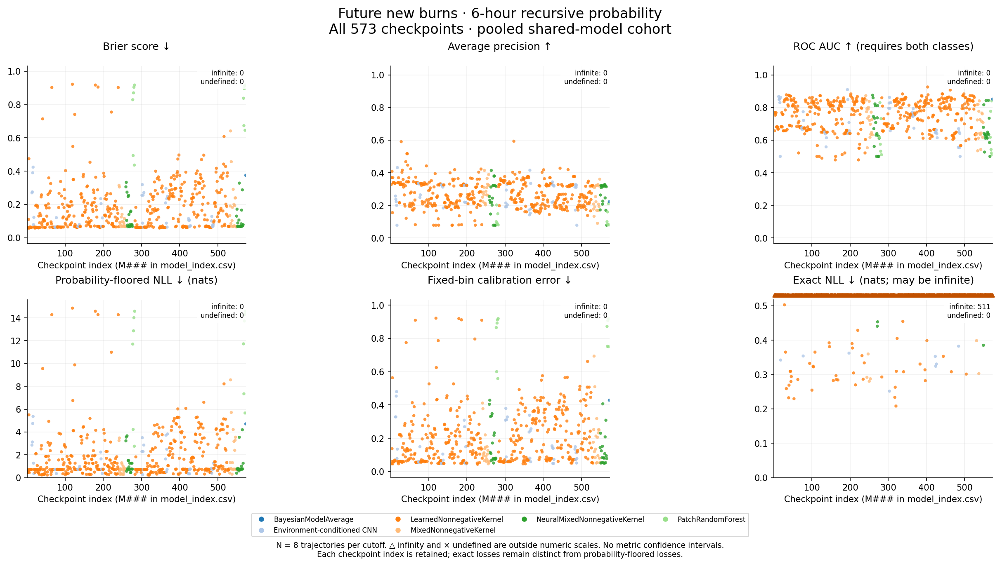

[PNG](plots/new_burn_metrics.png) · [SVG](plots/new_burn_metrics.svg)

### new burn architectures

All finite checkpoint scores by architecture, plus Brier/AP scatter; box plots describe checkpoint distributions.

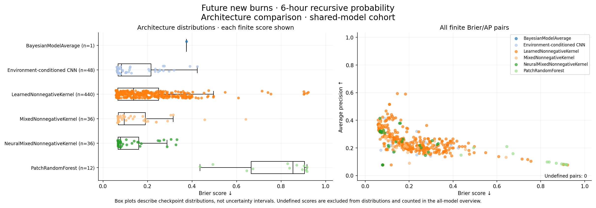

[PNG](plots/new_burn_architectures.png) · [SVG](plots/new_burn_architectures.svg)

### new burn distances

Eight representative displays for all nine exact/floored KL and Bernoulli probability-distance fields; total variation equals Wasserstein-1 for unit distance on {0,1}. Infinity and undefined values retained separately.

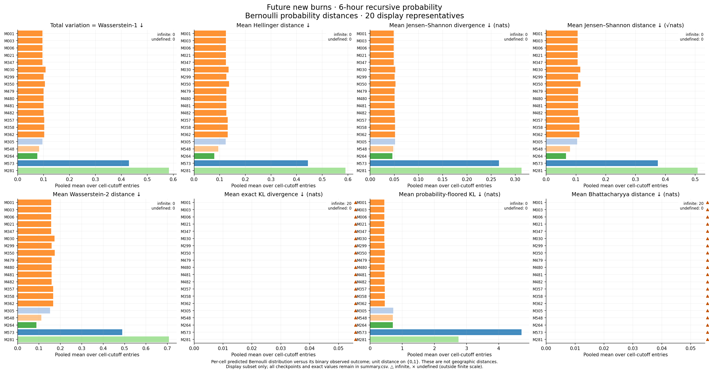

[PNG](plots/new_burn_distances.png) · [SVG](plots/new_burn_distances.svg)

### new burn reliability

Fixed-bin reliability small multiples; empty bins omitted and marker size reflects bin population.

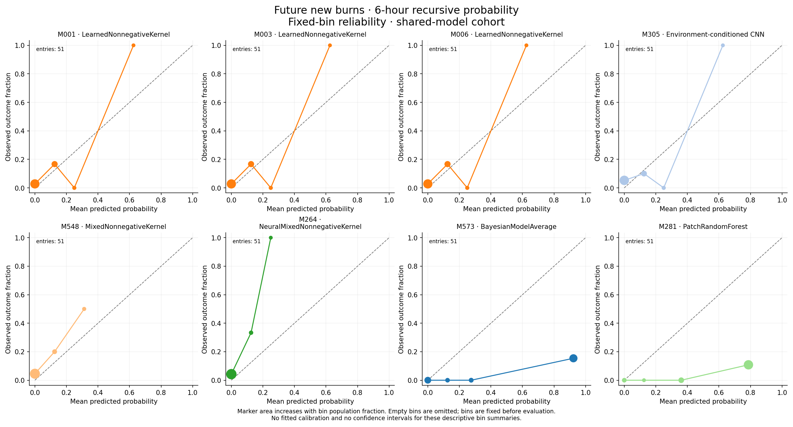

[PNG](plots/new_burn_reliability.png) · [SVG](plots/new_burn_reliability.svg)

### new burn event brier

Per-event pooled Brier heatmap for display representatives; unavailable event scores remain gray.

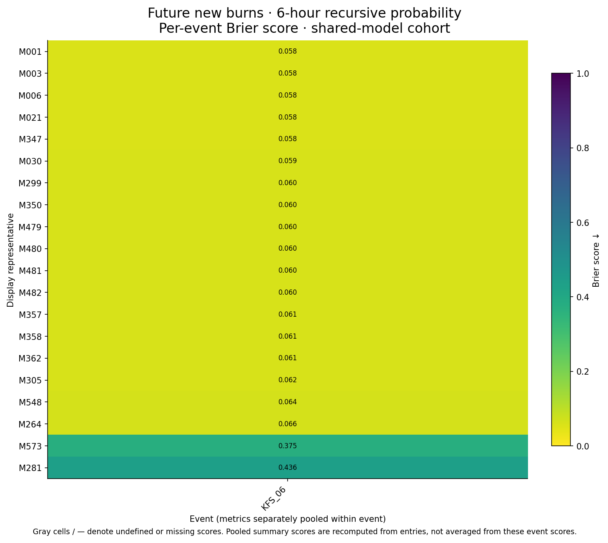

[PNG](plots/new_burn_event_brier.png) · [SVG](plots/new_burn_event_brier.svg)

### new burn coverage

Native availability and shared-model retention for every checkpoint; coverage versus shared-cohort Brier.

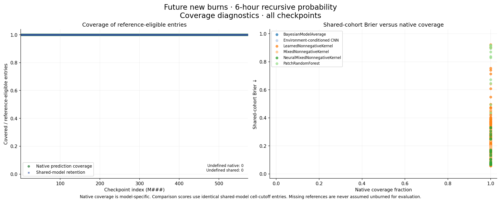

[PNG](plots/new_burn_coverage.png) · [SVG](plots/new_burn_coverage.svg)

### new burn curves

Complete pooled ROC and step precision-recall curves for display representatives; single-class/empty support recorded.

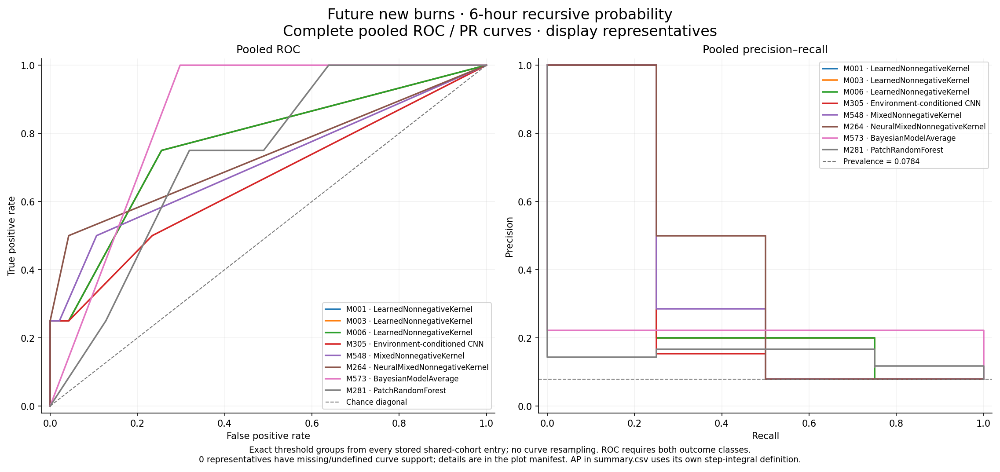

[PNG](plots/new_burn_curves.png) · [SVG](plots/new_burn_curves.svg)

### burned metrics

Six pooled metrics for every checkpoint, retaining infinite/undefined values distinctly.

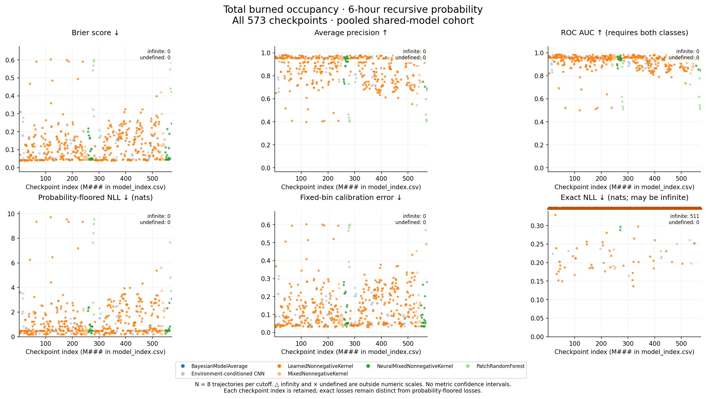

[PNG](plots/burned_metrics.png) · [SVG](plots/burned_metrics.svg)

### burned architectures

All finite checkpoint scores by architecture, plus Brier/AP scatter; box plots describe checkpoint distributions.

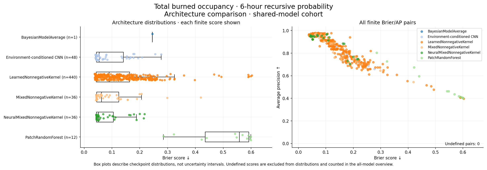

[PNG](plots/burned_architectures.png) · [SVG](plots/burned_architectures.svg)

### burned distances

Eight representative displays for all nine exact/floored KL and Bernoulli probability-distance fields; total variation equals Wasserstein-1 for unit distance on {0,1}. Infinity and undefined values retained separately.

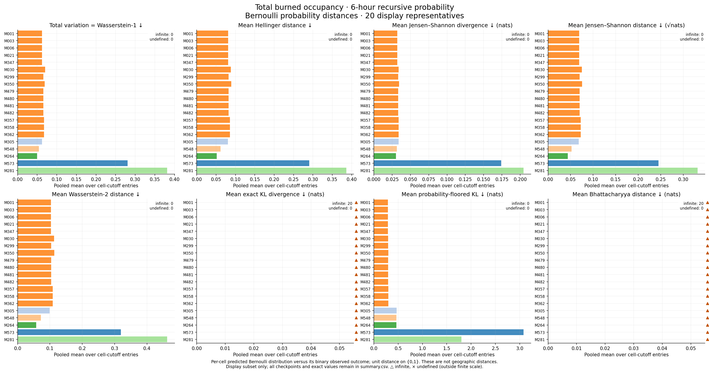

[PNG](plots/burned_distances.png) · [SVG](plots/burned_distances.svg)

### burned reliability

Fixed-bin reliability small multiples; empty bins omitted and marker size reflects bin population.

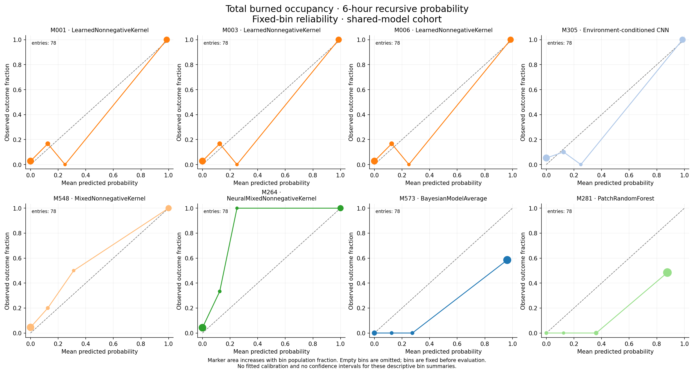

[PNG](plots/burned_reliability.png) · [SVG](plots/burned_reliability.svg)

### burned event brier

Per-event pooled Brier heatmap for display representatives; unavailable event scores remain gray.

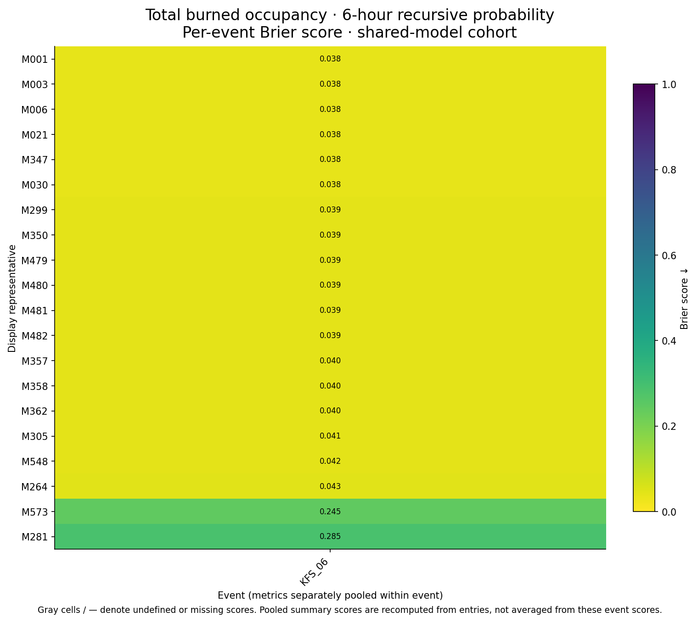

[PNG](plots/burned_event_brier.png) · [SVG](plots/burned_event_brier.svg)

### burned coverage

Native availability and shared-model retention for every checkpoint; coverage versus shared-cohort Brier.

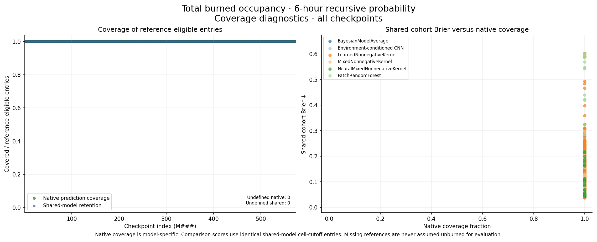

[PNG](plots/burned_coverage.png) · [SVG](plots/burned_coverage.svg)

### burned curves

Complete pooled ROC and step precision-recall curves for display representatives; single-class/empty support recorded.

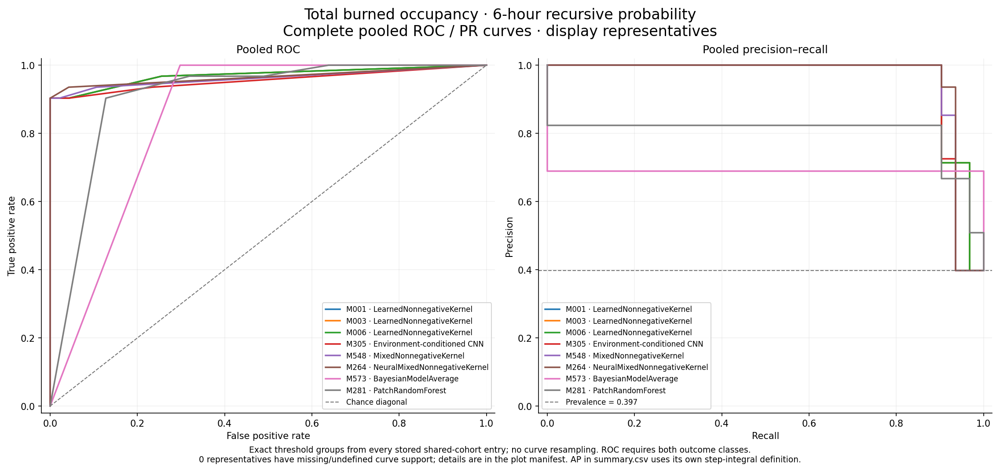

[PNG](plots/burned_curves.png) · [SVG](plots/burned_curves.svg)

## Files

- `report.json`: protocol, checkpoint hashes/contracts, pooled and event results, failures, and plot manifest.
- `summary.csv`: pooled scores and every probability distance for shared and native cohorts, both probability quantities.
- `per_event.csv` and `per_cutoff.csv`: corresponding diagnostic scores and distances.
- `calibration.csv`: pooled/event calibration bins.
- `protocol.json`: explicit settings and exact case identities.
- `plots/`: default PNG/SVG figures, model index, and manifest; omit with `--no-plots`.
- `predictions/`: optional full rectangular prediction arrays (`--save-predictions`).

Exact losses can be infinite for zero/one Monte Carlo estimates. Separately floored scores retain their explicit interpretation. Bernoulli distances concern binary outcomes at each cell, not geographic transport. This is evaluation of the recorded repeated-current-environment scenario.
