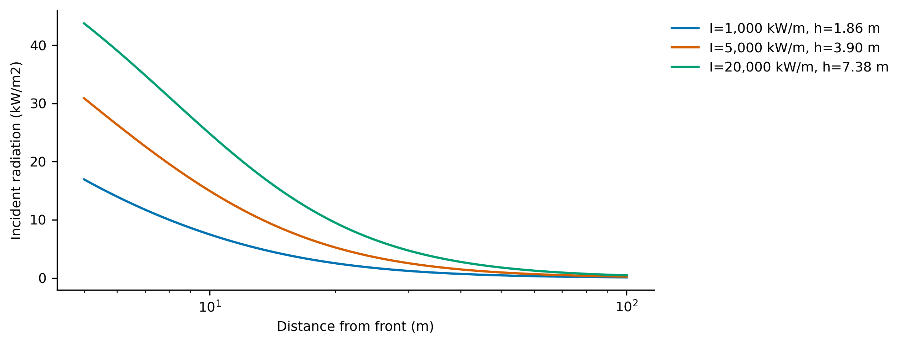
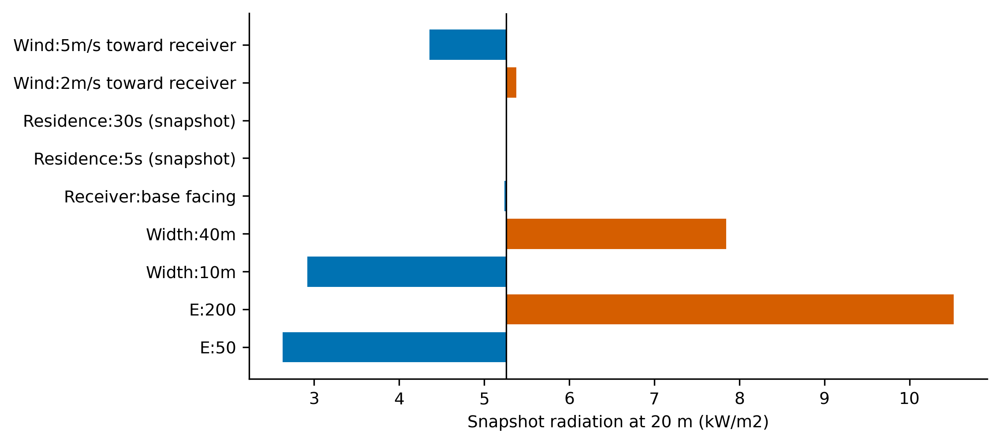

# Flame-front radiation research prototype

**21 tests passed, including 1,000 deterministic random box/interval cases; routing-v2 experiments: NOT_RUN.** The mandatory empirical physics gate remains unresolved. Rejected prior routes and peak/dose binding counts are unavailable, not zero. This branch is HOLD and does not satisfy the complete track acceptance criteria.

## What is supported

The NumPy-only library supplies polygonal fronts on affine grids, Byram intensity, sourced Putnam wind tilt, exact polygon view factors, point flux, a rigorous but loose monotone model enclosure, and analytic integration of piecewise-linear flux dose. Tests compare closed forms and explicitly refuse unknown geometry and scalar old-fire phase enclosures. Numerical enclosure samples are regression checks; the finite panel-count argument is the bound proof.

## Why the physics gate is open

Source retrieval found a material input error: the quoted Mediterranean vegetation height is not an identified flame height. Plot width does not establish instantaneous radiating width. The deliberately retained diagnostic assumptions produce large ratios, but they are not comparable measurement errors. Primary crown-fire sensor data do not uniquely determine a spatially uniform panel emissive power. Uniform-panel model agreement is reported separately from measurements. No emission constant was fitted to these values or to a routing result.

The primary Cohen paper also contradicts the prompt's statement that wall ignition occurred only with flame contact. Its ideal-model flux values must remain distinct from its measurement table. Details, citation locations and retrieval failures are in [the source ledger](physics_validation/SOURCES.json) and [physics notes](physics_validation/README.md).

## Reproduce

From repository root in the fresh pinned routing environment:

```sh
python3.12 -m venv /absolute/path/to/venv
/absolute/path/to/venv/bin/python -m pip install -c constraints-routing.txt './integration[packets]'
/absolute/path/to/venv/bin/python -m pip install -r experimental/flame-front-radiation/requirements-test.txt
/absolute/path/to/venv/bin/python research/flame-front-radiation/run_evidence.py
```

Producing script: `run_evidence.py`, with `physics_validation/run_physics.py`. Recorded seed: 20261030. Exact commands, exit codes, host, Python and NumPy versions, input hashes and full requirement states are in [RESULTS.json](RESULTS.json), [TEST_OUTPUT.txt](TEST_OUTPUT.txt), [EXECUTIONS.csv](EXECUTIONS.csv) and [REQUIREMENTS_STATUS.json](REQUIREMENTS_STATUS.json). This execution used Python 3.12.1, NumPy 1.26.4, arm64 on Darwin. No scored repetitions were run.

## Figures and captions



The straight-front figure evaluates declared finite rectangular flame panels at ground-level receivers for the specified Byram intensities and common scenario emissive power. It uses the actual receiver-to-panel geometry. Curves describe the optical model, not observed Korean fire flux or a route policy outcome. The infinite-wall limit has a different receiver orientation and is retained in the model table. PNG and SVG files share the same calculation.



The parameter chart compares snapshot radiation at the stated distance under declared emissive powers, widths, orientations and sourced tilt scenarios. Residence-time changes leave this fixed geometry snapshot unchanged; they change the evolution of the trailing front in a time-dependent calculation. These are sensitivity scenarios, not a fit or a confidence interval.

## Scope and limits

This is a model-relative prototype with no field validation. Straight marching-square segments approximate curved bilinear contours, and leading/trailing panels do not resolve the volumetric flaming band. The mean quad gradient is a declared rate approximation. Unknown cells, never-boundary interpolation and missing present-fire phases are not supplied silently. An optional explicit never-time surrogate or exclusion is a different scenario and must not be used as an unqualified route certificate. The coarse enclosure can remain indecisive under refinement. Literature emissive powers and residence times are not Korean measurements. Convection, smoke, embers, vehicle shielding, terrain occlusion and parameter uncertainty are omitted. No full journey checker, frozen journey replay, policy ablation, or continuous-route physical accuracy is established. Existing thresholds and frozen files are unchanged.
