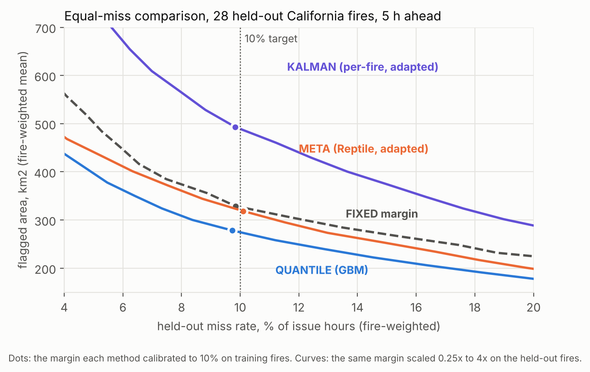
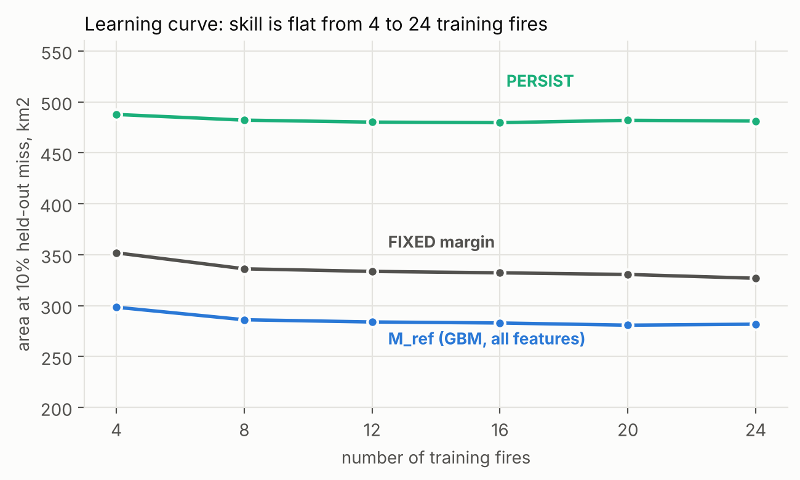

# RESULTS: can a general machine-learning forecast margin beat the fixed margin at equal miss rate? (kcf-adaptive2)

Rules: `PROTOCOL.md`, frozen at commit 28ece7a before any result in this folder; three amendments, two of them written after
seeing results (listed in section 8, with what was seen). Every number below is in `numbers.json` or `derived/`.
Labels: MEASURED = computed here from data; ORACLE = uses the fire's future, never a result for any method;
ASSUMED = an input taken on trust; NOT RUN = not done, with the reason.

## Answer

The belief was that `kcf-adaptive` failed because it (1) adapted on each fire's own past, (2) trained for average error,
(3) compared methods at unequal miss rates, and (4) had few fires. Tested at one metric (flagged area at a 10% miss rate, miss
rate checked on fires held out of every fit), the data say:

1. **Reason 2 (average error) is the one that holds.** A model trained with a quantile loss, using what is known at the issue
   hour, needs **15% less area than the fixed margin at the same 10% miss rate** (area ratio 0.846, 95% interval 0.737 to
   0.946; 28 held-out California fires; lower on 22 of 28 fires; still 0.78 when the three largest fires are left out).
2. **Reason 1 (own past) is half right, and the half matters.** The fire's recent growth is what carries that gain
   (own-past features alone: 0.861; issued forecast alone: 0.919; both: 0.846). But using the past as an *input to one global
   model* works, while *adapting a model to each fire* does not: the per-fire Kalman update is worse than its own
   non-adaptive twin (area ratio 1.19, interval 1.04 to 1.42) and worse than the fixed margin (1.50); Reptile meta-learning
   with test-time adaptation is no better than its own starting point (ratio 1.01, 0.97 to 1.06) and does not beat the fixed
   margin (0.97, 0.82 to 1.15). At 8 h adaptation is again never better than its twin and is significantly worse for META
   (1.022, 1.001 to 1.046), KALMAN (1.322, 1.161 to 1.555) and the covariate tail of EVT (1.134, 1.021 to 1.292).
3. **Reason 3 (unequal miss rates) is real but is not what hid a gain.** All 18 variants land at 9.6% to 10.9% held-out miss;
   reading the area at the held-out 10% instead of at the calibrated point moves every method by less than 2.5%, except REGIME (5.3%).
   REGIME's apparent 5% gain is mostly its 10.9% miss rate: at exactly 10% its area equals the fixed margin's (328.7 against
   326.9 km2). Unequal miss rates did not hide a gain; they created a small false one.
4. **Reason 4 (few fires) is not supported.** The learning curve is flat from 4 to 24 training fires (area ratio to the fixed
   margin 0.85 at every n), 19 more fires from another archive add nothing at 5 h (0.880 against 0.866 without) and a little at 8 h (0.949 of the model
   without them, 0.885 to 1.003: not distinguishable from 1), and a simulator adds nothing (0.904 of FIXED at 5 h; at 8 h 1.068 times the same model trained without it).
5. **None of it transferred to Korea, and none of it saw 25 March 2025 coming.** With margins calibrated on California,
   every learned method flags more area than the fixed margin on 12 Korean fires, and on 25 March every method except the
   three that extrapolate wildly missed the 10 to 20 KST run (the reach went from 5 to 40 km); the three that held did so with
   margins of hundreds to thousands of km.

The stop/go gate passed (the oracle that adapts a scale per fire-day using the future gains 24.5% area). It says the
headroom lies in *when* within a day the fire runs, not in which fire it is: the fire-level oracle gains nothing (section 1).

## Main table: area at a 10% miss rate, achieved miss rate, number of fires

Held-out California fires (GOFER), 5 h ahead, 20,065 issue hours, 7 outer folds by fire. "Area" is the fire-weighted mean flagged
area per issue hour (km2) of the margin each method calibrated to 10% on its training fires. The miss interval is a fire-cluster
bootstrap (2,000 resamples). The ratio columns are paired fire bootstraps. Verdicts follow PROTOCOL section 3: valid miss
(within 10% +/- 3 points and the interval contains 10%), then **helps** if the upper end of the ratio interval is below 1,
**material** if the point estimate is 0.90 or lower. The last column reads the area off the held-out frontier at exactly 10% miss
(descriptive; it uses held-out outcomes).

{MAIN}

**Which methods failed.** PERSIST (last h hours repeated), KALMAN (per-fire Kalman adaptation), KALMAN-twin (its non-adaptive
base), META (Reptile with adaptation), META-init and META-pooled (the same networks without adaptation) **do not help**: their
ratio intervals include 1 or lie above it. KALMAN is the clearest failure: its predictive distribution is Gaussian in log
reach, so its 90% quantile explodes when the inputs are unusual (section 4). Pretraining on archive fires, on simulated
fires, or on both does not beat the same model trained without them (section 3). EVT's tail model adds nothing over its
constant-scale twin (1.035, 0.996 to 1.086). The forecast-regime rule alone (REGIME) passes the frozen rule but its gain
vanishes at equal miss (above). Nothing was tuned after a held-out result was seen.

## 1. Step 1 gate: oracle ceiling and learning curve

All ORACLE rows use the fire's future hours and are not a result for any method. Gain = 1 - area(oracle) / area(FIXED at 10%),
FIXED area {FIXED_AREA} km2 at {FIXED_MISS} miss. Blocks are consecutive eligible hours of one fire; "random" draws the same block sizes
from random hours of the same fire (the control for in-sample optimism). Scale only (shape s = 1).

| Oracle (scale per block) | Miss | Area | Gain vs FIXED (95%) | Same with random blocks (O-fire: identical by construction) |
|---|---|---|---|---|
{ORACLE}

- **The pre-registered gate statistic is O-day, per-fire budget: gain 24.5% (9.1 to 40.5), above the 10% threshold. Gate passed.**
- Its random-block control gains -0.5%, so the gain is time structure, not fitting 10% quantiles in-sample.
- O-fire (one scale per fire) gains **-11%**: giving every fire its own 10% is a worse use of the miss budget than one pooled
  margin. Fire-level adaptation has no headroom here.
- The gain grows without bound as blocks shrink (O-6h: 54%, and 14.8% even with random blocks). A ceiling that adapts
  every few hours is not informative; the 24 h block is the one the gate was fixed on, in the protocol, before any value.
- Amendment 2 (after seeing the above): the per-fire budget oracle is not a ceiling because it does worse than the
  non-adaptive M_ref when stacked on M_ref (291 against 285 km2). The pooled-budget oracle (minimum area subject to 10% miss
  over all fires, a constant scale is a feasible point) is reported beside it: O-day 59.0% (46.4 to 68.7) with random-block
  control 28.9%; O-fire 14.4% (-5.6 to 34.8). Both versions pass the gate; no decision rests on the second.
- Against it, the best causal method here, QUANTILE, gains 15.4% against the same baseline.

**Learning curve** (M_ref = gradient-boosted 90% quantile, fixed settings, no tuning; training fires drawn at random from the 24
available in each fold, 10 draws per size except n = 24):

{CURVE}

The ratio of M_ref to FIXED read at held-out 10% miss is 0.85 at every size. The slope of log ratio against log n over n = 8..24 is
+0.007 (flat); the fire-bootstrap interval of the same slope on the calibrated area is -0.109 to +0.001. Skill saturates by
about 8 fires, so more fires of this kind is not the missing ingredient. (n = 4 uses leave-one-fire-out calibration inside the
subset, larger n six groups, per Amendment 2.) 

## 2. What does adapting to the fire add? (paired by fire, same held-out fires)

{TWINS}

Using the fire's past as an input (QUANTILE-own against FIXED) lowers area by 14%. Updating a model per fire on top of that
does not: META against META-init, KALMAN against its twin, and nothing is gained by the extra 'forecast' features once the
past is in (QUANTILE against QUANTILE-own: 0.983, 0.947 to 1.026).

## 3. The six method families, one line each (details in PROTOCOL section 5)

1. **Meta-learning (Reptile).** Does not help (0.969, 0.820 to 1.152). The meta-initialisation without adaptation (0.955) is as
   good; the pooled network it started from (1.093) is worse, so meta-training itself helped a little and adaptation not at all.
2. **Low-dimensional per-fire update (Kalman).** Fails: 1.499 (1.085 to 2.004), worse than its non-adaptive twin (1.263).
   The wind-alignment factor of the task text was not testable on a scalar reach and was replaced by a wind-speed slope.
3. **Quantile loss at the target.** Helps, material: 0.846 (0.737 to 0.946). Linear and boosted models were both available to
   inner cross-validation; inner cross-validation chose boosted trees on all features at tau 0.9 (depth 2 or 3, 100 iterations) in all 7 folds (`derived/step2/QUANTILE_h5.json`).
4. **Forecast regime.** REGIME helps on the frozen rule (0.949, 0.923 to 0.976) but only through a 10.9% miss rate; at equal miss
   it is equal to FIXED. Adding an own-past quantile model inside each regime (REGIME+own, 0.860) gives the same as QUANTILE-own
   (0.999, 0.988 to 1.011): the forecast regime adds nothing once the past is in.
5. **Pretraining.** Archive (19 US Choi fires): 0.880. Simulated fires: 0.904. Both: 0.873. Without pretraining (M_ref): 0.866.
   None beats it (paired ratios 1.015, 1.043, 1.007 with intervals that include 1). The simulator is a toy (section 7).
   FIRED and GlobFire could not be used (section 7).
6. **Peaks over threshold.** EVT 0.876 (0.754 to 0.999) against its constant-scale twin 0.846: no gain from covariates in the
   tail. On 25 March it extrapolates the scale (margins up to 69 km), see section 5.

## 4. Why KALMAN fails (MEASURED description, not tuned)

KALMAN is a ridge regression of log(reach + 0.375) on all features with a Gaussian predictive 90% quantile. Its non-adaptive
twin is already worse than the fixed margin (1.263), because exponentiating a Gaussian quantile in log space overshoots on
the many hours when the regression is wrong by a factor (the likely cause; not tested separately). The per-fire update does not
repair it: KALMAN has less area than FIXED on only 13 of 28 fires (median per-fire ratio 1.04), and the adaptive version is
worse than the twin on average (1.19, 1.04 to 1.42). This is a failure of this implementation, not a proof that no Kalman
update could work; it was not changed after the result was seen.

## 5. Sealed transfer test: Korea, and 25 March 2025

Models were fitted and calibrated on all 28 California fires (the archive too, for PRETRAIN-archive and -both) and applied once.
KR = 12 Korean fires with Choi arrival rasters, 756 issue hours, one product different from GOFER (kriged arrival times).

{KR}

- Every learned method flags **more** area than the fixed margin at the California-calibrated 10%. Most miss less than the
  fixed margin on Korea (2% to 4% against 4.5%), so they are conservative where Korea is calmer. At the held-out 10% (last
  column) none beats FIXED either (FIXED 52.1 km2; REGIME 50.2 is the lowest). This is **no transfer**. Why is not tested here
  (the product, the climate and the fire regime all differ).

### 25 March 2025 (Gyeongbuk, KFS_01), hour by hour, 5 h ahead

Detection product (FIRMS VIIRS + Himawari AHI), 23 complete issue hours. Margin q at each issue hour uses only the features
and outcomes available at that hour (forecast as issued with the 5 h availability delay; reach history from the detection
product). Counts only: one fire, one day. Area is capped at q = 60 km, so the very large margins below cap at that value.

{MAR}

- **Nothing saw it coming.** At 10 and 11 KST (reach 4.9 and 6.6 km) several margins held (9 of 18 at 10 KST, 4 at 11 KST), but
  the reach was still small. From 12 KST (reach 12 to 40 km) only three methods ever held: KALMAN, KALMAN-twin and META-init,
  the ones whose margin extrapolates (next point), and **no method held at 13, 14 or 15 KST** (reach 24, 35, 33 km). Leaving out
  KALMAN, META-init and PERSIST (which follows the observed reach), no margin exceeded 12 km before 16 KST.
- **The methods that held later did so by growing after the fact.** PERSIST and EVT hold from 17 to 18 KST because their
  margin is a function of the reach already seen (observed growth over the previous hours). KALMAN's margin reaches 21,539 km at 19 KST (an extrapolation of a
  log-linear model on features outside the training range); META-init reaches 1,066 km. These are failures of
  extrapolation, not forecasts: no clipping was added, per PROTOCOL section 7.
- The tree models saturate at about 10 km (QUANTILE, M_ref, PRETRAIN) and miss the same 11 hours as the fixed margin.
- The issued forecast did carry the warning: forecast 850 hPa wind of 32 m/s at 10-16 KST against a California maximum of
  30 m/s (`kcf-abstain`). The models that use it (QUANTILE-fc: 10 missed) did not turn it into a large margin, because
  a model fitted on California cannot learn a value it never saw. Abstaining (`kcf-abstain`) is the tool that used it.

## 6. h = 8 replication (identical code, DEV)

{H8}

Reading (h = 8): only QUANTILE (0.877), QUANTILE-fc (0.907), REGIME (0.916, at a 11.2% miss rate: at held-out 10% its area is 428.4 against
FIXED's 433.4, no gain) and EVT-twin (0.882, 10.9% miss, read at held-out 10%: 395.6, ratio 0.91) pass the frozen rule. Every
adaptive method fails again. The gain from using the fire's recent growth and the forecast as inputs to one global model is
therefore real at both horizons but smaller at 8 h, and its size depends on which model and features are used. Paired
comparisons against the twins at h = 8 are in `derived/tables_h8.md`.

## 7. Limits

- 28 fires. Intervals are fire bootstraps (marginal, no multiplicity correction over 18 variants and about 40 comparisons); several
  verdicts are close to the edge (EVT 0.999, PRETRAIN-sim 0.999 on the upper bound).
- The 10% miss rate is hour-level and fire-weighted; area is the fire-weighted mean of per-fire mean areas, so a few large fires
  weigh more. The gain is lower on 22 of 28 fires and 0.78 without the 3 largest-area fires (`derived/per_fire_robustness_h5.json`).
  The worst fires were Kincade and Zogg (wind-driven).
- Forecast features are inherited from `kcf-abstain` (GFS or HRRR as issued, 5 h availability ASSUMED, read over 8 h also for
  h = 5). Own-past features come from the GOFER or Choi arrival grids; the Choi rasters are kriged and smoother than GOFER.
- The simulator for PRETRAIN-sim is a toy (elliptical-kernel spread, AR(1) wind, fixed a priori; its constants were set in three passes
  by comparing marginals with the archive fires, never with the 28 DEV fires). A better simulator could behave differently;
  this one did not help.
- FIRED and GlobFire were **not used**: their hosts are not on this environment's allow-list. Both are also daily products, which
  cannot give an hourly 5 h reach. The 19 US Choi fires are the larger archive that was available (NOT RUN: FIRED, GlobFire).
- The oracle numbers depend on block length and on Amendment 2, which was written after the first oracle values were seen.
- A worker restart killed the first dev sweep after QUANTILE-own and QUANTILE-fc finished; the sweep script is restart-safe and
  resumed from the next method (finished outputs kept). The simulator was generated after the restart. No result was changed by it.
- Korea and 25 March were run once, after the DEV sweep, with no method altered between the two (no Korean run was made at h = 8).
- No result here says anything about margin placement by direction (wind alignment is not testable on a scalar reach).

## 8. Amendments (also in `PROTOCOL.md`)

1. Before any oracle value: the per-fire miss budget carries over between blocks (a literal 10% quantile is impossible for
   blocks under 10 hours).
2. After the first oracle values were seen: the pooled-budget oracle added beside the pre-registered one (it is the true ceiling),
   with implementation details (score floor 0.1 km, inner groups min(6, n), reach reproduction tolerance 1e-5 km).
3. Before any REGIME result was read: the regime index is the minimum, not the maximum, over the four tail probabilities
   (as in `kcf-abstain`); plus statsmodels QuantReg, warm-start detail, EVT body, Kalman prior and the list of extra
   ablation rows.

## 9. Reproduce

    # data: GOFER v0.2 (Zenodo 14642378) and Choi et al. 2026 (Zenodo 21788344); both need zenodo.org
    python build_data.py --gofer DATA/gofer/GOFER --choi DATA/choi --out WORK        # 1 minute
    python step1_oracle.py; python step1_pooled.py; python step1_curve.py            # oracle ceiling and learning curve
    python sim_fires.py --n 400 --out WORK/sim.csv.gz                                  # simulated fires
    bash run_step2.sh                                                                 # dev sweep, h = 5 (H=8 for h = 8)
    python step2_final.py --methods ...; python final_report.py 5                      # sealed Korea + 25 March
    python make_tables.py 5; python make_tables_final.py; python figures.py; python make_numbers.py
    python -m pytest -q tests                                                         # leakage tests L1, L2, L3

Scripts read WORK (the arrival grids, area curves and simulated fires; about 40 MB) from the environment variable `KCF2_WORK`.
Leakage tests: L1 (features at hour t ignore everything after t) passes; L2 (scrambling outcomes not yet known at hour t leaves
the predictions of META and KALMAN bitwise identical) passes; L3 (a deliberately leaky Kalman) fails L2 as it must; L4 (the
committed kcf-margin reach and its 6.16% leave-one-fire-out miss) reproduces: 0.06156 on the committed hours, 0.0601 on the 20,065
eligible hours.
