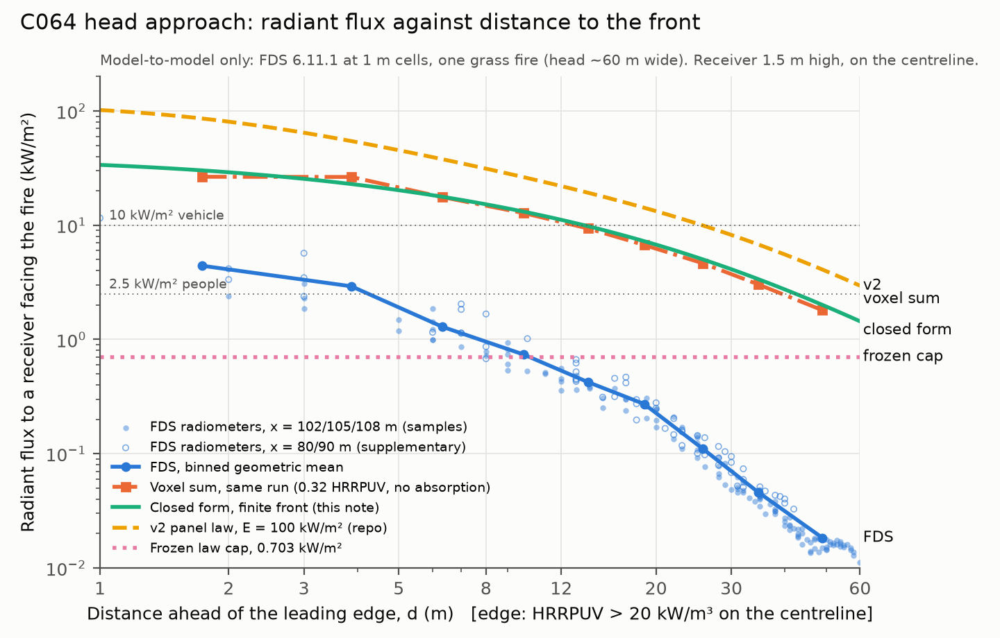

# FDS check of the heat laws on the C064 grass fire (model-to-model)

**What this is:** a comparison of four radiant-heat laws with FDS 6.11.1 on one simulated grass fire (CSIRO C064,
1 m cells, head about 60 m wide). No measured flux is used anywhere. FDS is a model, so agreement with it is not
validation and disagreement with it is not refutation.



*Figure.* Radiant flux to a receiver 1.5 m high on the centreline, facing the fire, against distance ahead of the
leading edge.

* Dots: FDS gas-phase radiometers at 0.5 s output, interpolated to the 1 s volume frames, 40–84 s (head 50–100 m).
* Blue line: FDS binned geometric mean.
* Orange: voxel sum on the same run's 1 s HRRPUV volume.
* Green: closed form, finite front, run-mean front parameters.
* Yellow: the repository's v2 panel law (leading + trailing panels, E = 100 kW/m²).
* Pink: frozen-law cap.

Numbers are in the table below; data in `data/b2_fds_compare.json`.

## Inputs and identity

* **Study package.** The attached `WildfireGuardian_C064_Temporal_Helicopter_Study.zip` (sha256 `5524404f…`) was
  extracted to a fresh directory. All 277 entries match its `SHA256SUMS.json`.
* **3D field.** `fire-data/csiro-volume-dt5-120.npz` (sha256 `7efeca01…`, 5 s snapshots).
* **Source input.** `fire-data/full-5s-evidence/Case_C064_crude_cat.fds` (sha256 `d23221dd…`, the input recorded
  for that npz).
* **FDS binary.** FDS-6.11.1-0-gff928db-release (sha256 `f76a868c…`, the study's binary), 6 MPI processes, on this
  Mac.

## B.1 Reproduction from the 3D field

Script: `scripts/b1_voxel_check.py`. Output: `data/b1_voxel_check.json`. Quasi-steady window 30–80 s (10 snapshots).

The leading edge is the downstream face of the last centreline voxel (|y| ≤ 2.5 m) above an HRRPUV threshold. **The
brief's numbers are reproduced with a 20 kW/m³ edge.** The table gives all three thresholds because the edge
definition moves the answer:

| quantity | brief | edge 5 kW/m³ | **edge 20 kW/m³** | edge 100 kW/m³ |
|---|---:|---:|---:|---:|
| head spread rate R (m/s, LSQ fit of the edge) | 1.33 | 1.334 | **1.287** | 1.283 |
| head intensity I (MW/m, centreline HRR per metre; threshold-free) | 4.4 | 4.51 | **4.46** | 4.24 |
| flame depth (m) | ~12 | 14.7 | **11.4** | 7.9 |
| flame height (m, top of highest voxel above threshold) | ~4 | 6.8 | 5.7 | 4.4 |
| effective head width (m, head HRR / I) | 59 | 58.3 | **59.5** | 61.6 |
| radiant fraction −Q_RADI/HRR (window) | 0.32 | 0.316 | **0.316** | 0.316 |

* Byram's L = 0.0775 I^0.46 gives 3.7 m, so the brief's ~4 m flame height matches Byram's estimate rather than the
  HRR envelope.
* The radiant fraction ranges 0.27–0.34 across individual HRR rows.

Voxel-sum radiometer (0.316·HRRPUV·dV, inverse square, receiver cosine, no absorption), mean over 10 snapshots, with
ratios to it:

| d (m) | brief voxel | **voxel, edge 20** (min–max) | closed form / voxel (min–max) | long-front / voxel | v2 / voxel |
|---:|---:|---:|---:|---:|---:|
| 3 | 21 | **22.7** (17.8–31.3) | **1.10** (0.78–1.30) | 1.15 | 2.86 |
| 8 | 13 | **13.6** (11.1–18.2) | **1.09** (0.78–1.29) | 1.21 | 2.29 |
| 12 | 9.4 | **9.8** (8.2–12.6) | **1.10** (0.81–1.28) | 1.30 | 2.22 |
| 20 | 5.6 | **5.9** (5.0–7.2) | **1.11** (0.87–1.27) | 1.50 | 2.23 |
| 30 | 3.4 | **3.5** (3.1–4.2) | **1.11** (0.92–1.23) | 1.78 | 2.27 |

**Corrections to the first pass.**

1. **The closed form is 9–11% high, not 16–17%.** This uses per-snapshot I, depth and width with the same edge.
   * With the brief's rounded parameters (χ 0.32, I 4.4 MW/m, R 1.33, depth 12, a = 29.5 m) against the brief's own
     voxel numbers, the ratio is 1.11–1.16.
   * The ratio depends on the edge definition: 1.17–1.24 at 5 kW/m³ and 0.89–1.02 at 100 kW/m³.
   * Measured from the threshold-free HRR centroid instead of an edge, the closed form is 0.92–1.05 × the voxel sum
     for s = 8–36 m, and 0.77 at s = 6 m (one sample).
   * The edge-referenced bias comes mostly from placement. The law puts the source D/2 = 5.7 m behind the edge; the
     HRR centroid is 7.1 m behind it.
   * The finite-front factor is essential: without it the law is 15–78% high.
2. **The repository's v2 panel law is 2.2–2.9× high, not 1.5–1.9×.** v2 has a leading and a trailing panel, both at
   E = 100 kW/m², L = 3.7 m and width 59.5 m.
   * The brief's 1.5–1.9 is reproduced only by the leading panel alone (1.4–2.3×).
   * With the brief's parameters, v2 is 2.3–3.0× the brief's voxel numbers.
   * A worst-case receiver orientation changes v2 by under 1%. A 4.6 m/s wind tilt changes it to 1.6–3.5×.

## B.2 FDS's own radiation solver

### Run setup

`scripts/make_fds_input.py` derives the input from the packaged one:

* Gas-phase radiometers `RADIATIVE HEAT FLUX GAS`, `ORIENTATION=-1,0,0` (facing the fire), z = 1.5 m, y = 0:
  * x = 102, 105, 108 m (requested; on the roads just past the fuel bed);
  * x = 80, 90 m (supplementary; inside the bed, used only while ahead of the edge).
* `DT_DEVC` 0.5 s, and a 1 s HRRPUV volume over x 30–110 m.
* T_END 140 s.

Physics records are unchanged.

* **Run B** (the reported one) completed in 423 s (`data/fds_rerun/`).
* **Run A**, identical except that `DT_SL3D` was missing (so it wrote only six volume frames), gave **bit-identical
  device output**: max |difference| = 0 on all seven devices. The run is reproducible on this host.

### Sign check

The orientation convention was tested, not assumed (`data/fds_orientation_check/`). A 3 × 3 m panel at 800 °C was
placed 4 m from a radiometer at its centre, with 400 angles and 0.25 m cells:

* facing the panel: 8.80 kW/m², against 11.29 kW/m² analytic (FDS reads 0.78 of the view-factor value);
* facing away: 0.07 kW/m².

The fire runs therefore face the fire.

### Result

The front was measured on every 1 s frame (edge 20 kW/m³, as in B.1): R = 1.290 m/s, I = 4.47 MW/m, depth 11.1 m,
width 60.1 m, χ = 0.318. There are 189 radiometer samples ahead of the edge (d ≥ 1 m).

| d bin (m) | n | FDS (geo-mean) | voxel, same run | closed form | v2 | voxel / FDS | closed form / FDS | v2 / FDS | v2 lead panel / FDS | frozen cap / FDS |
|---|---:|---:|---:|---:|---:|---:|---:|---:|---:|---:|
| 1–3 | 4 | 4.41 | 26.5 | 29.2 | 84.4 | 6.0 | 6.6 | 19 | 16 | 0.16 |
| 3–5 | 6 | 2.92 | 26.4 | 25.9 | 64.4 | 9.1 | 8.9 | 22 | 18 | 0.24 |
| 5–8 | 13 | 1.29 | 17.6 | 18.3 | 38.6 | 14 | 14 | 30 | 22 | 0.55 |
| 8–12 | 14 | 0.74 | 12.8 | 14.3 | 28.6 | 17 | 19 | 39 | 28 | 0.95 |
| 12–16 | 18 | 0.42 | 9.4 | 10.3 | 20.0 | 22 | 24 | 47 | 32 | 1.7 |
| 16–22 | 21 | 0.27 | 6.7 | 6.8 | 14.0 | 25 | 25 | 52 | 33 | 2.6 |
| 22–30 | 30 | 0.11 | 4.7 | 4.7 | 9.8 | 42 | 42 | 89 | 55 | 6.4 |
| 30–40 | 34 | 0.05 | 3.0 | 3.2 | 6.7 | 66 | 70 | 146 | 88 | 15 |
| 40–60 | 48 | 0.02 | 1.8 | 2.0 | 4.1 | 98 | 109 | 222 | 131 | 38 |

**FDS's radiation solver gives far less flux ahead of this front than any unattenuated law.** The gap is 6× at 1–3 m
and about 100× at 40–60 m.

* FDS first reaches 10 kW/m² only within about 1 m of the edge. It reaches 2.5 and 5 kW/m² at about 3 m.
* The closed form crosses 10 / 5 / 2.5 kW/m² at 13.6 / 25.8 / 42.5 m; v2 at 25.6 / 42.9 / 66.3 m.
* In this fire, the closed form's long-front lead times are T\*(10) = 13 s and T\*(2.5) = 66 s (finite front: 10.5
  and 33 s). FDS implies roughly 0 s and 2–3 s.
* The closed form and the voxel sum agree within 0.97–1.11 in every bin. That is B.1's result again on an
  independent run.

**Why (interpretation, fitted; `scripts/b2_absorption_fit.py`, `data/b2_absorption_fit.jsonl`).**

* The gap is not the 0.21 m grass layer that FDS smears over the lowest 1 m cell. Only 25% of HRR is in that layer,
  and adding its absorption (1.37 m⁻¹ in unburnt bed cells) lowers the voxel sum by about 25%, not 10–100×.
* The voxel sum matches FDS to a geometric factor of 1.44 (log-rms 0.52) only if every flaming cell absorbs with
  κ ≈ 0.3 m⁻¹ and the path absorbs with κ ≈ 0.03 m⁻¹. At 1 m cells, FDS therefore behaves like a self-absorbing flame
  zone (its emission is forced to equal χ·HRR net, and much of it leaves through the zone's large top and bottom
  faces rather than its thin leading edge) in an absorbing atmosphere.
* Whether a real grass fire's near-front flux looks more like FDS or like the unattenuated laws is **UNVERIFIED**
  here: no measured radiometry is used. The 0.03 m⁻¹ path absorption (transmissivity 0.41 over 30 m) is larger than
  usual clear-air values, which suggests FDS's gray-gas treatment at 1 m is on the low side. That is not shown.

## B.3 Decision on the v2 empirical gate (factor of three)

The gate (docs/next/prompts/01A_flame_front_radiation.md) reads: *"If any comparison is off by more than a factor of
three, stop and fix the model before touching routing."*

**Decision: the gate is NOT passed on this evidence. v2 stays on HOLD and is not admitted to routing.**

* **Against FDS**, the only independent radiation solver here, v2 is 19× (1–3 m) to 222× (40–60 m) high. Even its
  leading panel alone is 16–131× high.
* **Against the voxel sum**, which shares v2's no-absorption optics and so is not independent, v2 is 2.1–2.4× high
  beyond 3 m and 3.2× at 1–3 m (B.2 run). B.1 gives 2.2–2.9× at d = 3–30 m. It is at or beyond the gate at the
  closest distances, where routing decisions are made.
* The same test applied to the closed form also fails against FDS (6.6–109×). **The closed form is therefore not
  validated by this check either.** It is adopted for routing as a **screening law on the conservative side**:
  * about 10% above the unattenuated field and 6–100× above FDS at d ≥ 1 m;
  * one formula with one parameter group (χ·E_A), and a lead time independent of R.

  "Conservative" holds only relative to these two model references. It is not a proof against a real fire (see
  DERIVATION.md section 5).

**Limits of this decision**

* One grass fire, one fuel, a 59 m head, 1 m cells, 4.6 m/s wind, flat terrain, one receiver height.
* FDS radiometry at 1 m resolution is unverified against measurement. Its gap to the unattenuated laws is larger than
  any difference between them.
* Model-to-model throughout. A measured near-front radiometry dataset with a known front geometry is the missing
  evidence for either law.
* Not covered: convection (comparable to radiation at the front in surface fires), smoke, embers, terrain shading,
  vehicle shielding, crown-fire fuel load.

## Reproduce

```sh
# extract the attached zip to $PKG; FDS 6.11.1 at $FDS_ROOT; Python 3.12 + numpy 1.26.4, matplotlib, pytest
python research/kcf-heat/scripts/b1_voxel_check.py $PKG/c064-refinement-study/fire-data out/b1.json
python research/kcf-heat/scripts/make_fds_input.py $PKG/c064-refinement-study/fire-data/full-5s-evidence/Case_C064_crude_cat.fds out/run
FDS_ROOT=... python research/kcf-heat/scripts/run_fds_guarded.py out/run 2400   # ~7 min, 6 MPI ranks, ~0.3 GB
python research/kcf-heat/scripts/stitch_fds_slice.py out/run out/hrrpuv.npz
python research/kcf-heat/scripts/b2_fds_compare.py out/run out/hrrpuv.npz out/b2.json
python research/kcf-heat/scripts/fig_fds_check.py out/b2.json research/kcf-heat/figures/fds_check.png
```

OpenMPI needs loopback sockets. Under the Claude Code sandbox the FDS step was run with the sandbox off.
