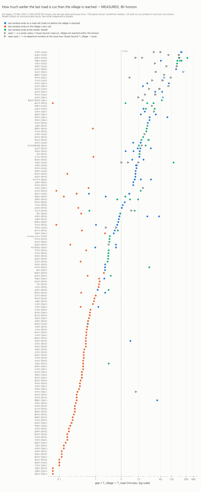

# kcf-roadcut — results: how much earlier is the last road cut than the village is reached?

**Every number here is model output on reconstructed inputs. It is not what happened to people.** Nothing here is a
claim about what any official should have done. The Korea Forest Service rule is *read* here (assumptions in §4); its
system is not reproduced.

Protocol: `PROTOCOL.md`, frozen at `e8947dc` before any outcome was computed; amendments 1 (`9b16a3a`) and 2 (`67afec0`)
were both made before any validation comparison or test was run. Main at `896bd41` (PR #193). Run 2026-11-18,
10:37–13:30 UTC.

## 0 Headline (primary configuration fixed in advance: kcf-replay, MEASURED arm, 8 h horizon)

*Model output on reconstructed inputs. Not what happened to people.*

Units: 174 places × 13 issue hours (25 Mar 2025, 12:00–24:00 KST) = 2,262 place-hours.

* **States:**
  * 1,077 are INSIDE: the place's entry point is already inside the known fire area at the issue hour, so there is no gap.
  * 785 are not cut within 8 h.
  * 349 are CUT.
  * 51 have NO_WINDOW: not inside, but no departure works at the issue hour.
* **The road is cut before the village is reached (count A):** **154 place-hours at 68 of 174 places**. These are the
  103 CUT place-hours whose last window ends on a road cell, plus the 51 NO_WINDOW place-hours. In another 79 CUT
  place-hours the window ends at the shelter (the destination closes first; counted separately). In the other 167 CUT
  place-hours the window ends on the village's own cell.
* **The gap, T_village − T_road, over the 343 exact gaps at 136 places:**
  * Median **1.2 min**; 10th–90th percentile 0.2–29.3 min.
  * Largest **326.8 min**: 동변리 (의성군), 12:00 issue. The shelter ends that window.
  * 57 further place-hours give only a lower bound; the largest is 256.3 min.
* **The median is small by construction.** Where the village's own cell ends the window (n = 167), the "gap" is only the
  time needed to leave that cell: median 0.3 min, maximum 1.8 min. That is not a finding (PROTOCOL §2.4).
* **Where a road cell ends the window (n = 97 exact),** the road is cut a median **11.8 min** before the village is
  reached, with a maximum of **159.6 min** (삼의리, 영양군, 18:00 issue).
* **Gap thresholds:**

  | | gap ≥ 5 min | gap ≥ 15 min | gap ≥ 30 min | gap ≥ 60 min |
  |---|---|---|---|---|
  | exact gaps (place-hours) | 118 | 77 | 33 | 18 |
  | adding lower bounds | 167 | 118 | 67 | 40 |

* **Holes in the windows:** none. In all 27,144 place-hours of every arm and horizon, the merged window set of every
  place is a single interval, so "end of the last window" is "end of the window". Family M is a prefix by
  construction (no holes possible).
* **Under the 5 h / 8 h reading (§3):**
  * **12 place-hours at 10 places** are "prepare" (8) or nothing (4) while the model's last road out closes within 5 h (P5).
  * **6 place-hours at 4 places** are nothing while the last road closes within 8 h (P8): 구계리 (의성군) at 12:00,
    13:00 and 14:00, and 상아리, 인금리 and 하아리 (안동시) at 15:00.
  * No P5 or P8 place-hour in the primary configuration is a NO_WINDOW case. The list is in §3.3.
* **Across all arms (8 h):**
  * Count A runs from 102 place-hours at 47 places (ORDINARY) to 521 at 121 places (WORST).
  * P5 runs from 5 (WORST) to 19 (MEASURED_GUST_KMA).
  * P8 runs from 0 (RUNNING, WORST) to 17 (ORDINARY).
  * The fast arms (RUNNING, WORST) put nearly every place's village within 5 h, so they leave almost nothing in the
    "prepare" or "nothing" steps.
* **Validation** (§5) **is weak and mostly uninformative.** Every record is REPORTED (news), and most were seen only as
  search-snippet text.
  * **Expressways (8 records):** the model already had the in-grid section "closed" at the issue hour. Its known fire
    area touched those routes from 23–24 March, while the recorded closures are on 25–26 March.
  * **Local roads (4 records):** MEASURED closes two of them 20 and 30 min *after* the recorded time and **misses**
    the other two (not closed by 01:00).
  * **Burned area:** the model's "reached" area covers every assessable cell of both grids, against ≈ 45 % burned on
    the Sentinel-2 map. This over-coverage starts in the fire input (2 km discs around hotspots), not in the spread
    arm.

So, to the question "how much earlier?": in this model, when the last road out is cut before the village is reached, it
is usually cut minutes before (median 11.8 min in the primary configuration, 2.8–34.0 min across arms); at a few
places it is hours. At 68 of 174 places this happens at least once during the 13 issue hours. None of these times has
been shown to match what happened on the roads.

## 1 What was computed (summary of the protocol)

* **R** (kcf-replay):
  * For each place, issue hour T, arm and horizon H, the departure-window set is the union over the place's 3 planner
    shelters of the F-3.1 issue sets, merged.
  * T_road = the end of the last window.
  * T_village = the closure time of the place's own entry cell under the same arm. This is "fire within reach of the
    entry point" by the arm's closure rule, the same rule that closes road cells. It is not a physical flame-arrival
    time.
  * The binding cell (PROTOCOL §2.4) is the minimum-slack closure on the witness route at T_road.
* **M** (multi-hour F-DYN HEADLINE run, `no_reentry/2`):
  * The window is [T, T + leave_by_s].
  * T_village comes from the Choi 2026 TOA raster (kriged_mean) or from `firms_variants` (firms_early). The envelope is
    taken as firms_early (ASSUMED reading).
  * The rasters are rebuilt here from committed inputs, not read from the F-DYN packets, which are not on Main.
  * 3,132 rows (amendment 2a).
* **Reproduction:** `replay.py` was rerun unchanged (312 jobs). `analyze.py` on the rerun gives a `per_place.csv`
  identical to the committed one in **every column of all 27,144 rows**, with 0 keys present in only one of the two
  (`repro_check.json` checked the 7 protocol columns; a full-column diff also gave 0 differences). Only the row order
  differs, so the file SHA-256 differs.
  * The SHA-256 of the 312 raw run files and the intermediate files (which stay in scratch because of their size)
    are in `runs_sha256.txt`.
* **Integrity checks** (`numbers.json` → `checks`):
  * The step from T_village equals the committed `government_step` in every R 8 h row: 0 mismatches.
  * No M row is INSIDE by the raster while having a route in the run: 0.

## 2 All configurations

MEASURED_GUST (ERA5) is **PROVISIONAL** (marked †). Both gust arms' ≥ 20 m/s class rests on 9 fires. R and M are never
pooled. In M, "cut before reached" can only be read as gap ≥ 5 min or NO_WINDOW, because M has no committed witness
routes.

### 2.1 States, binding cell and count A

{{T1}}

### 2.2 Gap distribution (minutes; exact gaps only in median/percentiles/max; lower bounds counted separately)

{{T2}}

### 2.3 Exact gap by what ends the last window (R, minutes)

{{TB}}

### 2.4 Places with the largest gaps (primary configuration)

{{TP}}

The figure `gap_per_place.png` shows every place-hour of the primary configuration. It has one row per place (150
places with at least one CUT or NO_WINDOW hour; the 24 others are INSIDE at every issue hour). Colour shows what
ends the last window. Open triangles are lower bounds.

### 2.5 Family M: caveats specific to it

*Model output on reconstructed inputs. Not what happened to people.*

* **Very few exact gaps:** 19 place-hours under kriged_mean and 4 under firms_early (8 h). Most CUT rows have
  T_village beyond the horizon.
* **Arrival can be late against the records.** For the four 영덕 local-road records, the Choi raster puts the fire
  ≈ 400 min later than the recorded closure (§5.1, last column). M's T_village can therefore be late.
* **Most M NO_WINDOW rows may not be fire-limited.** Under kriged_mean / 8 h there are 45 NO_WINDOW rows:
  * 30 carry the F-DYN flag `possibly_road_limited`: the route may exist beyond the loaded graph.
  * 38 are `lost_route_depends_on_no_reentry`: no route only because of the no-re-entry rule.
* **Consequence for P8:** of M's P8 = 58 place-hours (kriged_mean), 27 are `possibly_road_limited` NO_WINDOW rows, 9 are
  fire-limited NO_WINDOW rows, and 22 are CUT. So M's P5 / P8 counts mostly reflect those flags, not the
  village-versus-road contrast.
* **One row disagrees with itself:** under kriged_mean, one NO_WINDOW row is flagged `origin_point_in_flame_at_departure`
  while its raster T_village is after T. It is reported as is.

## 3 The government rule as applied here

### 3.1 Assumptions (all ASSUMED; this is a reading, not the Korea Forest Service system)

Source of the rule: YTN, 2025-04-16, as cited in `research/kcf-replay/SOURCES.md` (REPORTED). Where the fire line is
known, areas the fire can reach within 5 h are 위험구역 and within 8 h 잠재적 위험구역.

1. "Leave now" = the 5 h zone; "prepare" = the 8 h zone (vulnerable people pre-evacuate). The source does not map
   zones to these words.
2. The reach time is counted to the place's entry point, i.e. T_village.
3. The reach time is computed **with the same arm or variant as the road model**, from the same known fire area at T.
   This isolates village versus road. It does not reproduce the Korea Forest Service's spread estimate, data, timing
   or delivery.
4. The designation is made at each issue hour (R) or start (M) and acts at once, with no notification or mobilisation
   time.
5. In M, the step uses the raster T_village without censoring at H, and INSIDE counts as "leave now". R uses the
   committed `government_step`, which equals the step from T_village in all 8 h rows.

**Definitions:**
* **P5** = told "prepare" or nothing, while the last road closes within 5 h (or there is no window at T).
* **P8** = told nothing, while the last road closes within 8 h (or there is no window).

Both are counted on the 8 h runs. P5 is also counted on the 5 h runs.

### 3.2 Counts

{{T3}}

### 3.3 The primary configuration's P5 / P8 place-hours

{{TG}}

## 4 Ronchi et al. (2023) verification tests

Ronchi E, Wahlqvist J, Ardinge A, Rohaert A, Gwynne SMV, Rein G, Mitchell H, Kalogeropoulos N, Kinateder M, Bénichou
N, Kuligowski E, Kimball A. *The verification of wildland–urban interface fire evacuation models.* Natural Hazards
117(2):1493–1519 (2023). doi:10.1007/s11069-023-05913-2. Full text read via PMC (PMC10220130, eutils efetch XML),
retrieved 2026-11-18 10:41:15 UTC.

**What could and could not be read:**
* The supplement (`11069_2023_5913_MOESM1_ESM.docx`), which holds the full per-test geometries, could not be fetched:
  PMC returned a CAPTCHA, and Springer and the FPRF report are unreachable from this session. The geometries are
  therefore built from the main-text descriptions.
* The paper sets **no pass criterion**: "it is here left up to the model user to judge if a given testing result is
  acceptable". Here, PASS means the model's result equals the hand calculation under the model's own assumptions,
  exactly in integer seconds (amendment 2d).

*Synthetic test instances, not the 2025 fire: model output on constructed inputs, not what happened to people.*

**How the tests were run:** through the unchanged `deadline_field.core` plus the replay closure functions
(`ronchi_tests.py`, `ronchi_tests.json`).

| test | what it checks | verdict | detail |
|---|---|---|---|
| T.1a | single vehicle, one road type | **PASS** | 1000 m at 50 km/h: arrival 72 s = hand; departure set [0, 3408] = hand |
| T.1b | single vehicle, several road types | **PASS** | 1000 m at 50 + 2000 m at 80 + 500 m at 30 km/h: 222 s = hand |
| T.12 | forced destination | **PASS** | forced to the far shelter (5 km at 60 km/h): 300 s via edge 1 = hand |
| WT.1 | route loss | **PASS** | the short route's road is lost at 600 s: the short route is used to departure 479 s, then the long route (720 s); set [0, 3240] = hand |
| WT.3 | loss of shelter / exit | **PASS** | shelter 1 cell closes at 1000 s (120 s dwell): its set is [0, 789], shelter 2 [0, 3120] = hand |
| B.1 | homogeneous spread (base case) | **PASS (weak for MEASURED)** | 4 communities equidistant from a point ignition: equal arrivals = distance / R for ORDINARY, RUNNING, WORST. For MEASURED, the communities (10.6 km) lie beyond its 8 h reach (3.5 / 10 km), so the test only shows all four agree on "never reached". |
| P.1–P.4, PT.1 | pedestrians, households, response curve | not applicable | no pedestrians, households or pre-evacuation behaviour |
| T.2–T.11, T.13–T.15 | traffic, lanes, visibility, crashes, intersections, demand | not applicable | single vehicles, fixed edge times, no traffic flow |
| WT.2, WT.4 | lane reversal, refuge capacity | not applicable | no lanes; shelters have no capacity |
| B.2–B.5 | fuel, wind, valley, heterogeneous | not applicable | no fuel, wind or slope input; reach is isotropic |

Of the 29 codes, 6 apply and all 6 pass; the other 23 are not applicable (reasons in `ronchi_tests.json`).

**Extra check, not counted as T.14:** the T.14 geometry with a single vehicle and no traffic (4000 m at 120 km/h vs
2000 m at 30 km/h) gives 120 s by the fast route, matching the hand calculation. The paper's 122 s includes WUI-NITY's
traffic model and is not comparable.

**Harness bug:** the B.1 harness at first compared `inf − inf` (NaN) for never-reached points and failed for that
reason. It was fixed to an exact equality comparison against the hand-computed closure before the result was recorded.
The model code was not changed.

## 5 Validation against records the model never used

*Model output on reconstructed inputs. Not what happened to people.*

**How the records were found:** web searches on 2026-11-18, 10:38–10:47 UTC; sources and retrieval times are in
`records_raw/`.

**Every record is REPORTED** (news media). Korean news, government and Wikipedia hosts are blocked from this session.
Every record except the 뉴스로 영덕군 log is search-result text only, **not a page read in full**. The 뉴스로 log was
read in full on 2026-11-16 (per `research/kcf-replay/SOURCES.md`) and is one outlet's transcription of the county's
log.

**Conflicts between records** (reported, not resolved):
* 중앙선 의성IC–예천IC closure: 18:00 (outlet unidentified), 22:00 (to 풍기, 한국경제/Yonhap) and 26 Mar 07:55 (뉴시스).
* The 서산영덕선 closure is reported both as "안동JC~청송IC" and as "~청송JC".
* First 영덕 wildfire text: 18:00 (CBS, per 뉴스로) or 21:00 (메트로신문).
* 지품면 order: 16:30 (대구MBC, 면장) or 18:00 (county log).
* The 911 control text: 19:09 (아시아경제) or 19:04 (뉴스로 entry for 도계→영양).

**How records were placed on the road graph** (amendment 2b):
* Roads are located by joining OSM way ids to Overture Maps 2026-10-21.0 route refs.
* Towns are the Overture locality polygons. 안동 and 의성 use web-search 법정리 lists instead (flagged).
* Model times are read at the latest issue hour at least 1 h before the record (roads) or at or before the order time
  (orders). Error = model − recorded.

### 5.1 Road closures and village fire-arrival accounts — the validation table (`validation_table.csv`)

{{V1}}

Notes:
* "closed at issue (error ≤ bound)": the model already had the road closed at the issue hour, so the error is at most
  issue − recorded.
* Reconstruction: the first time the hotspot-disc fire area (no spread) touches the road.
* Choi TOA: the earliest kriged arrival on those cells (the M family's input).
* MISS: not closed (or not reached) by the end of the 8 h horizon.

**Error summary, as measured** (a median is given only where n ≥ 3 compared):

| arm | compared | MISS | closed at issue | not compared | median error (min) | \|error\| ≤ 30 / ≤ 60 min |
|---|---|---|---|---|---|---|
| MEASURED | 2 (+20, +30) | 2 (RD10, RD11) | 8 | 1 (RD13, outside domain) | – (n < 3) | – |
| RUNNING | 4 | 0 | 8 | 1 | −39 (range −52 … −11) | 1 / 4 of 4 |
| ORDINARY | 2 (+329, +353) | 2 | 8 | 1 | – | – |
| WORST | 2 (−33, −53) | 0 | 10 | 1 | – | – |
| MEASURED_GUST_KMA | 4 | 0 | 8 | 1 | +158 (+10, +19, +297, +353) | 2 / 2 of 4 |
| MEASURED_GUST † | 4 | 0 | 8 | 1 | +158 (same values) | 2 / 2 of 4 |

**Reading, as measured:**
* **Expressways (RD1–RD8):** every arm has every section closed at the issue hour.
  * Under the frozen location rule, a section closes at the first cut anywhere on the route inside the grid. The known
    fire area (2 km discs around hotspots) first touches route 30 on 23 Mar 03:23 KST and route 55 on 25 Mar 01:28
    KST.
  * Those are 15–67 h before the recorded closures. These comparisons say only that the model would have treated
    these routes as cut well before they were reported closed. They do not test closure timing.
* **The four 영덕 local roads (RD9–RD12):**
  * MEASURED: two comparisons late (+20, +30 min), two misses.
  * RUNNING: 11–52 min early in all four.
  * The hotspot reconstruction alone is 25–66 min early.
* **Village accounts (VA1–VA3, single-source, REPORTED):**
  * MEASURED misses 매정리 and 화매리, and is 88 min early at 강구리 (a 면-level account).
  * RUNNING is −2, +43 and −95 min.

### 5.2 Evacuation orders per town

{{V2}}

Each cell shows, at the issue hour used: the model's steps; its states; the median T_road over CUT places; and the
order time minus that median T_road (negative = the order came before the model's last road closed).

* 하회리 (EV4) is not a planner place.
* 18 further order records were excluded, with reasons (no clock time, 24 or 26 March, duplicates, not an order); the
  list is in `validation.json` → `evacuation_excluded`.
* Excluded road records: R2 (a duplicate with a conflicting end point), R6 (no time), R8 (a reopening), R10 (a status
  snapshot) and a 24 March record.

### 5.3 Burned area (Sentinel-2 dNBR) versus model "reached"

**Map:**
* Sentinel-2 L2A from the AWS open bucket `sentinel-cogs`, read 2026-11-18 10:46–10:53 UTC.
* 52SEF (영덕 grid): 2025-03-14 → 2025-04-08. 52SDF (의성·안동 grid): 2025-03-14 → 2025-04-28.
* Burned pixel: dNBR ≥ 0.10 (primary) or ≥ 0.27 (sensitivity). A cell (375 m) is burned if ≥ 25 % of its valid pixels
  are burned.

**Burned area inside the routing grids:**

| grid | dNBR ≥ 0.10 | dNBR ≥ 0.27 | cells burned / unburned / not assessable (0.10) |
|---|---|---|---|
| 영덕 | 211.7 km² | 101.1 km² | 1,854 / 2,580 / 323 |
| 의성·안동 | 236.0 km² | 174.1 km² | 2,147 / 2,302 / 296 |

**Plausibility only:**
* The 산림청 provisional damage area (2025-04-18, REPORTED via 경향신문, 농민신문 and 데일리한국; the korea.kr release
  itself was not read) is 99,289 ha over 의성, 안동, 청송, 영양 and 영덕 (28,853 / 26,709 / 20,655 / 6,864 / 16,208 ha).
* The two grids cover only part of those counties: 448 km² = 44,767 ha at dNBR ≥ 0.10, inside the grids only.
* GWIS via GDACS gives 28,203 ha (last update 2025-04-01).

**No published burned-area map could be downloaded.** NASA Earth Observatory offers images only; OPERA DIST-ALERT and
MCD64A1 need an Earthdata login; no Copernicus EMS or Charter activation was found. So the Sentinel-2 map above is the
only map.

{{V3}}

**Reading, as measured:**
* **Places:**
  * Every arm of R except ORDINARY "reaches" all 172 assessable places, either INSIDE or with T_village within 8 h at
    some issue hour. The places include all 55 burned ones, but 117 places (0.10) or 144 (0.27) whose entry cell is
    not burned are reached too: no miss, many false alarms. ORDINARY leaves 9 unburned places unreached.
  * M is more selective: 53 hits, 2 misses, 54 false alarms and 63 correct negatives (kriged_mean, 0.10).
* **Cells** (R, 24:00 issue, closed by T + 8 h): MEASURED, RUNNING and WORST close every assessable cell of both grids
  (8,883).
* **The over-coverage is already in the fire input.** The hotspot reconstruction with no spread at all (every detection
  up to 26 Mar 02:58 KST) marks 7,811 cells, of which 3,823 are unburned at 0.10.
* **This is not a test of arrival times.** A model closure means "fire within reach", not "this cell burns", and the
  post-fire scenes come 2–5 weeks later.

**Map limits:**
* The 52SDF post-fire scene is late April, so vegetation green-up and cropland change can show as dNBR; some
  southern 의성·안동 patches may be such change.
* 0.10 is a low threshold. At 0.27 the mapped area roughly halves in 영덕.

## 6 Limits

* **The inputs are reconstructions:**
  * the fire comes from satellite hotspots with 2 km discs (AHI) and FIRMS;
  * the spread comes from stand-in or measured-rate arms with isotropic reach and no fuel, wind or slope;
  * the roads come from OSM, with speeds capped at 40 km/h;
  * all of it is inside two 375 m routing grids.
* **The gap is between two closures under the same rule.** T_village is the closure of the village's own cell under
  the arm's rule ("fire within reach"), not a flame-arrival time.
* **Family M's arrival rasters were rebuilt here** from committed inputs, not read from the F-DYN packets. The envelope
  = firms_early is an assumed reading.
* **The government reading is ours** (§3.1). It uses the model's own reach time, not the Korea Forest Service estimate,
  and assumes the designation acts at once.
* **Records are REPORTED and mostly snippet-level.** None comes from an official archive. Record times conflict (§5).
  Expressway records can only be compared at section level.
* **Location rules for some records are approximations:**
  * 황장재 and 도계→영양 are located by path, not coordinates;
  * 안동 and 의성 towns come from web-search lists;
  * 7 of 174 places got no town.

## 7 Files

| file | what |
|---|---|
| `PROTOCOL.md` | frozen protocol + 2 amendments |
| `RESULTS.md` | this file (built from `RESULTS.template.md` by `build_results.py`) |
| `numbers.json` | every headline number, all configurations, place-level summaries, checks |
| `per_unit.csv.gz` | every place-hour row of R and M with windows (KST), per-shelter windows, state, gap or bound, binding |
| `gap_per_place.png` | the one figure (primary configuration) |
| `validation_table.csv` | the one validation table (roads, village accounts, evacuation orders; all arms) |
| `validation.json` | validation detail incl. burned-area 2×2 tables, exclusions, place → town |
| `ronchi_tests.json` | Ronchi tests: geometry, expected, got, verdict |
| `repro_check.json`, `runs_sha256.txt` | reproduction check; SHA-256 of raw run files and intermediates |
| `records_raw/` | records as found, with source, access level and retrieval time |
| scripts | `replay_gaps.py`, `multihour.py`, `burned_area.py`, `aggregate.py`, `validation.py`, `figure.py`, `ronchi_tests.py`, `repro_check.py`, `build_results.py` |

**How to reproduce (paths relative to the repository root; `$S` = a scratch directory):**
1. `cd research/kcf-replay && python3 replay.py fire_discs.json $S/runs --workers 4`
2. `python3 research/kcf-roadcut/replay_gaps.py $S/runs $S/R.json`
3. `python3 research/kcf-roadcut/multihour.py $S/multihour.json`
4. `python3 research/kcf-roadcut/burned_area.py $S/s2 $S/burned_area.json`
5. `aggregate.py`, `validation.py` and `figure.py` as in their docstrings.
