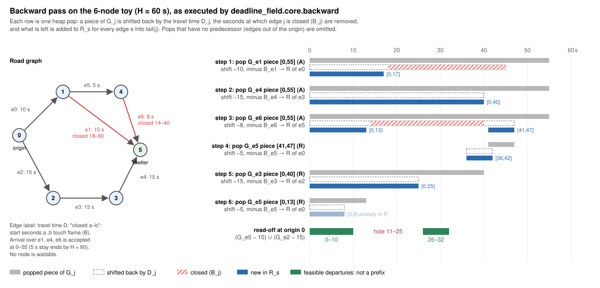

# The F-3.1 deadline field: what is proved

Code under study: `research/harness-2026-11/F-3.1/deadline_field/core.py` (`backward`, `issue_core`, `issue_set`) at
commit `a697d14` (Main after PR #189). The code is not changed. Line numbers refer to that file.

## 0. Headline

**The prefix claim needs an assumption the code does not enforce, and the recorded data break that assumption.**

* "Feasible departures from a node form a prefix [0, L]" is **false for the model the code implements**. The
  repository's own 6-node toy (`research/kcf-evidence/ALGORITHM_APPENDIX.md`) has feasible departures
  {0..10} ∪ {26..32}. The code is written for this: it stores whole interval sets (§3 of `F-3.1/DESIGN.md`).
* What the code computes is proved exact **without** any monotonicity (Theorem 1). The prefix property holds
  **only** under hypotheses M1–M4 below: closures are permanent ("no re-entry") and shelters accept from time 0
  (Theorem 2). Under M1–M4, L is given by a scalar recursion (Theorem 2(b)).
* `Instance` accepts arbitrary interval sets, so M1–M4 are **not enforced**. On the six recorded caches, measured
  (`results/assumptions_real.json`): __REAL_VIOLATIONS__.
  Even so, every feasible set measured on those caches is a prefix (__REAL_PREFIX__). That holds on that data. It is
  **not** a consequence of Theorem 2, and it can change with other data.

## 1. Model

Time is integer seconds, T = {0, 1, …, H}. For X ⊆ ℤ and d ∈ ℤ, X − d = {x − d : x ∈ X}.

**Graph.** A finite directed multigraph with nodes V and edges E, maps tail, head : E → V, travel times
D : E → ℤ, D_j ≥ 1 [**C1**]. Forbidden turns F ⊆ E × E: after arriving over i, edge j may not be taken next
(also after waiting in between) [**C7**]. Waitable nodes Wt ⊆ V. Node and edge revisits are allowed.

**Closures and acceptance** (all subsets of ℤ; in the code, sorted lists of disjoint integer intervals [**C9**]):

| symbol | meaning | code |
|---|---|---|
| B_j | start seconds at which edge j is **closed** (driving [t, t + D_j] touches flame) | `inst.B[j]` |
| W_v | seconds t at which waiting [t, t + 1] at v is closed | `inst.W[v]` |
| A_j | arrival seconds at which arriving over j is **accepted** (head(j) is a shelter, its window and the stay fit) | `inst.A[j]`, clipped to T at lines 56–57 [**C4**] |
| IB_o | departure seconds at which origin o itself is closed | `inst.IB[o]` |
| AN_o | departure seconds accepted with an empty journey (o is itself a shelter) | `inst.AN[o]` |

A **closure time** c (closed from c on, never open again) is the special case B_j = [c, ∞).

**Configurations and moves.** A configuration is (v, e, t, α): node v, last edge e ∈ E ∪ {⊥} (head(e) = v if
e ≠ ⊥), time t ∈ T, admission bit α. Moves:

* EDGE j: tail(j) = v; e = ⊥ or (e, j) ∉ F; t ∉ B_j; t + D_j ≤ H. Result (head(j), j, t + D_j, 1).
* WAIT: v ∈ Wt; t ∉ W_v; t + 1 ≤ H. Result (v, e, t + 1, 0). A wait never re-admits [**C5**].

A configuration is **accepting** if α = 1 and t ∈ A_e.

**Feasible departure.** t ∈ T is a feasible departure from origin o iff t ∉ IB_o and either t ∈ AN_o, or some
finite sequence of moves leads from (o, ⊥, t, 0) to an accepting configuration. Feas(o) is the set of these t.
The journey's legs are the moves, so "valid route" in `checker.py` is exactly this definition.

**Truth sets.** For an edge s: R\*_s = {t ∈ T : from (head(s), s, t, 0) an accepting configuration is reachable},
G\*_s = {t ∈ T : the same from (head(s), s, t, 1)}.

## 2. Theorem 1: the backward pass is exact (no monotonicity needed)

**Theorem 1.** Assume C1, and that A_j ⊆ T (C4). Then `backward` terminates, and its output satisfies
R_s = R\*_s and G_s = G\*_s for every edge s. Moreover `issue_set(fld, o)` = Feas(o) for every node o.

**Lemma 1.1 (one-step equation).** For every edge s, G\*_s = A_s ∪ R\*_s, and

  R\*_s = ⋃_{j : tail(j) = head(s), (s, j) ∉ F} { t ∈ T : t ∉ B_j, t + D_j ∈ G\*_j }
     ∪ { t ∈ T : head(s) ∈ Wt, t ∉ W_head(s), t + 1 ∈ R\*_s }.  (E)

*Proof.* The moves available from (v, s, t, α) do not depend on α, and α only decides whether the configuration
itself accepts. So G\*_s = A_s ∪ R\*_s. A non-accepting start must make a first move: an EDGE j leads to
(head(j), j, t + D_j, 1), from which success means t + D_j ∈ G\*_j (and t + D_j ∈ T because G\*_j ⊆ T). A WAIT
leads to (head(s), s, t + 1, 0), from which success means t + 1 ∈ R\*_s. Conversely, each listed option gives
a journey. ∎

**Lemma 1.2 (uniqueness).** If sets X_s ⊆ T satisfy (E) with G\*_j replaced by A_j ∪ X_j, then X = R\*.

*Proof.* Every term on the right of (E) at time t refers only to times t + D_j > t and t + 1 > t (C1). Induct
on t from H down to 0: whether t ∈ X_s is fixed by membership at strictly later times, where X and R\* agree. ∎

**Proof of Theorem 1.** Write R_s for the list kept by `backward`, and G_j = A_j ∪ R_j.

*(i) Soundness: R_s ⊆ R\*_s at all times.* A second t enters R_s in one of two ways. Via `cand` (lines 92–99):
t ≥ 0, t ∉ B_j, and t + D_j lies in a popped piece of G_j, with s ∈ `pred[j]`, i.e. tail(j) = head(s) and
(s, j) ∉ F (line 82). By induction G_j ⊆ G\*_j, so t ∈ R\*_s by (E). Via the waiting closure (lines 103–109,
`_wait_close` at line 70) at a waitable head v: a piece [lo, hi] is extended to [w + 1, hi], where w is the
largest element of W_v below lo. Every t in [w + 1, lo − 1] is not in W_v, and t + 1 ∈ [w + 2, lo] ⊆ R_s, so
t ∈ R\*_s by (E) and downward induction from lo.

*(ii) Termination.* Every push after the seeds is a subset of `new`, which is disjoint from the current R_s
(lines 99, 109). So each push adds at least one second of T to R_s, and there are at most |E|·(H + 1) of
them.

*(iii) Every element of every final G_j lies in a piece that was popped.* Seeds are all of A_j (line 87). Every
second added to R_j is pushed unless it lies in A_j (line 113). The loop runs until the heap is empty.

*(iv) The final R is closed under the right-hand side of (E).* Edge terms: take t ∈ T with t ∉ B_j and
t + D_j ∈ G_j, with tail(j) = head(s), (s, j) ∉ F. By (iii), t + D_j lies in a popped piece [lo, hi]. In that
pop, t ∈ [max(lo − D_j, 0), hi − D_j] minus B_j = `cand`, and after processing s, `cand` ⊆ R_s (line 99 adds
`cand` minus R_s; R only grows). Wait terms: at a waitable head v, a second u enters R_s only as part of a
closed piece [lo', hi] = `_wait_close`(p), with lo' = 0 or lo' − 1 ∈ W_v, and all of [lo', hi] is in R_s
afterwards (lines 106–111: what is not already in R_s is added). If u ∈ R_s, u ≥ 1 and u − 1 ∉ W_v, then
u ≠ lo', so u − 1 ∈ [lo', hi] ⊆ R_s.

*(v) Completeness: R\*_s ⊆ R_s.* Induct on t from H down. If t ∈ R\*_s, by (E) either t + D_j ∈ G\*_j for an
allowed j with t ∉ B_j, and by induction (t + D_j > t) t + D_j ∈ G_j, so t ∈ R_s by (iv); or t + 1 ∈ R\*_s with
t ∉ W_v, and by induction t + 1 ∈ R_s, so t ∈ R_s by (iv).

(i) and (v) give R = R\*, hence G = G\*. *Origin.* From (o, ⊥, t, 0) no turn is forbidden. The same
argument gives that the first-move set is X = ⋃_{j out of o} ((G_j − D_j) ∩ [0, ∞)) \ B_j, closed under
waiting at o when o ∈ Wt (lines 128–135; the closure of each maximal piece is exactly the set of seconds that
can wait into it). AN_o is added without waiting closure (line 138), because a wait clears admission. Finally,
IB_o is subtracted (`issue_set`). This is Feas(o). ∎

**Figure.** `figures/toy_backward_pass.svg` (made by `make_figure.py`, traced from the unchanged `backward`) shows
every pop on the 6-node toy: the popped piece of G_j, its shift by D_j, the removed closure B_j and the piece
added to R_s, then the read-off at the origin, {0..10} ∪ {26..32}.

`check_fixed_point` (line 224) checks (E) with equality on the stored sets. By Lemma 1.2 that alone certifies
R = R\*, independent of the order of solving.

## 3. Theorem 2: the prefix property and the recursion for L

**Hypotheses** (none of them is enforced by `Instance` or `backward`):

* **M1 (edges: no re-entry).** For each edge j, B_j ∩ [0, H − D_j] is upward closed in [0, H − D_j]: it is empty
  or [c'_j, H − D_j]. Equivalently, an edge that closes stays closed for the rest of the horizon. This is the
  repository's `no_reentry` reading (`F-BASE/fbase_static.py::no_reentry`: B ↦ [min B, H]).
* **M2 (waits: no re-entry).** For each v ∈ Wt, W_v ∩ [0, H − 1] is upward closed in [0, H − 1].
* **M3 (shelters open from 0).** Each A_j is downward closed in T: empty or [0, a_j]. Each AN_o likewise.
* **M4 (origins: no re-entry).** Each IB_o ∩ T is upward closed in T.

Define c_j = min(B_j ∩ [0, H − D_j]), or H − D_j + 1 if that set is empty; a_j = max A_j (−∞ if empty);
i_o = min(IB_o ∩ T) (H + 1 if empty).

**Theorem 2.** Under M1–M4:

(a) Every R\*_s, G\*_s and Feas(o) is empty or an interval [0, L].

(b) Write ℓ_s = max G\*_s (−∞ if empty). Then ℓ is the unique solution of

  ℓ_s = max( a_s, max_{j : tail(j) = head(s), (s, j) ∉ F} τ_j(ℓ_j) ),  τ_j(x) = min(c_j − 1, x − D_j),

where a term below 0 counts as −∞. For the origin, with L⁰_o = max(max AN_o, max_{j out of o} τ_j(ℓ_j)):
Feas(o) = [0, min(L⁰_o, i_o − 1)] (empty when that bound is below 0). Waiting never appears in the formula.

(c) Since `backward` computes R\* exactly (Theorem 1), the last element of each list it returns equals ℓ_s, and
`issue_set(fld, o)` = [0, L_o] with L_o given by (b).

*Proof of (a): shifting a journey earlier.* Let t be feasible from o by journey π, and t' < t, δ = t − t' > 0.
Let π' do the same moves, each starting δ seconds earlier. Each move of π starts at τ ≥ t, so π' starts it at
τ − δ ≥ t' ≥ 0, and ends it at most at H. Turns are unchanged. An EDGE j started at τ − δ: τ ∉ B_j and
τ ≤ H − D_j; if τ − δ were in B_j, then by M1 τ would be too. A WAIT: likewise by M2. The final arrival
τ_end − δ ∈ A_e by M3. The departure: t' ∉ IB_o, since otherwise t ∈ IB_o by M4. If π is empty, t' ∈ AN_o by M3.
So t' ∈ Feas(o). The same argument from (head(s), s, t, α) gives (a) for R\* and G\*. ∎

*Proof of (b).* By (a) and (E), the edge term for j is {t ∈ T : t ≤ c_j − 1, t ≤ ℓ_j − D_j} = [0, τ_j(ℓ_j)].
The wait term is contained in R\*_s − 1, so its maximum is below max R\*_s and it never sets the maximum. A union
of prefixes is the prefix of the largest one. So ℓ solves the recursion. *Uniqueness:* let ℓ ≠ ℓ' be two
solutions, and pick s with ℓ_s ≠ ℓ'_s and max(ℓ_s, ℓ'_s) largest, say ℓ_s > ℓ'_s. ℓ_s ≠ a_s, since ℓ'_s ≥ a_s.
So ℓ_s = τ_j(ℓ_j) ≤ ℓ_j − D_j < ℓ_j for some allowed j. By the choice of s, ℓ_j = ℓ'_j, so
ℓ'_s ≥ τ_j(ℓ'_j) = ℓ_s, a contradiction. The origin is the same computation followed by subtracting
IB_o = [i_o, H]. ∎

**Corollary 3 (a safe prefix when closures reopen).** For any instance, let B̂_j = [min B_j, ∞), Ŵ_v and ÎB_o
likewise, and let Â_j (ÂN_o) be the longest initial segment [0, a] contained in A_j (AN_o). The hatted instance
satisfies M1–M4, so its Feaŝ(o) is a prefix [0, L̂_o]. Every hatted set only adds closures and removes acceptances,
so every journey valid in the hatted instance is valid in the original one: [0, L̂_o] ⊆ Feas(o). Every second of
[0, L̂_o] is truly feasible, but L̂_o can be much smaller than the end of the first interval of Feas(o).

## 4. Smallest counterexample, and what it means for REOPENED events

**Instance.** Two nodes, one edge e = (0 → 1), D_e = 1, H = 2, origin 0, shelter 1 with A_e = {0, 1, 2}, no
waiting, B_e = {0}: the road is closed at second 0 and **reopens** at second 1.

* depart 0: e is closed. Infeasible.
* depart 1: arrive at 2 ≤ H, accepted. Feasible.
* depart 2: arrival 3 > H. Infeasible.

Feas(0) = {1}, which is not a prefix. **The algorithm returns exactly {1}**: `issue_set` = [(1, 1)]
(`test_theorem.py::test_smallest_counterexamples`). That is correct, and its maximum is 1. A reader who takes
"deadline L = 1" to mean "any departure up to 1 is safe" sends the vehicle onto a closed road at 0. The no-re-entry
hull (Corollary 3) returns ∅: safe, but it loses the departure at 1.

The same graph with no closure but a shelter that opens late (A_e = {2}) also gives Feas(0) = {1}. That is
M3 failing; the recorded caches contain such windows (§0).

**Why it is the smallest.** With origin ≠ shelter, a feasible journey uses at least one edge, so at least 2
nodes and 1 edge. A failure needs a feasible t ≥ 1 with t − 1 infeasible, and a journey from t ≥ 1 ends at
t + D ≥ 2, so H ≥ 2. `test_nothing_smaller_fails` checks exhaustively that with 2 nodes, 1 edge and H ≤ 1, every
choice of B, W, A, IB, waitability and D ∈ {1, 2} gives a prefix. If the origin may itself be a shelter (never the
case in the caches), one node and no edge suffice: IB_o = {0}, AN_o = {0, 1}, H = 1 gives Feas = {1}.

**Revisiting nodes does not break the prefix.** Theorem 2 allows journeys that revisit nodes and edges. Only
non-monotone closure or acceptance sets (M1–M4 failing) break it.

**REOPENED events from the vehicle unit.** I found no data source with that name in the repository (searched all
tracked files for "REOPENED", "reopened" and "vehicle unit"). Whatever its format, a road that is reported closed
and later REOPENED within the horizon is exactly an edge whose B_j is not upward closed, so M1 fails. Then:

1. The field itself stays correct (Theorem 1), **provided the reopening is encoded as a closed interval
   [close, reopen − 1] in B_j**. It then returns a union of intervals, possibly with holes.
2. A single number L no longer describes the answer. **Departing before L can be infeasible.** Any consumer that
   reads only `issue_set(...)[-1][1]`, or any scalar "latest safe departure" code (mutant `scalar_deadline` in §6),
   is wrong. On graphs that satisfy M1–M4 such a scalar version cannot be told apart from the correct one: 0 of
   3,000 closure-only cases detected it, against 1,260 of 3,000 cases with reopening.
3. What is safe to publish as "leave by" is the end of the **first** interval, if it starts at 0 (the planner's
   "contiguous time" rule, `planner/README.md`), or the no-re-entry hull's L̂ (Corollary 3), which is never later.
   A departure after a hole must be shown as a separate window, never as the deadline.

## 5. Running time

**Theorem 4 (cost of the implementation).** Let P be the number of heap pushes, κ the largest number of
intervals in any list B_j, W_v or R_s, and Δ the largest number of edges into a node. Then
P ≤ Σ_j |A_j|_pieces + Σ_s |R_s \ A_s| ≤ |E|·(H + 2), and `backward` runs in
O(P · Δ · (κ + log P)) time, so O(Δ·|E|·H·(κ + log(|E|H))) in the worst case.

*Proof.* Each non-seed push adds a second not yet in R_s (Theorem 1(ii)). A pop subtracts B_j from one piece
(O(log κ + κ)), and for each of at most Δ predecessors subtracts R_s, inserts into a Python list (O(κ)), and
pushes onto the heap (O(log P)). ∎

**Under M1–M4**, Theorem 2(b) is a reverse Dijkstra on ℓ (the max-heap pops values in non-increasing order and
τ_j strictly decreases), so the deadlines can be computed in O(|E| log |E|), independent of H. The implementation
does not exploit this, but measured on real data its sets have one interval each (κ = 1, committed
`F-3.1/results/SUMMARY_final_70f70d7.json`, `piece_stats`), so it behaves almost like that.

**One departure at a time.** Checking one (origin, t) exhaustively explores up to |E|·(H + 1) configurations,
because a non-waitable node forbids "earliest arrival dominates". Checking every t ∈ T is O(|E|·H²) per origin
and shelter, or O(|V|·|E|·H²) for all origins. Under M1–M4 a binary search on t gives O(|E|·H·log H) per
origin. The backward pass answers every origin and every second at once.

**Measured** (`bench.py`, grids with permanent closures, this machine; `results/bench.json`):

| grid | edges | H | heap pushes | pushes / edge | max intervals per R_s | backward, all origins (s) | one at a time, 1 origin (s) | one at a time, all origins (s, ×|V|) |
|---|---:|---:|---:|---:|---:|---:|---:|---:|
| 3x3 | 24 | 30 | 36 | 1.5 | 1 | 0.0003 | 0.0019 | 0.02 |
| 3x3 | 24 | 60 | 38 | 1.58 | 1 | 0.0003 | 0.0047 | 0.04 |
| 3x3 | 24 | 120 | 29 | 1.21 | 1 | 0.0002 | 0.0065 | 0.06 |
| 4x4 | 48 | 60 | 65 | 1.35 | 1 | 0.0005 | 0.0172 | 0.28 |
| 4x4 | 48 | 120 | 59 | 1.23 | 1 | 0.0003 | 0.0204 | 0.33 |
| 4x4 | 48 | 240 | 87 | 1.81 | 1 | 0.0003 | 0.0689 | 1.1 |
| 5x5 | 80 | 120 | 119 | 1.49 | 1 | 0.0005 | 0.0613 | 1.53 |
| 5x5 | 80 | 240 | 378 | 4.72 | 1 | 0.0013 | 0.0531 | 1.33 |
| 6x6 | 120 | 240 | 256 | 2.13 | 1 | 0.0009 | 0.419 | 15.08 |

The pushes stay a small multiple of |E| and do not grow with H on these instances. The worst-case bound of Theorem 4 is not attained here.

On the six recorded caches (committed in `F-3.1/results/SUMMARY_final_70f70d7.json`, not re-measured here, on
different hosts): the cert-rule fields took 1,711.6 s in total, against 147,900.1 s of recorded per-check compute
for the forward checks they reproduce.

## 6. Evidence

All counts below are measured by the files in this directory. Commands are in `README.md`.

| test | what | result |
|---|---|---|
| `test_theorem.py::PropertyVsBruteForce` | 12,000 random graphs (6,000 with reopening, late shelters and origin closures; 6,000 satisfying M1–M4); every node as origin; field `issue_set` vs `checker.feasible_set` at every second | **0 disagreements** over 48,052 origin sets and 625,172 departure seconds; `check_fixed_point` passes on all 12,000. Reopening family: 3,826 of 8,411 non-empty feasible sets are **not** prefixes |
| same | Theorem 2 on the M1–M4 family: every feasible set and every G_s is a prefix and equals the scalar recursion, written independently from §3 | 23,993 / 23,993 origin sets, and every G_s, prefix and equal to the recursion |
| same | Deadline certificate: field witness at L passes `check_route`; brute force finds no route at L + 1 | 16,841 / 16,841 non-empty sets confirmed |
| same | Corollary 3 on the reopening family: hull set is a prefix and a subset of the truth | 24,059 / 24,059 hold; the hull gives up 50,107 truly feasible departure seconds |
| `test_theorem.py::Mutants` | five bugs in a copy of `backward` (`mutants.py`), 3,000 + 3,000 cases each | see table below |
| `differential_witnesses.py` | `check_route` on every recorded checked route of the six caches, both contact rules; field witness at every exact deadline; exhaustive search at L + 1 | __DIFF_RESULT__ |
| `measure_assumptions.py` | M1–M4 and the prefix conclusion on the six caches | __REAL_RESULT__ |

**Mutation tests** (cases caught out of 3,000 per family; "caught" = brute-force disagreement, or `check_route`
rejects the route the mutant's own extractor builds, or the mutant's extractor dead-ends, or
`check_fixed_point` fails):

| mutant | bug | caught, reopening family | caught, M1–M4 family | detectors that fired | first checker rejection (or detector) |
|---|---|---:|---:|---|---|
| `shift_off_by_one` | edge travel taken as D − 1 when shifting back (off by one) | 1,716 / 3,000 | 1,874 / 3,000 | brute_force_overclaim, brute_force_underclaim, certificate, checker_rejects_route, route_dead_end | leg 0 (EDGE 2 [0, 3]): edge takes D = 4 s, leg takes 3 s |
| `ignore_turns` | forbidden turns not removed from predecessor lists | 860 / 3,000 | 798 / 3,000 | brute_force_overclaim, certificate, checker_rejects_route | leg 1 (EDGE 6 [7, 11]): turn (2 -> 6) is forbidden |
| `block_at_arrival` | closure tested at the arrival second t + D instead of the start second t | 1,241 / 3,000 | 702 / 3,000 | brute_force_overclaim, brute_force_underclaim, certificate, checker_rejects_route | leg 1 (EDGE 5 [7, 11]): edge 5 is closed at start second 7 |
| `wait_through_fire` | waiting closure extended to 0, ignoring W_v | 217 / 3,000 | 0 / 3,000 | brute_force_overclaim, certificate, checker_rejects_route | leg 2 (WAIT 2 [10, 11]): wait at node 2 is closed at second 10 |
| `scalar_deadline` | one number per state: [0, latest] treated as feasible (the prefix assumption) | 1,260 / 3,000 | 0 / 3,000 | brute_force_overclaim, certificate, route_dead_end | no route rejected; detected by brute_force_overclaim, certificate, route_dead_end |
| none (the copy, unmutated) | – | 0 / 3,000 | 0 / 3,000 | – | – |

Each of the five is caught. Two are **invisible on M1–M4 instances** (0 / 3,000): `wait_through_fire` and
`scalar_deadline`. This is Theorem 2 at work: under M1–M4, waiting never sets the maximum and every set is a
prefix, so both bugs return the true sets. Only instances with reopening expose them. A test suite built only on
permanent closures would pass a scalar implementation that is wrong as soon as a road reopens. For
`scalar_deadline` the checker never sees an invalid route: the mutant's route extractor dead-ends inside the hole
it claims is feasible (10,006 dead ends), and brute force and `check_fixed_point` flag it.

## 7. Assumptions the code relies on

| # | assumption | enforced? | where |
|---|---|---|---|
| C1 | integer seconds; every D_j ≥ 1 | **yes** | `Instance.__post_init__` raises (line 47) |
| C2 | hazards reduce exactly to the integer interval sets B, W, A, IB | not in `core`; outside these theorems | `real.py` (rational arithmetic); repo test `tests/test_real_masks.py` |
| C3 | full policy (dose, peak) = flame contact, so no dose state is needed | **computed and recorded, not asserted** | `reproduce.py` lines 99–106 store `(ok, details)` and continue; committed `precondition_ok: true` on all six caches |
| C4 | A_j ⊆ T | **yes** | lines 56–57 clip |
| C5 | acceptance only on arrival over an edge or at the initial label; a wait never re-admits | by construction | equation (E); `issue_core` line 138 |
| C6 | journeys start at a plain node, with no incoming edge and no edge fraction | in `reproduce.py`, not in `core` | `reproduce.py` raises on other starts |
| C7 | turn restrictions are between consecutive edges and survive waits | by construction | line 82 |
| C8 | `pieces_cap` is None (no early stop) | default | line 79 |
| C9 | interval lists sorted, disjoint, non-adjacent | **yes** | `intervals.normalize` in `__post_init__` |
| M1–M4 | closures permanent; shelters open from 0 (Theorem 2 only) | **no** | violated on recorded data (§0) |
