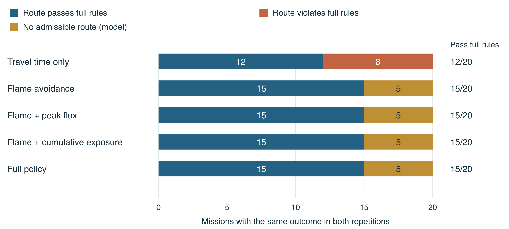
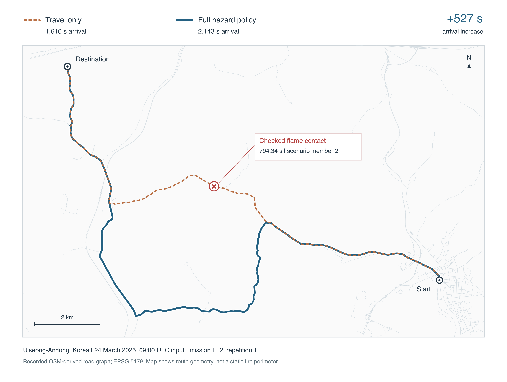

# Final-input routing constraint ablation

**Completed and independently accepted: 200 native Mac executions.** This research addition retains the final evaluated checkpoint and 20 missions, five hazard policies and two repetitions. Five regional panels represent four parent fires. It does not replace the frozen application or its earlier 80-execution comparison.

| Policy | Checked routes /20 | Model-infeasible missions /20 | Routes passing full rules /20 | Median request, all 40 executions |
|---|---:|---:|---:|---:|
| Travel only | 20 | 0 | 12 | 1.632 s |
| Flame avoidance | 15 | 5 | 15 | 1.991 s |
| Flame + peak flux | 15 | 5 | 15 | 6.541 s |
| Flame + cumulative exposure | 15 | 5 | 15 | 6.599 s |
| Full policy | 15 | 5 | 15 | 6.511 s |

Mission counts require matching outcomes in both repetitions. All 200 attempts completed within the unchanged 30-second complete-request allowance with clean shutdown, no scored retry, interruption or memory stop. No unresolved outcome occurred in this panel.



## What changed

- Eight travel-only routes encountered predicted flames; four also exceeded cumulative exposure limits.
- Flame avoidance found three checked detours, arriving **490, 527 and 531 seconds later**. Five remaining missions had no admissible route under the supplied model and mission horizon; independently completed contact-relaxation searches corroborated all 40 refusal executions.
- Adding peak-flux or cumulative-exposure limits changed **no outcomes, arrivals or route hashes** on this panel. The global constructed flux cap was 0.703 kW/m² against a 10 kW/m² limit. This does not show that thermal constraints are unnecessary elsewhere.
- Two independently written grid/centre calculations agreed for all 160 route executions, representing 23 distinct trajectories. All 40 full-policy outcomes matched the prior final campaign exactly.



This map uses the recorded road geometry and an exact checked flame-contact event; it does not depict observed flames or an invented fire perimeter. See the [route caption](route_figure/CAPTION.md) and [figure sources](route_figure/SOURCE_MANIFEST.json).

## Files

- [Methods](METHODS.md), [frozen protocol](PROTOCOL.md), [results](RESULTS.md) and [independent review](review/INDEPENDENT_FINAL_REVIEW.md).
- [Reviewed execution CSV](data/ROWS.csv), [JSON](data/ROWS.json), [summary](data/SUMMARY.json), [detours](data/ARRIVAL_DELTAS.csv) and [mission-level records](data/STABLE_MISSIONS.json).
- `data/producer/` preserves the original rows before independent refusal annotations. [The merge receipt](data/REVIEW_MERGE_RECEIPT.json) binds both versions; no scientific outcome or measured cost changed.
- `experiment_source/` contains the narrow policy wrappers and grading source for inspection. The complete runnable layout, 200 raw records, constructed inputs, controls, failed attempts and all review evidence are in the release archive.
- Both figures include editable SVG, vector PDF, high-resolution PNG, source tables, captions and provenance. Rendering scripts retain their original study-source paths; they are source records rather than installed command-line tools.

## Verify or reproduce

Fast recorded-result verification from the repository root (standard library only):

```sh
python3 research/routing/final-input-ablation/tools/verify_published_results.py
```

For the full preserved evidence, download **WFG-final-input-routing-ablation-20261016-v1.zip** and its checksum from the [research release](https://github.com/Sparkxt-0318/wildfireguardian/releases/tag/routing-ablation-final-inputs-20261016). Extract it and read its `README.md`. Run `python3 verify_archive.py` inside the extracted top-level directory to verify every member. This checks identities and accounting, not a new routing run.

To create a fresh execution workspace from that archive, use native macOS, Python 3.12 and NumPy 1.26.4, then:

```sh
python3.12 prepare_reproduction.py --dest /absolute/workspace/outputs/ablation_reproduction
```

The helper validates the source/grading freezes, copies no scored records, refuses an existing destination and never replaces an existing timing lease. Follow the three commands in the generated `REPRODUCTION_SETUP.json` through execution and grading. [Original execution instructions](ORIGINAL_REPRODUCE.md) are retained as a historical source record: their final `write_report.py` step is tied to the original campaign and must **not** be used to generate claims for a new run. New timings, refusals and conclusions require their own host report and independent review. Forecast inference is excluded; the exact constructed packets are included, so rerunning this routing-only study does not need external environmental rasters or a forecast checkpoint download.

## Interpretation

This measures hazard-policy effects under a declared model. Cross-policy request times include different checking work and cannot establish a same-problem solver speedup. Selected-policy validity is distinct from full-policy validity. Independent continuous-road radiation enclosure, global proof closure and real-fire safety are not established here. The source cap explains why peak cannot bind in these inputs; it is not an incident heat measurement.

No production source, selected checkpoint, default hazard policy or prior release artifact was changed. The older 300-execution Uljin ablation and the 80-execution final solver comparison remain separate cohorts.
