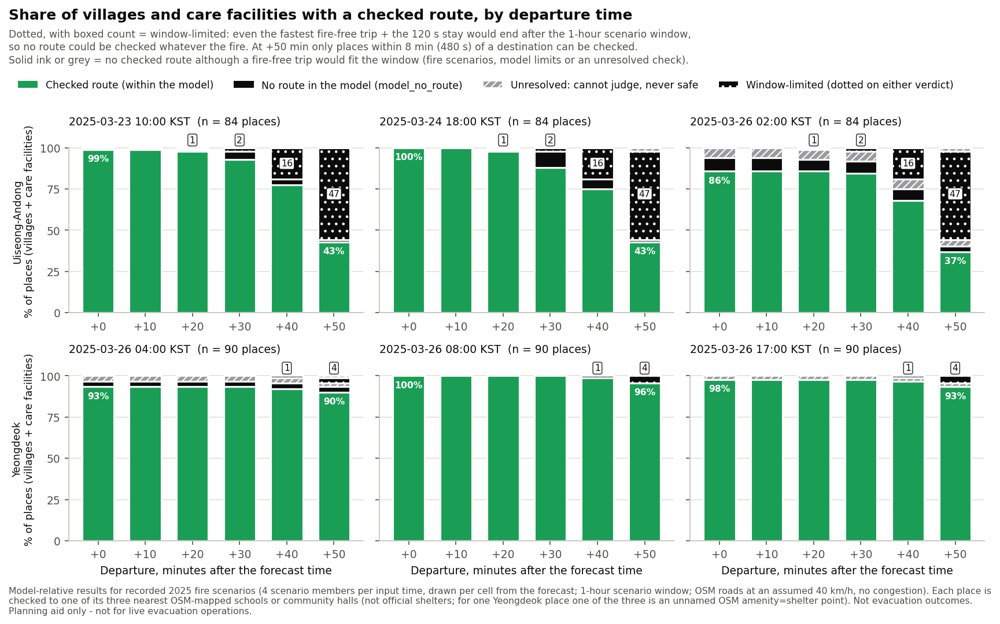

# Who needs more time: impact numbers from the recorded 2025 planner cache

Reproducible, model-relative numbers and English figures for the MIT Solve 2027 application, computed from the
six booth-cache files the village evacuation planner already ships (`planner/cache/`, 2 regions x 3 recorded input
times). This package re-reads those recorded Route-Check API results; it runs no new route checks and changes no
routing, forecast or checking code.

> **사전 계획 보조 도구입니다. 실시간 대피 지휘·운영용이 아닙니다. / Planning aid only — not for live evacuation operations.**
> Fire input: 2025년 실제 산불 기록 기반 시나리오 재현 / Recorded 2025 wildfire · scenario replay.

## Read this first: what these numbers are not

1. **Fire scenarios from the forecast, not fire-spread simulations.** Each recorded input time ("forecast time") has 4
   scenario members drawn independently per 375 m cell from the c651 forecast. The forecasts were produced
   retrospectively in 2026 from recorded 2025 inputs (release `research-final-20261015`), not issued during the fires,
   and the members are not simulations of the actual fire.
2. **The one-hour scenario window sets many deadlines, not the fire.** Hazards cover 1 hour after each forecast time
   (`valid_until` = 3,600 s in every HAZARD.json). The routing kit accepts an arrival only if arrival plus the 120 s
   stay ends inside that hour, so a departure at +50 min can have a checked route only if the place's fastest
   fire-free trip to a candidate destination takes at most 480 s (8 min); at +40 min, at most 1,080 s. A missing
   checked route at a late departure, or a leave-by deadline before +50 min, is therefore often set by the window:
   most of the drop toward +50 min in Uiseong-Andong is window-limited (no route could be checked whatever the fire),
   and most deadlines before +50 min are window-set (see `window_limited_among_not_checked.*` and `deadline_set_by.*`
   below). Statements about fire must use the window-corrected keys (`not_checked_although_fits.*`,
   `deadline_set_by.fire_or_limits@*`). Departures were checked every 10 minutes (+0 to +50 min); times in between are
   not checked, and a deadline of +50 min means the checked window may extend later.
3. **Roads are a model.** Provisional pre-fire OpenStreetMap snapshot (2025-03-21) at an assumed 40 km/h, rounded up to
   1 s ticks; no congestion; missing one-way tags assumed two-way; passability never field-validated.
4. **Destinations are not official shelters.** Each place is checked against its 3 nearest (straight-line) OSM
   destinations with distinct road entry nodes: OSM-mapped schools and community halls, plus, for one Yeongdeok place,
   an unnamed OSM point tagged `amenity=shelter` without `shelter_type` (`destinations_used.*` keys). None is an
   official evacuation shelter. Travel between a mapped point and its road entry node (진입 지점) is not modelled.
   Places come from a 2026-10-17 OSM extract (current data), roads from the pre-fire snapshot.
5. **Recorded on the evaluated host.** Every result in the cache was computed by the Route-Check API on a native macOS
   arm64 host, the planner's test for the evaluated booth host (purpose `booth`, fixed 30 s budget per check); the API
   records platform and machine, not the chip. Checks that timed out and were re-checked are shown
   as their re-check, exactly as the planner shows them.
6. **Model-relative only.** `checked_route` = a route that passed the checks within the model and its inputs (never
   "safe"); `model_no_route` = no route within this model and input scope (not proof that escape is impossible);
   `unresolved` = cannot judge (never safe, never a deadline). **None of these numbers are evacuation outcomes,
   observed travel times or casualties avoided.**
7. **Small and incomplete samples.** 5 care facilities are mapped in OSM (all in Uiseong-Andong), none in Yeongdeok.
   They are 25-290 s fire-free drive from a candidate destination (`fastest_trip_s.*@all/places#care_facility`), so the
   window never limits them; most of their apparent advantage over villages at late departures is this short
   distance, not lower fire exposure. OSM coverage of villages and facilities is incomplete. Results are specific to
   these recorded scenarios.

## Headline numbers

All values come from [`NUMBERS.json`](NUMBERS.json) (key, definition, value, numerator/denominator, scope, script and
input SHA-256 for each). "Cases" count each place once per recorded input time (forecast time); "places" count each
place once. "Fits" = the fastest fire-free trip plus the 120 s stay fits the 1-hour scenario window at that departure;
"window-limited" = it does not (definitions below).

<!-- BEGIN GENERATED: headline -->
| Key (NUMBERS.json) | Value | Meaning (short; full definition in NUMBERS.json) |
|---|---:|---|
| `records.route_checks@all/pooled` | 9,722 | route-check records in the six cache files (incl. re-checks) |
| `records.rechecks@all/pooled` | 279 | re-checks of timed-out checks among them |
| `attempts@all/pooled` | 9,396 | route checks behind the cases (place x forecast time x candidate destination x departure) |
| `places@all/places` | 174 | distinct OSM-mapped villages/hamlets + care facilities checked (both regions) |
| `osm_origins_not_checkable@all/places` | 3 | listed OSM villages with no road node within 2 km (never checked) |
| `cases@all/pooled` | 522 | place-forecast-time cases (each place once per recorded forecast time) |
| `cell.checked_route.offset_0000s@all/pooled` | 501/522 (96.0%) | cases with a checked route for departure at the forecast time |
| `no_checked_route_any_offset@all/pooled` | 21/522 (4.0%) | cases with no checked route at any departure time |
| `best_verdict.model_no_route@all/pooled` | 11/522 (2.1%) | of those, model_no_route at every attempt (no route within the model) |
| `best_verdict.unresolved@all/pooled` | 10/522 (1.9%) | of those, >= 1 unresolved attempt (cannot judge, never safe) |
| `no_checked_route_any_offset.trip_fits_at_offset_0000s@all/pooled` | 21/21 (100.0%) | of those, a fire-free trip fits the window at +0 min (the window does not explain them) |
| `not_checked_although_fits.offset_0000s@uiseong_andong_2025/pooled` | 13/252 (5.2%) | Uiseong-Andong, departure at +0 min: no checked route although a fire-free trip fits the window |
| `not_checked_although_fits.offset_1800s@uiseong_andong_2025/pooled` | 23/246 (9.3%) | same, Uiseong-Andong, +30 min |
| `not_checked_although_fits.offset_2400s@uiseong_andong_2025/pooled` | 19/204 (9.3%) | same, Uiseong-Andong, +40 min |
| `not_checked_although_fits.offset_3000s@uiseong_andong_2025/pooled` | 8/111 (7.2%) | same, Uiseong-Andong, +50 min (only trips <= 480 s fit) |
| `not_checked_although_fits.offset_0000s@yeongdeok_2025/pooled` | 8/270 (3.0%) | same, Yeongdeok, +0 min |
| `not_checked_although_fits.offset_1800s@yeongdeok_2025/pooled` | 8/270 (3.0%) | same, Yeongdeok, +30 min |
| `window_limited_among_not_checked.offset_3000s@all/pooled` | 153/168 (91.1%) | cases without a checked route at +50 min that are window-limited (none possible whatever the fire) |
| `window_limited_among_not_checked.offset_3000s@uiseong_andong_2025/pooled` | 141/149 (94.6%) | same, Uiseong-Andong |
| `deadline_set_by.window@all/pooled` | 132/147 (89.8%) | deadlines before +50 min set by the 1-hour window (next departure cannot fit) |
| `deadline_set_by.fire_or_limits@all/pooled` | 15/147 (10.2%) | deadlines before +50 min set by fire scenarios or limits (next would fit) |
| `places.not_checked_although_fits_any_offset_any_input@all/places` | 30/174 (17.2%) | places with an unchecked departure that would fit the window, in >= 1 forecast time |
| `places.not_checked_although_fits_at_offset_3000s_any_input@all/places` | 14/65 (21.5%) | of the places unchecked at +50 min in >= 1 forecast time, those where +50 min would fit |
| `fastest_trip_s.median@uiseong_andong_2025/places#village` | 583 (n = 79) | fastest fire-free trip to the nearest candidate, Uiseong-Andong villages, median (s) |
| `fastest_trip_s.median@yeongdeok_2025/places#village` | 87.5 (n = 90) | same, Yeongdeok villages, median (s) |
| `fastest_trip_s.min@all/places#care_facility` | 25 (n = 5) | same, care facilities, min (s) |
| `fastest_trip_s.max@all/places#care_facility` | 290 (n = 5) | same, care facilities, max (s) |
| `trip_model.equals_travel_only@all/pooled` | 501/501 (100.0%) | fire-free trip model = API travel-only route time (validation) |
| `api_check.recorded_equals_planner_rule_on_original@all/pooled` | 522/522 (100.0%) | API recorded fields = planner rules on original attempts |
| `api_check.displayed_equals_recorded.latest_checked_depart_offset_s@all/pooled` | 517/522 (99.0%) | planner-displayed deadline = API latest_checked_depart_offset_s |
| `api_check.displayed_differs_explained_by_recheck@all/pooled` | 8/8 (100.0%) | displayed differences explained by re-checks |
| `travel_only.fastest_meets_flames@all/pooled` | 9/501 (1.8%) | fastest (travel-time-only) routes with predicted flame contact, at the leave-by time |
| `travel_only.fastest_meets_flames@all/pooled#leave_by_before_3000s` | 9/147 (6.1%) | same, leave-by deadline before +50 min |
| `travel_only.fastest_meets_flames@all/pooled#leave_by_3000s` | 0/354 (0.0%) | same, leave-by deadline +50 min |
| `travel_only.clear_pairs_equal_arrival@all/pooled` | 492/492 (100.0%) | other comparisons: checked route arrives at the same second |
| `travel_only.extra_arrival_s.min@all/pooled` | 31 (n = 9) | extra arrival time of the checked alternative, min (s) |
| `travel_only.extra_arrival_s.median@all/pooled` | 328 (n = 9) | extra arrival time, median (s) |
| `travel_only.extra_arrival_s.max@all/pooled` | 1,309 (n = 9) | extra arrival time, max (s) |
| `travel_only.extra_length_m.min@all/pooled` | 270.7 (n = 9) | extra route length, min (m) |
| `travel_only.extra_length_m.median@all/pooled` | 2646.9 (n = 9) | extra route length, median (m) |
| `travel_only.extra_length_m.max@all/pooled` | 12783.2 (n = 9) | extra route length, max (m) |
| `redundancy.turn_aware_paths_1@all/places` | 115/174 (66.1%) | places whose routes all pass through >= 1 common road segment |
| `redundancy.single_cut_at_entry_node@all/places` | 108/115 (93.9%) | of those, the first common segment leaves the entry point |
| `redundancy.turn_aware_equals_plain@all/places` | 174/174 (100.0%) | turn-aware count = count ignoring turn restrictions |
| `redundancy.shared_stretch_m.median@all/places` | 673.6 (n = 115) | entry point to the end of the last common segment, median (m) |
| `redundancy.shared_stretch_within_100m@all/places` | 10/115 (8.7%) | of those, the common segments end within 100 m |
<!-- END GENERATED: headline -->

Candidate wording for the application, with cautions: [`APPLICATION_SENTENCES.md`](APPLICATION_SENTENCES.md).

## Results by recorded scenario set

Cases = OSM villages/hamlets and care facilities with an accepted road node within 2 km (the ones the API checked),
once per forecast time (one scenario set: cases = places).
"Window-limited at +50 min" = no fire-free trip fits the window, so no route could be checked whatever the fire.
"No checked route although a fire-free trip fits" = the window-corrected count: cases without a checked route among
cases whose fastest fire-free trip fits, at +0 · +30 · +50 min. "Deadline before +50 min" splits the cases whose
checked departures end before +50 min by what set the end: the window at the next departure, or the fire scenarios
or model limits (a fire-free trip would still have fitted).

<!-- BEGIN GENERATED: by-scenario -->
| Region | Forecast time | Cases | Checked at +0 min | Checked at +50 min | Window-limited at +50 min | No checked route although a fire-free trip fits: +0 · +30 · +50 min | No checked route at any departure (model_no_route + unresolved) | Deadline before +50 min: set by window + by fire/limits | Fastest route meets predicted flames |
|---|---|---:|---:|---:|---:|---:|---:|---:|---:|
| Uiseong-Andong | 2025-03-23 10:00 KST (2025-03-23T01:00:00Z) | 84 | 83/84 (98.8%) | 36/84 (42.9%) | 47/84 (56.0%) | 1/84 · 4/82 · 1/37 | 1 + 0 | 42 + 5 | 1/83 (1.2%) |
| Uiseong-Andong | 2025-03-24 18:00 KST (2025-03-24T09:00:00Z) | 84 | 84/84 (100.0%) | 36/84 (42.9%) | 47/84 (56.0%) | 0/84 · 8/82 · 1/37 | 0 + 0 | 39 + 9 | 7/84 (8.3%) |
| Uiseong-Andong | 2025-03-26 02:00 KST (2025-03-25T17:00:00Z) | 84 | 72/84 (85.7%) | 31/84 (36.9%) | 47/84 (56.0%) | 12/84 · 11/82 · 6/37 | 7 + 5 | 40 + 1 | 1/72 (1.4%) |
| Yeongdeok | 2025-03-26 04:00 KST (2025-03-25T19:00:00Z) | 90 | 84/90 (93.3%) | 81/90 (90.0%) | 4/90 (4.4%) | 6/90 · 6/90 · 5/86 | 3 + 3 | 3 + 0 | 0/84 (0.0%) |
| Yeongdeok | 2025-03-26 08:00 KST (2025-03-25T23:00:00Z) | 90 | 90/90 (100.0%) | 86/90 (95.6%) | 4/90 (4.4%) | 0/90 · 0/90 · 0/86 | 0 + 0 | 4 + 0 | 0/90 (0.0%) |
| Yeongdeok | 2025-03-26 17:00 KST (2025-03-26T08:00:00Z) | 90 | 88/90 (97.8%) | 84/90 (93.3%) | 4/90 (4.4%) | 2/90 · 2/90 · 2/86 | 0 + 2 | 4 + 0 | 0/88 (0.0%) |
| **Uiseong-Andong, 3 forecast times** | pooled cases | 252 | 239/252 (94.8%) | 103/252 (40.9%) | 141/252 (56.0%) | 13/252 · 23/246 · 8/111 | 8 + 5 | 121 + 15 | 9/239 (3.8%) |
| **Yeongdeok, 3 forecast times** | pooled cases | 270 | 262/270 (97.0%) | 251/270 (93.0%) | 12/270 (4.4%) | 8/270 · 8/270 · 7/258 | 3 + 5 | 11 + 0 | 0/262 (0.0%) |
| **Both regions, 6 forecast times** | pooled cases | 522 | 501/522 (96.0%) | 354/522 (67.8%) | 153/522 (29.3%) | 21/522 · 31/516 · 15/369 | 11 + 10 | 132 + 15 | 9/501 (1.8%) |
<!-- END GENERATED: by-scenario -->

Pooling: within a region the three input times are different scenario sets for the same places, so pooled rows count
place-input-time cases (descriptive, not independent samples). Distinct-place counts (`@*/places` keys) count each
place once. The two regions share no place.

## Leave-by deadline (출발 마감) by origin type

Cases by the latest departure (minutes after the recorded input time) with a checked route, pooled over the three
input times of each region, with the window-set deadlines in parentheses. Origin types are the planner's: village
(`place=village|hamlet`) or care facility (`vulnerable = true`: `nursing_home` / `social_facility`), as in
`planner/src/components/LeftPanel.tsx` `glyphKind`.

<!-- BEGIN GENERATED: deadlines -->
| Subset | Cases | +10 | +20 | +30 | +40 | +50 (last checked; may be later) | none: model_no_route | none: unresolved |
|---|---:|---:|---:|---:|---:|---:|---:|---:|
| Uiseong-Andong villages | 237 | 3 (2) | 13 (3) | 38 (34) | 82 (82) | 88 | 8 | 5 |
| Uiseong-Andong care facilities | 15 | 0 (0) | 0 (0) | 0 (0) | 0 (0) | 15 | 0 | 0 |
| Yeongdeok villages | 270 | 0 (0) | 0 (0) | 3 (3) | 8 (8) | 251 | 3 | 5 |

In parentheses: deadlines set by the 1-hour window (`deadline.latest_<t>s.set_by_window@*`): at the next departure even the fastest fire-free trip plus the 120 s stay would end after the window. Overall 132 of the 147 deadlines before +50 min are set by the window and 15 by the fire scenarios or model limits (`deadline_set_by.*@all/pooled`). No case had its last checked departure at +0 min (`deadline.latest_0000s@*` = 0). Yeongdeok has no care facility in the OSM extract.
<!-- END GENERATED: deadlines -->

## Road redundancy

Number of walks from each place's road entry node to any of its three candidate destination nodes that share no
directed road segment, on the exact graph the API used (SHA-256 asserted against the `input_hashes.graph` of every
cached route check). Turn-aware counts obey the graph's `forbidden_turns` as the routing kit does; counts ignoring turn
restrictions are also computed and equal for every place.

<!-- BEGIN GENERATED: redundancy -->
| Subset | Places | 1 path | 2 paths | 3 paths | >= 4 | 1 path, first common segment at the entry point |
|---|---:|---:|---:|---:|---:|---:|
| Uiseong-Andong villages | 79 | 53 | 26 | 0 | 0 | 48/53 |
| Uiseong-Andong care facilities | 5 | 5 | 0 | 0 | 0 | 4/5 |
| Yeongdeok villages | 90 | 57 | 31 | 2 | 0 | 56/57 |
| All checked places | 174 | 115 | 57 | 2 | 0 | 108/115 |

| Region | Places with 1 path | Entry point to the end of the last common segment: median (min - max) | Ends within 100 m |
|---|---:|---:|---:|
| Uiseong-Andong | 58 | 1,034.7 m (84.9 - 9,023.5 m) | 1/58 (1.7%) |
| Yeongdeok | 57 | 465.8 m (32.2 - 6,422.0 m) | 9/57 (15.8%) |
| Both regions | 115 | 673.6 m (32.2 - 9,023.5 m) | 10/115 (8.7%) |

Descriptive only (no causal or statistical claim): no checked route at +0 min in 14/345 (4.1%) cases of single-path places versus 7/177 (4.0%) of places with at least two paths (keys `redundancy_x.*@all/pooled#rc1|rc2plus`). Later departures are not compared here because the window, not the road network, dominates them.
<!-- END GENERATED: redundancy -->

A value of 1 means every route from the place's entry node to all three candidate destinations passes through at
least one common directed road segment. Those common segments are found by growing the max-flow residual closure
from the entry node: when it stops, exactly one saturated road segment leaves it, every route drives it, and growth
continues from its end (`wfg_impact/maxflow.py` `_cut_chain`; path B does the same on networkx's residual network).
"Entry point to the end of the last common segment" is the shortest legal-walk length (sum of straight edge chords,
EPSG:5179) from the entry node to the end of the last such segment: it shows that the shared road usually extends
well beyond the entry node itself. It is a property of the provisional road graph and of the planner's entry node
(the nearest node of the largest strongly connected component to the OSM point, which can lie on a dead-end spur;
see `redundancy.entry_out_degree_1@*`). It ignores capacity, travel time and fire, and is not a field-verified count
of access roads.

## Figures

PNG and SVG in [`figures/`](figures/); each has a CSV twin in [`tables/`](tables/) and every plotted count is asserted
equal to `NUMBERS.json` when the figure is drawn. Verdicts use the planner's fixed colours (`planner/docs/ARCHITECTURE.md`
section 7) plus text labels, and unresolved is always hatched, so no verdict relies on colour alone: green `#1A9E55`
checked route, ink `#0B0B0C` model_no_route, grey `#9A9AA0` hatched unresolved. The window is a white-dot pattern over
the verdict colour, with counts in text. The travel-time-only route is never green. Every footer states the
destination scope (three nearest OSM-mapped schools or community halls, not official shelters).

1. [`fig1_checked_share_by_offset`](figures/fig1_checked_share_by_offset.png) - share of places with a checked route
   at each departure time, per scenario set, split into the three verdicts. The window-limited part (no fire-free trip
   fits the 1-hour window, so no route could be checked whatever the fire) is dotted, on either verdict, and its count
   is boxed; it makes up most of the drop at +40 and +50 min in Uiseong-Andong.
2. [`fig2_deadline_by_origin_type`](figures/fig2_deadline_by_origin_type.png) - leave-by deadline distribution by
   origin type and region; deadlines set by the window are dotted and counted, the rest were set by the fire
   scenarios or model limits.
3. [`fig3_travel_only_vs_checked`](figures/fig3_travel_only_vs_checked.png) - the comparisons where the fastest route
   meets predicted flames, with the checked alternative's extra time and length.



## Definitions (replicated exactly from the planner)

- **Cell verdict at a departure offset** (`planner/src/domain/plan.ts` `combineVerdicts`/`cellVerdict`, lines 106-115):
  `checked_route` if any candidate destination has a checked route; `model_no_route` only if every attempted
  destination is `model_no_route`; otherwise `unresolved`. No attempt at all is `unresolved`.
- **Re-checks** (`planner/src/api/cache.ts` lines 120-145): a re-check (`recheck_of`) replaces the attempt it re-ran.
- **Leave-by deadline, 출발 마감** (`plan.ts` `latestSafeDeparture`, 155-161): the latest departure offset whose cell
  is `checked_route`. Unresolved and skipped cells never count.
- **Contiguous deadline** (`plan.ts` `contiguousSafeDeparture`, 169-178; contract
  `latest_contiguous_checked_depart_offset_s`): walk the offsets from the earliest, leaving out only "시간창 밖"
  (`window_unsatisfiable`) cells, and stop at the first cell that is not `checked_route`. In this cache no origin has
  a gap, so it always equals the leave-by deadline (`contiguous_differs_from_latest@*` = 0).
- **Window-unsatisfiable offsets** ("시간창 밖", `cache.ts` 223-226): research-origin offsets that precompute did not
  send because the recorded arrival window cannot be met. They are their own category, never a verdict; none occur for
  village/care-facility origins.
- **Overall verdict** (`plan.ts` 204, contract `best_verdict`): the same rule over all attempts of an origin.
- **Origin set** (`planner/src/data/staticData.ts` `scenarioOrigins`, 179-183; `controller.ts` `completePlans`,
  494-501): all OSM origins plus the scenario's research-mission origins; origins without results are unresolved.
  Headline numbers cover checked OSM villages and care facilities only; the 3 not-checkable villages and the 8 research
  origins are listed in [`tables/origin_cases.csv`](tables/origin_cases.csv).
- **Travel-time-only comparison** (`cache.ts` 250-258, `planner/scripts/precompute.py` `best_checked`): for each origin
  with a checked route, one route check with `policy: travel_only` at the same start, destination and departure as its
  default checked route (the earliest-arriving checked attempt at its leave-by deadline). "Meets predicted flames" =
  centre-model flame contact (`exposure[].contact`) in at least one of the 4 scenario members. Extra arrival = checked
  arrival minus travel-only arrival (same departure); extra length = difference of summed straight edge chords (EPSG:5179).
- **Road redundancy**: see the section above and `wfg_impact/maxflow.py`. The legality rule is the kit's
  (`integration/kit/routing_candidate/baseline/temporal_contract.py` `check_mission`: an edge is legal iff it starts at
  the current node and `(incoming edge, edge)` is not a forbidden turn).

### Scenario-window classification (added; planner verdicts unchanged)

- **Fastest fire-free trip** (`wfg_impact/trips.py`): turn-aware Dijkstra over directed edges on `travel_ticks` x `dt`
  (dt = 1 s; the graph's 40 km/h assumption) from the place's entry node to each candidate destination node, with the
  kit's legality rule and no waits (waiting never shortens a fire-free trip). It equals the API's own travel-time-only
  route time (arrival minus departure) in every comparison (`trip_model.equals_travel_only@all/pooled`).
- **Fits / window-limited**: a departure at offset t fits if, for at least one candidate destination,
  t + fastest fire-free trip + required stay (120 s) <= min(destination window close, hazard `valid_until`), the kit's
  acceptance rule (`check_mission`: with `end = t + dwell`, a destination is eligible iff `end <= horizon` and some
  open interval `(a, b)` has `a <= t` and `end <= b`; every destination window here is [0, 3600 s], asserted, so
  `a <= t` always holds); `valid_until` and `dt` are read from each SHA-verified HAZARD.json. Otherwise the departure is **window-limited**: no route can be checked
  there whatever the fire. Every checked cell fits (asserted).
- **Not checked although a fire-free trip fits** (`not_checked_although_fits.offset_<t>s@*`): among cases that fit at
  offset t, those whose cell is `model_no_route` or `unresolved` - the window-corrected share that fire scenarios,
  model limits or unresolved checks account for.
- **Deadline set by** (`deadline_set_by.*`, `deadline.latest_<t>s.set_by_*`): for a leave-by deadline t before +50 min,
  `window` if the next departure offset (t + 600 s) is window-limited, otherwise `fire_or_limits` (a fire-free trip
  would fit, but the model found no checked route there, or could not judge).

The port is `wfg_impact/planner_rules.py`; its docstring lists every replicated function and line range.

## Cross-check against the API's own fields

For every village/care-facility origin the cache stores the API's `best_verdict`, `latest_checked_depart_offset_s`
and `latest_contiguous_checked_depart_offset_s`. They are compared with (1) the API's own `api/dispatch.py`
`origin_plan` re-applied to the recorded attempts, (2) the planner rules applied to the same original attempts and
(3) the values the planner displays (re-checks substituted).

<!-- BEGIN GENERATED: crosscheck -->
| Scenario set | Origins | Recorded = API rule on original attempts | Recorded = planner rules on original attempts | Displayed = recorded: latest / contiguous / best verdict | Origins with re-checked attempts | Differences explained by re-checks |
|---|---:|---:|---:|---:|---:|---:|
| uiseong_andong_2025/20250323T010000Z | 84 | 84 | 84 | 84 / 84 / 84 | 0 | 0/0 |
| uiseong_andong_2025/20250324T090000Z | 84 | 84 | 84 | 84 / 84 / 84 | 0 | 0/0 |
| uiseong_andong_2025/20250325T170000Z | 84 | 84 | 84 | 83 / 83 / 83 | 12 | 1/1 |
| yeongdeok_2025/20250325T190000Z | 90 | 90 | 90 | 86 / 86 / 84 | 26 | 7/7 |
| yeongdeok_2025/20250325T230000Z | 90 | 90 | 90 | 90 / 90 / 90 | 13 | 0/0 |
| yeongdeok_2025/20250326T080000Z | 90 | 90 | 90 | 90 / 90 / 90 | 5 | 0/0 |
| all/pooled | 522 | 522 | 522 | 517 / 517 / 515 | 56 | 8/8 |
<!-- END GENERATED: crosscheck -->

All recorded fields are reproduced from the original attempts. Every displayed difference comes from an origin with
re-checked attempts whose original attempts reproduce the recorded fields exactly (for example, timed-out attempts
that were re-checked as `checked_route` or `model_no_route`). The planner shows the re-check, so its deadline is the
re-checked one.

## Independent second computation

`verify.py` recomputes every key of `NUMBERS.json` with different code (`wfg_impact/path_b.py`, pandas + networkx):
attempts are rebuilt from the cache's `route_checks` (each check's own request), not from the dispatch plans' attempt
arrays; re-checks are substituted by `recheck_of` after checking that each re-check repeated its original request
(all 279 differ from their original only in `client_ref` and an explicit `incurred_dose_kj_m2: 0`, the API default
the original omitted, and the API's recorded `input_hashes.request` is identical for every pair); flame contact is
read from `full_policy_assessment.per_scenario`, arrivals from the route `times_s`, lengths from `node_ids`;
redundancy and the common road segments use networkx's Edmonds-Karp and its residual network; fire-free trips and
shared-stretch lengths use networkx's Dijkstra on a turn-expanded graph built there, and the scenario window is read
from each HAZARD.json there. It fails on any difference in value, numerator or denominator. The tests run it.

## Reproduce

From the repository root, with Python 3.12:

```sh
python3.12 -m venv .venv
.venv/bin/python -m pip install -c constraints-routing.txt './integration[packets]'
.venv/bin/python -m pip install -c constraints-routing.txt -r research/solve2027-impact/requirements.txt
.venv/bin/python tools/fetch_routing_inputs.py             # SHA-verified road graphs (only needed once)
.venv/bin/python research/solve2027-impact/compute.py       # path A: NUMBERS.json, tables, figures, generated text
.venv/bin/python research/solve2027-impact/verify.py        # path B: independent recomputation, exits 1 on mismatch
.venv/bin/python -m pytest -q research/solve2027-impact/tests
```

`compute.py --check` recomputes and fails if any committed text output (NUMBERS.json, tables, generated README blocks,
APPLICATION_SENTENCES.md, figure CSV twins) would change. On a shared, heavily loaded 2-vCPU Linux container
`compute.py` took about 1.5 minutes, `verify.py` 4-8 minutes and the tests about 9 minutes, each below 1 GB peak
memory. The numbers do not
depend on the host running this package: they are read from the recorded cache, not recomputed by the router.

## Inputs

All inputs are verified by SHA-256 before use (cache files against `planner/cache/INDEX.json`, graphs and the six
HAZARD.json packets - only `valid_from`, `valid_until` and `dt` are read - against the API provenance in every cached
route check). Full list with hashes: `NUMBERS.json` -> `inputs`.

<!-- BEGIN GENERATED: inputs -->
| Scope key | Cache file | SHA-256 | Scenario set | Hazard SHA-256 | Graph SHA-256 | Host | Created |
|---|---|---|---|---|---|---|---|
| uiseong_andong_2025/20250323T010000Z | `planner/cache/uiseong_andong_2025/20250323T010000Z.json` | `e94d3dfae1860f61…` | `ffb1:20250323T010000Z:da4a13e53bc0b6a2` | `21a8a087f419382b…` | `8c37e5b6440608bc…` | macOS-27.0.1-arm64-arm-64bit (1608 results) | 2026-10-17T22:54:04+00:00 |
| uiseong_andong_2025/20250324T090000Z | `planner/cache/uiseong_andong_2025/20250324T090000Z.json` | `53e54f019c540b51…` | `ffb1:20250324T090000Z:08721049cc48e045` | `cde0707dcd5bd8ed…` | `8c37e5b6440608bc…` | macOS-27.0.1-arm64-arm-64bit (1603 results) | 2026-10-17T22:54:05+00:00 |
| uiseong_andong_2025/20250325T170000Z | `planner/cache/uiseong_andong_2025/20250325T170000Z.json` | `f851a19ba71c0484…` | `ffb1:20250325T170000Z:53e6da7897bf9b5b` | `87c2ee0c367fad73…` | `8c37e5b6440608bc…` | macOS-27.0.1-arm64-arm-64bit (1630 results) | 2026-10-17T23:10:25+00:00 |
| yeongdeok_2025/20250325T190000Z | `planner/cache/yeongdeok_2025/20250325T190000Z.json` | `fad4d227e81e7d6c…` | `ffb1:20250325T190000Z:20cb6955b51ab0c6` | `fe33db2193742879…` | `f097e6c8d8bb4454…` | macOS-27.0.1-arm64-arm-64bit (1894 results) | 2026-10-18T00:10:31+00:00 |
| yeongdeok_2025/20250325T230000Z | `planner/cache/yeongdeok_2025/20250325T230000Z.json` | `b0700a1b288bf8d1…` | `ffb1:20250325T230000Z:c1b46f3c00c2036c` | `fa347cf3077fdbed…` | `f097e6c8d8bb4454…` | macOS-27.0.1-arm64-arm-64bit (1764 results) | 2026-10-18T00:24:29+00:00 |
| yeongdeok_2025/20250326T080000Z | `planner/cache/yeongdeok_2025/20250326T080000Z.json` | `a7f3fe90211dbb78…` | `ffb1:20250326T080000Z:d8d21b8e3ced8a48` | `0f468b69a569b2c2…` | `f097e6c8d8bb4454…` | macOS-27.0.1-arm64-arm-64bit (1730 results) | 2026-10-18T00:29:34+00:00 |
<!-- END GENERATED: inputs -->

## Population context: not included

The brief allowed the share of residents aged 65+ in the affected counties only from an official open source reachable
without an API key, cited exactly. The official resident-registration statistics (Ministry of the Interior and Safety,
`jumin.mois.go.kr`; KOSIS) are served through interactive forms or a keyed API, and a fetch of `jumin.mois.go.kr` was
not permitted from this environment. No population figure is used here, and none should be added without such a citation.

## Files

| Path | Content |
|---|---|
| `compute.py` | path A entry point: writes every output below |
| `verify.py` | path B entry point: recomputes and compares every number |
| `wfg_impact/` | `sources` (inputs, hashes), `planner_rules` (planner port), `api_rules` (API cross-check), `maxflow` (redundancy, common segments), `trips` (fire-free trips), `analysis`, `numbers`, `figures`, `sentences`, `path_b` |
| `NUMBERS.json` | every number with definition, value, numerator/denominator, scope, script, inputs; `headline` entries carry their input SHA-256 inline |
| `APPLICATION_SENTENCES.md` | 7 candidate sentences rendered from NUMBERS.json, with keys and cautions |
| `tables/origin_cases.csv` | one row per scenario set x origin (verdict cell and window fit per offset, deadlines and what set them, fastest fire-free trip, API fields, reasons) |
| `tables/travel_only_pairs.csv`, `tables/redundancy_places.csv` | per comparison / per place details |
| `tables/fig*_*.csv` | table twins of the figures |
| `figures/` | 3 figures, PNG + SVG |
| `tests/` | synthetic-case tests of the planner port and max-flow, and the full path A / path B reproduction |
| `requirements.txt` | pinned analysis dependencies |

## Key format

`<metric>@<scope>[#<subset>]`. Scope: `<region>/<input time>` (one scenario set), `<region>/pooled` or `all/pooled`
(place-input-time cases), `<region>/places` or `all/places` (distinct places). Subset: `#village`, `#care_facility`;
`#rc1` / `#rc2plus` for places with one / at least two edge-disjoint paths.
